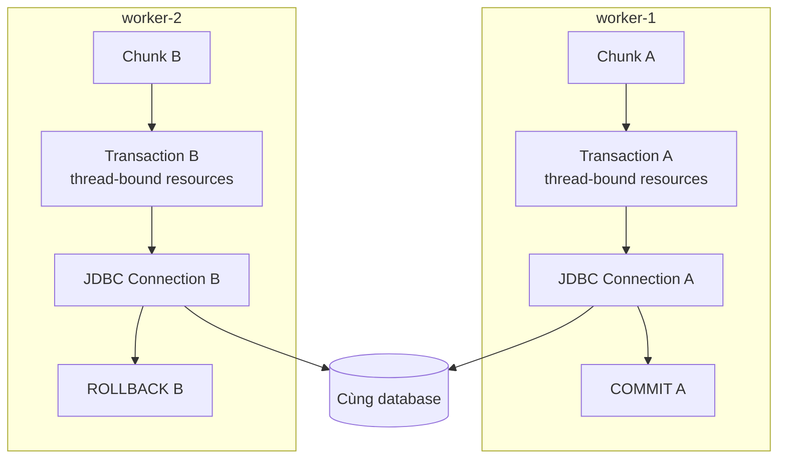
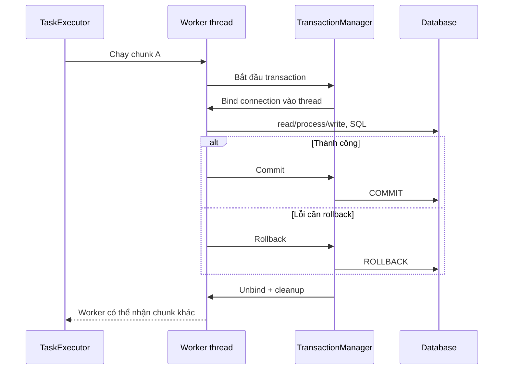
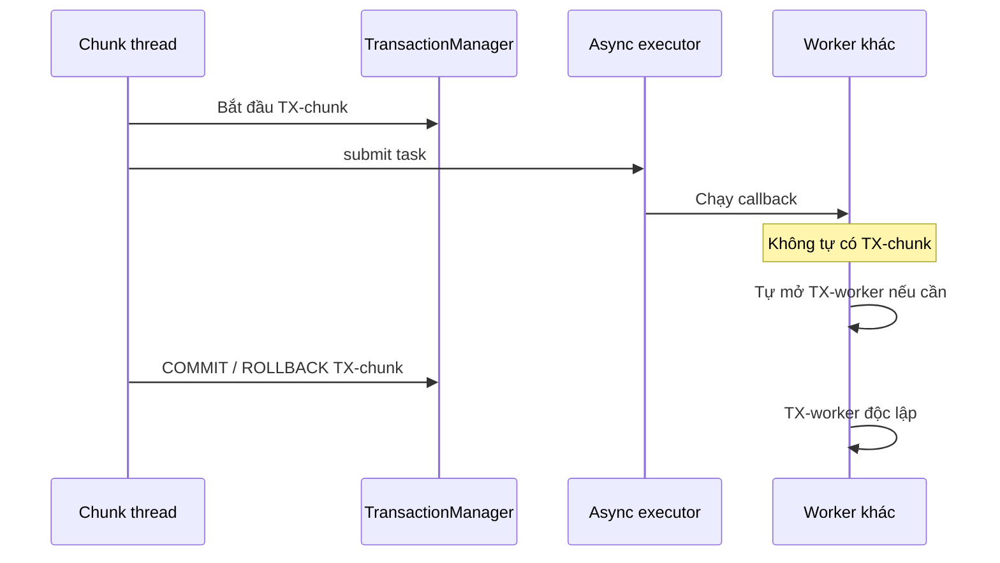
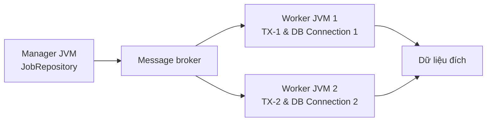

# Thread-bound transaction trong worker Spring Batch

> **Chương:** An toàn luồng  
> **Phạm vi:** Hiểu transaction gắn với thread đang thực thi, phân biệt transaction của chunk với những tác vụ async tự tạo, và thiết kế worker an toàn khi Spring Batch chạy multi-threaded step, parallel steps, partitioning hoặc phân tán. Ví dụ dùng mô hình transaction imperative của Spring Framework và API Spring Batch **5.2.x**.

## 1. Bài toán: Có nhiều worker thì transaction thuộc về ai?

Giả sử job nhập đơn hàng có bốn worker thread cùng xử lý các chunk. Mỗi chunk đọc đơn hàng, chuyển đổi và ghi vào database. Trong lúc vận hành xảy ra ba sự kiện:

1. Worker A đã ghi xong chunk gồm 100 đơn hàng và commit.
2. Worker B gặp lỗi ghi, rollback chunk đang xử lý.
3. Worker C gọi thêm một tác vụ bất đồng bộ qua `TaskExecutor` để cập nhật bảng thống kê.

Hai câu hỏi cốt lõi là: **Rollback của B có hoàn tác phần A đã commit không?** Và **tác vụ async do C tạo có tham gia transaction đang mở ở C không?**

Câu trả lời thông thường là **không** cho cả hai. Spring quản lý transaction theo ranh giới thực thi, với tài nguyên JDBC/JPA thường được **gắn vào thread hiện tại**. Worker xử lý một chunk có transaction riêng. Khi C đưa công việc sang thread khác, transaction của C không tự đi theo.

Trong module `SPRING_BATCH_SCALING_OPERATIONS`, đây là điểm quyết định tính đúng đắn khi tăng concurrency: tăng thông lượng chỉ có ý nghĩa khi mỗi đơn vị công việc sở hữu transaction và state rõ ràng, còn retry/restart không sinh thiếu hoặc trùng dữ liệu.

## 2. Thread-bound transaction là gì?

Với **transaction imperative** của Spring Framework, `PlatformTransactionManager` quản lý vòng đời transaction. Những implementation phổ biến:

- `DataSourceTransactionManager`: quản lý JDBC `Connection` của `DataSource` trong một transaction.
- `JpaTransactionManager`: quản lý transaction JPA và `EntityManager` theo cấu hình, có thể tham gia JDBC khi tích hợp phù hợp.
- `JtaTransactionManager`: tích hợp với môi trường transaction coordinator, theo khả năng cấu hình của hạ tầng.

`TransactionSynchronizationManager` cung cấp trạng thái và các tài nguyên gắn với thread để tầng truy cập dữ liệu của Spring lấy đúng resource của transaction đang hoạt động. Nói cách khác, `@Transactional` không gắn “transaction vĩnh viễn” vào một đối tượng `StepExecution` hay một bean `ItemWriter`.



| Khái niệm | Phạm vi | Không nên suy diễn |
| --- | --- | --- |
| Worker thread | Thread thực thi một lượt công việc trong executor | Một thread không đồng nghĩa một JobExecution hoặc một transaction cho cả đời thread |
| Transaction | Ranh giới commit/rollback do transaction manager quản lý | Nhiều thread không tự dùng chung một transaction |
| `StepExecution` | Metadata của một lần chạy step | Cùng StepExecution không đồng nghĩa cùng transaction |
| Chunk | Nhóm item được xử lý và ghi theo quy tắc transaction của step | Chunk khác đã commit không bị rollback bởi chunk hiện tại |
| `ExecutionContext` | State lưu phục vụ restart của job/step | Không phải cơ chế truyền transaction hay khóa chống race |
| MDC/`ThreadLocal` tùy chỉnh | Ngữ cảnh log hoặc dữ liệu ứng dụng gắn với thread | Không thể thay thế cơ chế transaction của Spring |

**Giới hạn của khái niệm:** Bài này nói về mô hình imperative (JDBC/JPA) phổ biến trong Spring Batch. Transaction reactive sử dụng ngữ cảnh khác và không nên áp các giả định ThreadLocal của imperative vào Reactor.

## 3. Spring gắn và tháo transaction khỏi thread như thế nào?

Trong một transaction JDBC điển hình:

1. `PlatformTransactionManager` bắt đầu hoặc tham gia transaction tại điểm thực thi cần thiết.
2. Spring lấy `Connection` từ `DataSource`, đưa nó vào transaction và gắn resource với **thread hiện tại**.
3. Tầng JDBC dùng `JdbcTemplate`/`DataSourceUtils` để nhận connection có liên kết với transaction trên thread đó.
4. Nếu xử lý thành công, Spring commit; nếu lỗi yêu cầu rollback, Spring rollback theo quy tắc transaction.
5. Khi kết thúc, Spring dọn transaction synchronization và tháo tài nguyên gắn với thread. Connection được trả về pool khi phù hợp.



Về mặt triển khai, việc bind/unbind được transaction manager và hạ tầng Spring thực hiện. **Không gọi thủ công** `TransactionSynchronizationManager.bindResource(...)`, `unbindResource(...)` để “chép” connection sang một worker khác; điều đó phá vỡ ranh giới sở hữu resource, khả năng rollback và an toàn đa luồng.

**Cách tự kiểm tra ngữ cảnh:** `TransactionSynchronizationManager.isActualTransactionActive()` cho biết có transaction thực được đánh dấu hoạt động trên thread hiện tại hay không. Đây là **thông tin chẩn đoán**, không phải lời đảm bảo rằng mọi thao tác ngoài ứng dụng cùng tham gia transaction.

```java
import org.springframework.transaction.support.TransactionSynchronizationManager;

boolean active =
        TransactionSynchronizationManager.isActualTransactionActive();
String txName =
        TransactionSynchronizationManager.getCurrentTransactionName();

log.debug("thread={} txActive={} txName={}",
        Thread.currentThread().getName(), active, txName);
```

Đoạn code minh họa đặt trong reader, processor, writer hoặc tasklet khi cần điều tra. Nó giả định có biến `log` là SLF4J logger; `txName` có thể `null`. Không bật log từng item trong job dữ liệu rất lớn.

## 4. Transaction của chunk chạy trên worker nào?

Trong một **chunk-oriented step** tuần tự, Spring Batch thường mở transaction cho lượt xử lý chunk trên thread đang chạy step. Với **multi-threaded step** có `TaskExecutor`, lượt xử lý chunk được dispatch sang các worker và transaction tương ứng được mở trong **thread thực thi công việc ấy**.

```text
JobExecution 410
  StepExecution 917: importOrdersStep
    worker-1: chunk A → TX-A → COMMIT
    worker-2: chunk B → TX-B → ROLLBACK / retry
    worker-3: chunk C → TX-C → COMMIT
    worker-1: chunk D → TX-D → COMMIT
```

Trong ví dụ trên, **cả bốn chunk thuộc cùng `StepExecution 917`**, nhưng mỗi lần xử lý có ranh giới transaction riêng. `worker-1` nhận lại chunk D sau khi đã kết thúc chunk A; nó không mang theo transaction A.

Các chi tiết cần ghi nhớ:

- Một `StepExecution` có nhiều chunk transaction. Khóa của metadata `StepExecution` và khóa transaction là hai khái niệm khác nhau.
- Việc commit không bảo đảm theo thứ tự đã đọc. Một chunk xử lý nhanh có thể commit trước chunk bắt đầu sớm hơn.
- Nếu chunk B thất bại, các chunk đã commit không tự được hoàn tác. Cần tính đến side effect và restart.
- `ItemStream.open`/`close`, step listener và các callback khác **không phải lúc nào cũng nằm trong cùng transaction của từng chunk**. Không dùng kết quả kiểm tra transaction ở `beforeStep` để khẳng định trạng thái của writer trên worker.
- Tùy loại reader và cách dispatch, lời gọi `read()` có thể tranh chấp tài nguyên với worker khác. Việc transaction thuộc riêng worker **không chứng minh reader thread-safe**.

### Parallel steps và partitioning

Với `FlowBuilder.split(...)`, mỗi flow thực thi step theo đường đi riêng. Mỗi step có transaction của các chunk/tasklet do nó chạy; executor của split **không tạo một transaction chung bao trùm các flow**.

Với **local partitioning**, các worker partition có `StepExecution` và `ExecutionContext` riêng. Transaction của chunk vẫn được quản lý theo thread thực thi. Với **remote partitioning** hoặc **remote chunking**, các worker chạy ở tiến trình khác, nên không thể chia sẻ transaction JDBC gắn với thread ở manager JVM.

## 5. Ví dụ Spring Batch 5.2: Kiểm tra transaction tại writer

Ví dụ dưới đây minh họa một step chunk-oriented gắn `ThreadPoolTaskExecutor`. Reader và writer nghiệp vụ được inject từ cấu hình khác; chúng cần đáp ứng yêu cầu an toàn đồng thời. Processor giữ state cục bộ trong mỗi lần xử lý.

```java
package com.example.batch;

import java.util.Locale;
import org.slf4j.Logger;
import org.slf4j.LoggerFactory;
import org.springframework.batch.core.Step;
import org.springframework.batch.core.repository.JobRepository;
import org.springframework.batch.core.step.builder.StepBuilder;
import org.springframework.batch.item.ItemProcessor;
import org.springframework.batch.item.ItemReader;
import org.springframework.batch.item.ItemWriter;
import org.springframework.beans.factory.annotation.Qualifier;
import org.springframework.context.annotation.Bean;
import org.springframework.context.annotation.Configuration;
import org.springframework.scheduling.concurrent.ThreadPoolTaskExecutor;
import org.springframework.transaction.PlatformTransactionManager;
import org.springframework.transaction.support.TransactionSynchronizationManager;

@Configuration(proxyBeanMethods = false)
public class WorkerTransactionConfig {
    private static final Logger log =
            LoggerFactory.getLogger(WorkerTransactionConfig.class);

    public record OrderInput(long id, String email) {}
    public record OrderOutput(long id, String normalizedEmail) {}

    @Bean
    public ThreadPoolTaskExecutor chunkExecutor() {
        ThreadPoolTaskExecutor executor = new ThreadPoolTaskExecutor();
        executor.setCorePoolSize(4);
        executor.setMaxPoolSize(4);
        executor.setQueueCapacity(16);
        executor.setThreadNamePrefix("order-chunk-");
        return executor;
    }

    @Bean
    public Step importOrdersStep(
            JobRepository jobRepository,
            PlatformTransactionManager transactionManager,
            @Qualifier("orderReader") ItemReader<OrderInput> reader,
            @Qualifier("orderWriter") ItemWriter<OrderOutput> businessWriter,
            @Qualifier("chunkExecutor") ThreadPoolTaskExecutor executor) {

        ItemProcessor<OrderInput, OrderOutput> processor = item ->
                new OrderOutput(item.id(),
                        item.email().trim().toLowerCase(Locale.ROOT));

        ItemWriter<OrderOutput> diagnosticWriter = items -> {
            boolean active =
                    TransactionSynchronizationManager
                            .isActualTransactionActive();
            log.debug("writer thread={} txActive={} chunkSize={}",
                    Thread.currentThread().getName(),
                    active, items.size());

            // Delegation diễn ra trên cùng worker thread và trong
            // transaction của chunk, nếu writer dùng cùng hạ tầng TX.
            businessWriter.write(items);
        };

        return new StepBuilder("importOrdersStep", jobRepository)
                .<OrderInput, OrderOutput>chunk(100, transactionManager)
                .reader(reader)
                .processor(processor)
                .writer(diagnosticWriter)
                .taskExecutor(executor)
                .build();
    }
}
```

**Điểm cần hiểu khi triển khai:**

1. `chunk(100, transactionManager)` gắn transaction manager vào bước xử lý chunk; `.taskExecutor(executor)` cho phép các lượt xử lý chạy đồng thời trong step.
2. `diagnosticWriter` chỉ log trạng thái transaction của **worker đang gọi writer**, không đọc thread-local của thread chạy job.
3. Nếu `businessWriter` dùng `JdbcTemplate` trên `DataSource` được transaction manager quản lý, nó tham gia connection/transaction hiện tại theo cơ chế Spring. Nếu writer dùng data source hoặc transaction manager **khác**, không tự động được một transaction nguyên tử chung bảo vệ.
4. `OrderInput`/`OrderOutput` là immutable record, processor stateless. Reader và writer thực tế vẫn cần kiểm chứng thread safety trước khi bật concurrency.
5. Với Spring Batch 5.x, cơ chế throttle mặc định của step có thể giới hạn concurrency hiệu dụng (thường ở mức 4); chỉ tăng kích cỡ executor không bảo đảm tăng đồng thời. `throttleLimit` đã bị deprecated từ Spring Batch 5.0; khi cần giới hạn tùy chỉnh, xem cơ chế `RepeatOperations` và `stepOperations` của đúng phiên bản.

Đây là **mẫu cấu hình giải thích transaction**, không phải ứng dụng hoàn chỉnh: cần bean `orderReader`, `orderWriter`, `JobRepository`, `PlatformTransactionManager`, nguồn dữ liệu và job launcher tương ứng. Ví dụ không bảo đảm checkpoint/restart an toàn cho một reader stateful chia sẻ giữa các thread; hãy kiểm chứng hoặc chọn partitioning.

Nếu bật log chẩn đoán ở writer của một chunk, có thể nhận:

```text
DEBUG [order-chunk-1] writer thread=order-chunk-1 txActive=true chunkSize=100
DEBUG [order-chunk-2] writer thread=order-chunk-2 txActive=true chunkSize=100
DEBUG [order-chunk-3] writer thread=order-chunk-3 txActive=true chunkSize=100
```

Không suy ra rằng những dòng log có `txActive=true` nói lên transaction đã **commit thành công**; commit diễn ra sau khi quá trình ghi hoàn tất và toàn bộ callback transaction kết thúc.

## 6. Tạo async task từ một chunk: Không mang transaction sang thread mới

Một bẫy phổ biến là gọi `TaskExecutor.execute(...)`, `CompletableFuture.runAsync(...)` hoặc `@Async` **bên trong** processor/writer đang có transaction rồi tin rằng các tác vụ vừa tạo thuộc cùng transaction ấy.



Ví dụ **không bảo đảm tính nguyên tử**:

```java
// Chạy trong ItemWriter của một chunk đang có TX:
executor.execute(() -> statisticsRepository.incrementCounter(orderId));
// Chunk có thể commit hoặc rollback mà không chờ worker kia.
```

Tác vụ trong `executor` có thể chạy muộn hơn, thất bại sau khi chunk đã commit hoặc thành công dù chunk chính rollback. Nếu `statisticsRepository` dùng Spring Data, phương thức repository có thể mở transaction riêng theo cấu hình; đó **không phải TX-chunk**. Nếu callback tự dùng JDBC không qua transaction manager, hành vi commit phụ thuộc API và cấu hình connection.

**Không khắc phục bằng cách sao chép `TransactionSynchronizationManager` hoặc truyền trực tiếp JDBC `Connection`/`EntityManager` sang thread khác.** Cách đó có thể gây dùng chung connection không an toàn, trộn transaction và rò resource.

### Khi worker thực sự cần transaction riêng

Nếu tác vụ async độc lập là yêu cầu có chủ đích, hãy mở transaction **trong chính worker** và quản lý kết quả rõ ràng. Một cách tường minh là `TransactionTemplate`:

```java
import java.util.concurrent.CompletableFuture;
import java.util.concurrent.CompletionException;
import org.springframework.core.task.TaskExecutor;
import org.springframework.transaction.PlatformTransactionManager;
import org.springframework.transaction.support.TransactionTemplate;

public final class IndependentWriteService {

    private final TransactionTemplate txTemplate;
    private final TaskExecutor workerExecutor;
    private final RecordStore store;

    public IndependentWriteService(
            PlatformTransactionManager txManager,
            TaskExecutor workerExecutor,
            RecordStore store) {
        this.txTemplate = new TransactionTemplate(txManager);
        this.workerExecutor = workerExecutor;
        this.store = store;
    }

    // Gọi từ một boundary đã chấp nhận các worker transaction riêng.
    public void writeAndWait(long recordId) {
        CompletableFuture<Void> future = CompletableFuture.runAsync(
                () -> txTemplate.executeWithoutResult(status ->
                        store.saveIdempotently(recordId)),
                workerExecutor);

        // Exception được đưa về thread gọi; quyết định fail/retry
        // cần nằm ở boundary quản lý workflow.
        try {
            future.join();
        } catch (CompletionException failure) {
            throw new IllegalStateException(
                    "Independent worker transaction failed", failure);
        }
    }

    public interface RecordStore {
        void saveIdempotently(long recordId);
    }
}
```

Ví dụ này minh họa **transaction độc lập trên worker thread**. `RecordStore` và `TaskExecutor` là các dependency phải được cung cấp. Việc `join()` giúp quan sát lỗi và đợi task hoàn thành, nhưng **không biến hai transaction thành một transaction nguyên tử**. Nếu một transaction đã commit rồi transaction còn lại rollback, chương trình phải có chiến lược bù trừ hoặc xử lý lại.

Một phương án khác là gọi **public `@Transactional` method trên một Spring bean khác** từ worker. Invocation phải đi qua Spring proxy và transaction manager cấu hình đúng; gọi `this.someTransactionalMethod()` trong cùng object thường bỏ qua proxy transaction. Dù dùng annotation hay template, transaction vẫn bắt đầu trên thread thực thi phương thức.

**Đối với chunk-oriented step:** Không dùng mẫu fire-and-forget bên trong writer để bỏ qua cơ chế retry/commit của Spring Batch. Nếu cần ghi kết quả nhất quán với chunk, ưu tiên thực hiện ghi trong transaction chunk hiện tại. Nếu cần đẩy công việc ra hệ thống khác, đánh giá transactional outbox và worker tiêu thụ độc lập có idempotency.

## 7. Propagation: REQUIRED, REQUIRES_NEW và NESTED khi có worker

Thuộc tính `propagation` của `@Transactional` chỉ có ý nghĩa đối với **transaction được nhìn thấy tại thời điểm method được gọi trên thread đó**.

| Propagation | Cùng thread, đang có transaction | Thread async khác chưa có transaction |
| --- | --- | --- |
| `REQUIRED` | Tham gia transaction hiện tại nếu tương thích | Bắt đầu transaction mới |
| `REQUIRES_NEW` | Tạm đình chỉ transaction hiện tại rồi tạo transaction mới | Bắt đầu transaction mới |
| `SUPPORTS` | Tham gia nếu có | Không tự mở transaction |
| `MANDATORY` | Yêu cầu có transaction, nếu không sẽ lỗi | Thường lỗi vì không có transaction hiện tại |
| `NOT_SUPPORTED` | Chạy ngoài transaction, tạm đình chỉ transaction hiện tại | Chạy ngoài transaction |
| `NESTED` | Có thể tạo savepoint trong transaction hiện tại nếu transaction manager hỗ trợ | Thường hoạt động như mở transaction mới khi không có transaction hiện tại |

`REQUIRES_NEW` **không có nghĩa** “mở transaction trên thread khác”; vẫn chạy trên thread được gọi, nhưng sử dụng transaction độc lập. Khi gọi bên trong chunk, inner transaction có thể commit dù chunk outer rollback, dẫn đến dữ liệu không nhất quán nếu nghiệp vụ coi cả hai là một đơn vị.

Không giả định `NESTED` hoạt động với mọi loại transaction manager: nó phụ thuộc hỗ trợ savepoint và hạ tầng JDBC/JPA. Đối với job dữ liệu lớn, nested transaction không thay thế việc chia partition hoặc idempotency.

## 8. Thread safety của resource, reader, processor và writer

**Transaction-bound không đồng nghĩa thread-safe.** Có transaction riêng cho từng chunk vẫn có thể tạo race condition nếu component ứng dụng chia sẻ mutable state.

| Thành phần | Nguy cơ đa luồng | Cách quản lý |
| --- | --- | --- |
| JDBC connection | Connection không thiết kế để bị nhiều thread thao tác chung tùy tiện | Để Spring quản lý connection riêng theo transaction/thread; dùng `JdbcTemplate` và pool |
| `EntityManager` | Persistence context thường không thread-safe | Không lưu `EntityManager` hay managed entity để chia sẻ giữa worker |
| `FlatFileItemReader` hoặc cursor reader | Con trỏ đọc bị cập nhật đồng thời | Reader phù hợp concurrent use hoặc serialize `read()`; cân nhắc partitioning |
| Processor có mutable `ArrayList`/`HashMap` field | Bản ghi từ các chunk làm lẫn state | Processor stateless; biến cục bộ/immutable output; cấu trúc đồng bộ khi thật sự cần |
| Writer dùng buffer singleton | Các chunk đè buffer của nhau | Chọn writer hỗ trợ multi-threaded access, thiết kế buffer theo invocation |
| `ExecutionContext` chung của step | Checkpoint/counter bị cập nhật không nhất quán | Tránh tự sửa state chia sẻ ngoài hợp đồng; xác định chính sách restart |
| Pool connection và DB row lock | Hết connection, deadlock, lock wait | Giới hạn executor, transaction ngắn, partition theo khóa dữ liệu |
| `ThreadLocal` custom | Quên cleanup gây nhiễm state khi thread pool tái sử dụng | `try/finally` và `remove()` cho state ứng dụng |

**`@StepScope` không tự tạo bản sao bean theo từng thread.** Trong multi-threaded step, các worker thuộc cùng `StepExecution`, nên có thể truy cập cùng step-scoped component. Tương tự, `StepSynchronizationManager` quản lý ngữ cảnh step và **không phải** `TransactionSynchronizationManager`; có step context không có nghĩa có transaction hiện tại.

`@JobScope` với job thực thi multi-threaded hoặc partitioned đòi hỏi thận trọng: một số mô hình worker nằm ngoài thread mà job scope được thiết lập, và Spring Batch không khuyến nghị phụ thuộc job-scoped bean trong multi-threaded/partitioned step. Khi cần late binding, nên xác định rõ phạm vi step/partition và API tương ứng phiên bản.

### Trường hợp reader đã đồng bộ vẫn chưa đủ cho restart

`SynchronizedItemStreamReader` có thể serialize các lời gọi `read()` trên delegate, nhưng không khóa **toàn bộ chunk transaction**. Ví dụ chunk A đọc trước và chậm, chunk B đọc sau nhưng commit sớm; vị trí đã đọc và vị trí đã commit có thể không khớp khi job crash. Đồng bộ phương thức `read()` không chứng minh checkpoint chính xác cho multi-threaded step.

Nếu bắt buộc có khả năng resume chính xác sau lỗi, hãy thử kill/restart với dữ liệu thật. Với source có thể phân đoạn, **partitioning theo range hoặc key cố định** và reader riêng từng partition thường dễ lập luận hơn về checkpoint; vẫn cần writer idempotent và kiểm chứng thực nghiệm.

## 9. Rollback, retry, skip, restart và side effect

Khi một chunk gặp lỗi, cần phân biệt bốn lớp xử lý:

1. **Rollback:** Hủy những cập nhật thuộc transaction chưa commit của chunk gặp lỗi.
2. **Retry:** Thử lại thao tác phù hợp (ví dụ deadlock hoặc timeout tạm thời) theo policy/giới hạn; có thể dẫn đến gọi lại processor/writer.
3. **Skip:** Chấp nhận bỏ item thuộc loại lỗi đã khai báo và còn quota, sau đó tiếp tục. `skipLimit` không làm transaction xuyên qua nhiều chunk.
4. **Restart:** Chạy lại `JobInstance` thất bại từ metadata/checkpoint phù hợp. Các chunk đã commit không tự bị undo.

Ví dụ worker A gọi API ngoài DB thành công rồi writer ném lỗi khiến chunk rollback. Khi retry, API có thể bị gọi **lần thứ hai**, dù database có rollback hoàn toàn. Muốn an toàn, nên dùng khóa `idempotencyKey` hoặc transactional outbox.

| Sự kiện | Trong DB transaction của chunk | Bên ngoài DB transaction |
| --- | --- | --- |
| SQL thuộc cùng transaction manager | Commit/rollback theo chunk | Không áp dụng |
| HTTP request gửi sang service khác | Không được rollback bởi JDBC | Có thể đã tạo side effect vĩnh viễn |
| Ghi file hoặc message không transactional | Có thể phát sinh bản ghi trước khi chunk commit | Cần xử lý lặp/compensation |
| `REQUIRES_NEW` ghi audit trong chunk | Có transaction độc lập, có thể commit dù chunk rollback | Phải chấp nhận mất tính atomic với chunk chính |
| Tác vụ async có `TransactionTemplate` | Transaction của worker riêng | Commit/rollback độc lập với chunk cha |

Vì các chunk cùng step có thể commit lệch thứ tự, restart của multi-threaded step là rủi ro riêng. Thiết kế idempotent write, unique constraint và kiểm tra chênh lệch nguồn/đích là biện pháp thiết yếu; **không suy ra exactly-once** chỉ từ việc bật `@Transactional`.

## 10. Tài nguyên: Thread pool không được lớn hơn khả năng chịu tải

Mỗi worker có transaction dùng database có thể cần một connection trong khoảng thời gian transaction đó hoạt động. Vì vậy tăng số thread khiến:

- Nhu cầu connection và memory của pool tăng.
- Lock contention, deadlock và thời gian chờ ở database có thể tăng.
- Rollback giữ lock lâu hơn nếu transaction quá lớn hoặc xử lý chậm bên trong transaction.
- `JobRepository` cũng cần tài nguyên DB để lưu trạng thái; ứng dụng khác có thể dùng chung pool.
- Các job chạy đồng thời cộng dồn nhu cầu transaction, kể cả mỗi job riêng lẻ có vẻ đủ tài nguyên.

Ví dụ cấu hình **4 worker** nhưng chỉ có **3 connection** cho cả nghiệp vụ và metadata có thể khiến các chunk phải chờ connection, gây timeout. Ngược lại, cho pool 32 worker khi database đã bão hòa có thể làm job chậm hơn do tranh chấp.

Không có một công thức chung “pool DB = số worker + 1” phù hợp mọi kiến trúc: connection có thể được sử dụng bởi service khác, JobRepository có thể dùng data source khác và mỗi thao tác có thể mở transaction phụ. Cần đo **active, idle, pending, acquisition time, lock wait và timeout** trong điều kiện tải thực.

```text
Throughput = số item ghi thành công / thời gian chạy thực tế

Speedup = thời gian step tuần tự / thời gian step đa luồng

Thời gian thực = xử lý hữu ích + chờ DB/I/O + tranh chấp + rollback/retry
```

Tăng số worker chỉ có lợi khi phần công việc có thể song song hóa đủ lớn và tài nguyên downstream còn dư.

## 11. Quan sát transaction trên worker thread

Để xác định ranh giới thực thi, nên log có cấu trúc tại **worker thực sự ghi dữ liệu**:

- `jobExecutionId`, `stepExecutionId`, `stepName` của Spring Batch.
- Tên thread/worker và định danh partition nếu có.
- `txActive` (khi chẩn đoán), loại lỗi, số lần retry/rollback, thời gian chunk.
- Tổng `readCount`, `writeCount`, `skipCount`, `commitCount`, `rollbackCount` sau step.
- Số worker active, queue depth, DB pool pending, lock wait và SQL duration.

```text
INFO  [order-chunk-1] stepExecutionId=917 chunk=27 txActive=true  - write_start
INFO  [order-chunk-2] stepExecutionId=917 chunk=28 txActive=true  - write_start
WARN  [order-chunk-2] stepExecutionId=917 chunk=28 error=Deadlock - rollback
INFO  [order-chunk-1] stepExecutionId=917 chunk=27                  - committed
```

Các ID/chunk number ở đây minh họa dạng log mong muốn; **Spring Batch không tự cấp số thứ tự chunk toàn cục** theo cấu trúc này. Nếu cần `chunk` correlation ID, ứng dụng phải tự xây dựng nó và không dựa vào giá trị ấy để xác định thứ tự commit.

MDC (`Mapped Diagnostic Context`) cũng là dữ liệu theo thread. Khi log từ worker, hãy gắn MDC ở ranh giới worker hoặc chunk và dọn bằng `finally`. Chuyển MDC qua `TaskDecorator` chỉ giúp **log correlation**, không sao chép transaction hoặc persistence context.

Với metric Prometheus/Micrometer, không đưa `stepExecutionId` hoặc `jobExecutionId` vào tag động cho mọi time series vì gây **high cardinality**. Giữ các ID này trong log/traces, metric dùng tag ổn định như job name, step name, status.

## 12. Khi mở rộng sang worker phân tán

Khi bước từ cùng JVM sang remote partitioning hoặc remote chunking, transaction còn có ranh giới **tiến trình/máy**:



Không thể “gửi” transaction JDBC gắn với thread của manager qua message broker cho remote worker. Mỗi worker cần transaction manager/resource của mình và hợp đồng hoàn thành công việc. Tùy middleware và cấu hình, message có thể giao lại khi worker chết hoặc chưa ack; vì vậy thiết kế deduplication/idempotency và quan sát trạng thái là yêu cầu thực tế.

Các trường correlation nên theo worker: `jobExecutionId`, `stepExecutionId` hoặc partition key phù hợp, message ID, business key. Đừng dùng correlation ID như bằng chứng giao dịch đã commit. Việc cần một distributed transaction/XA là quyết định kiến trúc phức tạp với coordinator riêng, **không phát sinh tự động** khi bật `TaskExecutor` hoặc Spring Batch partitioning.

## 13. Lỗi thường gặp và cách khắc phục

| Triệu chứng | Nguyên nhân thường gặp | Hướng xử lý |
| --- | --- | --- |
| Worker async báo `txActive=false` | Task được gửi sang thread mới, transaction cha không đi theo | Tạo transaction trên worker nếu nghiệp vụ cần; không copy ThreadLocal |
| SQL ở writer được commit dù chunk cha rollback | Writer dùng data source/transaction manager khác, `REQUIRES_NEW` hoặc async | Đồng nhất transaction manager và datasource; xem lại propagation/async boundary |
| Method `@Transactional` không mở transaction như mong đợi | Gọi nội bộ `this.method()` bỏ qua proxy, hoặc method không được proxy | Gọi qua Spring-managed bean/proxy đúng cách hoặc dùng `TransactionTemplate` |
| Database pool cạn khi tăng concurrency | Mỗi worker dùng connection, kèm metadata/transaction phụ | Đo pool pending, giảm concurrency hoặc cấp tài nguyên hợp lý |
| Log step giống nhau trên nhiều thread | Các chunk cùng một `StepExecution` | Hành vi bình thường; thêm thread, chunk correlation để điều tra |
| Restart sinh duplicate/missing records | Checkpoint của reader chung không tương ứng commit lệch thứ tự | Kiểm tra ID nguồn/đích, idempotent write hoặc chuyển sang partitioning |
| Side effect HTTP bị nhân đôi sau retry | HTTP call không thuộc transaction JDBC | Idempotency key, outbox, deduplication |
| Transaction kéo dài đến lúc worker pool nhàn | Code giữ transaction khi chờ async hoặc I/O không cần thiết | Rút ngắn transaction, tránh chờ tác vụ khác trong transaction |
| Thread pool rò state của request/step cũ | Tự đặt ThreadLocal/MDC mà không dọn | Dọn trong `finally`; để Spring tự quản transaction resources |

## 14. Bài thực hành và tiêu chí kiểm chứng

**Bài 1 — Transaction trong chunk.** Tạo step với `chunk(50)` và pool 4 worker; log `Thread.currentThread().getName()` cùng `TransactionSynchronizationManager.isActualTransactionActive()` ngay trong writer. Xác nhận nhiều worker xử lý chunk với transaction active và nhiều chunk thuộc cùng `StepExecution`.

**Bài 2 — Chứng minh không tự truyền transaction.** Trong một chunk, submit callback sang executor khác; log `isActualTransactionActive()` ở hai thread. Sau đó dùng `TransactionTemplate` hoặc proxied `@Transactional` trên worker; xác nhận worker có transaction riêng. Dùng `CompletableFuture.join()` để kiểm tra lỗi được phản ánh, nhưng không coi hai transaction là nguyên tử.

**Bài 3 — Rollback độc lập.** Cho chunk A ghi thành công, chunk B cố ý ném `RuntimeException` trong writer. Xem dữ liệu đã commit của A, metadata `rollbackCount` và trạng thái step. Tránh khẳng định A và B nhận các dải item cố định nếu reader chia sẻ con trỏ.

**Bài 4 — Test restart.** Tạo lỗi khi job đang có nhiều chunk in-flight; restart đúng JobInstance. So sánh **tập business key** của input và output: item thiếu, trùng, commit sai thứ tự và side effect lặp. Nếu không bảo đảm được, thử thiết kế partition theo range cố định.

**Bài 5 — Kiểm tra tài nguyên.** Chạy 1, 2, 4 và 8 worker (tùy throttle thực tế) trên cùng dữ liệu; đo throughput, DB connection pool pending, lock wait, retry, rollback, thời gian chạy. Dừng tăng concurrency khi số liệu cho thấy contention lớn hơn lợi ích.

**Câu hỏi tự kiểm tra:**

- Vì sao cùng `StepExecution` vẫn có nhiều transaction đồng thời?
- `@Transactional(REQUIRED)` trên một worker mới có tham gia transaction của chunk cha không?
- `REQUIRES_NEW` khác việc submit async task ở đâu?
- Khi nào `SynchronizedItemStreamReader` chưa đủ cho yêu cầu restart?
- Vì sao MDC và transaction đều dùng ngữ cảnh theo thread nhưng **không thể thay thế nhau**?
- Khi nào cần partitioning hoặc outbox để giữ tính đúng đắn?

## 15. Tài liệu tham khảo

- [Spring Framework — TransactionSynchronizationManager](https://docs.spring.io/spring-framework/docs/current/javadoc-api/org/springframework/transaction/support/TransactionSynchronizationManager.html)
- [Spring Framework — Understanding the Spring Framework's Declarative Transaction Implementation](https://docs.spring.io/spring-framework/reference/data-access/transaction/declarative/tx-decl-explained.html)
- [Spring Framework — Transaction Propagation](https://docs.spring.io/spring-framework/reference/data-access/transaction/declarative/tx-propagation.html)
- [Spring Framework — TransactionTemplate](https://docs.spring.io/spring-framework/reference/data-access/transaction/programmatic.html)
- [Spring Batch 5.2 — Scaling and Parallel Processing](https://docs.spring.io/spring-batch/reference/5.2/scalability.html)
- [Spring Batch 5.2 — Chunk-oriented Processing](https://docs.spring.io/spring-batch/reference/5.2/step/chunk-oriented-processing.html)
- [Spring Batch 5.2 — Restarting a Step](https://docs.spring.io/spring-batch/reference/5.2/step/chunk-oriented-processing/restart.html)

> **Lưu ý về phiên bản và triển khai:** Ví dụ hướng đến Spring Batch **5.2.x** và Spring transaction imperative; package, API cấu hình concurrency và cách tích hợp observability có thể đổi theo Spring Batch 6 hoặc transaction manager thực tế. Đây là nội dung kiến thức và mẫu thiết kế, chưa thay thế việc kiểm thử với reader, writer và database của dự án.

**Ghi nhớ:** Transaction của Spring Batch được quản lý ở **thread thực thi công việc**, theo ranh giới chunk/tasklet và transaction manager cụ thể. Worker mới không tự thừa hưởng transaction của thread gọi; mỗi chunk có thể commit/rollback độc lập. Mở rộng an toàn đòi hỏi kiểm soát resource, propagation, thread safety, idempotency và khả năng restart dựa trên dữ liệu thực.
