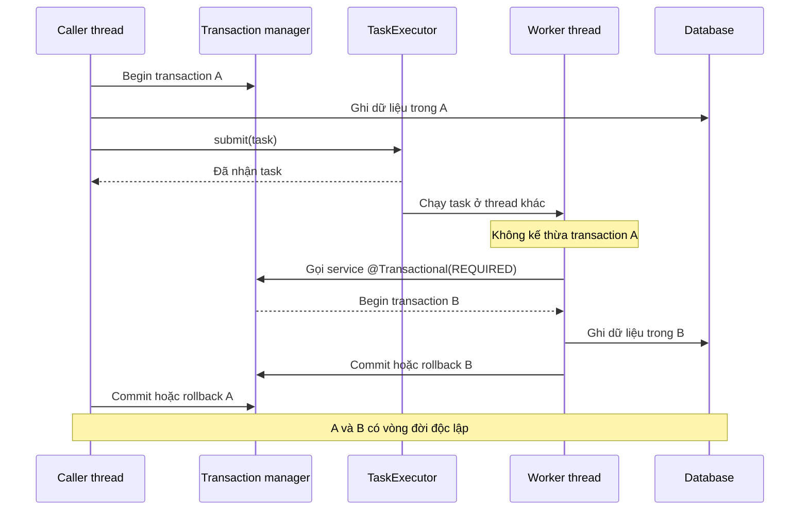
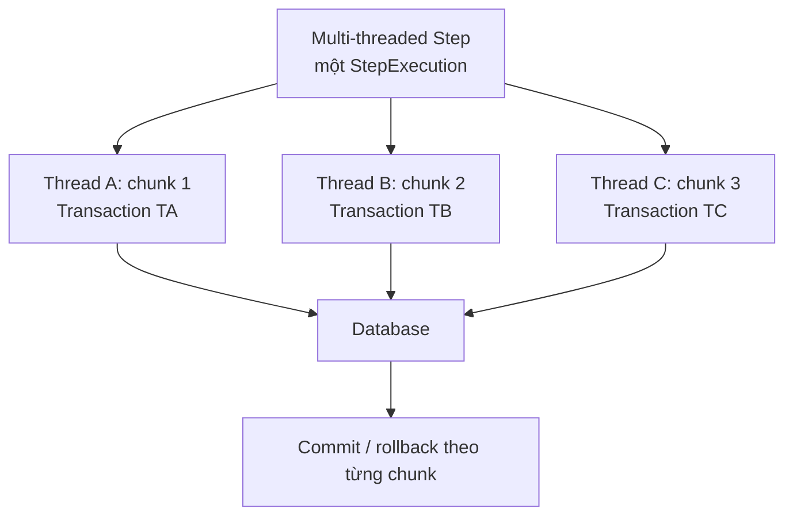
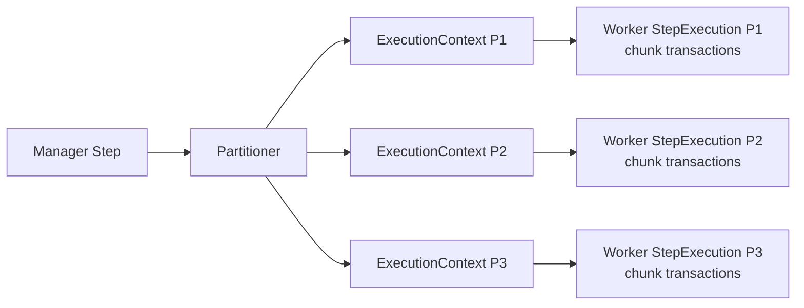

# Propagation transaction trên worker thread trong Spring Batch

Khi mở rộng Spring Batch bằng multi-threaded step, parallel steps, partitioning hoặc worker phân tán, câu hỏi quan trọng là: **transaction đang chạy ở thread nào, ai tạo transaction đó và thao tác nào thực sự nằm trong phạm vi commit/rollback của nó?**

Một nhầm lẫn dễ gây mất dữ liệu là cho rằng transaction của thread tạo tác vụ sẽ tự đi theo tác vụ sang thread của `TaskExecutor`, `@Async` hay `CompletableFuture`. Với cơ chế transaction imperative phổ biến của Spring (dựa trên `PlatformTransactionManager` và `ThreadLocal`), điều đó **không tự xảy ra**. Mỗi worker cần transaction được thiết lập đúng tại **thread đang thực thi công việc**. Các giá trị `Propagation.REQUIRED`, `REQUIRES_NEW`, `MANDATORY`... được xét **trên transaction hiện có ở thread gọi phương thức**, không phải transaction đang tồn tại ở một thread khác.

Bài học thuộc chương **An toàn luồng** của module **SPRING_BATCH_SCALING_OPERATIONS**, phục vụ mục tiêu mở rộng workload dữ liệu lớn nhưng vẫn bảo đảm thread safety, retry/restart, tính đúng đắn nghiệp vụ và khả năng vận hành. Sau khi học, bạn cần phân biệt được ranh giới transaction giữa các thread, cấu hình worker phù hợp, phát hiện giao dịch không tham gia cùng commit và kiểm chứng bằng thử nghiệm lỗi thực tế.

## 1. Transaction context được gắn với thread như thế nào?

Trong cách lập trình transaction imperative của Spring, `TransactionSynchronizationManager` dùng trạng thái gắn với thread để quản lý các thông tin như tài nguyên đã bind, synchronization và một số thuộc tính của transaction. Khi một lời gọi đi qua Spring transaction interceptor:

1. Interceptor chọn transaction manager và đọc chính sách `@Transactional`/`TransactionAttribute`.
2. Spring xem **thread hiện tại** đang có transaction phù hợp hay không.
3. Nếu cần, transaction manager mở transaction, bind tài nguyên vào context của thread.
4. Code nghiệp vụ thực thi trên thread đó, các thao tác tương thích có thể tham gia transaction.
5. Khi lời gọi kết thúc, interceptor/transaction manager xử lý commit hoặc rollback theo kết quả và quy tắc, rồi dọn context đã bind.

Điều này áp dụng cho giao dịch imperative tiêu chuẩn. **Reactive transaction** dùng `ReactiveTransactionManager` và ngữ cảnh reactive (Reactor Context) theo cơ chế khác; không được lấy giả định về `ThreadLocal` của imperative để suy thẳng sang luồng Reactor.

### Sơ đồ: caller transaction không tự truyền sang worker



Transaction **A** và **B** trong ví dụ không tạo thành một transaction nguyên tử chung. Transaction A có thể rollback trong khi B đã commit, hoặc B có thể rollback trong khi A commit. Sự trùng nhau về thời gian, tên method, trace ID hay `JobExecutionId` không thay đổi quy tắc đó.

**Phân biệt hai câu sau:**

- “Worker không kế thừa transaction của caller” là đúng đối với transaction imperative Spring thông thường.
- “Worker luôn chạy không có transaction” là **sai**: Spring Batch có thể tạo transaction chunk ngay trên worker thread, hoặc một service được gọi qua Spring AOP có thể mở transaction riêng tại worker.

## 2. Điều gì thật sự được truyền qua TaskExecutor?

`TaskExecutor`, `ExecutorService`, `CompletableFuture.runAsync(...)` và `@Async` chủ yếu quyết định **nơi và lúc tác vụ được chạy**. Chúng không mặc định chuyển toàn bộ trạng thái thread-bound từ thread nguồn sang worker.

| Thành phần/ngữ cảnh | Có tự truyền transaction imperative không? | Ghi chú |
| --- | --- | --- |
| `TaskExecutor.execute(runnable)` | **Không** | Runnable chạy trong thread được executor chọn; transaction của caller không được chuyển theo |
| `ExecutorService.submit(callable)` | **Không** | `Future` hỗ trợ nhận kết quả/lỗi, không mang theo JDBC transaction |
| `CompletableFuture.supplyAsync(...)` | **Không** | Có thể dùng common pool hoặc executor chỉ định; propagation giống về ranh giới thread |
| `@Async` | **Không** | Method chạy ở executor; `@Transactional` đúng cách có thể tạo transaction ở thread đó |
| `@StepScope` | **Không phải cơ chế truyền transaction** | Scope theo `StepExecution`, không cung cấp một transaction chung cho các thread |
| `TaskDecorator` sao chép MDC/tracing context | **Không** | Context quan sát có thể truyền theo, nhưng transaction/resource không tự tham gia |
| Worker Step trong partitioning | Có transaction riêng khi Step chunk được cấu hình đúng | Spring Batch thiết lập transaction tại nơi worker thực thi chunk |
| Remote worker ở JVM khác | **Không** | Không thể mang trực tiếp một JDBC transaction local qua message broker như biến Java |

Dù một thư viện dùng `InheritableThreadLocal` cho thông tin phụ, không vì vậy mà JDBC connection hoặc transaction Spring trở thành đối tượng có thể chuyển quyền sở hữu sang thread pool. **Không tự sao chép** `TransactionSynchronizationManager`, `ConnectionHolder` hay `EntityManager` bằng `TaskDecorator` hoặc phản chiếu trạng thái nội bộ để “giữ transaction”. Các resource này có ràng buộc về thread, lifecycle và tính nhất quán không được giải quyết bằng cách copy context.

Khi cần lưu correlation ID, tenant ID hay trace ID, có thể truyền dưới dạng dữ liệu bất biến hoặc context propagation được thư viện hỗ trợ. Nhưng **correlation context và transaction context là hai khái niệm khác nhau**.

## 3. Ý nghĩa của Transaction Propagation trên worker thread

`Propagation` trả lời câu hỏi “lời gọi method này sẽ dùng transaction nào?” **tại thời điểm interceptor chạy trong thread hiện tại**. Nếu caller có transaction nhưng worker không có, transaction của caller **không** được xem là “existing transaction” của worker.

### 3.1. Khi worker bắt đầu không có transaction

| Propagation | Hành vi trên worker | Điều cần chú ý |
| --- | --- | --- |
| `REQUIRED` | Tạo transaction mới | Trường hợp phổ biến khi method worker được gọi qua Spring proxy |
| `REQUIRES_NEW` | Tạo transaction mới | Không có transaction hiện hữu để suspend; kết quả ban đầu gần giống REQUIRED |
| `SUPPORTS` | Chạy không có transaction thực tế | Có thể vẫn có synchronization tùy cấu hình manager; không coi là commit/rollback bảo vệ DB |
| `MANDATORY` | Ném lỗi vì không có transaction hiện hữu | Hay giúp phát hiện worker được gọi sai ranh giới |
| `NOT_SUPPORTED` | Chạy không có transaction thực tế | Không có transaction nào để suspend |
| `NEVER` | Chạy không có transaction thực tế | Không lỗi nếu thực sự không có transaction |
| `NESTED` | Có thể khởi tạo transaction mới khi chưa có transaction hiện hữu | Hỗ trợ tùy transaction manager/resource; không mặc định có nested savepoint |

### 3.2. Khi worker đã có transaction (ví dụ chunk transaction)

| Propagation | Hành vi tương đối với transaction đang có trên **worker** | Lưu ý |
| --- | --- | --- |
| `REQUIRED` | Tham gia transaction hiện có | Exception hoặc rollback-only có thể khiến transaction chunk rollback |
| `REQUIRES_NEW` | Suspend transaction đang có và mở transaction độc lập | Transaction riêng có thể commit dù chunk ngoài rollback; có thể cần thêm connection |
| `SUPPORTS` | Tham gia transaction hiện có | Không mở transaction độc lập |
| `MANDATORY` | Tham gia transaction hiện có | Nếu giao dịch không tồn tại sẽ fail sớm |
| `NOT_SUPPORTED` | Tạm ngưng transaction hiện có rồi chạy không có transaction thực tế | Side effect trong đoạn này không rollback theo chunk |
| `NEVER` | Ném lỗi vì transaction hiện hữu | Cố ý cấm code chạy trong transaction |
| `NESTED` | Dùng nested scope/savepoint nếu transaction manager hỗ trợ | Không phải transaction riêng trên resource khác; hỗ trợ phụ thuộc cấu hình |

**Không đồng nhất `REQUIRES_NEW` với “lan truyền transaction sang thread khác”.** `REQUIRES_NEW` luôn tạo một transaction **mới tại nơi method được gọi**. Nếu worker đã có chunk transaction thì đó là transaction mới ở worker, còn transaction chunk bị suspend theo cơ chế manager. Nếu worker chưa có transaction thì nó vẫn chỉ tạo transaction tại worker, không biết transaction của caller.

Với `DataSourceTransactionManager` và JDBC, `NESTED` thường dựa trên savepoint khi có transaction hiện tại và driver hỗ trợ. Với JPA và các transaction manager khác, hợp đồng hỗ trợ có thể khác. Hãy xác minh manager thực dùng thay vì giả định mọi propagation đều được hỗ trợ tương đương.

### 3.3. Những điều kiện để annotation hoạt động

`@Transactional` thường được áp dụng qua **Spring AOP proxy**. Các lỗi thường gặp:

- Method được gọi trực tiếp trên đối tượng tự tạo bằng `new`, không qua Spring container.
- Tự gọi method cùng bean (`this.doWork()`), khiến interception qua proxy không xảy ra trong chế độ proxy thông thường.
- Chú thích trên method nhưng thực thi qua đường gọi không được proxy hỗ trợ.
- Dùng transaction manager không quản lý datasource/resource cần commit.
- Dùng `@Async` nhưng không bật hoặc không đi qua cơ chế proxy async thực tế.

Do đó, chỉ nhìn thấy annotation trong source code **chưa đủ** để kết luận transaction đã được mở.

## 4. Ví dụ Java: transaction mới bên trong worker

Ví dụ Spring Framework/Spring Batch 5+ theo mô hình imperative. Một service là bean Spring thực hiện thao tác DB, còn dispatcher gửi việc qua executor. Lưu ý việc submit không bao hàm giao dịch của caller.

```java
import java.util.concurrent.CompletableFuture;
import java.util.concurrent.Executor;

import org.springframework.stereotype.Service;
import org.springframework.transaction.annotation.Propagation;
import org.springframework.transaction.annotation.Transactional;
import org.springframework.transaction.support.TransactionSynchronizationManager;

@Service
public class OrderWorkerService {
    private final OrderRepository repository;

    public OrderWorkerService(OrderRepository repository) {
        this.repository = repository;
    }

    @Transactional(propagation = Propagation.REQUIRED)
    public void processOne(long orderId) {
        // Method được gọi qua Spring proxy trên worker thread.
        if (!TransactionSynchronizationManager
                .isActualTransactionActive()) {
            throw new IllegalStateException("Missing worker transaction");
        }
        repository.markProcessed(orderId);
    }
}

@Service
public class OrderDispatcher {
    private final OrderWorkerService workerService;
    private final Executor batchWorkerExecutor;

    public OrderDispatcher(
            OrderWorkerService workerService, Executor batchWorkerExecutor) {
        this.workerService = workerService;
        this.batchWorkerExecutor = batchWorkerExecutor;
    }

    public CompletableFuture<Void> dispatch(long orderId) {
        return CompletableFuture.runAsync(
                () -> workerService.processOne(orderId),
                batchWorkerExecutor
        );
    }
}
```

`OrderRepository` và bean `batchWorkerExecutor` là các dependency do ứng dụng cấu hình. `processOne` được gọi **qua bean Spring** trong worker, vì vậy transaction interceptor có cơ hội mở transaction mới tại worker. `CompletableFuture` chỉ giúp nhận trạng thái hoàn tất/lỗi; nó không khiến transaction của thread gọi `dispatch` chuyển sang worker.

**Giới hạn quan trọng:** Không gọi `dispatch` từ bên trong một transaction vừa thêm dữ liệu mà worker cần đọc ngay. Worker có thể chạy **trước khi transaction caller commit** và không thấy dữ liệu mới, hoặc thấy trạng thái không đúng kỳ vọng tùy isolation. Nếu việc phải bắt đầu sau commit, dùng quy trình điều phối sau commit hoặc bảng outbox/task bền vững, tùy độ tin cậy cần thiết.

Cũng không nên chặn thread caller bằng `join()` khi đang giữ connection/lock mà worker cần, vì có thể tạo deadlock ở tầng ứng dụng hoặc pool. Quản lý completion, timeout và lỗi phải được thiết kế riêng.

## 5. Ví dụ đối chiếu: @Async không tự giữ transaction caller

`@Async` có thể được dùng để chạy method trên executor do Spring quản lý. Cách diễn giải an toàn nhất là tách **điều phối bất đồng bộ** và **service có transaction** thành hai bean:

```java
import java.util.concurrent.CompletableFuture;

import org.springframework.scheduling.annotation.Async;
import org.springframework.stereotype.Service;

@Service
public class AsyncOrderGateway {
    private final OrderWorkerService workerService;

    public AsyncOrderGateway(OrderWorkerService workerService) {
        this.workerService = workerService;
    }

    @Async("batchWorkerExecutor")
    public CompletableFuture<Void> processAsync(long orderId) {
        workerService.processOne(orderId);
        return CompletableFuture.completedFuture(null);
    }
}
```

Ứng dụng phải bật hỗ trợ async (`@EnableAsync` hoặc cấu hình tương đương) và có executor mang tên `batchWorkerExecutor`. Lời gọi `AsyncOrderGateway.processAsync(...)` phải đi qua Spring proxy.

Diễn biến:

1. Caller gọi proxy của `processAsync` và nhận `CompletableFuture`.
2. Method `processAsync` chạy trong worker thread.
3. Worker gọi proxy `OrderWorkerService.processOne`.
4. `@Transactional(REQUIRED)` tạo transaction mới tại worker nếu chưa có transaction ở đó.
5. Transaction worker commit/rollback độc lập, sau đó future hoàn tất hoặc chứa lỗi.

Đặt `@Async` và `@Transactional` trên cùng method có thể hợp lệ trong một số cách cấu hình, nhưng việc tách thành hai bean làm ranh giới rõ hơn và tránh dựa vào giả định về thứ tự interceptor. Nếu caller bỏ qua `CompletableFuture` hoặc không quan sát lỗi, job có thể báo thành công ở luồng điều phối trong khi task bất đồng bộ đã thất bại. **Đã submit không có nghĩa đã xử lý xong.**

### Ví dụ rủi ro từ transaction của caller

```java
@Transactional
public CompletableFuture<Void> createThenDispatch(Order order) {
    repository.save(order);           // Chưa chắc đã commit.
    return asyncGateway.processAsync(order.getId());
}
```

Worker có thể đọc dữ liệu trước khi caller commit. Nếu caller rollback sau khi worker đã ghi DB hoặc gọi API, ta có side effect không nhất quán. Đây là **ví dụ cần tránh** khi công việc worker phụ thuộc kết quả giao dịch của caller.

Với tác vụ bắt buộc được thực hiện một lần về mặt nghiệp vụ, cách phổ biến là ghi `order` và một record **outbox/task** trong cùng transaction DB. Dispatcher nền lấy record đã commit, thực thi qua worker, đánh dấu trạng thái và cho phép retry với khóa idempotency.

## 6. Transaction của chunk được tạo tại thread thực thi Step

Trong Spring Batch chunk-oriented Step, framework sử dụng `PlatformTransactionManager` cấu hình cho Step để điều khiển transaction của **mỗi chunk**. Khi một chunk chạy trên worker thread, transaction của chunk được mở và đóng **trên thread đó**. Các callback reader/processor/writer thuộc chu trình chunk bình thường được gọi trong ngữ cảnh transaction phù hợp của chunk.



Các transaction `TA`, `TB` và `TC` **không phải cùng một transaction được chia sẻ qua ba thread**. Mỗi chunk có thể commit hoặc rollback ở thời điểm khác nhau. Một chunk thất bại không tự rollback các chunk khác đã commit.

Đối với processor gọi một service được `@Transactional(REQUIRED)`, method thường tham gia **transaction chunk đang hoạt động trên worker thread**, với điều kiện lời gọi đi qua proxy và dùng đúng manager/resource. Nếu method dùng `REQUIRES_NEW`, nó tạo giao dịch độc lập có thể commit trước khi chunk ngoài commit. Vì thế, lạm dụng `REQUIRES_NEW` cho mỗi item vừa tăng overhead vừa có thể phá yêu cầu rollback nguyên chunk.

### Ví dụ cấu hình Step có TaskExecutor

```java
import org.springframework.batch.core.Step;
import org.springframework.batch.core.repository.JobRepository;
import org.springframework.batch.core.step.builder.StepBuilder;
import org.springframework.batch.item.ItemProcessor;
import org.springframework.batch.item.ItemReader;
import org.springframework.batch.item.ItemWriter;
import org.springframework.context.annotation.Bean;
import org.springframework.core.task.TaskExecutor;
import org.springframework.transaction.PlatformTransactionManager;

@Bean
public Step concurrentOrderStep(
        JobRepository jobRepository,
        PlatformTransactionManager transactionManager,
        ItemReader<InputOrder> orderReader,
        ItemProcessor<InputOrder, OutputOrder> orderProcessor,
        ItemWriter<OutputOrder> orderWriter,
        TaskExecutor batchWorkerExecutor) {

    return new StepBuilder("concurrentOrderStep", jobRepository)
            .<InputOrder, OutputOrder>chunk(200, transactionManager)
            .reader(orderReader)
            .processor(orderProcessor)
            .writer(orderWriter)
            .taskExecutor(batchWorkerExecutor)
            .build();
}
```

Đây là **đoạn cấu hình minh họa Spring Batch 5.x**; `InputOrder`, `OutputOrder`, reader, writer và executor cần được định nghĩa phù hợp trong dự án. Đừng bật đa luồng với một `ItemReader` có cursor, offset hoặc state mutable khi chưa xác minh contract thread safety và khả năng restart. `@StepScope` cung cấp một instance theo **StepExecution**, không phải mỗi thread; nhiều thread trong multi-threaded Step có thể vẫn dùng cùng reader/processor.

Trong các phiên bản khác nhau, API throttle/giới hạn đồng thời của Step có thể thay đổi. Đừng coi `taskExecutor(...)` là đủ để kiểm soát backlog; cần biết mức đồng thời, queue capacity, datasource pool và các giới hạn vận hành của Step thật.

### Callback processor có tự mở transaction riêng không?

**Không mặc định.** Trong chunk-oriented Step thông thường, processor chạy dưới transaction chunk, và một chunk chứa nhiều lời gọi `process(item)`. Tức là `process()` **không tạo một commit riêng cho mỗi item**. Việc một service bên dưới có `@Transactional` và propagation đặc biệt là một quyết định khác cần kiểm tra tường minh.

Một transaction quản lý DB cũng **không** làm HTTP, file write hoặc broker send trong processor trở nên atomic. Khi chunk rollback, các side effect ngoài DB có thể đã xảy ra.

## 7. Nên ưu tiên partitioning khi state của reader không an toàn

Multi-threaded step có thể khiến nhiều chunk của **cùng StepExecution** chia sẻ reader và checkpoint. Nếu một reader mutable không hỗ trợ gọi `read()` đồng thời, có nguy cơ đọc trùng, thiếu hoặc ghi sai vị trí khi rollback/restart. Bọc `read()` bằng khóa chỉ giải quyết một phần tranh chấp; thứ tự commit chunk có thể khác thứ tự đọc.

**Local partitioning** có cấu trúc khác:

- Manager Step tạo partition và một `ExecutionContext` riêng cho từng partition.
- Mỗi worker partition có **StepExecution riêng** và có thể nhận reader `@StepScope` riêng.
- Mỗi worker chunk có transaction của riêng mình trên thread đang chạy.
- Transaction giữa hai partition không được gộp thành một transaction toàn cục.



Trong ví dụ chia dữ liệu theo `bucketId`, mỗi worker có thể dùng `@StepScope` để đọc `stepExecutionContext['bucketId']`, lấy đúng các bản ghi của bucket. **Tính đúng đắn** còn yêu cầu partition không chồng lấn, snapshot dữ liệu ổn định và tên partition giữ nguyên khi restart.

Với **parallel steps**, các StepExecution cũng có transaction riêng theo từng chunk/Step. Các Step có thể chia sẻ service singleton, DB pool hoặc bảng đích: cần audit những tài nguyên này dù mỗi Step có transaction độc lập.

## 8. Remote worker: transaction local dừng tại biên process

Khi chuyển sang **remote partitioning** hoặc **remote chunking**, transaction local của manager không tự đi qua broker và network đến worker ở JVM khác. Thay vào đó, worker dùng transaction manager của môi trường chạy mình.

| Giai đoạn | Phạm vi transaction thường gặp | Nguy cơ |
| --- | --- | --- |
| Manager tạo/lưu metadata partition | Transaction của JobRepository/manager | Metadata lưu xong chưa chứng minh worker đã xử lý |
| Manager gửi message | Transaction của broker hoặc thao tác gửi riêng | Gửi message có thể thành công khi transaction DB khác rollback |
| Worker nhận message | Transaction/acknowledgement theo cấu hình consumer/broker | Message có thể redeliver |
| Worker xử lý chunk và ghi DB | Transaction local của worker | Worker commit DB nhưng chưa ack có thể khiến chunk được giao lại |
| Manager tổng hợp trạng thái | Transaction cập nhật JobRepository | Kết quả phản ánh thông tin worker gửi về, không phải distributed commit nguyên tử |

**At-least-once delivery** là tình huống cần chuẩn bị khi dùng nhiều hệ thống: cùng message/partition có thể được xử lý lại sau timeout, worker crash hoặc mất ack. Không giả định exactly-once chỉ vì Spring Batch có JobRepository hoặc vì các method đều gắn `@Transactional`.

Mẫu phòng vệ:

1. Mỗi công việc có khóa nghiệp vụ hoặc idempotency key ổn định.
2. Writer dùng unique constraint, upsert có quy tắc hoặc kiểm tra phiên bản phù hợp.
3. Nếu cần phát event, ghi outbox cùng transaction DB với kết quả.
4. Worker xác nhận message theo giao thức phù hợp sau khi công việc đã được lưu bền vững.
5. Giữ bản ghi trạng thái và có khả năng reconcile khi không chắc task đã commit hay chưa.

### Ví dụ lỗi do commit khác thời điểm

Worker đã ghi đơn hàng vào DB và commit transaction `T1`. Trước khi gửi ack về broker, worker mất kết nối. Broker giao lại message; worker chạy lần hai với transaction `T2`. `T1` và `T2` có thể đều commit ở DB. Chỉ một transaction của worker không ngăn ghi trùng trong tình huống này: cần khóa duy nhất/idempotency và xử lý lại an toàn.

## 9. Những anti-pattern nguy hiểm khi dùng worker thread

### 9.1. Dùng connection hoặc EntityManager của caller trong worker

```java
// Anti-pattern: connection được mở/bind ở caller rồi truyền sang thread khác.
Connection connection = dataSource.getConnection();
executor.execute(() -> useConnection(connection));
```

Một JDBC `Connection`/`ResultSet`/JPA `EntityManager` cụ thể có lifecycle và giới hạn concurrency riêng, không nên truyền tùy tiện giữa threads để “tham gia cùng transaction”. Hãy để worker lấy connection qua đúng datasource và transaction manager trong transaction của chính worker. `DataSource`/connection pool được thiết kế để chia sẻ ở mức bean; **một connection đang có transaction** không phải một resource tự động chia sẻ an toàn.

### 9.2. Sao chép ThreadLocal transaction bằng TaskDecorator

```java
// Ý tưởng sai: lấy tài nguyên transaction của caller,
// rồi bind thủ công sang worker bằng TransactionSynchronizationManager.
// Không triển khai kiểu "copy transaction context" như vậy.
```

`TaskDecorator` hữu ích để truyền trace/span/MDC hoặc một số context nghiệp vụ được hỗ trợ, nhưng không có nghĩa là chuyển cả quyền sở hữu transaction JDBC. Sao chép tài nguyên đang bind dễ gây dùng connection đồng thời, commit/rollback không rõ chủ sở hữu và rò rỉ context khi thread pool tái sử dụng thread.

### 9.3. Gọi REQUIRES_NEW cho mỗi item để “an toàn hơn”

Nếu mỗi item `process()` gọi một service `REQUIRES_NEW`, những transaction đó commit độc lập với chunk transaction. Writer có thể rollback cả chunk trong khi side effect của vài item trước vẫn còn. Ngoài sai lệch dữ liệu, mô hình này gây nhiều commit và có thể yêu cầu thêm connection khi outer transaction còn giữ connection.

### 9.4. Dùng MANDATORY rồi giả định transaction caller đã chuyển sang worker

`@Transactional(propagation = MANDATORY)` chỉ được phép khi **worker thread đã có transaction phù hợp**. Nếu worker chạy một Runnable thuần, transaction của caller không được kế thừa nên method có thể ném `IllegalTransactionStateException`. Đây là tín hiệu thiết kế/cấu hình, không phải lý do để chuyển sang dùng chung connection.

### 9.5. Bắt mọi exception trong future rồi bỏ qua

```java
CompletableFuture<Void> future = dispatcher.dispatch(orderId);
// Nếu không đợi/quan sát completion, lỗi xảy ra ở worker
// có thể không được chuyển thành trạng thái fail của bước điều phối.
```

Một `Future` hoặc `CompletableFuture` cho phép nhận lỗi nhưng không biến async task thành một phần transaction chung. Nếu Batch Step kết thúc trước khi các task bắt buộc hoàn tất, báo cáo thành công có thể sai. Đưa công việc vào các cơ chế Step/partition do Spring Batch quản lý hoặc thiết kế lifecycle completion rõ ràng; không tạo fire-and-forget nghiệp vụ trong processor.

### 9.6. Dùng @Transactional trên private method/tự gọi trong cùng bean

Trong cấu hình Spring AOP proxy thường gặp, `this.transactionalMethod()` và nhiều dạng gọi nội bộ không đi qua proxy. Code có annotation nhưng transaction không được áp dụng như kỳ vọng. Cần service bean riêng, proxy-invoked method đúng contract, hoặc `TransactionTemplate` tại worker nếu muốn điều khiển ranh giới một cách tường minh.

## 10. Dùng TransactionTemplate khi cần một ranh giới rõ ràng

Nếu worker không được điều phối bằng chunk Step mà là một task Java độc lập, `TransactionTemplate` có thể làm rõ transaction mở trên thread thực thi task:

```java
import org.springframework.transaction.PlatformTransactionManager;
import org.springframework.transaction.support.TransactionTemplate;

public final class WorkerUnitOfWork {
    private final TransactionTemplate transactionTemplate;
    private final OrderRepository repository;

    public WorkerUnitOfWork(
            PlatformTransactionManager transactionManager,
            OrderRepository repository) {
        this.transactionTemplate =
                new TransactionTemplate(transactionManager);
        this.repository = repository;
    }

    public void process(long orderId) {
        transactionTemplate.executeWithoutResult(status -> {
            repository.markProcessed(orderId);
        });
    }
}
```

Khi `process(...)` được chạy **trên worker thread**, callback của `TransactionTemplate` tham gia transaction hiện hữu hoặc tạo transaction mới theo propagation mặc định `REQUIRED`. Nếu code chạy trong một chunk đã có transaction đúng manager, nó sẽ tham gia chunk transaction; nếu không, nó sẽ tạo transaction mới tại worker.

**Chỉ dùng** `TransactionTemplate` khi cần kiểm soát tường minh. Trong một chunk Step tiêu chuẩn, thường không cần tự bọc toàn bộ processor bằng template vì Spring Batch đã sở hữu transaction boundary. Việc dùng transaction manager không đúng datasource vẫn có thể tạo transaction mà writer không tham gia.

## 11. Kiểm chứng transaction đang ở thread nào

Spring cung cấp API quan sát trạng thái transaction của thread hiện tại:

```java
import org.slf4j.Logger;
import org.slf4j.LoggerFactory;
import org.springframework.transaction.support.TransactionSynchronizationManager;

public final class TransactionProbe {
    private static final Logger log =
            LoggerFactory.getLogger(TransactionProbe.class);

    public static void logHere(String stage) {
        log.info("stage={}, thread={}, txActive={}, txName={}",
                stage,
                Thread.currentThread().getName(),
                TransactionSynchronizationManager
                        .isActualTransactionActive(),
                TransactionSynchronizationManager
                        .getCurrentTransactionName());
    }
}
```

Có thể gọi `TransactionProbe.logHere("caller")` trước khi submit, gọi `logHere("worker-before-service")` ở đầu Runnable, rồi gọi `logHere("worker-in-transaction")` bên trong service `@Transactional`.

Kỳ vọng trong một ví dụ có caller transaction và Runnable bình thường:

| Điểm quan sát | Thread | Transaction imperative |
| --- | --- | --- |
| Trong caller `@Transactional` | Caller | `txActive=true` nếu proxy/manager đã mở transaction |
| Runnable vừa bắt đầu trên worker, chưa mở transaction | Worker | Thường `txActive=false` |
| Trong method worker `@Transactional(REQUIRED)` | Worker | `txActive=true` khi transaction được tạo thành công |
| Sau khi method worker trả về | Worker | Transaction method đã kết thúc; thường `txActive=false` nếu không có outer worker transaction |

Trong chunk-oriented Step, `logHere` ở processor có thể hiển thị `txActive=true` vì framework đã mở transaction chunk **tại worker**. Điều này **không chứng minh** transaction của caller đã được truyền sang.

Bộ quan sát này là **dấu hiệu ban đầu**, không phải bằng chứng mọi resource cùng transaction: nếu một repository dùng datasource khác, transaction manager khác hoặc thao tác HTTP, `txActive=true` không tự bảo vệ chúng. Dùng integration test với DB thật hoặc môi trường gần production để xác minh rollback và commit.

### Tránh dùng metric label có cardinality cao

Có thể log `threadName`, `stepExecutionId`, `partitionId` và `jobExecutionId` để truy vết từng lần chạy. Với time-series metric, ưu tiên nhãn ổn định như `step`, `worker_pool`, `phase`; không gắn mỗi execution ID hoặc từng item ID vào timer/counter vì số time series có thể tăng rất lớn.

## 12. Kiểm thử propagation và rollback có ý nghĩa

Một bộ thử nghiệm cần **phân biệt kết quả transaction** với việc một callback đã chạy:

| Kịch bản | Thao tác | Điều cần chứng minh |
| --- | --- | --- |
| Caller có transaction, submit worker không có `@Transactional` | Quan sát `txActive` ở hai thread | Worker không tự mang transaction của caller |
| Worker gọi service `REQUIRED` qua proxy | Ghi DB rồi kết thúc bình thường | Worker có transaction mới khi ban đầu không có; ghi được commit |
| Worker `REQUIRED` ném `RuntimeException` | Ghi DB rồi ném lỗi | Giao dịch worker rollback theo rule và resource thực |
| Caller rollback sau khi worker đã commit | Cố ý throw ở caller | Commit của worker **không** tự rollback |
| Worker `MANDATORY` không có transaction | Gọi service từ Runnable thuần | Thất bại như thiết kế thay vì âm thầm tạo transaction |
| Trong chunk, service `REQUIRED` | Processor gọi service trong callback chunk | Dùng đúng transaction chunk khi manager/resource tương thích |
| Trong chunk, service `REQUIRES_NEW` | Commit inner, sau đó làm outer chunk fail | Inner có thể còn dữ liệu sau outer rollback; phát hiện rủi ro |
| Multi-threaded Step với 4–8 worker | Tiêm lỗi một chunk | Rollback một chunk không làm mất dữ liệu đã commit ở chunk khác |
| Restart giữa nhiều partition | Kill worker có kiểm soát rồi restart | Không thiếu/trùng output; checkpoint từng partition đúng |
| Remote message được giao lại | Gửi trùng cùng request ID | Writer idempotent, trạng thái kết quả đúng |

**Để phát hiện lỗi nhất quán thực sự**, dùng test database và truy vấn đối soát độc lập. Ví dụ trong thử nghiệm một record `order_id=42`, nếu worker cập nhật thành công và caller rollback, kiểm tra database cho thấy trạng thái order sau khi worker commit; đồng thời xác nhận bản ghi caller định ghi đã rollback. Tránh test chỉ `assertTrue(isActualTransactionActive())` rồi kết luận mọi thứ đã đúng.

Khi tạo test concurrency, dùng barrier/latch để điều khiển thời điểm các thread bắt đầu, nhưng không tạo deadlock giả bằng cách giữ transaction mở và chờ worker phải lấy lock của transaction đó. Test stress lặp có thể phát hiện race, còn contract/framework behavior và code review vẫn cần thiết.

### Kiểm tra kết quả nghiệp vụ sau restart

Đối với workload đầu vào N khóa duy nhất, không filter/skip và mỗi input tạo một output, kỳ vọng N khóa đầu ra. Tuy nhiên **đúng số lượng chưa đủ**: đối soát khóa thiếu/thừa, duplicate, tổng nghiệp vụ và giá trị từng bản ghi; khi upsert có thể không có duplicate nhưng vẫn ghi đè sai giá trị.

Ghi thêm số `commitCount`, `rollbackCount`, `readCount`, `writeCount` theo StepExecution, số retry và độ trễ DB. Các count của Step không nhất thiết bằng số lần callback thật đã xảy ra khi có rollback/retry.

## 13. Đo nút thắt transaction khi tăng worker

Tách transaction đúng theo thread thường làm **số transaction đồng thời** tăng. Nhưng throughput không tăng vô hạn, vì DB connection pool, lock và I/O vẫn hữu hạn.

| Metric | Tín hiệu |
| --- | --- |
| Số worker đang chạy, queue wait | Khả năng tạo và thực thi chunk |
| DB connection active/pending, thời gian chờ pool | Pool có đủ connection cho cả worker và JobRepository không |
| Lock wait, deadlock, transaction duration | Giao dịch dài hoặc nhiều worker tranh chấp cùng khóa |
| Commit/rollback count và commit latency | Chi phí/độ ổn định của transaction theo chunk |
| Processor và writer latency p95/p99 | Dịch vụ bên ngoài, CPU và database có nghẽn không |
| Throughput output item/s và wall-clock | Mục tiêu xử lý tổng thể |
| Dữ liệu thiếu/trùng, số lần retry/restart | Bảo đảm tính đúng đắn khi tối ưu concurrency |

Ví dụ 12 worker chạy transaction chunk, đồng thời service bên trong dùng `REQUIRES_NEW` trên cùng datasource. Một worker có thể giữ connection của outer transaction trong khi cần thêm connection cho inner transaction. Nếu pool chỉ 12 connection và mỗi worker đều chờ inner connection, có nguy cơ **cạn pool hoặc deadlock kiểu chờ tài nguyên**. Tài liệu Spring khuyến nghị tính connection pool dư cho các transaction độc lập; cách an toàn hơn trong chunk thông thường là bỏ `REQUIRES_NEW` khi không có yêu cầu commit riêng.

Khi benchmark, thay từng biến như số worker, chunk size, pool size và retry policy; chạy lại trên dữ liệu tương đương. Không đo throughput bằng tổng callback time của nhiều thread; dùng wall-clock của job/step và số item đã thực sự hoàn tất.

## 14. Checklist production: transaction trên worker thread

- [ ] Đã vẽ rõ ranh giới các thread tạo task, chạy chunk, mở transaction và commit/rollback.
- [ ] Đã xác nhận worker **không phụ thuộc** vào việc kế thừa transaction của caller.
- [ ] `@Transactional` được gọi qua Spring proxy hoặc đã có `TransactionTemplate`/chunk boundary rõ ràng.
- [ ] Đã biết transaction manager nào quản lý datasource/resource được worker sử dụng.
- [ ] Có chính sách propagation cho service gọi trong chunk; tránh `REQUIRES_NEW` tùy tiện.
- [ ] Với `@Async`/`CompletableFuture`, có xử lý completion, exception, timeout và shutdown.
- [ ] Producer không gửi công việc dựa trên dữ liệu caller **chưa commit**, hoặc có giao thức sau commit/outbox phù hợp.
- [ ] Không copy `TransactionSynchronizationManager`, `Connection`, `EntityManager` qua threads.
- [ ] Reader/writer/processor/listener được kiểm tra thread safety theo đúng kiểu multi-thread/partition.
- [ ] `@StepScope` được hiểu là theo StepExecution, không phải mỗi thread.
- [ ] Mỗi chunk/partition có checkpoint và quy tắc restart rõ ràng, không nhầm submit với commit.
- [ ] Worker và message handler có cơ chế idempotency khi retry, crash hoặc redelivery.
- [ ] Đã thử caller rollback/worker commit, worker rollback/caller commit và lỗi sau commit trước ack.
- [ ] Đã đo CPU, DB pool, lock, queue wait, throughput và kết quả nghiệp vụ ở concurrency mục tiêu.
- [ ] Có runbook để điều tra worker lỗi, xác định trạng thái commit và phục hồi an toàn.

## 15. Câu hỏi và bài tập áp dụng

1. Caller đang ở trong method `@Transactional`, gọi `executor.execute(...)`. Worker có tự thấy transaction của caller không? Vì sao?
2. `Propagation.REQUIRED` và `REQUIRES_NEW` khác nhau thế nào khi worker chưa có transaction? Khi worker đã có chunk transaction?
3. Vì sao `MANDATORY` trong worker có thể ném lỗi dù caller đang trong transaction?
4. Multi-threaded Step chạy 8 chunk đồng thời: có một transaction chung hay 8 transaction đang hoạt động riêng? Rollback một chunk ảnh hưởng thế nào đến chunk khác?
5. Tại sao `@StepScope` không thể thay thế kiểm tra thread safety trong multi-threaded Step?
6. Một method `@Async` gọi service ghi DB, trong khi caller vừa insert dữ liệu và chưa commit. Hãy mô tả race có thể xảy ra và cách điều phối an toàn hơn.
7. Giải thích vì sao bọc toàn bộ processor bằng `TransactionTemplate` có thể là thừa khi processor đã chạy trong transaction chunk.
8. Worker ghi DB thành công nhưng broker giao lại message vì mất ack. Transaction local có ngăn ghi lặp không?
9. Khi dùng `REQUIRES_NEW` trong processor của 16 worker, hãy xác định nguy cơ với pool 16 connection và phương án giảm rủi ro.
10. Hãy thiết kế integration test có hai thread để chứng minh worker không kế thừa transaction caller và kết quả commit/rollback độc lập.

**Ghi nhớ:** **Transaction propagation trong Spring là chính sách áp dụng trên transaction hiện diện ở thread thực thi**, không phải cơ chế tự chuyển transaction của caller sang worker. Spring Batch tạo transaction chunk trên thread chạy chunk, còn `@Transactional`/`TransactionTemplate` có thể tạo hoặc tham gia transaction tại worker theo đúng proxy và manager. Khi mở rộng workload, cần xác định ranh giới commit của từng chunk/partition, bảo vệ side effect bằng idempotency và kiểm chứng retry/restart bằng dữ liệu thực.
