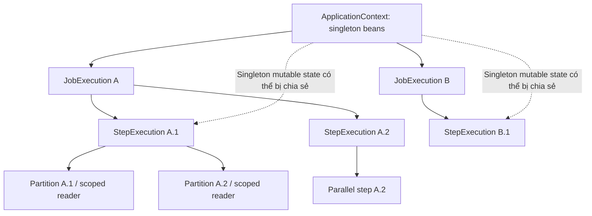
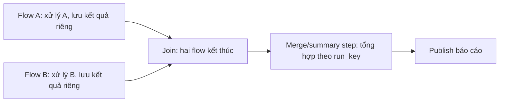
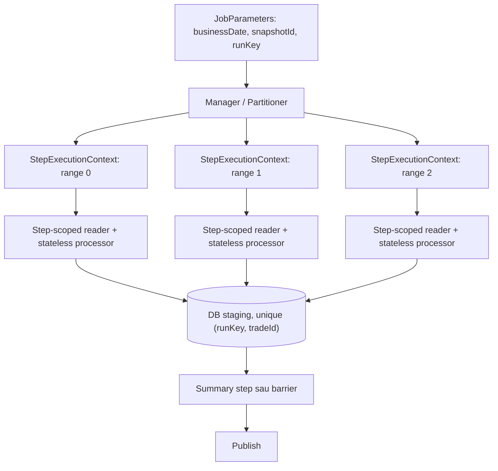

# Shared mutable state trong Job: nhận diện và xử lý an toàn

## Mục tiêu bài học

Trong module **SPRING_BATCH_SCALING_OPERATIONS**, mục tiêu là mở rộng Spring Batch cho workload dữ liệu lớn bằng **multi-threaded step, parallel steps, partitioning và các mô hình phân tán**, đồng thời bảo đảm thread safety, retry/restart và vận hành theo tài nguyên thực tế. Bài thuộc chương **An toàn luồng**, tập trung vào **shared mutable state trong Job**: trạng thái có thể bị nhiều luồng hoặc nhiều lần chạy job truy cập và thay đổi.

Sau bài học, bạn có thể:

- Nhận diện nơi xuất hiện shared mutable state trong Spring Batch: singleton bean, reader/writer, processor, listener, cache, bộ đếm, `ExecutionContext` và tài nguyên ngoại vi.
- Phân biệt **thread safety**, **job isolation**, **transaction safety** và **restartability**; một thuộc tính đúng không tự kéo theo các thuộc tính còn lại.
- Phân tích data race, lost update, visibility, stale state và nhiễm dữ liệu giữa hai `JobExecution` đồng thời.
- Chọn cách khắc phục phù hợp: dữ liệu bất biến, stateless component, `@StepScope`, phân vùng theo business key, ghi staging có khóa duy nhất hoặc đồng bộ ở phạm vi thích hợp.
- Kiểm thử multi-threaded step, parallel steps, partitioning và restart dưới concurrency thực tế thay vì chỉ dựa vào unit test tuần tự.

> **Phạm vi:** Ví dụ Java hướng tới **Spring Batch 5.2.x**, Spring Framework 6.x. Các điểm liên quan tới `@JobScope` và `@StepScope` được diễn giải theo tài liệu chính thức của dòng 5.2. Với Spring Batch 6.x hoặc các mô hình concurrency mới, kiểm tra tài liệu đúng phiên bản trước khi áp dụng cấu hình.

## 1. Shared mutable state là gì?

Một đối tượng có **mutable state** nếu giá trị bên trong nó có thể thay đổi sau khi khởi tạo. State trở thành **shared** khi từ hai execution context độc lập trở lên có thể truy cập cùng đối tượng hoặc cùng dữ liệu có thể thay đổi.

Ví dụ: một `@Component` singleton có field `long totalProcessed`, được hai step song song cùng gọi `totalProcessed++`. Cả hai luồng có thể đọc cùng một giá trị, cùng tính giá trị mới rồi cùng ghi đè; kết quả cuối có thể nhỏ hơn số item thực tế.

```java
@Component
public class UnsafeJobStats {
    private long processedCount = 0L;
    private String currentRunKey;

    public void begin(String runKey) {
        currentRunKey = runKey;
        processedCount = 0L;
    }

    public void record() {
        processedCount++; // Read-modify-write không nguyên tử.
    }

    public long getProcessedCount() {
        return processedCount;
    }

    public String getCurrentRunKey() {
        return currentRunKey;
    }
}
```

Tình huống lỗi:

1. Job A gọi `begin("run-A")`, sau đó xử lý được 5.000 bản ghi.
2. Job B được khởi chạy cùng ứng dụng, gọi `begin("run-B")` và reset bộ đếm chung về 0.
3. Các worker của A và B lần lượt gọi `record()`, cập nhật xen kẽ vào cùng field.
4. Kết quả bộ đếm vừa có thể **mất cập nhật** do race, vừa **trộn hai lần chạy** vì service singleton không phân biệt JobExecution.

Ngay cả khi chỉ chạy một job tại một thời điểm, việc reuse singleton qua nhiều lần launch mà quên reset hoặc reset sai thời điểm vẫn tạo dữ liệu cũ còn sót. Thêm concurrency khiến lỗi khó tái hiện hơn.

### Hai chiều chia sẻ dễ bị bỏ sót

| Chiều chia sẻ | Ví dụ | Loại lỗi |
| --- | --- | --- |
| **Giữa nhiều thread của cùng step** | Multi-threaded chunk step dùng một reader/counter singleton | Race, duplicate/skip, checkpoint sai |
| **Giữa các step/flow của cùng JobExecution** | Hai parallel flows cùng cập nhật bean `JobStats` | Lost update, đọc kết quả chưa hoàn chỉnh |
| **Giữa các StepExecution của partition** | Nhiều partition dùng một processor có cache mutable | Trộn state các phân vùng, kết quả sai |
| **Giữa các JobExecution của cùng ứng dụng** | Bean singleton giữ `currentRunKey` hoặc `businessDate` | Nhiễm dữ liệu giữa lần chạy |
| **Giữa nhiều JVM** | Worker chia sẻ cùng bảng trạng thái hoặc object store | Race/duplicate ở DB hoặc hệ thống ngoài, khóa Java không giải quyết |

Một field `static` mutable thường làm phạm vi chia sẻ còn rộng hơn. Những đối tượng như `SimpleDateFormat`, `StringBuilder`, `HashMap` mutable, cursor reader, iterator, buffer, tập khóa “đã xử lý”, token cache hoặc holder của user context cũng cần được đánh giá.

## 2. Định nghĩa bốn loại tính đúng khác nhau

| Thuộc tính | Câu hỏi | Cơ chế phù hợp |
| --- | --- | --- |
| **Thread safety** | Hai thread gọi đồng thời có làm hỏng state hoặc đọc sai giá trị không? | Immutable objects, scope phù hợp, atomic/synchronization, concurrent collections đúng cách |
| **Job isolation** | Job A có thể thấy/sửa state của Job B không? | JobParameters, run key, tách staging/khóa dữ liệu, không giữ state per-job trong singleton |
| **Transaction safety** | DB và side effect có commit/rollback nhất quán không? | Transaction boundary, isolation/locking, unique constraint, outbox nếu cần |
| **Restartability** | Job chết rồi chạy lại có tiếp tục đúng mà không bỏ sót/trùng nghiệp vụ không? | JobRepository, ExecutionContext checkpoint, snapshot ổn định, idempotency |

Ví dụ thay `long` bằng `AtomicLong` có thể khắc phục **lost update trong một JVM**, nhưng chưa giải quyết:

- Job A và Job B vẫn dùng chung một counter.
- Counter reset khi JVM khởi động lại, mất kết quả không lưu bền vững.
- Counter tăng trước khi transaction rollback, tạo số đếm khác số bản ghi đã commit.
- Hai JVM có hai instance `AtomicLong` khác nhau, không chia sẻ tổng chính xác.

**Không đồng nhất “thread-safe” với “restart-safe” hoặc “exactly-once”.** Tính đúng khi xử lý phân tán còn đòi ràng buộc ở nơi lưu dữ liệu và cơ chế chống phát lại.

## 3. Mô hình scope và vòng đời trong Spring Batch

Để kiểm soát mutable state, cần xác định **ai đang sở hữu trạng thái** và vòng đời của trạng thái đó.



| Phạm vi | Số instance thông dụng | Rủi ro cần nhớ |
| --- | --- | --- |
| `@Component` / `@Bean` mặc định (singleton) | Một bean instance trong một ApplicationContext | Nhiều job/step/thread cùng gọi vào một đối tượng |
| `@JobScope` | Một bean instance cho phạm vi job đang thực thi khi scope được bind | Có thể bị nhiều bước dùng chung; **không được khuyến nghị trong multi-threaded/partitioned steps** |
| `@StepScope` | Một bean target instance theo `StepExecution` khi scope được bind đúng | Phù hợp phân vùng vì mỗi partition có StepExecution riêng; **không phải instance riêng cho mỗi thread trong cùng StepExecution** |
| Immutable `JobParameters` | Bộ tham số xác định JobInstance/được truyền cho job | Phù hợp làm input cấu hình; không phải nơi lưu counter mutable |
| `JobExecution.ExecutionContext` | Context cho một JobExecution | Keyspace chung ở phạm vi job; không có hợp đồng atomic counter concurrent |
| `StepExecution.ExecutionContext` | Context cho một StepExecution | Phù hợp checkpoint per-step; vẫn cần xử lý truy cập đồng thời nếu *cùng* StepExecution có nhiều thread |

### 3.1. `@StepScope` không phải `@ThreadScope`

Trong **local partitioning**, mỗi partition có `StepExecution` riêng nên bean `@StepScope` thường cho reader của từng partition một instance riêng cùng `ExecutionContext` tương ứng. Đó là cách giảm nguy cơ chia sẻ cursor.

Trong **multi-threaded step**, nhiều chunk có thể chạy trên nhiều thread nhưng vẫn thuộc **cùng một StepExecution**. Bean `@StepScope` gắn với StepExecution này vẫn có thể được các chunk truy cập đồng thời. Nếu bean là một reader có mutable cursor, thêm `@StepScope` **không tự làm reader thread-safe**.

### 3.2. Lưu ý với `@JobScope`

Theo tài liệu Spring Batch 5.2, bean `@JobScope` **không được khuyến nghị trong multi-threaded hoặc partitioned steps** vì Spring Batch không kiểm soát mọi thread được tạo trong các mô hình này để thiết lập job context đúng cách. Không coi `@JobScope` là giải pháp mặc định nhằm chia tách bean cho các worker thread.

Nếu một worker cần dữ liệu theo lần chạy, thường an toàn hơn khi **truyền giá trị bất biến qua JobParameters** và bind vào bean `@StepScope`, hoặc dùng `StepExecutionContext` của partition cho thông số riêng. Đừng nhét một mutable object lớn vào JobExecutionContext rồi chia sẻ reference cho mọi worker.

### 3.3. Không gắn scope lên Step bean

`Step` là định nghĩa công việc và được Spring Batch quản lý vòng đời thực thi. Khi cần late binding, đặt `@StepScope` lên **tasklet, reader, processor, writer hoặc thành phần của step**, không tùy tiện đặt lên `Step` bean. Với bean cần thực hiện hợp đồng `ItemStream`, nên khai báo return type đủ cụ thể để proxy thực hiện `open/update/close` đúng.

## 4. Các lỗi data race thường gặp

### 4.1. Lost update trên counter

```java
class BadCounter {
    long value;

    void increment() {
        value++; // Gồm read -> +1 -> write.
    }
}
```

Nếu hai thread cùng đọc `value=40`, cả hai có thể ghi `41`; kết quả mong đợi `42` bị mất. `volatile long` giúp một số vấn đề visibility nhưng **không biến `value++` thành phép tăng nguyên tử**.

`AtomicLong.incrementAndGet()` hoặc `LongAdder.increment()` giải quyết đếm concurrent **trong cùng JVM**, nhưng nên dùng chúng cho telemetry tạm thời, không dùng làm số bản ghi đã commit hoặc checkpoint bền vững nếu chưa có transaction/snapshot xử lý.

### 4.2. Check-then-act trên Set/Map

```java
if (!processedIds.contains(id)) {
    sendPayment(id);
    processedIds.add(id);
}
```

Hai thread có thể cùng thấy ID chưa tồn tại, cùng gọi `sendPayment(id)` rồi mới thêm ID vào set. `ConcurrentHashMap.newKeySet()` cùng `add(id)` nguyên tử có thể ngăn hai thread trong **cùng một JVM** cùng vào một đoạn mã, nhưng còn hàng loạt vấn đề:

- Mất set khi process restart.
- Một thread đã thêm ID nhưng side effect thất bại, lần sau lại bị chặn sai.
- Nhiều worker JVM có các set riêng, vẫn xử lý trùng.
- Transaction bên ngoài không được gắn nguyên tử với set in-memory.

Với nghiệp vụ thanh toán, cần **idempotency key ở hệ thống đích** hoặc ghi transactionally vào bảng inbox/outbox/unique key; không dùng set trong RAM làm nguồn chân lý.

### 4.3. Shared cursor/iterator

```java
@Component
class BadReaderState {
    private Iterator<Long> ids;

    Long next() {
        return ids.hasNext() ? ids.next() : null;
    }
}
```

Khi nhiều worker chia sẻ một iterator không thread-safe, `hasNext` và `next` có thể xen kẽ; dữ liệu bị đọc trùng/bỏ sót hoặc ném exception. Việc đồng bộ mọi lời gọi có thể giảm race nhưng tuần tự hóa phần đọc, đồng thời checkpoint và restart vẫn cần được thiết kế riêng.

### 4.4. Shared mutable configuration

Một singleton giữ `currentBusinessDate`, `runKey`, `tenantId` hoặc `maxRecordId` rồi thay đổi theo JobParameters sẽ làm hai job chạy đồng thời thấy cấu hình của nhau. Với các giá trị đầu vào theo job, ưu tiên **immutable value injection** thay vì set lại field của singleton.

## 5. Thiết kế tốt: immutable input và stateless service

### Anti-pattern: ghi cấu hình job vào singleton

```java
@Component
class UnsafeImportService {
    private String businessDate;

    void setBusinessDate(String businessDate) {
        this.businessDate = businessDate;
    }

    InvoiceSummary convert(Invoice invoice) {
        // Job khác có thể vừa thay businessDate.
        return InvoiceSummary.of(invoice, businessDate);
    }
}
```

Đối với input theo job, truyền dữ liệu như **tham số không thay đổi** của hàm:

```java
@Service
class InvoiceSummaryService {
    InvoiceSummary convert(Invoice invoice, LocalDate businessDate) {
        return InvoiceSummary.of(invoice, businessDate);
    }
}

@Bean
@StepScope
ItemProcessor<Invoice, InvoiceSummary> invoiceProcessor(
        InvoiceSummaryService service,
        @Value("#{jobParameters['businessDate']}") String dateText) {

    final LocalDate date = LocalDate.parse(dateText);
    return invoice -> service.convert(invoice, date);
}
```

Bean processor ở đây đóng trên một `LocalDate` bất biến, còn service singleton không lưu trạng thái riêng của job. Hai job với businessDate khác nhau không cần tranh nhau cập nhật field `businessDate`.

**Giới hạn:** Nếu bước trên là multi-threaded step, cùng processor instance có thể được nhiều thread gọi; ví dụ an toàn vì không sửa dữ liệu nội bộ. Nếu chuyển sang cache mutable hoặc gọi API side effect, phải đánh giá lại concurrency và idempotency.

### Giữ tên/tham số ổn định

Các giá trị như `businessDate`, `snapshotId`, `runKey` và phân vùng dữ liệu nên được xác định nhất quán trong một lần xử lý logic. Với restart, phải dùng đúng identifying JobParameters để tiếp tục JobInstance mong muốn, không tự tạo run key mới trong singleton hoặc mỗi lần JVM khởi động.

## 6. Thiết kế tốt: tách mutable state theo partition

Giả sử job xử lý 1.000.000 giao dịch theo ID, chia thành bốn dải. Chúng ta dùng `Partitioner` để tạo ngữ cảnh không chồng lấn, và reader scoped riêng cho từng `StepExecution`.

### 6.1. Tạo `ExecutionContext` cho từng partition

```java
@Bean
Partitioner tradePartitioner() {
    return gridSize -> {
        long firstId = 1L;
        long lastId = 1_000_000L; // Demo: production dùng snapshot xác định.
        int count = Math.max(1, gridSize);
        long width = (lastId - firstId + count) / count;

        Map<String, ExecutionContext> result = new LinkedHashMap<>();
        for (int i = 0; i < count; i++) {
            long from = firstId + i * width;
            if (from > lastId) {
                break;
            }
            long to = Math.min(lastId, from + width - 1);

            ExecutionContext ctx = new ExecutionContext();
            ctx.putLong("fromId", from);
            ctx.putLong("toId", to);
            result.put("partition-" + i, ctx);
        }
        return result;
    };
}
```

Khóa `partition-N` và dải dữ liệu cần ổn định khi restart cùng JobInstance. Một snapshot/watermark giúp worker không đọc một tập dữ liệu đã thay đổi giữa các lần chạy. `LinkedHashMap` trong ví dụ không bảo đảm thứ tự hoàn thành partition.

### 6.2. Reader theo phạm vi của StepExecution

```java
@Bean
@StepScope
JdbcPagingItemReader<Long> tradeIdReader(
        DataSource dataSource,
        @Value("#{stepExecutionContext['fromId']}") Long fromId,
        @Value("#{stepExecutionContext['toId']}") Long toId) {

    return new JdbcPagingItemReaderBuilder<Long>()
            .name("tradeIdReader")
            .dataSource(dataSource)
            .selectClause("SELECT id")
            .fromClause("FROM trade")
            .whereClause("WHERE id BETWEEN :fromId AND :toId")
            .sortKeys(Map.of("id", Order.ASCENDING))
            .parameterValues(Map.of("fromId", fromId, "toId", toId))
            .pageSize(500)
            .rowMapper((rs, rowNum) -> rs.getLong("id"))
            .build();
}
```

Mỗi partition có `StepExecutionContext` riêng, reader nhận đúng `fromId/toId` của mình; không cần singleton `currentPartitionRange`. Khi có trạng thái paging cần lưu, reader cũng có thể tham gia lifecycle `ItemStream` để ghi checkpoint theo StepExecution.

Lưu ý phạm vi bảo đảm:

- **Local partitioning:** Mỗi partition có một `StepExecution`; step-scoped reader giúp cô lập instance reader giữa các partition.
- **Multi-threaded step:** Cùng một `StepExecution` có thể có nhiều thread. Reader step-scoped vẫn có thể bị dùng đồng thời; cần reader thread-safe hoặc chuyển sang partitioning nếu truy cập state là nút thắt.
- **Remote partitioning:** Mỗi worker ở process riêng có bean instance riêng; tác động ghi lên **DB, queue, file chia sẻ** vẫn cần ràng buộc idempotency/transaction.

### 6.3. Ghi bền vững theo khóa nghiệp vụ

Giả sử có bảng `processed_trade` với unique key `(run_key, trade_id)`. Writer có thể dựa trên SQL idempotent:

```sql
INSERT INTO processed_trade (run_key, trade_id, processed_at)
VALUES (:runKey, :tradeId, CURRENT_TIMESTAMP)
ON CONFLICT (run_key, trade_id) DO NOTHING;
```

Hai partition vô tình gặp cùng `trade_id` hoặc worker phải chạy lại sẽ không tạo hai hàng trùng. Tuy nhiên unique key **không thay thế** kiểm chứng độ phủ dữ liệu, và `DO NOTHING` có phù hợp hay không phụ thuộc nghiệp vụ: nếu bản ghi phải được cập nhật theo phiên bản, cần UPSERT có điều kiện hoặc optimistic lock phù hợp.

Một cách đo số lượng hoàn thành thực sự là truy vấn bảng đích theo `run_key` hoặc dùng metadata `StepExecution` sau khi commit. Đừng dùng một singleton `processedCount` được tăng trong processor làm số liệu kế toán.

## 7. JobExecutionContext: dùng cho handoff, không làm counter dùng chung

Spring Batch có hai loại `ExecutionContext`:

- **StepExecutionContext:** gắn với một `StepExecution`; trong chunk-oriented step, thường được persist ở các commit point để hỗ trợ checkpoint/restart.
- **JobExecutionContext:** gắn với một `JobExecution`; framework lưu ở ranh giới giữa các step theo quy trình điều phối job.

Cả hai đều là vùng lưu key/value để framework có thể serialize/persist state; **không được thiết kế làm distributed shared memory hoặc counter atomic xuyên các luồng**.

### Anti-pattern: hai parallel steps cùng sửa một key

```java
void updateTotal(StepExecution stepExecution, long delta) {
    ExecutionContext context = stepExecution
            .getJobExecution()
            .getExecutionContext();

    long old = context.getLong("total", 0L);
    context.putLong("total", old + delta);
}
```

Nếu hai flow gọi hàm này đồng thời, cả hai có thể đọc cùng giá trị `old` rồi một lần cập nhật bị ghi đè. Việc framework persist context ở một thời điểm sau đó không thể khôi phục dữ liệu đã mất.

Ngoài ra, khi gọi `putLong`, **giá trị chưa mặc nhiên được commit cùng với transaction nghiệp vụ hiện tại**. Nếu một thread tăng total trước khi chunk rollback, counter có thể khác tổng đã ghi thành công.

### Chiến lược an toàn hơn: per-step state rồi tổng hợp sau barrier



Ví dụ mỗi step ghi vào staging riêng hoặc có key `(run_key, source_name, record_id)`. Một step cuối chạy **sau join** đọc và tính tổng:

```sql
SELECT source_name, COUNT(*) AS completed_items
FROM processed_record
WHERE run_key = :runKey
GROUP BY source_name;
```

Mỗi flow không cần đụng đến một Java object đếm chung. Nếu tổng hợp trạng thái từ metadata, dùng `JobExplorer`/các `StepExecution` sau khi các worker hoàn tất và phân biệt từng lần chạy, thay vì cộng trừ trên một field singleton.

### Dùng `ExecutionContextPromotionListener` có đủ không?

`ExecutionContextPromotionListener` hữu ích để chuyển **các key đã xác định từ StepExecutionContext lên JobExecutionContext** tại ranh giới step theo trạng thái phù hợp. Nó phù hợp cho việc truyền dữ liệu nhỏ từ bước trước sang bước sau trong flow có thứ tự.

Tuy nhiên, **nó không phải một bộ giảm tổng (atomic reducer) cho hai parallel flows cùng ghi một key**. Khi nhiều nhánh cùng promote `total` hoặc nhiều luồng sửa chung job context, vẫn có vấn đề thứ tự, lost update và persist. Với parallel steps, nên dùng key độc lập và điểm hội tụ có xác minh hoặc staging/transaction rõ ràng.

### Không đưa tài nguyên sống vào ExecutionContext

Tránh lưu `DataSource`, `Connection`, socket, stream, bean proxy phức tạp, cache lớn hoặc đối tượng mutable liên kết với hệ thống ngoài vào `ExecutionContext`. Những giá trị cần persist phải tương thích cơ chế serialization của Spring Batch và schema metadata; context lớn gây chi phí I/O và rủi ro khôi phục. Chỉ lưu những scalar hoặc trạng thái checkpoint cần thiết, như cursor, range, watermark và run key.

## 8. Đồng bộ hóa: khi nào có tác dụng, khi nào không?

Nếu thật sự cần state chia sẻ trong một JVM, Java concurrency cung cấp các công cụ sau:

| Cơ chế | Có ích cho | Không giải quyết |
| --- | --- | --- |
| `final` + immutable value | Cấu hình/dữ liệu không đổi, thread-safe by design | DB/external side effect hoặc object mutable được tham chiếu bên trong |
| `AtomicLong`, `LongAdder` | Số đếm in-memory từ nhiều thread | Job isolation, transaction rollback, bền vững sau restart |
| `ConcurrentHashMap` | Access/update theo key với phép toán concurrent đúng | Phối hợp nhiều thao tác compound và tính đúng ngoài JVM |
| `synchronized`, `ReentrantLock` | Critical section trên cùng JVM/instance | Điều phối giữa JVM/máy, distributed transaction, metadata restart |
| `ThreadLocal` | State tạm theo thread trong một request/task đã quản lý vòng đời | Job scope, sự an toàn của thread pool reuse, propagation async, restart |
| DB unique key/locking | Phối hợp ghi trên tài nguyên dùng chung giữa JVM | Phân vùng dữ liệu đúng hoặc xử lý không có tác dụng phụ |
| Outbox/inbox + idempotency key | Chống side effect trùng khi retry/redelivery | Tự động bảo đảm mọi quy tắc ordering nghiệp vụ |

### Cẩn thận với `ThreadLocal`

Thread pool thường **tái sử dụng thread**. Nếu task A đặt `ThreadLocal<RunContext>` nhưng không gọi `remove()` trong `finally`, task của Job B được xếp trên cùng thread có thể đọc nhầm state cũ. ThreadLocal cũng **không tự truyền** giá trị sang thread được executor/broker tạo và không phải nơi lưu trạng thái restart.

Đối với Spring Batch, ưu tiên `JobParameters`, `StepExecutionContext` và dữ liệu nghiệp vụ có khóa định danh hơn việc tự tạo một “current job” toàn cục.

### Synchronized reader chưa chắc làm checkpoint đúng

Spring Batch có wrapper như `SynchronizedItemStreamReader` để đồng bộ việc đọc của delegate trong những tình huống nhất định. Cách này giúp tránh gọi đồng thời reader không thread-safe, nhưng **không thể suy ra restart an toàn trong mọi multi-threaded step**: chunk có thể hoàn tất khác thứ tự, state của reader và side effect có thể không tương ứng đơn giản với một con trỏ tuần tự.

Nếu correctness và restart khó chứng minh, hãy dùng **partitioning theo dải dữ liệu** để mỗi `StepExecution` quản lý một reader độc lập, hoặc chọn mô hình concurrency khác phù hợp.

## 9. Tình huống production: hai job chốt sổ chạy song song

Giả sử job `dailySettlement` xử lý ngày D và D+1 trên cùng Spring Boot process. Mỗi job có 4 partition, mỗi partition 2.000.000 giao dịch. Ứng dụng sử dụng singleton `CurrentRunState` để giữ `businessDate`, `totalAmount` và `processedCount`.

Khi hai job chạy đồng thời:

- `CurrentRunState.businessDate` đổi từ D sang D+1 trong lúc worker của D còn chạy.
- `processedCount++` bị mất cập nhật.
- `totalAmount` được cộng ngay cả khi chunk rollback, lệch với DB.
- Nếu JVM chết, các số đếm trong RAM biến mất.
- Nếu triển khai worker sang JVM khác, mỗi JVM giữ counter riêng nên “tổng toàn job” càng sai.

### Thiết kế thay thế

1. `businessDate` và `snapshotId` là input bất biến theo identifying JobParameters; mọi partition của một JobInstance dùng cùng snapshot.
2. `Partitioner` cấp `fromId/toId` vào từng StepExecutionContext, với mapping ổn định qua restart.
3. `ItemReader` có trạng thái được tạo theo `@StepScope` cho từng partition.
4. `ItemProcessor` stateless, nhận giá trị cần thiết qua tham số; không cập nhật trường `currentRun` của singleton.
5. `ItemWriter` dùng transaction và unique key/UPSERT theo `(run_key, trade_id)`; side effect ngoài DB dùng idempotency/outbox tương ứng.
6. Sau khi manager partition step thành công, step tổng hợp đọc dữ liệu đã commit hoặc metadata đã hoàn tất để tạo báo cáo.
7. Dashboard theo dõi throughput, độ lệch partition, pool tài nguyên, rollback/retry và độ trễ toàn job.



Mô hình này tách rõ **scope của dữ liệu**, **transaction của side effect** và **điểm hội tụ**; không cần một singleton in-memory để đếm hoặc nhớ “job hiện tại”.

## 10. Kiểm thử để bắt race và nhiễm state giữa JobExecution

Unit test một luồng có thể luôn pass dù production lỗi. Bài kiểm thử cần cố ý kích hoạt interleaving:

1. **Hai JobExecution đồng thời:** launch cùng job với `businessDate/runKey` khác nhau; xác nhận output không trộn, bean singleton không giữ current run.
2. **Tăng concurrency:** so sánh đầu ra khi `gridSize=1, 2, 4, 8` hoặc multi-threaded step 1/4/8 thread; tập kết quả nghiệp vụ không đổi.
3. **Ép luồng xen kẽ:** dùng `CountDownLatch`/`CyclicBarrier` trong test để hai thread cùng đọc giá trị trước khi ghi; xác nhận ví dụ counter sai có thể tái hiện, sau đó thay thiết kế và kiểm lại.
4. **Restart sau commit:** cố ý fail một partition sau vài chunk đã commit; restart cùng JobInstance, đối chiếu DB theo khóa và checkpoint.
5. **Rollback và retry:** gây lỗi transient và rollback một chunk; tổng kết phải phản ánh dữ liệu đã commit, không phải số lần processor được gọi.
6. **Trùng message/re-delivery:** với remote partitioning, mô phỏng cùng ID được xử lý lại; unique/idempotency key ngăn side effect trùng.
7. **Resource stress:** theo dõi connection pool, DB lock wait, CPU, GC, throughput và timeouts khi nhiều job cùng chạy.

### Ví dụ kiểm tra lost update bằng `CountDownLatch`

Đoạn test sau minh họa cách ép hai thread đọc cùng giá trị ban đầu; nó không liên quan riêng tới Spring Batch và chỉ dùng để làm rõ data race:

```java
class UnsafeCounter {
    long value;
}

UnsafeCounter counter = new UnsafeCounter();
CountDownLatch bothRead = new CountDownLatch(2);
CountDownLatch resume = new CountDownLatch(1);

Runnable work = () -> {
    long snapshot = counter.value;
    bothRead.countDown();
    try {
        resume.await();
    } catch (InterruptedException ex) {
        Thread.currentThread().interrupt();
        return;
    }
    counter.value = snapshot + 1;
};

ExecutorService pool = Executors.newFixedThreadPool(2);
Future<?> first = pool.submit(work);
Future<?> second = pool.submit(work);

bothRead.await();
resume.countDown();
first.get();
second.get();
pool.shutdown();

// Hai thread đều ghi lại 1 dù ta mong 2.
assertEquals(1L, counter.value);
```

Trong code production, không “sửa” bằng cách làm phép đếm nguyên tử rồi tin đó là số commit. Nếu là chỉ số telemetry, atomic counter/metric API có thể hợp lý. Nếu là số liệu nghiệp vụ, lấy từ DB đã commit hoặc metadata đáng tin cậy sau khi các partition hoàn tất.

### Ma trận kiểm tra nhanh

| Thay đổi | Câu hỏi kiểm thử |
| --- | --- |
| Singleton → stateless bean | Hai JobExecution có thể chạy khác tham số mà không ảnh hưởng nhau? |
| Reader → `@StepScope` | Có một target reader riêng cho mỗi StepExecution partition? |
| Multi-threaded step | Component stateful có bị các chunk thread cùng truy cập? |
| Sử dụng `ExecutionContext` | Key có bị hai thread ghi cùng lúc? Value có serializable và persist đúng ranh giới? |
| Writer idempotent | Retry/restart/redelivery có tạo side effect trùng không? |
| Dùng `ThreadLocal` | Context có được dọn ở cuối task và không lọt sang job khác? |
| Partitioning → remote | Phối hợp giữa JVM có dựa vào DB/broker transaction và key nghiệp vụ thay vì lock Java? |

## 11. Lựa chọn kiến trúc theo mức chia sẻ state

| Nhu cầu | Hướng triển khai | Chú ý |
| --- | --- | --- |
| Một step có processor thuần hàm, item độc lập | Multi-threaded step nếu reader/writer và checkpoint phù hợp | Scope không tự tách theo thread; kiểm tra Javadoc từng component |
| Reader giữ cursor, dataset chia dải ID | Local partitioning + `@StepScope` | Mỗi partition có StepExecution riêng, naming/bounds ổn định |
| Hai bước nghiệp vụ độc lập dùng cùng snapshot | Parallel steps, output riêng rồi join | Không dùng shared in-memory accumulator; chú ý JobExecutionContext |
| Nhiều JVM/host cần xử lý cùng logic | Remote partitioning | Idempotency, metadata dùng chung, transport/retry, không dùng JVM lock |
| Phải cập nhật sự kiện theo business key có thứ tự | Affinity partition theo key + sequence guard | Không chia cùng key sang hai worker độc lập |
| Một DB/API đã bão hòa | Tối ưu SQL/index/pool và giảm concurrency | Tăng thread thường không giải quyết shared resource contention |

### Checklist đưa vào production

- [ ] Không có singleton mutable `currentJob`, `currentRunKey`, `currentPartition` hoặc counter nghiệp vụ dùng chung giữa job executions.
- [ ] Mỗi shared component có chính sách thread safety rõ ràng: immutable, stateless, scoped hoặc synchronized đúng mức.
- [ ] Không hiểu `@StepScope` là “mỗi thread một bean” trong multi-threaded step.
- [ ] Không dựa vào `@JobScope` trong multi-threaded/partitioned steps khi tài liệu phiên bản cảnh báo không hỗ trợ binding đúng context.
- [ ] Không dùng JobExecutionContext như concurrent distributed cache hoặc atomic total counter.
- [ ] `ExecutionContext` lưu trạng thái nhỏ, serializable, đủ cho restart theo ranh giới commit/step.
- [ ] Partition key, bounds, snapshot và identifying JobParameters ổn định qua restart.
- [ ] Writer bảo đảm idempotency; kết quả sau retry/rollback khớp dữ liệu đã commit.
- [ ] Có thử nghiệm hai JobExecution đồng thời, race interleaving, retry, restart và load trên tài nguyên thật.
- [ ] Theo dõi read/write/commit/rollback/skip count, p95 partition time, pool pending và lệch kết quả nghiệp vụ.

## Tài liệu tham khảo

- [Spring Batch 5.2 — Scaling and Parallel Processing](https://docs.spring.io/spring-batch/reference/5.2/scalability.html): giới hạn thread safety của reader/writer trong multi-threaded step và các mô hình partitioning/parallel steps.
- [Spring Batch 5.2 — Late Binding of Job and Step Attributes](https://docs.spring.io/spring-batch/reference/5.2/step/late-binding.html): `@StepScope`, `@JobScope` và cảnh báo với multi-threaded hoặc partitioned steps.
- [Spring Batch 5.2 — The Domain Language of Batch](https://docs.spring.io/spring-batch/reference/5.2/domain.html): JobExecution, StepExecution, ExecutionContext, vòng đời persist và restart.
- [Spring Batch 5.2 — Preventing State Persistence](https://docs.spring.io/spring-batch/reference/5.2/step/chunk-oriented-processing/restart.html): checkpoint và điều kiện restart của step.
- [Java Concurrency — AtomicLong](https://docs.oracle.com/en/java/javase/17/docs/api/java.base/java/util/concurrent/atomic/AtomicLong.html): các thao tác cập nhật atomic cho counter trong một JVM.

**Điều cần nhớ:** Shared mutable state trong Spring Batch nguy hiểm vì nó có thể được chia sẻ đồng thời **giữa thread, step, partition và nhiều JobExecution**. Cách bền vững nhất thường là **giảm state chia sẻ**: input bất biến, worker stateless, reader có state theo StepExecution, dữ liệu nghiệp vụ commit với khóa duy nhất và tổng hợp sau barrier. Đồng bộ Java chỉ xử lý một phần race trong một JVM; thread safety, transaction và restart phải được thiết kế, đo và kiểm chứng riêng.
