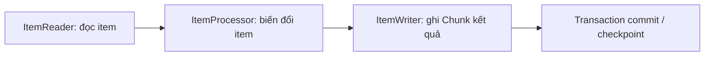
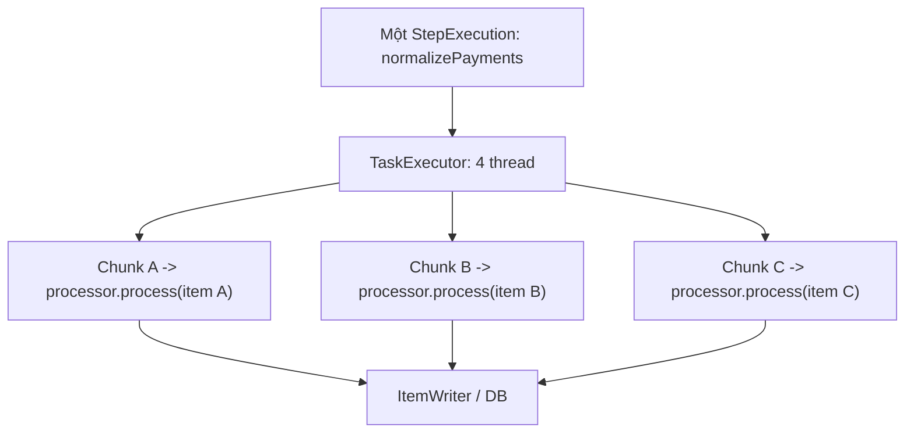

# Local variables và dữ liệu theo item trong Spring Batch

## Mục tiêu bài học

Trong chương **An toàn luồng** của module **SPRING_BATCH_SCALING_OPERATIONS**, chúng ta xem xét một nguyên tắc quan trọng khi tăng throughput cho workload dữ liệu lớn: **dùng biến cục bộ (local variables) và dữ liệu thuộc về từng item để giảm shared mutable state**. Nguyên tắc này có ích cho multi-threaded step, parallel steps, partitioning và worker phân tán, nhưng chỉ hiệu quả khi hiểu đúng đối tượng nào thực sự được chia sẻ.

Sau bài học, bạn có thể:

- Phân biệt biến cục bộ của một lần gọi hàm với instance field, static field, bean singleton, `ThreadLocal` và tham chiếu tới đối tượng mutable.
- Thiết kế `ItemProcessor` dạng stateless, tạo kết quả mới từ item đầu vào mà không sửa state chung.
- Xác định **quyền sở hữu item** khi đi qua reader → processor → writer, đặc biệt khi có nhiều thread hoặc xử lý bất đồng bộ.
- Hiểu giới hạn của `@StepScope`: phù hợp cô lập trạng thái theo `StepExecution`, nhưng không tự tạo một reader cho từng thread trong cùng multi-threaded step.
- Kiểm chứng thread safety, transaction, retry/restart, ordering và hiệu năng bằng dữ liệu thực tế trước khi mở rộng concurrency.

> **Phiên bản minh họa:** Spring Batch **5.2.x**, Java 17+ và Spring Framework 6.x. Các ví dụ mã tập trung vào nguyên tắc xử lý item, chưa chứa mọi dependency/import hay hạ tầng một ứng dụng chạy hoàn chỉnh. Nếu dùng API từ phiên bản khác, đối chiếu Javadoc tương ứng.

## 1. Biến cục bộ có nghĩa gì trong môi trường nhiều luồng?

Xem một hàm `process`:

```java
BigDecimal calculateNetAmount(
        BigDecimal grossAmount,
        BigDecimal fee) {

    BigDecimal netAmount = grossAmount.subtract(fee);
    return netAmount.setScale(2, RoundingMode.HALF_EVEN);
}
```

Mỗi lần gọi phương thức có **các biến tham số và biến cục bộ riêng về mặt ngữ nghĩa**. Hai thread cùng gọi `calculateNetAmount` không ghi đè lên một biến `netAmount` chung. Hơn nữa, `BigDecimal` là immutable; phép `subtract` tạo một giá trị kết quả mới, nên ví dụ không cần khóa.

Đối chiếu với field có thể thay đổi:

```java
@Component
class UnsafeNetAmountCalculator {
    private BigDecimal lastNetAmount = BigDecimal.ZERO;

    BigDecimal calculate(BigDecimal gross, BigDecimal fee) {
        lastNetAmount = gross.subtract(fee);
        return lastNetAmount; // Thread khác có thể vừa ghi field.
    }
}
```

Nếu bean trên là singleton (mặc định cho `@Component`), hai luồng có thể thay đổi `lastNetAmount` xen kẽ. Kết quả của thread A có thể là giá trị thread B vừa ghi. Không có yêu cầu nghiệp vụ nào cần lưu kết quả tạm vào field, nên giải pháp tốt nhất là **xóa field** và dùng local variable.

### So sánh vị trí và phạm vi state

| Vị trí dữ liệu | Ai có thể truy cập? | Rủi ro |
| --- | --- | --- |
| Biến primitive cục bộ như `long count` trong một lần gọi | Đoạn mã của lần gọi đó, trừ khi giá trị được xuất ra nơi khác | Thường không có race với lần gọi khác |
| Local reference tới đối tượng **mới tạo, không escape** | Chỉ luồng/lần gọi đang sở hữu | Thường an toàn nếu không có chia sẻ nội bộ |
| Local reference tới một đối tượng **mutable dùng chung** | Nhiều lần gọi có thể cùng trỏ đến một instance | Vẫn có race dù biến tham chiếu là local |
| Instance field của bean singleton | Các thread, step và job dùng bean đó | Race, nhiễm dữ liệu giữa JobExecution |
| Static mutable field | Các caller chia sẻ class trong phạm vi classloader | Chia sẻ rộng, khó cô lập |
| `ThreadLocal` | Luồng hiện tại trong một JVM | Rò state khi thread pool tái sử dụng, thiếu propagation và checkpoint |
| `StepExecutionContext` | Trạng thái của một `StepExecution` | Tốt cho checkpoint đúng phạm vi; không phải atomic counter cho nhiều thread |
| Bảng database/object store chung | Nhiều process và JVM | Cần transaction, unique key, locking và idempotency |

**Phạm vi của biến không đồng nghĩa phạm vi của đối tượng được tham chiếu.** Java cho phép một biến local nắm giữ reference tới một object trên heap mà nhiều thread cùng truy cập; cả `final` trên reference cũng không làm các field của object đó immutable.

## 2. Local variable không bảo vệ một mutable object đang được chia sẻ

Ví dụ dưới đây dùng biến local nhưng vẫn không thread-safe:

```java
@Component
class UnsafeFormatter {
    private final StringBuilder sharedBuilder = new StringBuilder();

    String format(String orderId, BigDecimal amount) {
        StringBuilder builder = sharedBuilder; // Biến local, object vẫn dùng chung.
        builder.setLength(0);
        builder.append(orderId).append(":").append(amount);
        return builder.toString();
    }
}
```

Hai thread có thể gọi `setLength(0)`/`append` trên cùng `StringBuilder`, làm trộn output. Cách sửa là tạo object trong lần gọi:

```java
@Component
class SafeFormatter {
    String format(String orderId, BigDecimal amount) {
        StringBuilder builder = new StringBuilder();
        builder.append(orderId).append(":").append(amount);
        return builder.toString();
    }
}
```

`builder` được tạo mới và không bị chuyển tới thread khác hoặc lưu trong field/cache. Mỗi lần gọi có một builder riêng. `StringBuilder` vẫn là mutable, nhưng chỉ có một owner trong phạm vi lời gọi này, nên không cần đồng bộ.

### Ba trường hợp làm object “escape”

Một object tạo trong method có thể bị chia sẻ nếu:

1. Bạn lưu nó vào singleton field, static collection hoặc cache chung.
2. Bạn đưa nó vào queue, future, callback hay executor để thread khác đọc/sửa **trước khi thread hiện tại ngừng sử dụng**.
3. Bạn trả reference ra ngoài rồi caller khác tiếp tục sửa khi người dùng đầu tiên còn xử lý.

```java
// Anti-pattern: tạo list local nhưng đưa list đang còn sửa sang thread khác.
List<Long> batch = new ArrayList<>();
CompletableFuture<Void> task =
        CompletableFuture.runAsync(() -> sendIds(batch), executor);

batch.add(100L); // Hai thread có thể đụng cùng ArrayList.
```

Một lựa chọn rõ quyền sở hữu hơn:

```java
List<Long> batch = new ArrayList<>();
batch.add(100L);
List<Long> snapshot = List.copyOf(batch); // Snapshot cấu trúc list.

CompletableFuture<Void> task =
        CompletableFuture.runAsync(() -> sendIds(snapshot), executor);
```

`List.copyOf` tạo danh sách không thể thay đổi qua API list, nhưng đây là **shallow copy**: nếu phần tử là object mutable, phần tử đó vẫn có thể bị sửa từ nơi khác. Hãy sao chép sâu hoặc dùng element immutable khi cần snapshot toàn bộ dữ liệu.

## 3. “Dữ liệu theo item” là gì?

Trong chunk-oriented Spring Batch, một item thông thường đi theo đường:



**Dữ liệu theo item (per-item data)** là mọi thông tin chỉ gắn với một record đang xử lý: ID, amount, trạng thái tính toán trung gian, kết quả chuẩn hóa, lỗi validation hoặc immutable metadata. Nên giữ dữ liệu này trong:

- Tham số của `process(item)` và biến cục bộ trong lần xử lý.
- Đối tượng output mới của chính item đó.
- Giá trị bất biến được truyền vào hàm xử lý (chẳng hạn `runKey`, `businessDate`).
- Bản ghi bền vững theo business key khi item đã commit.

Không nên lưu “item đang xử lý” trong một field singleton như `currentItem`. Khi nhiều chunk hoặc partition chạy song song, field đó không còn tương ứng với một item cụ thể.

### Bảng quyền sở hữu

| Dữ liệu | Owner phù hợp | Lý do |
| --- | --- | --- |
| `gross`, `fee`, `net` khi tính cho một payment | Một lần gọi processor | Không cần chia sẻ, dễ tính lại sau retry |
| `paymentId`, `runKey` của kết quả | Immutable output item | Writer biết rõ dữ liệu nào phải ghi |
| Reader cursor/paging state | Một `StepExecution` trong partitioning | Restart và phạm vi dữ liệu riêng |
| Tổng tiền của toàn job | DB/staging hoặc bước aggregate sau khi các worker kết thúc | Tránh cộng dồn in-memory mất cập nhật và lệch transaction |
| Phạm vi `fromId/toId` | `ExecutionContext` của partition tương ứng | Chốt dữ liệu mỗi worker chịu trách nhiệm |
| Connection pool và API client | Thành phần chia sẻ được thiết kế thread-safe, có giới hạn | Tối ưu sử dụng tài nguyên, không để item tự quản lý pool |

**Một item không nhất thiết có một object instance độc nhất.** Reader có thể trả entity được cache, object mutable đã reuse hoặc nhiều references tới cùng aggregate. Khi cần concurrency, phải kiểm tra cách reader tạo và sở hữu item; không thể mặc định mỗi call `read()` trả về object chưa từng được ai khác giữ.

## 4. Thiết kế ItemProcessor stateless với local variables

### 4.1. Anti-pattern: lưu giá trị của item vào bean field

```java
@Component
class UnsafePaymentProcessor
        implements ItemProcessor<RawPayment, NormalizedPayment> {

    private BigDecimal currentAmount;

    @Override
    public NormalizedPayment process(RawPayment item) {
        currentAmount = item.amount().setScale(2, RoundingMode.HALF_EVEN);
        return new NormalizedPayment(
                item.id(), currentAmount, item.currency(), "unknown-run");
    }
}
```

Khi cùng bean processor được gọi đồng thời, thread A có thể ghi `currentAmount`, thread B ghi đè, sau đó A đọc giá trị của B. Việc bọc bean bằng `@StepScope` không giải quyết triệt để nếu các thread **thuộc cùng một StepExecution** trong multi-threaded step.

### 4.2. Stateless processor trả output bất biến

Giả định input và output là Java record (Java 17+):

```java
public record RawPayment(
        long id,
        BigDecimal amount,
        String currency) {}

public record NormalizedPayment(
        long id,
        BigDecimal amount,
        String currency,
        String runKey) {}
```

Tạo processor:

```java
@Bean
@StepScope
ItemProcessor<RawPayment, NormalizedPayment> paymentProcessor(
        @Value("#{jobParameters['runKey']}") String runKey) {

    return item -> {
        // Toàn bộ giá trị này là local trong mỗi lần process(item).
        BigDecimal normalized =
                item.amount().setScale(2, RoundingMode.HALF_EVEN);
        String currency = item.currency().trim().toUpperCase(Locale.ROOT);

        return new NormalizedPayment(
                item.id(), normalized, currency, runKey);
    };
}
```

Vì sao thiết kế này phù hợp khi chạy concurrent?

1. Processor không có field mutable; mỗi lời gọi tạo các local values riêng.
2. `BigDecimal`, `String` là immutable, và `runKey` được capture dưới dạng giá trị không đổi.
3. Processor **tạo output object mới** thay vì thay đổi input mà reader hoặc một thread khác có thể đang giữ.
4. Mỗi output gắn với một `id` cụ thể và một `runKey`, giúp writer tạo ràng buộc idempotency.
5. Không cần gọi API, thay đổi DB hoặc cộng dồn tổng ở processor; một item có thể được process lại nếu chunk rollback/retry.

`@StepScope` ở đây phục vụ **late binding `runKey` theo StepExecution**. Processor là stateless kể cả khi cùng target instance được nhiều thread trong một step gọi. `@StepScope` **không có ý nghĩa “mỗi item một instance” hoặc “mỗi thread một instance”**.

> **Lưu ý nghiệp vụ:** `RoundingMode.HALF_EVEN` và chuẩn hóa mã tiền tệ chỉ minh họa; quy tắc làm tròn/validation thực tế phải tuân hợp đồng dữ liệu hoặc yêu cầu kế toán. `ItemProcessor` có thể trả `null` để filter một item; hành vi đó phải là quyết định nghiệp vụ có thể kiểm chứng, không dùng để che lỗi concurrency.

### 4.3. Immutable record cũng có giới hạn

Java record là shallowly immutable: các component reference không thể được gán lại, nhưng nếu component trỏ đến `List<MutableLine>` thì phần tử trong list vẫn có thể bị sửa.

```java
public record PaymentBatch(List<PaymentLine> lines) {
    public PaymentBatch {
        lines = List.copyOf(lines);
    }
}
```

Đoạn trên snapshot **danh sách references**; để bất biến thực sự, `PaymentLine` cũng phải immutable (ví dụ record chỉ chứa `long`, `String`, `BigDecimal`). Nếu dùng JPA entity mutable, cần map sang DTO bất biến hoặc kiểm soát ownership trước khi truyền qua các thread.

## 5. Tránh sửa trực tiếp item input khi có concurrency

Một anti-pattern khác không cần field shared:

```java
ItemProcessor<MutablePayment, MutablePayment> processor = item -> {
    item.setNetAmount(item.getGrossAmount().subtract(item.getFee()));
    return item;
};
```

`item` là biến tham số local, nhưng **instance** mà nó tham chiếu có thể cũng được giữ trong reader/cache, ORM persistence context, listener hoặc async task. Hai thread chạm cùng entity sẽ gây race và có thể làm bẩn dữ liệu khi transaction khác chưa sẵn sàng.

Nên map sang một đối tượng mới:

```java
ItemProcessor<MutablePayment, NormalizedPayment> processor = item -> {
    BigDecimal net = item.getGrossAmount().subtract(item.getFee());
    return new NormalizedPayment(
            item.getId(), net, item.getCurrency(), "fixed-run");
};
```

Trong production, `runKey` lấy từ JobParameters/StepExecutionContext, thay vì hard-code. Cách map sang immutable DTO giúp làm rõ **bên reader vẫn sở hữu source item; bên writer nhận một output value**. Đây là nguyên tắc thiết kế; việc tạo object mới không tự bảo đảm transaction, idempotency hay uniqueness của record.

### Khi nào in-place mutation vẫn chấp nhận được?

Có thể dùng khi chứng minh được cả ba điều kiện:

- Item instance chỉ có một owner trong suốt khoảng thời gian được sửa.
- Không thread, cache hay transaction khác dùng cùng instance trước khi mutation hoàn tất.
- Hành vi retry/restart xử lý đúng khi item đã bị sửa một phần.

Nếu khó chứng minh, immutable output thường dễ hiểu, dễ test và dễ vận hành hơn, dù có thêm allocation.

## 6. Multi-threaded step: biến local an toàn, reader/writer vẫn cần xem xét

Một multi-threaded step sử dụng `TaskExecutor` để thực thi các chunk trên nhiều thread. Các lần gọi `process(item)` có local variables riêng, nhưng **cùng một StepExecution** và một số component có thể được dùng chung:



Ví dụ hình thức cấu hình trong Spring Batch 5.2.x:

```java
@Bean
Step normalizePaymentsStep(
        JobRepository jobRepository,
        PlatformTransactionManager transactionManager,
        ItemReader<RawPayment> reader,
        ItemProcessor<RawPayment, NormalizedPayment> processor,
        ItemWriter<NormalizedPayment> writer,
        @Qualifier("chunkExecutor") TaskExecutor chunkExecutor) {

    return new StepBuilder("normalizePayments", jobRepository)
            .<RawPayment, NormalizedPayment>chunk(200, transactionManager)
            .reader(reader)
            .processor(processor)
            .writer(writer)
            .taskExecutor(chunkExecutor)
            .build();
}
```

**Điều kiện bắt buộc để dùng thật:** `reader` và `writer` ở ví dụ phải được chọn/cấu hình **phù hợp việc gọi đồng thời**. Không lấy một `JdbcCursorItemReader` hoặc reader mutable không thread-safe rồi thêm `taskExecutor` và giả định an toàn. Tùy reader, có thể cần đồng bộ đọc, chia dữ liệu thành partition, hoặc dùng kiến trúc khác để giữ restartability.

**`@StepScope` không phải `@ThreadScope`**: trong multi-threaded step, nhiều thread xử lý chunk của **cùng StepExecution**, nên một scoped reader có thể bị chúng truy cập đồng thời. Chỉ các local variables trong mỗi lần `process(item)` không được chia sẻ; reader state, writer buffer, input item reference và các bean dependency vẫn cần đánh giá.

### Một biến local có thể gián tiếp đọc state chung

```java
public NormalizedPayment process(RawPayment item) {
    BigDecimal rate = exchangeRateCache.get(item.currency());
    BigDecimal amount = item.amount().multiply(rate);
    return new NormalizedPayment(item.id(), amount, item.currency(), "run");
}
```

`rate` là local variable, nhưng `exchangeRateCache` có thể là mutable shared map. Nếu cache cập nhật giữa hai lần gọi, hai item cùng ngày có thể dùng rate khác nhau; nếu map không thread-safe, còn có race/hỏng cấu trúc.

Với batch đối soát, nên cố định `rateSnapshotId` theo job và đọc **snapshot immutable** hoặc truy vấn DB nhất quán. Thread-safe cache không tự bảo đảm tính nhất quán nghiệp vụ giữa các item.

## 7. Partitioning: phạm vi per-item và per-StepExecution

Trong **local partitioning**, mỗi partition là một `StepExecution` riêng. Đó là mô hình dễ cô lập reader state bằng `@StepScope` khi dataset chia vùng không chồng lấn.

Giả sử xử lý ID 1..1.000.000, chia bốn partition:

| Partition | Vùng ID | StepExecution name |
| --- | --- | --- |
| `partition-0` | 1..250.000 | `paymentWorker:partition-0` |
| `partition-1` | 250.001..500.000 | `paymentWorker:partition-1` |
| `partition-2` | 500.001..750.000 | `paymentWorker:partition-2` |
| `partition-3` | 750.001..1.000.000 | `paymentWorker:partition-3` |

### 7.1. Cấp vùng dữ liệu rõ ràng

```java
@Bean
Partitioner paymentPartitioner() {
    return gridSize -> {
        long minId = 1L;
        long maxId = 1_000_000L; // Ví dụ: thực tế dùng snapshot cố định.
        int count = Math.max(1, gridSize);
        long size = (maxId - minId + 1 + count - 1) / count;

        Map<String, ExecutionContext> partitions = new LinkedHashMap<>();

        for (int i = 0; i < count; i++) {
            long from = minId + i * size;
            if (from > maxId) break;
            long to = Math.min(maxId, from + size - 1);

            ExecutionContext context = new ExecutionContext();
            context.putLong("fromId", from);
            context.putLong("toId", to);
            partitions.put("partition-" + i, context);
        }
        return partitions;
    };
}
```

Các key `fromId`, `toId` thuộc **ExecutionContext của một partition**. Không lưu phạm vi hiện tại trong singleton field `currentFromId` hoặc `currentPartition`.

### 7.2. Reader `@StepScope` với local variable trong row mapper

```java
@Bean
@StepScope
JdbcPagingItemReader<Long> paymentIdReader(
        DataSource dataSource,
        @Value("#{stepExecutionContext['fromId']}") Long fromId,
        @Value("#{stepExecutionContext['toId']}") Long toId) {

    return new JdbcPagingItemReaderBuilder<Long>()
            .name("paymentIdReader")
            .dataSource(dataSource)
            .selectClause("SELECT id")
            .fromClause("FROM payment")
            .whereClause("WHERE id BETWEEN :fromId AND :toId")
            .sortKeys(Map.of("id", Order.ASCENDING))
            .parameterValues(Map.of("fromId", fromId, "toId", toId))
            .pageSize(500)
            .rowMapper((rs, rowNum) -> rs.getLong("id"))
            .build();
}
```

Mỗi partition nhận một reader có state riêng cùng range tương ứng. Trong worker, một item `Long` đọc được là immutable. Nếu cần biến đổi thành nhiều thuộc tính, processor nên tạo một output DTO mới dựa trên item này.

### 7.3. Không nhầm phạm vi local với checkpoint

Biến cục bộ trong `process(item)` mất sau lần gọi; điều này **tốt** cho giá trị trung gian có thể tính lại. Nhưng **reader offset, watermark, số trang hoặc khóa cuối đã commit** cần được lưu theo cơ chế `ItemStream` và `ExecutionContext`, không chỉ trong một local variable tồn tại trong một lần gọi.

Mỗi `StepExecution` của partition có metadata và checkpoint riêng. `JobRepository` giúp Spring Batch restart partition theo trạng thái đã ghi, nhưng side effect của writer vẫn phải idempotent và mapping partition giữ ổn định khi restart cùng `JobInstance`.

## 8. Writer: per-item data và transaction boundary

Một processor hoàn toàn stateless **chưa bảo đảm job đúng** nếu writer ghi dữ liệu không an toàn.

Ví dụ writer dùng `JdbcBatchItemWriter` với PostgreSQL và khóa duy nhất `(run_key, payment_id)`:

```java
@Bean
JdbcBatchItemWriter<NormalizedPayment> normalizedPaymentWriter(
        DataSource dataSource) {

    return new JdbcBatchItemWriterBuilder<NormalizedPayment>()
            .dataSource(dataSource)
            .sql("""
                INSERT INTO normalized_payment
                    (run_key, payment_id, amount, currency)
                VALUES (:runKey, :id, :amount, :currency)
                ON CONFLICT (run_key, payment_id) DO NOTHING
                """)
            .itemSqlParameterSourceProvider(item ->
                    new MapSqlParameterSource()
                            .addValue("runKey", item.runKey())
                            .addValue("id", item.id())
                            .addValue("amount", item.amount())
                            .addValue("currency", item.currency()))
            .assertUpdates(false)
            .build();
}
```

Các điều kiện của ví dụ:

- Bảng `normalized_payment` cần ràng buộc unique hoặc primary key trên `(run_key, payment_id)`.
- `runKey` phải ổn định cho một lần xử lý logic và qua restart tương ứng.
- `ON CONFLICT DO NOTHING` chỉ phù hợp nếu “đã xử lý ID này rồi” là hành vi nghiệp vụ đúng. Nếu record có version hoặc phải sửa, dùng UPSERT có điều kiện.
- Transaction manager phải quản lý kết nối DB và commit theo chunk. Việc dùng SQL idempotent không giải quyết vấn đề input thiếu/trùng và không tự tạo exactly-once cho API ngoài DB.
- Một writer có thể được gọi từ nhiều thread trong multi-threaded step; chọn triển khai writer được tài liệu cho phép sử dụng đồng thời, hoặc tách writer/transaction theo partition. Không suy ra mọi implementation đều thread-safe vì interface là `ItemWriter`.

### Side effect không nên đặt trong processor

```java
// Anti-pattern nếu processor có thể bị gọi lại sau rollback/retry.
public NormalizedPayment process(RawPayment item) {
    externalApi.sendMoney(item.id(), item.amount());
    return normalize(item);
}
```

Processor có thể chạy lại vì rollback, retry, restart, item bị đọc lại hoặc message redelivery. `sendMoney` trước khi commit DB không nằm trong cùng transaction chunk và có thể bị thực thi nhiều lần.

Giải pháp phổ biến là **processor tính toán thuần**, writer ghi trạng thái/outbox trong transaction, sau đó một thành phần phát thông điệp riêng xử lý delivery có idempotency key. Điều này xử lý tính đúng nghiệp vụ ở nơi bền vững thay vì dùng local flag như `boolean alreadySent`.

## 9. Biến local, async boundaries và ownership transfer

Trong pipeline đồng bộ, lời gọi `process(item)` thường kết thúc trước khi writer nhận item output. Khi thêm `AsyncItemProcessor`, `AsyncItemWriter`, `CompletableFuture` hoặc event queue, quyền sở hữu tham chiếu cần được xem lại.

Ví dụ nguy hiểm:

```java
MutablePayment item = readMutablePayment();
CompletableFuture<Result> future =
        CompletableFuture.supplyAsync(() -> enrich(item), executor);

item.setAmount(BigDecimal.ZERO); // Async thread có thể đọc object đã thay đổi.
```

Ví dụ an toàn về ownership:

```java
MutablePayment source = readMutablePayment();
PaymentSnapshot snapshot = new PaymentSnapshot(
        source.getId(),
        source.getAmount(), // BigDecimal immutable.
        source.getCurrency());

CompletableFuture<Result> future =
        CompletableFuture.supplyAsync(() -> enrich(snapshot), executor);
```

Ở đây `PaymentSnapshot` là record immutable. Nếu có mutable nested structures (ví dụ `List<LineItemEntity>`), phải tạo snapshot phù hợp trước khi handoff.

**Quy tắc handoff:** khi một item được đưa sang thread khác, hãy làm rõ ai được phép sửa nó và khi nào; tốt nhất là chuyển immutable value và không sửa tiếp input sau khi giao. Không chỉ kiểm tra có `final`, `ThreadLocal` hay local reference.

### Cẩn thận với `ThreadLocal`

`ThreadLocal` tạo state theo thread, nhưng thread pool tái sử dụng worker cho nhiều chunk/job. Nếu không cleanup ở `finally`, task tiếp theo có thể đọc state cũ. Đồng thời, `ThreadLocal` không tự propagate sang async task và không lưu checkpoint cho restart.

```java
static final ThreadLocal<String> RUN_KEY = new ThreadLocal<>();

void runTask(String runKey) {
    try {
        RUN_KEY.set(runKey);
        performWork();
    } finally {
        RUN_KEY.remove();
    }
}
```

Đoạn trên chỉ minh họa lifecycle cleanup nếu buộc phải dùng `ThreadLocal`. Trong Spring Batch, nên ưu tiên đưa `runKey` vào input value hoặc bind qua JobParameters/StepExecutionContext đã được quản lý đúng phạm vi.

## 10. Retry/restart: giá trị tạm có thể mất, trạng thái tiến độ không được mất

Biến local là nơi tốt để chứa giá trị **có thể tái tính**:

```java
BigDecimal calculateFee(BigDecimal amount) {
    BigDecimal rate = new BigDecimal("0.015");
    BigDecimal fee = amount.multiply(rate);
    return fee.setScale(2, RoundingMode.HALF_EVEN);
}
```

Nếu một chunk rollback và chạy lại, phép tính thuần với cùng input cho kết quả như cũ. Không cần lưu `fee` trung gian vào `ExecutionContext` mỗi item.

Ngược lại, reader cần biết đã commit đến đâu; writer cần xác định thao tác đã commit hay chưa. Những thông tin này thuộc **checkpoint/metadata hoặc trạng thái nghiệp vụ bền vững**.

| Trạng thái | Nên đặt ở đâu? | Khi restart |
| --- | --- | --- |
| Giá trị tính toán trung gian cho một item | Local variable / output immutable | Tính lại từ input |
| ID, cursor, position của reader | Reader `ItemStream` + `StepExecutionContext` | Khôi phục theo checkpoint đã persist |
| Bounds của partition | `StepExecutionContext` và snapshot theo JobInstance | Giữ nhất quán để không đọc nhầm vùng |
| Business key đã xử lý | DB có khóa/đánh dấu trạng thái bền vững | Ngăn side effect trùng theo transaction |
| Total đã commit của job | Query staging/DB hoặc aggregate sau barrier | Có thể tái tính từ dữ liệu bền vững |
| Bộ đếm telemetry trong RAM | Atomic metric/counter (nếu cần) | Không dùng như nguồn chân lý cho kế toán |
| Timestamp tùy ý hoặc random trong processor | Nếu ảnh hưởng business output: xác định/chốt chính sách | Cần biết liệu retry có được phép tạo output khác |

### Vấn đề deterministic processing

Một processor dùng `LocalDateTime.now()`, `UUID.randomUUID()` hoặc API bên ngoài mà không chốt kết quả có thể tạo output khác khi retry cùng item, dù chỉ dùng local variables. Vì vậy **stateless không tự đồng nghĩa deterministic**. Khi output cần ổn định, dùng event timestamp từ input, identifying run parameters hoặc một khóa ổn định theo item.

Nếu cần event ID dùng cho idempotency, thường có thể tạo từ `runKey + paymentId + eventType` theo format an toàn hoặc lưu lần đầu trong DB; tránh tạo UUID mới mỗi lần retry rồi xem đó là cùng một side effect.

## 11. Mô hình nào được lợi nhất từ local variables và per-item data?

| Mô hình | Điểm chia sẻ chính | Ứng dụng nguyên tắc |
| --- | --- | --- |
| Step tuần tự | Bean có thể được tái dùng giữa các job | Xóa state per-job khỏi singleton, tạo output per-item |
| Multi-threaded step | Nhiều chunk thread trong **một StepExecution** | Stateless processor, thread-safe reader/writer, local values; scope không tách theo thread |
| Parallel steps | Các StepExecution khác nhau có thể dùng singleton service | Stateless service và output riêng theo step/run key |
| Local partitioning | Mỗi partition có StepExecution riêng, cùng JVM | `@StepScope` cho reader stateful và local processing cho từng item |
| Remote partitioning | Worker JVM riêng, DB/broker chia sẻ | Item immutable, idempotent writer, đồng bộ bằng DB/transport thay vì Java lock |
| Remote chunking | Các chunk đi qua message/serialization boundaries | DTO rõ owner, metadata correlation, retry/redelivery và idempotency |

Khi dữ liệu được chia thành các phân vùng độc lập và reader có trạng thái, **partitioning + step-scoped reader + stateless processor** thường dễ kiểm chứng hơn ép một reader stateful chạy trong multi-threaded step. Tuy nhiên không tự động chọn partitioning: cần đo bottleneck ở DB, CPU, I/O và độ lệch phân vùng.

## 12. Kiểm thử concurrency có chủ đích

Một bài kiểm tra tốt không chỉ xác nhận “job COMPLETED”, mà phải chứng minh **tập dữ liệu**, **quy tắc nghiệp vụ** và **restart** đều đúng.

### 12.1. Các kịch bản tối thiểu

1. **Hai luồng gọi cùng processor:** đầu vào `A` và `B` có amount rất khác nhau, lặp nhiều lần; output từng ID phải khớp đúng input của ID đó.
2. **Hai JobExecution đồng thời:** chạy hai run key/business date khác nhau, cùng dùng service singleton; không có value per-job bị trộn.
3. **So sánh concurrency:** chạy một thread, nhiều thread và partitioned mode trên snapshot giống nhau; checksum/count/tập key phải như nhau.
4. **Item mutable được chia sẻ:** cố ý cho hai caller giữ cùng instance, chứng minh mutation đầu vào là không an toàn; sau đó chuyển sang DTO immutable.
5. **Async handoff:** truyền một item sang executor rồi cố tình sửa item ở caller; xác nhận snapshot/copy giải quyết data race.
6. **Rollback/retry:** làm chunk fail sau một vài item đã được process; output cuối không có side effect trùng hoặc tổng sai.
7. **Restart:** dừng job sau vài commit, khởi động lại đúng JobInstance; reader phục hồi checkpoint, dữ liệu per-item được tính lại đúng.
8. **Nhiều worker JVM:** thử redelivery cùng message ở remote mode; DB unique/idempotency key chặn duplicate.
9. **Ordering:** cố tình cho partition ID cao hoàn tất trước; không phụ thuộc vào thứ tự thread nếu nghiệp vụ không yêu cầu, hoặc có merge/sequence guard nếu bắt buộc.

### 12.2. Kiểm thử định hướng race condition

Trong unit/integration test, `CountDownLatch` hoặc `CyclicBarrier` có thể buộc các thread cùng đọc một field singleton trước khi ghi để tái hiện lost update. Đối với processor stateless, cũng có thể chặn hai thread ở cùng vị trí trong `process(item)` rồi xác minh chúng không dùng chung state mutable.

Không nên viết test giả lập race chỉ bằng một vòng for tuần tự và coi đó là bằng chứng thread safety. Với batch thật, thêm integration test với nhiều chunk/partition, transaction và database; kiểm tra kết quả nghiệp vụ sau khi job hoàn thành và sau restart.

### 12.3. Chỉ số hiệu năng cần đo

- Tổng thời gian JobExecution, throughput item/giây và p95/p99 thời gian chunk/partition.
- CPU, heap allocation và GC khi tạo nhiều immutable DTO.
- Số worker đang hoạt động, queue executor, DB pool active/pending và lock wait.
- `readCount`, `writeCount`, `filterCount`, `skipCount`, `commitCount`, `rollbackCount` của StepExecution.
- Chênh lệch tổng số row nguồn và row đích theo run key; tỷ lệ duplicate bị unique constraint loại bỏ.

Tạo object mới cho mỗi item có chi phí allocation; thông thường nên đo trước khi chuyển sang tái sử dụng một buffer mutable chung để “tối ưu”. Dữ liệu lớn thường còn có bottleneck ở DB, serialization hoặc I/O; một tối ưu memory thiếu kiểm soát có thể gây mất tính đúng đắn khó sửa.

## 13. Các hiểu lầm phổ biến

| Nhận định | Đúng/sai và lý do |
| --- | --- |
| “Biến local luôn thread-safe.” | **Sai nếu hiểu tuyệt đối.** Biến reference là local, nhưng object mà nó trỏ tới có thể shared và mutable. |
| “`final` làm object bất biến.” | **Sai.** `final` chặn gán lại reference, không khóa field/collection của object. |
| “`@StepScope` cho mỗi thread một reader.” | **Sai trong multi-threaded step.** Scope gắn với StepExecution, không gắn mặc định với từng thread. |
| “Processor stateless thì cả job thread-safe.” | **Sai.** Reader, writer, listener, cache, DB và external side effect vẫn cần đánh giá. |
| “`AtomicLong` tính chính xác số item đã commit.” | **Không đủ.** Atomic tăng trong RAM không rollback cùng transaction hay persist qua restart. |
| “Object là Java record thì mọi nested data đều immutable.” | **Sai.** Record là shallowly immutable, cần xem từng component. |
| “Có `ThreadLocal` là không bị nhiễm state giữa job.” | **Sai.** Thread pool reuse, thiếu cleanup và async handoff có thể rò state. |
| “Idempotent SQL đủ bảo đảm output đúng.” | **Chưa đủ.** Partition mapping, snapshot, độ phủ dữ liệu và nghiệp vụ cũng phải đúng. |
| “Giữ kết quả trung gian trong local variable thì không restart được.” | **Sai trong nhiều trường hợp.** Giá trị thuần có thể tính lại; checkpoint cần lưu là tiến độ và side effect đã commit. |

## 14. Checklist trước production

- [ ] Mọi singleton/`static` field mutable đều có lý do, phạm vi sở hữu và cơ chế bảo vệ rõ ràng.
- [ ] Không lưu `currentItem`, `currentRunKey`, `lastAmount` hoặc buffer per-item trong shared singleton.
- [ ] Processor dùng local variables cho phép tính trung gian và tạo output object mới khi cần cô lập item.
- [ ] Kiểm tra các references trong local variables: có object nào shared, mutable, escape qua async/cache/listener không?
- [ ] Nested data của immutable DTO được snapshot phù hợp; tránh shallow copy không được nhận diện.
- [ ] Reader/writer có hợp đồng thread safety phù hợp với multi-threaded step hoặc được cô lập theo partition.
- [ ] Hiểu `@StepScope` tạo bean theo StepExecution, **không** bảo đảm một bean mỗi thread của cùng step.
- [ ] Dùng JobParameters/StepExecutionContext đúng phạm vi, không lưu cursor/checkpoint chỉ trong biến local.
- [ ] State bền vững và side effect được bảo vệ bằng transaction, unique key, idempotency/outbox nếu cần.
- [ ] Đã chạy test concurrent JobExecution, interleaving item, async handoff, rollback, restart và dữ liệu đến muộn.
- [ ] Benchmark cho thấy concurrency cải thiện tổng thời gian, không làm bão hòa DB/API hoặc gây GC bất thường.

## Tài liệu tham khảo

- [Spring Batch 5.2 Reference — Scaling and Parallel Processing](https://docs.spring.io/spring-batch/reference/5.2/scalability.html): các mô hình multi-threaded step, parallel steps, partitioning và lưu ý thread safety của các thành phần.
- [Spring Batch 5.2 Reference — Late Binding of Job and Step Attributes](https://docs.spring.io/spring-batch/reference/5.2/step/late-binding.html): `@StepScope`, `@JobScope` và cách nhận JobParameters/ExecutionContext.
- [Spring Batch 5.2 Reference — Chunk-oriented Processing](https://docs.spring.io/spring-batch/reference/5.2/step/chunk-oriented-processing.html): ItemReader, ItemProcessor, ItemWriter, chunk và commit.
- [Spring Batch 5.2 API — ItemProcessor](https://docs.spring.io/spring-batch/docs/5.2.x/api/org/springframework/batch/item/ItemProcessor.html): giao ước xử lý và filter item.
- [Java SE 17 — Java Language Specification: Variables](https://docs.oracle.com/javase/specs/jls/se17/html/jls-4.html): phạm vi biến, reference và kiểu dữ liệu Java.

**Điều cần nhớ:** Local variables chỉ an toàn khỏi chia sẻ khi **dữ liệu chúng dùng cũng có quyền sở hữu rõ ràng**. Với Spring Batch chạy song song, hãy giữ phép biến đổi item thuần và stateless, ưu tiên immutable output, cô lập reader state theo StepExecution khi partitioning, rồi dùng transaction/idempotency để bảo vệ kết quả đã commit. Thread safety, restartability và throughput phải được kiểm chứng độc lập.
