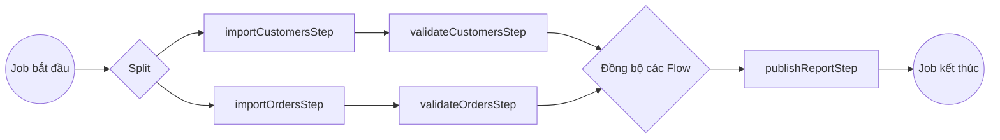

# Split flow trong một Job với Spring Batch

Trong một hệ thống xử lý dữ liệu lớn, không phải công việc nào cũng cần chờ công việc trước đó kết thúc. Chẳng hạn, một Job nhập dữ liệu cuối ngày cần tải **khách hàng** và **đơn hàng** từ hai nguồn độc lập, sau đó mới lập báo cáo tổng hợp. Nếu thực hiện tuần tự, thời gian xử lý bằng tổng thời gian của các nhóm công việc. **Parallel Steps** cho phép tổ chức các Step độc lập thành những **Flow chạy đồng thời trong cùng một Job**, giảm thời gian chờ mà vẫn giữ cơ chế quản lý trạng thái, lỗi và restart của Spring Batch.

Bài học này tập trung vào **split flow trong một Job**: khi nào nên sử dụng, cách cấu hình bằng Java, các giới hạn về thread và tài nguyên, cách xử lý thất bại và kiểm chứng hiệu quả vận hành. Đây là một cách mở rộng Spring Batch trên **cùng tiến trình ứng dụng**; để phân phối khối lượng công việc ra nhiều tiến trình hoặc máy chủ, cần kiến trúc khác như remote partitioning hoặc remote chunking.

## 1. Mục tiêu học tập

Sau bài này, bạn có thể:

1. Phân biệt `Job`, `Step`, `Flow` và `split`; giải thích ranh giới song song và điểm chờ đồng bộ.
2. Xây dựng hai Flow gồm các Step chạy tuần tự bên trong từng Flow nhưng chạy song song với Flow còn lại.
3. Cấu hình `TaskExecutor` có giới hạn, xác định ràng buộc dữ liệu, transaction và thread safety giữa các nhánh.
4. Dự đoán hành vi của Job khi một Flow thành công, Flow khác thất bại và khi restart cùng `JobInstance`.
5. Đo thời gian thực thi, đánh giá nút thắt và lựa chọn parallel steps thay vì multi-threaded step hoặc partitioning khi phù hợp.

## 2. Vì sao cần split flow?

Giả sử một quy trình nhập dữ liệu cuối ngày có các bước:

- Nhánh **khách hàng**: `importCustomersStep` → `validateCustomersStep`.
- Nhánh **đơn hàng**: `importOrdersStep` → `validateOrdersStep`.
- Bước cuối: `publishReportStep`, chỉ được chạy sau khi cả hai nhánh hoàn tất thành công.

Nếu tuần tự hóa toàn bộ quy trình, nhánh đơn hàng phải chờ nhánh khách hàng dù không cần dữ liệu đầu ra của nhánh khách hàng để thực hiện công việc riêng. Với split flow, hai chuỗi bước có thể được khởi chạy đồng thời:



**Hai mức thứ tự cần ghi nhớ:**

- **Trong một Flow**, các Step vẫn nối tiếp theo thứ tự đã khai báo, trừ khi Flow có định tuyến trạng thái riêng.
- **Giữa các Flow được đưa vào split**, Spring Batch gửi các Flow đến `TaskExecutor` để thực thi đồng thời. Trước khi chuyển sang trạng thái tiếp theo, split **chờ tất cả Flow hoàn tất** và tổng hợp kết quả thực thi.

Điểm đồng bộ sau split thường được gọi là *join* trong mô hình luồng. Đây là hành vi đồng bộ của split; bạn không cần tự xây một bộ đếm hoặc `CountDownLatch` trong logic nghiệp vụ.

### Điều kiện để hai nhánh thực sự độc lập

Hai Flow chỉ nên chạy đồng thời nếu việc nhập dữ liệu đơn hàng không phụ thuộc vào kết quả **chưa hoàn tất** của nhánh khách hàng. Nếu `importOrdersStep` phải tra cứu ngay các khách hàng được nhập bởi `importCustomersStep`, tách hai Step thành hai nhánh đồng thời có thể tạo dữ liệu thiếu, truy vấn không ổn định hoặc lỗi khóa ngoại.

Một số cách xử lý phụ thuộc:

| Tình huống | Cách thiết kế phù hợp |
| --- | --- |
| Hai nguồn tách biệt, ghi vào bảng staging riêng | Đưa vào hai Flow song song |
| Đơn hàng bắt buộc dựa trên dữ liệu khách hàng vừa nhập | Nhập khách hàng trước, rồi mới xử lý đơn hàng; hoặc thay đổi quy trình staging để tách được phụ thuộc |
| Hai nhánh tạo kết quả độc lập, báo cáo cần cả hai | Split hai nhánh, đặt Step báo cáo **sau** split |
| Cần chia **cùng một tập dữ liệu** thành nhiều vùng xử lý | Cân nhắc partitioning, thay vì tạo nhiều Flow thủ công cho từng vùng |

## 3. Các thành phần Spring Batch tham gia

| Thành phần | Vai trò trong bài toán |
| --- | --- |
| `Job` | Đơn vị xử lý tổng thể, có `JobExecution`, trạng thái và tham số chạy |
| `Step` | Đơn vị công việc có `StepExecution`, transaction, thống kê, trạng thái và cơ chế restart |
| `Flow` | Đồ thị điều hướng giữa các Step hoặc Flow khác; chứa các chuyển tiếp theo `ExitStatus` |
| `FlowBuilder` | API khai báo thứ tự, điều kiện và split các Flow |
| `TaskExecutor` | Quyết định các Flow được lập lịch trên thread nào và mức đồng thời khả dụng |
| `JobRepository` | Lưu metadata cho Job/Step và hỗ trợ theo dõi, restart |

`split` **không tự tách** một Step lớn thành nhiều phần dữ liệu, cũng không khiến `ItemReader` hoặc `ItemWriter` của một Step tự nhiên hoạt động trên nhiều thread. Mỗi nhánh có các Step riêng, với `StepExecution` và transaction của từng Step. Các Step thuộc nhiều nhánh có thể chạy trùng thời gian.

## 4. Cấu hình split flow bằng Java

Ví dụ sau dùng cấu hình dựa trên `JobBuilder` và `FlowBuilder` của Spring Batch hiện đại (Spring Batch 5/6). Giả sử bốn bean `Step` nhập/kiểm tra dữ liệu và bean `publishReportStep` đã được định nghĩa bằng chunk-oriented Step hoặc Tasklet tương ứng. Phần code tập trung vào **cách nối các Step thành Flow và Job**.

```java
import org.springframework.batch.core.Job;
import org.springframework.batch.core.Step;
import org.springframework.batch.core.job.builder.JobBuilder;
import org.springframework.batch.core.job.builder.FlowBuilder;
import org.springframework.batch.core.job.flow.Flow;
import org.springframework.batch.core.job.flow.support.SimpleFlow;
import org.springframework.batch.core.repository.JobRepository;
import org.springframework.context.annotation.Bean;
import org.springframework.context.annotation.Configuration;
import org.springframework.beans.factory.annotation.Qualifier;
import org.springframework.core.task.TaskExecutor;
import org.springframework.scheduling.concurrent.ThreadPoolTaskExecutor;

@Configuration
public class ParallelImportJobConfig {

    @Bean
    public Flow customersFlow(
            @Qualifier("importCustomersStep") Step importCustomersStep,
            @Qualifier("validateCustomersStep") Step validateCustomersStep) {
        return new FlowBuilder<SimpleFlow>("customersFlow")
                .start(importCustomersStep)
                .next(validateCustomersStep)
                .build();
    }

    @Bean
    public Flow ordersFlow(
            @Qualifier("importOrdersStep") Step importOrdersStep,
            @Qualifier("validateOrdersStep") Step validateOrdersStep) {
        return new FlowBuilder<SimpleFlow>("ordersFlow")
                .start(importOrdersStep)
                .next(validateOrdersStep)
                .build();
    }

    @Bean
    public ThreadPoolTaskExecutor flowExecutor() {
        ThreadPoolTaskExecutor executor = new ThreadPoolTaskExecutor();
        executor.setCorePoolSize(2);
        executor.setMaxPoolSize(2);
        executor.setQueueCapacity(0);
        executor.setThreadNamePrefix("batch-flow-");
        return executor;
    }

    @Bean
    public Flow importSplitFlow(
            @Qualifier("customersFlow") Flow customersFlow,
            @Qualifier("ordersFlow") Flow ordersFlow,
            @Qualifier("flowExecutor") TaskExecutor flowExecutor) {
        return new FlowBuilder<SimpleFlow>("importSplitFlow")
                .split(flowExecutor)
                .add(customersFlow, ordersFlow)
                .build();
    }

    @Bean
    public Job parallelImportJob(
            JobRepository jobRepository,
            @Qualifier("importSplitFlow") Flow importSplitFlow,
            @Qualifier("publishReportStep") Step publishReportStep) {
        return new JobBuilder("parallelImportJob", jobRepository)
                .start(importSplitFlow)
                .next(publishReportStep)
                .build()
                .build();
    }
}
```

**Cách đọc cấu hình:**

1. `customersFlow` khai báo `importCustomersStep` rồi `validateCustomersStep`. Tương tự, `ordersFlow` xử lý phần đơn hàng.
2. `flowExecutor` có hai worker thread cho **hai Flow** trong ví dụ. Vì đây là bean do Spring quản lý, container thực hiện vòng đời khởi tạo/hủy của executor.
3. `importSplitFlow` gom hai Flow và yêu cầu thực thi bằng `TaskExecutor`. `.add(customersFlow, ordersFlow)` thêm hai nhánh vào cùng một split.
4. `parallelImportJob` chạy split trước, sau khi split **hoàn tất thành công** mới chạy `publishReportStep`.
5. Hai lời gọi `.build()` cuối có hai trách nhiệm khác nhau: hoàn tất định nghĩa luồng Job, rồi tạo đối tượng `Job`.

Với các phiên bản Spring Batch có cú pháp `.start(flow1).split(executor).add(flow2)`, bạn cũng có thể ghép trực tiếp. Việc đặt split trong một `Flow` riêng như ở trên giúp nhìn rõ ranh giới đồng bộ và thuận tiện đặt Step tiếp theo sau split. Tránh gắn split tùy tiện vào giữa một chuỗi Flow đã ghép phức tạp; hãy cấu trúc phần split thành Flow riêng.

### Vì sao phải truyền TaskExecutor bất đồng bộ?

Việc khai báo split **chưa đủ** bảo đảm hai Flow chạy song song. Nếu dùng `SyncTaskExecutor`, các Flow được thực thi ngay trên thread gọi và về thực tế có thể nối tiếp nhau. Cần `TaskExecutor` bất đồng bộ với đủ khả năng thực thi để quan sát độ chồng lấn của hai nhánh.

`ThreadPoolTaskExecutor` có giới hạn chủ động thường dễ vận hành hơn việc tạo thread không giới hạn. Trong ví dụ:

- `corePoolSize = maxPoolSize = 2`: tối đa hai thread cho executor này.
- `queueCapacity = 0`: không giữ hàng đợi cho công việc vượt sức chứa; có thể bị từ chối khi pool đã bận, chẳng hạn khi nhiều Job dùng chung executor.
- Số thread **không đồng nghĩa** với số kết nối DB; cả hai phải được tính cùng với transaction và các Job khác trong ứng dụng.

Cấu hình hai thread chỉ minh họa cho **một lần chạy Job với hai nhánh**. Với nhiều JobExecution chạy đồng thời hoặc nhiều Flow hơn, phải đo tải và chọn pool/queue/rejection policy thích hợp. Một executor bị quá tải hoặc từ chối task có thể khiến việc thực thi split thất bại.

## 5. Dòng thực thi: song song ở đâu, chờ ở đâu?

Giả sử mỗi nhánh bắt đầu gần cùng thời điểm, lịch chạy có thể như sau (thứ tự thực tế phụ thuộc scheduler và thời gian xử lý):

```text
Thread batch-flow-1       Thread batch-flow-2           Điều phối Job
        |                         |                           |
 importCustomersStep       importOrdersStep             split bắt đầu
        |                         |                           |
 validateCustomersStep     validateOrdersStep                 |
        |                         |                           |
    COMPLETED                  COMPLETED                       |
        +-------------------------+---------------------------+
                                                              |
                                                     publishReportStep
                                                              |
                                                         Job kết thúc
```

**Lưu ý về kết quả:** split chờ các Flow đã khởi chạy hoàn tất rồi tổng hợp `ExitStatus`; sự thất bại ở một Flow không đồng nghĩa Spring Batch sẽ lập tức dừng hoặc rollback các Flow còn lại. Các thay đổi đã commit ở những Step khác không tự bị đảo ngược.

Trong từng Step, Spring Batch vẫn áp dụng cơ chế transaction, chunk commit, retry, skip và checkpoint theo cấu hình của Step đó. Split chỉ thay đổi **cách các Flow được điều phối**, không biến mọi Step trong Job thành một transaction chung.

## 6. Tính độc lập dữ liệu và thread safety

Khi hai Flow chạy trên hai thread, các đối tượng dùng chung là nguồn gây lỗi lớn hơn bản thân API `split`.

### 6.1. State của reader, processor, writer và listener

Một Flow có Step riêng nhưng có thể vô tình dùng chung bean singleton có state. Ví dụ, nếu `ItemReader` của nhánh A và nhánh B cùng giữ một con trỏ đọc mutable, cả hai có thể ghi đè vị trí hiện tại của nhau. Với thành phần có state:

- Ưu tiên mỗi Step có component phù hợp với vòng đời riêng; dùng `@StepScope` khi cần state theo `StepExecution` hoặc tham số runtime.
- Đừng chia sẻ mutable counter, buffer, cache hoặc file cursor giữa hai nhánh mà không có cơ chế đồng bộ rõ ràng.
- Bean dùng chung chỉ nên truy cập đồng thời nếu thực sự thread-safe, hoặc dữ liệu của các nhánh đã tách hoàn toàn.
- Kiểm tra cả listener và service được gọi bên dưới, không chỉ `ItemReader`/`ItemWriter` trực tiếp.

**Ví dụ lỗi:** hai Step cùng ghi ra `output.csv` bằng hai `FlatFileItemWriter` độc lập nhưng chung đường dẫn. Mỗi writer tưởng mình sở hữu file; kết quả có thể trộn dữ liệu hoặc bị ghi đè. Tốt hơn, ghi vào `customers.csv` và `orders.csv`, rồi hợp nhất ở Step sau join.

### 6.2. ExecutionContext của Step và Job

`StepExecutionContext` lưu checkpoint và trạng thái theo Step; đặt những giá trị như offset đọc dữ liệu hoặc số lô đã xử lý tại đây. `JobExecutionContext` có phạm vi toàn Job. Các nhánh chạy đồng thời nên hạn chế sửa cùng khóa của context cấp Job; cập nhật dùng chung không được xem như một phép cộng/ghi nguyên tử.

Nếu Step báo cáo cần thông tin từ cả hai nhánh, có thể:

1. Để mỗi nhánh lưu kết quả vào bảng staging hoặc artifact riêng với định danh `jobExecutionId`/batch ID thích hợp.
2. Hoặc ghi các khóa phân biệt vào context và tổ chức việc chuyển/gộp dữ liệu sau khi các nhánh hoàn tất, có đồng bộ rõ ràng nếu cần.
3. Cho `publishReportStep` đọc kết quả **sau split**, khi không còn nhánh đang thay đổi dữ liệu đầu vào.

Đừng dùng một biến Java toàn cục như nơi truyền dữ liệu tạm giữa các Flow: nhiều JobExecution trong cùng tiến trình có thể đồng thời sử dụng biến đó.

### 6.3. Transaction và tài nguyên chia sẻ

| Tài nguyên | Rủi ro khi chạy song song | Hướng xử lý |
| --- | --- | --- |
| Cùng bảng DB | Lock contention, deadlock, update cùng bản ghi | Phân tách vùng dữ liệu/khóa, giao dịch ngắn, chỉ mục và thứ tự khóa ổn định |
| Connection pool | Hết connection khi cả hai Step truy vấn hoặc ghi | Điều chỉnh pool theo số Step/Job đồng thời, dành chỗ cho transaction của batch metadata |
| File và thư mục | Đọc file chưa hoàn tất, ghi trùng đích | Đường dẫn riêng theo nhánh/run, xuất bản file bằng bước cuối sau khi hoàn thành |
| API bên ngoài | Vượt rate limit hoặc timeout hàng loạt | Giới hạn đồng thời, retry có backoff, circuit breaker khi cần |
| Bộ nhớ và CPU | GC tăng, tranh CPU, throughput giảm | Đo heap, kích thước chunk và số worker trước khi tăng pool |

**Tính idempotent rất quan trọng:** khi một Job phải restart, một phần ghi dữ liệu có thể đã commit. Ưu tiên khóa duy nhất theo nghiệp vụ, upsert có kiểm soát, checkpoint, mã xử lý theo batch ID và cơ chế tránh ghi trùng. Parallel steps không mang lại tính *exactly-once* cho API, file hay cơ sở dữ liệu ngoài chỉ vì JobRepository lưu trạng thái.

## 7. Thất bại, retry và restart

Xét lần chạy thứ nhất của cùng một `JobInstance`:

| Step | Lần 1 | Khi restart cùng JobInstance |
| --- | --- | --- |
| `importCustomersStep` | `COMPLETED` | Thường được bỏ qua |
| `validateCustomersStep` | `COMPLETED` | Thường được bỏ qua |
| `importOrdersStep` | `FAILED` sau khi ghi một phần | Được chạy lại theo cấu hình restart và checkpoint |
| `validateOrdersStep` | Chưa chạy | Chạy khi nhập đơn hàng thành công |
| `publishReportStep` | Chưa chạy vì split thất bại | Chạy sau khi split thành công |

Đây là hành vi thông thường của Job có thể restart và các Step không đặt `allowStartIfComplete(true)`. Spring Batch lưu StepExecution trong `JobRepository`; khi khởi chạy lại **cùng JobInstance** với trạng thái cho phép restart, các Step đã `COMPLETED` thường không chạy lại. Step thất bại phải có reader/writer và checkpoint được thiết kế để tiếp tục chính xác; chỉ bật restart trong cấu hình không giải quyết được tình trạng ghi trùng ngoài hệ thống.

Các điểm cần phân biệt:

- **Retry** diễn ra *bên trong một lần chạy Step* khi lỗi đáp ứng retry policy; nếu vượt giới hạn, Step mới có thể kết thúc `FAILED`.
- **Restart** là một `JobExecution` mới của cùng `JobInstance` (giữ JobParameters định danh tương ứng), tận dụng metadata của các Step đã chạy.
- `allowStartIfComplete(true)` cho phép một Step đã hoàn thành được chạy lại khi restart; dùng có chủ đích vì có thể lặp lại tác dụng phụ.
- Một Flow có thể khai báo chuyển tiếp riêng cho các `ExitStatus` khác nhau. Kết quả Job và việc đi tiếp phụ thuộc **toàn bộ luật điều hướng**, không thể suy chỉ từ một Step bất kỳ.
- Nếu một Flow thất bại, Flow còn lại có thể vẫn hoàn thành. Không xem split như cơ chế dừng khẩn cấp mọi task hoặc transaction phân tán có rollback đồng loạt.

Trong vận hành, trước khi restart nên trả lời được: *lỗi thuộc Flow nào, Step nào, dữ liệu đã commit đến đâu, hệ thống đích có thao tác nào không thể rollback và chạy lại có sinh trùng không?*

## 8. Đo nút thắt trước và sau khi song song hóa

Giả sử nhánh khách hàng mất 12 phút, nhánh đơn hàng mất 8 phút, bước lập báo cáo mất 3 phút. Nếu hai nhánh độc lập và tài nguyên đủ:

| Phương án | Ước tính thời gian |
| --- | --- |
| Chạy tuần tự hai nhánh, rồi lập báo cáo | 12 + 8 + 3 = **23 phút** |
| Split hai nhánh, rồi lập báo cáo | max(12, 8) + 3 = **15 phút** |
| Phần thời gian tiết kiệm lý tưởng | **8 phút**, trước khi cộng overhead và tranh chấp tài nguyên |

Đây là **ước tính**, không phải cam kết về tốc độ. Tăng số thread có thể không giúp nếu DB đã đạt giới hạn I/O, pool kết nối quá nhỏ hoặc các Step cùng khóa trên bảng dữ liệu.

Để đánh giá hiệu quả, nên ghi nhận:

1. `JobExecutionId`, tên Step/Flow, `startTime`, `endTime` và trạng thái; so sánh timeline xem các Step ở hai nhánh có thực sự chồng lấn.
2. Thời lượng từng Step, số bản ghi đọc/ghi, commit/rollback, retry/skip; tìm Step dài nhất trên đường tới join.
3. CPU, heap/GC, số connection đang dùng, thời gian chờ connection/lock, I/O và rate-limit của hệ thống đích.
4. Hiệu quả trên nhiều lần chạy và cả khi có nhiều Job đồng thời, không chỉ trên một lần thử có dữ liệu nhỏ.

Nếu nhánh A mất 12 phút nhưng nhánh B chỉ 1 phút, tối ưu B xuống 10 giây hầu như không giảm tổng thời gian sau split; nút thắt đã chuyển sang A hoặc bước sau join.

## 9. Split flow khác gì các cách mở rộng khác?

| Kỹ thuật | Đơn vị song song | Thích hợp khi | Lưu ý chính |
| --- | --- | --- | --- |
| **Parallel Steps / split flow** | Nhiều Flow/Step độc lập của cùng Job | Có vài nhóm trách nhiệm khác nhau, ít phụ thuộc chéo | Cần quản lý tài nguyên và state giữa các nhánh |
| Multi-threaded Step | Công việc trong **một Step** | Một Step xử lý nhiều item và mô hình đọc/ghi hỗ trợ cách chạy đồng thời | Kiểm tra thread safety, transaction và cách framework thực hiện concurrency ở phiên bản đang dùng |
| Local partitioning | Nhiều StepExecution xử lý các phân vùng dữ liệu của **cùng Step logic** | Dữ liệu có khóa/range phân hoạch rõ ràng | Cần `Partitioner`, cân bằng phân vùng và checkpoint |
| Remote partitioning | StepExecution phân phối qua nhiều worker | Cần mở rộng ra nhiều tiến trình/máy | Thêm mạng, broker/middleware và xử lý worker lỗi |
| Remote chunking | Các chunk được chuyển đến worker từ phía manager | Muốn phân tán phần xử lý item/chunk | Cần cơ chế truyền nhận và bảo đảm xử lý lại |

Ví dụ, nhập khách hàng và nhập đơn hàng là **hai trách nhiệm khác nhau** → split flow phù hợp. Nhập **100 triệu đơn hàng trong cùng một nguồn** theo khoảng ID → cân nhắc partitioning. Hai kỹ thuật cũng có thể phối hợp, nhưng concurrency tổng cộng phải tính trên **mọi tầng**, tránh nhân số worker đến mức vượt tài nguyên.

## 10. Các lỗi thiết kế thường gặp

1. **Đặt Step phụ thuộc vào nhánh song song:** Step cần dữ liệu của Flow khác sẽ đọc dữ liệu chưa hoàn thiện. Hãy chuyển Step đó xuống sau join hoặc thiết kế staging rõ ràng.
2. **Dùng executor đồng bộ hoặc thiếu worker:** mã có `split` nhưng thời gian chạy vẫn nối tiếp. Kiểm tra thread name và timeline thực tế.
3. **Tăng pool mà không đo connection/lock:** nhiều thread hơn chỉ làm tăng timeout, deadlock hoặc độ trễ DB.
4. **Dùng chung component mutable hoặc file đích:** hai nhánh tranh nhau state, gây mất checkpoint hoặc dữ liệu hỏng.
5. **Tưởng một Flow lỗi sẽ rollback các Flow còn lại:** mỗi Step có ranh giới commit riêng; cần chiến lược phục hồi hoặc bù trừ ở tầng nghiệp vụ.
6. **Restart bằng JobParameters định danh khác mà vẫn mong bỏ qua Step cũ:** điều đó thường tạo **JobInstance mới**, không dùng lại tiến trình restart của instance trước.
7. **Gắn split giữa chuỗi Flow phức tạp mà không tách ranh giới:** có thể không được hỗ trợ đúng theo API builder. Dùng `splitFlow` riêng rồi liên kết với các Step trước/sau.
8. **Đo riêng thời gian Step mà bỏ qua Job:** tổng thời gian phụ thuộc nhánh chậm nhất, điểm join, bước xử lý sau join và tranh chấp với Job khác.

## 11. Bài thực hành gợi ý

Hãy tạo ba nhóm Step độc lập có thể chạy thử bằng dữ liệu nhỏ:

- Flow A: đọc tệp khách hàng → kiểm tra số bản ghi.
- Flow B: đọc tệp đơn hàng → kiểm tra số bản ghi.
- Sau split: tạo báo cáo tổng hợp chỉ khi dữ liệu cả hai nguồn đã sẵn sàng.

**Lần thử 1 — tuần tự:** nối các Step trong một chuỗi, ghi thời gian bắt đầu/kết thúc. **Lần thử 2 — song song:** tạo hai Flow và `ThreadPoolTaskExecutor` hai worker, so timeline và thời gian toàn Job. **Lần thử 3 — lỗi:** chủ động làm `importOrdersStep` thất bại sau một checkpoint, quan sát `JobRepository` rồi restart **cùng JobInstance**. Xác minh Flow khách hàng đã hoàn thành không bị chạy lại theo cấu hình mặc định, và báo cáo chỉ chạy khi split hoàn thành.

Khi kiểm chứng, đừng chỉ so tổng thời lượng: hãy đối chiếu tổng bản ghi, số bản ghi trùng, trạng thái từng Step, dữ liệu đầu ra và số transaction rollback. Một Job nhanh hơn nhưng thiếu dữ liệu không đạt mục tiêu.

### Câu hỏi tự kiểm tra

1. Trong sơ đồ đầu bài, tại sao `publishReportStep` phải đặt sau split?
2. Hai Flow có còn chạy song song nếu truyền `SyncTaskExecutor` vào `split` không?
3. Vì sao hai Flow có Step riêng vẫn có thể gặp vấn đề thread safety?
4. Khi `ordersFlow` thất bại, Spring Batch có tự rollback kết quả đã commit của `customersFlow` không?
5. Khi nào bạn sẽ thay split flow bằng partitioning?

## Tài liệu tham khảo

- [Spring Batch Reference — Scaling and Parallel Processing](https://docs.spring.io/spring-batch/reference/scalability.html), mục **Parallel Steps**.
- [Spring Batch Reference — Controlling Step Flow](https://docs.spring.io/spring-batch/reference/step/controlling-flow.html), mục **Split Flows**.
- [Spring Batch Reference — Configuring a Step for Restart](https://docs.spring.io/spring-batch/reference/step/chunk-oriented-processing/restart.html).
- [Spring Batch API — FlowBuilder](https://docs.spring.io/spring-batch/reference/api/org/springframework/batch/core/job/builder/FlowBuilder.html).
