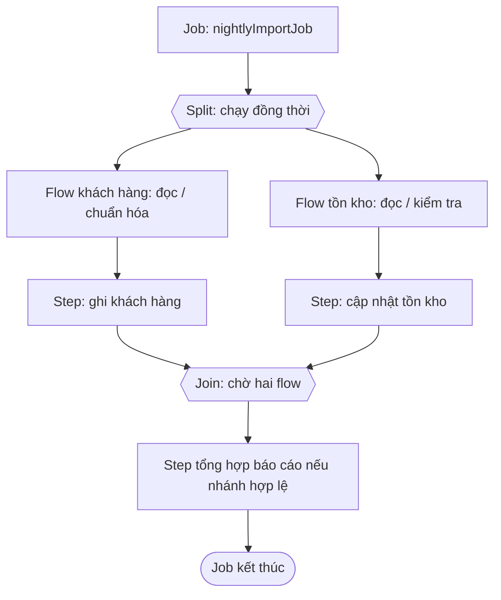

# Chạy hai flow độc lập song song trong Spring Batch

## 1. Bài toán: hai nhánh công việc không cần chờ nhau

Một job tổng hợp dữ liệu chạy mỗi đêm phải làm hai việc:

- **Flow khách hàng:** đọc dữ liệu khách hàng, kiểm tra và cập nhật bảng khách hàng.
- **Flow hàng tồn kho:** đọc bản chụp tồn kho, tính toán và cập nhật bảng tồn kho.

Hai nguồn dữ liệu và hai bảng đích độc lập. Nếu cấu hình các step theo một chuỗi, job buộc phải chờ xử lý khách hàng xong rồi mới bắt đầu tồn kho, dù máy còn CPU, I/O và kết nối cơ sở dữ liệu. Spring Batch hỗ trợ **parallel steps thông qua hai flow và một split**: các step **bên trong mỗi flow** vẫn chạy theo thứ tự, còn **hai flow** được khởi chạy đồng thời.

Đây là kỹ thuật mở rộng trong module **SPRING_BATCH_SCALING_OPERATIONS**, cùng họ với multi-threaded step, partitioning và các mô hình phân tán. Mục tiêu là sử dụng tốt tài nguyên hiện có, đo nút thắt thật, bảo đảm thread safety, retry/restart và chọn kiến trúc có độ phức tạp phù hợp với workload dữ liệu lớn.

Sau bài học, bạn sẽ:

1. Phân biệt `Step`, `Flow`, `Split`, `TaskExecutor` và một `JobExecution`.
2. Cấu hình hai flow độc lập chạy song song bằng Spring Batch Java DSL.
3. Biết khi nào nên đặt step tổng hợp **sau khi cả hai flow kết thúc**.
4. Thiết kế tài nguyên, dữ liệu và transaction để tránh race condition.
5. Hiểu trạng thái lỗi, restart, quan sát và giới hạn hiệu năng của cách mở rộng này.

## 2. Từ Step đến Flow và Split

**Step** là một đơn vị thực thi Batch có `StepExecution`, trạng thái và metadata trong `JobRepository`. Step có thể là chunk-oriented step hoặc tasklet step.

**Flow** là một chuỗi điều phối gồm step và/hoặc trạng thái chuyển hướng. Flow có thể rẽ nhánh theo `ExitStatus`. Các step nối nhau bằng `next(...)` bên trong cùng một flow vẫn chạy **tuần tự**, trừ khi chính flow chứa cấu trúc song song khác.

**Split** là điểm tách điều phối thành nhiều flow cùng được thực thi bởi `TaskExecutor`. Split hoạt động như một **điểm đồng bộ (join/barrier)**: trạng thái của các nhánh được thu thập sau khi chúng kết thúc, rồi luồng phía sau split mới được xét tiếp.

**TaskExecutor** quyết định cách các flow được thực thi. Dùng executor có đủ thread mới tạo ra tính đồng thời thật; `SyncTaskExecutor` chạy trên thread gọi và không mang lại song song. Ví dụ thực tế thường sử dụng `ThreadPoolTaskExecutor` để có giới hạn tài nguyên.



Trong hình, `A1 → A2` và `B1 → B2` là hai chuỗi tuần tự, còn flow A và B có thể chạy xen kẽ hoặc đồng thời. Hình minh họa nhánh `REPORT` tùy chọn; phần cấu hình tối thiểu bên dưới trước hết chỉ chạy hai flow và kết thúc job.

> **Phân biệt:** Đây vẫn là **một JobInstance/JobExecution** có nhiều `StepExecution`. Hai flow không đồng nghĩa với hai job độc lập, cũng không tự tạo hai JVM hoặc hai container. Song song flow ở cấu hình local dùng các thread trong cùng JVM.

## 3. Khi nào hai flow thực sự độc lập?

Điều kiện quan trọng không phải là hai flow có tên khác nhau, mà là **không có phụ thuộc dữ liệu hoặc thứ tự** yêu cầu một flow phải hoàn tất trước flow kia.

| Câu hỏi trước khi split | Phù hợp để song song | Cần thay đổi thiết kế |
|---|---|---|
| Đầu vào của B có cần kết quả từ A không? | Không; hai nhánh nhận dữ liệu đã sẵn sàng | Có; đặt B sau A hoặc tách phần phụ thuộc thành step sau join |
| Hai nhánh có ghi cùng bản ghi không? | Không, hoặc có upsert/locking đã được thiết kế | Có nguy cơ lost update, ghi trùng hoặc deadlock |
| Có yêu cầu thứ tự nghiệp vụ không? | Không bắt buộc A trước B | Có; giữ thứ tự trong cùng flow |
| Khi A lỗi, B đã ghi dữ liệu có chấp nhận được không? | Có cơ chế đối soát, restart hoặc bù trừ | Phải yêu cầu giao dịch nguyên tử trên cả hai nhánh |
| Tài nguyên có đủ cho hai nhánh không? | DB pool, CPU, disk và API downstream còn dư | Hai flow cùng cạnh tranh một nút thắt đã bão hòa |

Ví dụ hợp lệ: cập nhật catalog sản phẩm và lập báo cáo rủi ro từ hai bản chụp dữ liệu độc lập. Ví dụ **không hợp lệ**: tính hóa đơn cuối kỳ từ bảng đơn hàng **đang** được flow kia cập nhật, nếu không có snapshot, watermark hoặc quy tắc nhất quán rõ ràng.

Hai flow có thể đọc chung một nguồn **chỉ khi** mỗi flow sở hữu reader riêng và ngữ nghĩa đọc nhất quán. Một reader stateful dùng chung cho cả hai thread có nguy cơ làm sai thứ tự, duplicate, bỏ sót hoặc mất checkpoint.

## 4. Cấu hình tối thiểu với FlowBuilder và split

Ví dụ Java DSL dưới đây theo cách cấu hình phổ biến của **Spring Batch 5.x** với Java configuration. Ứng dụng phải cung cấp sẵn bốn `Step` nghiệp vụ: `loadCustomerStep`, `publishCustomerStep`, `loadStockStep` và `verifyStockStep`. Mỗi step tự có reader/processor/writer hoặc tasklet, transaction manager và các bean cần thiết.

```java
import org.springframework.batch.core.Job;
import org.springframework.batch.core.Step;
import org.springframework.batch.core.job.builder.JobBuilder;
import org.springframework.batch.core.job.flow.Flow;
import org.springframework.batch.core.job.flow.support.SimpleFlow;
import org.springframework.batch.core.job.flow.builder.FlowBuilder;
import org.springframework.batch.core.repository.JobRepository;
import org.springframework.beans.factory.annotation.Qualifier;
import org.springframework.context.annotation.Bean;
import org.springframework.context.annotation.Configuration;
import org.springframework.core.task.TaskExecutor;
import org.springframework.scheduling.concurrent.ThreadPoolTaskExecutor;

@Configuration
public class ParallelFlowsConfiguration {

    @Bean
    public Flow customerFlow(
            @Qualifier("loadCustomerStep") Step loadCustomer,
            @Qualifier("publishCustomerStep") Step publishCustomer) {
        return new FlowBuilder<SimpleFlow>("customerFlow")
                .start(loadCustomer)
                .next(publishCustomer)
                .build();
    }

    @Bean
    public Flow stockFlow(
            @Qualifier("loadStockStep") Step loadStock,
            @Qualifier("verifyStockStep") Step verifyStock) {
        return new FlowBuilder<SimpleFlow>("stockFlow")
                .start(loadStock)
                .next(verifyStock)
                .build();
    }

    @Bean("parallelFlowExecutor")
    public ThreadPoolTaskExecutor parallelFlowExecutor() {
        ThreadPoolTaskExecutor executor = new ThreadPoolTaskExecutor();
        executor.setCorePoolSize(2);
        executor.setMaxPoolSize(2);
        executor.setQueueCapacity(4);
        executor.setThreadNamePrefix("batch-flow-");
        executor.initialize();
        return executor;
    }

    @Bean
    public Job nightlyImportJob(
            JobRepository jobRepository,
            @Qualifier("customerFlow") Flow customer,
            @Qualifier("stockFlow") Flow stock,
            @Qualifier("parallelFlowExecutor") TaskExecutor executor) {
        return new JobBuilder("nightlyImportJob", jobRepository)
                .start(customer)
                .split(executor)
                .add(stock)
                .end()
                .build();
    }
}
```

Giải thích từng phần:

- `FlowBuilder<SimpleFlow>("customerFlow")` định nghĩa **nhánh điều phối**, trong đó `loadCustomerStep` chạy trước `publishCustomerStep`.
- `stockFlow` có chuỗi riêng, với tên các step **khác** tên step của flow khách hàng.
- `.start(customer).split(executor).add(stock)` tạo split gồm flow khách hàng và flow tồn kho; cách viết này không có nghĩa customer flow phải chạy xong mới đến stock flow.
- `.end().build()` hoàn tất đồ thị job. Job được launch theo cơ chế Spring Batch thường dùng; gọi `JobLauncher` là trách nhiệm của ứng dụng.
- `ThreadPoolTaskExecutor` có hai worker thread cho hai nhánh. Queue capacity là giới hạn hàng đợi task của executor, **không phải** hàng đợi message broker.

Ví dụ là cấu hình điều phối, chưa phải ứng dụng đầy đủ: bốn bean Step nghiệp vụ phải tồn tại và được cấu hình nhất quán với JobRepository, transaction manager, dữ liệu thực tế. Khi dùng Spring Batch 6.x hoặc phiên bản khác, kiểm tra package, API builder và yêu cầu tối thiểu của phiên bản đang sử dụng trước khi sao chép code.

### Ví dụ một step nghiệp vụ để ghép vào flow

Một tasklet step có thể trông như sau; các step còn lại được khai báo tương tự nhưng gọi nghiệp vụ riêng:

```java
import org.springframework.batch.core.Step;
import org.springframework.batch.core.repository.JobRepository;
import org.springframework.batch.core.step.builder.StepBuilder;
import org.springframework.batch.repeat.RepeatStatus;
import org.springframework.context.annotation.Bean;
import org.springframework.transaction.PlatformTransactionManager;

@Bean("verifyStockStep")
public Step verifyStockStep(
        JobRepository jobRepository,
        PlatformTransactionManager transactionManager,
        StockValidationService service) {
    return new StepBuilder("verifyStockStep", jobRepository)
            .tasklet((contribution, chunkContext) -> {
                service.validateCurrentSnapshot();
                return RepeatStatus.FINISHED;
            }, transactionManager)
            .build();
}
```

`StockValidationService` chỉ là interface/service nghiệp vụ minh họa do ứng dụng cung cấp; không phải class của Spring Batch. Tasklet chạy khi nhánh tồn kho tiến đến `verifyStockStep`. Với công việc đọc hàng triệu bản ghi, step dùng chunk-oriented processing và reader/processor/writer có checkpoint thường thích hợp hơn tasklet gọi một hàm xử lý toàn bộ.

## 5. Thêm một step chỉ chạy sau khi hai flow kết thúc

Nếu sau hai nhánh phải tạo báo cáo hợp nhất, không đặt báo cáo ở **cuối riêng một nhánh**: khi đó báo cáo có thể bắt đầu khi nhánh kia còn đang chạy.

Hãy tạo một split flow, sau đó nối step báo cáo **sau split**:

```java
@Bean
public Flow parallelImportFlow(
        @Qualifier("customerFlow") Flow customer,
        @Qualifier("stockFlow") Flow stock,
        @Qualifier("parallelFlowExecutor") TaskExecutor executor) {
    return new FlowBuilder<SimpleFlow>("parallelImportFlow")
            .split(executor)
            .add(customer, stock)
            .build();
}

@Bean
public Job nightlyImportWithSummary(
        JobRepository jobRepository,
        @Qualifier("parallelImportFlow") Flow parallel,
        @Qualifier("summaryStep") Step summary) {
    return new JobBuilder("nightlyImportWithSummary", jobRepository)
            .start(parallel)
            .next(summary)
            .end()
            .build();
}
```

**Ý nghĩa:** `summaryStep` chỉ được xét thực thi sau khi split tổng hợp kết quả của cả hai flow. Với chuyển tiếp bình thường, step này chạy khi hai nhánh hoàn thành thành công. Nếu một nhánh FAILED/STOPPED, trạng thái tổng hợp có thể ngăn nhánh thành công bình thường hoặc dẫn tới chuyển tiếp lỗi tùy cấu hình; không mặc định báo cáo vẫn chạy.

Nếu nghiệp vụ muốn **báo cáo lỗi hoặc cleanup** sau failure, hãy mô hình hóa các chuyển tiếp `on("FAILED")`, `fail()`, `stop()`, `end()` hoặc listener tương ứng một cách rõ ràng và kiểm thử exit status. `end()` trong Java DSL để đóng cấu hình flow/job khác với ý nghĩa transition `end()` có thể tạo trạng thái hoàn tất; không nên dùng `end()` để “nuốt” mọi lỗi mà không hiểu trạng thái kết thúc.

## 6. Dòng thời gian thực thi: song song đến đâu?

Giả sử flow khách hàng gồm hai step A1 và A2, flow tồn kho gồm B1 và B2:

```text
Thời gian  ────────────────────────────────────────────>

Flow A     [A1: 4 phút][A2: 3 phút]         COMPLETED
Flow B     [B1: 6 phút][B2: 5 phút]         COMPLETED
Split      |--------------------------------|  join
Summary                                     [C: 2 phút]

Thời gian phần A+B chạy nối tiếp: 7 + 11 = 18 phút
Thời gian split lý tưởng: max(7, 11) = 11 phút
Toàn job có summary: khoảng 11 + 2 = 13 phút
```

Đây chỉ là ví dụ mô hình hóa: khi cùng dùng CPU, disk, connection pool hoặc hệ thống downstream, mỗi flow có thể chạy chậm hơn lúc chạy một mình. Chi phí tạo thread, transaction, checkpoint và contention khiến thời gian thực lớn hơn mức lý tưởng. Hai flow không bảo đảm nhanh gấp đôi; nếu một nhánh rất dài, nhánh ngắn hoàn thành sớm rồi chờ tại join.

Với thời lượng chạy độc lập `T_A` và `T_B`, mô hình đơn giản:

```text
T_sequential ≈ T_A + T_B
T_parallel_ideal ≈ max(T_A, T_B)
Speedup_ideal ≈ (T_A + T_B) / max(T_A, T_B) <= 2
```

Công thức giả định hai nhánh không tranh chấp tài nguyên và bỏ qua overhead. Không dùng công thức này để cam kết SLA mà chưa benchmark.

## 7. Thread safety: hai flow có thể chia sẻ những gì?

Hai flow chạy ở các thread khác nhau **trong cùng ApplicationContext**; một bean singleton có thể được cả hai nhánh gọi đồng thời. Spring Batch không tự biến mọi bean nghiệp vụ thành thread-safe.

| Tài nguyên | Cách làm an toàn | Rủi ro nếu cấu hình sai |
|---|---|---|
| `ItemReader` stateful | Mỗi step sở hữu reader riêng, scope phù hợp | Hai flow tranh iterator/cursor, checkpoint lệch |
| `ItemProcessor` | Stateless, immutable hoặc cô lập state theo step | Dùng chung mutable cache, counter không đồng bộ |
| `ItemWriter` | Mỗi writer giữ state riêng hoặc hỗ trợ concurrent write | File bị ghi đè, buffer dùng chung, dữ liệu trộn |
| `ExecutionContext` | Giữ thông tin riêng theo StepExecution; đặt key phân biệt | Hai flow ghi chung mutable value, lost update |
| Cơ sở dữ liệu | Transaction riêng, khóa nghiệp vụ, index và isolation phù hợp | Deadlock, lock wait, ghi đè dữ liệu |
| File kết quả | Đường dẫn output riêng theo branch/run; merge sau join | Hai thread cùng truncate/append một file |
| HTTP client | Client có hỗ trợ concurrency; giới hạn rate/connection | Connection exhaustion hoặc bị rate limit |

Ví dụ hai flow cùng ghi file `/reports/current.csv`:

```text
Flow A -> writer A -> /reports/current.csv
Flow B -> writer B -> /reports/current.csv
```

Nếu hai writer tạo/truncate cùng file hoặc cùng append không có cơ chế phối hợp, kết quả có thể bị mất hoặc đan xen. Một thiết kế hợp lý là `/reports/customer.csv` và `/reports/stock.csv`, sau đó một `summaryStep` duy nhất đọc hai kết quả đã chốt và tạo báo cáo tổng hợp.

**`@StepScope` không có nghĩa mỗi item nhận bean riêng**: nó tạo bean theo `StepExecution`. Điều này thường đủ cho hai step của hai flow tách biệt, nhưng nếu bản thân một step có xử lý đa luồng riêng thì vẫn cần đánh giá thread safety ở cấp item.

## 8. Transaction và tính nhất quán khi hai nhánh ghi song song

Mỗi step thực thi transaction của mình. Không có một transaction ACID duy nhất tự động ôm cả flow A, flow B và join. Nếu A đã commit dữ liệu còn B thất bại, những commit của A thường **không tự rollback** chỉ vì job cuối cùng FAILED.

Ví dụ:

1. Flow A đã cập nhật 50.000 khách hàng và hoàn tất.
2. Flow B gặp lỗi database sau khi ghi 30.000 hàng tồn kho.
3. Job có thể FAILED, nhưng 50.000 khách hàng của A và phần hàng tồn kho đã commit vẫn tồn tại.

Nếu yêu cầu **hai tập dữ liệu phải được công bố cùng lúc**, hãy dùng chiến lược:

- **Staging theo run ID:** mỗi nhánh ghi vào bảng hoặc vùng dữ liệu riêng, cùng `importRunId`.
- **Đối soát sau join:** bước cuối kiểm tra record count, checksum, chất lượng dữ liệu và trạng thái cả hai nhánh.
- **Publish atomically ở tầng nghiệp vụ:** chuyển con trỏ phiên bản/snapshot hoặc trạng thái batch sang `READY` sau khi xác nhận cả hai nhánh thành công, trong transaction ngắn phù hợp.
- **Không công bố dữ liệu dở:** người đọc downstream chỉ truy vấn các run đã ở trạng thái sẵn sàng.

Mẫu này tránh phụ thuộc vào distributed transaction lớn qua cả job. Nếu có side effect ngoài DB như gọi API, gửi email, tạo chứng từ, cần idempotency key hoặc outbox để an toàn khi retry.

## 9. Lỗi của một flow ảnh hưởng flow còn lại như thế nào?

Khi split khởi chạy hai flow, chúng vận hành độc lập. Lỗi ở một flow không có nghĩa Spring Batch sẽ tự ngắt thread của flow kia ngay lập tức. Split thường **đợi các nhánh trả trạng thái** để tổng hợp; kết quả của nhánh còn lại tùy mức độ xử lý và cơ chế stop/cancellation của ứng dụng.

| Flow A | Flow B | Kết quả mong đợi ở split | Ghi chú |
|---|---|---|---|
| COMPLETED | COMPLETED | Thành công | Step sau split có thể tiếp tục |
| FAILED | COMPLETED | Thất bại của nhánh cần được phản ánh | Không tự rollback commit của B |
| COMPLETED | FAILED | Thất bại của nhánh cần được phản ánh | A có thể giữ trạng thái COMPLETED để restart bỏ qua |
| FAILED | FAILED | Thất bại | Cần xem logs/metadata **cả hai** flow |
| STOPPED | COMPLETED | Trạng thái dừng cần được xử lý | Không mặc định chuyển sang step sau như thành công |

Thứ tự ưu tiên/trạng thái tổng hợp chính xác có thể chịu ảnh hưởng của flow transitions, custom `ExitStatus` và phiên bản framework. Không xây quy tắc nghiệp vụ chỉ bằng suy đoán từ bảng: hãy kiểm thử các trường hợp COMPLETE/FAIL/STOP và kiểm tra `BatchStatus`/`ExitStatus` thực tế trong JobRepository.

Một step B thất bại có thể để lại một worker A đang chờ I/O; cơ chế stop cần được thiết kế để không treo vô hạn. Kiểm tra timeout của datasource, socket, remote API và chính sách interruption; việc gọi stop job không bảo đảm hủy tức thì một thao tác ngoài không hỗ trợ hủy.

### Log đủ để phân biệt lỗi trong hai flow

Mỗi log nên có:

```text
jobName, jobExecutionId, stepName, stepExecutionId,
flowName, startTime, endTime, duration, batchStatus, exitStatus,
readCount, writeCount, skipCount, retryCount (nếu có)
```

Lưu ý `flowName` không nhất thiết là field mặc định của mọi log. Có thể đưa tên flow vào MDC hoặc log tại orchestration/lifecycle; StepExecution vẫn là đơn vị metadata cốt lõi để tra cứu.

## 10. Restart khi chỉ một flow thất bại

Ví dụ lần chạy đầu:

```text
JobExecution #101       FAILED
  loadCustomerStep       COMPLETED
  publishCustomerStep    COMPLETED
  loadStockStep          COMPLETED
  verifyStockStep        FAILED
```

Khi **restart cùng JobInstance** với repository còn nguyên metadata, các step đã COMPLETED thường được bỏ qua và step lỗi chạy lại (trừ khi chủ động cấu hình `allowStartIfComplete(true)` hoặc transition làm thay đổi hành vi). Với flow B, `loadStockStep` đã hoàn tất nên thường không cần đọc lại; `verifyStockStep` là vị trí cần xử lý lỗi.

Những điều kiện phải thỏa mãn:

1. **Tên job và tên step ổn định:** đổi tên step giữa các lần restart làm framework coi đó là step khác.
2. **JobRepository bền vững:** lưu JobInstance, JobExecution, StepExecution và ExecutionContext; không dùng metadata tạm nếu cần khôi phục production.
3. **Đầu vào có version/snapshot:** flow B không được vô tình đọc dữ liệu khác khi chạy lại.
4. **Reader/processor/writer hỗ trợ restart đúng:** stateful component phải lưu/khôi phục checkpoint thích hợp; side effect có tính idempotent.
5. **Tách JobInstance mới và restart:** launch với identifying job parameters khác tạo JobInstance mới, không phải restart bản FAILED cũ.

Nếu flow A hoàn tất nhưng B thất bại, hãy quyết định nghiệp vụ có cho phép **giữ kết quả A** hay không. Dữ liệu staging theo run ID giúp tránh công bố kết quả mới khi chỉ một nhánh thành công.

### Không lạm dụng JobExecutionContext dùng chung

Hai step chạy đồng thời có các `StepExecutionContext` riêng. Nếu cả hai cùng sửa một entry trong `JobExecutionContext` để truyền dữ liệu, thao tác cập nhật có thể chồng chéo hoặc khó dự đoán thời điểm persist. Ưu tiên:

- StepExecutionContext cho checkpoint nội bộ từng step.
- Bảng staging/manifest có key theo run ID cho dữ liệu cần tập hợp.
- Step sau join truy vấn trạng thái đã commit thay vì đọc mutable object được cả hai thread sửa.

## 11. Chọn mức song song theo tài nguyên thật

Mặc dù ví dụ chỉ có hai flow, đây vẫn là một workload dữ liệu lớn. Hai flow cùng tăng I/O có thể khiến tổng thời gian **dài hơn** chạy tuần tự nếu cùng tranh một ổ đĩa hoặc database đích.

| Tài nguyên | Điều cần đo | Dấu hiệu nghẽn |
|---|---|---|
| CPU | Utilization, số thread runnable, GC pause | CPU sát trần, nhiều context switch |
| RAM/GC | Heap, allocation rate, số item buffer | GC tăng, out-of-memory, latency p99 cao |
| Database | Pool active/waiting, lock wait, commit latency | Thread đợi connection, deadlock, throughput đứng yên |
| Disk | Throughput, IOPS, queue depth, latency | Hai branch đọc/ghi cùng ổ khiến latency tăng |
| Network/API | Request rate, retry, timeout, 429/5xx | Downstream bị quá tải hoặc rate limit |
| JobRepository | Thời gian lưu metadata, lỗi optimistic locking | Quá nhiều StepExecution/transaction cùng lúc |

**Cách đo có kiểm soát:**

1. Chạy flow A riêng và ghi `T_A`, throughput và tài nguyên.
2. Chạy flow B riêng và ghi `T_B`.
3. Chạy split A+B, ghi thời gian tổng và thời gian từng nhánh.
4. So sánh với `T_A + T_B` và `max(T_A, T_B)`. Nếu không cải thiện, tìm tài nguyên chung đang bão hòa.
5. Lặp lại với dữ liệu có kích thước thực tế và nhiều lần chạy để tránh nhầm biến động cache/network thành speedup.

Với đúng hai flow, executor hai worker threads thường đủ. Đặt pool lên 20 **không tạo thêm 20 flow**. Nếu một flow chứa một step xử lý hàng triệu item và chính step đó là nút thắt, cân nhắc multi-threaded step, local/remote partitioning hoặc remote chunking tùy mô hình, thay vì tăng thread của split.

### Lưu ý TaskExecutor ở production

`SimpleAsyncTaskExecutor` là lựa chọn thường thấy trong tài liệu minh họa split, nhưng không phải thread pool dùng lại worker; cấu hình production thường ưu tiên `ThreadPoolTaskExecutor` để quản lý concurrency và queue. Với hai flow, đặt `corePoolSize` và `maxPoolSize` đủ cho hai task đồng thời. Không tái sử dụng executor đã bão hòa bởi tác vụ không liên quan nếu cần đảm bảo job chạy đúng SLA.

Pool thread chỉ điều phối flow; các tác vụ database, HTTP và JVM vẫn tiêu thụ tài nguyên thật. Có thể cần giới hạn riêng ở processor/writer và connection pool. Đừng cấu hình mọi tầng concurrency cùng tăng gấp đôi mà không đo.

## 12. Quan sát, kiểm thử và xử lý sự cố

### Các triệu chứng thường gặp

| Triệu chứng | Nguyên nhân có thể | Hướng kiểm tra |
|---|---|---|
| Hai nhánh vẫn chạy lần lượt | Dùng executor đồng bộ; pool chỉ có một thread; flow đặt nối bằng `next()` | Kiểm tra DSL `split(executor)` và thread names/timestamps |
| Job kết thúc FAILED dù một nhánh COMPLETED | Nhánh còn lại lỗi; split tổng hợp failure | Kiểm tra từng StepExecution và lỗi gốc |
| Báo cáo chạy khi nhánh thứ hai chưa xong | Báo cáo nằm ở cuối nhánh A, không nằm sau split | Chuyển báo cáo thành step sau join |
| Kết quả hai flow trộn nhau | Dùng singleton writer/reader stateful hoặc output path chung | Scope, mutable state, transaction và file path |
| Bật split làm job chậm hơn | DB/disk/API downstream trở thành bottleneck chung | So sánh metrics từng flow chạy riêng và chạy chung |
| Restart đọc lại dữ liệu đã xử lý | JobInstance khác, tên step đổi, `allowStartIfComplete` hoặc writer không idempotent | Kiểm tra job parameters, metadata và config |
| Step đang chạy rất lâu khi nhánh kia FAILED | Tác vụ chờ I/O hoặc không phản hồi stop | Đặt timeout, quan sát thread dump và downstream |
| Optimistic locking trong JobRepository | Component hoặc listener cập nhật metadata chung sai cách | Kiểm tra truy cập state, transaction, listener và logging |

### Kiểm thử nên thực hiện

- **Concurrency test:** tạo hai step giả lập mỗi step chờ 3 giây; so sánh timestamp để xác nhận hai nhánh trùng thời gian và mỗi flow vẫn đúng thứ tự.
- **Failure test:** ép `verifyStockStep` FAILED, ghi nhận rằng `customerFlow` không tự bị rollback, job thể hiện failure và `summaryStep` không chạy như một nhánh thành công.
- **Restart test:** restart cùng JobInstance, xác minh step COMPLETED được bỏ qua và side effect không bị nhân đôi.
- **Contention test:** cho hai flow ghi vào DB cùng lúc rồi so sánh số connection và lock wait với khi chạy lần lượt.
- **Idempotency test:** phát lại lỗi đúng thời điểm sau commit, xác minh không duplicate.

Một bài kiểm thử đúng phải quan sát **trạng thái trong JobRepository**, dữ liệu đã commit và timeline từng flow; chỉ thấy hai thread name khác nhau chưa đủ để chứng minh hiệu năng hay tính đúng đắn.

## 13. Thực hành: chạy hai flow rồi tổng hợp

Xây job `nightlyImportWithSummary` gồm:

- **Flow A:** `readCustomersStep` → `writeCustomersStep`.
- **Flow B:** `readStockStep` → `writeStockStep`.
- **Step C sau join:** `publishSummaryStep`; chỉ publish khi cả hai tập dữ liệu đã hoàn tất và đối soát đạt yêu cầu.

Sử dụng cùng `importRunId` trong các step, nhưng ghi kết quả vào hai bảng staging riêng với unique key theo run và business key. Dùng pool hai thread và input snapshot cố định. Thực hiện các lượt chạy:

1. A mất 8 giây, B mất 12 giây. Đo thời gian job chạy tuần tự và chạy split, kiểm tra thứ tự A1→A2, B1→B2 và C chạy **sau cả hai**.
2. Ép flow B lỗi sau một chunk đã commit. Xác nhận job FAILED, step C không publish, kết quả staging của A vẫn tồn tại nhưng chưa visible cho downstream.
3. Sửa lỗi và restart cùng JobInstance. Kiểm tra các step COMPLETED được bỏ qua, dữ liệu không ghi trùng và C chỉ publish khi đủ điều kiện.
4. Tăng tải ghi của cả hai flow vào cùng DB cho đến khi connection wait/lock wait tăng. Xác định ngưỡng mà split không còn giúp giảm thời gian.
5. Thêm một phụ thuộc thực sự từ B sang A (ví dụ B cần bảng do A tạo) để thấy vì sao hai nhánh không còn độc lập. Sửa đồ thị bằng cách đặt bước phụ thuộc **sau** join hoặc bỏ split cho đoạn cần thứ tự.

Tiêu chí đạt: timeline chứng minh hai flow chạy chồng lấn, mỗi flow giữ đúng thứ tự, không có dữ liệu xuất bản dở, lỗi/restart không nhân đôi side effect và lựa chọn pool dựa trên chỉ số đo được.

## 14. So sánh với các cách scale Spring Batch khác

| Kỹ thuật | Đơn vị thực thi song song | Thường dùng khi |
|---|---|---|
| **Parallel steps với split** | Hai hoặc nhiều **flow/step độc lập** | Job có các nhánh nghiệp vụ có thể chạy đồng thời |
| Multi-threaded step | Các chunk trong **một step** | Một bước đọc/xử lý nhiều item cần concurrency; phải kiểm tra reader/writer thread safety |
| Local partitioning | Nhiều StepExecution cho **các phân vùng dữ liệu** | Một bài toán lớn chia được thành các partition độc lập trong một JVM |
| Remote partitioning | StepExecution trên **nhiều worker process** | Cần nhiều máy và phân vùng dữ liệu riêng |
| Remote chunking | Manager đọc/chia chunk; worker **xử lý chunk** | Đọc nhanh nhưng xử lý/ghi nặng, phù hợp message transport |

Chọn split khi có **hai flow nghiệp vụ độc lập**; chọn partitioning khi muốn **chia một khối dữ liệu lớn thành nhiều phần tương tự**. Hai kiểu có thể kết hợp nhưng mỗi tầng song song đều tăng contention và yêu cầu vận hành. Chẳng hạn chạy hai flow song song, mỗi flow lại partition theo file, có thể tạo nhiều worker hơn số connection DB; cần giới hạn concurrency theo tổng tải.

## 15. Checklist trước khi triển khai

1. Hai nhánh không có quan hệ dữ liệu cần thứ tự; nếu có thì điều phối đúng trước/sau join.
2. Step name duy nhất và ổn định qua restart; JobRepository lưu bền vững.
3. Reader/writer/processor stateful của từng nhánh được cô lập, thread safety được kiểm tra.
4. Mỗi nhánh có transaction phù hợp; dữ liệu đã commit vẫn đúng khi nhánh kia lỗi.
5. Job parameters và snapshot input cho phép restart đúng JobInstance.
6. Executor có ít nhất hai thread khi muốn chạy đúng hai flow đồng thời, đồng thời có giới hạn tài nguyên.
7. Có chỉ số thời gian từng nhánh, throughput, retry/skip, connection/lock wait và trạng thái step.
8. Step tổng hợp chạy sau split; publish output theo version/run ID sau khi đối soát.
9. Đã thử failure, stop và restart trên dữ liệu đại diện, không chỉ chạy happy path.

**Ghi nhớ:** `split()` song song hóa **luồng điều phối** của Spring Batch, không tự song song hóa mọi item trong một step. Để có lợi ích thật, hai flow phải độc lập về nghiệp vụ, đủ tài nguyên để cùng chạy, kiểm soát state/transaction và có chiến lược khôi phục khi chỉ một nhánh thất bại.

## Tài liệu tham khảo

- [Spring Batch Reference — Scaling and Parallel Processing](https://docs.spring.io/spring-batch/reference/scalability.html), phần *Parallel Steps*.
- [Spring Batch Reference — Controlling Step Flow](https://docs.spring.io/spring-batch/reference/step/controlling-flow.html).
- [Spring Batch Reference — Configuring and Running a Job](https://docs.spring.io/spring-batch/reference/job/configuring.html).
- [Spring Framework Reference — Task Execution and Scheduling](https://docs.spring.io/spring-framework/reference/integration/scheduling.html).
