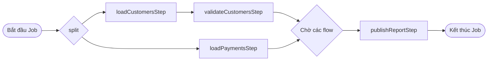

# TaskExecutor cho split flow trong Spring Batch

> **Chương:** Parallel Steps  
> **Phạm vi:** Mở rộng Spring Batch để xử lý dữ liệu lớn bằng các step/flow độc lập chạy song song trong **một tiến trình**, đồng thời kiểm soát tài nguyên, thread safety, lỗi và khả năng restart.

## 1. Vấn đề: Khi một Job có các nhánh xử lý độc lập

Giả sử một hệ thống chạy job tổng hợp dữ liệu cuối ngày, gồm ba công việc:

1. Nạp khách hàng, sau đó kiểm tra dữ liệu khách hàng.
2. Nạp giao dịch thanh toán, không phụ thuộc vào việc nạp khách hàng trong ví dụ này.
3. Phát hành báo cáo chỉ sau khi **cả hai nhánh** hoàn tất thành công.

Nếu xếp tất cả step nối tiếp nhau, thời gian chờ của nhánh thanh toán bị cộng vào thời gian của nhánh khách hàng dù chúng độc lập. **Parallel steps** giải quyết bằng cách nhóm các step thành từng `Flow`, dùng `split` để chạy các flow đồng thời, rồi đồng bộ trước khi chuyển sang step báo cáo.



Điểm quan trọng:

- Trong **customerFlow**, `loadCustomersStep` chạy xong mới đến `validateCustomersStep`: thứ tự trong cùng một flow vẫn được giữ.
- `customerFlow` và `paymentFlow` có thể chạy **đồng thời**, trên các thread khác nhau.
- `publishReportStep` là điểm hội tụ: chỉ chạy theo luồng thành công sau khi split đã chờ các flow kết thúc và tổng hợp trạng thái.
- Đây là song song **theo nhánh của job**, không đồng nghĩa một step tự xử lý các chunk bằng nhiều thread.

Nếu nhánh khách hàng mất 9 phút, nhánh thanh toán mất 5 phút, báo cáo mất 2 phút, thời gian lý tưởng có thể giảm từ **16 phút** (9 + 5 + 2) còn khoảng **11 phút** (max(9, 5) + 2). Con số thực tế phải cộng overhead và xét tranh chấp I/O, CPU, database.

## 2. TaskExecutor làm gì trong split flow?

`TaskExecutor` là abstraction của Spring để thực thi một tác vụ. Khi khai báo:

```java
new FlowBuilder<SimpleFlow>("splitFlow")
        .split(splitFlowExecutor)
        .add(customerFlow, paymentFlow)
        .build();
```

Spring Batch dùng `splitFlowExecutor` để điều phối **các flow**. Mỗi flow tiếp tục quản lý các step của mình theo đồ thị chuyển trạng thái. Tất cả flow được chờ hoàn tất trước khi split quyết định kết quả và chuyển tiếp.

| Thành phần | Vai trò | Đơn vị được chạy đồng thời |
| --- | --- | --- |
| `Flow` | Xác định thứ tự step và chuyển trạng thái trong một nhánh | Các flow khác nhau |
| `FlowBuilder.split(taskExecutor)` | Tạo điểm phân nhánh và hội tụ | Một tác vụ cho mỗi flow trong split |
| `TaskExecutor` | Cung cấp cách thực thi flow: đồng bộ hoặc bất đồng bộ | Thread xử lý flow |
| `JobRepository` | Lưu `JobExecution`, `StepExecution`, trạng thái để restart | Metadata của từng step/job |
| `Step` | Thực thi nghiệp vụ, giao dịch, reader/processor/writer hoặc tasklet | Vẫn chạy bình thường trong flow của nó |

**Phân biệt hai vị trí đặt executor:**

- `flowBuilder.split(taskExecutor)`: chạy **nhiều flow** song song; một step đơn lẻ trong mỗi flow không vì thế trở thành multi-threaded.
- `stepBuilder.taskExecutor(...)` hoặc cơ chế concurrent chunk tương ứng với phiên bản Spring Batch: song song hóa công việc **bên trong một step**; có hợp đồng thread safety và cách xử lý transaction khác. Không nhầm hai cấu hình này.

Mặc định, executor đồng bộ như `SyncTaskExecutor` chạy trên thread hiện tại và không mang lại lợi ích song song. `SimpleAsyncTaskExecutor` dễ thử nghiệm nhưng có thể tạo nhiều thread mới; workload vận hành lâu dài thường phù hợp hơn với `ThreadPoolTaskExecutor` có giới hạn.

## 3. Ví dụ Java Configuration đầy đủ

Ví dụ dưới đây dùng API `JobBuilder`, `StepBuilder`, `FlowBuilder` của Spring Batch 5.x/6.x. Các tasklet chỉ ghi tên thread để minh họa cách điều phối; khi triển khai, thay phần thân tasklet bằng nghiệp vụ thực, có xử lý transaction và tính idempotent.

```java
import org.springframework.batch.core.Job;
import org.springframework.batch.core.Step;
import org.springframework.batch.core.job.builder.FlowBuilder;
import org.springframework.batch.core.job.builder.JobBuilder;
import org.springframework.batch.core.job.flow.Flow;
import org.springframework.batch.core.job.flow.support.SimpleFlow;
import org.springframework.batch.core.repository.JobRepository;
import org.springframework.batch.core.step.builder.StepBuilder;
import org.springframework.batch.repeat.RepeatStatus;
import org.springframework.beans.factory.annotation.Qualifier;
import org.springframework.context.annotation.Bean;
import org.springframework.context.annotation.Configuration;
import org.springframework.scheduling.concurrent.ThreadPoolTaskExecutor;
import org.springframework.transaction.PlatformTransactionManager;

@Configuration(proxyBeanMethods = false)
public class SplitFlowJobConfig {

    // Hai flow độc lập có thể chiếm tối đa hai worker của pool này.
    @Bean
    public ThreadPoolTaskExecutor splitFlowExecutor() {
        ThreadPoolTaskExecutor executor = new ThreadPoolTaskExecutor();
        executor.setCorePoolSize(2);
        executor.setMaxPoolSize(2);
        executor.setQueueCapacity(0);
        executor.setThreadNamePrefix("batch-split-");
        // Spring khởi tạo và quản lý vòng đời bean executor.
        return executor;
    }

    @Bean
    public Step loadCustomersStep(
            JobRepository repository, PlatformTransactionManager tx) {
        return demoStep("loadCustomersStep", repository, tx);
    }

    @Bean
    public Step validateCustomersStep(
            JobRepository repository, PlatformTransactionManager tx) {
        return demoStep("validateCustomersStep", repository, tx);
    }

    @Bean
    public Step loadPaymentsStep(
            JobRepository repository, PlatformTransactionManager tx) {
        return demoStep("loadPaymentsStep", repository, tx);
    }

    @Bean
    public Step publishReportStep(
            JobRepository repository, PlatformTransactionManager tx) {
        return demoStep("publishReportStep", repository, tx);
    }

    private Step demoStep(
            String name, JobRepository repository,
            PlatformTransactionManager tx) {
        return new StepBuilder(name, repository)
                .tasklet((contribution, chunkContext) -> {
                    System.out.printf("step=%s thread=%s%n",
                            name, Thread.currentThread().getName());
                    return RepeatStatus.FINISHED;
                }, tx)
                .build();
    }

    @Bean
    public Flow customerFlow(
            @Qualifier("loadCustomersStep") Step loadCustomers,
            @Qualifier("validateCustomersStep") Step validateCustomers) {
        return new FlowBuilder<SimpleFlow>("customerFlow")
                .start(loadCustomers)
                .next(validateCustomers)
                .build();
    }

    @Bean
    public Flow paymentFlow(
            @Qualifier("loadPaymentsStep") Step loadPayments) {
        return new FlowBuilder<SimpleFlow>("paymentFlow")
                .start(loadPayments)
                .build();
    }

    @Bean
    public Flow splitFlow(
            @Qualifier("customerFlow") Flow customers,
            @Qualifier("paymentFlow") Flow payments,
            @Qualifier("splitFlowExecutor")
                    ThreadPoolTaskExecutor executor) {
        return new FlowBuilder<SimpleFlow>("splitFlow")
                .split(executor)
                .add(customers, payments)
                .build();
    }

    @Bean
    public Job nightlyJob(
            JobRepository repository,
            @Qualifier("splitFlow") Flow parallelFlows,
            @Qualifier("publishReportStep") Step publishReport) {
        return new JobBuilder("nightlyJob", repository)
                .start(parallelFlows)
                .next(publishReport)
                .end()
                .build();
    }
}
```

**Đọc cấu hình theo thứ tự:**

1. Bốn bean `Step` định nghĩa các đơn vị nghiệp vụ với **tên step duy nhất**. Việc dùng `@Qualifier` tránh nhập nhằng khi ứng dụng có nhiều bean kiểu `Step` hoặc `Flow`.
2. `customerFlow` nối hai step **tuần tự**; `paymentFlow` chứa một step độc lập.
3. `splitFlow` tạo hai nhánh và giao việc thực thi cho pool tối đa hai thread. Với hai flow, `queueCapacity(0)` và hai worker đang sẵn có là đủ cho một lần split.
4. `nightlyJob` chạy `splitFlow`; chỉ khi split thành công mới chạy `publishReportStep` theo cấu hình mặc định.
5. `JobRepository` và `PlatformTransactionManager` phải được cấu hình bởi ứng dụng. Ví dụ giả định hạ tầng Spring Batch đã có sẵn.

Log có thể xuất hiện như sau (thứ tự giữa hai nhánh **không cố định**):

```text
step=loadPaymentsStep thread=batch-split-2
step=loadCustomersStep thread=batch-split-1
step=validateCustomersStep thread=batch-split-1
step=publishReportStep thread=main
```

Tên thread thực tế của `publishReportStep` phụ thuộc thread gọi job, nên `main` chỉ là ví dụ. Vì tasklet minh họa chạy rất nhanh, thời điểm log dễ bị xen kẽ; để **chứng minh song song**, cần quan sát khoảng thời gian thực thi trùng nhau, không chỉ hai tên thread khác nhau.

### Vì sao chọn pool có giới hạn?

`SimpleAsyncTaskExecutor` phù hợp để hiểu cơ chế vì không cần quản lý pool, nhưng số lượng tác vụ đồng thời có thể dẫn tới nhiều thread hơn dự kiến. Với `ThreadPoolTaskExecutor`, số lượng worker có thể khống chế. Lưu ý:

- `corePoolSize`, `maxPoolSize`, `queueCapacity` phối hợp quyết định khi nào tạo thread, xếp hàng hoặc từ chối tác vụ. Queue lớn có thể khiến các flow phải **chờ tuần tự** dù `maxPoolSize` cao.
- `queueCapacity(0)` ưu tiên cấp thread (không có hàng đợi). Nếu tất cả worker đã bận, tác vụ mới có thể bị **từ chối**, khiến job lỗi nếu không có chính sách điều phối/phục hồi phù hợp.
- Hai thread chỉ đủ nếu hệ thống thực tế không có nhiều job sử dụng **chung** pool đồng thời. Ví dụ ba lần chạy job có hai flow mỗi lần có thể yêu cầu sáu tác vụ cùng lúc. Khi đó cần giới hạn job đồng thời, điều chỉnh pool hoặc dùng hàng đợi có chủ đích.
- Không tăng số thread chỉ dựa vào số core. Với tải I/O, hãy đo connection pool, giới hạn API và băng thông; với tải CPU, hãy đo mức sử dụng CPU.

## 4. Trạng thái, lỗi và restart tại điểm hội tụ

Split có tính chất **fork/join**: tạo các nhánh, chờ tất cả các nhánh kết thúc, rồi tổng hợp `FlowExecutionStatus` để quyết định chuyển tiếp. Spring Batch không cung cấp một transaction duy nhất bao trùm toàn bộ split.

| Tình huống | Điều xảy ra |
| --- | --- |
| Cả `customerFlow` và `paymentFlow` thành công | Split hoàn tất, `publishReportStep` có thể chạy |
| `loadCustomersStep` lỗi | `validateCustomersStep` không chạy theo tuyến thành công; `paymentFlow` có thể vẫn tiếp tục công việc của nó |
| Một flow lỗi, flow kia hoàn thành | Split chờ các flow kết thúc; trong luồng mặc định, lỗi khiến job thất bại và bước báo cáo không chạy |
| Ứng dụng chạy lại **JobInstance** bị lỗi với cùng identifying `JobParameters` | Spring Batch dùng metadata đã lưu để quyết định step nào cần chạy lại; step đã `COMPLETED` thường được bỏ qua theo mặc định |
| Dữ liệu đã được ghi trước khi một flow lỗi | Giao dịch đã commit ở nhánh kia không tự rollback; nghiệp vụ phải chịu được chạy lại |

**Không nhầm retry với restart:**

- **Retry** là thử lại một thao tác lỗi tạm thời *trong step* (ví dụ chunk có cấu hình `faultTolerant().retry(...)`); `TaskExecutor` của split không tự retry các flow lỗi.
- **Restart** là chạy lại JobInstance đã thất bại hoặc dừng, dựa trên `JobRepository` và trạng thái của từng step. Các step đã hoàn thành sẽ được skip nếu không bật `allowStartIfComplete(true)` hoặc thay đổi hành vi khởi động.
- **JobParameters** có phần định danh. Dùng cùng các tham số định danh của JobInstance lỗi để restart; nếu tạo tham số định danh mới, Spring Batch coi là JobInstance khác, thường sẽ xử lý từ đầu.

Ví dụ, `loadPaymentsStep` đã commit xong còn `validateCustomersStep` thất bại. Khi restart, nhánh khách hàng có thể chạy lại step chưa hoàn thành, trong khi `loadPaymentsStep` đã `COMPLETED` được bỏ qua. Do đó output của mỗi step nên có khóa nghiệp vụ ổn định, `upsert`/ghi đè có điều kiện, hoặc checkpoint phù hợp để tránh nhân đôi giao dịch.

Nếu cần điều hướng lỗi riêng (chấp nhận thất bại một nhánh, xuất báo cáo một phần, gửi cảnh báo), phải thiết kế transition từ `ExitStatus` có chủ đích và kiểm tra kỹ điều kiện phát hành báo cáo; đây là thay đổi yêu cầu nghiệp vụ, không phải mặc định của split.

## 5. Thread safety và cô lập dữ liệu

Parallel steps thường dễ an toàn hơn multi-threaded step nếu mỗi flow quản lý bộ reader, processor, writer và vùng dữ liệu riêng. Tuy nhiên **khác flow vẫn có thể đụng nhau** khi chia sẻ singleton service, biến static, connection pool, bảng dữ liệu hay file đích.

| Nguồn chia sẻ | Nguy cơ | Cách xử lý |
| --- | --- | --- |
| Singleton service chứa biến đếm, danh sách, cache mutable | Race condition và mất cập nhật | Tránh state theo lần chạy trong singleton; dùng dữ liệu immutable hoặc cơ chế đồng bộ phù hợp |
| Hai flow ghi cùng bảng/dòng dữ liệu | Lock contention, deadlock, ghi trùng | Phân vùng khóa nghiệp vụ; transaction ngắn; unique constraint; idempotency |
| `ItemReader`/`ItemWriter` có con trỏ trạng thái bị dùng chung | Trộn vị trí đọc/ghi giữa các step | Mỗi step có instance hoặc state riêng; không chia sẻ component stateful không thread-safe |
| `ExecutionContext` của job dùng chung giữa các flow | Ghi đè key, tranh chấp cập nhật | Ưu tiên dữ liệu theo `StepExecutionContext`; trao đổi kết quả lớn qua bảng/file staging có khóa theo job |
| Connection pool hoặc client gọi API | Hết connection, throttling, timeout | Giới hạn đồng thời theo tài nguyên, quan sát pool và áp dụng retry/backoff có giới hạn |

Không nên dùng `ExecutionContext` làm bộ nhớ chia sẻ tùy ý để hai flow liên tục đọc/ghi cùng key. `StepExecutionContext` thuộc mỗi step; việc truyền kết quả giữa các nhánh cần giao thức rõ ràng. Chẳng hạn mỗi nhánh ghi kết quả cuối vào bảng staging theo `businessDate` và `jobExecutionId`, còn `publishReportStep` đọc các kết quả đó **sau điểm join**.

Nếu step sử dụng bean theo scope (`@StepScope`, `@JobScope`), hãy kiểm tra cách scope được kích hoạt trong thread thực thi và tránh dựa vào mutable state của bean dùng chung. Đừng coi việc có `@StepScope` là đủ để bảo đảm thread safety cho tất cả service mà step gọi.

## 6. Đo hiệu năng và xác định nút thắt

Không kết luận split thành công chỉ vì job có nhiều thread. Hãy đo riêng từng nhánh và toàn bộ job với cùng bộ dữ liệu:

1. Ghi lại `startTime`, `endTime`, `BatchStatus` của các `StepExecution` và thời gian `JobExecution` trước/sau khi áp dụng split.
2. Quan sát timeline: hai flow có thực sự chồng lấp thời gian không? Điểm hội tụ có chờ đúng không?
3. Đo mức sử dụng CPU, số connection DB đang dùng/đang chờ, I/O, lock wait, độ trễ mạng và số thread/pool queue.
4. Đối chiếu throughput (bản ghi/giây), lỗi, retry, rollback, thời gian restart, chứ không chỉ thời gian chạy thuận lợi một lần.
5. Thử các kích cỡ pool trong điều kiện tải thực tế; chọn cấu hình cho throughput tốt mà vẫn giữ dư địa tài nguyên cho các job khác.

Với hai flow độc lập:

```text
T_sequential ≈ T_customerFlow + T_paymentFlow + T_report
T_parallel   ≈ max(T_customerFlow, T_paymentFlow) + T_report + T_overhead
Speedup      = T_sequential / T_parallel
```

Đây là **ước lượng**, không phải bảo đảm. Hai flow có thể tranh nhau connection, CPU hoặc cùng ổ đĩa khiến cả hai cùng chậm hơn. Nếu một flow mất 90% tổng thời gian, việc tăng số thread cho flow ngắn gần như không giúp giảm critical path.

### Các lỗi cấu hình thường gặp

| Triệu chứng | Khả năng nguyên nhân | Cách kiểm tra |
| --- | --- | --- |
| Hai flow vẫn nối đuôi | Executor đồng bộ, pool/queue không cho chạy đồng thời | Log tên thread và khoảng thời gian chạy; xem executor thực được inject |
| Nhiều thread nhưng job chậm hơn | Tranh chấp CPU/DB/API, quá nhiều job đồng thời | So sánh CPU, DB waits, connection usage và baseline tuần tự |
| Job bị từ chối tác vụ | Pool đầy, `queueCapacity(0)`, nhiều job dùng chung executor | Kiểm tra số lần chạy song song và chính sách giới hạn job |
| Báo cáo đọc thiếu dữ liệu | Hai nhánh ghi chung kết quả không có giao thức, hoặc flow/transition sai | Kiểm tra điểm join, trạng thái step, khóa staging và transaction commit |
| Restart phát sinh dữ liệu trùng | Side effect không idempotent hoặc JobParameters tạo JobInstance mới | Kiểm tra định danh đầu ra, unique key, metadata step và cách khởi chạy |

## 7. Chọn split flow hay mô hình mở rộng khác?

| Mô hình | Nên dùng khi | Lưu ý vận hành |
| --- | --- | --- |
| **Parallel steps + split** | Job có **các nhánh nghiệp vụ độc lập**, mỗi nhánh là một hoặc nhiều step | Dễ mô tả thứ tự và điểm join, nhưng chỉ mở rộng trong cùng tiến trình |
| Multi-threaded step | Một step có nhiều item/chunk xử lý đồng thời được | Kiểm tra hợp đồng thread safety của reader/processor/writer và transaction theo API phiên bản |
| Partitioning | Một tập dữ liệu có thể chia thành các partition độc lập, cần phân phối công việc có chủ đích | Cần cách chia khóa không trùng và quản lý metadata mỗi partition |
| Remote chunking | Phân phối xử lý chunk sang các worker khác tiến trình | Cần message middleware, delivery semantics và xử lý duplicate |
| Remote partitioning | Phân phối các partition/step execution sang nhiều worker | Phức tạp hơn về worker, giao tiếp và quan sát trạng thái |

Nếu vấn đề là “có hai quy trình import độc lập”, dùng split flow là tự nhiên. Nếu vấn đề là “một file 200 triệu dòng cần chia 20 đoạn xử lý giống nhau”, partitioning thường phù hợp hơn. Nếu cần mở rộng qua nhiều máy, riêng `TaskExecutor` cho split **không tự biến job thành xử lý phân tán**.

## 8. Bài thực hành và tiêu chí đạt

**Bài 1 — Quan sát split.** Chạy `nightlyJob` với hai flow; thêm log bắt đầu/kết thúc từng tasklet và độ trễ mô phỏng có kiểm soát. Xác nhận `validateCustomersStep` luôn ở sau `loadCustomersStep`, trong khi `loadPaymentsStep` có thể chồng lấp; `publishReportStep` chỉ bắt đầu khi cả hai flow đã kết thúc thành công.

**Bài 2 — Giới hạn tài nguyên.** Chạy nhiều JobExecution đồng thời dùng chung `splitFlowExecutor`. Quan sát trường hợp pool đầy và điều chỉnh số job đồng thời hoặc cấu hình queue; không tăng pool vượt khả năng database. So sánh tổng thời gian, wait time và số connection sử dụng.

**Bài 3 — Failure và restart.** Tạo lỗi có điều kiện ở `validateCustomersStep`, quan sát step của flow thanh toán có thể hoàn tất và báo cáo bị chặn. Restart đúng JobInstance; kiểm tra các step `COMPLETED` không bị xử lý lại mặc định. Thử lại với output có unique key để chứng minh không sinh bản ghi trùng.

**Tự kiểm tra:**

- Tôi phân biệt được executor ở `split` với executor trong nội bộ một `Step`.
- Tôi giải thích được vì sao một flow thất bại không tự rollback giao dịch ở flow còn lại.
- Tôi chọn được giới hạn thread theo cả số flow **và** số job chạy đồng thời.
- Tôi có bằng chứng về thời gian chạy chồng lấp, throughput, trạng thái step và tính đúng đắn sau restart.
- Tôi biết khi nào cần chuyển sang partitioning hoặc mô hình worker phân tán.

## 9. Tài liệu tham khảo chính thức

- [Spring Batch Reference — Scaling and Parallel Processing, Parallel Steps](https://docs.spring.io/spring-batch/reference/scalability.html)
- [Spring Batch Reference — Controlling Step Flow, Split Flows](https://docs.spring.io/spring-batch/reference/step/controlling-flow.html)
- [Spring Batch Reference — Configuring a Step for Restart](https://docs.spring.io/spring-batch/reference/step/chunk-oriented-processing/restart.html)
- [Spring Framework — ThreadPoolTaskExecutor](https://docs.spring.io/spring-framework/docs/current/javadoc-api/org/springframework/scheduling/concurrent/ThreadPoolTaskExecutor.html)

**Ghi nhớ:** `TaskExecutor` quyết định **cách các flow được chạy**; `FlowBuilder` quyết định **nhánh và thứ tự**; `JobRepository` giúp kiểm soát **trạng thái và restart**. Hiệu quả mở rộng phụ thuộc mức độc lập thực tế của workload và tài nguyên mà các flow cùng sử dụng.
