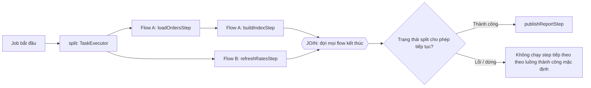
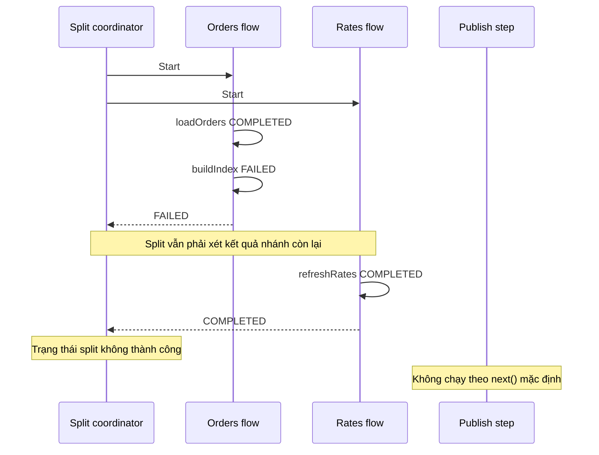

# Đợi tất cả flow hoàn tất trong Parallel Steps của Spring Batch

## Mục tiêu học tập

Sau bài học này, bạn có thể:

- Giải thích **điểm đồng bộ (join/barrier)** của `split`: Spring Batch chờ các flow song song **kết thúc** trước khi đi sang bước kế tiếp.
- Xây dựng job có hai flow độc lập chạy song song và một step tổng hợp chỉ thực hiện **sau cả hai flow**.
- Phân biệt “đã kết thúc” với “đã thành công”, đặc biệt khi một nhánh `FAILED` hoặc `STOPPED`.
- Hiểu phạm vi transaction, `StepExecution`, restart, thread safety và tác động của `TaskExecutor` trong mô hình parallel steps.
- Thiết kế đo lường và kiểm thử thời điểm join cho workload dữ liệu lớn, không nhầm join giữa các flow với đồng bộ nhiều `JobExecution`.

## 1. Bài toán: hai luồng độc lập, một bước phụ thuộc kết quả của cả hai

Một job chuẩn bị báo cáo bán hàng cần:

1. Flow A: tải dữ liệu đơn hàng và xây chỉ mục tra cứu.
2. Flow B: cập nhật bảng tỷ giá.
3. Step C: xuất báo cáo từ **cả dữ liệu đơn hàng đã chuẩn bị và tỷ giá đã cập nhật**.

Flow A và Flow B không phụ thuộc nhau nên có thể chạy đồng thời. Tuy nhiên, Step C **không được chạy** chỉ vì flow nhanh hơn đã kết thúc; nó phải đợi tất cả flow trước điểm nối.



Ở đây `split` là **cấu trúc điều phối flow** của Spring Batch; nó không phải thao tác SQL, không tạo một transaction chung và không giống `partitioning` (chia cùng một worker step thành nhiều vùng dữ liệu).

Trong module `SPRING_BATCH_SCALING_OPERATIONS`, parallel steps là lựa chọn hợp lý khi các tác vụ lớn **độc lập về dữ liệu và side effect**, nhưng một điểm tổng hợp phía sau cần kết quả của tất cả tác vụ. Nếu hai công việc thực sự là hai phần của cùng một tập bản ghi, partitioning có thể phù hợp hơn.

## 2. `split` thực hiện join tự động

Với Spring Batch 5.x, `FlowBuilder` cho phép khai báo một split gồm nhiều `Flow` và `TaskExecutor` để chạy chúng song song. **Khi tất cả flow trong split hoàn tất việc thực thi, split mới trả trạng thái cho flow/job cha**, từ đó transition tiếp theo được đánh giá.

Không cần tự viết vòng `while` thăm dò `StepExecution`, gọi `Thread.join()` hay tự tạo `CountDownLatch` chỉ để đợi các nhánh của `split`. Tính năng join đã nằm trong cách `split` điều phối các flow thành viên.

Giả sử các tác vụ chạy trong thời gian sau:

| Tác vụ | Thời lượng giả định | Quan hệ phụ thuộc |
| --- | ---: | --- |
| `loadOrdersStep` | 10 phút | Bước đầu của Flow A |
| `buildIndexStep` | 4 phút | Chờ `loadOrdersStep` trong Flow A |
| `refreshRatesStep` | 6 phút | Flow B, độc lập Flow A |
| `publishReportStep` | 3 phút | Chỉ chạy sau điểm join thành công |

Nếu chạy tuần tự, tổng thời gian là khoảng **23 phút**. Nếu có đủ tài nguyên và hai flow thật sự chạy song song, giai đoạn split mất gần `max(10 + 4, 6) = 14` phút; sau đó báo cáo mất 3 phút, tổng khoảng **17 phút** cộng overhead. Đây chỉ là tính toán minh họa, không phải cam kết tốc độ thực tế.

```text
Thời gian (phút):  0             6              10             14    17
Flow A:            [ loadOrdersStep (10 phút) ][ buildIndexStep (4) ]
Flow B:            [ refreshRatesStep (6 phút) ]
JOIN:                                                           |
publishReportStep:                                               [---]
```

**“Đợi tất cả flow hoàn tất” không đồng nghĩa “đợi tất cả flow thành công”.** Nếu một flow gặp lỗi, việc join vẫn cần được phân biệt với quyết định có chạy bước tiếp hay không. Trong cấu hình mặc định bên dưới, một nhánh lỗi làm split không đạt trạng thái thành công để chuyển tiếp bình thường sang `publishReportStep`.

### Ba mức độ đồng bộ dễ nhầm

| Cơ chế | Chờ cái gì? | Không chờ/bảo vệ cái gì? |
| --- | --- | --- |
| `.next(step)` trong **một flow** | Bước trước trong cùng flow kết thúc theo transition | Không làm các flow khác phải chạy theo thứ tự |
| `.split(executor).add(flowA, flowB)` | Các **flow thành viên của split** kết thúc | Không đồng bộ các `JobExecution` khác nhau |
| `@Scheduled` hoặc scheduler bên ngoài | Phát lệnh chạy theo lịch cấu hình | Không tự chặn hai `JobExecution` khác instance cùng chạy |

Điểm join chỉ tồn tại **bên trong cấu trúc split của một job execution**, không phải khóa toàn cục của hệ thống.

## 3. Ví dụ cấu hình job: hai flow song song, step sau join

Đoạn dưới dùng Java 17, Spring Framework và cách viết builder của **Spring Batch 5.x**. Chúng ta định nghĩa bốn tasklet step nhỏ để minh họa cấu trúc; thay chúng bằng chunk-oriented step thực tế khi xử lý hàng triệu bản ghi.

```java
import org.springframework.batch.core.Job;
import org.springframework.batch.core.Step;
import org.springframework.batch.core.job.builder.FlowBuilder;
import org.springframework.batch.core.job.builder.JobBuilder;
import org.springframework.batch.core.job.flow.Flow;
import org.springframework.batch.core.job.flow.support.SimpleFlow;
import org.springframework.batch.core.repository.JobRepository;
import org.springframework.batch.core.step.builder.StepBuilder;
import org.springframework.batch.repeat.RepeatStatus;
import org.springframework.beans.factory.annotation.Qualifier;
import org.springframework.context.annotation.Bean;
import org.springframework.context.annotation.Configuration;
import org.springframework.core.task.TaskExecutor;
import org.springframework.scheduling.concurrent.ThreadPoolTaskExecutor;
import org.springframework.transaction.PlatformTransactionManager;

@Configuration
class ParallelFlowJobConfiguration {

    // Mỗi Step có tên duy nhất trong JobRepository.
    // Tasklet ở đây chỉ log để tập trung vào flow và join.
    private Step demoStep(String name, JobRepository repository,
                          PlatformTransactionManager transactionManager) {
        return new StepBuilder(name, repository)
                .tasklet((contribution, chunkContext) -> {
                    System.out.printf("step=%s, thread=%s%n",
                            name, Thread.currentThread().getName());
                    return RepeatStatus.FINISHED;
                }, transactionManager)
                .build();
    }

    @Bean
    Step loadOrdersStep(JobRepository repository,
                        PlatformTransactionManager transactionManager) {
        return demoStep("loadOrdersStep", repository, transactionManager);
    }

    @Bean
    Step buildIndexStep(JobRepository repository,
                        PlatformTransactionManager transactionManager) {
        return demoStep("buildIndexStep", repository, transactionManager);
    }

    @Bean
    Step refreshRatesStep(JobRepository repository,
                          PlatformTransactionManager transactionManager) {
        return demoStep("refreshRatesStep", repository, transactionManager);
    }

    @Bean
    Step publishReportStep(JobRepository repository,
                           PlatformTransactionManager transactionManager) {
        return demoStep("publishReportStep", repository, transactionManager);
    }

    @Bean("ordersFlow")
    Flow ordersFlow(@Qualifier("loadOrdersStep") Step loadOrders,
                    @Qualifier("buildIndexStep") Step buildIndex) {
        return new FlowBuilder<SimpleFlow>("ordersFlow")
                .start(loadOrders)
                .next(buildIndex) // Tuần tự BÊN TRONG Flow A.
                .build();
    }

    @Bean("ratesFlow")
    Flow ratesFlow(@Qualifier("refreshRatesStep") Step refreshRates) {
        return new FlowBuilder<SimpleFlow>("ratesFlow")
                .start(refreshRates)
                .build();
    }

    @Bean("parallelFlowExecutor")
    ThreadPoolTaskExecutor parallelFlowExecutor() {
        ThreadPoolTaskExecutor executor = new ThreadPoolTaskExecutor();
        executor.setCorePoolSize(2);
        executor.setMaxPoolSize(2);
        executor.setQueueCapacity(4);
        executor.setThreadNamePrefix("batch-flow-");
        executor.initialize();
        return executor;
    }

    @Bean("splitPreparationFlow")
    Flow splitPreparationFlow(
            @Qualifier("ordersFlow") Flow ordersFlow,
            @Qualifier("ratesFlow") Flow ratesFlow,
            @Qualifier("parallelFlowExecutor") TaskExecutor executor) {

        return new FlowBuilder<SimpleFlow>("splitPreparationFlow")
                .split(executor)
                .add(ordersFlow, ratesFlow)
                .build();
    }

    @Bean
    Job reportingJob(
            JobRepository repository,
            @Qualifier("splitPreparationFlow") Flow split,
            @Qualifier("publishReportStep") Step publishReport) {

        return new JobBuilder("reportingJob", repository)
                .start(split)
                .next(publishReport) // Chỉ xét sau khi split đã join.
                .end()
                .build();
    }
}
```

### Đọc cấu hình theo thứ tự điều phối

1. `ordersFlow` có `loadOrdersStep → buildIndexStep`: step thứ hai không chạy trước khi step đầu chuyển tiếp thành công theo cấu hình này.
2. `ratesFlow` chỉ có `refreshRatesStep` và có thể chạy đồng thời với `ordersFlow`.
3. `splitPreparationFlow` khai báo `.split(executor).add(ordersFlow, ratesFlow)`: Spring Batch điều phối hai flow qua executor.
4. `reportingJob` khai báo `.start(split).next(publishReport)`: **điểm chuyển tiếp từ split sang `publishReportStep` chính là join**.
5. Nếu tất cả bước trước join hoàn tất thành công theo các transition mặc định, `publishReportStep` chạy. Nếu một nhánh thất bại hoặc bị dừng, xem cách xử lý ở mục 4.

Các `Step` demo không thể hiện logic nghiệp vụ nặng; trong ứng dụng thật, có thể thay `demoStep` bằng những bean `StepBuilder(...).<Input, Output>chunk(...)` được cấu hình reader, processor, writer và checkpoint riêng. **Không tạo một transaction dài** để làm toàn bộ khối hàng triệu bản ghi chỉ vì ví dụ tasklet đơn giản.

### Dùng executor giới hạn tài nguyên

Với hai flow song song, executor có hai worker thread là một điểm bắt đầu hợp lý. Có thể dùng `SimpleAsyncTaskExecutor` cho demo nhỏ, nhưng với production cần kiểm soát concurrency, queue, số kết nối DB và khả năng hủy. `ThreadPoolTaskExecutor` giúp đặt giới hạn rõ ràng hơn.

Số thread tối đa **không đồng nghĩa** số flow có thể chạy đồng thời hiệu quả. Nếu một flow lại dùng executor nội bộ cho partitioning, tổng số task và connection có thể tăng mạnh. Nếu hai flow dùng chung một executor có queue quá nhỏ, hoặc nested task đợi lẫn nhau trong pool bị bão hòa, hệ thống có thể đình trệ. Ưu tiên phân bổ executor theo mức công việc và đo tải thật.

## 4. Khi một flow `FAILED` hoặc `STOPPED`

Xét cùng `splitPreparationFlow` gồm hai nhánh:

- Flow A: `loadOrdersStep` đã hoàn thành, `buildIndexStep` ném exception và trở thành `FAILED`.
- Flow B: `refreshRatesStep` vẫn đang chạy và hoàn thành bình thường sau đó.

Spring Batch **không mặc nhiên rollback Flow B chỉ vì Flow A thất bại**. Các step đã commit trước đó giữ nguyên dữ liệu trong những transaction độc lập. Split thông thường đợi các flow bên trong kết thúc, tổng hợp trạng thái và chuyển kết quả lên job cha; nếu không có transition xử lý thất bại riêng, `publishReportStep` sẽ không chạy trên nhánh thành công.



Với lỗi từ code/hạ tầng nghiêm trọng như JVM chết, executor bị ngắt hoặc một task treo không kết thúc, **không có bảo đảm join cuối cùng hoàn tất**. “Đợi tất cả” là semantics khi Spring Batch còn điều phối được các flow; nó không mang ý nghĩa timeout tự động hoặc hệ thống có thể kết thúc worker vô hạn.

| Trạng thái các flow | Sau khi join | Step tiếp theo ở tuyến thành công mặc định |
| --- | --- | --- |
| A `COMPLETED`, B `COMPLETED` | Split thành công | Có thể chạy |
| A `FAILED`, B `COMPLETED` | Split không thành công | Không chạy |
| A `COMPLETED`, B `FAILED` | Split không thành công | Không chạy |
| A `STOPPED`, B `COMPLETED` | Split dừng hoặc được xử lý theo trạng thái flow | Không tiếp tục như một lần thành công bình thường |
| Một flow không thoát vì treo I/O | Join có thể phải đợi vô hạn nếu không timeout/cancel thích hợp | Không chạy |

Bảng mô tả cấu hình **transition mặc định** của ví dụ. Nếu thay đổi transition bằng `.on(...)`, `.end()`, `.fail()` hoặc status tùy biến, kết quả job có thể khác. Đặc biệt, tránh khai báo một chuyển tiếp bao phủ mọi trạng thái rồi đánh dấu `COMPLETED` khiến thất bại ở một nhánh bị che khuất.

### Không thể có “rollback tất cả flow” bằng một transaction chung

```text
Orders flow:  chunk 1 COMMIT; chunk 2 COMMIT; chunk 3 FAILED/ROLLBACK
Rates flow:   chunk 1 COMMIT; chunk 2 COMMIT; step COMPLETED
Job:          FAILED
```

Dù `JobExecution` kết thúc `FAILED`, các chunk đã commit ở hai flow **không bị hoàn tác ngược thời gian**. Transaction thuộc step/chunk và thread thực thi; không có transaction bao phủ toàn split. Vì vậy:

- Cần writer idempotent, khóa duy nhất hoặc `UPSERT` để restart có thể chạy lại an toàn.
- Chỉ dùng chung DB transaction trong cùng phạm vi thread/transaction manager thực sự quản lý; việc hai flow nằm trong một job không tạo distributed transaction.
- Nếu Flow B tạo báo cáo/vật phẩm phụ thuộc vào Flow A, chúng **không độc lập** và không nên đưa vào hai nhánh song song.

## 5. `StepExecution`, transaction và dữ liệu dùng chung

Mỗi `Step` thực thi có `StepExecution` và trạng thái metadata riêng. Mỗi chunk thường có transaction riêng theo cấu hình `PlatformTransactionManager` của step. Khi các flow chạy trên các thread khác nhau, transaction của một flow **không tự truyền sang flow khác**.

### Vùng dữ liệu nào là riêng, vùng nào dùng chung?

| Thành phần | Phạm vi | Hệ quả thiết kế |
| --- | --- | --- |
| `StepExecutionContext` | Theo từng `StepExecution` | Chứa offset, checkpoint, thông số riêng của step; không dùng làm “biến chung” tự động |
| `JobParameters` | Dùng chung cho một `JobInstance` | Phù hợp với `businessDate`, snapshot ID bất biến |
| `JobExecutionContext` | Theo `JobExecution` | Các flow có thể nhìn thấy ngữ cảnh job, nhưng **ghi đồng thời cùng key** có rủi ro race/lost update |
| Bean singleton của Spring | Có thể được dùng ở nhiều flow | Không lưu mutable state theo step nếu chưa bảo đảm thread safety |
| `@StepScope` bean | Theo `StepExecution` | Hữu ích cho reader/writer có trạng thái và late binding riêng mỗi step |
| Transaction/JDBC connection | Gắn với thread và giao dịch do manager quản lý | Không chuyển transaction giữa hai flow nhờ `TaskExecutor` |

Trong ví dụ, hai flow có thể ghi vào **hai bảng độc lập**, sau đó `publishReportStep` mới đọc kết quả. Nếu một flow ghi `JobExecutionContext['result']` đồng thời với flow khác dùng cùng key, dữ liệu có thể đè lên nhau. Dùng key tách biệt (chẳng hạn `orders.ready` và `rates.ready`) hoặc ghi trạng thái vào bảng nghiệp vụ có ràng buộc và transaction phù hợp; tránh phụ thuộc vào thứ tự hoàn thành flow.

Khi cần đưa dữ liệu của step sang job context, có thể dùng cơ chế `ExecutionContextPromotionListener` theo cấu hình step, nhưng phải đánh giá tính đồng thời, key trùng và thời điểm persist. Việc `publishReportStep` chạy sau join không tự biến mọi thay đổi in-memory ở các flow thành bản ghi metadata bền vững nếu ứng dụng thao tác context không đúng cách.

### Không tự chia sẻ reader có trạng thái

Hai flow có thể chạy các step dùng **cùng class** reader, nhưng chúng nên có bean reader/reader state phù hợp với `StepExecution` của từng step. Đừng giữ một `JdbcCursorItemReader` singleton và mở/đóng nó từ nhiều flow rồi mong join xử lý giúp: join chỉ điều phối **khi nào các flow kết thúc**, không khóa tài nguyên reader bên trong.

Nếu cả hai nhánh ghi vào cùng bảng, phân tích lock, unique constraints, thứ tự cập nhật và deadlock. Sự độc lập về **thứ tự xử lý** không có nghĩa độc lập về **tài nguyên**.

## 6. Restart sau khi một flow thất bại

Giả sử run đầu tiên có trạng thái:

| Step | Flow | Kết quả run đầu |
| --- | --- | --- |
| `loadOrdersStep` | A | `COMPLETED` |
| `buildIndexStep` | A | `FAILED` |
| `refreshRatesStep` | B | `COMPLETED` |
| `publishReportStep` | Sau join | Chưa chạy |

Khi restart **cùng `JobInstance`** bằng cùng identifying `JobParameters`, Spring Batch có thể bỏ qua các step đã `COMPLETED` theo restart policy mặc định, và thực hiện lại step chưa thành công. Khi mọi nhánh đạt trạng thái cho phép transition thành công, bước `publishReportStep` mới chạy.

Đừng hiểu restart là “chạy lại cả hai flow từ đầu” hoặc “mọi step đã chạy trước đó đều được undo”. Các step có thể được bỏ qua/rerun tùy metadata, `allowStartIfComplete`, checkpoint và cấu hình transition. Việc thay đổi tên `Step` hoặc `Flow`, thay đổi identifying parameters hay dùng repository mới có thể phá vỡ kỳ vọng phục hồi.

**Ví dụ về data integrity khi restart:**

- `loadOrdersStep` đã ghi 100.000 đơn hàng thành công, không nên import lại rồi nhân đôi bản ghi khi job restart.
- `buildIndexStep` có thể chạy lại từ checkpoint hoặc xây lại chỉ mục một cách idempotent.
- `refreshRatesStep` hoàn thành sớm không đồng nghĩa trạng thái tỷ giá còn phù hợp nếu nguồn bên ngoài thay đổi sau 24 giờ. Cần snapshot hoặc watermark nhất quán với phiên bản báo cáo.
- `publishReportStep` chỉ lấy dữ liệu từ một tập nguồn đủ điều kiện và có cách nhận diện bản báo cáo đã phát hành để tránh phát hành hai lần.

Nếu dữ liệu nghiệp vụ phải được tái tính từ đầu, cần thiết kế **job instance mới** và cơ chế reset hợp lệ, không tùy tiện xóa `BATCH_*` metadata hoặc ép chạy lại cùng instance sau khi hoàn tất.

## 7. Tăng tốc đúng cách và xử lý nút thắt

Parallel steps giúp giảm **thời gian trên đường găng (critical path)** khi hai nhánh độc lập, nhưng tốc độ có thể thấp hơn kỳ vọng nếu chúng cùng tranh chấp một DB hoặc hệ thống lưu trữ.

Một ví dụ ước lượng:

```text
Chạy tuần tự:     A(14 phút) + B(6 phút) + C(3 phút) = 23 phút
Chạy song song:  max(A=14 phút, B=6 phút) + C(3 phút) = 17 phút
Tăng tốc lý tưởng: 23 / 17 ≈ 1,35x, trước overhead và contention.
```

Flow B kết thúc ở phút 6 nhưng Flow A mất 14 phút, nên flow B **không quyết định** khi nào có thể publish. Tối ưu Flow B từ 6 xuống 2 phút hầu như không đổi tổng thời gian; cần tối ưu Flow A (đường găng) hoặc phần publish.

| Triệu chứng quan sát | Nguyên nhân thường gặp | Điều nên đo / xử lý |
| --- | --- | --- |
| Flow A chậm gấp nhiều lần Flow B | Workload lệch hoặc query A kém | Duration từng step, SQL plan, số item, I/O |
| Hai flow chạy cùng lúc lại chậm hơn chạy tuần tự | DB connection pool, lock, disk throughput bão hòa | Connection wait, DB lock wait, disk IOPS, p95 chunk |
| `publishReportStep` bắt đầu muộn dù các step đã log xong | Một flow có cleanup/transition chưa kết thúc, hoặc còn step ẩn trong flow | `StepExecution`/flow status và mốc thời gian từ JobRepository |
| Một flow chờ thread rất lâu | Thread pool thiếu capacity, queue dài, nested executor | Active threads, queue depth, rejected tasks |
| Chạy thường xuyên bị `FAILED` ở một nhánh | Lỗi tài nguyên, race, dữ liệu không ổn định | Error/rollback count theo step; kiểm tra restart/idempotency |
| Sau khi join vẫn không có dữ liệu báo cáo | Transaction/side effect chưa bền vững, dữ liệu ở hệ khác eventual-consistent | Kiểm tra commit, ack, nhất quán nguồn và điều kiện sẵn sàng |

**Không phải cứ có hai flow là phải cấp hai connection.** Mỗi flow có thể chạy nhiều chunk, gọi nhiều nguồn dữ liệu hoặc dùng writer giữ kết nối riêng. Cần đo pool size theo hành vi driver, transaction manager và số step chạy đồng thời thực tế. Nếu flow lại chứa partitioning với nhiều worker, tài nguyên tăng theo cả hai tầng song song.

Khi hai bước phụ thuộc dữ liệu hoặc cần một thứ tự nghiệp vụ, hãy giữ chúng trong **cùng flow** qua `.next(...)`. Chỉ đặt trong `split` những luồng có thể tiến hành độc lập.

## 8. Những cách “đợi tất cả” dễ sai

### Sai lầm 1: tự thăm dò trạng thái thay cho split

```java
// Minh họa anti-pattern, không dùng làm cơ chế join chính.
while (jobExplorer.findRunningJobExecutions("ordersJob").size() > 0) {
    // polling / sleep...
}
```

`JobExplorer` đọc metadata, không biểu diễn barrier giữa các **flow của cùng split**. Nếu dùng nhầm `JobExecution` của chính job đang chạy, vòng lặp thậm chí chờ mãi vì job đó chưa hoàn tất. Hãy mô tả dependency bằng `FlowBuilder` thay vì polling.

### Sai lầm 2: tự khởi chạy subtask bất đồng bộ từ một step

```java
// Sai nếu yêu cầu kết quả phải sẵn sàng ở step kế tiếp.
executor.execute(() -> doWorkAsync());
return RepeatStatus.FINISHED;
```

Khi tasklet đã trả `FINISHED`, Spring Batch có thể đánh dấu step hoàn thành **trong khi tác vụ con chưa xong**. `split` chỉ chờ flow/step do framework quản lý, không tự phát hiện `Runnable` mà ứng dụng gửi đi rồi bỏ quên. Nếu phải chạy async bên trong một step, ứng dụng phải tự chờ kết quả, chuyển lỗi, quản lý transaction/restart hoặc thay bằng split/partitioning đúng mô hình.

### Sai lầm 3: dùng một biến cờ chia sẻ

```java
// Không thể đại diện cho kết thúc của nhiều StepExecution.
static boolean done = false;
```

Ngay cả khi thay bằng `AtomicBoolean`, cờ vẫn không cung cấp đủ trạng thái từng flow, rollback, restart và metadata bền vững. Trên nhiều instance, biến này không được chia sẻ. Dùng trạng thái `StepExecution`/JobRepository do Batch quản lý và cấu trúc flow khai báo tường minh.

### Sai lầm 4: tưởng `split` tự đồng bộ nhiều JobExecution

Nếu scheduler khởi chạy `reportingJob` với `businessDate=2026-11-25` và đồng thời với `businessDate=2026-11-26`, mỗi `JobExecution` có **split và join của riêng nó**. Không có hàng rào nào tự buộc job của ngày 26 chờ job của ngày 25.

Khi cần ngăn hai job cùng ghi tài nguyên độc quyền, hãy dùng identifying parameters hợp lý, scheduler/lock phân tán hoặc chính sách điều phối ở cấp job, ngoài join của `split`.

### Sai lầm 5: ghi cùng key trong JobExecutionContext từ cả hai flow

```text
Flow A ghi jobContext["ready"] = "orders"
Flow B ghi jobContext["ready"] = "rates"
Step C đọc jobContext["ready"]
```

Kết quả cuối phụ thuộc thời điểm ghi, không phải một trạng thái đã tổng hợp đúng. Tách hai key hoặc ghi các kết quả vào nguồn bền vững, rồi cho step sau join kiểm tra điều kiện đầy đủ trước khi publish.

## 9. Kiểm thử để chứng minh join hoạt động

Kiểm chứng gồm cả **thứ tự**, **trạng thái lỗi** và **tính đúng đắn dữ liệu**. Chỉ nhìn thấy hai log interleave nhau chưa đủ để kết luận bước sau thật sự chờ cả hai flow.

1. Tạo Flow A có step giả lập chạy 2 giây, Flow B có step giả lập chạy 5 giây, `publishReportStep` ghi timestamp. Kiểm tra timestamp publish **muộn hơn cả hai timestamp kết thúc**.
2. Đổi tốc độ: Flow A 5 giây, Flow B 2 giây. Kết quả vẫn phải giữ invariant, không phụ thuộc flow nào xong trước.
3. Làm Flow A ném exception sau một số thao tác, Flow B hoàn thành. Xác nhận `publishReportStep` không chạy theo transition mặc định và các transaction đã commit ở Flow B không bị rollback ngoài ý muốn.
4. Thử `STOPPED`/cơ chế stop được hỗ trợ ở phiên bản dùng. Kiểm tra join và trạng thái job, không giả định worker bị dừng ngay lập tức.
5. Restart cùng `JobInstance` sau khi Flow A lỗi. Kiểm tra step hoàn thành được skip hoặc chạy lại theo cấu hình, và `publishReportStep` chỉ được thực hiện khi toàn bộ prerequisite đủ điều kiện.
6. Chạy với pool chỉ một thread, sau đó tăng thành hai thread. Kiểm tra tính đúng đắn không đổi, đồng thời so sánh thời gian tổng; một thread có thể làm hai flow xếp hàng và mất lợi ích song song.
7. Kiểm tra writer có side effect: đóng/mở connection, transaction, rollback, DB constraints, idempotency và kết quả báo cáo sau retry; không chỉ kiểm tra job status.
8. Đo throughput, p95 chunk, DB connection wait và lock contention khi tăng `TaskExecutor` hoặc khi các flow chứa nhiều partition.

Để quan sát production, ghi log tên `JobExecution`, `StepExecution`, thread, thời điểm bắt đầu/kết thúc, `BatchStatus`, `ExitStatus`, read/write/commit/rollback count. Đặt correlation key theo business date để nối dữ liệu từ nhiều flow trong cùng job. Nếu dùng tracing/MDC dựa trên `ThreadLocal`, cần cơ chế truyền context tương thích executor vì thread khác không tự kế thừa mọi ngữ cảnh log.

## 10. Parallel steps, partitioning và multi-threaded step: chọn đúng

| Phương án | Đơn vị chạy song song | Điểm chờ/kết thúc | Khi nào phù hợp |
| --- | --- | --- | --- |
| **Parallel steps qua split** | Những **flow** độc lập, mỗi flow có thể chứa nhiều step tuần tự | `split` đợi các flow thành viên, rồi mới transition tiếp | Chuẩn bị hai tập dữ liệu độc lập trước bước tổng hợp |
| **Partitioning** | Nhiều `StepExecution` của cùng worker step, mỗi partition nhận một miền dữ liệu | Manager step/PartitionHandler đợi và tổng hợp kết quả worker | Chia một tập dữ liệu lớn theo range, file, tenant |
| **Multi-threaded step** | Tác vụ/chunk/processor bên trong một step tùy phiên bản Spring Batch | Chính step/điều phối nội bộ kiểm soát hoàn thành | Khi cần xử lý nhiều item song song thay vì nhiều quy trình độc lập |
| **Remote partitioning** | Worker step chạy trên nhiều process/JVM | Manager điều phối và tổng hợp partition qua hạ tầng remote | Dữ liệu vượt khả năng một host |
| **Parallel JobExecution** | Nhiều lần chạy logic của một hoặc nhiều job | Không có join chung theo mặc định | Cửa sổ dữ liệu độc lập và hệ thống chịu được concurrency |

Đối với workload lớn, có thể kết hợp split và partitioning, nhưng phải tính tổng tài nguyên. Ví dụ hai flow, mỗi flow lại có bốn partition, nghĩa là có thể có đến tám worker step đang tranh chấp DB; đặt thread pool và connection pool cần dựa vào đồ thị concurrency thật.

## Tài liệu tham khảo

- [Spring Batch Reference – Scaling and Parallel Processing](https://docs.spring.io/spring-batch/reference/scalability.html): parallel processing, parallel steps, partitioning.
- [Spring Batch 5.2 Reference – Parallel Steps](https://docs.spring.io/spring-batch/reference/5.2/scalability.html): cấu hình split flow bằng `TaskExecutor`.
- [Spring Batch – Configuring a Job](https://docs.spring.io/spring-batch/reference/job/configuring.html): chuyển tiếp giữa các step, flow và trạng thái kết thúc.
- [Spring Batch – Job and Step Metadata](https://docs.spring.io/spring-batch/reference/schema-appendix.html): `JobExecution`, `StepExecution`, checkpoint và restart.

## Ghi nhớ

**`split` trong Spring Batch vừa cho phép các flow độc lập chạy song song, vừa tạo điểm join trước bước phụ thuộc phía sau.** Join đợi tất cả flow kết thúc, sau đó trạng thái tổng hợp quyết định đường chuyển tiếp; nó không biến thất bại thành thành công, không rollback các chunk đã commit và không đồng bộ các `JobExecution` khác. Muốn scale đúng, cần mô hình hóa dependency rõ ràng, giữ dữ liệu và transaction từng flow an toàn, xử lý restart/idempotency và đo nút thắt tài nguyên thực tế.
