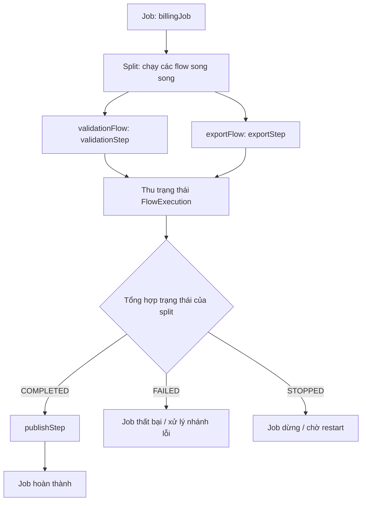
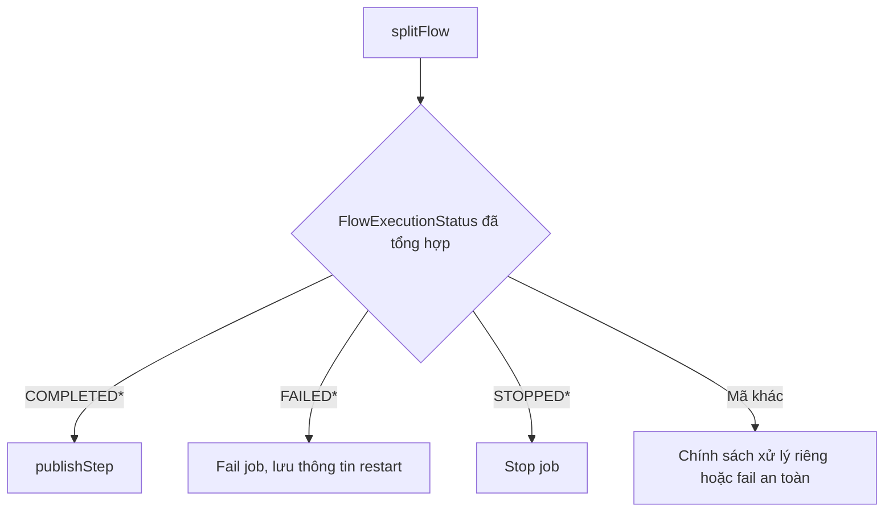

# Tổng hợp exit status của các flow khi chạy Parallel Steps trong Spring Batch

Khi một Spring Batch job chạy nhiều flow song song, một flow có thể hoàn thành, một flow khác thất bại, còn flow thứ ba bị dừng. **Job sẽ quyết định đi tiếp, thất bại hay cho phép restart dựa trên trạng thái tổng hợp của các flow**, chứ không chỉ dựa vào trạng thái của flow hoàn thành cuối cùng.

Trong chương **Parallel Steps** của module `SPRING_BATCH_SCALING_OPERATIONS`, chủ đề này là nền tảng để mở rộng workload dữ liệu lớn bằng các nhánh xử lý độc lập, theo dõi nút thắt và vận hành retry/restart an toàn. Bài học giải thích các lớp trạng thái của Spring Batch, cách `split` tổng hợp `FlowExecutionStatus`, cách thiết kế đường đi khi có lỗi và phương pháp kiểm chứng kết quả trong `JobRepository`. Ví dụ sử dụng API Spring Batch **5.x**.

## 1. Bối cảnh: nhiều flow chạy song song nhưng job có một kết quả

Giả sử job tổng hợp dữ liệu giao dịch có hai nhánh độc lập:

- `validationFlow` kiểm tra chất lượng dữ liệu và chuẩn bị kết quả kiểm tra.
- `exportFlow` xuất tập dữ liệu đã được chốt theo cùng `runId` sang nơi nhận.

Sau khi cả hai nhánh hoàn thành, job mới chạy `publishStep` để công bố kết quả. Đây chỉ là mô hình hợp lệ **khi hai nhánh không phụ thuộc kết quả chưa hoàn tất của nhau**. Nếu export cần dữ liệu được validation tạo ra, hai nhánh đó phải chạy tuần tự hoặc được thiết kế lại.



**Điểm đồng bộ** nằm ở cuối `split`. Spring Batch sử dụng `TaskExecutor` để thực thi các flow, **đợi các flow trong split hoàn tất trước khi tổng hợp trạng thái và quyết định chuyển tiếp**. Nếu một flow thất bại, điều đó không mặc nhiên có nghĩa các flow còn lại bị hủy ngay lập tức. Vì vậy một nhánh có thể đã commit thành công dù job chung kết thúc bằng `FAILED`.

## 2. Phân biệt ba loại trạng thái dễ nhầm

Trong Spring Batch, từ “status” xuất hiện ở ba tầng quan trọng:

| Kiểu trạng thái | Thuộc đối tượng | Ví dụ | Dùng để làm gì? |
| --- | --- | --- | --- |
| `BatchStatus` | `JobExecution`, `StepExecution` | `COMPLETED`, `FAILED`, `STOPPED` | Trạng thái thực thi do framework quản lý, phục vụ metadata và restart |
| `ExitStatus` | `JobExecution`, `StepExecution` | `COMPLETED`, `FAILED`, `COMPLETED WITH SKIPS` | Mã kết thúc và mô tả; hỗ trợ điều hướng có điều kiện |
| `FlowExecutionStatus` | `FlowExecution` | `COMPLETED`, `FAILED`, `STOPPED` hoặc mã tùy chỉnh | Kết quả của một flow và giá trị để điều khiển chuyển tiếp giữa các state |

### 2.1. BatchStatus

`BatchStatus` là enum trạng thái vận hành, gồm các giá trị như `STARTING`, `STARTED`, `COMPLETED`, `FAILED`, `STOPPING`, `STOPPED`, `ABANDONED` và `UNKNOWN`. Ví dụ một `StepExecution` có `BatchStatus.FAILED` khi việc thực thi step không thành công.

### 2.2. ExitStatus

`ExitStatus` là value object có `exitCode` và `exitDescription`. Cùng một step có thể mang:

```text
BatchStatus = COMPLETED
ExitStatus  = COMPLETED WITH SKIPS
```

Điều này có thể xảy ra khi step xử lý xong nhưng listener báo có bản ghi bị skip. Các biểu thức `.on("...")` trong flow dùng **exit code**, không dùng trực tiếp `BatchStatus`. Mặc định hai trạng thái thường tương ứng, nhưng bạn có thể thay đổi exit code bằng listener hoặc định nghĩa transition.

### 2.3. FlowExecutionStatus

`FlowExecutionStatus` là kết quả của một `Flow` khi đi tới điểm kết thúc của flow. Các hằng thông dụng:

```java
FlowExecutionStatus.COMPLETED
FlowExecutionStatus.FAILED
FlowExecutionStatus.STOPPED
FlowExecutionStatus.UNKNOWN
```

Nó cũng có thể mang chuỗi tùy chỉnh, chẳng hạn `new FlowExecutionStatus("COMPLETED WITH SKIPS")`. Giá trị ở tầng flow dùng để đánh giá nhánh nào sẽ được đi tiếp và để `split` kết hợp kết quả nhiều nhánh.

**Không nên mặc định** rằng `JobExecution.getExitStatus()` là bản sao nguyên vẹn của `StepExecution.getExitStatus()` hoặc của một `FlowExecutionStatus`: kết quả cuối của job còn phụ thuộc định nghĩa flow, các transition và chính sách dừng/kết thúc.

## 3. Split tổng hợp FlowExecutionStatus như thế nào?

Ở cấu hình thông thường của Spring Batch 5.x, `SplitState` dùng bộ tổng hợp `MaxValueFlowExecutionAggregator`. Bộ này nhận danh sách các `FlowExecution` và **chọn trạng thái có độ ưu tiên cao nhất** theo thứ tự so sánh của `FlowExecutionStatus`.

```text
FlowExecution(validationFlow, COMPLETED)
FlowExecution(exportFlow,     FAILED)
                |
                v
MaxValueFlowExecutionAggregator
                |
                v
FlowExecutionStatus.FAILED
```

Với các trạng thái phổ biến, có thể nhớ kết quả dưới đây:

| Flow A | Flow B | Kết quả tổng hợp thông thường | Ý nghĩa vận hành |
| --- | --- | --- | --- |
| `COMPLETED` | `COMPLETED` | `COMPLETED` | Các nhánh kết thúc thành công |
| `COMPLETED` | `FAILED` | `FAILED` | Không được coi split là thành công |
| `FAILED` | `FAILED` | `FAILED` | Có lỗi ở cả hai nhánh |
| `COMPLETED` | `STOPPED` | `STOPPED` | Có nhánh dừng trước khi hoàn tất |
| `FAILED` | `STOPPED` | `FAILED` | Trạng thái lỗi có độ ưu tiên cao hơn dừng |

Bảng trên dùng **trạng thái chuẩn**, không bao hàm mọi chuỗi tùy chỉnh. `FlowExecutionStatus` có cơ chế so sánh trạng thái; nếu flow dùng mã như `CUSTOM_WARNING`, `COMPLETED WITH SKIPS` hay `FAILED_RETRYABLE`, cần kiểm tra chính xác cách chúng được xếp hạng trong phiên bản Spring Batch đang dùng. Không giả định rằng “chỉ cần chuỗi có chữ SUCCESS thì luôn thắng” hoặc rằng mã tùy chỉnh sẽ bị loại bỏ.

### 3.1. Ví dụ trực tiếp với aggregator

Để hiểu nguyên tắc tổng hợp mà không phải khởi động cả job:

```java
import java.util.List;

import org.springframework.batch.core.job.flow.FlowExecution;
import org.springframework.batch.core.job.flow.FlowExecutionStatus;
import org.springframework.batch.core.job.flow.support.state.MaxValueFlowExecutionAggregator;

public class SplitStatusExample {
    public static void main(String[] args) {
        List<FlowExecution> executions = List.of(
                new FlowExecution(
                        "validationFlow", FlowExecutionStatus.COMPLETED),
                new FlowExecution(
                        "exportFlow", FlowExecutionStatus.FAILED));

        FlowExecutionStatus result =
                new MaxValueFlowExecutionAggregator().aggregate(executions);

        System.out.println(result.getName()); // FAILED
    }
}
```

**Lưu ý phạm vi:** đây là ví dụ trực tiếp cho bộ tổng hợp trạng thái, chưa mô phỏng DB transaction hay `JobExecution`. Trong một job thật, các flow được thực thi dưới `JobRepository` và có thể chứa nhiều step cùng transition riêng.

### 3.2. Split khác partition aggregation

Hai khái niệm cùng có từ “aggregate” nhưng khác tầng:

- **Parallel steps:** tổng hợp `FlowExecutionStatus` của các flow trong `split` thông qua `FlowExecutionAggregator`.
- **Partitioning:** manager step tổng hợp thông tin `StepExecution` của các worker partition (ví dụ `DefaultStepExecutionAggregator`), gồm trạng thái và các counter xử lý.

Không sử dụng bảng đếm read/write của partition để suy ra trực tiếp kết quả route của `split`. Chúng phục vụ hai mô hình mở rộng khác nhau.

## 4. Cấu hình Parallel Steps bằng Java trong Spring Batch 5.x

Ví dụ sau định nghĩa hai flow chạy trên executor có hai thread và một step chỉ chạy sau điểm đồng bộ. Phần xử lý nghiệp vụ là chỗ dành để bổ sung validation và export thực tế.

```java
import org.springframework.batch.core.Job;
import org.springframework.batch.core.Step;
import org.springframework.batch.core.job.builder.FlowBuilder;
import org.springframework.batch.core.job.builder.JobBuilder;
import org.springframework.batch.core.job.flow.Flow;
import org.springframework.batch.core.job.flow.support.SimpleFlow;
import org.springframework.batch.core.repository.JobRepository;
import org.springframework.batch.core.step.builder.StepBuilder;
import org.springframework.batch.repeat.RepeatStatus;
import org.springframework.beans.factory.annotation.Qualifier;
import org.springframework.context.annotation.Bean;
import org.springframework.context.annotation.Configuration;
import org.springframework.scheduling.concurrent.ThreadPoolTaskExecutor;
import org.springframework.transaction.PlatformTransactionManager;

@Configuration
public class BillingParallelJobConfig {

    @Bean
    public Step validationStep(
            JobRepository repository,
            PlatformTransactionManager transactionManager) {
        return new StepBuilder("validationStep", repository)
                .tasklet((contribution, context) -> {
                    // Thực hiện validation trên snapshot đã chốt.
                    return RepeatStatus.FINISHED;
                }, transactionManager)
                .build();
    }

    @Bean
    public Step exportStep(
            JobRepository repository,
            PlatformTransactionManager transactionManager) {
        return new StepBuilder("exportStep", repository)
                .tasklet((contribution, context) -> {
                    // Xuất dữ liệu độc lập với validationFlow.
                    return RepeatStatus.FINISHED;
                }, transactionManager)
                .build();
    }

    @Bean
    public Step publishStep(
            JobRepository repository,
            PlatformTransactionManager transactionManager) {
        return new StepBuilder("publishStep", repository)
                .tasklet((contribution, context) -> {
                    // Chỉ công bố kết quả sau khi split thành công.
                    return RepeatStatus.FINISHED;
                }, transactionManager)
                .build();
    }

    @Bean
    public Flow validationFlow(
            @Qualifier("validationStep") Step validationStep) {
        return new FlowBuilder<SimpleFlow>("validationFlow")
                .start(validationStep)
                .build();
    }

    @Bean
    public Flow exportFlow(@Qualifier("exportStep") Step exportStep) {
        return new FlowBuilder<SimpleFlow>("exportFlow")
                .start(exportStep)
                .build();
    }

    @Bean
    public ThreadPoolTaskExecutor splitTaskExecutor() {
        ThreadPoolTaskExecutor executor = new ThreadPoolTaskExecutor();
        executor.setCorePoolSize(2);
        executor.setMaxPoolSize(2);
        executor.setQueueCapacity(2);
        executor.setThreadNamePrefix("billing-flow-");
        return executor;
    }

    @Bean
    public Job billingJob(
            JobRepository repository,
            @Qualifier("validationFlow") Flow validationFlow,
            @Qualifier("exportFlow") Flow exportFlow,
            @Qualifier("publishStep") Step publishStep,
            @Qualifier("splitTaskExecutor") ThreadPoolTaskExecutor executor) {
        return new JobBuilder("billingJob", repository)
                .start(validationFlow)
                .split(executor)
                .add(exportFlow)
                .next(publishStep)
                .end()
                .build();
    }
}
```

**Điều cần để ý:**

1. `validationStep` và `exportStep` có tên riêng, logic độc lập, không chia sẻ một đối tượng reader/writer stateful dùng cùng file đích.
2. `.split(executor).add(exportFlow)` đặt hai flow vào một điểm phân nhánh; `TaskExecutor` có khả năng chạy đồng thời. Nếu dùng `SyncTaskExecutor`, các flow có thể lần lượt chạy dù vẫn sử dụng cấu trúc split.
3. `.next(publishStep)` đặt bước công bố sau khi split trả kết quả thành công theo đường đi thông thường. Nếu một nhánh thất bại, cần quan sát flow transition trước khi cho phép công bố.
4. `.end()` trong ví dụ là thao tác **kết thúc phần khai báo flow của builder**. Nó khác với việc cấu hình một **transition thành công cưỡng bức** bằng `.on("FAILED").end()`.
5. `.build()` tạo job, không chạy công việc. Ứng dụng cần có `JobRepository`, `PlatformTransactionManager` và cơ chế launch job.

Nếu một flow phải xử lý nhiều step **tuần tự trong chính nhánh đó**, đặt `.start(stepA).next(stepB).build()` bên trong `FlowBuilder` riêng. Không biến hai step có quan hệ dữ liệu phụ thuộc thành hai flow chạy song song.

## 5. Thử ba tình huống vận hành

### 5.1. Cả hai flow hoàn thành

```text
validationStep  COMPLETED
exportStep      COMPLETED
-------------------------
split           COMPLETED
publishStep     COMPLETED
job             COMPLETED
```

Vì split thành công, job đi tới `publishStep`. Đây là trường hợp đơn giản để xác nhận graph đã cấu hình đúng.

### 5.2. Một flow thất bại, flow còn lại hoàn thành

Để tái hiện trong môi trường demo, có thể tạm cho `validationStep` ném exception:

```java
.tasklet((contribution, context) -> {
    throw new IllegalStateException("Validation failed for demo");
}, transactionManager)
```

Khi đó có thể gặp:

```text
validationStep  FAILED
exportStep      COMPLETED
-------------------------
split           FAILED
publishStep     không được chạy theo đường thành công
job             FAILED
```

**Export vẫn có thể đã ghi dữ liệu thành công.** Một lỗi ở `validationFlow` không tự rollback transaction của `exportFlow`. Các transaction trong từng step/flow độc lập; split không mở một transaction tổng bao trùm cả hai nhánh.

Đừng dùng `publishStep` để giả định tất cả các thay đổi trước đó đều có thể rollback cùng nhau. Nếu cần đảm bảo công bố nguyên tử, hãy ghi kết quả tạm theo `runId` và chỉ chuyển trạng thái sang “published” khi tất cả điều kiện đã được xác minh.

### 5.3. Một flow dừng (STOPPED)

Một flow có thể đi vào trạng thái `STOPPED` do yêu cầu dừng có kiểm soát hoặc một transition được định nghĩa để chờ restart. Với các mã chuẩn, nếu nhánh kia `COMPLETED`, trạng thái split sẽ là `STOPPED`.

```text
validationFlow  COMPLETED
exportFlow      STOPPED
-----------------------
split           STOPPED
job             STOPPED (trong đường xử lý stop phù hợp)
```

Trạng thái stop và điều kiện restart phụ thuộc đường chuyển trạng thái và cấu hình job. Không nên coi `STOPPED` là lỗi vĩnh viễn giống hệt `FAILED`, cũng không nên thay thủ công metadata của job để “tiếp tục”.

## 6. Vì sao mã exit tùy chỉnh có thể làm kết quả khác dự kiến?

Trong một step, `StepExecutionListener.afterStep(...)` có thể trả về `ExitStatus` mang mã nghiệp vụ. Ví dụ, nếu step hoàn thành với bản ghi bị skip, ta muốn báo trạng thái đặc biệt:

```java
import org.springframework.batch.core.ExitStatus;
import org.springframework.batch.core.StepExecution;
import org.springframework.batch.core.StepExecutionListener;

public class SkipReportingListener implements StepExecutionListener {

    @Override
    public ExitStatus afterStep(StepExecution execution) {
        if (execution.getStatus().isUnsuccessful()) {
            return null; // Giữ trạng thái lỗi có sẵn.
        }
        if (execution.getSkipCount() > 0) {
            return new ExitStatus("COMPLETED WITH SKIPS");
        }
        return null;
    }
}
```

Gắn listener vào step bằng `.listener(new SkipReportingListener())` trong `StepBuilder`. Listener có thể làm exit code khác `BatchStatus`; trong flow không chuyển hướng riêng, exit code của step có thể trở thành trạng thái kết thúc của flow và ảnh hưởng đến split.

Ví dụ ba mã cần nhận diện:

| Mã | Dùng để mô tả | Lưu ý khi ghép kết quả |
| --- | --- | --- |
| `COMPLETED` | Hoàn thành không có lưu ý bổ sung | Trạng thái chuẩn |
| `COMPLETED WITH SKIPS` | Hoàn thành nhưng có bản ghi bị bỏ qua | Chuỗi kết thúc theo quy ước `COMPLETED`, nhưng không đồng nhất với kết quả “không lỗi dữ liệu” |
| `FAILED_VALIDATION` | Kiểm tra nghiệp vụ không qua | Mang tiền tố `FAILED`; phải thiết kế transition tương ứng |
| `WARNING` | Cảnh báo nghiệp vụ tùy chỉnh | Không mặc định đánh giá cùng mức `COMPLETED`; kiểm tra quy tắc so sánh |

`FlowExecutionStatus` cung cấp `compareTo(...)` để sắp xếp độ ưu tiên. **Mã tự đặt có thể chi phối kết quả tổng hợp theo cách không trực giác.** Khi thiết kế custom exit code:

1. Quy định rõ mã nào là thành công, cảnh báo, lỗi, dừng.
2. Ưu tiên quy ước tiền tố `COMPLETED`, `FAILED`, `STOPPED` khi muốn giữ hành vi điều hướng tương ứng; kiểm tra kết quả thực của phiên bản sử dụng.
3. Dùng pattern transition cụ thể như `"COMPLETED*"` hoặc `"FAILED*"` ở nơi cần bắt cả mã mở rộng; `.on("COMPLETED")` là pattern khác `.on("COMPLETED*")`.
4. Thử cặp trạng thái khi hai flow kết thúc khác nhau; không kiểm tra riêng từng flow rồi giả định split sẽ tự suy ra “ý nghĩa nghiệp vụ”.

**Không nhầm hai thứ tự so sánh:** `ExitStatus.and(...)` có quy tắc tổng hợp exit code của `ExitStatus`, còn `MaxValueFlowExecutionAggregator` so sánh `FlowExecutionStatus`. Tên và mục đích gần nhau nhưng không phải cùng một API.

## 7. Định nghĩa kết thúc job: end, fail và stop

Trong điều khiển flow, sau khi một state trả về kết quả, các transition có thể:

| Hành động khai báo | Tác động chính | Hệ quả restart |
| --- | --- | --- |
| `.to(nextStep)` | Tiếp tục bước kế tiếp | Phụ thuộc kết quả cuối cùng |
| `.end()` trên một nhánh điều kiện | Kết thúc job ở trạng thái `COMPLETED` dù đã từng có step lỗi | `JobInstance` hoàn thành thường không restart được |
| `.fail()` | Kết thúc job ở trạng thái `FAILED` | Cho phép restart nếu cấu hình/job state phù hợp |
| `.stopAndRestart(...)` | Dừng và xác định điểm có thể restart | `STOPPED`, restart theo state được chỉ định |

Mỗi transition ở trên cần được dùng **đúng ngữ cảnh builder**. Chẳng hạn, logic `.on("FAILED").end()` thể hiện chủ đích **coi đường lỗi là kết thúc thành công** tại cấp job; nó không chuyển `StepExecution` đã lỗi thành `COMPLETED`. Hành vi này có thể hữu ích cho trường hợp nghiệp vụ chấp nhận lỗi, nhưng rất nguy hiểm nếu chạy theo mặc định trong job yêu cầu cả hai flow đều thành công.

Khi muốn xuất bản kết quả chỉ khi cả hai flow thành công, hãy chọn rõ chính sách:

- `FAILED` hoặc mã `FAILED*`: báo job lỗi, giữ thông tin để restart và cảnh báo vận hành.
- `STOPPED`: bảo toàn trạng thái dừng, để operator hoặc scheduler quyết định restart.
- `COMPLETED` (và những mã thành công đã định nghĩa): mới cho phép bước publish chạy.

Nếu có cảnh báo được chấp nhận, tách **điều kiện cho phép publish** khỏi **chính sách hiển thị cảnh báo**. Một bước publish có thể thành công nhưng hệ thống quan sát vẫn cần biết có các lỗi skip hoặc chất lượng dữ liệu thấp.

## 8. Mẫu điều hướng riêng theo kết quả của split

Có thể khai báo split thành một `Flow` riêng rồi áp dụng nhánh điều kiện từ flow đó. Mục đích là có một điểm xác định xem job nên publish, ghi nhận lỗi hay dừng.



Trong Spring Batch Java DSL, transition `.on("...")` khớp exit code của state đứng trước và hỗ trợ ký tự đại diện `*`, `?`. Nếu job định nghĩa route có điều kiện, **mọi trạng thái có thể xảy ra cần có đường xử lý thích hợp**; thiếu transition có thể làm job lỗi do không tìm được nhánh phù hợp.

Với những mã nghiệp vụ đặc biệt, hãy viết bảng yêu cầu trước khi viết builder:

| Trạng thái split | Có chạy publish? | Kết quả job mong muốn | Hành động vận hành |
| --- | --- | --- | --- |
| `COMPLETED` | Có | `COMPLETED` sau publish | Ghi metrics |
| `COMPLETED WITH SKIPS` | Tùy SLA chất lượng | `COMPLETED` hoặc route kiểm tra bổ sung | Lưu skip count, cảnh báo nếu cần |
| `FAILED` | Không | `FAILED` | Phân tích nhánh lỗi và restart |
| `STOPPED` | Không | `STOPPED` | Tiếp tục khi đã sẵn sàng |
| Mã không nhận diện | Không theo mặc định | Xử lý riêng / báo lỗi | Kiểm tra quy tắc phân loại |

Không nên dùng một wildcard `.on("*").end()` để giải quyết mọi tình huống: nó có thể đánh dấu job `COMPLETED` ngay cả khi một flow đã thất bại, khiến hệ thống lập lịch bỏ qua phần việc cần restart.

## 9. Trạng thái cuối không được quyết định bởi thứ tự flow hoàn thành

Ví dụ:

```text
00:00 validationFlow bắt đầu
00:00 exportFlow bắt đầu
00:15 validationFlow FAILED
00:45 exportFlow COMPLETED
00:45 split hoàn tất chờ và tổng hợp -> FAILED
```

`exportFlow` hoàn thành sau, nhưng kết quả split **không trở thành `COMPLETED` chỉ vì đó là flow cuối cùng ghi log**. Aggregator xem tất cả kết quả trong split.

Nếu có lỗi **không phải exit status bình thường** (chẳng hạn executor từ chối task, thread bị interrupt hoặc lỗi hạ tầng khi join task), xử lý có thể đi theo đường exception khác với phép tổng hợp trạng thái thành công. Cần kiểm tra `JobExecution` và exception thực tế; đừng giả định mọi lỗi đều biến thành một mã custom trong bảng tổng hợp.

## 10. Theo dõi trong JobRepository và log

Spring Batch ghi metadata job/step trong các bảng tiêu chuẩn:

- `BATCH_JOB_EXECUTION`: `STATUS`, `EXIT_CODE`, `EXIT_MESSAGE`, thời điểm bắt đầu/kết thúc của job.
- `BATCH_STEP_EXECUTION`: trạng thái và exit code của từng step, cùng read/write/skip count, thời gian và thông tin lỗi.
- `BATCH_STEP_EXECUTION_CONTEXT`: dữ liệu checkpoint liên quan đến từng step execution.

**Một `FlowExecution` không mặc định tương ứng với một hàng riêng trong `BATCH_STEP_EXECUTION`.** Muốn biết nhánh nào đã lỗi, hãy kết hợp tên step/flow trong định nghĩa job với metadata của các step thuộc nhánh và log có correlation ID.

Ví dụ query metadata theo `JobExecution`:

```sql
SELECT STEP_EXECUTION_ID,
       STEP_NAME,
       STATUS,
       EXIT_CODE,
       EXIT_MESSAGE,
       START_TIME,
       END_TIME
FROM BATCH_STEP_EXECUTION
WHERE JOB_EXECUTION_ID = :jobExecutionId
ORDER BY START_TIME, STEP_EXECUTION_ID;
```

Đọc trạng thái cuối job:

```sql
SELECT JOB_EXECUTION_ID,
       STATUS,
       EXIT_CODE,
       EXIT_MESSAGE,
       START_TIME,
       END_TIME
FROM BATCH_JOB_EXECUTION
WHERE JOB_EXECUTION_ID = :jobExecutionId;
```

Kết quả minh họa:

```text
Step execution:
  validationStep  STATUS=FAILED     EXIT_CODE=FAILED
  exportStep      STATUS=COMPLETED  EXIT_CODE=COMPLETED

Job execution:
  billingJob      STATUS=FAILED     EXIT_CODE=FAILED
```

Hãy log thêm `jobExecutionId`, `stepExecutionId`, `flowName` (tự đưa vào MDC nếu cần), `exitCode` và exception gốc. Cảnh báo vận hành nên báo **nhánh và step gây lỗi** cùng bối cảnh dữ liệu, không chỉ thông điệp “split failed”.

## 11. Restart khi chỉ một nhánh thất bại

Parallel steps chia các nhánh thành những step execution riêng. Khi restart **cùng `JobInstance`** bằng identifying job parameters phù hợp, Spring Batch thường **bỏ qua các step đã `COMPLETED`** và chạy lại phần chưa hoàn tất, tùy graph và chính sách của từng step.

Một trình tự minh họa:

| Giai đoạn | validationStep | exportStep | publishStep |
| --- | --- | --- | --- |
| Lần chạy 1 | `FAILED` | `COMPLETED` | Chưa chạy |
| Sửa lỗi nguồn | Có thể chạy lại | Không cần xuất lại theo mặc định | Chưa chạy |
| Restart cùng `JobInstance` | `COMPLETED` | Thường được bỏ qua | Chạy sau split thành công |

Những điểm phải giữ nhất quán:

1. Giữ **tên step và flow** ổn định trong đồ thị job khi restart; thay tên step có thể ảnh hưởng việc tìm lại `StepExecution` cũ.
2. Giữ cùng snapshot/cutoff dữ liệu hoặc input bền vững để flow được chạy lại không đọc một tập dữ liệu khác ngoài ý muốn.
3. Tránh dùng `allowStartIfComplete(true)` tùy tiện với bước có side effect; tùy chọn đó yêu cầu chạy lại cả step đã hoàn thành.
4. Thiết kế external side effect **idempotent** (sử dụng business key, outbox hoặc nơi lưu kết quả tạm có đánh dấu theo `runId`).
5. Nếu trạng thái cuối job bị ép `COMPLETED` bằng transition `.end()` trên đường lỗi, việc restart cùng `JobInstance` sẽ không diễn ra như trường hợp `FAILED`.

**Split không thực hiện “global rollback”.** Nếu `exportFlow` đã tải file lên object storage rồi `validationFlow` thất bại, retry không tự động xóa file đó. Nên sử dụng đường dẫn tạm theo `runId`, chỉ công bố manifest/pointer sau khi tất cả nhánh thành công và xác minh output.

## 12. Các lỗi thiết kế thường gặp

| Hiện tượng | Nguyên nhân khả dĩ | Hướng xử lý |
| --- | --- | --- |
| Job báo `COMPLETED` dù có step `FAILED` | Transition ép `.end()` trên đường lỗi | Rà lại route `FAILED*`, `STOPPED*`, wildcard và yêu cầu restart |
| Một nhánh lỗi nhưng nhánh khác vẫn ghi xong | Split chờ tất cả flow, không có transaction chung | Dùng staging và publish có điều kiện; đảm bảo idempotent |
| `publishStep` chạy khi dữ liệu chưa sẵn sàng | Các flow không độc lập hoặc kiểm soát flow sai | Định nghĩa đúng phụ thuộc và rào chắn sau split |
| Custom code `WARNING` làm split xử lý bất ngờ | Độ ưu tiên của custom `FlowExecutionStatus` chưa được kiểm tra | Thử `compareTo`/aggregator và định nghĩa pattern rõ |
| Job chậm dù có hai flow | Executor chạy tuần tự, pool thiếu thread hoặc DB tranh chấp | Kiểm tra `TaskExecutor`, thời gian từng step và DB |
| Không thấy “dòng flow” trong `BATCH_STEP_EXECUTION` | Metadata lưu theo job/step, không có bảng flow riêng mặc định | Dựa vào đồ thị job, step names và log |
| Restart chạy lại output gây trùng | Step đã hoàn thành bị cấu hình chạy lại hoặc side effect không idempotent | Kiểm tra `allowStartIfComplete`, tên step và outbox |
| Lỗi route khi có mã `COMPLETED WITH SKIPS` | Chỉ khai báo `.on("COMPLETED")` | Cân nhắc `COMPLETED*` hoặc route riêng cho mã mở rộng |

## 13. Đo hiệu năng nhưng phải giữ đúng kết quả

Parallel steps hữu ích khi các nhánh độc lập đủ nặng để vượt chi phí tạo thread/flow. Số nhánh tăng cũng tăng áp lực lên DB, connection pool, file system, network và các dịch vụ nhận.

Để đánh giá:

1. Đo riêng thời gian từng flow, thời gian toàn job và thời gian chờ ở điểm đồng bộ split. Job thường bị chi phối bởi nhánh chạy lâu nhất cộng overhead, thay vì tổng đơn giản các thời gian flow.
2. So sánh `SyncTaskExecutor` hoặc thiết lập tuần tự với executor bất đồng bộ cùng dataset để đo speedup.
3. Theo dõi CPU/heap/GC, JDBC pool, DB lock wait, I/O và retry. Đừng tăng thread vô hạn khi bottleneck đã chuyển sang DB.
4. Thực hiện test một flow `FAILED` và một flow `COMPLETED`; kiểm chứng exit status tổng, đường publish, side effect và restart.
5. Kiểm tra thread safety: các flow nên có reader/writer stateful và tài nguyên ghi độc lập, hoặc chiến lược đồng bộ và transaction được thiết kế rõ.

Với hai flow mất `40 giây` và `55 giây`, thời gian song song lý tưởng gần `55 giây` cộng overhead, **không tự động bằng `(40+55)/2`**. Nếu cả hai cùng cạnh tranh một connection pool nhỏ, thực tế có thể lâu hơn cả chạy tuần tự.

## 14. Tự kiểm tra

**Câu 1.** Flow A `COMPLETED` và flow B `FAILED`. Flow B kết thúc trước flow A. Kết quả split là gì?

**Đáp án:** Với trạng thái chuẩn và bộ tổng hợp mặc định, split trả `FAILED`. Thứ tự kết thúc không quyết định kết quả.

**Câu 2.** `BatchStatus` của step là `COMPLETED` nhưng `ExitStatus` là `COMPLETED WITH SKIPS`. Điều kiện `.on("COMPLETED")` có chắc khớp không?

**Đáp án:** Không. `.on(...)` so khớp exit code bằng pattern; để bắt mã mở rộng có thể dùng `"COMPLETED*"` hoặc nhánh riêng.

**Câu 3.** Vì sao không gọi `.on("*").end()` để “job luôn xanh” sau split?

**Đáp án:** Nó có thể kết thúc `JobInstance` với trạng thái `COMPLETED` dù nhánh lỗi. Điều này che giấu thất bại và cản trở restart thông thường.

**Câu 4.** Export đã thành công, validation thất bại. Có cần rollback file export không?

**Đáp án:** Split không tự rollback output của flow khác. Cần thiết kế công bố có điều kiện và cơ chế bù trừ/cleanup hoặc idempotent, phù hợp nghiệp vụ.

**Câu 5.** Hai flow cùng dùng một `FlatFileItemWriter` singleton ghi một file CSV, nhưng mỗi flow có tên step riêng. Đã an toàn chưa?

**Đáp án:** Chưa. Step riêng không tự cô lập Java object hoặc file đích. Phải tách tài nguyên ghi hoặc có chiến lược đồng bộ và restart an toàn.

## 15. Tài liệu đối chiếu

- [Spring Batch 5.2 — Scaling and Parallel Processing: Parallel Steps](https://docs.spring.io/spring-batch/reference/5.2/scalability.html): các flow song song, `TaskExecutor` và điểm đồng bộ split.
- [Spring Batch 5.2 — Controlling Step Flow / Split Flows](https://docs.spring.io/spring-batch/reference/5.2/step/controlling-flow.html): `BatchStatus`, `ExitStatus`, transition `end/fail/stop` và ví dụ split.
- [Spring Batch 5.2 API — SplitState](https://docs.spring.io/spring-batch/docs/5.2.x/api/org/springframework/batch/core/job/flow/support/state/SplitState.html): thực thi flow và tổng hợp trạng thái.
- [Spring Batch 5.2 API — MaxValueFlowExecutionAggregator](https://docs.spring.io/spring-batch/docs/5.2.x/api/org/springframework/batch/core/job/flow/support/state/MaxValueFlowExecutionAggregator.html): chọn `FlowExecutionStatus` có độ ưu tiên cao nhất.
- [Spring Batch 5.2 API — FlowExecutionStatus](https://docs.spring.io/spring-batch/docs/5.2.x/api/org/springframework/batch/core/job/flow/FlowExecutionStatus.html): trạng thái flow, các mã chuẩn và `compareTo`.
- [Spring Batch 5.2 API — FlowBuilder.SplitBuilder](https://docs.spring.io/spring-batch/docs/5.2.x/api/org/springframework/batch/core/job/builder/FlowBuilder.SplitBuilder.html): cấu trúc builder cho `split`.

**Ghi nhớ:** `split` tạo một điểm chờ, tập hợp kết quả của các `FlowExecution` và quyết định trạng thái dựa trên độ ưu tiên, không dựa vào flow chạy xong cuối. Để job vận hành đúng khi mở rộng, cần phân biệt `BatchStatus`/`ExitStatus`/`FlowExecutionStatus`, thiết kế transition rõ ràng, không che lỗi bằng `end` và bảo đảm các side effect có thể phục hồi khi một nhánh thất bại.
