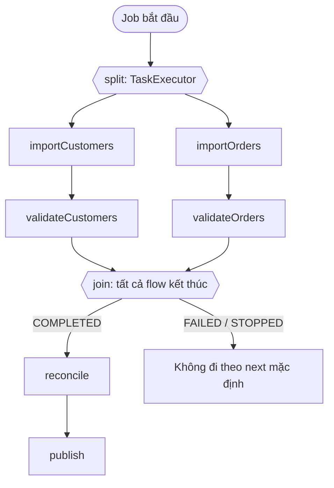

# Step tiếp theo sau split

## 1. Bối cảnh: vì sao cần một step sau các nhánh song song?

Trong Spring Batch, **Parallel Steps** cho phép một job chạy nhiều `Flow` độc lập đồng thời. Nhưng một job nghiệp vụ thường không dừng ngay khi các nhánh hoàn tất: sau khi nhập dữ liệu khách hàng và đơn hàng từ hai nguồn, hệ thống còn phải đối soát số lượng, kiểm tra tính nhất quán và công bố kết quả. Step đối soát đó cần **chờ cả hai nhánh của `split` kết thúc**.

Trong module **SPRING_BATCH_SCALING_OPERATIONS**, kỹ thuật này gắn trực tiếp với mục tiêu mở rộng workload dữ liệu lớn: tận dụng tài nguyên bằng parallel steps, đo các nút thắt thật sự, giữ độc lập về thread safety và transaction, đồng thời thiết kế retry/restart để step tổng hợp chỉ chạy khi những điều kiện cần thiết đã được đáp ứng.

Sau bài học, bạn có thể:

- Giải thích **điểm đồng bộ hóa (join)** sau một `split` và thứ tự kích hoạt step kế tiếp.
- Viết Java DSL dùng `FlowBuilder`, `split(TaskExecutor)` và `.next(step)` theo kiểu Spring Batch 5.x.
- Phân biệt flow hoàn tất về mặt kỹ thuật với dữ liệu đã đủ điều kiện nghiệp vụ để publish.
- Giải thích hành vi khi một nhánh `FAILED`/`STOPPED`, nhánh kia hoàn tất hoặc còn chạy.
- Thiết kế job phục hồi: nhánh thành công, nhánh lỗi và step sau split được xử lý thế nào khi restart.
- Theo dõi các `StepExecution`, mức sử dụng thread, kết nối DB và độ lệch thời gian của các nhánh.

> **Quy tắc cốt lõi:** Spring Batch **đợi tất cả flow trong `split` kết thúc rồi tổng hợp `FlowExecutionStatus` trước khi đi tiếp**. Với đường chuyển mặc định `.next(step)`, step tiếp theo được kích hoạt khi split hoàn thành bình thường; nếu một nhánh làm trạng thái split thất bại thì không được tự giả định step sau split vẫn chạy.

## 2. Mô hình thực thi: hai nhánh, một điểm join

Giả sử job nhập dữ liệu có cấu trúc:

```text
                +--> importCustomers --> validateCustomers --+
                |                                            |
START -- split +                                            +--> reconcile --> publish
                |                                            |
                +--> importOrders ----> validateOrders ------+
```

Hai nhánh xử lý song song về mặt **Flow**:

- **Flow khách hàng:** `importCustomers` rồi `validateCustomers`; hai step này **tuần tự trong cùng flow**.
- **Flow đơn hàng:** `importOrders` rồi `validateOrders`; hai step này cũng **tuần tự trong cùng flow**.
- **Sau join:** `reconcile` chỉ được xét chuyển tới khi các flow của split đã kết thúc; `publish` được chạy sau `reconcile` nếu điều kiện chuyển tiếp phù hợp.



**Điểm dễ nhầm:** join ở đây là **hành vi điều phối trạng thái của flow**, không phải SQL `JOIN`, không phải thread barrier do lập trình viên tự tạo, và không phải một bước xử lý dữ liệu ngầm định. Nó không tự trộn record đầu ra của hai nhánh. Nếu muốn hợp nhất kết quả, phải định nghĩa một `Step` nghiệp vụ như `reconcile`/`merge`.

### Trục thời gian minh họa

```text
Thời gian         t0         t1           t2           t3         t4
Flow A            [importCustomers-----][validateCustomers--]
Flow B            [importOrders------------------------][validateOrders]
Split/join         \-----------------------------------------------/
Step tiếp theo                                                     [reconcile][publish]
```

Thời lượng thực tế có thể khác. Dù Flow A hoàn thành từ `t2`, `reconcile` vẫn đợi Flow B kết thúc ở `t3`. Việc flow nhanh đợi flow chậm là một **nút thắt tại điểm join**: thời gian trước step tiếp theo xấp xỉ thời gian của nhánh kết thúc muộn nhất, cộng overhead điều phối.

## 3. Step sau split chạy khi nào?

Spring Batch xác định chuyển tiếp dựa trên trạng thái của split sau khi nó **tổng hợp trạng thái kết thúc của các nhánh**. Ta không nên suy luận rằng một nhánh hoàn thành là đủ để cho phép bước tiếp theo bắt đầu.

| Flow A | Flow B | Điều xảy ra ở join | `.next(reconcile)` mặc định |
| --- | --- | --- | --- |
| `COMPLETED` | `COMPLETED` | Split hoàn thành bình thường | Có thể chạy `reconcile` |
| `COMPLETED` | `FAILED` | Split phản ánh kết quả thất bại | Không chạy theo đường `next` thành công |
| `FAILED` | `COMPLETED` | Split phản ánh kết quả thất bại | Không chạy theo đường `next` thành công |
| `FAILED` sớm | Flow B còn xử lý | Split vẫn phải xử lý việc kết thúc các flow để tổng hợp | Chưa đến `reconcile` |
| `STOPPED` hoặc custom status | Trạng thái bất kỳ | Kết quả tùy trạng thái và các transition đã cấu hình | Cần đọc rule chuyển tiếp cụ thể |

Một flow có thể chứa nhiều step. Nếu `importCustomers` lỗi, `validateCustomers` trong cùng flow thường không chạy theo đường `next` thành công. Flow đơn hàng có thể vẫn đang xử lý; split không biến việc một flow lỗi thành lệnh **hủy tức thời tất cả tác vụ còn lại**. Khi hệ thống cần dừng chủ động, phải thiết kế timeout/stop/cancellation và xác minh các tác dụng phụ đã phát sinh.

### `BatchStatus` và `ExitStatus` khác gì?

- `BatchStatus` của `StepExecution` diễn tả vòng đời kỹ thuật của step: `STARTING`, `STARTED`, `COMPLETED`, `FAILED`, `STOPPED`, ...
- `ExitStatus` là mã kết quả dùng cho logic chuyển nhánh, có thể có mã tùy biến.
- `FlowExecutionStatus` đại diện trạng thái điều phối của `Flow` và được dùng khi quyết định chuyển tiếp của flow/job, gồm cả split.

Đừng trộn `BatchStatus.COMPLETED` của một step riêng với việc toàn split đã `COMPLETED`. Kiểm tra tình trạng **tất cả các nhánh và trạng thái chuyển tiếp** trước khi khẳng định bước tổng hợp sẽ chạy.

## 4. Java DSL: đặt step sau split bằng `.next(...)`

Ví dụ dưới đây dùng cú pháp Spring Batch **5.x**, trong đó `JobBuilder` và `StepBuilder` nhận `JobRepository` qua constructor. Các step mẫu dùng `Tasklet` trả về `FINISHED` để tập trung vào cấu trúc flow; phần đọc/ghi nghiệp vụ cần được cài đặt trong dự án thực tế.

### 4.1. Xây các step và flow độc lập

```java
import org.springframework.batch.core.Job;
import org.springframework.batch.core.Step;
import org.springframework.batch.core.job.builder.FlowBuilder;
import org.springframework.batch.core.job.builder.JobBuilder;
import org.springframework.batch.core.job.flow.Flow;
import org.springframework.batch.core.job.flow.support.SimpleFlow;
import org.springframework.batch.core.repository.JobRepository;
import org.springframework.batch.core.step.builder.StepBuilder;
import org.springframework.batch.repeat.RepeatStatus;
import org.springframework.beans.factory.annotation.Qualifier;
import org.springframework.context.annotation.Bean;
import org.springframework.context.annotation.Configuration;
import org.springframework.core.task.TaskExecutor;
import org.springframework.scheduling.concurrent.ThreadPoolTaskExecutor;
import org.springframework.transaction.PlatformTransactionManager;

@Configuration
class ParallelImportJobConfiguration {

    private Step exampleStep(
            String name,
            JobRepository repository,
            PlatformTransactionManager tx) {
        return new StepBuilder(name, repository)
            .tasklet((contribution, chunkContext) -> {
                // Thay bằng nghiệp vụ cụ thể của mỗi step.
                return RepeatStatus.FINISHED;
            }, tx)
            .build();
    }

    @Bean
    Step importCustomersStep(
            JobRepository repository,
            PlatformTransactionManager tx) {
        return exampleStep("importCustomers", repository, tx);
    }

    @Bean
    Step validateCustomersStep(
            JobRepository repository,
            PlatformTransactionManager tx) {
        return exampleStep("validateCustomers", repository, tx);
    }

    @Bean
    Step importOrdersStep(
            JobRepository repository,
            PlatformTransactionManager tx) {
        return exampleStep("importOrders", repository, tx);
    }

    @Bean
    Step validateOrdersStep(
            JobRepository repository,
            PlatformTransactionManager tx) {
        return exampleStep("validateOrders", repository, tx);
    }

    @Bean
    Step reconcileStep(
            JobRepository repository,
            PlatformTransactionManager tx) {
        return exampleStep("reconcile", repository, tx);
    }

    @Bean
    Step publishStep(
            JobRepository repository,
            PlatformTransactionManager tx) {
        return exampleStep("publish", repository, tx);
    }

    @Bean
    Flow customerFlow(
            @Qualifier("importCustomersStep") Step importStep,
            @Qualifier("validateCustomersStep") Step validateStep) {
        return new FlowBuilder<SimpleFlow>("customerFlow")
            .start(importStep)
            .next(validateStep)
            .build();
    }

    @Bean
    Flow orderFlow(
            @Qualifier("importOrdersStep") Step importStep,
            @Qualifier("validateOrdersStep") Step validateStep) {
        return new FlowBuilder<SimpleFlow>("orderFlow")
            .start(importStep)
            .next(validateStep)
            .build();
    }

    @Bean
    TaskExecutor splitExecutor() {
        ThreadPoolTaskExecutor executor = new ThreadPoolTaskExecutor();
        executor.setCorePoolSize(2);
        executor.setMaxPoolSize(2);
        executor.setQueueCapacity(2);
        executor.setThreadNamePrefix("parallel-flow-");
        executor.initialize();
        return executor;
    }

    @Bean
    Flow importSplitFlow(
            @Qualifier("splitExecutor") TaskExecutor executor,
            @Qualifier("customerFlow") Flow customers,
            @Qualifier("orderFlow") Flow orders) {
        return new FlowBuilder<SimpleFlow>("importSplitFlow")
            .split(executor)
            .add(customers, orders)
            .build();
    }

    @Bean
    Job importAndPublishJob(
            JobRepository repository,
            @Qualifier("importSplitFlow") Flow parallelImports,
            @Qualifier("reconcileStep") Step reconcile,
            @Qualifier("publishStep") Step publish) {
        return new JobBuilder("importAndPublishJob", repository)
            .start(parallelImports)
            .next(reconcile)
            .next(publish)
            .build() // FlowJobBuilder
            .build(); // Job
    }
}
```

### 4.2. Tại sao cách viết trên đáp ứng yêu cầu?

1. `customerFlow` có chuỗi `importCustomers -> validateCustomers`. `orderFlow` có chuỗi `importOrders -> validateOrders`.
2. `importSplitFlow` nhận một `TaskExecutor` bất đồng bộ và hai flow độc lập. Hai flow có thể chạy đồng thời.
3. `JobBuilder.start(parallelImports)` dùng toàn bộ split flow làm trạng thái đầu của job.
4. `.next(reconcile)` đặt `reconcile` **sau kết quả chung của split**, không đặt nó bên trong một nhánh bất kỳ.
5. `.next(publish)` yêu cầu `reconcile` hoàn thành bình thường trước khi publish theo đường mặc định.
6. Hai lời gọi `.build()` của job thể hiện API `FlowJobBuilder` tương ứng với cách khởi tạo từ `Flow` trong Spring Batch 5.x.

Đây là ví dụ cấu trúc **có thể cấu hình** nhưng các `Tasklet` đang là placeholder nghiệp vụ. Chạy nguyên ví dụ sẽ tạo các step hoàn thành nhanh; để kiểm chứng dữ liệu thực, phải thay từng tasklet bằng xử lý nghiệp vụ, ví dụ chunk step đọc, xử lý và ghi staging tables.

### 4.3. Executor quyết định có chạy song song thật hay không

`split(...)` cần `TaskExecutor` phù hợp. Với `SyncTaskExecutor`, các flow có thể thực thi **lần lượt**, dù sơ đồ điều phối vẫn chứa split. `ThreadPoolTaskExecutor` có pool hai thread như ví dụ tạo điều kiện để hai flow được thực thi cùng thời điểm, miễn tài nguyên bên dưới không chặn nhau.

`setQueueCapacity(2)` nghĩa là sức chứa hàng đợi task, **không phải** thêm hai thread chạy song song. Nếu có nhiều nhánh hơn số worker, các nhánh dư có thể xếp hàng.

Tài liệu Spring Batch xác nhận: mỗi flow trong split được đợi kết thúc trước khi tổng hợp exit statuses và thực hiện chuyển tiếp. Đừng tự thêm `Thread.sleep(...)` hoặc chờ vòng lặp để “đợi hai nhánh”; làm vậy khó khôi phục và dễ gây treo.

## 5. Cú pháp XML tương đương

Với các ứng dụng dùng XML namespace của Spring Batch, `next="reconcile"` nằm **trên `split`**, còn các step của từng flow được khai báo bên trong:

```xml
<job id="importAndPublishJob">
    <split id="importSplit" task-executor="splitExecutor"
           next="reconcile">
        <flow>
            <step id="importCustomers" parent="customerImportStep"
                  next="validateCustomers"/>
            <step id="validateCustomers" parent="customerValidateStep"/>
        </flow>
        <flow>
            <step id="importOrders" parent="orderImportStep"
                  next="validateOrders"/>
            <step id="validateOrders" parent="orderValidateStep"/>
        </flow>
    </split>
    <step id="reconcile" parent="reconcileTemplate"
          next="publish"/>
    <step id="publish" parent="publishTemplate"/>
</job>
```

Các bean/step template tham chiếu bởi `parent` và executor phải được khai báo riêng. XML ở đây minh họa **điểm đặt transition**, không phải cấu hình ứng dụng hoàn chỉnh.

## 6. Sai sót thường gặp: tưởng `.next(...)` thuộc một nhánh của split

Xét cách mô hình hóa sai:

```text
Flow A: importCustomers -> validateCustomers -> reconcile
Flow B: importOrders -> validateOrders
```

Ở đây `reconcile` thuộc **Flow A** nên nó có thể bắt đầu ngay sau `validateCustomers`, dù Flow B chưa nhập/kiểm tra xong đơn hàng. Nếu `reconcile` cần dữ liệu của cả A và B, kết quả có thể thiếu hoặc sai.

Phải mô hình hóa như sau:

```text
Flow A: importCustomers -> validateCustomers
Flow B: importOrders -> validateOrders
             |
             v
      SPLIT JOIN
             |
             v
        reconcile
```

### Một giới hạn của `FlowBuilder` cần biết

Không nên viết một chuỗi dài rồi tự thêm `split` vào giữa một chain state mà không tách flow cho rõ ràng:

```java
// Tránh cấu trúc split gắn trực tiếp sau chuỗi next() như sau:
new FlowBuilder<SimpleFlow>("complexFlow")
    .start(precheckStep)
    .next(loadConfigStep)
    .split(executor)
    .add(customerFlow, orderFlow)
    .build();
```

`FlowBuilder.SplitBuilder` mô tả đây là cấu hình **không được hỗ trợ** trong cách ghép chain nêu trên. Giải pháp là xây split thành một flow độc lập và kết nối từ flow cha:

```java
Flow parallel = new FlowBuilder<SimpleFlow>("parallel")
    .split(executor)
    .add(customerFlow, orderFlow)
    .build();

Flow pipeline = new FlowBuilder<SimpleFlow>("pipeline")
    .start(precheckStep)
    .next(loadConfigStep)
    .next(parallel)
    .next(reconcileStep)
    .build();
```

Khi dùng biến cục bộ như `precheckStep` và `loadConfigStep`, các bean `Step` phải được inject đúng vào phương thức cấu hình; đoạn sau chỉ minh họa cách ghép flow. Thiết kế này cũng giúp đọc DAG của job rõ ràng hơn.

## 7. Nếu một nhánh thất bại thì step tiếp theo ra sao?

Giả sử:

- `customerFlow` gồm `importCustomers` và `validateCustomers`, hoàn thành.
- `orderFlow` chạy `importOrders` thành công nhưng `validateOrders` thất bại.

Trình tự thường thấy:

1. Split đã tạo hai nhánh. Nhánh khách hàng hoàn thành và có các `StepExecution` trạng thái `COMPLETED`.
2. Nhánh đơn hàng gặp lỗi tại `validateOrders`, trạng thái liên quan là `FAILED`.
3. Job **đợi các flow kết thúc và tổng hợp trạng thái** của split. Kết quả chung thể hiện thất bại.
4. `reconcile` và `publish` **không được thực thi theo chuyển tiếp `.next(...)` thông thường**.
5. Job có thể kết thúc `FAILED`, để vận hành xử lý lỗi và restart dựa trên metadata.

**Không nên buộc `reconcile` chạy bằng cách bỏ qua thất bại** nếu đây là bước công bố dữ liệu cuối cùng. Trạng thái kỹ thuật chỉ là một tầng kiểm tra: có thể cần thêm điều kiện nghiệp vụ như “cả hai bộ dữ liệu cùng thuộc kỳ chốt sổ X” và “không còn record thiếu khóa”.

### Chuyển nhánh có điều kiện sau split

Khi cần xử lý nhiều kết quả, Java DSL có thể khai báo transition từ kết quả split. Ví dụ sau định tuyến trạng thái `COMPLETED` sang `reconcile`, trạng thái `FAILED` sang một step ghi nhận lỗi:

```java
Job job = new JobBuilder("importWithErrorReport", repository)
    .start(importSplitFlow)
        .on("COMPLETED").to(reconcileStep)
    .from(importSplitFlow)
        .on("FAILED").to(reportFailureStep)
    .end()
    .build();
```

Đây là **sơ đồ rule chuyển nhánh**. Nếu `reportFailureStep` hoàn thành, job có thể có trạng thái cuối khác với “job thất bại cần restart”; khi muốn giữ job ở trạng thái thất bại để vận hành chạy lại, cần thiết kế transition `.fail()` hoặc cơ chế dừng/restart phù hợp. Không dùng `.end()` chỉ để che thất bại của nhánh.

Khi dùng nhiều transition, cần kiểm tra trạng thái tùy biến và đường `STOPPED`/`UNKNOWN`. `.next(...)` đơn giản thường đủ cho đường thành công; khi yêu cầu phức tạp hãy thiết kế explicit transitions và test từng trạng thái.

## 8. Step sau split có “giao dịch chung” với các nhánh không?

**Không.** Join là ranh giới điều phối, không phải distributed transaction hay một giao dịch bao trùm tất cả nhánh.

Ví dụ:

- `importCustomers` đã commit 10.000 dòng vào `staging_customers`.
- `importOrders` đã commit 40.000 dòng vào `staging_orders`.
- `reconcile` sau join phát hiện chênh lệch 20 đơn hàng không có khách hàng tương ứng và `FAILED`.

Dù `reconcile` thất bại, các giao dịch đã commit ở hai nhánh **không tự rollback hàng loạt**. Nếu job được restart, cần bảo đảm hai nguồn staging vẫn được nhận diện đúng bởi identifying job parameters và logic ghi có thể lặp an toàn.

Thiết kế thực tế nên:

1. Mỗi nhánh ghi vào staging có **job-run key** hoặc khóa nghiệp vụ xác định, tránh tranh chấp với kỳ chạy khác.
2. Step sau split chỉ đọc dữ liệu được xác định là đã chốt/hoàn thành của đúng kỳ chạy.
3. `reconcile` kiểm tra invariant: tổng số bản ghi, khóa ngoại, fingerprint/checksum hoặc watermark.
4. `publish` đưa dữ liệu từ staging sang vùng người dùng đọc theo cơ chế nhất quán, ví dụ một transaction cập nhật cờ publish hoặc thao tác swap phù hợp với hệ quản trị CSDL.
5. Khi lỗi, có cơ chế sửa và chạy lại theo checkpoint, tránh nhân đôi side effect hoặc publish nửa chừng.

Một file xuất ra từ nhánh A và một file từ nhánh B tồn tại trên filesystem **không** đồng nghĩa chúng đã hoàn chỉnh. Step sau split phải kiểm tra trạng thái các step và tính toàn vẹn dữ liệu trước khi dùng các file ấy.

## 9. Restart: bước nào chạy lại?

Giả sử lần chạy đầu:

| Step | Trạng thái lần chạy đầu |
| --- | --- |
| `importCustomers` | `COMPLETED` |
| `validateCustomers` | `COMPLETED` |
| `importOrders` | `COMPLETED` |
| `validateOrders` | `FAILED` |
| `reconcile` | Chưa chạy |
| `publish` | Chưa chạy |

Khi chạy lại **cùng `JobInstance`** với `JobRepository` còn metadata, cơ chế restart tiêu chuẩn có thể **bỏ qua các step đã hoàn thành** và chỉ chạy lại step thất bại cùng các step phía sau khi điều kiện chuyển tiếp đã đáp ứng. Với cấu hình mặc định, khi `validateOrders` được chạy lại thành công, split có thể đi tiếp tới `reconcile` và `publish`.

Lưu ý các ngoại lệ quan trọng:

- `allowStartIfComplete(true)` có thể khiến một step đã hoàn thành chạy lại khi restart; phải xem xét tác dụng phụ khi dùng lựa chọn này.
- `startLimit`, chính sách restart của job, identifying parameters và cách flow chuyển nhánh ảnh hưởng khả năng chạy lại.
- Một flow có thể chứa `StepExecution` khác nhau trong các `JobExecution` của cùng `JobInstance`; không nhận diện tiến độ duy nhất bằng ID execution của lần chạy gần nhất.
- Khi step đã xử lý một phần và commit một số chunk, reader/writer phải thực hiện checkpoint/idempotency đúng để tránh thiếu hoặc trùng dữ liệu.
- Nếu thêm/bớt step hoặc đổi tên flow/step giữa lúc có job lỗi cần restart, metadata cũ có thể không còn khớp; nên giữ định nghĩa flow ổn định cho những job cần được phục hồi.

### Trường hợp step sau split thất bại

Giả sử **cả hai nhánh đã `COMPLETED`** nhưng `reconcile` thất bại giữa chừng. Khi restart, các nhánh đã hoàn thành **thường được bỏ qua theo mặc định**, còn `reconcile` được chạy lại nếu đáp ứng chính sách restart. Điều này tránh nhập lại toàn bộ dữ liệu chỉ để đối soát, nhưng đòi hỏi staging được giữ đủ lâu và không bị job khác ghi đè.

**Không đồng nhất “flow hoàn tất” với “tất cả side effect chính xác đúng một lần”**. JobRepository ghi nhận trạng thái kỹ thuật; nghiệp vụ cần constraint/transaction và kiểm tra dữ liệu thật ở đích.

## 10. Thread safety: nhiều flow khác với nhiều thread trong cùng step

Parallel steps phân phối **nhiều `StepExecution` khác nhau** lên executor. Multi-threaded step phân phối **các chunk của cùng một step** lên nhiều thread. Hai mô hình có yêu cầu chia sẻ state khác nhau:

| Thuộc tính | Parallel steps (`split`) | Multi-threaded step |
| --- | --- | --- |
| Đơn vị thực thi đồng thời | Những flow/step khác nhau | Chunk cùng một step |
| Số `StepExecution` | Riêng cho từng step thực thi | Một `StepExecution` có thể chứa nhiều worker thread |
| Reader/writer | Có thể tách bean và tài nguyên theo step | Nhiều thread có thể cùng dùng reader/writer trong một step |
| Điểm đồng bộ | Join sau split, trước step kế tiếp | Chunk transaction, kết thúc step |
| Thứ tự | Không bảo đảm nhánh nào hoàn tất trước | Không bảo đảm chunk nào hoàn tất trước |
| Trường hợp phù hợp | Các pha nghiệp vụ tương đối độc lập | Nhiều chunk xử lý tương tự và thành phần hỗ trợ concurrency |

Mặc dù các step ở hai flow khác nhau, lỗi vẫn có thể xảy ra nếu:

- Hai step cùng gọi một bean singleton chứa state mutable không thread-safe.
- Hai writer cùng mở một file hoặc cùng sửa một hàng tổng hợp trong DB.
- Một nhánh xóa dữ liệu staging trong khi nhánh kia vẫn cần đọc.
- Dùng `JobExecutionContext` như bản đồ mutable chia sẻ giữa các flow mà không có quy tắc cập nhật rõ ràng.
- Các step dùng chung connection/cursor không an toàn hoặc pool connection cạn.

`@StepScope` giúp tách instance reader/writer theo `StepExecution` nếu phù hợp; tuy nhiên vẫn phải thiết kế resource và dữ liệu đầu ra độc lập. Khi hai bước cố tình chia sẻ dữ liệu, sử dụng khóa nghiệp vụ, checkpoint và transaction thích hợp hơn là dựa vào thứ tự chạy bất định của executor.

## 11. Đo điểm nghẽn của split và step phía sau

Giả sử mỗi nhánh chạy độc lập trong điều kiện lý tưởng:

\[
T_{\text{split}} \approx \max(T_A, T_B) + T_{\text{overhead}},
\]

trong đó `T_A`, `T_B` là thời gian chạy mỗi flow và `T_{\text{overhead}}` là chi phí điều phối/đợi. Nếu A mất 2 phút, B mất 7 phút thì split gần 7 phút chứ không phải 2 phút; sau đó `reconcile` mất thêm 3 phút, tổng trước `publish` xấp xỉ 10 phút cộng overhead.

Đây chỉ là **mô hình gần đúng**: tranh chấp tài nguyên chung có thể làm cả hai nhánh chậm hơn khi chạy đồng thời, và thread pool có thể không cung cấp đủ khả năng chạy song song.

### Chỉ số vận hành nên xem

| Chỉ số | Cách đọc | Hướng xử lý |
| --- | --- | --- |
| Thời gian bắt đầu/kết thúc mỗi step | Flow nào là đường găng (critical path)? | Tối ưu nhánh dài nhất |
| Thời gian chờ từ flow nhanh đến join | Có nhiều tài nguyên rỗi trong lúc đợi không? | Cân nhắc phân lại tải/partition nhánh chậm |
| Active threads và queue executor | Có đủ thread cho các flow? | Chọn pool phù hợp, tránh queue dài |
| CPU, heap, I/O, network | Chạy song song có tranh tài nguyên? | Giảm concurrency hoặc tách tài nguyên |
| DB connection/lock waits | Mỗi nhánh có làm nhánh kia chậm? | Điều chỉnh pool, index, transaction |
| Read/write/skip/rollback count | Có step lỗi hoặc xử lý lệch dữ liệu? | Kiểm tra từng `StepExecution` |
| Duration `reconcile`/`publish` | Sau join có nút thắt tuần tự mới không? | Tối ưu bước tổng hợp và cách publish |

Thực nghiệm hữu ích:

1. Đo từng flow chạy riêng trên cùng tập dữ liệu đại diện.
2. Chạy cả hai flow trong split với pool hai thread và đo thời gian chung.
3. So sánh thời gian mỗi nhánh: nếu cả hai đều chậm hơn nhiều khi chạy song song, kiểm tra tranh chấp DB/CPU/I/O.
4. Nếu một nhánh dài gấp nhiều lần nhánh kia, cân nhắc partitioning cho riêng nhánh dài nếu dữ liệu chia được và restart cần độc lập theo vùng.
5. Đo thời gian step sau split; việc tăng tốc các nhánh ít có ích nếu `reconcile` chiếm đa số tổng thời gian job.
6. Đối chiếu dữ liệu cuối với khóa nghiệp vụ, không dùng tốc độ cao làm bằng chứng thành công.

### Xem `StepExecution` trong JobRepository

```sql
SELECT
    STEP_EXECUTION_ID,
    STEP_NAME,
    JOB_EXECUTION_ID,
    STATUS,
    EXIT_CODE,
    START_TIME,
    END_TIME,
    READ_COUNT,
    WRITE_COUNT,
    COMMIT_COUNT,
    ROLLBACK_COUNT
FROM BATCH_STEP_EXECUTION
WHERE JOB_EXECUTION_ID = ?
ORDER BY START_TIME, STEP_EXECUTION_ID;
```

Kết quả giúp xác nhận các step thuộc flow khác nhau có khoảng thời gian thực thi chồng lấn hay không, nhánh nào chạy lâu và `reconcile` bắt đầu **sau khi** các nhánh hoàn tất. Trong FlowJob, bản thân trạng thái `split` là trạng thái điều phối; không mặc định kỳ vọng có một dòng `StepExecution` riêng tên `split` trừ khi thiết kế đã bọc nó trong một `FlowStep`.

## 12. Những trường hợp cần tránh

| Nhận định/cách làm | Vấn đề | Cách đúng |
| --- | --- | --- |
| Đặt `reconcile` ở cuối nhánh A | Có thể chạy khi nhánh B chưa hoàn tất | Đặt `.next(reconcile)` **sau split flow** |
| Dùng `SyncTaskExecutor` nhưng kỳ vọng chạy song song | Executor thực thi đồng bộ | Dùng executor bất đồng bộ và kiểm tra thread thực tế |
| Dùng `Thread.sleep` chờ nhánh kia | Không liên kết với metadata/job status, dễ treo | Dựa vào join và transition của Spring Batch |
| Coi `COMPLETED` của một step là toàn split thành công | Nhánh khác có thể lỗi | Xem trạng thái tổng hợp và mọi `StepExecution` |
| Một nhánh thất bại là rollback mọi nhánh | Không có transaction toàn split | Thiết kế staging, idempotency, reconciliation |
| Tăng pool từ 2 lên 16 dù chỉ có 2 flow | Không tạo thêm 14 flow hữu ích | Đo concurrency thực và critical path |
| Cùng một writer có state được chia sẻ giữa các flow | Race condition và trùng/xung đột ghi | Tách resource/scope hoặc thiết kế thread-safe |
| Đổi tên step sau một lần job lỗi rồi restart | Metadata có thể không khớp | Giữ định danh job/step/flow ổn định |
| Cho `publish` chạy chỉ vì hai flow không ném exception | Dữ liệu vẫn có thể sai nghiệp vụ | Bắt buộc `reconcile` kiểm tra invariant |

## 13. Bài tập tình huống

**Bài toán:** Job xây báo cáo doanh thu ngày cần hai nguồn: `loadPayments` từ cổng thanh toán và `loadRefunds` từ hệ thống hoàn tiền. Hai nguồn độc lập, mỗi nguồn có bước validate. Sau đó `buildDailyRevenue` tính doanh thu thực và `publishReport` công bố báo cáo.

Yêu cầu thực hiện:

1. Vẽ flow gồm hai nhánh chạy song song; mỗi nhánh có `load -> validate`. Đặt `buildDailyRevenue` **sau split**, `publishReport` sau build.
2. Viết cấu hình Java DSL với `FlowBuilder`, `split(TaskExecutor)` và `.next(...)`; chọn pool có ít nhất hai worker nếu nguồn tài nguyên cho phép.
3. Tạo dữ liệu test để `validateRefunds` thất bại sau khi `validatePayments` hoàn thành; xác nhận `buildDailyRevenue` **không chạy** theo đường thành công mặc định.
4. Thử giữ một nhánh đang chạy lâu sau khi nhánh còn lại thất bại; quan sát thời điểm job tổng hợp trạng thái.
5. Sửa lỗi và restart **cùng `JobInstance`**; xác định step nào được chạy lại theo chính sách restart đang dùng.
6. Đưa lỗi vào `buildDailyRevenue` khi hai nhánh đã `COMPLETED`; xác minh rằng dữ liệu staging còn đủ để chạy lại bước tổng hợp.
7. Chạy tuần tự và chạy split, so sánh thời gian từng flow, tổng job, connection waits và tốc độ publish.

**Câu hỏi tự kiểm tra:**

- Vì sao step sau split không thể chạy ngay khi flow nhanh nhất vừa xong?
- `.next(reconcile)` đặt **trong** flow A khác gì với `.next(reconcile)` đặt **sau** `importSplitFlow`?
- Khi một nhánh `FAILED`, nhánh còn lại có tự động bị rollback không?
- Nếu hai flow đều `COMPLETED` mà `reconcile` thất bại, điều gì thường xảy ra khi restart?
- Vì sao `@StepScope` giúp tách state theo step nhưng không giải quyết xung đột cùng ghi một bảng hoặc một file?
- Với hai flow, tăng thread pool từ 2 lên 20 có nhất thiết tăng throughput không?
- Khi cần phát hành dữ liệu đúng thứ tự và nguyên tử, join của `split` đã đủ chưa?

## 14. Tài liệu tham khảo

- [Spring Batch 5.2 — Scaling and Parallel Processing: Parallel Steps](https://docs.spring.io/spring-batch/reference/5.2/scalability.html).
- [Spring Batch 5.2 — Controlling Step Flow: Split Flows](https://docs.spring.io/spring-batch/reference/5.2/step/controlling-flow.html).
- [Spring Batch — FlowBuilder.SplitBuilder Java API](https://docs.spring.io/spring-batch/docs/current/api/org/springframework/batch/core/job/builder/FlowBuilder.SplitBuilder.html).
- [Spring Batch — Job Flow](https://docs.spring.io/spring-batch/reference/step/controlling-flow.html).

**Ghi nhớ:** `split` cho phép các flow độc lập chạy song song; Spring Batch **chờ mọi flow kết thúc và tổng hợp trạng thái** rồi mới quyết định chuyển tiếp. `.next(step)` ở **sau split** tạo điểm join rõ ràng cho bước kiểm tra/hợp nhất/công bố dữ liệu. Join không tự bảo đảm dữ liệu đúng hay rollback chéo các nhánh; hãy kết hợp transaction, `JobRepository`, restart, idempotency và số đo thực tế để chọn kiến trúc phù hợp với workload.
