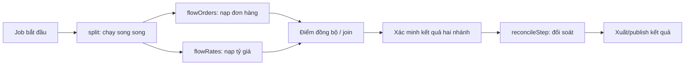
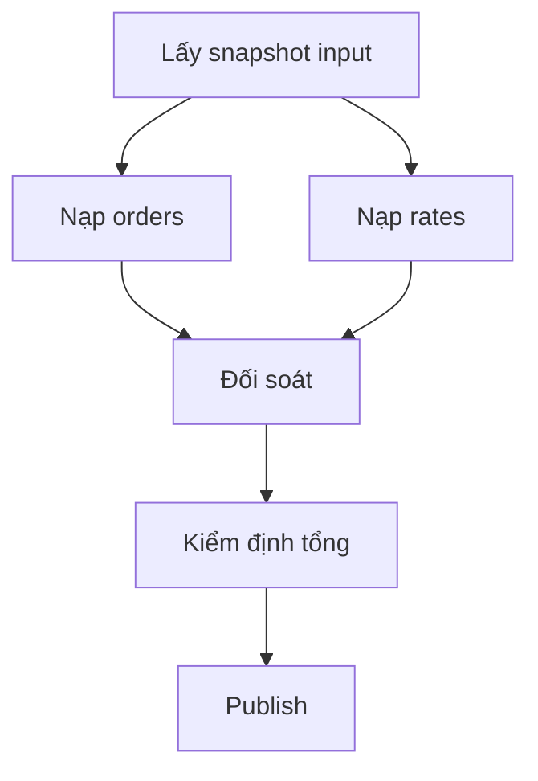

# Phụ thuộc dữ liệu giữa các flow khi chạy Parallel Steps trong Spring Batch

**Parallel Steps** giúp Spring Batch chạy nhiều nhánh công việc đồng thời, thường bằng cách kết hợp các `Flow` với `split(TaskExecutor)`. Tuy nhiên, hai flow chỉ nên chạy song song khi các bước trong đó **không phụ thuộc vào kết quả chưa hoàn tất của nhau**. Nếu một flow đang ghi dữ liệu còn flow khác đọc hoặc sửa chính dữ liệu đó, job có thể cho kết quả sai dù tất cả step đều báo `COMPLETED`.

Bài học thuộc chương **Parallel Steps** của module **SPRING_BATCH_SCALING_OPERATIONS**. Mục tiêu là xác định và mô hình hóa phụ thuộc dữ liệu giữa các flow, xây dựng điểm đồng bộ trước khi hợp nhất kết quả, bảo đảm transaction/thread safety, retry/restart và quan sát hiệu năng. Đây là phần quan trọng khi mở rộng Spring Batch cho workload lớn bằng parallel steps, partitioning và các kiến trúc phân tán theo giới hạn tài nguyên thực tế.

## 1. Flow là gì và vì sao dữ liệu có thể tạo ra phụ thuộc?

Một `Flow` là một nhánh thực thi gồm một hoặc nhiều step và các quy tắc chuyển tiếp. Trong Spring Batch, cấu hình `split(...)` cho phép nhiều flow được khởi chạy đồng thời qua `TaskExecutor`. **Thứ tự hoàn thành của các flow không được bảo đảm**.

Một ví dụ nghiệp vụ:

- `flowOrders`: đọc đơn hàng, chuẩn hóa và ghi vào bảng staging `stage_orders`.
- `flowRates`: lấy tỷ giá, kiểm tra và ghi vào `stage_rates`.
- `reconcileStep`: dùng cả đơn hàng và tỷ giá để tính tổng giá trị, đối soát và xuất báo cáo.

Hai flow đầu có thể chạy song song **nếu** chúng chỉ ghi vào những vùng staging độc lập. `reconcileStep` phải bắt đầu sau khi **cả hai đầu vào đã hoàn tất và có thể đọc nhất quán**.



Ngược lại, nếu `flowOrders` **đã phải tính giá trị bằng tỷ giá** ngay trong lúc chạy, nó phụ thuộc vào dữ liệu do `flowRates` cung cấp. Khi đó không thể chỉ đặt hai flow vào cùng một `split` rồi kỳ vọng Spring Batch tự biết flow nào phải chờ.

**Nguyên tắc nền tảng:** `split` tạo khả năng thực thi song song; nó **không tự suy luận đồ thị phụ thuộc dữ liệu**, không tạo transaction chung và không đảm bảo dữ liệu một nhánh được nhánh kia nhìn thấy vào đúng thời điểm.

## 2. Phân biệt phụ thuộc điều khiển và phụ thuộc dữ liệu

Hai loại phụ thuộc dễ bị nhầm:

| Loại | Câu hỏi | Ví dụ |
| --- | --- | --- |
| Phụ thuộc **điều khiển** | Step B có được bắt đầu trước khi step A đạt trạng thái thích hợp không? | Chỉ chạy `publishStep` sau `validateStep` thành công. |
| Phụ thuộc **dữ liệu** | B có cần dữ liệu/trạng thái do A tạo, thay đổi hoặc khóa lại không? | `calculateTax` cần bảng tỷ giá do `loadRates` cập nhật. |

Có thể cấu hình điều khiển đúng mà vẫn sai dữ liệu: ví dụ flow A và flow B cùng báo `COMPLETED`, nhưng B đã đọc bản ghi A chưa commit hoặc đọc một snapshot khác ngày nghiệp vụ.

Có thể không có phụ thuộc dữ liệu mà vẫn có **tranh chấp tài nguyên**: flow A và B độc lập nhưng đều full scan cùng một database, làm I/O bão hòa và khiến việc chạy song song chậm hơn tuần tự. Đây là vấn đề capacity, khác với tính đúng đắn do phụ thuộc dữ liệu, nhưng cả hai đều phải được xét khi chọn kiến trúc.

## 3. Ba dạng xung đột đọc/ghi cần phát hiện

Một cách phân tích quen thuộc là xem cặp thao tác trên **cùng dữ liệu hoặc cùng đối tượng nghiệp vụ**.

| Kiểu | Tên thường gặp | Ví dụ | Nguy cơ |
| --- | --- | --- | --- |
| **RAW** (*Read After Write*) | B đọc kết quả do A ghi | A cập nhật `stage_orders`, B đọc bảng để tính doanh thu | B đọc khi A chưa xong, thấy dữ liệu thiếu hoặc trạng thái trung gian. |
| **WAW** (*Write After Write*) | Hai flow cùng ghi một vùng | A và B cùng cập nhật `customer_balance` | Lost update, lock, deadlock, thứ tự kết quả không ổn định. |
| **WAR** (*Write After Read*) | A đọc dữ liệu trong lúc B có thể sửa nó | A quét trạng thái `PENDING`, B chuyển sang `PROCESSED` | Phạm vi dữ liệu bị thay đổi, đọc thiếu/lặp hoặc snapshot không nhất quán. |

Không phải mọi trường hợp cùng **tên bảng** đều là xung đột. Nếu hai flow ghi các hàng **không giao nhau** theo `tenant_id` hoặc khoảng ID đã cố định và có ràng buộc dữ liệu rõ ràng, chúng có thể chạy song song. Tuy vậy, index nóng, khóa bảng hoặc tài nguyên DB dùng chung vẫn có thể gây tranh chấp về hiệu năng.

Tương tự, đọc chung một bảng bất biến thường an toàn về phụ thuộc dữ liệu. Khi bảng được cập nhật liên tục, cần quyết định **snapshot, isolation level, watermark hoặc version** dùng cho mỗi lần batch.

### Kiểm kê truy cập dữ liệu trước khi dùng split

Với mỗi flow, lập một bản đồ:

| Flow | Đọc | Ghi | Tác dụng phụ | Dữ liệu bắt buộc phải có trước |
| --- | --- | --- | --- | --- |
| `loadOrders` | File đơn hàng / bảng nguồn | `stage_orders(run_id, ...)` | Không | File đầu vào đã đóng/sẵn sàng. |
| `loadRates` | API tỷ giá / snapshot | `stage_rates(run_id, ...)` | Không | Phiên bản tỷ giá đã xác định. |
| `reconcile` | Hai bảng staging | `stage_results(run_id, ...)` | Không | Hai luồng nạp hoàn tất và đã xác minh. |
| `publish` | `stage_results` | Bảng chính / object xuất | Notification có thể có | Đối soát thành công. |

Nếu một flow **đọc cột/bảng mà flow khác đang ghi**, coi đó là phụ thuộc cần giải thích; chưa đủ bằng chứng để đặt hai flow vào cùng split.

## 4. Biểu diễn phụ thuộc dưới dạng đồ thị có hướng không chu trình

Để quyết định những step có thể chạy đồng thời, nên dựng **DAG** (directed acyclic graph):

- Mỗi nút là một step hoặc một nhóm step có kết quả rõ ràng.
- Cạnh `A → B` nghĩa là B phải đợi A thỏa điều kiện hoàn tất/đầu ra.
- Những nút **không có đường phụ thuộc bắt buộc giữa chúng** có thể là ứng viên chạy đồng thời, sau khi kiểm tra xung đột đọc/ghi và giới hạn tài nguyên.

Ví dụ:



Trong cấu hình này:

1. `Lấy snapshot input` phải xong để cố định bộ dữ liệu/cửa sổ thời gian.
2. `Nạp orders` và `Nạp rates` có thể chạy song song nếu độc lập.
3. `Đối soát` phụ thuộc **cả hai** nhánh, nên đặt **sau điểm join**.
4. `Publish` phụ thuộc kết quả kiểm định, không được chạy ngay khi một nhánh vừa báo `COMPLETED`.

Spring Batch hỗ trợ xây dựng các flow, split và các bước tuần tự để biểu diễn cấu trúc này. Nó không phải bộ lập lịch DAG tổng quát tự phát hiện phụ thuộc từ câu SQL; developer phải mô tả ranh giới và điều kiện chuyển tiếp.

## 5. Khi nào có thể đặt hai flow trong cùng split?

Hai flow là ứng viên chạy song song nếu thỏa đồng thời:

1. **Đầu vào đã ổn định:** Mỗi flow có thể xác định tập item của mình mà không chờ output đang được tạo bởi flow kia.
2. **Không có xung đột ghi:** Hai flow không cùng cập nhật một đối tượng nghiệp vụ theo cách phụ thuộc thứ tự.
3. **Không dùng state mutable chung:** Reader/writer, bean singleton, cache và đối tượng trong memory không bị thay đổi đồng thời một cách thiếu đồng bộ.
4. **Đầu ra có phạm vi rõ:** Mỗi flow ghi artifact/staging riêng hoặc partition dữ liệu không giao nhau.
5. **Có hợp đồng hoàn tất:** Downstream phân biệt được dữ liệu **đã hoàn tất và được xác minh** với dữ liệu đang được viết một phần.
6. **Recovery được thiết kế:** Khi một flow thất bại và flow kia thành công, có thể restart/đối soát mà không tạo ghi trùng.
7. **Nguồn và đích còn tài nguyên:** Việc chạy đồng thời không đẩy DB, pool connection, API hay broker vào vùng quá tải.

**Ví dụ an toàn tương đối:** Flow A trích xuất đơn hàng từ bảng X sang `stage_orders`; flow B nạp tỷ giá từ API sang `stage_rates`. Hai bên dùng `run_id` chung để xác định cùng một lô nghiệp vụ và mỗi flow chỉ ghi dữ liệu của mình.

**Ví dụ không an toàn nếu chưa đồng bộ:** Flow A ghi `stage_orders` theo nhiều chunk; flow B đọc `stage_orders` để tính tổng trong cùng split. B có thể bắt đầu khi A mới commit vài chunk, làm tổng bị thiếu nhưng vẫn kết thúc thành công.

## 6. Mẫu chuẩn: fan-out song song, barrier, fan-in

Một thiết kế phổ biến:

```text
                      +--> flowOrders: stage_orders ----+
snapshot/prepare -----|                               |----> reconcile ----> publish
                      +--> flowRates: stage_rates -----+
                                 split                join
```

**Fan-out:** Bắt đầu các nhánh độc lập sau khi điều kiện đầu vào sẵn sàng.

**Barrier/join:** Không cho bước tiêu thụ kết quả chạy cho đến khi các nhánh cần thiết đã hoàn tất theo điều kiện chuyển tiếp của job. Trong Spring Batch, flow sau một `split` có điểm đồng bộ ở mức flow: framework chờ các nhánh của split kết thúc để tổng hợp trạng thái.

**Fan-in:** `reconcileStep` hợp nhất dữ liệu từ tất cả các nhánh, kiểm tra tính đầy đủ và mới được tạo kết quả nghiệp vụ cuối cùng.

> Barrier là đồng bộ **luồng điều khiển**. Để bảo đảm dữ liệu đúng, còn phải kiểm tra transaction đã commit, artifact có version/scope chính xác và dữ liệu thực sự đủ. Một HTTP request được chấp nhận hoặc một message được broker ACK chưa đồng nghĩa với việc downstream đã tạo output cuối cùng.

### Barrier không bảo đảm mọi flow thành công

Một split kết thúc khi các flow thành phần đạt trạng thái kết thúc của chúng; cách tổng hợp `FlowExecutionStatus` và luật chuyển tiếp sẽ quyết định job đi tiếp, dừng hay thất bại. Nếu một nhánh lỗi, nhánh khác có thể đã commit dữ liệu hoặc vẫn đang kết thúc công việc.

**Đừng coi “đã đi qua join” là “hai nhánh thành công”.** Sau split nên có hợp đồng kiểm tra kết quả đầu vào, và cấu hình transition/exit status để `reconcileStep` không publish khi có nhánh thất bại. Nếu dùng flow đặc biệt có catch/skip lỗi hoặc transition tùy biến, cần kiểm chứng kết quả cuối cùng thật sự.

## 7. Cấu hình Parallel Steps bằng Java trong Spring Batch 5.x

Ví dụ sau tạo hai flow độc lập và một step `reconcileStep` chỉ được đưa vào đường xử lý sau khi split hoàn thành. Mã là **cấu hình cấu trúc flow**; các bean step thực tế do ứng dụng cung cấp. Tên bean tách biệt để dễ theo dõi trong `JobRepository`.

```java
import org.springframework.batch.core.Job;
import org.springframework.batch.core.Step;
import org.springframework.batch.core.flow.Flow;
import org.springframework.batch.core.flow.support.SimpleFlow;
import org.springframework.batch.core.job.builder.FlowBuilder;
import org.springframework.batch.core.job.builder.JobBuilder;
import org.springframework.batch.core.repository.JobRepository;
import org.springframework.beans.factory.annotation.Qualifier;
import org.springframework.context.annotation.Bean;
import org.springframework.context.annotation.Configuration;
import org.springframework.core.task.TaskExecutor;
import org.springframework.scheduling.concurrent.ThreadPoolTaskExecutor;

@Configuration
public class ParallelDataFlowsConfig {

    @Bean
    public ThreadPoolTaskExecutor flowExecutor() {
        ThreadPoolTaskExecutor executor = new ThreadPoolTaskExecutor();
        executor.setThreadNamePrefix("batch-flow-");
        executor.setCorePoolSize(2);
        executor.setMaxPoolSize(2);
        executor.setQueueCapacity(4);
        return executor;
    }

    @Bean
    public Flow ordersFlow(
            @Qualifier("loadOrdersStep") Step loadOrdersStep) {
        return new FlowBuilder<SimpleFlow>("ordersFlow")
            .start(loadOrdersStep)
            .build();
    }

    @Bean
    public Flow ratesFlow(
            @Qualifier("loadRatesStep") Step loadRatesStep) {
        return new FlowBuilder<SimpleFlow>("ratesFlow")
            .start(loadRatesStep)
            .build();
    }

    @Bean
    public Flow parallelLoadFlow(
            @Qualifier("flowExecutor") TaskExecutor executor,
            @Qualifier("ordersFlow") Flow orders,
            @Qualifier("ratesFlow") Flow rates) {

        return new FlowBuilder<SimpleFlow>("parallelLoadFlow")
            .split(executor)
            .add(orders, rates)
            .build();
    }

    @Bean
    public Flow mainFlow(
            @Qualifier("parallelLoadFlow") Flow parallelLoadFlow,
            @Qualifier("reconcileStep") Step reconcileStep) {

        return new FlowBuilder<SimpleFlow>("mainFlow")
            .start(parallelLoadFlow)
            .next(reconcileStep)
            .build();
    }

    @Bean
    public Job dailyReconciliationJob(
            JobRepository jobRepository,
            @Qualifier("mainFlow") Flow mainFlow) {

        return new JobBuilder("dailyReconciliationJob", jobRepository)
            .start(mainFlow)
            .end()
            .build();
    }
}
```

**Giải thích các điểm quan trọng:**

- `ordersFlow` và `ratesFlow` chạy ở hai nhánh song song. Hai step `loadOrdersStep` và `loadRatesStep` phải thực sự độc lập về dữ liệu.
- `split(executor).add(orders, rates)` dùng `TaskExecutor` để chạy các flow. Pool có hai worker là mức ban đầu thích hợp cho **hai flow**; không có nghĩa mọi step trong flow tự động xử lý đa luồng.
- `mainFlow` đặt `reconcileStep` **sau** `parallelLoadFlow`, nhằm tạo một điểm phụ thuộc rõ ràng ở cấp flow.
- `reconcileStep` phải kiểm tra hai đầu vào đã đủ, đúng `run_id` và đạt trạng thái được phép xử lý; không chỉ giả định có bản ghi trong staging.
- Mã chưa định nghĩa nội dung của ba Step, transaction manager, DataSource, JobRepository, cách cập nhật staging và các transition tùy biến khi lỗi. Cần kiểm tra ngữ nghĩa status/transition trên phiên bản triển khai; đặc biệt, nếu flow tùy biến nuốt lỗi thì downstream vẫn có nguy cơ chạy với dữ liệu thiếu.

### Trường hợp A phải hoàn tất trước B

Nếu `loadOrdersStep` cần dữ liệu do `loadRatesStep` tạo, không nên đặt chúng ở hai nhánh độc lập như trên. Có thể đặt chúng **cùng một flow tuần tự**:

```java
@Bean
public Flow ratesThenOrdersFlow(
        @Qualifier("loadRatesStep") Step loadRatesStep,
        @Qualifier("loadOrdersStep") Step loadOrdersStep) {

    return new FlowBuilder<SimpleFlow>("ratesThenOrdersFlow")
        .start(loadRatesStep)
        .next(loadOrdersStep)
        .build();
}
```

Chỉ dùng `split` cho các nhóm step độc lập còn lại. Nếu cần A và B làm xong rồi C mới chạy, xây cấu trúc **split → join → C** như ví dụ chính. Việc khởi chạy song song hai step phụ thuộc nhau rồi thêm `Thread.sleep(...)` hoặc poll vòng lặp không tạo hợp đồng đồng bộ vững chắc.

## 8. Không dùng JobExecutionContext như bộ truyền dữ liệu đồng thời

Spring Batch có hai phạm vi context chính:

| Context | Phạm vi | Mục đích điển hình |
| --- | --- | --- |
| `StepExecution.getExecutionContext()` | Một `StepExecution` | Checkpoint, cursor, phạm vi item, vị trí file của step. |
| `JobExecution.getExecutionContext()` | Một `JobExecution` | Metadata nhỏ dùng ở cấp job, tham số kỹ thuật và giá trị cần chia sẻ theo lifecycle. |

Vấn đề: khi hai flow chạy song song, cả hai có thể truy cập metadata cấp job. Việc mỗi flow tự ghi cùng một key như `rowCount`, `filePath` hoặc `lastId` dẫn đến **xung đột ghi** và kết quả khó dự đoán. Thậm chí hai key khác nhau cũng không nên được cập nhật bằng thao tác thiếu kiểm soát khi framework đang lưu context ở các thời điểm lifecycle khác nhau.

Mẫu có nguy cơ:

```java
// KHÔNG sử dụng làm cơ chế phối hợp giữa hai flow đang chạy:
stepExecution.getJobExecution()
    .getExecutionContext()
    .putLong("processedCount", localCount);
```

Hai nhánh có thể ghi đè nhau; việc giá trị tồn tại trong object memory cũng **không bảo đảm** đã được lưu bền vững vào JobRepository hoặc đã trở thành dữ liệu nhất quán của flow khác. `ExecutionContext` vốn phục vụ metadata/checkpoint, không phải message bus cho đồng bộ realtime.

**Giải pháp ưu tiên:**

1. Các flow ghi dữ liệu có phạm vi riêng, thường theo `run_id`/`business_date` và tên dataset.
2. Mỗi flow tạo một kết quả/manifest bền vững hoặc cập nhật trạng thái của phần dữ liệu riêng **sau khi đã commit phần việc cần thiết**.
3. Bước downstream chỉ đọc các kết quả đó **sau join**, kiểm tra đủ các đầu vào và tính nhất quán.
4. Nếu cần chuyển **metadata nhỏ** từ step sang job context, có thể dùng cơ chế promotion với key khác nhau và chỉ tiêu thụ sau khi mọi nhánh liên quan đã hoàn tất; không dựa vào việc hai flow đang chạy nhìn thấy giá trị mới ngay lập tức.

`ExecutionContextPromotionListener` có thể chuyển giá trị từ step context lên job context khi step đạt trạng thái phù hợp, nhưng cần kiểm tra cách đăng ký listener, tên key, exit status và độ bền của metadata. Khi nhiều nhánh cùng ghi, nên dùng key có namespace riêng và kiểm thử hành vi song song/restart thay vì tùy tiện promotion cùng một key.

### Lưu ý về bean scope

`@StepScope` giúp tạo bean theo `StepExecution` riêng, hữu ích cho reader/writer stateful. Với `@JobScope`, việc truy cập context trong thread do parallel flows/task executor sinh ra có thể có hạn chế trong một số cấu hình và phiên bản, vì framework không kiểm soát hoàn toàn việc gắn scope cho thread tự tạo. Không nên dựa vào mutable job-scoped bean để đồng bộ hai nhánh; ưu tiên dữ liệu bền vững và tham số truyền rõ ràng.

## 9. Mẫu staging theo run_id và trạng thái sẵn sàng

Đối với workload dữ liệu lớn, một cách đáng tin cậy để tránh nhánh đọc dữ liệu đang ghi là **tách staging theo lần chạy** và có bản ghi biểu thị hoàn tất.

Ví dụ schema khái niệm (PostgreSQL; giản lược dữ liệu nghiệp vụ):

```sql
CREATE TABLE batch_stage_orders (
    run_id       VARCHAR(80) NOT NULL,
    order_id     BIGINT NOT NULL,
    amount       NUMERIC(18, 2) NOT NULL,
    currency     VARCHAR(3) NOT NULL,
    PRIMARY KEY (run_id, order_id)
);

CREATE TABLE batch_stage_rates (
    run_id       VARCHAR(80) NOT NULL,
    currency     VARCHAR(3) NOT NULL,
    rate         NUMERIC(18, 8) NOT NULL,
    PRIMARY KEY (run_id, currency)
);

CREATE TABLE batch_stage_manifest (
    run_id         VARCHAR(80) NOT NULL,
    dataset        VARCHAR(40) NOT NULL,
    state          VARCHAR(20) NOT NULL,
    expected_rows  BIGINT,
    written_rows   BIGINT,
    completed_at   TIMESTAMPTZ,
    PRIMARY KEY (run_id, dataset)
);
```

Hai flow sử dụng cùng `run_id` đã được xác định trước khi chạy (ví dụ business date cùng một batch version). Một flow chỉ ghi `batch_stage_orders` và manifest `dataset='orders'`; flow còn lại chỉ ghi `batch_stage_rates` và manifest `dataset='rates'`. Tách namespace giúp giảm WAW và hỗ trợ restart.

**Quy ước đề xuất:**

- `RUNNING`: flow đang nạp; downstream **không được dùng** dữ liệu này để publish.
- `READY`: toàn bộ các chunk của flow đã commit, qua kiểm tra cần thiết và đã công bố trạng thái sẵn sàng.
- `FAILED` hoặc thiếu manifest: không có hợp đồng đầu vào hợp lệ cho downstream.

Chỉ chuyển manifest sang `READY` **sau khi** việc ghi dữ liệu cần thiết đã commit và đã đối chiếu số lượng/checksum theo yêu cầu. Nếu việc ghi kết quả và cập nhật manifest ở hai transaction khác nhau, phải thiết kế xử lý crash giữa hai transaction: thiếu `READY` sẽ khiến downstream từ chối, còn retry manifest phải idempotent.

Ví dụ kiểm tra điều kiện đầu vào tại `reconcileStep`:

```sql
SELECT dataset, state, expected_rows, written_rows
FROM batch_stage_manifest
WHERE run_id = :runId
  AND dataset IN ('orders', 'rates');
```

`reconcileStep` chỉ tiếp tục khi tìm thấy **đúng hai dataset**, cả hai ở `READY`, số lượng hợp lệ và không có lỗi ở mức job/step. Không dùng `COUNT(*) >= 2` mà bỏ qua `state`, vì một dataset có thể đang `FAILED` hoặc vẫn `RUNNING`.

Ví dụ truy vấn hợp nhất sau khi đã xác nhận readiness:

```sql
SELECT
    o.order_id,
    o.amount,
    o.currency,
    r.rate,
    o.amount * r.rate AS converted_amount
FROM batch_stage_orders AS o
JOIN batch_stage_rates AS r
  ON r.run_id = o.run_id
 AND r.currency = o.currency
WHERE o.run_id = :runId;
```

Nếu tỷ giá còn phân biệt ngày hoặc vùng, khóa join cần bổ sung đúng `rate_date`/`region` tương ứng. Đừng dùng tỷ giá “mới nhất” không cố định trong lúc job chạy, vì có thể khiến cùng một JobInstance cho kết quả khác nhau khi restart.

### Run ID và tính ổn định khi restart

`run_id` cần có semantics rõ: định danh một batch của dữ liệu nghiệp vụ, ổn định khi restart **cùng JobInstance**, và không vô tình trộn đầu ra của hai run có nội dung khác nhau. Một `businessDate` có thể chưa đủ nếu cùng ngày được xử lý lại theo nhiều phiên bản; khi đó bổ sung `batchVersion` hoặc khóa snapshot.

Nếu dùng cùng `run_id` để reprocess, cần chính sách *replace/upsert/delete & rebuild* rõ ràng, bảo đảm writer idempotent và không làm hỏng kết quả đã publish. `UNIQUE(run_id, business_key)` giúp ngăn ghi trùng nhưng chưa đủ cho mọi tác dụng phụ ngoài database.

## 10. Transaction isolation và snapshot: barrier chưa giải quyết hết vấn đề

Giả sử hai flow chỉ **đọc cùng nguồn** nhưng nguồn đang có cập nhật mới. Chúng có thể đọc các thời điểm khác nhau:

- `flowOrders` snapshot số đơn hàng tới 02:00.
- `flowRates` lấy tỷ giá lúc 02:07.
- `reconcileStep` chạy lúc 02:10.

Dù hai flow đều `COMPLETED`, dữ liệu đầu vào có thể **không đại diện cùng mốc nghiệp vụ**. Tùy yêu cầu, cần cố định `asOfTime`, CDC offset, batch version hoặc snapshot chung trước khi split.

Các lựa chọn thường gặp:

| Cơ chế | Khi hữu ích | Giới hạn |
| --- | --- | --- |
| Immutable snapshot/file version | Dữ liệu có thể đóng băng trước khi chạy. | Tốn lưu trữ và thời gian chuẩn bị. |
| Watermark/CDC offset chung | Dữ liệu ingest liên tục, cần biên rõ ràng. | Phải xử lý late-arrival, update/delete và checkpoint. |
| Cùng business date + batch version | Đầu vào đã phát hành theo kỳ nghiệp vụ. | Phải bảo đảm mỗi nguồn có cùng khái niệm về kỳ. |
| Database transaction isolation | Tránh một số bất thường đọc/ghi trong phạm vi transaction. | Transaction của các flow **khác nhau**, không mặc nhiên chia sẻ cùng snapshot; transaction dài còn tăng lock/bloat. |
| Staging + READY manifest | Phân biệt dữ liệu đang ghi với đã hoàn tất. | Cần thiết kế atomicity/khôi phục của manifest và kiểm định dữ liệu. |

**Không suy luận** rằng dùng isolation `READ_COMMITTED` là đủ để đọc một bảng đang được flow khác nạp từng chunk. B có thể thấy những chunk A đã commit nhưng chưa có toàn bộ dataset. `REPEATABLE_READ` trong một transaction của B có thể cho snapshot nhất quán, nhưng nếu snapshot được tạo **trước khi A hoàn tất**, nó vẫn nhất quán trên **dữ liệu thiếu**. Cần giải quyết dependency bằng luồng điều khiển và hợp đồng readiness trước, rồi mới chọn isolation phù hợp.

## 11. Failure và restart: một nhánh đã thành công, nhánh kia thất bại

Khi chạy song song, **thành công một phần** là bình thường. Ví dụ:

| Thành phần | Trạng thái | Tác động |
| --- | --- | --- |
| `loadOrdersStep` | `COMPLETED` | 2 triệu orders đã nạp vào staging và manifest `READY`. |
| `loadRatesStep` | `FAILED` | Một số tỷ giá có thể đã ghi, manifest chưa `READY`. |
| `reconcileStep` | Chưa được chạy trong đường thành công | Không có kết quả đối soát hợp lệ để publish. |
| Job | Thất bại theo flow/transition tương ứng | Cần sửa lỗi và restart có kiểm soát. |

Các transaction của flow thành công **không bị tự động rollback** vì một flow khác thất bại. Vậy điều gì xảy ra khi restart?

1. Xác định đúng `JobInstance` và các `StepExecution` trong `JobRepository`.
2. Kiểm tra bước đã `COMPLETED`, bước `FAILED`, checkpoint và các quy tắc `allowStartIfComplete`/restart.
3. Với cấu hình restart thông thường, step hoàn tất có thể được bỏ qua; step lỗi được xử lý lại theo trạng thái và `ExecutionContext`. Chi tiết phụ thuộc cấu hình flow và từng step.
4. Dữ liệu staging phải chịu được retry (upsert/merge/idempotency) và không xuất bản đầu ra khi các nhánh chưa `READY`.
5. Nếu muốn chạy lại cả hai nguồn để có cùng snapshot/version mới, cần thiết kế một lượt xử lý lại có nhận diện rõ, thay vì tình cờ ép chạy lại branch thành công.

**Không đổi identifying `JobParameters` rồi gọi đó là restart**: tham số định danh khác có thể tạo `JobInstance` khác, làm cơ chế resume dựa vào metadata cũ không còn áp dụng.

### Một lỗi nguy hiểm: “COMPLETE marker” được ghi quá sớm

Giả sử `loadRatesStep` ghi manifest `READY` **trước** khi ghi xong chunk cuối, rồi JVM crash. Lần chạy sau có thể thấy `READY` dù bảng staging chỉ có dữ liệu một phần. Do đó, cần thiết kế trật tự commit và quá trình xác minh rõ ràng: dữ liệu đầy đủ → commit → validate → cập nhật trạng thái `READY`. Nếu hệ thống dùng nhiều database, không có transaction chung thì phải có reconciliation/compensating logic cho khoảng thời gian không atomic.

## 12. Side effects ngoài DB: email, API, file và message

Độc lập về bảng DB chưa đủ nếu các flow cùng thao tác tài nguyên ngoài database.

| Tình huống | Rủi ro khi chạy song song | Cách xử lý |
| --- | --- | --- |
| Hai flow cùng ghi một file CSV | Interleaving nội dung, hỏng header, mất thứ tự | Mỗi flow ghi file riêng; bước sau join merge và publish atomically nếu có thể. |
| Hai flow gửi notification về cùng giao dịch | Người dùng nhận thông báo trùng hoặc quá sớm | Dùng khóa idempotency và phát sự kiện sau khi output hoàn tất. |
| Flow A tạo object, flow B đọc ngay | Object chưa upload xong hoặc chưa được promote sang trạng thái final | Dùng object key versioned và marker/manifest hoàn tất. |
| Hai flow cùng update balance qua API | Thứ tự cập nhật không xác định | Serialize theo business key hoặc dùng API atomic/idempotent phù hợp. |
| Hai flow ghi vào cùng Kafka topic | Thứ tự liên nhánh không bảo đảm | Chia key, sequence/version và consumer idempotent; không dựa vào thứ tự toàn cục. |

Đối với tác dụng phụ ngoài transaction của Spring Batch, retry sau timeout có thể thực hiện lặp lại một yêu cầu đã thành công. Cần cơ chế idempotency, outbox hoặc bù trừ theo nghiệp vụ. `BatchStatus.COMPLETED` của step chỉ phản ánh logic step và các transaction được kiểm soát, không tự chứng minh external system đã xử lý đúng một lần.

## 13. Thread safety và phạm vi bean trong nhiều flow

Các flow của split thường chạy trên những thread khác nhau trong cùng JVM. Các bean Spring singleton dùng chung có thể gây race:

- Reader giữ cursor hoặc buffer mutable.
- Writer ghi chung một file/collection.
- Processor giữ cache hoặc bộ đếm không thread-safe.
- Formatter/parser không an toàn thread.
- Shared `Map` dùng làm giao tiếp giữa các step.
- Job-scoped mutable service làm cache trạng thái cuối mà các nhánh cùng sửa.

Dùng `@StepScope` cho reader/writer phụ thuộc vào `stepExecutionContext` nếu cần instance riêng theo step. Mỗi flow cần sử dụng step với input/output rõ ràng; nếu hai flow thực thi hai bean step có cùng tên hoặc cùng business key mà không kiểm soát, metadata và dữ liệu có thể trở nên khó phân biệt.

**Cẩn trọng khi chia sẻ DataSource:** DataSource/pool là tài nguyên chia sẻ được thiết kế cho nhiều thread, nhưng JDBC `Connection` và các transaction/session đang hoạt động không nên được lưu trong singleton rồi dùng đồng thời ở các nhánh. Mỗi step cần transaction boundary phù hợp.

Một thiết kế tốt thường có các đặc tính:

1. Logic transform phần lớn **stateless**.
2. Mỗi step đọc từ phạm vi input đã xác định và ghi vào vùng output riêng.
3. Khả năng ghi lặp có kiểm soát (idempotent).
4. Shared mutable state được tránh hoặc có cơ chế đồng bộ rõ ràng, kiểm thử được.
5. Việc chuyển metadata nhỏ giữa step dùng cơ chế framework đúng lifecycle, thay vì polling biến Java giữa hai flow.

## 14. Phụ thuộc tài nguyên và nguy cơ deadlock dù dữ liệu “độc lập”

Hai flow có thể không dùng kết quả của nhau nhưng cùng tranh chấp:

- JDBC connections và transaction slots.
- DB CPU, buffer cache, index/partition hotspot.
- Thread pool, heap, GC và I/O.
- Rate limit của API ngoài.
- Lock trên bảng metadata hoặc cấu trúc lưu trữ.
- Chỉ số read/write và transaction overhead ở `JobRepository`.

Ví dụ mỗi flow độc lập cần tối đa 8 connection trong giờ cao điểm, nhưng pool chỉ có 10 connection; chạy song song có thể khiến một phần thread chờ connection và timeout. Chọn `TaskExecutor` có 2 thread cho 2 flow **không tự giới hạn** mọi thread con mà step bên trong có thể tạo. Nếu từng flow còn dùng partitioning hoặc multi-threaded chunk step, tổng concurrency tăng rất nhanh.

**Không giữ transaction mở trong một flow trong khi chờ flow khác hoàn tất.** Kiểu chờ vòng giữa hai flow có thể tạo deadlock nghiệp vụ: A giữ lock X đợi B phát tín hiệu, B cần X mới phát được tín hiệu. Barrier nên nằm **ngoài** transaction nghiệp vụ đang mở.

### Ước lượng lợi ích chạy song song

Nếu hai flow độc lập:

\[
T_{\text{sequential}}\approx T_A+T_B+T_{\text{merge}}
\]

\[
T_{\text{parallel}}\approx
\max(T_A,T_B)+T_{\text{merge}}+T_{\text{overhead}}
\]

Ví dụ A chạy 18 phút, B 12 phút, merge 5 phút:

- Tuần tự: khoảng **35 phút**.
- Song song lý tưởng: khoảng **23 phút**, chưa tính overhead/contended resources.

Nếu chạy cùng lúc khiến A tăng lên 24 phút vì DB bão hòa, B thành 17 phút và overhead là 1 phút thì tổng khoảng **30 phút**. Lợi ích chỉ còn 5 phút so với tuần tự và cần đánh giá thêm tỷ lệ lỗi.

Thời gian thực tế không thể suy ra chỉ bằng cách đếm số flow; cần benchmark với workload đại diện, dữ liệu và môi trường vận hành tương tự production.

## 15. Đo phụ thuộc và tiến độ ở cấp flow

Các nguồn quan sát:

| Nguồn | Chỉ số | Dùng để xác minh |
| --- | --- | --- |
| `JobRepository` | `JobExecution`, `StepExecution`, `BatchStatus`, `ExitStatus` | Nhánh nào còn chạy, nhánh nào lỗi hoặc hoàn tất. |
| Metadata theo step | read/write/skip/commit/rollback counts, duration | Có tiến độ và bottleneck ở đâu. |
| Bảng staging/manifest | `run_id`, trạng thái `READY`, số dòng, checksum | Đầu vào downstream có đầy đủ và cùng phiên bản không. |
| TaskExecutor | Active threads, queue, rejected tasks | Hai flow có thật sự được cấp thread không. |
| DB và I/O | Query latency, locks, pending connections, IOPS | Chạy song song có gây contention không. |
| Tracing/log | jobExecutionId, stepExecutionId, run_id | Ghép lỗi và output đúng nhánh. |

Ví dụ SQL (schema metadata Spring Batch thông thường):

```sql
SELECT
    STEP_NAME,
    STATUS,
    EXIT_CODE,
    READ_COUNT,
    WRITE_COUNT,
    COMMIT_COUNT,
    ROLLBACK_COUNT,
    START_TIME,
    END_TIME,
    LAST_UPDATED
FROM BATCH_STEP_EXECUTION
WHERE JOB_EXECUTION_ID = :jobExecutionId
ORDER BY START_TIME, STEP_NAME;
```

Nếu `loadOrdersStep` và `loadRatesStep` đều có `START_TIME` gần nhau, đó là dấu hiệu hai flow đã khởi động gần đồng thời. Tuy nhiên, để xác nhận concurrency thực sự, cần quan sát thread executor và activity của từng step. `JobRepository` ghi trạng thái theo các ranh giới lifecycle/commit, không phải heartbeat realtime từng instruction của worker.

Dashboard tốt nên cho thấy **thời điểm bắt đầu/kết thúc mỗi nhánh, bước downstream đợi điều gì, số artifact READY theo run_id và tuổi dữ liệu đầu vào**. Nếu chỉ nhìn tổng JobExecution vẫn `STARTED`, rất khó phân biệt một flow chậm với một phụ thuộc dữ liệu bị thiết kế sai.

## 16. Những sai lầm thường gặp

1. **Đưa hai flow có RAW dependency vào cùng split:** consumer đọc output chưa đầy đủ.
2. **Cho hai flow WAW cập nhật cùng business key:** dữ liệu cuối phụ thuộc interleaving hoặc gây deadlock.
3. **Cho flow B đọc bảng đang thay đổi mà không có snapshot/watermark:** kết quả thiếu hoặc khó tái lập.
4. **Coi kết thúc split là bảo đảm tất cả dữ liệu đúng:** bỏ qua trạng thái từng nhánh, commit và tính đầy đủ.
5. **Dùng `JobExecutionContext` như shared mutable map thời gian thực:** giá trị ghi đè hoặc không được persist theo cách mong đợi.
6. **Dùng `Thread.sleep`/poll busy-loop trong một nhánh để đợi nhánh khác:** vừa tốn thread vừa có thể deadlock/timeout.
7. **Bỏ qua side effects ngoài transaction:** retry gửi email, webhook hay cập nhật API lần thứ hai.
8. **Đặt nhiều flow nhưng chỉ cấp một worker thread:** split tồn tại về cấu trúc nhưng concurrency bị giới hạn.
9. **Chỉ đo duration mà không xét DB lock/pool:** thấy chạy chậm nhưng tăng thêm thread làm tệ hơn.
10. **Không xử lý trường hợp một nhánh thành công, một nhánh thất bại:** restart gây trùng dữ liệu hoặc publish dữ liệu thiếu.
11. **Không namespace staging theo run_id:** hai lịch chạy chồng nhau trộn output.
12. **Không đóng băng version của các nguồn:** hai flow cùng thành công nhưng dữ liệu thuộc kỳ nghiệp vụ khác nhau.

## 17. Tình huống thực hành: hệ thống đối soát giao dịch

Một job hằng ngày xử lý 5 triệu đơn hàng. Job có ba step:

- `A – loadOrdersStep`: đọc đơn hàng, ghi `stage_orders` theo `business_date`.
- `B – loadRatesStep`: đọc tỷ giá, ghi `stage_rates`.
- `C – reconcileStep`: join orders và rates để tính số tiền quy đổi.

A mất 14 phút, B mất 9 phút, C mất 6 phút; giới hạn batch window là 25 phút.

**Câu hỏi 1:** Có thể chạy A và B trong cùng split không?

Có, **nếu** A và B độc lập về nguồn/đích và cùng dùng một batch version, staging tách biệt, không có việc A trực tiếp dùng tỷ giá trong lúc load. C phải đặt sau điểm join.

**Câu hỏi 2:** Thời gian lý tưởng?

Tuần tự khoảng `14+9+6 = 29` phút. Song song lý tưởng khoảng `max(14,9)+6 = 20` phút, chưa tính overhead và contention. Mức dự phòng trước SLA là 5 phút trong mô hình lý tưởng.

**Câu hỏi 3:** Nếu C bắt đầu khi A mới commit 80% dữ liệu, lỗi gì xuất hiện?

Kết quả đối soát có thể thiếu 20% đơn hàng dù truy vấn thành công. Cần đợi A kết thúc, xác nhận manifest `READY`, kiểm tra row count/checksum rồi mới xử lý.

**Câu hỏi 4:** Nếu B thất bại sau khi ghi một phần staging, A đã thành công?

Không tự rollback A. Job phải phản ánh lỗi; C không được publish. Khi restart, đối chiếu metadata và manifest, cho phép reprocess B idempotent; chỉ chạy lại A nếu semantics nghiệp vụ/phiên bản snapshot yêu cầu.

**Câu hỏi 5:** Nếu A và B chạy song song nhưng DB throughput giảm mạnh, nên làm gì?

Đo query latency, active/pending connections, locks, CPU, I/O và row counts; đánh giá giảm concurrency, tối ưu index, chia lịch chạy hoặc tăng khả năng nguồn/đích. Một thiết kế đúng phụ thuộc dữ liệu chưa chắc mang lại lợi ích hiệu năng.

## 18. Checklist thiết kế phụ thuộc giữa các flow

- [ ] Mỗi flow có danh sách input, output, tác dụng phụ và owner dữ liệu rõ ràng.
- [ ] Đã xác định các phụ thuộc RAW/WAW/WAR và cạnh DAG trước khi cấu hình split.
- [ ] Chỉ các flow độc lập được khởi chạy song song; step phụ thuộc nằm sau điểm đồng bộ.
- [ ] Đầu vào được cố định bằng snapshot, watermark, batch version hoặc contract tương đương.
- [ ] Output từng flow được namespace theo run_id và có quy ước READY/FAILED rõ ràng.
- [ ] Downstream kiểm tra trạng thái và dữ liệu, không dựa vào việc staging chứa một vài dòng.
- [ ] Reader/writer/processor không chia sẻ mutable state thiếu thread safety; dùng scope phù hợp.
- [ ] Không dùng context cấp job để làm kênh đồng bộ trực tiếp giữa các flow.
- [ ] Side effects qua API/file/message có idempotency hoặc cơ chế bù trừ phù hợp.
- [ ] Có tình huống kiểm thử một flow thành công, một flow thất bại, crash giữa commit và READY.
- [ ] Đã thử restart đúng JobInstance và kiểm chứng không trùng/bỏ sót output.
- [ ] Có metric thời gian từng flow, độ đầy đủ staging, executor và độ bão hòa của DB/đích.
- [ ] Chạy song song thực sự cải thiện SLA trên workload đại diện, không chỉ trong mô hình lý tưởng.

## 19. Tài liệu tham khảo

- [Spring Batch Reference – Scaling and Parallel Processing](https://docs.spring.io/spring-batch/reference/scalability.html): cách thực hiện các parallel flows và split.
- [Spring Batch Reference – Configuring a Step](https://docs.spring.io/spring-batch/reference/step/chunk-oriented-processing.html): transaction, chunk và lifecycle.
- [Spring Batch Reference – Controlling Step Flow](https://docs.spring.io/spring-batch/reference/step/controlling-flow.html): điều kiện chuyển tiếp, split và trạng thái flow.
- [Spring Batch Reference – ExecutionContext](https://docs.spring.io/spring-batch/reference/common-patterns.html): mẫu chia sẻ dữ liệu và metadata trong job/step, cần đối chiếu theo phiên bản.
- [Spring Batch Reference – Late Binding](https://docs.spring.io/spring-batch/reference/step/late-binding.html): step scope, job scope, truyền tham số.
- [FlowBuilder API (Spring Batch)](https://docs.spring.io/spring-batch/docs/current/api/org/springframework/batch/core/job/builder/FlowBuilder.html): xây dựng flow, split, transition và composition.
- [Spring Batch Reference – JobRepository](https://docs.spring.io/spring-batch/reference/job/configuring-repository.html): metadata bền vững phục vụ trạng thái và restart.

> **Ghi nhớ:** Chỉ cho các flow chạy song song khi **đầu vào, đầu ra và side effect của chúng độc lập trong khoảng thời gian thực thi**. Phụ thuộc dữ liệu phải được biểu diễn bằng thứ tự flow hoặc điểm **split → join → downstream**, kết hợp snapshot/version, hợp đồng output READY, transaction, thread safety và restart. Sự đúng đắn của dữ liệu quyết định nơi đặt barrier; tài nguyên thực tế quyết định có nên tăng concurrency hay không.
