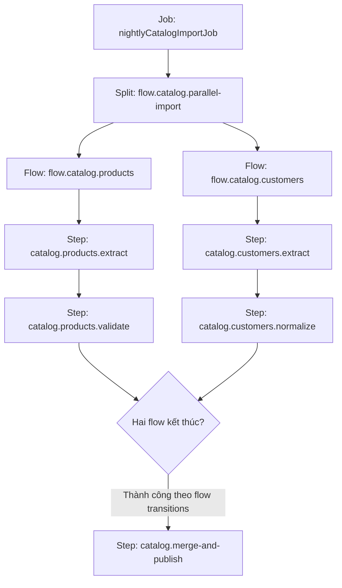

# Đặt tên flow và step rõ ràng

## 1. Vì sao tên lại quan trọng khi chạy parallel steps?

Trong Spring Batch, **parallel steps** cho phép thực thi nhiều **nhánh flow độc lập** cùng lúc bằng một `TaskExecutor`. Ví dụ job nhập dữ liệu chạy đồng thời một nhánh nhập khách hàng và một nhánh nhập sản phẩm, sau đó đối soát kết quả. Khi job có vài nhánh và nhiều `StepExecution` cùng xuất hiện, những tên kiểu `step1`, `step2`, `flowA` nhanh chóng trở thành vấn đề: log khó hiểu, dashboard khó lọc, on-call không biết nhánh nào lỗi, còn người chỉnh sửa có thể vô tình đổi tên một step đã có checkpoint.

Vì vậy, **tên `Job`, `Flow` và `Step` là một phần của hợp đồng vận hành**, không đơn thuần là tên biến Java. Tên step được đưa vào metadata để quản lý trạng thái và restart. Tên flow giúp cấu trúc điều phối dễ hiểu, còn tên bean và thread là những định danh **khác** cần đặt nhất quán nhưng không nên nhầm với tên step.

Đây là bài học trong chương **Parallel Steps** của module `SPRING_BATCH_SCALING_OPERATIONS`, hướng đến workload dữ liệu lớn với multi-threaded step, parallel steps, partitioning và xử lý phân tán. Một naming convention tốt giúp đo bottleneck theo nhánh, kiểm tra thread safety/transaction, vận hành và khôi phục job đáng tin cậy.

Sau bài này, bạn sẽ:

1. Phân biệt tên `Job`, `Flow`, `Step`, tên Spring bean và tiền tố thread.
2. Thiết kế quy tắc đặt tên theo **nghiệp vụ – nhánh – hành động**, ổn định qua các lần chạy.
3. Cấu hình parallel flows bằng `FlowBuilder` và `JobBuilder` với tên có nghĩa.
4. Hiểu tại sao đổi tên step hoặc trùng tên step có thể gây nhầm lẫn về metadata/restart.
5. Viết log, truy vấn metadata và bài kiểm thử cho phép theo dõi flow/step khi chạy song song.

## 2. Nhận diện đúng năm loại tên

Giả sử job cần nhập khách hàng và sản phẩm:

| Định danh | Ví dụ | Nơi khai báo/quan sát | Vai trò |
| --- | --- | --- | --- |
| **Job name** | `nightlyCatalogImportJob` | `new JobBuilder("nightlyCatalogImportJob", repository)` | Định danh logic job, được lưu trong metadata `JobInstance` |
| **Flow name** | `flow.catalog.products` | `new FlowBuilder<SimpleFlow>("flow.catalog.products")` | Định danh nhánh điều phối và các state của flow |
| **Step name** | `catalog.products.extract` | `new StepBuilder("catalog.products.extract", repository)` | Định danh logic step, xuất hiện trong `StepExecution` |
| **Spring bean name** | `productsExtractStep` | `@Bean("productsExtractStep")` | Khóa đăng ký/inject bean trong Spring ApplicationContext |
| **Thread name prefix** | `catalog-split-` | `ThreadPoolTaskExecutor.setThreadNamePrefix(...)` | Hỗ trợ debug và thread dump, **không phải** tên Step |

Một số sự phân biệt rất dễ sai:

- `@Bean("productsExtractStep")` đặt tên **bean**, không tự đổi tên được gán rõ trong `new StepBuilder("catalog.products.extract", ...)`.
- `new FlowBuilder<SimpleFlow>("flow.catalog.products")` đặt tên **flow**; nó không đổi tên những step bên trong.
- `new JobBuilder("nightlyCatalogImportJob", ...)` định danh **job**, không phải tên Java method tạo job.
- `TaskExecutor` chạy `Flow` song song; tiền tố thread giúp tra cứu log nhưng tên thread thay đổi khi executor mở/tái sử dụng worker.
- Flow name thông thường **không xuất hiện như một dòng `STEP_NAME`** trong bảng `BATCH_STEP_EXECUTION`. Bảng này ghi các step thực thi; flow là cấu trúc điều phối.

> **Chọn nguồn sự thật:** với tên nghiệp vụ của step, đọc `Step#getName()` hoặc `StepExecution#getStepName()`. Đừng suy ra tên step từ tên phương thức `@Bean` hay tên thread.

### 2.1. Dòng thời gian song song minh họa

```text
Job: nightlyCatalogImportJob
    |
    +-- Flow: flow.catalog.products --------------+
    |    Step: catalog.products.extract             |
    |    Step: catalog.products.validate            |  chạy cùng thời gian
    |                                               |  nhờ split executor
    +-- Flow: flow.catalog.customers ---------------+
    |    Step: catalog.customers.extract             |
    |    Step: catalog.customers.normalize           |
    |                                               |
    +---- Chờ cả hai flow hoàn tất ------------------+
         Step: catalog.merge-and-publish
```

Ở đây các step **trong cùng một flow** chạy theo thứ tự `.next(...)`. Hai flow khác nhau có thể chạy đồng thời. Bước `catalog.merge-and-publish` chỉ được chuyển tới sau khi split đã kết thúc theo điều kiện exit status của flow. Không được hiểu rằng mọi step ở mọi nhánh chạy đồng thời với nhau.



## 3. Quy ước đặt tên có thể sử dụng trong dự án

Một convention đơn giản:

- **Job:** `<domain><BusinessPurpose>Job`; ví dụ `nightlyCatalogImportJob` hoặc `monthlyBillingReconciliationJob`.
- **Flow:** `flow.<domain>.<branch-or-purpose>`; ví dụ `flow.catalog.customers`, `flow.catalog.products`, `flow.catalog.parallel-import`.
- **Step:** `<domain>.<branch>.<action>`; ví dụ `catalog.customers.normalize`, `catalog.products.validate`. Step cuối dùng tên có mục đích rõ: `catalog.merge-and-publish`.
- **Bean:** tuân thủ Java camelCase, thêm hậu tố `Flow`, `Step`, `Job`, `TaskExecutor` tùy loại: `customersFlow`, `customersNormalizeStep`.
- **Thread prefix:** tên ngắn nhưng nhận diện pipeline: `catalog-split-`; đây chỉ là tên dùng cho quan sát.

Đây là **quy ước nhóm đề xuất**, không phải cú pháp đặc biệt Spring Batch bắt buộc. Chọn ký tự và độ dài tên tương thích với naming, monitoring và kho metadata của môi trường đang dùng; tránh dấu cách, emoji, ký tự tùy ý hoặc tên quá dài khó truy vấn.

### 3.1. Tên tốt phải trả lời được ba câu hỏi

Một tên step rõ ràng giúp người vận hành hiểu:

1. **Nghiệp vụ nào?** `catalog`, `billing`, `customer`.
2. **Nguồn dữ liệu hoặc nhánh nào?** `products`, `customers`, `erp`, `crm`.
3. **Thao tác hoặc mục đích gì?** `extract`, `normalize`, `validate`, `persist`, `publish`.

Ví dụ:

| Tên mơ hồ | Tên được đề xuất | Vì sao dễ vận hành hơn |
| --- | --- | --- |
| `step1` | `catalog.products.extract` | Biết nguồn và tác vụ |
| `step2` | `catalog.products.validate` | Phân biệt đọc với kiểm tra |
| `flowA` | `flow.catalog.products` | Dễ xác định nhánh bị lỗi |
| `flowB` | `flow.catalog.customers` | Không phải đoán “B” là gì |
| `finishStep` | `catalog.merge-and-publish` | Biết bước hợp nhất sau split |
| `asyncExecutor` | `catalogSplitTaskExecutor` (bean) | Phân biệt với executor khác của ứng dụng |
| `thread-` | `catalog-split-` | Thread dump phản ánh nhóm tác vụ |

**Đừng gắn mỗi lần chạy vào tên step:** tránh `catalog.import-20261126`, `catalog.customers-tenant123` hay tên chứa email/PII. Ngày xử lý, tenant, source file, shard ID là **dữ liệu chạy**; lưu ở `JobParameters` (nếu thích hợp, không chứa bí mật) hoặc metadata có kiểm soát. Giữ tên step **ổn định** để restart nhận diện cùng đơn vị công việc.

### 3.2. Tránh đặt tên theo thứ tự chạy

Tên `step01`, `step02` đặt trọng tâm vào vị trí trong sơ đồ. Nhưng khi thêm một nhánh mới hoặc đổi thứ tự chạy, các tên này không còn mang ý nghĩa; đổi lại tên để cập nhật số thứ tự có thể làm thay đổi cách job restart nhận diện step cũ.

Trong parallel flows, không có một thứ tự chạy tuyến tính toàn job: `customers.extract` có thể hoàn tất trước `products.extract` dù được khai báo sau. Do đó dùng **nghiệp vụ/hành động**, không dùng thứ tự bắt đầu hoặc kết thúc.

## 4. Cấu hình Spring Batch Java với tên rõ ràng

Ví dụ dưới đây dùng `FlowBuilder`/`JobBuilder` thường gặp ở Spring Batch 5.x–6.x. Nó minh họa một job có **hai nhánh độc lập** và một bước hợp nhất sau split. Phần thao tác thực tế của các `Tasklet` được thay bằng `RepeatStatus.FINISHED` để làm nổi bật tên và sơ đồ; đây không phải import logic hoàn chỉnh.

### 4.1. Tạo bốn Step với tên nghiệp vụ

```java
@Configuration
class CatalogParallelJobConfig {

    private Step demoStep(
            String stepName,
            JobRepository repository,
            PlatformTransactionManager transactionManager) {

        return new StepBuilder(stepName, repository)
                .tasklet((contribution, context) -> RepeatStatus.FINISHED,
                         transactionManager)
                .build();
    }

    @Bean("productsExtractStep")
    Step productsExtractStep(
            JobRepository repository,
            PlatformTransactionManager transactionManager) {
        return demoStep("catalog.products.extract", repository, transactionManager);
    }

    @Bean("productsValidateStep")
    Step productsValidateStep(
            JobRepository repository,
            PlatformTransactionManager transactionManager) {
        return demoStep("catalog.products.validate", repository, transactionManager);
    }

    @Bean("customersExtractStep")
    Step customersExtractStep(
            JobRepository repository,
            PlatformTransactionManager transactionManager) {
        return demoStep("catalog.customers.extract", repository, transactionManager);
    }

    @Bean("customersNormalizeStep")
    Step customersNormalizeStep(
            JobRepository repository,
            PlatformTransactionManager transactionManager) {
        return demoStep("catalog.customers.normalize", repository, transactionManager);
    }

    @Bean("catalogMergeStep")
    Step catalogMergeStep(
            JobRepository repository,
            PlatformTransactionManager transactionManager) {
        return demoStep("catalog.merge-and-publish", repository, transactionManager);
    }
}
```

Ví dụ dùng `new StepBuilder(String, JobRepository)` và `tasklet(Tasklet, PlatformTransactionManager)`; kiểu gọi này phù hợp API thông dụng của Spring Batch 5.x–6.x. Các import Java, khai báo `JobRepository` và `PlatformTransactionManager` do infrastructure cung cấp được lược bớt.

**Lưu ý:** bean `productsExtractStep` có thể được Spring inject bằng `@Qualifier("productsExtractStep")`, nhưng step name thực sự là `catalog.products.extract`. Đổi tên bean không tự thay tên step vì builder đã nhận tên tường minh.

### 4.2. Tạo Flow theo nhánh

Các `Flow` bên dưới **chỉ chứa bước thuộc trách nhiệm của chính nó**:

```java
@Bean("productsFlow")
Flow productsFlow(
        @Qualifier("productsExtractStep") Step extract,
        @Qualifier("productsValidateStep") Step validate) {

    return new FlowBuilder<SimpleFlow>("flow.catalog.products")
            .start(extract)
            .next(validate)
            .build();
}

@Bean("customersFlow")
Flow customersFlow(
        @Qualifier("customersExtractStep") Step extract,
        @Qualifier("customersNormalizeStep") Step normalize) {

    return new FlowBuilder<SimpleFlow>("flow.catalog.customers")
            .start(extract)
            .next(normalize)
            .build();
}
```

`flow.catalog.products` và `flow.catalog.customers` là tên của hai flow, **không** phải alias cho step đầu tiên. Dù hai flow cùng chứa phương thức `extract`, các step vẫn có tên riêng theo domain/branch.

### 4.3. Tạo split và bước hợp nhất

```java
@Bean("catalogSplitTaskExecutor")
ThreadPoolTaskExecutor catalogSplitTaskExecutor() {
    ThreadPoolTaskExecutor executor = new ThreadPoolTaskExecutor();
    executor.setThreadNamePrefix("catalog-split-");
    executor.setCorePoolSize(2);
    executor.setMaxPoolSize(2);
    executor.setQueueCapacity(4);
    return executor; // Bean do Spring quản lý lifecycle
}

@Bean("catalogParallelFlow")
Flow catalogParallelFlow(
        @Qualifier("productsFlow") Flow products,
        @Qualifier("customersFlow") Flow customers,
        @Qualifier("catalogSplitTaskExecutor") TaskExecutor executor) {

    return new FlowBuilder<SimpleFlow>("flow.catalog.parallel-import")
            .split(executor)
            .add(products, customers)
            .build();
}

@Bean("nightlyCatalogImportJob")
Job nightlyCatalogImportJob(
        JobRepository repository,
        @Qualifier("catalogParallelFlow") Flow parallel,
        @Qualifier("catalogMergeStep") Step merge) {

    return new JobBuilder("nightlyCatalogImportJob", repository)
            .start(parallel)
            .next(merge)
            .build()
            .build();
}
```

Điểm cần đọc trong cấu hình:

- `.split(executor).add(products, customers)` tạo split với **hai flow riêng**, không phải làm mọi step trong từng flow chạy song song.
- `ThreadPoolTaskExecutor` được giới hạn hai worker; mỗi flow trong split có thể được chạy trên một worker khi có đủ tài nguyên.
- Split **chờ các flow hoàn tất** rồi tổng hợp trạng thái trước khi sang bước `merge`. Nếu một flow thất bại, cần xem exit status/flow transitions; không được giả định bước merge vẫn luôn chạy.
- Khi `products.extract` hoàn tất, `products.validate` bắt đầu theo `.next(...)` trong cùng flow. Nhánh customers tiến triển độc lập.
- `StepExecution` của các bước trên vẫn mang những tên như `catalog.products.extract`, không mang tên `flow.catalog.products`.
- Bộ xử lý nghiệp vụ thật phải bảo đảm **hai nhánh độc lập về đọc/ghi hoặc phối hợp transaction**. Đặt tên tốt không ngăn hai bước cùng cập nhật sai một bảng.

**Về version:** API build flow/job trình bày theo tài liệu hiện hành. Chữ ký của `StepBuilder` hoặc cách cấu hình transaction có thể khác giữa bản Spring Batch cũ; cần kiểm tra version đang dùng. Khi tạo split với executor đồng bộ `SyncTaskExecutor`, các flow không thực sự chạy đồng thời dù code gọi `split(...)`.

## 5. Quy tắc duy nhất trong phạm vi Job

Tên step nên **duy nhất trong đồ thị thực thi của một Job**, bao gồm toàn bộ nhánh parallel. Hai step làm việc khác nhau nhưng cùng tên là một lỗi thiết kế dễ gây nhầm metadata, flow transitions, monitoring và restart.

### 5.1. Trường hợp không nên làm

```java
// Hai Step khác nghiệp vụ nhưng cùng định danh logic.
Step crmExtract = new StepBuilder("extract", repository)
        .tasklet(crmTasklet, transactionManager)
        .build();

Step erpExtract = new StepBuilder("extract", repository)
        .tasklet(erpTasklet, transactionManager)
        .build();

// Nếu hai Step này xuất hiện trong các flow song song của cùng Job,
// việc tra cứu StepExecution theo "extract" trở nên mơ hồ.
```

Đừng giả định runtime luôn phát hiện lỗi trùng tên ngay lúc build job, hoặc rằng bean name khác nhau sẽ cứu được tình huống. Để vận hành an toàn, **không dùng cùng step name cho hai tác vụ logic khác nhau trong cùng Job**.

### 5.2. Cách đặt đúng

```java
Step crmExtract = new StepBuilder("customer.crm.extract", repository)
        .tasklet(crmTasklet, transactionManager)
        .build();

Step erpExtract = new StepBuilder("inventory.erp.extract", repository)
        .tasklet(erpTasklet, transactionManager)
        .build();
```

**Có cần tên step duy nhất trên toàn hệ thống không?** Không nhất thiết: hai job độc lập có thể có step name giống nhau, bởi metadata step gắn với `JobExecution`. Tuy nhiên, việc đặt namespace theo domain/job thường thuận tiện hơn cho truy vấn/dashboard xuyên job. Quan trọng nhất là phân biệt được **job name + job execution ID + step name** khi tra cứu.

### 5.3. Một Step dùng lại nhiều lần trong Job

Đừng tự động nối lại cùng một `Step` object vào nhiều nhánh song song để thực hiện hai công việc khác nhau. Việc dùng chung instance/step name có thể ảnh hưởng identity và state theo `StepExecution`. Nếu muốn dùng lại *logic*, hãy trích `Tasklet`, `ItemProcessor` hoặc cấu hình chung thành hàm factory rồi tạo **hai Step với tên khác nhau**, cùng chia sẻ code nhưng không chia sẻ identity.

Ví dụ: `catalog.products.checksum` và `catalog.customers.checksum` có thể cùng dùng thuật toán checksum, nhưng vẫn là hai step logic độc lập, cần log/metric/restart riêng.

## 6. Tên Step ảnh hưởng trực tiếp tới metadata và restart

Spring Batch lưu `JobInstance`, `JobExecution`, `StepExecution` và `ExecutionContext` trong `JobRepository`. Với schema JDBC điển hình, bảng `BATCH_STEP_EXECUTION` chứa cột `STEP_NAME`; `BATCH_JOB_INSTANCE` chứa `JOB_NAME`.

Dưới đây là ví dụ truy vấn trạng thái một lần chạy, dùng **tên bảng mặc định** (nếu tổ chức đổi table prefix/schema, điều chỉnh cho phù hợp):

```sql
SELECT
    ji.JOB_NAME,
    je.JOB_EXECUTION_ID,
    se.STEP_NAME,
    se.STATUS,
    se.EXIT_CODE,
    se.START_TIME,
    se.END_TIME,
    se.READ_COUNT,
    se.WRITE_COUNT
FROM BATCH_STEP_EXECUTION se
JOIN BATCH_JOB_EXECUTION je
  ON je.JOB_EXECUTION_ID = se.JOB_EXECUTION_ID
JOIN BATCH_JOB_INSTANCE ji
  ON ji.JOB_INSTANCE_ID = je.JOB_INSTANCE_ID
WHERE je.JOB_EXECUTION_ID = :job_execution_id
ORDER BY se.START_TIME, se.STEP_EXECUTION_ID;
```

Ví dụ kết quả giả định:

| JOB_EXECUTION_ID | STEP_NAME | STATUS | Ý nghĩa |
| ---: | --- | --- | --- |
| 5201 | `catalog.products.extract` | COMPLETED | Nhánh products đã đọc xong |
| 5201 | `catalog.customers.extract` | COMPLETED | Nhánh customers đã đọc xong |
| 5201 | `catalog.products.validate` | COMPLETED | Kiểm tra products hoàn tất |
| 5201 | `catalog.customers.normalize` | FAILED | Chuẩn hóa customers bị lỗi |
| 5201 | `catalog.merge-and-publish` | *Chưa có row* | Chưa được chạy do split chưa thành công |

Số liệu chỉ minh họa, thứ tự hoàn thành thực tế không được bảo đảm giữa hai flow. Flow name thường không có trong bảng này như một `StepExecution` riêng; để xem nhánh, ta dùng convention trong `STEP_NAME` kết hợp log của flow và cấu hình đồ thị Job.

### 6.1. Vì sao không tùy ý đổi tên step khi job đã từng chạy?

Spring Batch xác định step để truy xuất trạng thái thực thi và checkpoint bằng định danh step trong ngữ cảnh job. Nếu thay `catalog.customers.normalize` thành `catalog.normalizeCustomersV2` khi đang có JobInstance cần restart, hệ thống có thể xem đây là **một step logic mới** thay vì tiếp tục step cũ. Tùy flow graph và trạng thái repository, hậu quả có thể là chạy lại tác vụ đã hoàn tất, bỏ qua logic cần khôi phục hoặc không tìm lại được checkpoint như dự tính.

Không “refactor tên cho đẹp” giữa chừng chỉ vì method Java đổi. Khi cần đổi step name trong môi trường đã vận hành, hãy:

1. Kiểm tra còn `JobExecution` nào đang chạy, `FAILED` hoặc `STOPPED` có thể cần restart không.
2. Đánh giá thay đổi ảnh hưởng step identity, `ExecutionContext` và dashboard/cảnh báo.
3. Xác định liệu đây là **một phiên bản logic mới** cần JobInstance/job version/migration riêng hay chỉ sửa tên hiển thị.
4. Kiểm thử trên bản sao metadata/dữ liệu phù hợp hoặc môi trường tích hợp: failure → deploy → restart → đối soát dữ liệu.
5. Chỉ triển khai rename khi đã có kế hoạch cutover và rollback, không đổi hàng loạt trong giờ job chạy.

**Nguyên tắc:** tên step là định danh bền vững. Có thể đổi Java method/`@Bean` khi cần mà vẫn giữ chuỗi `StepBuilder("...")` ổn định. Tuy nhiên, đổi tên bean cũng có thể ảnh hưởng injection và cấu hình ứng dụng; cần kiểm thử wiring.

### 6.2. Retry/restart khi một flow đã hoàn thành

Giả sử hai flow chạy đồng thời: products hoàn thành, customers thất bại. Split kết thúc theo trạng thái phù hợp, job bị đánh dấu thất bại; **merge step chưa chạy**. Khi restart cùng JobInstance, Spring Batch thường bỏ qua các step đã `COMPLETED` theo cơ chế restart mặc định và thực hiện lại những phần cần chạy; cấu hình `allowStartIfComplete` và điều kiện luồng có thể làm hành vi khác.

Tên step rõ ràng giúp biết nhánh nào đã hoàn tất, nhánh nào cần chạy lại. Nhưng nó **không tự bảo đảm idempotency**. Một step có thể ghi side effect ra API/database rồi fail trước khi metadata commit; lần chạy sau vẫn có thể lặp thao tác. Writer cần khóa nghiệp vụ/unique constraint/upsert hoặc quy trình đối soát đáng tin.

## 7. Tên Flow giúp đọc flow transitions, nhưng không thay đổi semantics

Một tên `Flow` có ý nghĩa làm cấu hình dễ đọc, ví dụ:

```java
new FlowBuilder<SimpleFlow>("flow.billing.invoice-export")
        .start(invoiceExtractStep)
        .next(invoicePublishStep)
        .build();
```

Tên `flow.billing.invoice-export` giúp nhận biết đây là nhánh xuất hóa đơn. Tuy vậy:

- Tên flow **không** bảo đảm hai step bên trong được chạy đồng thời. `.next(...)` vẫn diễn tả trình tự.
- Tên flow **không** đặt `ExitStatus`. Trạng thái bước và flow transitions quyết định kết quả.
- Tên flow **không** chứng minh dữ liệu của hai nhánh độc lập. Nếu cả hai flow cùng ghi bảng trạng thái khách hàng, phải kiểm tra transaction, lock và race condition.
- Tên flow **không** biến step thành job riêng. Chỉ `Job`/`JobExecution` là cấp job; flow là một nhánh của đồ thị job.
- Trong ví dụ `.split(executor).add(products, customers)`, một executor **bất đồng bộ** cần thiết để các flow thực thi song song. Với `SyncTaskExecutor`, chúng có thể được chạy tuần tự dù có split.

### 7.1. Chỉ dùng `.next(...)` khi hành vi mặc định phù hợp

`next(step)` chuyển sang step tiếp khi phần trước hoàn tất thành công theo cơ chế flow. Nếu một nhánh `FAILED` và nghiệp vụ cho phép chạy bước bù trừ/điều tra, cần khai báo **transition tường minh** bằng `on(...)`, `to(...)`, `fail(...)` hoặc decider, thay vì đặt một cái tên đẹp rồi giả định Spring tự rẽ nhánh.

Ví dụ mức khái niệm:

```text
flow.catalog.products
   catalog.products.extract
     -> COMPLETED: catalog.products.validate
     -> FAILED: dừng nhánh theo flow policy

flow.catalog.customers
   catalog.customers.extract
     -> COMPLETED: catalog.customers.normalize
     -> FAILED: dừng nhánh theo flow policy
```

Giữ tên step ổn định và đặt mã trạng thái/transition theo nghiệp vụ giúp dễ giải thích vì sao bước merge không chạy.

### 7.2. Không lạm dụng nested split

`FlowBuilder` có những quy tắc bố trí split trong đồ thị state. Không tự chèn `.split(...)` vào giữa mọi chuỗi `start(...).next(...)` tùy ý. Nếu cần một split phức tạp, tạo **một flow split riêng có tên riêng**, rồi đưa nó vào job/flow cha. Điều này vừa phù hợp mô hình builder vừa dễ truy dấu khi vận hành.

## 8. Naming convention phục vụ log, metrics và tracing

Trong parallel steps, log được xen kẽ vì nhiều thread ghi cùng lúc. Một dòng `"Processed 100 rows"` không đủ thông tin. Cần gắn tối thiểu:

- `jobName`: tên logic, ví dụ `nightlyCatalogImportJob`.
- `jobExecutionId`: xác định **lần chạy** cụ thể.
- `stepName`: ví dụ `catalog.customers.normalize`.
- `stepExecutionId`: xác định lần chạy **step** cụ thể.
- `threadName`: hỗ trợ debugging, không dùng làm định danh nghiệp vụ.

### 8.1. Ví dụ StepExecutionListener

```java
@Component
class NamedStepLoggingListener implements StepExecutionListener {

    private static final Logger log =
            LoggerFactory.getLogger(NamedStepLoggingListener.class);

    @Override
    public void beforeStep(StepExecution execution) {
        JobExecution job = execution.getJobExecution();

        log.info(
            "job={} jobExecutionId={} step={} stepExecutionId={} thread={}",
            job.getJobInstance().getJobName(),
            job.getId(),
            execution.getStepName(),
            execution.getId(),
            Thread.currentThread().getName()
        );
    }
}
```

Đăng ký listener này cho những step cần theo dõi thông qua API `.listener(...)` phù hợp với builder đang dùng. **Không** tự nhận rằng thread trong `beforeStep` luôn là thread xử lý mọi item: multi-threaded step hoặc worker thread có thể khác.

Nếu dùng MDC để thêm context, cần truyền/khôi phục đúng ngữ cảnh ở từng worker thread và **xóa MDC sau task**. `TaskDecorator` có thể hỗ trợ sao chép context, nhưng không tự truyền transaction giữa các thread và không thay thế mã `jobExecutionId`, `stepName` trong log.

### 8.2. Ví dụ log dễ truy vết

```text
job=nightlyCatalogImportJob jobExecutionId=5201
step=catalog.products.validate stepExecutionId=8805 thread=catalog-split-1
result=COMPLETED readCount=120000 writeCount=118500

job=nightlyCatalogImportJob jobExecutionId=5201
step=catalog.customers.normalize stepExecutionId=8806 thread=catalog-split-2
result=FAILED errorCategory=DATABASE_LOCK_TIMEOUT
```

Không nên gắn email, access token, số tài khoản đầy đủ hoặc dữ liệu cá nhân vào tên step, tag metric hay MDC. Job parameter động như tenant/source file cũng cần kiểm soát cardinality và quyền hiển thị trước khi đưa vào metrics.

### 8.3. Đặt metric theo step, không chỉ theo flow

Flow là cấu trúc điều phối; các metric như `readCount`, `writeCount`, `commitCount`, `skipCount` thường gắn trực tiếp với `StepExecution`. Dùng prefix trong `stepName` để nhóm metric theo nhánh, ví dụ:

```text
batch_step_duration_seconds{
    job="nightlyCatalogImportJob",
    step="catalog.customers.normalize",
    status="FAILED"
}

batch_step_duration_seconds{
    job="nightlyCatalogImportJob",
    step="catalog.products.validate",
    status="COMPLETED"
}
```

Đây chỉ là **minh họa nhãn metric**, không phải tên metric bắt buộc của Micrometer/Spring Batch. Hạn chế dùng `jobExecutionId` hoặc tên file động làm metric label dài hạn nếu hệ thống metrics giới hạn cardinality; có thể giữ các ID trong log/tracing thay vì label metric.

## 9. Parallelism không thay thế phân chia trách nhiệm

Đặt tên rõ ràng còn giúp nhìn thấy một vấn đề kiến trúc: nếu các step mang tên khác nhau nhưng tất cả cùng làm “đọc bảng order và ghi bảng order” mà không có phân vùng dữ liệu, chúng có thể cạnh tranh cùng bản ghi.

| Tình huống | Đề xuất |
| --- | --- |
| Nhánh customers đọc bảng CRM, nhánh products đọc nguồn ERP; dữ liệu độc lập | Parallel flows phù hợp |
| Hai step cùng cập nhật bảng tổng hợp trong các transaction lớn | Cần đánh giá lock, deadlock, isolation và ranh giới commit |
| Cần xử lý 10 triệu bản ghi **cùng một pipeline** chia theo ID range | Partitioning thường rõ hơn là tạo nhiều flow thủ công tên `flow1`, `flow2` |
| Một step có processor nặng nhưng không tách được thành các bước nghiệp vụ | Multi-threaded step, local chunking hoặc partitioning theo phiên bản phù hợp |
| Cần worker ở nhiều máy | Remote partitioning hoặc remote chunking, thêm yêu cầu credential/broker/metadata |
| Muốn đảm bảo thứ tự giao dịch trên từng tài khoản | Chia theo key/tài khoản, xử lý tuần tự trong từng key hoặc mô hình thích hợp |

**Không đặt tên theo số partition tùy tiện:** khi dùng partitioning, Spring Batch có cơ chế định danh `StepExecution` cho các partition. Naming trong bài này áp dụng cho **parallel flow steps**; tên partition runtime và step logic của worker là bài toán liên quan nhưng khác. Nếu cần quy ước partition ID, phải thiết kế theo `Partitioner`/`StepExecutionSplitter` cụ thể.

## 10. Cân nhắc performance khi đặt tên và quan sát

Tên không làm job chạy nhanh hơn, nhưng tạo khả năng **tách số đo theo từng step**. Ví dụ hai nhánh chạy cùng lúc:

| Step | Thời gian giả định | Bottleneck | Quyết định |
| --- | ---: | --- | --- |
| `catalog.products.extract` | 45 s | SQL đọc theo trang | Tối ưu truy vấn và chỉ số |
| `catalog.products.validate` | 80 s | CPU checksum | Đo CPU, cân nhắc tối ưu xử lý |
| `catalog.customers.extract` | 30 s | HTTP CRM | Kiểm tra rate limit/timeout |
| `catalog.customers.normalize` | 210 s | DB updates và lock | Tối ưu batch writes, giảm lock |

Nhánh products cần khoảng 125 giây; nhánh customers khoảng 240 giây, nên **critical path** của split gần 240 giây (chưa tính overhead), không phải tổng 365 giây. Bước merge chỉ có thể bắt đầu sau split thành công. Tối ưu products thêm 10 giây chưa chắc giảm tổng job time nếu customers vẫn mất 240 giây.

Tên `catalog.customers.normalize` giúp dashboard cho thấy ngay nhánh chậm. Nếu mọi step đều tên `step1`, rất khó nhóm duration theo đúng trách nhiệm.

### 10.1. Giới hạn đồng thời của executor

Hai flow trong ví dụ cần đủ năng lực executor để thực sự chạy đồng thời. `ThreadPoolTaskExecutor` đặt `core=max=2` cung cấp hai worker; với nhiều flow hơn, cần thử cấu hình thread pool/queue phù hợp. Nếu executor chỉ có một worker, nhánh có thể phải chờ.

Tuy nhiên **hai flow song song không nhất thiết dùng gấp đôi CPU**: có thể một nhánh chờ I/O, nhánh kia CPU-bound. Đo CPU, connection pool, lock wait, throughput và memory trước khi tăng pool. Nếu hai flow cùng dùng một `DataSource`, chúng chia sẻ giới hạn connection, ngay cả khi tên step rất rõ.

## 11. Kiểm thử tên và khả năng restart

Một bộ test tích hợp nên xác minh **tên, sơ đồ và tính đúng**, không chỉ `JobExecution` trả `COMPLETED`.

### 11.1. Các phép thử nên có

| Bài kiểm thử | Kết quả kỳ vọng |
| --- | --- |
| Từng `Step` có tên không rỗng và độc lập trong cùng job | Không có hai step nghiệp vụ khác nhau trùng `Step#getName()` |
| Từng `Flow` có tên rõ và không trùng trong đồ thị | Truy vết được từng nhánh mà không cần đoán theo thứ tự |
| Cấu hình `split` có executor async và đủ capacity | Hai nhánh có thể overlap về thời gian trong test tải kiểm soát |
| Chạy cả hai nhánh và merge | Merge chỉ chạy sau khi cả hai flow thành công |
| Ép `catalog.customers.normalize` lỗi | Job phản ánh lỗi; không publish dữ liệu tổng hợp trước khi đủ điều kiện |
| Restart khi products đã COMPLETED nhưng customers FAILED | Step đã hoàn tất thường không chạy lại theo mặc định; nhánh lỗi được thử lại đúng |
| Đổi bean name nhưng giữ StepBuilder name | Metadata vẫn phản ánh step name ổn định |
| Cố tình thay tên step giữa hai lần restart (môi trường test) | Nhận diện rủi ro mất checkpoint hoặc coi là step mới; không rollout khi chưa có migration |
| Nhiều job có cùng tên step | Dashboard/log luôn bao gồm job name và execution ID để phân biệt |
| Hai flow cùng ghi resource | Không mất dữ liệu, không deadlock không kiểm soát, writer idempotent nếu cần |

### 11.2. Không khẳng định parallelism chỉ bằng thứ tự log

Hai step có log “START” gần nhau chưa chứng minh hai flow chồng lấp đáng kể, vì scheduler có thể chạy rất nhanh hoặc hai step chỉ xử lý công việc nhỏ. Trong test tải, có thể dùng tasklet/blocking work mô phỏng để đo **khoảng thời gian giao nhau** giữa hai `StepExecution`, đồng thời xác minh merge bắt đầu sau khi cả hai kết thúc.

Không dùng `Thread.sleep(...)` làm logic nghiệp vụ production để “ép” chạy song song. Chỉ sử dụng latch/hàng rào đồng bộ trong test có timeout tránh test treo.

## 12. Kịch bản thực tế: job nhập dữ liệu ba nguồn

Một công ty chạy batch hàng đêm để tổng hợp dữ liệu từ CRM, ERP và hệ thống kho, mỗi nguồn có định dạng khác nhau. Đội kỹ thuật cân nhắc ba flow song song:

```text
Job: nightlyWarehouseSyncJob

Flow: flow.warehouse.crm
  - warehouse.crm.extract
  - warehouse.crm.normalize

Flow: flow.warehouse.erp
  - warehouse.erp.extract
  - warehouse.erp.validate

Flow: flow.warehouse.inventory
  - warehouse.inventory.extract
  - warehouse.inventory.deduplicate

Sau split:
  - warehouse.reconcile-and-publish
```

Từ convention này, người trực vận hành có thể xác định sự cố ở `warehouse.erp.validate` mà không phải giải mã `step4`. Các metric theo step cho biết nhánh inventory đang chậm vì deduplication; đổi tên `flow.warehouse.inventory` hay `warehouse.inventory.deduplicate` chỉ để rút ngắn dashboard là không nên nếu job còn cần restart.

Khi hệ thống mở rộng sang nhiều máy, tên step vẫn phải ổn định và được phối hợp với identity của worker, partition/routing name, metadata repository và log correlation. Không được dùng tên step như một khóa duy nhất cho mọi worker instance hoặc task message.

### Cách áp dụng trước rollout

1. Chốt naming convention trong review code trước khi job chạy production lần đầu.
2. Liệt kê toàn bộ Job/Flow/Step/bean names, kiểm tra uniqueness và tính nhất quán.
3. Chạy thử hai flow song song, xác minh dependency/transaction và điểm join.
4. Đo thời gian từng step và critical path; đặt cảnh báo theo tên step bền vững.
5. Thử một nhánh lỗi và restart cùng `JobInstance`, đối soát kết quả đầu ra.
6. Chỉ đổi tên step trong một kế hoạch migration có kiểm thử metadata/restart, không đổi cùng các refactor thuần Java.

## 13. Những hiểu lầm thường gặp

| Nhận định | Sự thật |
| --- | --- |
| “Đổi tên `@Bean` tức đổi `STEP_NAME`.” | Sai nếu `StepBuilder` đã đặt tên tường minh; bean name và step name là hai loại khác nhau. |
| “Tên Flow được lưu như `StepExecution`.” | Thường không; `StepExecution` lưu tên step, còn flow là cấu trúc điều phối. |
| “`flow1` và `flow2` vẫn đủ tốt vì có thứ tự.” | Khi chạy song song, thứ tự kết thúc không cố định; nên tên theo trách nhiệm. |
| “Hai step khác bean name thì có thể dùng cùng step name trong một job.” | Không nên; gây mơ hồ về identity, metadata và restart. |
| “Đổi step name không ảnh hưởng gì tới job đã chạy.” | Có thể làm hệ thống nhận diện step mới và mất liên kết checkpoint/step state cũ. |
| “Đặt tên `parallelFlow` tự làm step chạy song song.” | Không; phải có `split` với executor async và các flow độc lập. |
| “Mỗi step trong một flow split đều chạy song song với nhau.” | Không; các step nối bằng `next` vẫn tuần tự trong nhánh. |
| “Job merge bắt đầu khi nhánh nhanh nhất xong.” | Không; split chờ các flow, transition tùy trạng thái tổng hợp. |
| “Tên step chứa tenant/date giúp restart.” | Trái lại, làm tên không ổn định và phình metadata; lưu dữ liệu chạy vào parameters/metadata đúng nơi. |
| “Tên rõ giúp tránh race condition.” | Tên giúp phát hiện và chẩn đoán, nhưng không thay transaction, data isolation và idempotency. |

## 14. Tự kiểm tra

**Câu 1.** Có hai flow `flow.catalog.products` và `flow.catalog.customers`. Cả hai chứa một step tên `extract` nhưng bean method khác nhau. Rủi ro chính là gì?

*Trả lời gợi ý:* Step name không phân biệt được hai tác vụ trong cùng job, có thể ảnh hưởng metadata/restart. Nên đặt `catalog.products.extract` và `catalog.customers.extract`.

**Câu 2.** `@Bean("customerExtractStep")` trả `new StepBuilder("catalog.customers.extract", repository)`. Tên nào có trong `BATCH_STEP_EXECUTION.STEP_NAME`?

*Trả lời gợi ý:* `catalog.customers.extract`, vì đây là tên step tường minh.

**Câu 3.** Bước products đã thành công, bước customers thất bại. Tại sao không nên đổi tên customers step ngay trước khi restart?

*Trả lời gợi ý:* Step name là một phần định danh dùng để truy xuất trạng thái và checkpoint; đổi tên có thể làm step được coi là mới thay vì tiếp tục trạng thái cũ.

**Câu 4.** Vì sao phải log `jobExecutionId` và `stepExecutionId` bên cạnh `stepName`?

*Trả lời gợi ý:* Một step name được chạy nhiều lần ở nhiều JobExecution; ID giúp chỉ đúng lần chạy và phân biệt khi xử lý nhiều nhánh song song.

**Câu 5.** Nhánh A mất 3 phút, nhánh B mất 8 phút. Chỉ tối ưu A xuống 1 phút có giúp split kết thúc trong 6 phút không?

*Trả lời gợi ý:* Không nếu nhánh B vẫn cần 8 phút; split chờ nhánh chậm hơn. Cần đo critical path và bottleneck của B.

## 15. Checklist naming và vận hành

- [ ] Tên `Job` phản ánh mục tiêu nghiệp vụ và được giữ ổn định.
- [ ] Tên `Flow` cho biết domain/nhánh, không chỉ `flow1`/`flow2`.
- [ ] Tên `Step` phản ánh domain, nguồn, thao tác và **duy nhất trong job**.
- [ ] Phân biệt `@Bean` name, `Step#getName()`, `Flow#getName()` và thread prefix.
- [ ] Không chứa secret, PII, ngày/tenant/run ID động trong step/flow name.
- [ ] Có sơ đồ split, ranh giới flow và bước join; đặt tên bước hậu xử lý rõ.
- [ ] Log/tracing có job name, jobExecutionId, stepName, stepExecutionId.
- [ ] Dashboard dùng tên step ổn định; đối soát `BATCH_STEP_EXECUTION` và dữ liệu đích.
- [ ] Có kiểm thử lỗi một nhánh và restart sau khi nhánh khác đã hoàn thành.
- [ ] Có kế hoạch migration trước khi đổi step name đã chạy production.
- [ ] Đã kiểm tra cả tính độc lập dữ liệu, transaction, thread safety, resource pool và critical path.

## Tài liệu tham khảo

- [Spring Batch Reference — Scaling and Parallel Processing](https://docs.spring.io/spring-batch/reference/scalability.html): cấu hình parallel steps với split flows và TaskExecutor.
- [Spring Batch Reference — Controlling Step Flow](https://docs.spring.io/spring-batch/reference/step/controlling-flow.html): thứ tự flow, split, transitions, các bước kết thúc và restart.
- [Spring Batch API — FlowBuilder](https://docs.spring.io/spring-batch/reference/api/org/springframework/batch/core/job/builder/FlowBuilder.html): `start`, `next`, `split`, `add` và `build`.
- [Spring Batch Reference — Job Repository](https://docs.spring.io/spring-batch/reference/job/configuring-repository.html): metadata của batch và truy cập repository.
- [Spring Batch Reference — Advanced Metadata Usage](https://docs.spring.io/spring-batch/reference/job/advanced-meta-data.html): sử dụng metadata và phân biệt các lần thực thi.
- [Spring Framework Reference — Task Execution and Scheduling](https://docs.spring.io/spring-framework/reference/integration/scheduling.html): executor bất đồng bộ và giới hạn tài nguyên.

**Ghi nhớ:** Tên `Flow` giúp hiểu **đồ thị điều phối**, tên `Step` giúp hiểu và khôi phục **đơn vị thực thi**, còn tên bean/thread hỗ trợ **wiring và quan sát**. Với parallel steps, hãy đặt tên theo trách nhiệm nghiệp vụ, bảo đảm uniqueness trong job và giữ ổn định qua các lần chạy; đó là nền tảng để đo bottleneck và restart an toàn khi workload mở rộng.
