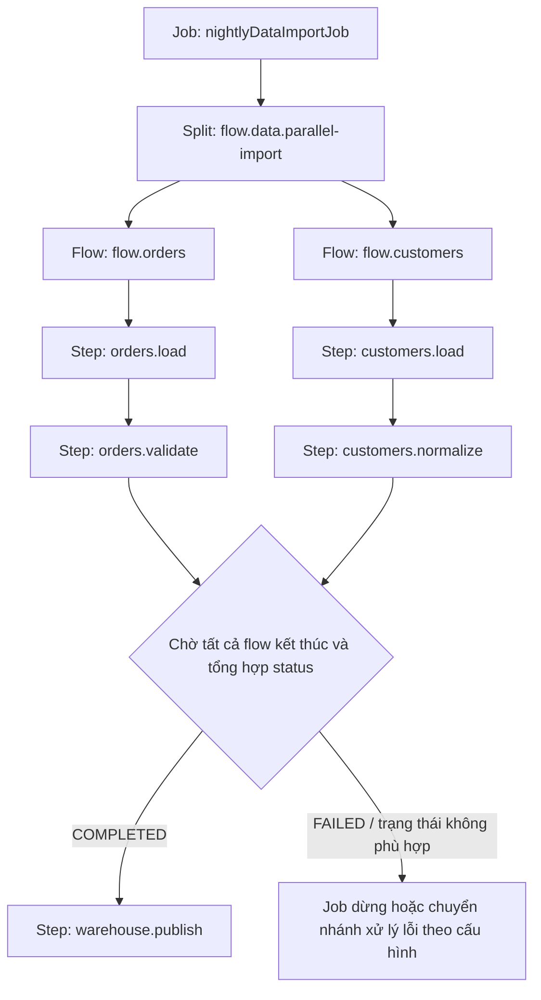
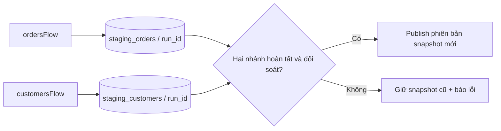

# Xử lý lỗi của một nhánh song song

## 1. Bài toán: một flow lỗi thì toàn bộ job ra sao?

Trong Spring Batch, **parallel steps** cho phép tổ chức một job thành nhiều **flow độc lập** và chạy các flow đồng thời qua `TaskExecutor`. Chẳng hạn một job dữ liệu cuối ngày vừa nhập hóa đơn vừa nhập thông tin khách hàng, sau đó chỉ công bố báo cáo khi **cả hai nhánh** đã đạt yêu cầu.

Điều gì xảy ra nếu nhánh hóa đơn thành công nhưng nhánh khách hàng gặp lỗi database? Người vận hành cần biết:

- Nhánh hóa đơn có bị dừng hay rollback theo nhánh khách hàng không?
- Bước tổng hợp/phát hành sau `split` có được chạy không?
- Job sẽ có `BatchStatus` và `ExitStatus` nào?
- Khi restart cùng `JobInstance`, bước đã hoàn thành có phải chạy lại không?
- Nếu một nhánh đã gọi API ngoài transaction, có thể rollback toàn bộ job không?

**Câu trả lời ngắn:** parallel flows là các đơn vị thực thi độc lập. Spring Batch **chờ các flow trong split kết thúc rồi tổng hợp exit status trước khi chuyển tiếp**; thất bại ở một nhánh **không mặc nhiên hủy ngay** những nhánh đang chạy. Các transaction đã commit ở nhánh khác **không bị rollback chung**. Một cấu hình flow/restart đúng phải chịu được kết quả hoàn thành một phần.

Bài này thuộc chương **Parallel Steps** của module `SPRING_BATCH_SCALING_OPERATIONS`, tập trung vận hành workload lớn với thread safety, retry/restart, đo bottleneck và lựa chọn kiến trúc theo nguồn lực thực tế.

### Mục tiêu

Sau bài này, bạn có thể diễn giải trạng thái của split khi một flow lỗi; cấu hình job để không chạy bước publish sai; phân biệt `BatchStatus` và `ExitStatus`; thiết kế nhánh an toàn để restart; và xây dựng runbook đo lường, cảnh báo, đối soát dữ liệu.

## 2. Nhắc lại semantics của split flows

Một `Flow` có thể chứa nhiều `Step` nối tiếp. `split` dùng executor để chạy **các flow** đồng thời, không tự làm những step nối bằng `next(...)` trong cùng flow chạy song song.



Ba nguyên tắc:

1. **Bên trong một flow:** các step chỉ chạy theo transition được khai báo, như `start(stepA).next(stepB)`; nếu `stepA` lỗi và không có đường xử lý đặc biệt, `stepB` thường không chạy.
2. **Giữa các flow:** các nhánh chạy đồng thời nếu executor thực sự bất đồng bộ và có đủ capacity. Nếu nhánh A lỗi, nhánh B không tự động dừng ngay.
3. **Sau split:** Spring Batch đợi các nhánh kết thúc và dùng kết quả tổng hợp để chọn bước tiếp theo. Không xem một flow hoàn thành sớm là tín hiệu cho phép publish dữ liệu.

Tài liệu Spring Batch mô tả `split` phải chờ mọi flow hoàn thành rồi **aggregate exit statuses**. Chính sách tổng hợp mặc định ưu tiên trạng thái có mức ưu tiên cao hơn (ví dụ một nhánh `FAILED` thường khiến kết quả split là `FAILED`), nhưng **exit code tùy biến** và transition riêng có thể thay đổi cách job kết thúc. Không giả định mọi chương trình đều luôn phản ứng giống nhau khi đã có cấu hình tùy biến.

## 3. Dòng thời gian: một nhánh thất bại, nhánh khác vẫn chạy

Giả sử `flow.orders` và `flow.customers` bắt đầu gần cùng lúc:

```text
Thời gian →
flow.orders:
    orders.load -------- COMMIT / COMPLETED
    orders.validate ---- COMMIT / COMPLETED
                                      [nhánh orders thành công]

flow.customers:
    customers.load ------- COMMIT / COMPLETED
    customers.normalize ------- ERROR / FAILED
                                  [nhánh customers lỗi]

Split:
    [chờ các flow kết thúc] --------> tổng hợp FAILED

warehouse.publish:
    [KHÔNG CHẠY theo luồng chuyển tiếp thành công thông thường]
```

Nếu flow customers lỗi **sớm hơn** lúc orders hoàn tất, orders vẫn có thể tiếp tục chạy và commit dữ liệu. Không dựa vào lỗi một nhánh để tự động dừng các API call hoặc transaction đang hoạt động ở nhánh kia.

| Thành phần | Trạng thái ví dụ | Ghi chú |
| --- | --- | --- |
| `orders.load` | COMPLETED | Dữ liệu đã commit không bị nhánh customers tự rollback |
| `orders.validate` | COMPLETED | Có thể được bỏ qua ở lần restart cùng JobInstance |
| `customers.load` | COMPLETED | Không bắt buộc chạy lại theo restart mặc định |
| `customers.normalize` | FAILED | Cần sửa nguyên nhân và chạy lại an toàn |
| Split | FAILED (ví dụ mặc định) | Kết quả được tổng hợp từ các flow |
| `warehouse.publish` | Chưa bắt đầu | Không có `StepExecution` cho bước chưa chạy |
| Job | FAILED (theo luồng mặc định) | Có thể restart nếu job được cấu hình cho phép và metadata hợp lệ |

Các trạng thái trên là **kịch bản minh họa**, không phải dấu hiệu chắc chắn nếu job có custom transitions, `allowStartIfComplete`, custom aggregator hoặc listener đổi `ExitStatus`.

### Một điểm khó: “fail fast” không phải mặc định

Fail fast có nghĩa phát hiện lỗi rồi lập tức hủy mọi nhánh khác. `split` thông thường **không bảo đảm** kiểu hủy tức thời đó. Nếu nghiệp vụ cần ngăn phát sinh side effect ngay khi có lỗi ở bất kỳ nhánh nào, phải thiết kế cơ chế phối hợp dừng và **cooperative cancellation**, hoặc thay đổi cấu trúc job để kiểm tra điều kiện trước khi tạo tác động phụ. Việc chủ động gọi dừng job cũng không bảo đảm task đang chờ I/O lập tức ngừng hay transaction đã commit được hoàn tác.

## 4. Hai loại trạng thái: BatchStatus và ExitStatus

Một trong những nguyên nhân dẫn tới xử lý lỗi sai là đánh đồng trạng thái quản lý với mã điều kiện luồng.

| Loại | Ví dụ | Dùng để làm gì? |
| --- | --- | --- |
| `BatchStatus` | `STARTED`, `COMPLETED`, `FAILED`, `STOPPED` | Trạng thái vòng đời của `JobExecution` hoặc `StepExecution` |
| `ExitStatus` / exit code | `COMPLETED`, `FAILED`, `COMPLETED WITH SKIPS`, mã tùy biến | Chỉ dẫn điều hướng qua `.on("...")`, `.next(...)` và các transition |
| `FlowExecutionStatus` | Status do một flow/split trả về | Được tổng hợp để xác định đường đi tiếp theo trong đồ thị job |

Trong Spring Batch, `on("FAILED")` match **exit code**, không trực tiếp so sánh `BatchStatus`. Một listener có thể trả exit code tùy biến; ví dụ step chạy thành công với 5 skip nhưng exit code `COMPLETED WITH SKIPS`. Do đó điều kiện `on("COMPLETED")` có thể không match nếu mã trả về khác.

**Cẩn trọng với `end()` trên nhánh lỗi.** Transition `.on("FAILED").end()` có thể kết thúc **Job** với `BatchStatus.COMPLETED` ngay cả khi step đã thất bại. Một `JobInstance` có trạng thái `COMPLETED` thông thường **không thể restart lại cùng định danh**. Nếu muốn thất bại có thể restart, ưu tiên `fail()` hoặc luồng mặc định để Job giữ trạng thái `FAILED`. Sử dụng `stopAndRestart(...)` khi thật sự muốn Job dừng có chủ đích ở `STOPPED` và có điểm bắt đầu tiếp theo rõ ràng.

| Transition được lựa chọn | Trạng thái Job mong muốn | Đặc điểm restart |
| --- | --- | --- |
| Không xử lý đặc biệt, lỗi không được khôi phục | `FAILED` | Có thể restart cùng JobInstance khi đáp ứng điều kiện |
| `.on("FAILED").fail()` | `FAILED` | Không biến lỗi thành thành công giả |
| `.on("FAILED").end()` | `COMPLETED` | **Không phù hợp** nếu muốn restart như một lỗi còn dang dở |
| `stopAndRestart(step)` | `STOPPED` | Dùng để tạm dừng có chủ đích và chuyển tới bước chỉ định khi restart |
| `.on("FAILED").to(alertStep)` | Phụ thuộc bước tiếp theo và kết thúc flow | Chạy alert không có nghĩa đã giữ trạng thái lỗi; cần thiết kế trạng thái cuối rõ ràng |

**Không nhầm** `end()` kết thúc *định nghĩa builder* (`.end().build()`) với transition `.on("FAILED").end()`. Chúng xuất hiện trong những ngữ cảnh khác nhau. Khi review code, đọc đầy đủ chuỗi fluent API và các nhánh kết thúc.

## 5. Mẫu cấu hình Java: hai flow và bước publish

Ví dụ sau minh họa cách **không chạy publish khi split thất bại**. Các step nhập/kiểm tra là đơn vị nghiệp vụ thật, được tạo và inject vào flow. Đoạn mã lược bỏ import, chi tiết ItemReader/Writer hoặc Tasklet và hạ tầng `JobRepository`/`TransactionManager`.

### 5.1. Mỗi flow có trách nhiệm rõ ràng

```java
@Bean
Flow ordersFlow(
        @Qualifier("ordersLoadStep") Step load,
        @Qualifier("ordersValidateStep") Step validate) {

    return new FlowBuilder<SimpleFlow>("flow.orders")
            .start(load)
            .next(validate)
            .build();
}

@Bean
Flow customersFlow(
        @Qualifier("customersLoadStep") Step load,
        @Qualifier("customersNormalizeStep") Step normalize) {

    return new FlowBuilder<SimpleFlow>("flow.customers")
            .start(load)
            .next(normalize)
            .build();
}
```

Các Step thực tế nên có tên ổn định, chẳng hạn `orders.load`, `orders.validate`, `customers.load`, `customers.normalize`. Tên bean có thể khác tên Step; chuỗi `StepBuilder("...")` mới quyết định `StepExecution.stepName`.

### 5.2. Cấp executor có giới hạn

```java
@Bean("importSplitExecutor")
ThreadPoolTaskExecutor importSplitExecutor() {
    ThreadPoolTaskExecutor executor = new ThreadPoolTaskExecutor();
    executor.setThreadNamePrefix("import-split-");
    executor.setCorePoolSize(2);
    executor.setMaxPoolSize(2);
    executor.setQueueCapacity(4);
    return executor;
}
```

Pool 2 worker đủ để **hai flow** có cơ hội chạy đồng thời nếu không có job khác chiếm pool và không bị hệ thống phụ thuộc chặn. Chọn pool size theo số flow cần chạy cùng lúc cùng năng lực database/network. `queueCapacity` chứa task đang chờ, không nhân đôi số flow chạy thực tế.

### 5.3. Cấu hình split trước bước publish

```java
@Bean
Job nightlyDataImportJob(
        JobRepository jobRepository,
        @Qualifier("ordersFlow") Flow orders,
        @Qualifier("customersFlow") Flow customers,
        @Qualifier("warehousePublishStep") Step publish,
        @Qualifier("importSplitExecutor") TaskExecutor executor) {

    return new JobBuilder("nightlyDataImportJob", jobRepository)
            .start(orders)
            .split(executor)
            .add(customers)
            .next(publish)
            .end()
            .build();
}
```

Đây là kiểu builder được minh họa trong tài liệu Spring Batch về **Split Flows**; `next(publish)` đặt publish **sau khi** split được đánh giá thành công theo transition thông thường.

- Nếu hai nhánh đều hoàn thành với exit status thành công phù hợp, job có thể chuyển đến publish.
- Nếu một nhánh bị `FAILED` và không có transition khôi phục/nuốt lỗi, split kết thúc thất bại, publish không được phép chạy.
- `.next(publish)` **không** có nghĩa publish chạy khi nhánh đầu tiên xong.
- Các tasklet hoặc chunk-based steps có transaction độc lập; fail một step không tạo transaction rollback toàn job.

**Không cần thêm `.on("FAILED").end()` để “xử lý lỗi”**. Làm vậy có nguy cơ đưa Job sang `COMPLETED` khi dữ liệu vẫn thiếu, khiến vận hành và restart hiểu sai.

### 5.4. Có thể tách split thành một Flow riêng

Với sơ đồ phức tạp cần nhiều transition, tạo `Flow` có tên cho split rồi chuyển nó qua builder của Job:

```java
@Bean("parallelImportFlow")
Flow parallelImportFlow(
        Flow ordersFlow,
        Flow customersFlow,
        @Qualifier("importSplitExecutor") TaskExecutor executor) {

    return new FlowBuilder<SimpleFlow>("flow.data.parallel-import")
            .split(executor)
            .add(ordersFlow, customersFlow)
            .build();
}
```

Cách này thuận tiện khi muốn đặt tên và tập trung quản lý điều kiện **sau split**. Nếu thêm `on("FAILED")`, `on("COMPLETED")` hoặc `on("*")`, phải thiết kế toàn bộ các exit codes có thể phát sinh; `on` match `ExitStatus` và precedence của pattern. Không nên mặc định một mã tùy biến sẽ đi đúng đường `COMPLETED`.

## 6. Không rollback toàn bộ các nhánh như một transaction

Hai flow chạy trong một Job vẫn có các transaction/`StepExecution` riêng. Khi orders đã commit 100.000 bản ghi nhưng customers thất bại giữa chừng, **không có transaction bao trùm tự động** để đảo ngược 100.000 bản ghi orders.

```text
flow.orders:
    [đọc/chuyển đổi/ghi] -- COMMIT ✓
    [đọc/chuyển đổi/ghi] -- COMMIT ✓
    DONE

flow.customers:
    [đọc/chuyển đổi/ghi] -- COMMIT ✓
    [đọc/chuyển đổi/ghi] -- ROLLBACK ✗
    FAILED

Job:
    FAILED; dữ liệu orders và chunk customers đã commit vẫn tồn tại
```

Các hậu quả:

1. **Đọc dữ liệu trung gian:** một consumer khác có thể nhìn thấy bảng orders đã cập nhật trong khi customers mới được xử lý một phần.
2. **Ghi trùng khi restart:** nếu writer gọi API hoặc ghi file ngoài transaction, side effect có thể thành công trước khi step fail.
3. **Lệch mốc nghiệp vụ:** nếu publish dùng dữ liệu mới nhất trước khi split hoàn thành, nó có thể lấy snapshot nửa chừng.
4. **Lock contention:** hai flow khác trách nhiệm nhưng cùng chạm một bảng có thể gây deadlock hoặc tăng thời gian chờ.

### 6.1. Dùng vùng staging và bước publish làm “cổng”

Một kiến trúc thường an toàn hơn:



Mỗi nhánh ghi vào vùng staging tách theo **run ID hoặc business batch ID**; bước publish chỉ chạy sau khi đủ điều kiện và đối soát số lượng/khóa. Với nguồn nhạy cảm, có thể cần lưu một **version marker** hoặc chuyển con trỏ tới snapshot mới trong transaction ngắn. Không có nghĩa mọi thao tác publish là atomic tự nhiên; phải thiết kế theo database/file/broker cụ thể.

**Nên phân biệt** `JobExecutionId` (lần chạy kỹ thuật, thay đổi khi restart) và **business batch ID** (định danh tập dữ liệu của một đợt xử lý). Nếu muốn restart dùng lại cùng staging set, chọn khóa nghiệp vụ bền vững, không vô tình tạo vùng dữ liệu hoàn toàn mới chỉ vì `JobExecutionId` thay đổi.

## 7. Retry, skip và khi nào lỗi phải làm nhánh FAILED

Không phải mọi exception đều cần làm cả job thất bại. Với chunk step, Spring Batch cho phép retry và skip khi đã cấu hình fault tolerance, nhưng phải tách **lỗi tạm thời** và **lỗi nghiệp vụ không thể tự phục hồi**.

| Loại lỗi | Ví dụ | Phương án phù hợp |
| --- | --- | --- |
| Lỗi transient | Network timeout, deadlock có thể retry, HTTP 503 | Retry giới hạn và backoff; theo dõi số lần retry |
| Dữ liệu sai có thể bỏ qua theo chính sách | Một dòng CSV sai định dạng không quan trọng | Skip có giới hạn, audit rõ item bị skip |
| Dữ liệu bắt buộc phải có | Thiếu file khách hàng, checksum sai toàn bộ nguồn | Đánh dấu FAILED; không publish |
| Lỗi xác thực/quyền | DB/broker credential sai, ACL deny | Fail và sửa cấu hình; không retry vô hạn |
| Constraint violation liên quan trùng lặp | Khóa nghiệp vụ đã ghi ở lần trước | Kiểm tra idempotency/đối soát; không bỏ qua mù |
| Quá tải downstream | Pool connections đầy, API 429 | Giảm concurrency, backoff và rate limit; cân nhắc fail kiểm soát |

Ví dụ một step có fault tolerance theo API Spring Batch 5.x (lược bỏ builder/infrastructure):

```java
new StepBuilder("customers.normalize", jobRepository)
    .<CustomerRow, CustomerRecord>chunk(100, transactionManager)
    .reader(reader)
    .processor(processor)
    .writer(writer)
    .faultTolerant()
    .retry(TransientDataAccessException.class)
    .retryLimit(3)
    .skip(ValidationException.class)
    .skipLimit(10)
    .build();
```

Đây là ví dụ theo **API 5.x**; nếu đang dùng 6.x, cấu hình transaction của builder có cú pháp khác. `ValidationException` ở đây biểu thị **loại lỗi cụ thể do ứng dụng chọn**; không phải mọi lỗi validate đều nên được skip. Hãy xác minh type và fault-tolerance policy trong phiên bản đang chạy.

Nếu step hoàn thành với 10 bản ghi skip theo policy, **BatchStatus** có thể vẫn là `COMPLETED`. Muốn chặn publish khi skip vượt ngưỡng nghiệp vụ, cần một bước kiểm tra dữ liệu/exit code cụ thể. Đừng coi `COMPLETED` luôn đồng nghĩa “100% bản ghi được xử lý thành công”.

### 7.1. Retry trong flow khác rollback của split

Retry xảy ra trong step theo chính sách của nó. Khi đã retry hết hoặc lỗi không được phép skip, step có thể `FAILED`; flow và split mới tổng hợp kết quả đó. Không có cơ chế retry toàn bộ các nhánh đồng thời một cách tự động, và replay flow đã thành công có thể gây side effect không cần thiết.

Với API có side effect (gửi hóa đơn, thanh toán, gửi email), timeout có thể xảy ra **sau khi API đã thực hiện thành công**. Dùng idempotency key, kiểm tra kết quả trước retry hoặc outbox/transactional boundary phù hợp. Không dùng “thử lại cho đến khi OK” làm chiến lược mặc định.

## 8. Restart khi một nhánh đã COMPLETED

Giả sử `flow.orders` hoàn tất, `flow.customers` thất bại và Job kết thúc `FAILED`. Khi khởi động lại **cùng `JobInstance`** (cùng job name + identifying JobParameters), Spring Batch thường:

- Nhận biết những step `COMPLETED` và **không chạy lại** theo hành vi mặc định.
- Tiếp tục/thử lại các step chưa thành công nếu job cho phép restart, trạng thái repository hợp lệ và điều kiện flow có thể tái đánh giá.
- Chuyển tới bước publish sau khi tất cả điều kiện thành công được thỏa mãn.
- Tôn trọng `allowStartIfComplete(true)` và `startLimit` nếu người lập trình đã cấu hình khác mặc định.

```text
Execution #1, JobInstance(importDate=2026-11-26):
    orders.load             COMPLETED
    orders.validate         COMPLETED
    customers.load          COMPLETED
    customers.normalize     FAILED
    warehouse.publish       NOT STARTED
JobExecution #1             FAILED

Execution #2, SAME JobInstance (restart):
    orders.load             thường SKIPPED (already COMPLETED)
    orders.validate         thường SKIPPED (already COMPLETED)
    customers.load          thường SKIPPED (already COMPLETED)
    customers.normalize     chạy lại theo policy và checkpoint
    warehouse.publish       chạy sau split thành công
JobExecution #2             COMPLETED nếu tất cả điều kiện đạt
```

*“Skipped” trong sơ đồ chỉ nghĩa Spring Batch **không thực thi lại một step đã hoàn thành**, không phải tạo một StepExecution mới với `BatchStatus.SKIPPED`; enum `BatchStatus` không có trạng thái này.*

### 8.1. Khi nào restart không thể thực hiện?

- Job đã được kết thúc `COMPLETED`, chẳng hạn do một `.on("FAILED").end()` sai mục đích; restart cùng JobInstance thường bị từ chối.
- Job cấu hình `preventRestart()`.
- Đã hết `startLimit` của step hoặc metadata không hợp lệ.
- Các `JobParameters` dùng để restart tạo ra **JobInstance khác** (ví dụ thêm tham số định danh ngẫu nhiên), thay vì tiếp tục instance bị lỗi.
- Một số side effect bên ngoài không idempotent khiến việc chạy lại không an toàn, dù framework cho phép thực hiện.

### 8.2. Đừng mặc định “đã completed thì dữ liệu chắc chắn đúng”

Nếu một step gửi sự kiện ra broker rồi báo `COMPLETED` nhưng dữ liệu phía nhận được xử lý bất đồng bộ, `COMPLETED` chỉ khẳng định step đã xong theo logic của nó; không tự đảm bảo toàn bộ downstream đã xử lý. Khi cần bảo đảm toàn pipeline, phải có contract ack/đối soát cụ thể.

### 8.3. Nếu cần chạy lại cả hai nhánh

Có thể nghiệp vụ yêu cầu đồng bộ lại cả orders và customers để tạo cùng một snapshot. Khi đó, không nên ép framework “quên” trạng thái completed bằng cách xóa metadata thủ công. Có thể dùng một **JobInstance mới** cho một đợt xử lý mới, hoặc thiết kế `allowStartIfComplete` trên những step cần chạy lại với checkpoint và idempotency đúng. Lựa chọn phụ thuộc business batch ID, snapshot strategy và yêu cầu không ghi trùng.

## 9. Stop, fail và lỗi nghiêm trọng giữa lúc split đang chạy

Một số lỗi (mất credential, dữ liệu sai toàn bộ, nguy cơ ghi hỏng) đòi hỏi người vận hành dừng job đang chạy. Các thao tác dừng hợp lệ thường được khởi phát qua `JobOperator`/`JobExplorer` hay công cụ vận hành tương thích, nhưng **stop là cooperative**:

1. Hệ thống đánh dấu yêu cầu dừng và các bước kiểm tra cờ dừng tại điểm phù hợp.
2. Tasklet hoặc worker thread đang chờ I/O/lock có thể chưa phản hồi ngay.
3. Các transaction đã commit trước đó vẫn còn.
4. Không mặc định hủy tức thời bằng `Thread.interrupt()` sẽ tạo rollback/cleanup hoàn toàn an toàn.
5. Khi status chuyển `STOPPED` hoặc `FAILED`, kiểm tra StepExecution thực tế trước khi quyết định restart.

Đặc biệt với parallel flows, đừng điều khiển `ExecutionContext` như một biến toàn cục được hai thread sửa tùy tiện. Muốn chia sẻ tín hiệu stop/abort, dùng cơ chế phối hợp thread-safe và thiết kế dừng có thể retry, không dùng một flag local mà người quản trị không thể quan sát.

### Các lớp lỗi cần tách

| Lớp | Dấu hiệu | Cần xử lý |
| --- | --- | --- |
| Lỗi item | Processor/writer exception | Fault tolerance, retry/skip policy, đối soát item |
| Lỗi step | `StepExecution.FAILED` | Checkpoint, transaction, nguyên nhân, restart step |
| Lỗi flow | Exit code của nhánh `FAILED` | Flow transitions, những step còn lại trong nhánh |
| Lỗi split | Kết quả aggregate failure | Chặn publish, quan sát trạng thái **mọi** nhánh |
| Lỗi job | `JobExecution.FAILED`/`STOPPED` | Quyết định restart JobInstance và làm sạch tác động ngoài transaction |
| Lỗi infrastructure | Worker pool, DB, disk, broker | Xác định lỗi quá tải hay cấu hình, không retry vô hạn |

## 10. Quan sát lỗi theo nhánh và StepExecution

Vì log từ nhiều worker thread có thể xen kẽ, mỗi sự kiện cần mang định danh đủ để người vận hành xác định nó thuộc nhánh nào.

Nên dùng:

- `jobName` và `jobExecutionId` để phân biệt job logic với lần chạy.
- `stepName` và `stepExecutionId` để phân biệt step cùng tên qua các lần chạy/restart.
- `flowName` hoặc một trường `branch` do ứng dụng gắn rõ khi có thể; StepExecution thường chỉ lưu **step name**, không phải một hàng riêng cho Flow.
- `threadName` để debug executor; không xem đây là ID nghiệp vụ.
- `exitCode`, `status`, `readCount`, `writeCount`, `skipCount`, `commitCount`, category lỗi và thời gian.

### 10.1. Listener log kết quả Step

```java
@Component
class StepOutcomeLogger implements StepExecutionListener {

    private static final Logger log =
            LoggerFactory.getLogger(StepOutcomeLogger.class);

    @Override
    public ExitStatus afterStep(StepExecution stepExecution) {
        log.info(
            "jobExecutionId={} step={} stepExecutionId={} status={} exitCode={} " +
            "readCount={} writeCount={} skipCount={}",
            stepExecution.getJobExecution().getId(),
            stepExecution.getStepName(),
            stepExecution.getId(),
            stepExecution.getStatus(),
            stepExecution.getExitStatus().getExitCode(),
            stepExecution.getReadCount(),
            stepExecution.getWriteCount(),
            stepExecution.getSkipCount()
        );
        return null; // Không thay đổi ExitStatus hiện có
    }
}
```

Đăng ký listener bằng `.listener(...)` vào các step. Đây là ví dụ theo các API phổ biến; điều chỉnh nếu phiên bản hoặc chính sách logging khác. Không log PII, mật khẩu, token, payload nhạy cảm hoặc toàn stack trace của item chứa dữ liệu khách hàng. Khi dùng MDC và thread pool, bảo đảm context được sao chép **và dọn sau task** để tránh thông tin giữa các job bị lẫn.

### 10.2. Query JobRepository để biết nhánh nào lỗi

Với schema mặc định Spring Batch JDBC:

```sql
SELECT
    ji.JOB_NAME,
    je.JOB_EXECUTION_ID,
    je.STATUS AS JOB_STATUS,
    se.STEP_NAME,
    se.STATUS AS STEP_STATUS,
    se.EXIT_CODE,
    se.READ_COUNT,
    se.WRITE_COUNT,
    se.COMMIT_COUNT,
    se.ROLLBACK_COUNT,
    se.START_TIME,
    se.END_TIME
FROM BATCH_JOB_INSTANCE ji
JOIN BATCH_JOB_EXECUTION je
  ON ji.JOB_INSTANCE_ID = je.JOB_INSTANCE_ID
JOIN BATCH_STEP_EXECUTION se
  ON je.JOB_EXECUTION_ID = se.JOB_EXECUTION_ID
WHERE je.JOB_EXECUTION_ID = :job_execution_id
ORDER BY se.START_TIME, se.STEP_EXECUTION_ID;
```

Tên bảng/cột và SQL dialect cần đối chiếu schema/version thực tế; schema prefix có thể được tổ chức tùy biến.

**Lưu ý:** step chưa chạy thường **không có row** trong `BATCH_STEP_EXECUTION` của lần thực thi đó. Nếu khi restart Spring Batch bỏ qua step `COMPLETED`, để hiểu lịch sử đầy đủ phải xem **các JobExecution trước của cùng JobInstance**; chỉ truy vấn một lần chạy có thể không hiển thị lại những step đã hoàn thành ở lần trước.

## 11. Runbook khi một nhánh parallel bị FAILED

Một runbook có thể dùng theo thứ tự sau:

1. **Xác định JobInstance/JobExecution:** ghi nhận job name, identifying parameters, `JobExecutionId` và trạng thái đang `FAILED` hay `STOPPED`. Không tự chạy instance mới chỉ để bỏ qua lỗi.
2. **Liệt kê toàn bộ StepExecution của các nhánh:** nhận diện nhánh đã `COMPLETED`, nhánh `FAILED`, các step chưa chạy, exit code và last exception.
3. **Xác định nguồn lỗi:** input, validation, DB lock, pool timeout, broker credential hoặc hệ thống ngoài. Đối chiếu metrics thời điểm lỗi.
4. **Khoanh vùng dữ liệu đã commit:** kiểm tra staging, bảng đích, message đã gửi, API side effects và ID nghiệp vụ.
5. **Quyết định khôi phục:** retry lỗi transient có backoff; sửa cấu hình; phục hồi input; tránh retry mù nếu đã có side effect.
6. **Xác nhận khả năng restart:** Job chưa `COMPLETED`, `preventRestart`/`startLimit` không chặn, metadata và checkpoint còn nguyên.
7. **Restart cùng JobInstance** khi phù hợp, có idempotency và khóa/đối soát dữ liệu. Không xóa `BATCH_*` thủ công.
8. **Kiểm tra sau restart:** nhánh lỗi hoàn thành, publish chỉ chạy khi hợp lệ, số record **duy nhất** và tổng nghiệp vụ trùng kỳ vọng.
9. **Đóng sự cố:** ghi nhận nguyên nhân gốc, số retry/skip, cải tiến alert/runbook và tải tài nguyên phù hợp.

### Một nguyên tắc quan trọng: không tự phát hành khi thiếu dữ liệu

Một lỗi customers không nên làm job `COMPLETED` rồi vẫn công bố báo cáo chỉ từ orders. Nếu nghiệp vụ thật sự cho phép **partial success**, phải xác định rõ contract: dữ liệu nào thiếu, exit code riêng (ví dụ `PARTIAL`), nhánh hậu xử lý riêng, người nhận biết rủi ro và cách đối soát sau đó. Không nên dùng `end()` để che trạng thái lỗi mà không có chính sách chấp nhận rõ.

## 12. Kiểm thử lỗi một nhánh, không chỉ happy path

| Tình huống test | Trạng thái/điều kiện cần xác minh |
| --- | --- |
| Hai nhánh đều thành công | Split thành công; publish chạy một lần; dữ liệu đối soát đúng |
| Orders thành công, customers lỗi ngay | Orders có thể vẫn chạy; job FAILED; publish không chạy |
| Customers lỗi sau khi commit một số chunk | Dữ liệu đã commit tồn tại; restart không ghi trùng |
| Orders chậm, customers lỗi sớm | Split không “vội” publish/hủy orders mặc định; chờ đúng nhánh |
| Cả hai nhánh cùng lỗi | Ghi nhận đủ hai nguyên nhân, không chỉ exception xuất hiện đầu tiên |
| Một nhánh `COMPLETED WITH SKIPS` | Theo chính sách chất lượng dữ liệu: publish hoặc chặn đúng exit code |
| Một nhánh có `.on("FAILED").end()` | Phát hiện việc Job có thể bị đánh dấu thành công giả và mất restart |
| Restart sau lỗi | Step đã completed được bỏ qua theo mặc định; step lỗi chạy lại an toàn |
| Restart với JobParameters khác định danh | Không nhầm job instance mới là restart của instance cũ |
| Nhánh ghi API side effect rồi timeout | Idempotency hoặc đối soát không nhân đôi tác động |
| Stop khi cả hai nhánh đang chạy | Stop hợp tác, không giả định rollback toàn cục |
| Executor pool chỉ có một thread | Kiểm tra có thực sự song song không; không nhầm split với concurrency bảo đảm |

**Cách thiết kế test tích hợp:** dùng job với hai tasklet có barrier/latch và timeout trong môi trường test, cho một nhánh throw exception có kiểm soát. Lưu dấu thời điểm bắt đầu/kết thúc từng step và kiểm tra `warehouse.publish` không chạy khi một nhánh lỗi. Test restart phải dùng JobRepository thật tương thích để quan sát metadata. Không đặt `Thread.sleep` hoặc latch như logic nghiệp vụ production.

## 13. Đo throughput và critical path khi có lỗi

Trong split, thời gian hoàn thành (khi các flow được thực thi song song) thường gần **thời gian của nhánh chậm nhất + overhead điều phối**, không phải tổng thời gian từng nhánh. Nhưng một nhánh lỗi có thể khiến toàn job thất bại **sau khi vẫn tiêu tốn thời gian** để chờ các nhánh khác kết thúc.

Giả sử số liệu **minh họa**:

| Flow | Thời gian | Kết quả |
| --- | ---: | --- |
| `flow.orders` | 260 giây | COMPLETED |
| `flow.customers` | 90 giây | FAILED |
| `flow.shipments` | 210 giây | COMPLETED |
| Join split | ~260 giây, chưa tính overhead | FAILED |

Một retry trong customers có thể hoàn tất ở lần restart nhanh hơn, nhưng các step orders/shipments hoàn thành ở lần chạy trước sẽ thường không được thực thi lại theo default. Khi đo **thời gian khôi phục end-to-end**, hãy cộng thời gian sửa lỗi, restart, kiểm tra dữ liệu và publish, không chỉ runtime của lần restart.

### Liên hệ tới thread pool và bottleneck

Nếu ba flow dùng một `ThreadPoolTaskExecutor` chỉ có hai worker, flow thứ ba có thể bị xếp hàng. Khi này một nhánh lỗi và kết quả split có thể tới chậm vì flow khác chưa chạy xong. Tăng pool tới ba worker có thể hữu ích nếu CPU/DB/API còn headroom. Nếu cả ba flow cùng gây DB lock, tăng thread có thể làm hệ thống chậm hơn và tăng xác suất lỗi.

Theo dõi:

- Tổng job duration, split wait duration, độ trễ từng Step và critical path.
- `ThreadPoolTaskExecutor` active workers, queue depth, rejection.
- DB connection pool, lock waits, deadlocks, transaction rollback.
- API latency, 429/503, retry count và timeout.
- Chất lượng dữ liệu, số record duy nhất, skip/error count và kết quả publish.

**Mục tiêu scaling** là giảm tổng thời gian **mà không** tăng rủi ro lỗi hoặc sai dữ liệu vượt khả năng vận hành.

## 14. Tình huống thực tế: nhập ba nguồn cho kho dữ liệu

Một doanh nghiệp đồng bộ ba nguồn CRM, ERP và tồn kho vào một data warehouse. Mỗi nguồn có một flow với step `extract` và `normalize` hoặc `validate`. Các flow chạy cùng lúc; bước `warehouse.publish` chỉ chuyển snapshot khi đủ cả ba.

Trong một đêm:

- ERP hoàn thành và đã ghi vào `staging_erp`.
- Inventory cũng hoàn thành.
- CRM thất bại khi kết nối nguồn, sau khi đã commit một số chunk vào `staging_crm`.
- Split tổng hợp lỗi và **không chạy** bước publish.
- Nhân viên trực dùng `JobExecutionId`, `StepExecution.stepName` và exit code để xác định lỗi, không xóa staging hay metadata ngay.
- Sáng hôm sau khi credential/network đã khôi phục, job được restart với **cùng định danh JobInstance**. Các step completed được bỏ qua theo mặc định; CRM tiếp tục với checkpoint/logic idempotent; bước publish chỉ chạy sau khi đối soát thành công.

Nếu business yêu cầu snapshot toàn vẹn, cần thêm **business batch ID** dùng chung cho staging ở lần chạy và restart. Không dùng tên file động hoặc `JobExecutionId` riêng từng lần làm khóa duy nhất của snapshot nếu điều đó khiến lần restart không nhận được dữ liệu đã ghi.

## 15. Những nhầm lẫn phổ biến

| Nhận định | Thực tế |
| --- | --- |
| “Một nhánh lỗi thì mọi nhánh khác lập tức dừng.” | Split thông thường chờ tất cả flow hoàn tất; không bảo đảm fail-fast cancellation. |
| “Một nhánh lỗi sẽ rollback mọi transaction ở nhánh khác.” | Mỗi step/chunk có transaction riêng; commit trước đó vẫn tồn tại. |
| “Nhánh A thành công là có thể chạy publish.” | Bước sau split phụ thuộc trạng thái tổng hợp và transitions, không phải nhánh nhanh nhất. |
| “`BatchStatus` và `ExitStatus` luôn giống nhau.” | Chúng khác mục đích; transition `on(...)` match exit code. |
| “`.on("FAILED").end()` giữ Job FAILED.” | Sai: `end()` có thể đánh dấu Job COMPLETED, khiến không restart cùng JobInstance được. |
| “Restart sẽ chạy lại tất cả step.” | Step đã COMPLETED thường được bỏ qua trừ khi cấu hình khác. |
| “Một lần JobExecution mới luôn là một JobInstance mới.” | Không: restart cùng identifying JobParameters tạo JobExecution mới cho **cùng** JobInstance. |
| “Skip một item luôn làm Step FAILED.” | Không nếu chính sách skip cho phép; cần kiểm tra điều kiện chất lượng dữ liệu. |
| “`JobRepository` bảo đảm exactly-once cho mọi HTTP call.” | Không; side effect ngoài transaction cần idempotency/đối soát. |
| “Tăng worker giúp xử lý lỗi nhanh hơn.” | Có thể làm tăng lock/timeout/rate limit; phải đo bottleneck và retry behavior. |

## 16. Câu hỏi tự kiểm tra

**Câu 1.** Flow A lỗi ở giây thứ 15, flow B còn cần 2 phút. Split có tự động cắt flow B ngay không?

*Gợi ý:* Không bảo đảm. Theo mô hình thông thường, split chờ các flow kết thúc trước khi tổng hợp exit status; đã commit thì không bị rollback bởi flow khác.

**Câu 2.** Nếu nhánh orders COMPLETED và customers FAILED, khi restart cùng JobInstance có nhất thiết đọc lại toàn bộ orders không?

*Gợi ý:* Không. Mặc định step đã hoàn thành thường được bỏ qua; còn tùy `allowStartIfComplete`, transitions và thiết kế checkpoint.

**Câu 3.** Vì sao `.on("FAILED").end()` có thể là lỗi nghiêm trọng trong job đối soát?

*Gợi ý:* Nó có thể kết thúc Job với `BatchStatus.COMPLETED`, chặn restart cùng JobInstance trong khi dữ liệu chưa đủ.

**Câu 4.** Một step hoàn thành có skip 10 item, exit code `COMPLETED WITH SKIPS`. Cấu hình chỉ match `on("COMPLETED")` đã đầy đủ chưa?

*Gợi ý:* Chưa chắc. `on` match exit code, cần quy định rõ partial success có được publish hay không và match exit codes phù hợp.

**Câu 5.** Vì sao kết quả publish nên dùng business batch ID thay vì chỉ `JobExecutionId` khi job có restart?

*Gợi ý:* Restart tạo JobExecution mới, trong khi business batch có thể vẫn là cùng đợt dữ liệu; dùng ID lần chạy làm khóa snapshot có thể tách dữ liệu ra hai staging set.

## 17. Checklist trước khi production

- [ ] Sơ đồ split cho biết rõ tất cả flow, step, join và bước publish.
- [ ] Mỗi step có tên ổn định, đủ để phân biệt khi truy vấn `StepExecution`.
- [ ] Đã xác định hành vi khi từng flow `COMPLETED`, `FAILED`, `STOPPED` hoặc có exit code tùy biến.
- [ ] Không dùng `end()` để vô tình che lỗi khiến Job thành COMPLETED.
- [ ] Bước publish chỉ chạy sau khi tất cả điều kiện thành công và đối soát dữ liệu đạt yêu cầu.
- [ ] Mỗi nhánh có transaction boundary rõ ràng; dữ liệu đã commit ở nhánh khác được xử lý đúng.
- [ ] Writer và external side effects có idempotency hoặc cơ chế đối soát.
- [ ] Retry, skip, backoff, timeout, start limit và restart policy được kiểm thử.
- [ ] Có log và metric theo jobExecutionId/stepExecutionId/stepName, không lộ dữ liệu nhạy cảm.
- [ ] Có runbook cho lỗi một nhánh, nhiều nhánh và trường hợp yêu cầu stop chủ động.
- [ ] Executor đủ concurrency cho các flow, nhưng không vượt giới hạn CPU/DB/API.
- [ ] Đã chạy test failure → restart → publish, kiểm tra số bản ghi **duy nhất** và business batch ID.

## Tài liệu tham khảo

- [Spring Batch Reference — Scaling and Parallel Processing](https://docs.spring.io/spring-batch/reference/scalability.html): parallel steps, split và chờ các flow hoàn thành trước khi aggregate.
- [Spring Batch Reference — Controlling Step Flow](https://docs.spring.io/spring-batch/reference/step/controlling-flow.html): `on(...)`, `BatchStatus` vs `ExitStatus`, `fail()`, `end()` và `stopAndRestart(...)`.
- [Spring Batch Reference — Configuring a Step for Restart](https://docs.spring.io/spring-batch/reference/step/chunk-oriented-processing/restart.html): restart, `startLimit`, `allowStartIfComplete`.
- [Spring Batch Reference — JobRepository](https://docs.spring.io/spring-batch/reference/job/configuring-repository.html): metadata `JobInstance`/`JobExecution`/`StepExecution`.
- [Spring Batch Reference — Retry and Skip Logic](https://docs.spring.io/spring-batch/reference/step/chunk-oriented-processing/configuring-skip.html): chính sách skip, cùng các phần fault tolerance liên quan.
- [Spring Batch 5.2 API — MaxValueFlowExecutionAggregator](https://docs.spring.io/spring-batch/docs/5.2.x/api/org/springframework/batch/core/job/flow/support/state/MaxValueFlowExecutionAggregator.html): cơ chế tổng hợp exit status từ nhiều flow.

**Điều cần nhớ:** xử lý lỗi một nhánh song song không chỉ là bắt exception. Bạn cần hiểu **nhánh nào đã commit**, **split tổng hợp trạng thái gì**, **Job có giữ khả năng restart không**, và **bước publish có bị chặn khi dữ liệu chưa đủ không**. Một thiết kế tốt cho phép khôi phục nhánh lỗi mà không phá dữ liệu đã hoàn thành hoặc nhân đôi side effect, ngay cả khi workload tiếp tục mở rộng.
