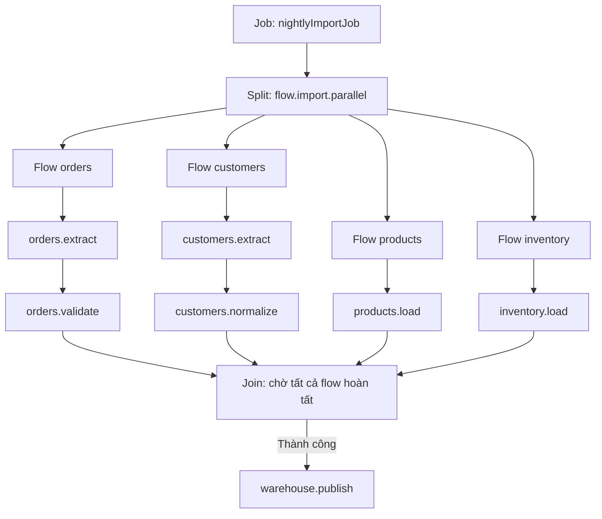
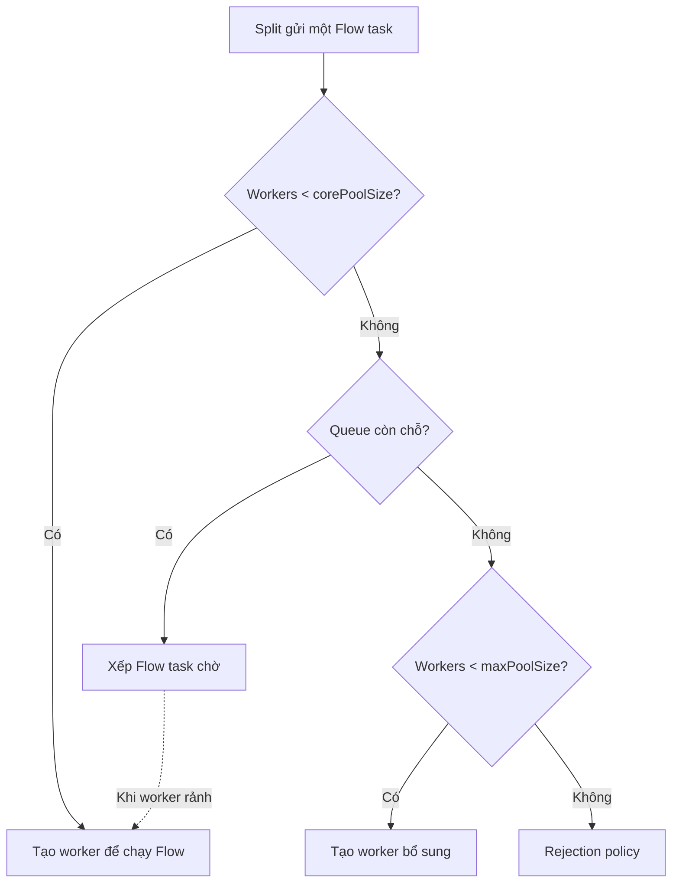

# Giới hạn số nhánh chạy đồng thời

## 1. Bài toán và mục tiêu

Trong Spring Batch, **parallel steps** cho phép một `Job` thực thi nhiều **flow** độc lập cùng lúc bằng `split` và một `TaskExecutor`. Chẳng hạn, công việc xây dựng báo cáo cuối ngày gồm sáu nhánh: nhập đơn hàng, khách hàng, sản phẩm, tồn kho, thanh toán và vận chuyển. Chạy cả sáu đồng thời có thể rút ngắn thời gian tổng, nhưng cũng có thể làm cạn JDBC connection pool, tăng CPU/GC, gây deadlock database hoặc đẩy API đối tác vượt quota.

Bởi vậy, câu hỏi vận hành không phải “có thể mở tối đa bao nhiêu thread?” mà là: **nên cho phép tối đa bao nhiêu nhánh đồng thời để hoàn tất job đúng hạn, đúng dữ liệu, với tài nguyên ổn định?**

Bài này thuộc chương **Parallel Steps** của module `SPRING_BATCH_SCALING_OPERATIONS`. Phạm vi là **giới hạn số flow trong một split được thực thi cùng lúc**, đồng thời xét các job khác, executor bên trong từng step, retry/restart và năng lực hạ tầng. Đây là khái niệm khác với việc tăng số thread **bên trong một multi-threaded step**.

### Sau bài học, bạn có thể

1. Phân biệt số flow trong cấu hình với số flow thực sự đang chạy.
2. Thiết kế `ThreadPoolTaskExecutor` với `corePoolSize`, `maxPoolSize` và `queueCapacity` hợp lý cho split.
3. Nhận biết queue đầy, `TaskRejectedException`, rủi ro `CallerRunsPolicy` và starvation khi lồng nhiều split.
4. Ước lượng số nhánh từ CPU, DB connections, network/API quota và thời gian critical path.
5. Đo concurrency thực tế, kiểm thử giới hạn và kiểm tra tính đúng khi một nhánh lỗi hoặc job restart.

## 2. Giới hạn đúng đối tượng: flow, step hay chunk?

Với Spring Batch, có ba cấp dễ bị nhầm:

| Cấp song song | Đơn vị công việc | Cách cấu hình điển hình | Đặc điểm metadata |
| --- | --- | --- | --- |
| **Parallel steps** | Các `Flow` độc lập trong một `split` | `FlowBuilder.split(taskExecutor).add(...)` | Mỗi `Step` trong flow có `StepExecution` riêng |
| **Multi-threaded step** | Công việc bên trong **một Step** | `StepBuilder.taskExecutor(...)` | Vẫn một `StepExecution` của step đó |
| **Partitioning** | Nhiều partition của tập dữ liệu | `PartitionStep`, `Partitioner`/`PartitionHandler` | Mỗi partition có `StepExecution` riêng |

**Trong bài này, một nhánh là một flow ở cấp split.** Một flow có thể chứa nhiều step chạy tuần tự qua `.next(...)`. Hai flow có thể cùng chạy, nhưng các step nối tiếp **trong cùng một flow** không mặc nhiên chạy song song.

Ví dụ:



Nếu split có **4 flow** nhưng executor chỉ có **2 worker khả dụng**, thông thường tối đa hai flow đang thực thi qua executor đó, hai flow còn lại phải chờ (nếu queue còn chỗ). Spring Batch **chờ các flow kết thúc** rồi mới tổng hợp exit status và quyết định chuyển tiếp tới bước `warehouse.publish`.

Không phải cứ có `4 flow` là có bốn thread hoạt động. Và bốn flow không tự đồng nghĩa với bốn database transaction đồng thời: số transaction tùy vào các step, thời điểm xử lý và các pool con.

## 3. Executor quyết định số nhánh có thể chạy

Tài liệu Spring Batch cho phép truyền một `TaskExecutor` cho `split`. Nếu dùng executor đồng bộ như `SyncTaskExecutor`, các nhánh được thực thi nối tiếp trên caller thread. Muốn song song thực sự phải dùng executor bất đồng bộ có năng lực chạy nhiều task.

### 3.1. So sánh các executor cho split

| Executor | Hành vi | Ý nghĩa với số nhánh |
| --- | --- | --- |
| `SyncTaskExecutor` | Chạy ngay trên caller thread, tuần tự | Không có parallelism thực sự |
| `SimpleAsyncTaskExecutor` | Mỗi task dùng thread mới; mặc định không có trần concurrency | Dễ thử nghiệm, nhưng có thể tạo nhiều thread quá mức |
| `SimpleAsyncTaskExecutor` với `setConcurrencyLimit(3)` | Tối đa ba task đồng thời tại executor; các lệnh submit dư phải chờ slot theo mặc định | Có giới hạn nhưng **không tái sử dụng platform thread** |
| `ThreadPoolTaskExecutor` fixed pool 3 | Tái sử dụng tối đa ba worker thread, có queue | Phù hợp để đặt trần và quan sát tải ổn định |
| `ThreadPoolTaskExecutor` elastic pool 2–6 | Có thể tăng worker tới sáu theo trạng thái queue | Số nhánh thực tế thay đổi, cần hiểu chiến lược queue |

`TaskExecutor` chỉ quản lý những task được giao cho **chính instance executor đó**. Nếu cùng lúc còn executor khác chạy multi-threaded chunk hoặc có ba pod, phải tính tài nguyên tổng thể.

### 3.2. Quy tắc cơ bản của ThreadPoolTaskExecutor

Với pool dựa trên `ThreadPoolExecutor` và queue dương, trình tự tiếp nhận task về cơ bản là:

1. Nếu số worker nhỏ hơn `corePoolSize`, tạo worker.
2. Nếu đạt core, thử xếp task vào `queue`.
3. Nếu queue đầy và số worker nhỏ hơn `maxPoolSize`, tạo thêm worker.
4. Nếu cả queue và pool đều đầy, áp dụng **rejection policy**.



Một điểm dễ bỏ sót: với `core=2, max=6, queue=100`, nếu chỉ có tám flow được submit gần như cùng lúc thì pool **có thể chỉ chạy hai flow**, còn sáu flow xếp hàng. Nó chưa có lý do mở đến sáu thread vì queue vẫn chưa đầy. Vì thế không nên chỉ nhìn `maxPoolSize` để đoán concurrency.

## 4. Cấu hình cố định: ba nhánh chạy, các nhánh khác chờ

Để dễ dự báo, bắt đầu bằng **fixed pool**, tức `corePoolSize == maxPoolSize`. Ví dụ một split có **6 flow** nhưng muốn tối đa **3 flow cùng lúc**:

```java
@Configuration
class ParallelFlowExecutorConfig {

    @Bean("importFlowExecutor")
    ThreadPoolTaskExecutor importFlowExecutor() {
        ThreadPoolTaskExecutor executor = new ThreadPoolTaskExecutor();
        executor.setThreadNamePrefix("batch-flow-");

        executor.setCorePoolSize(3);
        executor.setMaxPoolSize(3);
        executor.setQueueCapacity(6);

        // Không âm thầm bỏ task khi quá tải.
        executor.setRejectedExecutionHandler(
                new ThreadPoolExecutor.AbortPolicy());

        executor.setWaitForTasksToCompleteOnShutdown(true);
        executor.setAwaitTerminationSeconds(60);
        return executor; // Spring quản lý bean lifecycle
    }
}
```

**Đọc đúng cấu hình:**

- Tối đa **3 worker của pool** đồng thời chạy những flow task được submit.
- Tối đa **6 task chờ trong queue** của pool.
- Nếu tất cả worker bận và queue đầy, một task mới có thể bị reject. `ThreadPoolTaskExecutor` thông thường báo `TaskRejectedException` theo hợp đồng Spring.
- Queue 6 không tạo thêm sáu thread.
- Trần này áp dụng cho **một executor bean**, không phải toàn cụm hoặc mọi tác vụ nghiệp vụ.

Nếu chỉ chạy **một split có 6 flow** và pool đang rảnh, thường ba flow nhận worker, ba flow xếp queue; `queueCapacity=3` cũng *có thể* đủ trong điều kiện lý tưởng đó. Chọn queue 6 để có khoảng đệm, nhưng **không được suy ra nó bảo đảm chịu được hai job chạy đồng thời**: khi nhiều split dùng chung executor, số task submit có thể lớn hơn chín (3 đang chạy + 6 đang chờ).

### 4.1. Vì sao không cấu hình hàng đợi cực lớn?

Queue lớn giúp ít gặp rejection trong burst ngắn, nhưng tăng thời gian đợi, tốn heap và che giấu tốc độ xử lý thật. Ví dụ `core=2, max=8, queue=1000` có thể chỉ dùng hai worker trong khi sáu thread tiềm năng không được mở. Với batch có deadline, backlog dài dễ khiến thời gian chạy vượt cửa sổ vận hành mà dashboard chỉ nhìn “không có lỗi”.

### 4.2. Vì sao không chỉ đặt maxPoolSize?

`ThreadPoolTaskExecutor` có mặc định `corePoolSize=1` và queue rất lớn. Nếu chỉ cấu hình `maxPoolSize(8)`, kết quả thường vẫn gần một worker khi queue không đầy. Luôn ghi rõ **core, max, queue**, kiểm tra `activeCount`, `poolSize` và queue depth dưới tải thực.

## 5. Ví dụ đầy đủ hơn: FlowBuilder và JobBuilder

Dưới đây là cấu hình minh họa theo Java DSL Spring Batch 5.x–6.x, sử dụng **bốn flow nghiệp vụ** và một bước hợp nhất. Các bean `Step` đã được định nghĩa riêng, đúng tên, đúng transaction manager; code tập trung vào ranh giới **split**. Import Java và chi tiết nguồn dữ liệu được lược bỏ.

### 5.1. Định nghĩa từng flow độc lập

```java
@Bean("ordersFlow")
Flow ordersFlow(
        @Qualifier("ordersExtractStep") Step extract,
        @Qualifier("ordersValidateStep") Step validate) {

    return new FlowBuilder<SimpleFlow>("flow.orders")
            .start(extract)
            .next(validate)
            .build();
}

@Bean("customersFlow")
Flow customersFlow(@Qualifier("customersLoadStep") Step load) {
    return new FlowBuilder<SimpleFlow>("flow.customers")
            .start(load)
            .build();
}

@Bean("productsFlow")
Flow productsFlow(@Qualifier("productsLoadStep") Step load) {
    return new FlowBuilder<SimpleFlow>("flow.products")
            .start(load)
            .build();
}

@Bean("inventoryFlow")
Flow inventoryFlow(@Qualifier("inventoryLoadStep") Step load) {
    return new FlowBuilder<SimpleFlow>("flow.inventory")
            .start(load)
            .build();
}
```

Tên step như `orders.extract`, `customers.load` nên ổn định và duy nhất trong job để metadata/restart dễ hiểu. Lưu ý **hai step trong flow orders chạy theo thứ tự**; một worker chạy cả flow theo logic của nó, dù các flow khác có thể đang chạy đồng thời.

### 5.2. Tạo split có giới hạn hai nhánh

```java
@Bean("boundedSplitExecutor")
ThreadPoolTaskExecutor boundedSplitExecutor() {
    ThreadPoolTaskExecutor pool = new ThreadPoolTaskExecutor();
    pool.setThreadNamePrefix("import-split-");
    pool.setCorePoolSize(2);
    pool.setMaxPoolSize(2);
    pool.setQueueCapacity(4);
    return pool;
}

@Bean("boundedParallelFlow")
Flow boundedParallelFlow(
        @Qualifier("ordersFlow") Flow orders,
        @Qualifier("customersFlow") Flow customers,
        @Qualifier("productsFlow") Flow products,
        @Qualifier("inventoryFlow") Flow inventory,
        @Qualifier("boundedSplitExecutor") TaskExecutor executor) {

    return new FlowBuilder<SimpleFlow>("flow.import.parallel")
            .split(executor)
            .add(orders, customers, products, inventory)
            .build();
}

@Bean("nightlyImportJob")
Job nightlyImportJob(
        JobRepository repository,
        @Qualifier("boundedParallelFlow") Flow parallel,
        @Qualifier("warehousePublishStep") Step publish) {

    return new JobBuilder("nightlyImportJob", repository)
            .start(parallel)
            .next(publish)
            .build()
            .build();
}
```

**Kết quả mong đợi trong điều kiện pool rảnh:** hai flow đầu có thể nhận worker, các flow khác chờ. Khi một worker giải phóng, một flow đang chờ có thể được chạy. Thứ tự bắt đầu/hoàn thành thực tế phụ thuộc scheduler, queue, thời gian từng flow và các job khác dùng chung pool.

Đặc biệt, bước `warehousePublishStep` **không chạy ngay khi một flow kết thúc**. Split chờ tất cả flow hoàn thành, tổng hợp exit statuses, và chỉ chuyển tiếp theo flow transitions. Nếu một nhánh thất bại và không có transition xử lý khác, bước publish thông thường không được phép chạy.

### 5.3. Có cần nhiều FlowBuilder chỉ vì muốn hạn chế số nhánh?

Không cần thay đổi số flow hoặc gộp thủ công hai flow thành một chỉ để đạt concurrency 2. Giữ **đúng ranh giới nghiệp vụ** rồi dùng executor có giới hạn sẽ dễ điều chỉnh capacity hơn. Tuy vậy, khi các nhánh phụ thuộc dữ liệu nhau, phải khai báo `next(...)`/join đúng: không ép các bước phụ thuộc thành hai flow độc lập chỉ để tăng tốc.

## 6. Cách ước lượng số nhánh theo thời gian critical path

Số nhánh tối ưu còn phụ thuộc **thời lượng không đồng đều** giữa các flow. Một flow 20 phút và năm flow 1 phút không giống sáu flow đều 5 phút.

Giả sử có sáu flow độc lập, thời gian chạy giả định:

| Flow | Công việc | Thời gian |
| --- | --- | ---: |
| A | Chuẩn hóa đơn hàng | 12 phút |
| B | Đồng bộ khách hàng | 10 phút |
| C | Nạp sản phẩm | 7 phút |
| D | Tính tồn kho | 6 phút |
| E | Đối soát thanh toán | 5 phút |
| F | Đồng bộ vận chuyển | 4 phút |

Tổng thời gian xử lý từng flow là **44 phút**. Nếu executor cho phép nhiều flow cùng chạy và các resource khác không cạnh tranh, thời gian split lý tưởng xấp xỉ **makespan** của cách xếp sáu flow vào số worker đang có.

| Worker của split | Lịch giả định theo thứ tự A→F | Thời gian split |
| ---: | --- | ---: |
| 1 | A→B→C→D→E→F | 44 phút |
| 2 | A/B; khi B xong nhận C; khi A xong nhận D; rồi E/F | 22 phút |
| 3 | A/B/C, sau đó D/E/F khi worker trống | 16 phút |
| 4 | A/B/C/D, sau đó E/F | 12 phút |
| 6 | Tất cả cùng chạy | 12 phút |

Đây là **phép tính minh họa**, chưa tính overhead submit, database lock, GC, retry hay sai lệch thời gian. Vì nhánh A tự mất 12 phút, kể cả vô hạn worker cũng **không thể làm split ngắn hơn 12 phút** nếu không tối ưu nhánh A. Khi tăng từ 4 lên 6 worker không giảm tổng thời gian, chi phí tài nguyên có thể tăng mà không đem lại lợi ích.

Nếu bước publish phía sau tốn thêm 3 phút thì tổng thời gian job ở kịch bản bốn worker ít nhất khoảng **15 phút**. Tối ưu nhánh ít ảnh hưởng critical path có thể không giảm runtime job.

### 6.1. Không nhầm concurrency với throughput

Đối với các flow độc lập, có thể nhìn:

```text
Tốc độ hoàn tất job = số JobExecution hoàn tất / thời gian
Makespan split ≈ thời điểm flow cuối kết thúc - lúc split bắt đầu
```

Đừng cộng `readCount` của các flow rồi kết luận “item/s” nếu mỗi flow đọc loại bản ghi khác nhau hoặc số bước có ý nghĩa nghiệp vụ khác nhau. Tối ưu ở cấp split tập trung vào **thời điểm join**; tối ưu bên trong từng step mới xét throughput item/s ở step đó.

## 7. Cần nhiều nhánh đến mức nào? Ngân sách tài nguyên

Đặt `core=max=6` không có nghĩa hệ thống đủ chỗ cho sáu flow. Có thể mỗi flow lại dùng database connection, file descriptor, thread pool HTTP hoặc CPU-intensive processing.

### 7.1. CPU-bound

Nếu sáu flow đều tính toán CPU nặng và container chỉ được cấp bốn vCPU, chạy sáu flow trên sáu platform threads có thể tăng context switching mà không cải thiện đáng kể makespan. Ước lượng ban đầu nên xét CPU quota thực tế và dành headroom cho GC, JobRepository, scheduler và những job khác.

### 7.2. Database-bound

Giả sử connection pool có tổng cộng **12 connections**, còn ứng dụng web/scheduler/JobRepository thường cần khoảng **4**. Nếu mỗi flow có thể chiếm **2 connections** ở một thời điểm, ngân sách còn lại cho flow xấp xỉ:

```text
connections có thể dùng cho flow = 12 - 4 = 8
giới hạn flow sơ bộ <= floor(8 / 2) = 4
```

Đây là **ước lượng sơ bộ**, không phải quy tắc Spring JDBC tự tính. Connection thực tế tùy transaction, reader/writer, cách các pool được chia sẻ và luồng phụ. Nếu mỗi flow có step bên trong dùng thêm `TaskExecutor`, mức tải cao nhất có thể lớn hơn nhiều so với “một flow = một thread”.

### 7.3. API/network-bound

Nếu hai flow đều gọi một API đối tác giới hạn **6 request đồng thời**, đặt split pool 3 không đảm bảo chỉ có ba request: một flow có thể tự mở nhiều HTTP calls đồng thời. Cần giới hạn ở **cửa gọi API** bằng rate limiter/semaphore, pool client hoặc quota dùng chung. Với nhiều JVM/pod, giới hạn phải tính trên cả cụm.

### 7.4. Bảng ngân sách cho quyết định

| Resource | Kiểm tra | Biện pháp khi gần bão hòa |
| --- | --- | --- |
| CPU | Quota vCPU, CPU utilization, run queue, GC | Giảm nhánh hoặc tối ưu nhánh CPU-bound |
| DB | Active/pending connections, query/commit time, lock/deadlock | Giảm concurrency, tối ưu index/SQL hoặc tách vùng dữ liệu |
| HTTP/API | P95 latency, 429, request rate, concurrent calls | Rate limit, backoff và giới hạn client riêng |
| Heap | Peak live objects, GC pause, queue backlog | Bounded queue, giảm batch/chunk size và dữ liệu giữ trong bộ nhớ |
| Broker/file I/O | Throughput, lag, bandwidth, file locks | Điều chỉnh số consumer, backpressure hoặc phân phối luồng |
| JobRepository | Metadata transactions, pool/DB lock, status update | Tách đo bottleneck metadata, tránh mở quá nhiều job đồng thời |

## 8. Vượt trần: queue, rejection và backpressure

Khi một split có nhiều flow hơn worker, executor cần **xếp hàng**; khi số flow đang chạy cộng flow chờ vượt sức chứa executor, một task có thể **bị từ chối ngay lúc submit**.

### 8.1. Ví dụ pool hai worker, queue một

Giả sử split định submit **4 flow** gần như tức thời và pool đang rảnh:

```text
Pool: core=2, max=2, queue=1
Flow 1 -> worker 1
Flow 2 -> worker 2
Flow 3 -> queue
Flow 4 -> từ chối nếu chưa có worker/queue trống
```

**Đây là kịch bản có thể xảy ra**, không phải thứ tự/số lượng được bảo đảm khi worker hoàn thành nhanh. Với `AbortPolicy`, `ThreadPoolTaskExecutor` có thể ném `TaskRejectedException`. Đừng nhầm lỗi submit với lỗi nghiệp vụ xảy ra bên trong một step: cần kiểm tra `JobExecution`/log và xử lý saturation trước khi restart.

Nếu muốn tối đa hai flow chạy đồng thời mà vẫn chấp nhận cả bốn được nộp vào queue trong cùng một đợt, có thể đặt `queueCapacity ≥ 2` **cho tình huống một job khi pool rảnh**. Nếu hai JobExecution cùng sử dụng pool, nhu cầu queue tăng; không có queue hữu hạn nào bảo vệ được tải đến vô hạn.

### 8.2. Chọn rejection policy

| Policy | Khi pool và queue đầy | Phù hợp với batch? |
| --- | --- | --- |
| `AbortPolicy` | Từ chối task và báo lỗi | Có thể chấp nhận nếu job fail rõ, có runbook restart |
| `CallerRunsPolicy` | Thread submit có thể trực tiếp chạy flow task | **Có thể phá giả định** tối đa N flow nghiệp vụ đang chạy |
| `DiscardPolicy` | Bỏ task | Không phù hợp khi cần đủ mọi nhánh |
| `DiscardOldestPolicy` | Loại bỏ task chờ cũ | Không phù hợp với job yêu cầu đầy đủ dữ liệu |
| Điều tiết submit / hạn chế job đồng thời | Giảm áp lực đầu vào | Phù hợp nếu có scheduler/admission control rõ ràng |

**Cảnh báo về CallerRunsPolicy:** pool vẫn không có quá N worker, nhưng thread gọi executor có thể thực thi một flow **ngoài N worker đó**. Nếu yêu cầu “tối đa hai flow nghiệp vụ cùng chạy” là ràng buộc cứng, không được dựa duy nhất vào `maxPoolSize=2` khi bật policy này. Hơn nữa thread thực thi có thể mang context/transaction khác; phải kiểm thử trước khi dùng.

**Không dùng các policy âm thầm bỏ task** để làm job “nhẹ hơn”; bước publish có thể chạy trên dữ liệu thiếu nếu không có kiểm soát khác. Khi quá tải, ưu tiên fail có thể quan sát hoặc giảm số JobExecution được nhận.

### 8.3. Điều phối từ scheduler

Một kiến trúc thực tế có thể quy định:

- Mỗi job chạy tối đa 3 nhánh ở split.
- Chỉ 1 JobExecution của loại job này được chạy cùng lúc.
- Nếu cần chạy thêm job, scheduler đợi hoặc đặt vào hàng chờ có giới hạn và timeout.
- Giữ connection budget cho các job/ứng dụng khác.

**Giới hạn số job đồng thời** thường quan trọng không kém giới hạn số nhánh của từng job. Không để scheduler khởi chạy nhiều instance mới có tham số ngẫu nhiên chỉ nhằm né việc job cũ còn đang chạy.

## 9. Shared pool, nhiều JVM và nested split

### 9.1. Hai job có pool riêng hay dùng chung?

Giả sử Job A và Job B mỗi job có bốn flow:

| Kiến trúc | Trần flow worker khi cả hai job hoạt động |
| --- | --- |
| Mỗi job một executor riêng, `core=max=2` | Có thể có **4 flow workers tổng** |
| Hai job dùng chung **một** executor, `core=max=2` | Trần **worker pool chung = 2**, nhưng các flow có thể tranh queue |
| Hai ứng dụng/pod, mỗi pod có executor `core=max=2` | Có thể có **4 flow workers trên cụm**; phụ thuộc scheduler và tải |

Shared pool giúp đặt budget tại một JVM nhưng cũng gây **fairness problem**: một job có sáu flow chờ có thể chiếm phần lớn queue, khiến job khẩn cấp bị đói tài nguyên. Pool riêng giúp cô lập tải nhưng phải cộng ngân sách CPU/DB ở cấp ứng dụng.

### 9.2. Nested split có thể gây starvation/deadlock

Đây là rủi ro quan trọng khi giới hạn quá chặt mà không xét **đồ thị phụ thuộc**.

Giả sử split ngoài chạy hai flow trên một pool **2 worker**. Mỗi flow bên ngoài lại tạo **split bên trong sử dụng chính pool đó** và chờ các flow con hoàn tất:

```text
Shared pool: 2 workers, queue còn chỗ

worker-1: chạy outerFlow-A -> chờ innerFlow-A1/A2
worker-2: chạy outerFlow-B -> chờ innerFlow-B1/B2

queue: innerFlow-A1, A2, B1, B2
       (đợi worker trống; không worker nào rảnh)

=> Có nguy cơ thread-starvation deadlock
```

Đây là một tình huống nguy hiểm dù queue không đầy và CPU có thể rất thấp. Cách phòng ngừa: **làm phẳng flow graph** nếu có thể, hoặc dùng executor riêng với ngân sách rõ cho các tầng split lồng nhau và kiểm thử trường hợp tất cả nhánh chờ. Không khắc phục bằng queue lớn hơn, vì hàng đợi không thể tự chạy task khi toàn bộ worker đang chờ các task trong chính queue đó.

### 9.3. Flow có multi-threaded step bên trong

Một split giới hạn **3 flow** nhưng mỗi flow lại chạy một **multi-threaded step** với executor 8 worker có thể tạo tải công việc lớn hơn nhiều so với ba thread. Cách tính phải bao gồm *mỗi lớp executor*:

```text
Concurrency cấp flow: tối đa 3 flow đang chạy
Concurrency bên trong step: phụ thuộc TaskExecutor của từng step
Tải DB/API thực tế: tổng tất cả caller từ các nhánh/step/pod
```

Đừng nhân một cách máy móc 3 × 8 để kết luận luôn có 24 database transactions. Batch 5.x/6.x có semantics multi-threaded step khác nhau và số task hoạt động phụ thuộc workload. Nhưng **3** rõ ràng không còn là trần toàn bộ hoạt động nghiệp vụ.

## 10. Khi một nhánh lỗi: giới hạn pool không thay đổi semantics restart

Trong split, Spring Batch **đợi mọi flow hoàn thành** rồi tổng hợp trạng thái trước khi đi tiếp. Một flow `FAILED` **không mặc nhiên cắt ngang tức thì** những flow khác đang chạy; những transaction đã commit ở nhánh khác vẫn tồn tại.

Ví dụ có bốn flow, pool hai worker:

```text
Execution #1:
ordersFlow      COMPLETED
customersFlow   FAILED (sau một số chunk commit)
productsFlow    COMPLETED
inventoryFlow   COMPLETED
split           FAILED
publishStep     NOT STARTED

Restart cùng JobInstance, nếu phù hợp:
Các step đã COMPLETED thường được bỏ qua theo mặc định.
Step FAILED được thử lại theo checkpoint/policy.
publishStep chỉ chạy khi split hoàn tất thành công.
```

**Lưu ý:** “bỏ qua” ở đây nghĩa **không thực thi lại step đã completed**, không phải tạo thêm một `BatchStatus.SKIPPED`. Nếu step cấu hình `allowStartIfComplete(true)`, hành vi có thể khác. Nếu job dùng `.on("FAILED").end()`, nó có thể kết thúc `JobExecution` với `BatchStatus.COMPLETED` và không thể restart cùng JobInstance như một lần thất bại thông thường.

Giới hạn pool giúp tránh quá tải, **không tạo ra transaction chung của các flow**. Nếu orders đã ghi 100.000 dòng rồi customers lỗi, dữ liệu orders không tự rollback. Các writer phải **idempotent**, các bước publish phải đối soát đủ nhánh và nên dùng staging/snapshot khi yêu cầu dữ liệu nhất quán.

Khi nhận `TaskRejectedException` trước khi một nhánh bắt đầu, cần kiểm tra metadata xem step nào **thực sự được chạy**; không tự suy đoán mọi flow đã tạo `StepExecution`. Sau khi điều chỉnh pool/scheduler, kiểm thử restart ở JobRepository thật và đối soát record duy nhất.

## 11. Đo concurrency thực tế thay vì dựa vào cấu hình

### 11.1. Các metric nên có

| Cấp | Metric | Mục đích |
| --- | --- | --- |
| Split executor | `poolSize`, `activeCount`, queue depth, rejection count | Xác minh giới hạn nhánh có được thực thi |
| Flow/Step | Start/end time, status, exit code, duration | Xem overlap và critical path |
| Job | Duration, số JobExecution đang chạy, restart count | Kiểm soát SLA và admission |
| JVM | CPU, RAM/GC, thread count, container throttling | Phát hiện chi phí concurrency |
| Database | Connection active/pending, lock wait, commit latency | Phát hiện downstream bão hòa |
| External API | P95/P99 latency, timeout, 429/503, quota usage | Phát hiện vượt năng lực hệ thống ngoài |

Ví dụ một snapshot pool:

```java
void reportSplitPool(ThreadPoolTaskExecutor pool) {
    int size = pool.getPoolSize();
    int active = pool.getActiveCount();
    int queued = pool.getThreadPoolExecutor().getQueue().size();

    // Đưa size, active, queued vào metrics.
    // Kết hợp với thời gian thực thi của từng Flow/Step.
}
```

Đây là **snapshot**, không đủ chứng minh giới hạn luôn được tuân thủ. Cần xuất metric qua Micrometer/Actuator hoặc monitoring tương đương và theo dõi xu hướng qua nhiều chu kỳ. Nếu queue ở mức 0 vì `SynchronousQueue`, vẫn có thể xảy ra rejection khi pool đầy.

### 11.2. Query thời gian step để kiểm tra overlap

Với schema mặc định Spring Batch JDBC:

```sql
SELECT
    se.JOB_EXECUTION_ID,
    se.STEP_NAME,
    se.STATUS,
    se.START_TIME,
    se.END_TIME,
    se.READ_COUNT,
    se.WRITE_COUNT
FROM BATCH_STEP_EXECUTION se
WHERE se.JOB_EXECUTION_ID = :job_execution_id
ORDER BY se.START_TIME, se.STEP_EXECUTION_ID;
```

Nếu các step `orders.extract` và `customers.load` có khoảng thời gian **giao nhau**, đó là bằng chứng chúng từng xử lý đồng thời; tuy nhiên muốn xác nhận **số flow đồng thời cực đại**, cần tổng hợp thời gian của toàn bộ step trong mỗi flow, hoặc ghi event `flow-start/flow-end`. Vì một flow có thể chứa nhiều step nối tiếp, chỉ nhìn `START_TIME` của một step không cho biết toàn bộ thời gian giữ worker.

Tên flow thường **không có một hàng `BATCH_STEP_EXECUTION` riêng**. Dùng naming convention hoặc logging để liên hệ `stepName` với flow tương ứng. Nếu framework/schema được tùy biến, cần điều chỉnh truy vấn cho đúng.

## 12. Kiểm thử giới hạn concurrency

Một load test tốt phải kiểm tra **tốc độ và tính đúng**, không chỉ `JobExecution` trả `COMPLETED`.

### 12.1. Test đo số nhánh đang chạy

Tạo một `Tasklet` dùng trong **môi trường test**, ghi nhận số tác vụ đang thực thi bằng biến atomic:

```java
final class ConcurrencyProbe {

    private final AtomicInteger active = new AtomicInteger();
    private final AtomicInteger peak = new AtomicInteger();

    void enter() {
        int current = active.incrementAndGet();
        peak.accumulateAndGet(current, Math::max);
    }

    void leave() {
        active.decrementAndGet();
    }

    int peakConcurrency() {
        return peak.get();
    }
}
```

Mỗi tasklet test, tại đoạn đang giữ worker của flow, gọi:

```java
probe.enter();
try {
    // Chỉ dành cho test: giữ nhánh bận ngắn hạn để quan sát overlap.
    Thread.sleep(250);
    return RepeatStatus.FINISHED;
} finally {
    probe.leave();
}
```

Nếu cấu hình có bốn flow độc lập, pool `core=max=2` và không dùng `CallerRunsPolicy`, với test không có executor con, **kỳ vọng `peakConcurrency() <= 2`**. Để xác nhận thực sự có parallelism, cũng cần kiểm tra đã có thời điểm `peakConcurrency() == 2` khi tải đủ và executor rảnh.

Không đặt barrier yêu cầu **cả bốn flow cùng vào** trong khi pool chỉ có hai worker: hai flow sẽ đợi hai flow khác chưa được cấp thread, làm test bị treo. Mọi latch/barrier trong test phải có timeout và phù hợp với trần concurrency.

### 12.2. Các tình huống cần chạy

| Test | Điều mong đợi |
| --- | --- |
| 4 flow, pool 2, queue đủ | Không quá 2 flow workers cùng xử lý; mọi nhánh được thực thi |
| 4 flow, pool 1 | Các nhánh gần như tuần tự; không kỳ vọng tăng tốc |
| 4 flow, pool 2, queue 1 | Có thể reject khi submit burst; lỗi rõ, không silently drop |
| Chia sẻ pool cho 2 JobExecution | Tổng worker pool vẫn theo cấu hình; phải đánh giá fairness và queue |
| Dùng `CallerRunsPolicy` | Kiểm tra khả năng có thêm flow chạy trên submitter thread |
| Nested split dùng chung pool | Có test timeout để phát hiện starvation/deadlock |
| Một flow FAILED, các flow khác chạy | Split không publish khi thiếu điều kiện, metadata/restart đúng |
| Restart sau khi một flow COMPLETED | Không ghi trùng; step completed thường không chạy lại |
| DB pool nhỏ hơn nhu cầu | Lỗi/latency được phát hiện, không retry vô hạn |
| Tăng số pod cùng chạy job | Kiểm tra budget API/DB và admission cấp cụm |

Các test về số nhánh hoạt động nên đi kèm xác minh rằng **mọi nhánh có định danh riêng** và bước join chỉ chạy khi các điều kiện nghiệp vụ thỏa mãn. Tránh dùng chung các biến mutable hoặc một file writer không thread-safe giữa các flow.

## 13. Quy trình chọn số nhánh thực tế

1. **Tách công việc theo trách nhiệm độc lập:** ví dụ nhập khách hàng, sản phẩm, tồn kho; không chia bừa những bước phụ thuộc vào cùng một thứ tự dữ liệu.
2. **Đo baseline tuần tự:** thời gian từng flow và step, bottleneck CPU/DB/API, số record duy nhất và tổng thời gian job.
3. **Đặt giới hạn ban đầu nhỏ:** dùng fixed pool 2 hoặc 3 worker, queue có giới hạn, chính sách rejection rõ ràng.
4. **Đo critical path:** flow nào quyết định lúc join? Tối ưu flow đó có thể hiệu quả hơn tăng số worker.
5. **Tăng từng bước:** thử 2 → 3 → 4 workers; giữ input, environment, chunk size và các job khác tương đương.
6. **Kiểm tra tài nguyên dùng chung:** DB pool, rate limit, broker, heap, CPU và các pod/JobExecution khác.
7. **Kiểm thử lỗi:** một flow thất bại, timeout, task reject, stop/restart và kết quả dữ liệu sau publish.
8. **Chọn điểm ổn định:** đạt SLA với headroom và khả năng khôi phục; tránh tối đa hóa số thread bằng mọi giá.

### Khi nào dùng kiến trúc khác?

| Tình huống | Lựa chọn phù hợp hơn chỉ tăng flow worker |
| --- | --- |
| Có nhiều bước nghiệp vụ **thật sự độc lập** | Parallel flows với pool giới hạn |
| Một step xử lý hàng triệu item giống nhau, không có các nhánh nghiệp vụ riêng | Multi-threaded step hoặc local chunking theo phiên bản |
| Dữ liệu có thể chia theo ID/date/tenant, cần checkpoint riêng | Local partitioning |
| Cần dùng nhiều máy/worker | Remote partitioning hoặc remote chunking |
| Bị giới hạn CPU/DB/API chung | Tối ưu truy vấn/rate/quota, thêm tài nguyên hoặc giảm concurrency |
| Các flow phụ thuộc dữ liệu của nhau | Giữ thứ tự `next(...)` và ranh giới publish đúng |
| Split lồng nhau gây starvation | Làm phẳng flow graph hoặc tách executor và kiểm thử ngân sách |

**Parallel flow không phải distributed processing**: tăng worker trong một JVM không tự mở thêm CPU ở máy khác. Muốn tăng tổng năng lực bằng nhiều node, cần kiến trúc phân tán, phối hợp JobRepository/broker, security và idempotency phù hợp.

## 14. Tình huống vận hành: import sáu nguồn mỗi đêm

Một doanh nghiệp nhập dữ liệu từ sáu hệ thống trong **25 phút**. Tại thời điểm cao điểm, mỗi nguồn có thể gọi PostgreSQL và HTTP services. Bản thiết kế đầu chạy sáu flow trên `SimpleAsyncTaskExecutor` không giới hạn; mỗi lần failover hoặc API timeout khiến CPU, DB connections và số retry tăng mạnh.

Đội kỹ thuật thay đổi theo quy trình:

1. Đo thời gian từng flow; xác định một flow nhập đơn hàng mất 12 phút là critical path, các flow khác mất 4–10 phút.
2. Dùng `ThreadPoolTaskExecutor` fixed 3 worker, queue 6. Khi đo tốt, tổng split xấp xỉ 16 phút, bước đối soát/publish thêm 3 phút → khoảng 19 phút; đạt mục tiêu 25 phút.
3. Đo peak active workers và queue; kiểm tra DB pool chưa cạn và API không bị 429.
4. Kiểm tra job khác có dùng chung executor/DB; nếu có, tính tổng ngân sách thay vì chỉ ba worker của job này.
5. Cố tình làm một nguồn fail sau khi vài chunk commit. Kiểm tra các nhánh còn lại kết thúc, bước publish không chạy, Job ở trạng thái có thể restart.
6. Sau khi sửa dữ liệu nguồn, restart cùng JobInstance và đối soát số bản ghi duy nhất.
7. Chỉ tăng pool lên 4 nếu có bằng chứng cải thiện đáng kể tổng job time mà không tăng timeout, contention hoặc lỗi dữ liệu.

Bài học của tình huống: **giảm concurrency có thể tăng tính ổn định và làm job hoàn thành đáng tin hơn**, ngay cả khi một lượt chạy lý tưởng với nhiều thread có vẻ nhanh.

## 15. Những hiểu nhầm phổ biến

| Nhận định | Sự thật |
| --- | --- |
| “Có 6 flow trong split thì luôn có 6 flow chạy cùng lúc.” | Phụ thuộc executor, queue, scheduler và tải dùng chung. |
| “Pool 2 worker nghĩa chỉ có 2 thread của toàn ứng dụng.” | Chỉ giới hạn worker của pool đó, không gồm các executor/pod khác. |
| “Đặt `maxPoolSize(8)` chắc chắn chạy tới 8 flow.” | Không nếu core nhỏ và queue chưa đầy. |
| “Queue 100 làm tăng concurrency lên 100.” | Queue chỉ chứa task đang chờ. |
| “Pool có nhiều worker hơn số flow sẽ làm job nhanh hơn.” | Không; trần parallelism cấp split vẫn bị giới hạn bởi số flow và critical path. |
| “`CallerRunsPolicy` vẫn bảo đảm mọi công việc chỉ chạy trong pool.” | Sai; submitter thread có thể tự thực thi flow task. |
| “Một flow lỗi sẽ rollback những flow khác.” | Không có transaction toàn split tự động. |
| “Step đã completed thì restart luôn chạy lại.” | Thông thường completed step được bỏ qua trừ khi cấu hình khác. |
| “Có nhiều flow là có nhiều `JobInstance`.” | Một job vẫn có một JobInstance cho bộ identifying JobParameters tương ứng. |
| “Chỉ cần pool của split thì đủ giới hạn API.” | Sai nếu flow mở executor con, có nhiều pod hoặc nhiều nguồn gọi API. |
| “Bigger queue giải quyết nested split deadlock.” | Không; workers chờ tasks trong queue vẫn không thể tự giải phóng. |

## 16. Câu hỏi tự kiểm tra

**Câu 1.** Split có 5 flow; `ThreadPoolTaskExecutor` dùng `core=max=2`, `queue=3`. Trong điều kiện pool rảnh và các task chưa hoàn thành, có bao nhiêu flow chạy cùng lúc?

*Gợi ý:* Tối đa hai flow workers, ba flow chờ. Pool chưa cung cấp năm worker chỉ vì có năm flow.

**Câu 2.** `core=2, max=8, queue=100` với tám flow có thường mở hết tám worker ngay không?

*Gợi ý:* Không; sau hai core workers, các flow còn lại có thể vào queue khi chưa đầy.

**Câu 3.** Hai JobExecution chia sẻ một pool hai worker. Mỗi job có bốn flow. Tổng số flow workers của pool là bao nhiêu?

*Gợi ý:* Không vượt hai worker do pool đó quản lý; lưu ý fairness và queue có thể reject hoặc giữ task rất lâu.

**Câu 4.** Vì sao pool hai worker và hai nested split cùng sử dụng lại pool đó có thể bị treo dù CPU rảnh?

*Gợi ý:* Hai outer flows chiếm hết worker rồi chờ inner flows nằm trong queue; không worker nào có thể chạy inner flows.

**Câu 5.** Một flow mất 12 phút, năm flow khác 1–10 phút. Vì sao tăng worker từ bốn lên sáu có thể không giảm thời gian split?

*Gợi ý:* Nhánh 12 phút vẫn là critical path, không thể giảm chỉ bằng cho các nhánh khác chạy sớm hơn.

## 17. Checklist trước khi production

- [ ] Đã xác định đúng ranh giới `Flow`, `Step`, `Job` và không nhầm với concurrency bên trong step.
- [ ] `split` dùng asynchronous `TaskExecutor` phù hợp, không vô tình dùng `SyncTaskExecutor`.
- [ ] `corePoolSize`, `maxPoolSize`, `queueCapacity` được định nghĩa rõ và đã benchmark.
- [ ] Queue/rejection có hành vi quan sát được; không dùng discard policy cho các nhánh bắt buộc.
- [ ] Có ngân sách tổng cho nhiều JobExecution, executor con và nhiều pod/JVM.
- [ ] Đã phân tích nested split, thread starvation và fairness khi chia sẻ executor.
- [ ] CPU/DB connection pool/API quota còn headroom ở số nhánh dự kiến.
- [ ] Có metric pool active/queued/rejected, duration từng flow/step và critical path.
- [ ] Một nhánh lỗi không khiến dữ liệu công bố khi chưa đủ; publish chạy sau join thành công.
- [ ] Writer idempotent; restart cùng JobInstance đã được kiểm thử với metadata thật.
- [ ] Đã thử stop/shutdown, timeout, overload và chạy đồng thời với job khác.
- [ ] Concurrency được chọn theo SLA và tính đúng dữ liệu, không chỉ theo số thread tối đa.

## Tài liệu tham khảo

- [Spring Batch Reference — Scaling and Parallel Processing](https://docs.spring.io/spring-batch/reference/scalability.html): parallel steps, `split`, `TaskExecutor` và việc đợi các flow hoàn tất.
- [Spring Batch Reference — Controlling Step Flow](https://docs.spring.io/spring-batch/reference/step/controlling-flow.html): Java `FlowBuilder`, `JobBuilder`, split flows và transitions.
- [Spring Framework Reference — Task Execution and Scheduling](https://docs.spring.io/spring-framework/reference/integration/scheduling.html): executor đồng bộ/bất đồng bộ, `SimpleAsyncTaskExecutor`, `ThreadPoolTaskExecutor`.
- [Spring Framework API — ThreadPoolTaskExecutor](https://docs.spring.io/spring-framework/docs/current/javadoc-api/org/springframework/scheduling/concurrent/ThreadPoolTaskExecutor.html): giới hạn core/max/queue, metrics và lifecycle.
- [Java Platform API — ThreadPoolExecutor](https://docs.oracle.com/en/java/javase/21/docs/api/java.base/java/util/concurrent/ThreadPoolExecutor.html): chính sách queue/rejection và cơ chế quản lý worker.
- [Spring Batch Reference — Configuring a Step for Restart](https://docs.spring.io/spring-batch/reference/step/chunk-oriented-processing/restart.html): restart và điều kiện chạy lại step.

**Ghi nhớ:** số nhánh song song trong Spring Batch được quyết định bởi **số flow sẵn sàng, executor thực sự dùng cho split và các tài nguyên còn khả dụng**. Giới hạn bằng fixed thread pool + bounded queue là cách bắt đầu dễ kiểm soát, nhưng phải tính cả nhiều job, nested split, executor con và downstream. Mục tiêu là **hoàn thành job đúng hạn và có thể restart an toàn**, không phải chạy nhiều nhánh nhất có thể.
