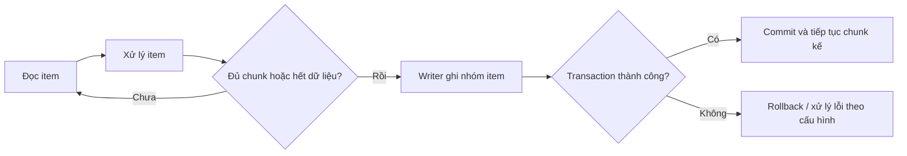
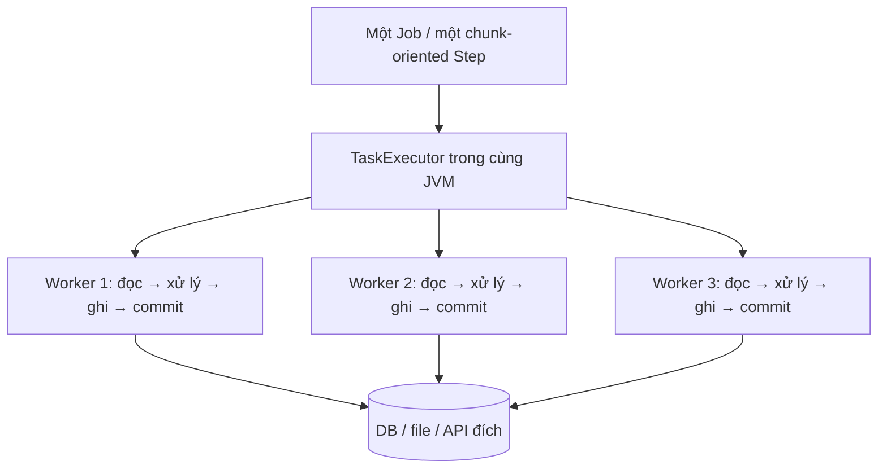

# Ý tưởng local chunking trong Spring Batch

## 1. Bài toán và mục tiêu

Một job nhập hàng triệu bản ghi thường không thể giữ toàn bộ dữ liệu trong bộ nhớ rồi mới ghi kết quả. Spring Batch giải quyết bài toán này bằng **chunk-oriented processing**: đọc một lượng bản ghi vừa phải, xử lý, ghi, sau đó xác nhận giao dịch. Khi workload tăng, ta có thể cho nhiều chunk chạy đồng thời trên các luồng của **cùng một ứng dụng** để tận dụng CPU và thời gian chờ I/O.

Trong module **SPRING_BATCH_SCALING_OPERATIONS**, local chunking là điểm xuất phát để hiểu việc mở rộng Spring Batch theo tài nguyên thực tế: đánh giá nút thắt trước khi tăng số luồng, giữ reader/processor/writer an toàn khi chạy đồng thời, và thiết kế retry/restart sao cho không tạo dữ liệu sai.

Sau bài này, bạn có thể:

- Giải thích phạm vi của một chunk, ranh giới transaction và sự khác nhau giữa chunk tuần tự với chunk chạy song song trong cùng JVM.
- Mô tả điều gì thay đổi khi thêm `TaskExecutor` vào một chunk-oriented step.
- Nhận ra rủi ro khi chia sẻ `ItemReader`, `ItemProcessor`, `ItemWriter` và trạng thái checkpoint giữa các luồng.
- Chọn khi nào local chunking phù hợp, khi nào nên chuyển sang parallel steps, partitioning hoặc remote chunking.
- Thiết kế một phép đo nhỏ để đánh giá throughput, lỗi, retry và restart trước khi đưa vào vận hành.

## 2. Local chunking thực chất là gì?

**Chunk** là một nhóm item được step đọc và xử lý trước khi ghi và commit. Ví dụ `chunk(200, transactionManager)` có nghĩa là step hướng tới xử lý tối đa 200 item được đọc trong một chunk (trừ chunk cuối, trường hợp lọc dữ liệu hoặc các điều kiện kết thúc/ngoại lệ). Nó **không** có nghĩa là luôn có đúng 200 dòng được ghi: processor có thể trả về `null` để lọc, hoặc writer nhận số output khác số input trong một mô hình xử lý phù hợp.

**Local** chỉ nơi công việc diễn ra: trong cùng process/JVM với Spring Batch job. Đây là cách gọi mô tả kiến trúc, **không phải** một loại step có tên chính thức `LocalChunkingStep`.

Cần phân biệt hai mức:

| Mức thực thi | Ý nghĩa | Số chunk chạy cùng lúc |
| --- | --- | --- |
| Chunk-oriented step thông thường | Reader → processor → writer, từng chunk lần lượt trên một luồng xử lý | Thường là 1 |
| Multi-threaded chunk-oriented step cục bộ | Cùng một step sử dụng `TaskExecutor` để thực thi nhiều chunk trên các worker thread trong một JVM | Có thể nhiều hơn 1 |

Vì vậy, khi một nhóm nói “bật local chunking để scale”, cần hỏi rõ họ đang nói về **chunking để giới hạn bộ nhớ** hay **multi-threaded step để tăng concurrency**. Chunking đơn thuần đã là cách xử lý phổ biến của Spring Batch; thêm thread mới là quyết định thay đổi cách thực thi và mức độ an toàn dữ liệu.

### Một chunk đi qua những đâu?

Với luồng xử lý đơn giản:

1. Spring Batch mở transaction cho chunk.
2. Reader lấy lần lượt các item; processor biến đổi hoặc lọc từng item.
3. Writer nhận nhóm item đã xử lý và ghi vào đích.
4. Nếu thành công, transaction commit và step cập nhật thông tin tiến độ phù hợp; nếu có lỗi dẫn đến rollback, các thay đổi thuộc transaction đó không được commit.
5. Step lặp lại cho đến khi reader báo hết dữ liệu.

`JobRepository` lưu metadata của job và step; `ExecutionContext` có thể lưu trạng thái checkpoint khi reader/writer triển khai và bật khả năng lưu trạng thái thích hợp. **Commit theo chunk** giảm lượng dữ liệu phải làm lại khi lỗi, nhưng không tự tạo ra cơ chế exactly-once cho mọi hệ thống bên ngoài.



**Ví dụ:** Có 10.000 đơn hàng, kích thước chunk là 200. Khi không có lọc hoặc đọc lỗi, step thường đi qua khoảng 50 chunk. Với 2.000.000 item là khoảng 10.000 chunk. Đây là số vòng đọc/ghi theo lô, **không** phải số thread.

## 3. Scale cục bộ bằng cách cho nhiều chunk chạy đồng thời

Ở mô hình đơn luồng, một chunk chờ thao tác DB hoặc I/O xong rồi chunk tiếp theo mới tiến lên. Nếu ứng dụng còn CPU, RAM và kết nối DB, dùng worker thread có thể tận dụng khoảng chờ đó.

Trong Spring Batch, một cách cấu hình phổ biến là gắn `TaskExecutor` vào chunk-oriented `Step`. Khi đó công việc chunk có thể chạy trên nhiều luồng trong **cùng một `StepExecution`**. Mỗi lần xử lý chunk có ranh giới transaction riêng; các chunk có thể hoàn tất và commit theo thứ tự khác thứ tự bắt đầu.



Hình trên thể hiện **các tác vụ chunk chạy đồng thời**, không hàm ý mỗi worker có một reader riêng. Trong multi-threaded step thông thường, các worker có thể cùng truy cập vào **các thành phần được chia sẻ của step**. Đây là rủi ro then chốt.

Ba điều dễ hiểu sai:

- **Tăng số thread không tự chia miền dữ liệu.** Nếu reader dùng một con trỏ chung và không an toàn luồng, các worker có thể đọc trùng, đọc thiếu hoặc làm sai trạng thái.
- **Không có bảo đảm về thứ tự ghi.** Chunk xử lý sau có thể commit trước chunk xử lý trước, nhất là khi chi phí mỗi item khác nhau.
- **Không phải một transaction lớn cho cả job.** Một số chunk đã commit vẫn có thể tồn tại sau khi chunk khác lỗi và khiến step thất bại.

Nếu nghiệp vụ yêu cầu xử lý nghiêm ngặt theo thứ tự, hoặc dữ liệu của item sau phụ thuộc vào output của item trước, mô hình này thường không phải lựa chọn phù hợp.

## 4. Cấu hình minh họa với Spring Batch 5.x

Ví dụ sau giả định ứng dụng đã có `Order`, `OrderView` và các bean reader/processor/writer **được kiểm chứng an toàn khi gọi đồng thời**. Nó tập trung vào cấu hình thực thi, không đại diện cho bộ job đầy đủ có thể copy và chạy ngay.

```java
@Configuration
public class LocalChunkConfiguration {

    @Bean("localChunkExecutor")
    public ThreadPoolTaskExecutor localChunkExecutor() {
        ThreadPoolTaskExecutor executor = new ThreadPoolTaskExecutor();
        executor.setCorePoolSize(4);
        executor.setMaxPoolSize(4);
        executor.setQueueCapacity(8);
        executor.setThreadNamePrefix("local-chunk-");
        executor.initialize();
        return executor;
    }

    @Bean
    public Step importOrdersStep(
            JobRepository jobRepository,
            PlatformTransactionManager transactionManager,
            ItemReader<Order> orderReader,
            ItemProcessor<Order, OrderView> orderProcessor,
            ItemWriter<OrderView> orderWriter,
            @Qualifier("localChunkExecutor") TaskExecutor taskExecutor) {

        return new StepBuilder("importOrdersStep", jobRepository)
                .<Order, OrderView>chunk(200, transactionManager)
                .reader(orderReader)
                .processor(orderProcessor)
                .writer(orderWriter)
                .taskExecutor(taskExecutor)
                .build();
    }
}
```

Các import tương ứng thuộc `org.springframework.batch.core`, `org.springframework.batch.core.repository`, `org.springframework.batch.core.step.builder`, `org.springframework.batch.item`, `org.springframework.context.annotation`, `org.springframework.core.task`, `org.springframework.scheduling.concurrent` và `org.springframework.transaction`. Khi cấu hình trong Spring Boot, cần bảo đảm các bean `JobRepository` và transaction manager đang được cấu hình phù hợp với ứng dụng.

Giải thích các tham số:

| Thành phần | Vai trò | Cần kiểm tra |
| --- | --- | --- |
| `chunk(200, transactionManager)` | Quy mô xử lý theo chunk và transaction manager dùng cho bước | Khả năng rollback với nguồn/đích thực tế; chi phí commit |
| `corePoolSize = maxPoolSize = 4` | Giới hạn worker thread của executor ở mức 4 | CPU, thời gian chờ I/O, connection pool và số job đồng thời |
| `queueCapacity = 8` | Hàng đợi task của executor | Khi quá tải có thể có từ chối tác vụ; theo dõi queue và chính sách vận hành |
| `taskExecutor(taskExecutor)` | Cho phép các lần xử lý chunk thực thi qua executor | Các thành phần dùng chung phải an toàn luồng |
| `@Qualifier` | Chọn đúng executor nếu ứng dụng có nhiều bean `TaskExecutor` | Tránh dùng nhầm executor phục vụ tác vụ khác |

**Không coi cấu hình bốn luồng trên là giá trị tối ưu.** Đây là điểm bắt đầu để benchmark. Kích thước pool, queue và chunk phải được điều chỉnh dựa trên năng lực DB, CPU, bộ nhớ và tốc độ nguồn dữ liệu. Việc thêm executor cũng không tự bảo đảm throughput tăng.

Lưu ý về phiên bản: API và chính sách giới hạn song song có thể thay đổi giữa các bản Spring Batch. Với các bản mới, nên dựa vào cấu hình executor và cơ chế giới hạn phù hợp với phiên bản đang dùng; không lấy `throttleLimit` cũ (đã được đánh dấu deprecated trong dòng Spring Batch 5.x) làm giải pháp mặc định.

## 5. Thread safety: điểm quyết định tính đúng của local chunking

Tốc độ chỉ có giá trị khi dữ liệu đầu ra vẫn đúng. Mỗi component phải được đánh giá theo **instance thực tế** được chia sẻ giữa worker threads.

| Thành phần | Rủi ro điển hình | Hướng xử lý |
| --- | --- | --- |
| `ItemReader` | Cursor, chỉ số dòng, bộ đệm hoặc trạng thái checkpoint bị thay đổi đồng thời | Chọn reader có contract hỗ trợ concurrency; đồng bộ hóa việc đọc khi phù hợp; cân nhắc partitioning để mỗi partition sở hữu reader riêng |
| `ItemProcessor` | Dùng chung `HashMap`, `SimpleDateFormat`, biến đếm mutable hoặc cache không đồng bộ | Ưu tiên hàm thuần/stateless, đối tượng immutable và thư viện thread-safe |
| `ItemWriter` | Bộ đệm mutable, phiên kết nối, thứ tự ghi hoặc thao tác ghi không tái nhập an toàn | Dùng writer thread-safe, đồng bộ hóa nơi cần thiết, hoặc tách writer theo partition |
| `ItemStream` / `ExecutionContext` | Các worker làm trạng thái save/restore không còn khớp tiến độ đã commit | Kiểm tra `open/update/close` và khả năng restart bằng bài test lỗi có chủ đích |
| Hệ thống đích | Deadlock, trùng khóa, rate limit hoặc side effect lặp lại | Unique key, UPSERT có kiểm soát, retry có backoff, giới hạn connection và concurrency |

**Một reader được đánh dấu `@StepScope` không mặc nhiên trở thành một reader mới cho từng worker thread.** Scope liên quan tới ngữ cảnh step, còn việc dùng cùng instance trên các chunk vẫn phải được kiểm tra riêng.

Spring Batch có `SynchronizedItemStreamReader` để tuần tự hóa các lời gọi `read()` của một `ItemStreamReader` delegate. Nó hữu ích nếu delegate chưa an toàn luồng, nhưng có ba giới hạn:

1. Chỉ đồng bộ hóa truy cập khi đọc; không làm cho processor, writer hoặc mọi trạng thái ngoài reader an toàn.
2. Reader tuần tự vẫn có thể trở thành nút thắt chính, khiến tăng worker không còn hiệu quả.
3. Khi một item đã đọc được xử lý trên luồng khác, lỗi giữa chừng có thể khiến checkpoint/restart khó suy luận; wrapper không bảo đảm restart an toàn cho mọi trường hợp.

Nếu cần reader độc lập và checkpoint rõ ràng theo từng dải ID hoặc file, **partitioning** thường dễ kiểm soát hơn multi-threaded step có reader dùng chung.

### Đúng dữ liệu dù thứ tự hoàn thành thay đổi

Giả sử các chunk chứa những đơn hàng độc lập:

- Worker A bắt đầu trước nhưng bị DB chờ khóa.
- Worker B bắt đầu sau và commit trước.
- Worker A cuối cùng commit hoặc rollback.

Thiết kế tốt không gắn ý nghĩa nghiệp vụ vào thứ tự commit. Mỗi bản ghi nên có **business key** rõ ràng (ví dụ `order_id` + `report_date`), còn thao tác ghi cần có hành vi xác định khi một bản ghi được thử lại. Nếu bắt buộc giữ thứ tự, có thể cần bước gom/sắp xếp đầu ra hoặc chọn mô hình xử lý tuần tự.

## 6. Transaction, retry và restart khi có nhiều worker

Hãy xét ba chunk A, B, C đang thực thi cùng lúc:

| Thời điểm | Chunk A | Chunk B | Chunk C |
| --- | --- | --- | --- |
| t1 | Đang xử lý | Đang xử lý | Đang xử lý |
| t2 | Commit | Gặp lỗi DB, rollback | Đang xử lý |
| t3 | Đã hoàn tất | Step có thể thất bại sau chính sách retry | Commit có thể đã xảy ra |

Ở thời điểm job thất bại, **một phần dữ liệu đã commit**. Khi khởi chạy lại đúng `JobInstance` theo cơ chế restart của Spring Batch, phải xử lý được dữ liệu đã ghi trước đó và cả những item có thể cần đọc lại. Không thể giả định hệ thống sẽ chạy lại đúng một lần trên mỗi item chỉ vì đã đặt chunk size.

Các nguyên tắc thực hành:

- **Idempotent write:** Nếu cùng một đơn hàng được xử lý lại, kết quả cuối vẫn đúng. Dùng unique constraint và chiến lược insert-if-absent/UPSERT dựa trên khóa nghiệp vụ khi phù hợp; không dựa riêng vào kiểm tra “đã tồn tại” rồi mới insert vì có race condition.
- **Retry có chọn lọc:** Thử lại lỗi tạm thời như kết nối hoặc deadlock theo chính sách và giới hạn hợp lý. Lỗi dữ liệu sai định dạng hay vi phạm logic thường cần được đưa vào luồng skip/quarantine hoặc dừng job.
- **Skip có truy vết:** Nếu chấp nhận bỏ item lỗi, ghi lại khóa bản ghi, nguyên nhân và số lượng để đối soát; “job COMPLETED” không đồng nghĩa tất cả item đều đã thành công.
- **Checkpoint/restart được kiểm chứng:** Kiểm tra reader có `saveState`, thứ tự dữ liệu ổn định, trạng thái `ExecutionContext` và khả năng phục hồi trong chính cấu hình nhiều luồng.
- **Side effect ngoài transaction:** Gọi API, gửi email, xuất file hoặc đẩy message có thể không rollback cùng DB. Dùng idempotency key hoặc mẫu outbox khi cần tránh thực thi lặp.

Một writer có thể idempotent nhưng reader dùng chung vẫn làm mất item. Ngược lại, reader an toàn vẫn không tránh được ghi trùng nếu writer không xử lý retry. Cả hai lớp phải đúng.

**Bài test restart có chủ đích:** Cho một chunk ghi lỗi sau khi một số chunk khác đã commit, xác nhận trạng thái DB, restart job, rồi so sánh tập business key đầu ra với tập input kỳ vọng. Đồng thời kiểm tra không thiếu, không trùng và không có side effect ngoài ý muốn. Lặp lại ở những mức song song khác nhau.

## 7. Cách chọn chunk size và số luồng

Không có một cấu hình chung cho mọi workload. Hai nhóm tham số giải quyết các bài toán khác nhau:

- **Chunk size** quyết định lượng xử lý trong một transaction: lớn hơn thường giảm số lần commit nhưng tăng dữ liệu cần rollback, bộ nhớ chiếm dụng và thời gian giữ khóa.
- **Số worker** quyết định mức song song: tăng có thể tận dụng I/O đang chờ nhưng cũng tăng tranh chấp tài nguyên và áp lực lên DB.

Một cách ước lượng thô lượng item đang được xử lý cùng lúc:

```text
in_flight_items ≈ worker_count × chunk_size
memory_for_items ≈ in_flight_items × average_item_footprint
```

Ví dụ 4 worker, mỗi chunk 200 item, mỗi item chiếm trung bình 5 KiB khi đang xử lý: phần item “đang bay” khoảng `4 × 200 × 5 KiB ≈ 3,9 MiB`. Đây chỉ là ước lượng phần payload; JVM còn object overhead, buffer của reader/writer, page/fetch buffer, queue, cache, GC và chi phí thư viện.

**Connection pool là giới hạn thực tế.** Nếu mỗi worker giữ một DB connection trong lúc ghi, bốn worker cùng các truy vấn đọc, metadata job và tải của ứng dụng khác có thể yêu cầu nhiều hơn bốn connection. Đừng tăng pool executor vượt khả năng xử lý kết nối của DB rồi kết luận Spring Batch chậm.

### Các nút thắt cần đo trước khi scale

| Hiện tượng | Chỉ báo cần quan sát | Gợi ý kiểm tra |
| --- | --- | --- |
| CPU gần bão hòa | CPU sử dụng cao, thời gian xử lý item cao | Tối ưu processor; nhiều thread có thể chỉ tăng context switch |
| Chờ DB/I/O | Query latency, connection-pool wait, disk I/O | Xem index, batch write, khóa, pool, giảm số lần gọi DB |
| Reader chậm | Thời gian `read()` cao, worker chờ input | Đánh giá nguồn, fetch/page size; xét partitioning nếu reader là nút thắt tuần tự |
| Memory/GC cao | Heap, allocation rate, GC pause | Giảm chunk size, giới hạn workers và queue |
| Ghi đích bị khóa | Deadlock, lock wait, rollback/retry tăng | Chia dữ liệu theo khóa, thứ tự truy cập nhất quán, giảm concurrency |
| Bên ngoài giới hạn tốc độ | HTTP 429, timeout, queue tăng | Backoff, rate limiting, số worker thấp hơn |

Một phép đo cơ bản là `throughput = số item xử lý thành công / thời gian thực thi` (items/second). Nên so sánh cùng dataset, cùng điều kiện tải và kiểm tra cả **tính đúng dữ liệu**. Tốc độ đọc cao nhưng ghi thiếu hoặc retry quá mức không phải cải thiện.

Theo dõi ít nhất thời gian job/step, read/write/filter/skip counts, commit/rollback counts, retry và loại exception, CPU, heap/GC, active threads, executor queue, connection pool, query latency và throughput theo khoảng thời gian. `commitCount` là số commit của step, không phải số item đã hoàn tất.

## 8. So sánh với các hướng scale khác của Spring Batch

| Mô hình | Đơn vị song song | Đặc điểm | Nên cân nhắc khi |
| --- | --- | --- | --- |
| Chunk tuần tự | Các chunk lần lượt trong một step | Dễ hiểu, checkpoint đơn giản hơn, thứ tự dễ kiểm soát | Dữ liệu vừa phải hoặc cần bảo toàn thứ tự |
| **Multi-threaded step (local chunks)** | Nhiều chunk của cùng một step, trong cùng JVM | Thiết lập gọn; chia sẻ state/component nên cần thread safety nghiêm ngặt | Item độc lập, công việc có thể song song, hạ tầng một JVM còn dư |
| Parallel steps | Nhiều step độc lập trong cùng job, có thể chạy cùng JVM | Mỗi step làm nhiệm vụ riêng, cấu hình luồng điều phối theo flow | Các nhánh nghiệp vụ độc lập: nạp khách hàng và nạp sản phẩm |
| Local partitioning | Nhiều `StepExecution`/partition trong cùng JVM | Mỗi partition có vùng dữ liệu, context và reader riêng | Dataset chia được theo ID/range/file, cần cô lập state và restart |
| Remote partitioning | Manager giao partition cho worker ở process khác | Có thể mở rộng nhiều instance/nút | Một JVM không đủ tài nguyên hoặc cần phân phối dữ liệu rõ ràng |
| Remote chunking | Manager đọc và gửi chunk qua middleware; worker xử lý/ghi | Có chi phí message, xác nhận và vận hành phân tán | Xử lý/ghi nặng, cần nhiều worker độc lập, chấp nhận tăng độ phức tạp |

Phân biệt đặc biệt quan trọng: **remote chunking** gửi *nội dung chunk* qua middleware, trong khi **partitioning** giao *một phân vùng dữ liệu* để worker tự đọc và xử lý. Local multi-threaded step không có message broker và không tự động mở rộng qua nhiều máy.

Tăng số worker của một multi-threaded step có giới hạn bởi CPU/RAM của JVM và khả năng chia sẻ reader. Nếu cần chạy trên nhiều node hoặc cần checkpoint rõ theo từng phân vùng, thiết kế cần thay đổi, không chỉ tăng thread count.

## 9. Tình huống thực tế: nạp báo cáo đơn hàng cuối ngày

**Yêu cầu:** Hệ thống phải chuẩn hóa khoảng 2 triệu bản ghi đơn hàng, ghi bảng `daily_order_summary` theo khóa `(report_date, order_id)`. Dữ liệu đến từ DB, thứ tự hoàn thành các đơn hàng không có ý nghĩa nghiệp vụ.

Một phương án thử nghiệm theo từng bước:

1. Chạy baseline chunk 200, một luồng. Đo số item, thời gian, query latency, các chỉ số DB và kết quả đối soát khóa.
2. Xác nhận processor stateless và writer xử lý trùng business key an toàn; đánh giá reader có thực sự hỗ trợ nhiều luồng và restart hay không.
3. Chạy lần lượt với 2 rồi 4 worker, vẫn giữ cùng dataset và chunk size. Quan sát cả throughput lẫn lock wait, connection wait, retry/rollback và heap.
4. Thử các chunk size 100, 200, 500 trên mức concurrency có triển vọng, xem lợi ích commit có bù được chi phí giữ khóa và bộ nhớ không.
5. Cố ý tạo lỗi tạm thời ở DB, restart và đối soát: mọi cặp `(report_date, order_id)` cần tồn tại đúng một kết quả kỳ vọng, không mất hay ghi sai bản ghi.

Nếu reader sử dụng cursor chung phải đồng bộ và chiếm hầu hết thời gian, tăng từ 4 lên 8 luồng có thể không mang lại lợi ích. Khi đó nên xem xét **local partitioning theo dải `order_id` hoặc theo ngày** để mỗi partition đọc vùng độc lập; cần tránh dải không cân bằng khiến một partition chạy lâu hơn hẳn các partition còn lại.

Đối với job gửi hóa đơn ra API, xử lý song song còn cần kiểm soát **rate limit** và **idempotency key**, vì một lời gọi API thành công có thể không bị hoàn tác nếu transaction DB rollback.

## 10. Quy trình kiểm chứng trước khi đưa vào vận hành

Hãy đặt tiêu chí đúng dữ liệu ngang hàng với tiêu chí tốc độ.

| Nhóm kiểm tra | Câu hỏi đạt yêu cầu |
| --- | --- |
| Đầu vào/đầu ra | Tổng item đọc, item lọc, item skip và item ghi có đối soát được không? Khóa đầu ra có đúng tập kỳ vọng không? |
| Thread safety | Mỗi reader, processor, writer, stream và client chia sẻ đã được xác minh concurrency chưa? |
| Transaction | Nếu một chunk lỗi, rollback có đúng phạm vi? Những chunk đã commit có an toàn khi thử lại? |
| Restart | Job lỗi giữa chừng rồi chạy lại có thiếu/trùng bản ghi hoặc tác dụng phụ không? |
| Hiệu năng | Throughput tăng bao nhiêu khi thay workers/chunk size? Pool connection, DB locks, CPU, heap có còn dư địa? |
| Vận hành | Có log theo job/step, metrics, cảnh báo, giới hạn retry và cách xử lý dữ liệu lỗi không? |

**Thực hành gợi ý:** Tự tạo 100.000 item có khóa duy nhất, processor ngẫu nhiên ngủ 0–20 ms để mô phỏng độ trễ, writer ghi có unique constraint. So sánh chạy 1 và 4 worker, quan sát thứ tự commit, sau đó tiêm lỗi một vài item và kiểm tra restart. Với một reader không thread-safe, chỉ thử trên môi trường test và dùng kết quả để thấy rủi ro, không chuyển cấu hình đó lên production.

## 11. Ghi nhớ cốt lõi

- **Chunking** chia việc theo transaction nhỏ; **multi-threaded local chunking** cho nhiều chunk tiến lên đồng thời trong một JVM.
- `TaskExecutor` cung cấp concurrency, nhưng không tự chia input hoặc biến các component dùng chung thành thread-safe.
- Thứ tự commit không bảo đảm; trạng thái reader/checkpoint, retry và restart phải được kiểm tra dưới tải song song.
- Tăng worker chỉ giúp khi workload còn tài nguyên và phần việc có thể chạy đồng thời; đo bottleneck trước khi điều chỉnh.
- Nếu reader cần trạng thái độc lập, dữ liệu chia dải rõ ràng hoặc cần phân tán qua nhiều máy, hãy cân nhắc partitioning hay remote chunking theo yêu cầu thực tế.

**Câu hỏi tự kiểm tra:** Nếu step có 4 worker và chunk size 200, tại sao vẫn có thể đọc thiếu item dù writer dùng UPSERT? Vì UPSERT xử lý tính lặp ở *đích*, còn reader dùng chung không an toàn luồng có thể cấp dữ liệu sai ngay từ *nguồn*. Do đó không thể thay thế kiểm tra concurrency của reader bằng idempotency của writer.
