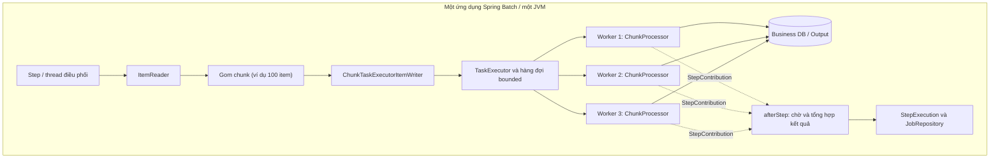
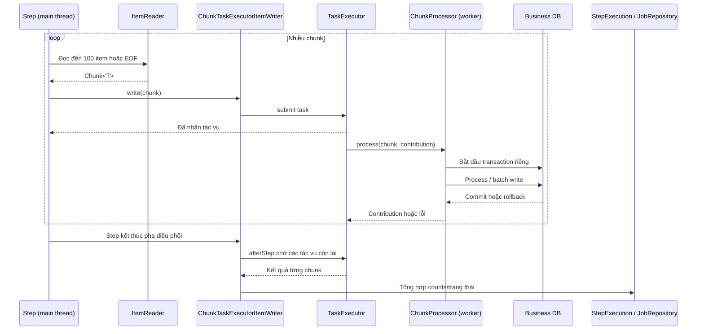
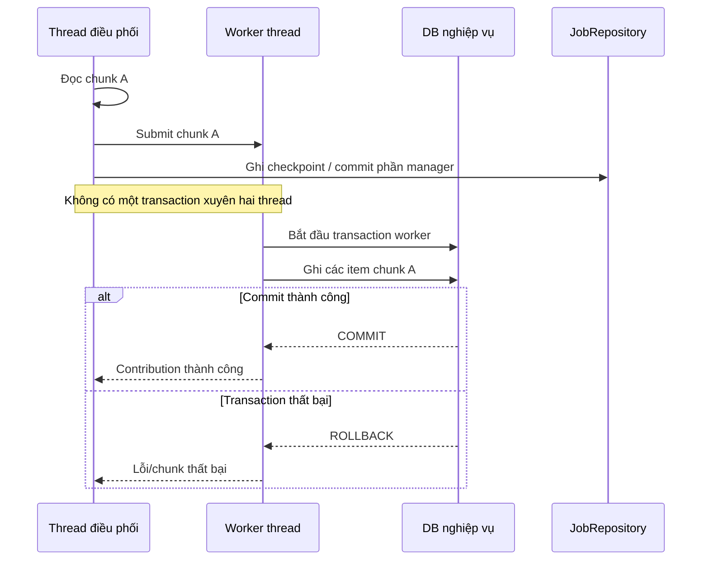

# ChunkTaskExecutorItemWriter trong Spring Batch: thực thi chunk song song tại một JVM

## 1. Bài toán cần giải quyết

Giả sử một job Spring Batch đọc 3 triệu bản ghi đơn hàng để cập nhật bảng báo cáo. Reader lấy dữ liệu nhanh, còn việc xử lý và ghi mỗi lô tốn nhiều CPU và thời gian I/O. Một step tuần tự chỉ xử lý một chunk tại một thời điểm, nên các lõi CPU hoặc tài nguyên ghi vẫn có thể còn dư.

Nếu ứng dụng chạy trên một JVM có nhiều core, **local chunking** cho phép gửi nhiều chunk tới các worker thread và xử lý chúng song song **trong cùng tiến trình**. Spring Batch giới thiệu cơ chế này từ phiên bản **6.0** thông qua lớp `ChunkTaskExecutorItemWriter<T>`.

Bài học tập trung vào chính lớp này: cách nó chuyển chunk sang thread khác, ghi nhận kết quả, kết nối với `ChunkProcessor`, cấu hình trong `Step` và những trách nhiệm quan trọng mà framework **không tự thực hiện** thay ứng dụng.

Sau khi học, bạn có thể:

- Mô tả luồng reader → `ChunkTaskExecutorItemWriter` → worker `ChunkProcessor` → `afterStep`.
- Phân biệt local chunking với multi-threaded step, parallel steps, local partitioning và remote chunking.
- Viết cấu hình Java cho Spring Batch 6.1 và nhận diện thay đổi package so với 6.0.
- Quản lý transaction riêng cho chunk, xử lý lỗi và cập nhật `StepContribution`.
- Xác định yêu cầu thread safety, memory, connection pool, restart và tính idempotent.
- Đo xem local chunking có cải thiện throughput theo tài nguyên thực tế hay không.

## 2. Local chunking khác step đa luồng ở đâu?

Trong **multi-threaded step** kiểu `step.taskExecutor(...)` của Spring Batch 6, `ItemProcessor` có thể chạy trên các worker thread; việc đọc và ghi item vẫn do thread chính của step thực hiện tuần tự. Vì vậy, nếu **writer** mới là nút thắt, thêm processor thread sẽ không giải quyết triệt để.

Với **local chunking**, thread điều phối đọc và lập chunk, rồi giao chunk cho `ChunkTaskExecutorItemWriter`. Writer đặc biệt này không trực tiếp ghi từng item vào đích. Nó **submit nhiệm vụ xử lý cả chunk** cho một `TaskExecutor`, nơi `ChunkProcessor` xử lý và ghi dữ liệu.



Sơ đồ biểu diễn ý tưởng logic, không mô tả đầy đủ thứ tự giao dịch và toàn bộ listener/metadata callback. Các chunk có thể **hoàn thành không cùng thứ tự đã được đọc**.

Một cách hình dung:

| Loại thực thi | Đơn vị chạy đồng thời | Reader | Processor/writer | Phạm vi |
|---|---|---|---|---|
| Step tuần tự | Một chunk tại một thời điểm | Tuần tự | Tuần tự | Một JVM |
| Multi-threaded step (6.x) | Các lần xử lý item | Thread điều phối | Processor đa luồng, writer tuần tự | Một JVM |
| **Local chunking** | **Nhiều chunk độc lập** | Thread điều phối đọc/gom | `ChunkProcessor` trên worker threads | **Một JVM** |
| Parallel steps | Các step/flow độc lập | Theo từng step | Theo từng step | Một JVM |
| Local partitioning | Các `StepExecution`/phân vùng | Mỗi partition có reader riêng | Theo partition | Một JVM |
| Remote chunking | Chunk truyền qua middleware | Manager | Worker ở tiến trình khác | Nhiều JVM |

**Không nhầm local chunking với local partitioning:** local chunking phân công các chunk được reader của step điều phối tạo ra; partitioning tạo nhiều `StepExecution`, mỗi cái có vùng dữ liệu và context riêng.

## 3. Vai trò của `ChunkTaskExecutorItemWriter<T>`

Đây là **một `ItemWriter<T>` đồng thời là `StepExecutionListener`**. Constructor nhận hai tham số:

```java
new ChunkTaskExecutorItemWriter<T>(
        ChunkProcessor<T> chunkRequestProcessor,
        TaskExecutor taskExecutor
);
```

Từng thành phần có vai trò rõ ràng:

| Thành phần | Nhiệm vụ |
|---|---|
| `ItemReader<T>` | Đọc dữ liệu nguồn trên đường xử lý của step điều phối. |
| `ChunkTaskExecutorItemWriter<T>` | Nhận các chunk và gửi nhiệm vụ xử lý đến `TaskExecutor`. |
| `TaskExecutor` | Cung cấp worker threads, lập lịch chạy và giới hạn mức đồng thời tùy triển khai. |
| `ChunkProcessor<T>` | Xử lý **toàn bộ nội dung của chunk**: có thể transform, filter và ghi; tự quản lý transaction, lỗi, retry/skip. |
| `StepContribution` | Ghi lại đóng góp của worker như write/skip count, `ExitStatus`. |
| `beforeStep` / `afterStep` | Chuẩn bị trạng thái và chờ/tổng hợp contributions để cập nhật `StepExecution`. |
| `JobRepository` | Lưu execution status, context và metadata step/job theo cấu hình repository. |

Theo Javadoc, `afterStep` **đợi các phản hồi worker**, sau đó tổng hợp write/skip counts và tăng các bộ đếm commit/rollback tương ứng theo contribution thành công/thất bại. Khi có worker báo lỗi, step được đánh dấu thất bại và ghi nhận ngoại lệ. Không nên xem `write()` trả về tại thread điều phối là bằng chứng business data đã commit ở worker.

Điểm giới hạn phải ghi nhớ:

> `ChunkTaskExecutorItemWriter` **không quản lý transaction và fault tolerance cho chunk**. Các chức năng như retry, skip, chunk scanning và quyết định rollback cần được cài đặt ở `ChunkProcessor` được giao việc. **Vòng đời `TaskExecutor` cũng không do writer này quản lý.**

Đây là điểm khác biệt rất lớn so với việc gắn `.faultTolerant()` vào một step tuần tự rồi mặc nhiên kỳ vọng logic đó bảo vệ toàn bộ công việc chạy bất đồng bộ.

## 4. Khác biệt quan trọng giữa Spring Batch 6.0 và 6.1

`ChunkTaskExecutorItemWriter` được giới thiệu ở **Spring Batch 6.0**, ban đầu thuộc module integration. **Spring Batch 6.1** chuyển lớp này về `spring-batch-core` vì nó chỉ cần `TaskExecutor`, không phụ thuộc Spring Integration. API trước đó vẫn được giữ dưới dạng subclass deprecated để tương thích nhưng nên chuyển sang package mới khi nâng version.

```java
// Spring Batch 6.0.x
import org.springframework.batch.integration.chunk.ChunkTaskExecutorItemWriter;

// Spring Batch 6.1+
import org.springframework.batch.core.step.item.ChunkTaskExecutorItemWriter;
```

| Phiên bản | Package chính | Dependency cần chú ý |
|---|---|---|
| Spring Batch 6.0.x | `org.springframework.batch.integration.chunk` | `spring-batch-integration` |
| Spring Batch 6.1+ | `org.springframework.batch.core.step.item` | `spring-batch-core` |

Tương tự, từ 6.1 có `DefaultChunkProcessor<I,O>` để thay thế `SimpleChunkProcessor` đã deprecated. `DefaultChunkProcessor` có thể gọi `ItemProcessor` rồi `ItemWriter` và cập nhật số item filter/write, nhưng **không tự cung cấp transaction, listener, metrics hay retry/skip**. Lựa chọn phiên bản phải nhất quán giữa dependency, import và ví dụ code.

Phần code dưới đây nhắm tới **Spring Batch 6.1**. Với 6.0.x, đổi import `ChunkTaskExecutorItemWriter` như trên và giữ cấu hình `ChunkProcessor` viết tay; những API đã được xác nhận trong 6.0 vẫn hoạt động theo cùng nguyên lý.

## 5. Luồng xử lý một chunk

Giả sử step dùng `chunk(100)` và pool 4 worker:



**Chi tiết về thời gian:** `write(chunk)` trên `ChunkTaskExecutorItemWriter` submit tác vụ và xử lý bất đồng bộ; thực hiện transaction nghiệp vụ ở worker có thể kết thúc sau transaction của thread điều phối. Vì vậy hai ranh giới transaction là **khác nhau**. Người thiết kế phải kiểm soát đoạn thời gian reader đã tiến lên, nhưng chunk chưa được worker commit.

`chunk(100)` là số item mục tiêu mỗi chunk, **không có nghĩa 100 worker threads**. Nếu xử lý 10.000 item, về lý tưởng có khoảng 100 chunk, trong khi số chunk đang xử lý đồng thời phụ thuộc pool và queue.

## 6. Ví dụ cấu hình Java Spring Batch 6.1

Ví dụ bên dưới giả định một step đọc các đối tượng `InvoiceRow` và ghi vào bảng projection. Để dễ kiểm soát transaction, ví dụ **chỉ ghi dữ liệu ở worker**, còn biến đổi dữ liệu có thể bổ sung bên trong `ChunkProcessor`.

```java
import org.springframework.batch.core.ExitStatus;
import org.springframework.batch.core.repository.JobRepository;
import org.springframework.batch.core.step.Step;
import org.springframework.batch.core.step.builder.StepBuilder;
import org.springframework.batch.core.step.item.ChunkProcessor;
import org.springframework.batch.core.step.item.ChunkTaskExecutorItemWriter;
import org.springframework.batch.infrastructure.item.ItemReader;
import org.springframework.batch.infrastructure.item.ItemWriter;
import org.springframework.beans.factory.annotation.Qualifier;
import org.springframework.context.annotation.Bean;
import org.springframework.context.annotation.Configuration;
import org.springframework.core.task.TaskExecutor;
import org.springframework.scheduling.concurrent.ThreadPoolTaskExecutor;
import org.springframework.transaction.PlatformTransactionManager;
import org.springframework.transaction.support.TransactionTemplate;

@Configuration
public class InvoiceLocalChunkingConfiguration {

    // Spring quản lý initialize() và shutdown() của bean executor.
    @Bean
    public ThreadPoolTaskExecutor localChunkExecutor() {
        ThreadPoolTaskExecutor executor = new ThreadPoolTaskExecutor();
        executor.setCorePoolSize(4);
        executor.setMaxPoolSize(4);
        executor.setQueueCapacity(16);
        executor.setThreadNamePrefix("local-chunk-");
        executor.setWaitForTasksToCompleteOnShutdown(true);
        executor.setAwaitTerminationSeconds(120);
        return executor;
    }

    // Đây là nơi transaction của từng chunk được thực thi.
    @Bean
    public ChunkProcessor<InvoiceRow> invoiceChunkProcessor(
            @Qualifier("invoiceBusinessWriter")
            ItemWriter<InvoiceRow> businessWriter,
            @Qualifier("businessTransactionManager")
            PlatformTransactionManager businessTransactionManager) {

        TransactionTemplate transactionTemplate =
                new TransactionTemplate(businessTransactionManager);

        return (chunk, contribution) -> {
            try {
                transactionTemplate.executeWithoutResult(status -> {
                    try {
                        businessWriter.write(chunk);
                    }
                    catch (Exception ex) {
                        // Consumer của TransactionTemplate không khai báo
                        // checked exception: bọc lỗi để transaction rollback.
                        throw new IllegalStateException("Chunk write failed", ex);
                    }
                });

                // Cập nhật counts sau khi transaction trả về thành công.
                contribution.incrementWriteCount(chunk.size());
                contribution.setExitStatus(ExitStatus.COMPLETED);
            }
            catch (RuntimeException ex) {
                contribution.setExitStatus(
                        ExitStatus.FAILED.addExitDescription(ex));
                throw ex;
            }
        };
    }

    @Bean
    public ChunkTaskExecutorItemWriter<InvoiceRow> localChunkItemWriter(
            ChunkProcessor<InvoiceRow> invoiceChunkProcessor,
            @Qualifier("localChunkExecutor") TaskExecutor executor) {

        return new ChunkTaskExecutorItemWriter<>(
                invoiceChunkProcessor, executor);
    }

    @Bean
    public Step invoiceLocalChunkStep(
            JobRepository jobRepository,
            @Qualifier("managerTransactionManager")
            PlatformTransactionManager managerTransactionManager,
            @Qualifier("invoiceReader")
            ItemReader<InvoiceRow> reader,
            ChunkTaskExecutorItemWriter<InvoiceRow> localChunkItemWriter) {

        return new StepBuilder("invoiceLocalChunkStep", jobRepository)
                .<InvoiceRow, InvoiceRow>chunk(100)
                .transactionManager(managerTransactionManager)
                .reader(reader)
                .writer(localChunkItemWriter)
                .build();
    }
}
```

**Những điều ví dụ đã minh họa:**

1. `ChunkTaskExecutorItemWriter` được truyền **trực tiếp** vào `.writer(...)`, để listener `beforeStep`/`afterStep` của writer được đăng ký theo cơ chế listener của Spring Batch. Nếu writer bị bọc qua một adapter/composite, hãy xác minh việc đăng ký và khai báo listener tường minh nếu cần.
2. Worker pool có `core=max=4`, queue tối đa 16 task đang chờ. Đây là **giá trị minh họa**, phải điều chỉnh theo DB pool, memory và CPU.
3. `TransactionTemplate` được tạo từ transaction manager của **business database** và chạy **ngay trên worker thread**.
4. Sau khi transaction worker hoàn thành, processor cập nhật `StepContribution` (`writeCount` và `ExitStatus`). Nếu lỗi, nó đánh dấu thất bại và ném lại exception để writer tổng hợp.
5. `managerTransactionManager` thuộc giao dịch/reader của thread điều phối; nó **không thay thế** transaction ở worker.

**Các thành phần chưa được định nghĩa trong ví dụ** gồm record/class `InvoiceRow`, bean `invoiceReader`, bean `invoiceBusinessWriter`, hai transaction manager và cấu hình database/`JobRepository`. Cần nối những thành phần này theo ứng dụng thực tế; đây là ví dụ tập trung vào **API và cấu trúc local chunking**, không phải dự án hoàn chỉnh có thể chạy độc lập.

`InvoiceRow` nên mang khóa nghiệp vụ ổn định, chẳng hạn `invoiceId`. Writer nghiệp vụ phải đáp ứng yêu cầu idempotency khi chunk bị chạy lại: ví dụ unique constraint hoặc thao tác `UPSERT` có điều kiện.

### Có nên dùng chung một transaction manager cho manager và worker?

Có thể hai bean transaction manager tham chiếu cùng `DataSource` trong môi trường đơn giản, nhưng **transaction vẫn gắn với từng thread**, không tự nối thành một transaction nguyên khối. Trong ứng dụng có DB metadata và DB nghiệp vụ tách nhau, cần chỉ rõ transaction manager tương ứng với mỗi tài nguyên và thiết kế tính nhất quán giữa chúng.

### Chèn bước transform vào worker như thế nào?

Ví dụ đơn giản ở trên chỉ gọi `businessWriter.write(chunk)`. Nếu cần transform/filter, hãy đặt logic xử lý trong `ChunkProcessor` worker, gọi `ItemProcessor` trên từng input rồi ghi các output hợp lệ, đồng thời cập nhật `filterCount`/`writeCount` chính xác. Với Spring Batch **6.1**, có thể dùng:

```java
ChunkProcessor<InvoiceRow> delegate =
        new DefaultChunkProcessor<>(invoiceProcessor, invoiceBusinessWriter);
```

`DefaultChunkProcessor` ở package `org.springframework.batch.core.step.item`. Để dùng trong local chunking, vẫn phải **bọc lệnh `delegate.process(chunk, contribution)` trong transaction của worker** và thiết kế chính sách lỗi/retry tương ứng. Không nhầm việc `DefaultChunkProcessor` cập nhật counts với việc nó tự commit.

Nếu logic nghiệp vụ phức tạp, hãy xây dựng `ChunkProcessor` rõ ràng, có kiểm thử transaction và idempotency; không chuyển nguyên đoạn xử lý cũ sang thread khác mà bỏ qua các phụ thuộc thread-bound.

## 7. `StepContribution` và tổng hợp trạng thái

Trong local chunking, nhiều worker có thể hoàn thành không theo thứ tự submit. Mỗi worker đóng góp thông tin trạng thái vào kết quả tổng hợp:

| Tín hiệu | Ý nghĩa |
|---|---|
| `writeCount` | Số item được writer ghi thành công theo quy ước của ứng dụng. |
| `writeSkipCount` | Số item được bỏ qua có chủ đích sau chính sách skip. |
| `ExitStatus` | Thành công hay thất bại theo xử lý của delegate chunk. |
| Lỗi/exceptions | Dùng để biểu thị chunk thất bại và giúp chẩn đoán. |
| Commit/rollback contribution | Javadoc mô tả `afterStep` cập nhật commit count khi contribution thành công và rollback count khi thất bại. |

**Điểm cần thận trọng:** số liệu của step không phản ánh đầy đủ tiến độ worker trong khi công việc còn đang chờ/tổng hợp. Chỉ đánh giá kết quả cuối khi `afterStep` đã hoàn tất và đã đối soát dữ liệu đích.

Không tự `incrementWriteCount(chunk.size())` khi chỉ mới enqueue task. Hãy cập nhật sau khi chunk nghiệp vụ đã thành công theo transaction tương ứng. Nếu có filter/skip, **không cộng số item đầu vào** thay cho số output thực ghi.

Một lỗi phổ biến là bắt exception rồi chỉ log, vẫn trả `ExitStatus.COMPLETED`; khi đó phép đo thông lượng và trạng thái job đánh lừa người vận hành. Tình huống lỗi phải được chuyển thành failure rõ ràng hoặc skip được kiểm soát, có ghi nhận dữ liệu bị bỏ qua.

## 8. Transaction: hai ranh giới không đồng nhất

Đây là rủi ro quan trọng nhất của lớp này.



Khi transaction của manager đã chốt tiến độ reader nhưng chunk A còn nằm trong executor queue hoặc đang chạy, **mất tiến trình đột ngột** có thể tạo khoảng trống giữa checkpoint và dữ liệu đã thực sự ghi. Không có durable message broker bảo đảm phát lại các nhiệm vụ còn trong RAM.

Vì vậy, đối với workload yêu cầu restart mạnh, cần kiểm thử ít nhất các kịch bản:

- JVM dừng ngay **sau khi submit chunk** nhưng trước khi worker thực thi.
- Worker đã ghi một phần rồi transaction rollback.
- Worker commit thành công nhưng ứng dụng chưa tổng hợp đầy đủ kết quả.
- Nhiều worker đang chạy, một worker lỗi và các worker khác vẫn hoàn tất.
- Manager nhận yêu cầu stop trong khi queue còn tác vụ.
- Restart job trên dữ liệu nguồn đã thay đổi thứ tự hoặc bị cập nhật.

**Không coi local chunking mặc định cung cấp exactly-once business delivery.** Muốn khôi phục tin cậy, có thể thiết kế bảng trạng thái nghiệp vụ theo business key, staging/outbox, unique constraints, idempotent upsert hoặc process indicator. Cần thử crash/restart ở những ranh giới giao dịch thật, không chỉ thử job chạy hoàn tất bình thường.

Tương tự, các side effect như gửi email, gọi HTTP, ghi object storage có thể nằm ngoài transaction DB. Nếu thực hiện trong worker, cần idempotency key, trạng thái gửi và cơ chế bù trừ hoặc tái đối soát khi cần.

## 9. Retry/skip phải đặt đúng vị trí

Giả sử một batch insert gặp deadlock, trong khi item thứ 37 của chunk lại chứa giá trị sai không thể ghi. Hai loại lỗi cần xử lý khác nhau:

- **Lỗi tạm thời:** deadlock, network timeout nhất thời. Có thể retry giới hạn số lần và dùng backoff.
- **Lỗi dữ liệu:** thiếu business key, vi phạm quy tắc nghiệp vụ. Cần fail hoặc skip theo chính sách và ghi lại nguồn lỗi; retry vô hạn không hữu ích.

`ChunkTaskExecutorItemWriter` không tự triển khai logic retry, skip hoặc chunk scanning. Một `ChunkProcessor` dùng trong worker có thể đưa vào quy trình:

```text
receive chunk
  -> validate dữ liệu/khóa nghiệp vụ
  -> chạy transaction worker
      -> process/transform từng item (nếu có)
      -> write/batch write
  -> khi thành công: commit và cập nhật contribution
  -> khi lỗi tạm thời: rollback, retry có giới hạn/backoff
  -> khi lỗi không thể phục hồi:
       nếu chính sách cho phép: skip + ghi nhận chính xác
       nếu không: mark FAILED + truyền lỗi
```

**Không giả định `.faultTolerant().retry(...).skip(...)` trên step manager tự xử lý ngoại lệ xuất hiện bất đồng bộ sau khi chunk đã được dispatch.** Với local chunking, hãy triển khai và xác minh fault tolerance ở delegate `ChunkProcessor`, đồng thời kiểm soát số side effect thực đã được commit.

Khi cần retry, giới hạn tổng thời gian, số lượt thử và số chunk được thử lại đồng thời. Nếu database đang quá tải, việc 16 worker cùng retry không có backoff có thể biến một deadlock nhỏ thành retry storm.

## 10. Thread safety: ai được dùng chung?

Vì nhiều `ChunkProcessor` chạy trong các thread của **cùng JVM**, đối tượng được inject vào tất cả worker thường là một instance bean dùng chung. Không bảo đảm an toàn chỉ bằng việc `@Bean` được Spring quản lý.

| Thành phần | Cách nhìn nhận thread safety |
|---|---|
| `ItemReader` ở thread điều phối | Trong mô hình minh họa reader không bị các worker gọi trực tiếp, không cần tự chia reader cho nhiều thread. |
| `ChunkProcessor` | Bắt buộc xử lý concurrent calls an toàn nếu dùng chung instance. Ưu tiên stateless logic, immutable input. |
| `ItemWriter` nghiệp vụ | Có thể bị nhiều worker gọi đồng thời; phải kiểm tra implementation và các tài nguyên dùng chung. |
| `TransactionTemplate` | Có thể dùng chung khi cấu hình cố định; transaction thực tế theo worker thread. |
| `EntityManager` / session | Không dùng chung object persistence context không thread-safe giữa worker threads; lấy theo transaction/thread đúng cách. |
| Mutable counter/map/cache | Dễ xảy ra lost update; dùng cấu trúc concurrent phù hợp hoặc đưa state vào database/metrics. |
| File writer đơn đích | Có thể phát sinh tranh chấp hoặc thứ tự ghi sai; cần cơ chế phân vùng/đồng bộ đúng nghiệp vụ. |

Ví dụ anti-pattern:

```java
class UnsafeInvoiceProcessor {
    private long processed = 0;

    public void process(InvoiceRow item) {
        processed++; // Lost update khi nhiều worker dùng cùng instance.
        // ...
    }
}
```

Thay `processed++` bằng `AtomicLong` có thể sửa riêng lỗi counter, nhưng **không tự sửa** rủi ro transaction, writer không thread-safe hoặc thứ tự side effect. Để đo số liệu vận hành, ưu tiên Spring Batch metadata và Micrometer; để bảo đảm đúng nghiệp vụ, dùng khóa và ràng buộc lưu trữ.

Nếu cần state riêng cho từng worker, không mặc định `@StepScope` tạo một bean mới cho mỗi thread: scope của nó gắn với `StepExecution`, trong khi nhiều chunk có thể thuộc **cùng một StepExecution**.

## 11. Executor, backpressure và tài nguyên

Một pool lớn chưa chắc tăng throughput. Để đặt cấu hình, hãy ước lượng:

\[
\text{Số item đang được giữ gần đúng}
\approx
(\text{active chunks} + \text{queued chunks})
\times \text{chunk size}
\]

Nếu `chunkSize=500`, pool có 8 active worker và queue 32 chunk, riêng các item trong các chunk đó có thể lên tới khoảng **20.000 item**. Chưa kể dữ liệu reader, object sau transform, transaction context, JDBC batch buffer và overhead Java object.

Cần kiểm tra:

1. **Pool size:** chọn theo CPU và số DB connection thực có; thử `1, 2, 4, 8` thay vì tăng ngay lên 32.
2. **Queue capacity:** bounded queue để kiểm soát memory; hiểu rõ cơ chế task rejection khi queue đầy. Từ chối task phải làm job thất bại có thể quan sát được, không được bỏ qua chunk.
3. **DB connection pool:** mỗi worker giao dịch DB có thể cần một connection. Pool phải đủ cho số worker thực chạy **và** phần reader/repository/ứng dụng khác.
4. **JDBC locks:** tăng số transaction đồng thời có thể tăng deadlock hoặc contention theo index và business key.
5. **Shutdown:** writer không tự quản lý lifecycle của executor. Spring quản lý bean executor hoặc ứng dụng phải shutdown có kiểm soát và chờ task phù hợp.
6. **Memory và GC:** chunk lớn, queue dài, output phình to khiến heap/GC tăng. Đo allocation và p95/p99 chunk latency.
7. **Thứ tự kết quả:** chunk B có thể hoàn thành trước A. Nếu nghiệp vụ bắt buộc ghi đúng thứ tự, cần thiết kế khác hoặc áp đặt thứ tự tại output.

**Đặt queue quá dài chỉ giấu bottleneck:** writer sẽ tiếp tục enqueue nhanh trong khi DB chậm, tạo backlog và tăng thời gian job kết thúc. Tình huống thực tế phải đo cả thời gian chờ queue và thời gian commit của worker.

## 12. Khi nào `ChunkTaskExecutorItemWriter` phù hợp?

Phù hợp khi:

- Reader có thể cung cấp chunk đủ nhanh, còn xử lý/ghi mỗi chunk đủ nặng để song song hóa có lợi.
- Workload chứa các chunk tương đối độc lập, không bắt buộc output theo thứ tự đọc.
- Writer/processor thread-safe hoặc được cấu hình an toàn theo từng worker.
- Business database còn khả năng xử lý transaction song song, lock không phải nút thắt chính.
- Chấp nhận và kiểm soát được các yêu cầu restart, idempotency và giám sát vốn phức tạp hơn xử lý tuần tự.
- Muốn mở rộng trong một JVM trước khi phải vận hành middleware/cụm worker từ xa.

Không phù hợp nếu:

- Reader/query nguồn đã là giới hạn cứng và không thể cấp thêm item.
- Writer ghi vào một tài nguyên chỉ cho phép một luồng hoặc có thứ tự nghiêm ngặt.
- DB connection/lock đã bão hòa; thêm transaction làm tình hình tệ hơn.
- Cần checkpoint/restart đúng từng shard, trong khi chiến lược chia dữ liệu theo khóa cho partitioning sẽ rõ ràng hơn.
- Nhiệm vụ cần độc lập máy, cách ly lỗi tiến trình và triển khai worker đa host; lúc đó xem xét remote partitioning/chunking.

### So sánh theo mục tiêu

| Mục tiêu | Công cụ nên xem xét | Lý do |
|---|---|---|
| CPU transform từng item là nút thắt | Multi-threaded step | Song song hóa processor, đơn giản hơn nếu writer vẫn đáp ứng. |
| Ghi cả chunk nặng nhưng reader nhẹ | **Local chunking** | Worker có thể xử lý/ghi các chunk song song trong cùng JVM. |
| Nguồn dữ liệu chia ID range/tenant/file | Local/remote partitioning | Nhiều `StepExecution` với ranh giới dữ liệu rõ. |
| Các bước công việc độc lập | Parallel steps | Dễ diễn đạt các nhánh nghiệp vụ độc lập. |
| Manager đọc, worker ở các tiến trình khác xử lý chunk | Remote chunking | Phân tán qua middleware, nhiều JVM. |
| Chuyển trọn một step sang node đặc biệt | RemoteStep | Tách nơi thực thi một step, không tự phân mảnh nó. |

Quyết định phải dựa trên số liệu bottleneck, tài nguyên và yêu cầu restart; không chọn kiến trúc vì số worker có thể khai báo.

## 13. Benchmark local chunking đúng cách

Một phương pháp thực nghiệm:

1. Chạy step tuần tự trên dataset đủ lớn; đo item read/write per second, tổng thời gian, số commit/rollback và dữ liệu đích.
2. Giữ **cùng input**, schema, index, JVM, DB pool, chunk size và writer khi thay sang local chunking.
3. Thử 1, 2, 4, 8 worker; giữ queue capacity có giới hạn và ghi chính xác cấu hình.
4. Lặp mỗi mức nhiều lần sau warm-up; so median và mức biến động, tránh kết luận từ một lượt chạy.
5. Quan sát cả CPU, heap/GC, DB active/pending connections, lock wait, p95 chunk duration, retry/rollback và thời gian chờ queue.
6. Đối soát output theo business key, tổng số lượng/tổng tiền/checksum; chèn lỗi để kiểm chứng restart.
7. Tăng/giảm chunk size riêng sau khi đã xác định vùng concurrency hợp lý; luôn đo lại cả hai biến cùng nhau khi cần.

### Bảng benchmark giả định

| Workers | Chunk size | Throughput hợp lệ* | Thời gian 1 triệu item* | DB lock wait* | Heap peak* |
|---:|---:|---:|---:|---|---|
| 1 | 200 | 2.000 item/s | 500 s | Thấp | 300 MiB |
| 2 | 200 | 3.600 item/s | ~278 s | Thấp | 380 MiB |
| 4 | 200 | 5.700 item/s | ~175 s | Trung bình | 550 MiB |
| 8 | 200 | 5.900 item/s | ~169 s | Cao | 830 MiB |
| 16 | 200 | 4.500 item/s | ~222 s | Rất cao | 1.200 MiB |

\* **Toàn bộ là dữ liệu minh họa**, không phải benchmark chính thức của Spring Batch.

Nếu 4 worker đã gần đạt vùng throughput tốt mà DB lock wait tăng mạnh ở 8 worker, tăng lên 16 không có cơ sở. Có thể chọn 4 worker để chừa headroom cho job khác; cần lặp benchmark và kiểm thử lỗi trước khi chốt.

Đừng nhầm tốc độ đọc của thread điều phối với số item thực **đã commit** ở worker. Hệ thống có thể đọc xong rất nhanh nhưng hàng đợi vẫn còn nhiều chunk chưa xử lý.

### Truy vấn quan sát sau khi step kết thúc

Nếu `JobRepository` dùng schema JDBC mặc định:

```sql
SELECT
    STEP_EXECUTION_ID,
    STEP_NAME,
    STATUS,
    READ_COUNT,
    WRITE_COUNT,
    WRITE_SKIP_COUNT,
    COMMIT_COUNT,
    ROLLBACK_COUNT,
    START_TIME,
    END_TIME
FROM BATCH_STEP_EXECUTION
WHERE JOB_EXECUTION_ID = :jobExecutionId
ORDER BY STEP_EXECUTION_ID;
```

Hãy đồng thời đối soát dữ liệu đích. Metadata có thể ghi lại số lượng và trạng thái tổng hợp sau `afterStep`, nhưng không đủ để tự chứng minh mọi side effect nằm ngoài transaction đã diễn ra đúng một lần.

Các biểu đồ theo thời gian có ích: worker active, queue depth, worker duration p50/p95, DB pool pending, lock waits, step elapsed và số output nghiệp vụ hoàn tất mỗi giây. Nên dùng correlation ID gắn `JobExecutionId`, `StepExecutionId`, chunk sequence/business key để theo dõi log nhiều thread.

## 14. Sự cố thường gặp và cách xử lý

| Triệu chứng | Nguyên nhân khả dĩ | Hướng điều tra |
|---|---|---|
| `writeCount` chỉ xuất hiện đúng ở cuối step | Kết quả worker được tổng hợp ở `afterStep` | Kiểm tra listener đã chạy và worker thực đã commit. |
| `ExitStatus=FAILED` nhưng log writer thiếu lỗi | Delegate bắt lỗi nhưng không ghi đủ context | Ghi exception, chunk key, contribution; trả failure tường minh. |
| Job “COMPLETED” nhưng DB thiếu item sau crash | Checkpoint manager và commit worker bất đồng bộ | Đối soát, idempotency, durable staging, test crash window. |
| Một worker làm toàn bộ step chậm | Chunk bị lệch tải hoặc một giao dịch treo | Theo dõi per-chunk duration; timeout, partition phù hợp nếu cần. |
| DB pool cạn khi tăng threads | Mỗi worker/manager cần connection | Giảm concurrency, tối ưu transaction, chỉnh pool theo capacity thật. |
| `TaskRejectedException` | Executor/queue đã đầy | Đo tốc độ enqueue và xử lý, giới hạn inflight, thiết kế backpressure. |
| Dữ liệu ghi sai thứ tự | Chunk hoàn tất out-of-order | Không dựa vào thứ tự; thiết kế sequence hoặc dùng phương án tuần tự. |
| OOM/GC cao | Queue dài, chunk lớn, object graph dày | Bounded queue, giảm chunk, giảm worker, kiểm tra memory allocation. |
| Restart tạo duplicate | Worker commit trước khi metadata xác nhận, hoặc side effect ngoài transaction | Unique key, UPSERT, ledger theo business key, đối soát. |
| Shutdown giữ tiến trình lâu | Còn worker chạy hoặc giao dịch treo | Timeout hợp lý, shutdown có kiểm soát, log active tasks. |

Đối với lỗi worker, kiểm tra **cả `BatchStatus` và `ExitStatus`**, sau đó xác minh side effect và cơ sở dữ liệu. Không tự suy luận trạng thái nghiệp vụ chỉ từ một trường; các bản sửa lỗi giữa các minor versions cũng có thể ảnh hưởng cách trạng thái được tổng hợp.

## 15. Bài thực hành: từ step tuần tự sang local chunking

Thiết kế một batch nhập **500.000 hóa đơn**:

- Reader lấy `invoiceId`, `customerId`, `amount` theo thứ tự khóa ổn định.
- Writer ghi sang `invoice_projection`, có unique key `invoiceId` và thao tác idempotent.
- Chạy bằng Spring Batch 6.1, `chunk(100)`, worker pool 4 thread, queue giới hạn.
- Mỗi chunk được ghi trong transaction riêng của worker.

Các bước:

1. **Baseline:** chạy tuần tự với cùng reader và writer; thu thập thời gian, throughput, CPU, DB wait, read/write/commit/rollback.
2. **Triển khai:** thay writer bằng `ChunkTaskExecutorItemWriter` và `ChunkProcessor` có `TransactionTemplate`, rồi chạy 1 worker.
3. **Tăng dần:** thử 2, 4 và 8 worker. Mỗi lần ghi median throughput, memory, queue depth, số lỗi.
4. **Kiểm tra listener:** xác nhận `beforeStep` và `afterStep` hoạt động, counts của các worker được tổng hợp, job chỉ kết thúc sau khi toàn bộ worker hoàn thành.
5. **Chèn lỗi rollback:** cố tình để một chunk bị lỗi DB và xác minh transaction rollback, step báo failure; không có item “thành công ảo”.
6. **Chèn lỗi crash:** kết thúc JVM khi còn task queued và khi một worker vừa commit. Restart theo cơ chế ứng dụng, so sánh toàn bộ business key để phát hiện missing/duplicate.
7. **Kiểm tra shutdown:** dừng ứng dụng khi queue còn công việc, xác nhận log, timeout và khả năng phục hồi được mô tả rõ.
8. **Kết luận:** chọn pool/chunk phù hợp SLA, transaction boundary và chính sách khôi phục thay vì chỉ dựa trên benchmark thành công.

**Tiêu chí đạt:** mô tả rõ hai ranh giới transaction, biết `afterStep` tổng hợp gì, chứng minh dữ liệu đúng sau lỗi/restart và có số đo cho thấy dùng local chunking có ích.

## 16. Câu hỏi tự kiểm tra

1. `ChunkTaskExecutorItemWriter` có trực tiếp ghi dữ liệu nghiệp vụ lên database không, hay giao chunk cho thành phần khác?
2. Vì sao `ChunkProcessor` phải tự quản lý transaction cho từng chunk?
3. Điểm khác biệt lớn nhất giữa local chunking và multi-threaded step trong Spring Batch 6 là gì?
4. `afterStep` cần chờ điều gì, và vì sao không được coi `write()` trả về là đã hoàn tất ghi?
5. Nếu manager commit checkpoint trước khi worker ghi xong, crash có thể ảnh hưởng restart như thế nào?
6. Đổi import `ChunkTaskExecutorItemWriter` khi nâng Spring Batch 6.0.x lên 6.1+ ra sao?
7. Vì sao `@StepScope` không bảo đảm tạo một `ItemWriter` riêng cho từng worker thread?
8. Vì sao queue 100 chunk và chunk size 1.000 có thể gây áp lực heap ngay cả khi chỉ 4 worker hoạt động?
9. Khi một chunk lỗi dữ liệu nhưng các chunk khác thành công, bạn sẽ ghi `StepContribution`, error log và đối soát thế nào?
10. Khi nào nên chọn local partitioning hoặc remote chunking thay cho `ChunkTaskExecutorItemWriter`?

## 17. Tài liệu tham khảo

- [Spring Batch 6.0 — Scaling and Parallel Processing, mục Local Chunking](https://docs.spring.io/spring-batch/reference/6.0/scalability.html). Diễn giải mô hình và ví dụ `ChunkTaskExecutorItemWriter`.
- [Spring Batch 6.0 API — `ChunkTaskExecutorItemWriter`](https://docs.spring.io/spring-batch/reference/api/org/springframework/batch/integration/chunk/ChunkTaskExecutorItemWriter.html). Constructor, lifecycle, cách `afterStep` tổng hợp counts/status và trách nhiệm của delegate.
- [Spring Batch 6.1 API — `ChunkTaskExecutorItemWriter`](https://docs.spring.io/spring-batch/reference/api/org/springframework/batch/core/step/item/ChunkTaskExecutorItemWriter.html). Package mới sau khi chuyển sang `spring-batch-core`.
- [Spring Batch 6.1 — What's new](https://docs.spring.io/spring-batch/reference/whatsnew.html). Chi tiết di chuyển API và `DefaultChunkProcessor`.
- [Spring Batch 6.1 API — `DefaultChunkProcessor`](https://docs.spring.io/spring-batch/reference/api/org/springframework/batch/core/step/item/DefaultChunkProcessor.html). Khả năng transform/filter/write và các giới hạn về transaction/fault tolerance.
- [Spring Batch 6.0 — Intercepting Step Execution](https://docs.spring.io/spring-batch/reference/6.0/step/chunk-oriented-processing/intercepting-execution.html). Cách đăng ký step listener khi writer được inject trực tiếp.

> **Ghi nhớ:** `ChunkTaskExecutorItemWriter` giúp **giao nhiều chunk cho các thread trong cùng JVM** và tổng hợp kết quả ở cuối step. Khả năng mở rộng chỉ có giá trị khi worker xử lý độc lập, database còn capacity, transaction rõ ràng, retry/restart an toàn và throughput được chứng minh bằng dữ liệu thực tế.
