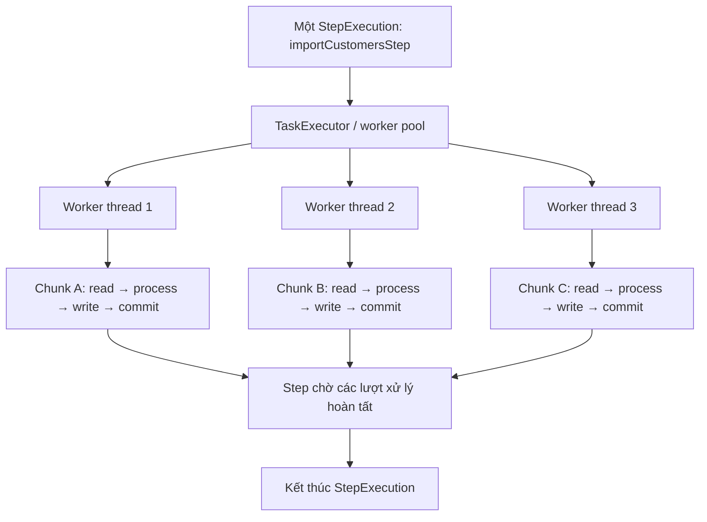
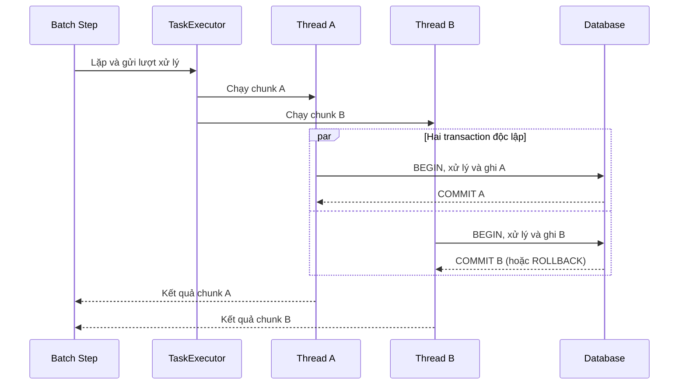

# Mỗi thread nhận một chunk riêng trong Spring Batch

> **Chương:** Local Chunking  
> **Phạm vi:** Tăng thông lượng của một chunk-oriented step trong **cùng một tiến trình** bằng `TaskExecutor`, đồng thời kiểm soát thread safety, transaction, thứ tự dữ liệu, retry/restart và giới hạn tài nguyên. Ví dụ Java sử dụng Spring Batch **5.2.x**.

## 1. Bài toán: Một step tuần tự là nút thắt

Giả sử `importCustomersStep` phải đọc 1.000.000 bản ghi từ CSV, chuẩn hóa email, tra cứu thông tin phụ trợ rồi ghi vào database. Với cấu hình `chunk(100)`, một step tuần tự thường thực hiện:

1. Đọc tối đa 100 item cho chunk hiện tại.
2. Xử lý các item và ghi những item hợp lệ.
3. Commit transaction của chunk, cập nhật trạng thái cần thiết.
4. Lặp lại đến khi hết nguồn.

Nếu một chunk mất 400 ms, khoảng 10.000 chunk sẽ cần xấp xỉ 4.000 giây cho riêng phần xử lý đó (chưa tính khởi tạo, lỗi, checkpoint và overhead). Khi nhiều chunk độc lập về nghiệp vụ và tài nguyên còn dư, có thể cho **nhiều chunk được xử lý đồng thời** để giảm thời gian chạy tổng.

Đây là **multi-threaded step**: một step dùng `TaskExecutor` để chạy các lượt xử lý chunk trên nhiều thread. Trong tài liệu này, “local chunking” chỉ cơ chế song song hóa **ngay trong JVM chạy Spring Batch**, không phải remote chunking qua message broker.

## 2. “Mỗi thread nhận một chunk riêng” nghĩa là gì?

Với mô hình tuần tự, chỉ có một chunk đang được xử lý tại một thời điểm. Với multi-threaded step, framework có thể giao các lượt công việc xử lý chunk cho các thread của executor.



**Cần hiểu chính xác:**

- **Một lượt thực thi chunk** được chạy bởi một worker thread; các chunk khác có thể chạy đồng thời ở các thread khác.
- **Một thread không bị gắn vĩnh viễn với một chunk**. Thread của pool được tái sử dụng và có thể xử lý chunk A, sau đó chunk D, chunk G...
- Các worker thuộc **cùng một `StepExecution`**; đây không phải việc tạo một `StepExecution` riêng cho mỗi chunk hoặc mỗi thread.
- `chunk(100)` chỉ là ngưỡng nhóm item vào một transaction trong cấu hình minh họa. Chunk cuối có thể ngắn hơn, và cách skip/filter/retry ảnh hưởng số item thực sự được ghi.
- Không bảo đảm “chunk 1 hoàn tất trước chunk 2” hoặc “dòng thứ 1–100 luôn ở worker 1, dòng 101–200 luôn ở worker 2”. Nếu chia sẻ một reader có con trỏ, các lời gọi `read()` giữa worker có thể **xen kẽ**; việc khóa từng lần đọc không biến đầu vào thành các dải liên tục.

Ví dụ timeline rút gọn:

```text
Thời gian  Worker-1                 Worker-2                Worker-3
t0        đọc/xử lý chunk A         đọc/xử lý chunk B        đọc/xử lý chunk C
t1        ghi & commit A            còn xử lý B              ghi & commit C
t2        nhận chunk D              ghi & commit B           nhận chunk E
t3        ghi & commit D            nhận chunk F             ghi & commit E
```

Timeline chỉ minh họa: **thứ tự commit có thể khác thứ tự lấy dữ liệu**. Đây là thuộc tính phải được nghiệp vụ chấp nhận trước khi bật đa luồng.

### So sánh với các mô hình hay bị nhầm

| Mô hình | Đơn vị chạy song song | Cách tạo công việc | Phạm vi |
| --- | --- | --- | --- |
| Multi-threaded step (local chunking) | Các lượt xử lý **chunk của cùng step** | `StepBuilder.taskExecutor(...)` | Một step, một JVM |
| Parallel steps | Các **flow/step độc lập** | `FlowBuilder.split(taskExecutor)` | Nhiều nhánh của một job |
| Local partitioning | Nhiều **StepExecution của partition** | Partition manager chia dữ liệu, worker thực thi từng partition | Một JVM |
| Remote partitioning | Các partition/step trên worker khác | Manager + kênh điều phối | Nhiều JVM/máy |
| Remote chunking | Chuyển chunk sang tiến trình xử lý khác | Messaging giữa manager và worker | Nhiều JVM/máy |

Nếu có hai quy trình độc lập “nhập khách hàng” và “tính hóa đơn”, cân nhắc **parallel steps**. Nếu có một công việc áp cùng logic lên 100 phân đoạn dữ liệu có khóa rõ ràng, **partitioning** thường dễ quản lý checkpoint hơn. Multi-threaded step phù hợp khi một step có nhiều chunk độc lập và reader/writer có thể phối hợp an toàn.

## 3. TaskExecutor điều phối chunk, transaction bảo vệ từng chunk

Trong Spring Batch 5.2, một chunk-oriented step dùng `TaskletStep`. Khi cấu hình `.taskExecutor(executor)`, cơ chế lặp xử lý chunk có thể dispatch công việc sang executor; mỗi worker thực hiện phần việc trong ngữ cảnh step.

Một chunk bình thường có ranh giới giao dịch riêng:



Điều này kéo theo các hệ quả vận hành:

- Transaction của chunk A **không gộp** với transaction chunk B. Nếu B thất bại, giao dịch đã commit của A không bị rollback tự động.
- Dữ liệu trong các chunk có thể commit **không theo thứ tự** đã đọc.
- Một exception không được phục hồi có thể làm step thất bại, nhưng các chunk khác có thể đã hoàn tất hoặc đang chạy. Không dựa vào giả định “cả step là một transaction”.
- Các thành phần reader, processor, writer có thể được gọi từ nhiều thread **trong cùng StepExecution**. Mọi state chia sẻ phải được rà soát.
- Thao tác bên ngoài transaction (HTTP API, email, ghi file khác hệ thống) không được rollback cùng JDBC transaction. Cần idempotency hoặc outbox phù hợp.

Nếu dữ liệu phụ thuộc thứ tự (running balance, thứ tự tạo đơn, đánh số bản ghi tăng dần, xử lý thay đổi cho cùng một khóa), không nên bật local chunking trực tiếp trên tập dữ liệu ấy khi chưa có chiến lược giữ thứ tự hoặc phân nhóm khóa.

## 4. Cấu hình multi-threaded step bằng ThreadPoolTaskExecutor

Ví dụ sau sử dụng Spring Batch **5.2.x**, Spring Framework, Java 17 và JDBC. Nó minh họa đầy đủ cách gắn executor vào step. Giả định trước khi chạy, database có bảng `customer_clean(id BIGINT PRIMARY KEY, email VARCHAR(...))` và file `data/customers.csv` với header `id,email`.

```java
import java.util.Locale;
import javax.sql.DataSource;

import org.springframework.batch.core.Step;
import org.springframework.batch.core.repository.JobRepository;
import org.springframework.batch.core.step.builder.StepBuilder;
import org.springframework.batch.item.ItemProcessor;
import org.springframework.batch.item.ItemStreamReader;
import org.springframework.batch.item.database.JdbcBatchItemWriter;
import org.springframework.batch.item.database.builder.JdbcBatchItemWriterBuilder;
import org.springframework.batch.item.file.FlatFileItemReader;
import org.springframework.batch.item.file.builder.FlatFileItemReaderBuilder;
import org.springframework.batch.item.support.builder.SynchronizedItemStreamReaderBuilder;
import org.springframework.beans.factory.annotation.Qualifier;
import org.springframework.context.annotation.Bean;
import org.springframework.context.annotation.Configuration;
import org.springframework.core.io.FileSystemResource;
import org.springframework.jdbc.core.namedparam.MapSqlParameterSource;
import org.springframework.scheduling.concurrent.ThreadPoolTaskExecutor;
import org.springframework.transaction.PlatformTransactionManager;

@Configuration(proxyBeanMethods = false)
public class LocalChunkingConfig {

    public record InputCustomer(long id, String email) {}
    public record CleanCustomer(long id, String email) {}

    public static class InvalidCustomerException extends RuntimeException {
        public InvalidCustomerException(String message) {
            super(message);
        }
    }

    @Bean
    public ThreadPoolTaskExecutor localChunkExecutor() {
        ThreadPoolTaskExecutor executor = new ThreadPoolTaskExecutor();
        executor.setCorePoolSize(4);
        executor.setMaxPoolSize(4);
        executor.setQueueCapacity(16);
        executor.setThreadNamePrefix("batch-chunk-");
        return executor; // Spring khởi tạo và quản lý vòng đời bean này.
    }

    @Bean
    public ItemStreamReader<InputCustomer> customerReader() {
        FlatFileItemReader<InputCustomer> delegate =
                new FlatFileItemReaderBuilder<InputCustomer>()
                        .name("customerCsvReader")
                        .resource(new FileSystemResource("data/customers.csv"))
                        .linesToSkip(1)
                        .delimited()
                        .names("id", "email")
                        .fieldSetMapper(fs -> new InputCustomer(
                                fs.readLong("id"),
                                fs.readString("email")))
                        .build();

        // Chỉ serialize thao tác read() trên reader stateful này.
        return new SynchronizedItemStreamReaderBuilder<InputCustomer>()
                .delegate(delegate)
                .build();
    }

    @Bean
    public ItemProcessor<InputCustomer, CleanCustomer> customerProcessor() {
        // Processor không giữ state giữa các item.
        return source -> {
            String email = source.email();
            if (email == null || !email.contains("@")) {
                throw new InvalidCustomerException(
                        "Invalid email for customer id=" + source.id());
            }
            return new CleanCustomer(
                    source.id(),
                    email.trim().toLowerCase(Locale.ROOT));
        };
    }

    @Bean
    public JdbcBatchItemWriter<CleanCustomer> customerWriter(
            DataSource dataSource) {
        return new JdbcBatchItemWriterBuilder<CleanCustomer>()
                .dataSource(dataSource)
                .sql("INSERT INTO customer_clean (id, email) VALUES (:id, :email)")
                .itemSqlParameterSourceProvider(item ->
                        new MapSqlParameterSource("id", item.id())
                                .addValue("email", item.email()))
                .build();
    }

    @Bean
    public Step importCustomersStep(
            JobRepository jobRepository,
            PlatformTransactionManager transactionManager,
            @Qualifier("customerReader")
                    ItemStreamReader<InputCustomer> reader,
            ItemProcessor<InputCustomer, CleanCustomer> processor,
            JdbcBatchItemWriter<CleanCustomer> writer,
            @Qualifier("localChunkExecutor")
                    ThreadPoolTaskExecutor taskExecutor) {

        return new StepBuilder("importCustomersStep", jobRepository)
                .<InputCustomer, CleanCustomer>chunk(100, transactionManager)
                .reader(reader)
                .processor(processor)
                .writer(writer)
                .faultTolerant()
                .skip(InvalidCustomerException.class)
                .skipLimit(10)
                .taskExecutor(taskExecutor)
                .build();
    }
}
```

**Đọc cấu hình theo những điểm quyết định:**

1. `chunk(100, transactionManager)` nhóm tối đa 100 item theo lần xử lý chunk, với transaction manager do ứng dụng cấp.
2. `.taskExecutor(taskExecutor)` bật xử lý chunk đa luồng **trong step**; không cần `split` hay tạo nhiều step trùng nhau.
3. `localChunkExecutor` giới hạn pool tối đa **4 worker**. Queue giúp giữ task chờ khi pool bận; không tự tăng tốc nếu nút thắt ở DB hoặc reader.
4. `SynchronizedItemStreamReader` đồng bộ các lời gọi `read()` của `FlatFileItemReader`, vì reader file có con trỏ và không nên để nhiều thread đọc tự do.
5. Processor trả về đối tượng mới và không sửa dữ liệu dùng chung. Writer dùng đối tượng được cấu hình sau khởi tạo và JDBC batch; cần bảo đảm dữ liệu không trùng khóa, transaction hoạt động đúng.
6. `skipLimit(10)` minh họa giới hạn lỗi nghiệp vụ; lỗi khác (ví dụ database không kết nối) không tự được skip. Số skip trong thực tế có thể thay đổi giữa các lượt chạy vì thứ tự xử lý không cố định.

**Ranh giới của ví dụ:** `customerReader` được khai báo singleton cho một cấu hình minh họa; **không dùng cùng reader instance cho hai JobExecution đang chạy đồng thời**. Trong hệ thống thực tế, hãy tạo reader riêng theo lượt step (ví dụ thiết kế step-scoped reader đã kiểm chứng với mô hình threading) hoặc chọn partitioning với mỗi partition có reader và vùng dữ liệu riêng. Ví dụ cũng không bảo đảm restart chính xác khi reader stateful bị dùng đồng thời: phần 7 phân tích giới hạn này.

**Lưu ý phiên bản:** API `.taskExecutor(...)` thuộc `StepBuilder`/chunk step Spring Batch 5.2. Cơ chế điều tiết số lượt xử lý cùng lúc có một **throttle limit** nội bộ trong các phiên bản Batch 5.x (mặc định thường là 4); API `.throttleLimit(...)` đã được đánh dấu *deprecated* từ Batch 5.0. Nếu cần vượt giới hạn này, phải thiết kế `RepeatOperations` riêng và cấu hình thông qua `stepOperations` theo tài liệu phiên bản đang dùng, thay vì chỉ tăng `maxPoolSize` và mặc định sẽ có thêm concurrency.

## 5. Thread safety: Các thành phần có thể bị truy cập đồng thời

Sự an toàn của multi-threaded step phụ thuộc vào **mỗi thành phần**. Một executor đúng không làm reader/processor/writer tự trở nên thread-safe.

| Thành phần | Lỗi thường gặp | Hướng xử lý |
| --- | --- | --- |
| `FlatFileItemReader`, `JdbcCursorItemReader` có con trỏ | Hai thread đổi vị trí đọc, mất hoặc trùng item | Serialize `read()` khi phù hợp; ưu tiên reader độc lập theo partition cho dữ liệu lớn |
| Processor singleton chứa `int count`, `ArrayList` tạm | Race condition, mất đếm, lẫn kết quả | Viết processor stateless; dùng biến cục bộ hoặc immutable object |
| Writer giữ buffer/state mutable chung | Ghi trùng, đảo thứ tự, buffer bị xóa bất ngờ | Chọn writer hỗ trợ concurrent use; tránh buffer mutable chia sẻ; kiểm tra DB constraint |
| `ExecutionContext` bị cập nhật bởi nhiều thread | Checkpoint không khớp các commit đã xảy ra | Xác định giới hạn restart; tách state theo partition khi cần |
| Connection pool | Hết connection, các chunk chờ nhau | Giới hạn pool chunk và để dư connection cho JobRepository/công việc khác |
| Bảng dữ liệu và khóa nghiệp vụ | Row lock, deadlock, unique key conflict | Phân vùng khóa, transaction ngắn, idempotent write và retry có điều kiện |
| Remote API/rate limit | Đột biến lưu lượng và bị từ chối | Semaphore, quota, timeout, backoff và retry theo lỗi tạm thời |

### SynchronizedItemStreamReader giải quyết tới đâu?

`SynchronizedItemStreamReader` bảo vệ **mỗi lời gọi `read()`** trên delegate, nhờ đó reader stateful không bị hai thread đọc trực tiếp cùng lúc. Nó **không**:

- khóa cả chuỗi `read → process → write → commit`;
- biến các item đã đọc thành các đoạn liên tục theo thread;
- bảo đảm thứ tự ghi và thứ tự commit;
- giúp writer hoặc processor khác trở nên thread-safe;
- tự bảo đảm restart chính xác khi checkpoint được cập nhật xen kẽ với chunk đã commit.

Vì chỉ một thread được vào `read()` tại một thời điểm, reader có thể trở thành **điểm nghẽn mới**. Nếu một lần đọc mất 20 ms và processor chỉ mất 2 ms, thêm thread không giải quyết được phần lớn thời gian đọc.

### Tại sao `@StepScope` không tự giải quyết mọi vấn đề?

`@StepScope` giúp cấp bean theo `StepExecution`, hữu ích để tách state **giữa các lần chạy step** và dùng tham số job. Nhưng trong multi-threaded step, các chunk vẫn thuộc **cùng một `StepExecution`**, nên các thread có thể cùng dùng một bean step-scoped. Vì vậy scope không tự tạo một reader riêng cho mỗi chunk/thread.

Không đặt `currentItem`, `lastCustomerId` hay mutable list vào field của singleton processor rồi trông chờ các thread “tự có bản sao”. Thông tin tạm thời của một item/chunk nên là biến cục bộ, còn trạng thái phục vụ restart phải có hợp đồng rõ ràng.

## 6. Thứ tự, tính nhất quán và idempotency

Một batch tuần tự thường khiến ta **vô thức** dựa vào thứ tự nguồn. Local chunking làm giả định đó không còn đúng.

Ví dụ đầu vào có ba sự kiện của cùng tài khoản:

```text
1. balance(account=42, amount=100)
2. withdraw(account=42, amount=20)
3. deposit(account=42, amount=10)
```

Nếu commit chunk chứa bước 3 trước chunk chứa bước 2, hệ thống có thể cho kết quả sai nếu nghiệp vụ phụ thuộc thứ tự. Giải pháp không chỉ là đổi số thread. Cần giữ mọi sự kiện của cùng tài khoản trong chuỗi xử lý có thứ tự, hoặc thiết kế thao tác giao dịch độc lập có điều kiện kiểm soát optimistic locking/version.

Trường hợp thích hợp hơn cho local chunking là **chuẩn hóa mỗi khách hàng độc lập rồi upsert theo customer ID**. Dù chunk hoàn thành khác thứ tự, kết quả cuối vẫn đúng nếu dữ liệu nguồn không chứa xung đột cùng khóa và output có unique key.

Ba quy tắc giúp giảm rủi ro:

1. **Định danh ổn định:** Mỗi item có `sourceId`/`businessKey` độc lập với thread và thứ tự xử lý.
2. **Ghi có thể lặp lại:** Dùng unique constraint, upsert có điều kiện hoặc idempotency key khi nghiệp vụ cho phép; đừng giả định không bao giờ retry/restart.
3. **Tách side effect:** Các hoạt động ngoài transaction (gửi mail, gọi API thu phí) cần outbox hoặc cơ chế chống lặp; không đặt hành động khó đảo ngược trong processor mà không có bảo vệ.

Lưu ý: SQL `INSERT` trong ví dụ phần 4 sẽ báo lỗi khi cùng ID đã tồn tại. Đó là cách trình bày dễ thấy hành vi lỗi, **chưa phải một chiến lược idempotent production**. Cần thay bằng upsert/merge phù hợp database và chính sách chống ghi đè của nghiệp vụ.

## 7. Retry, skip, rollback và restart khi nhiều chunk đồng thời

Với một chunk gặp exception, Spring Batch áp dụng cấu hình fault tolerance của step ở pha lỗi tương ứng. Tuy nhiên, các chunk khác có transaction riêng, do đó trạng thái của toàn step không thể coi là atomic.

| Tình huống | Điều có thể xảy ra | Điều cần kiểm chứng |
| --- | --- | --- |
| Chunk A commit, chunk B gặp lỗi fatal | A vẫn đã commit; B rollback và step có thể FAILED | Database không trùng/mất dữ liệu sau lần chạy lại |
| Chunk B được retry | Item/chunk B có thể được xử lý lại; chunk khác vẫn đang chạy | Processor/writer và side effect idempotent |
| Lỗi dữ liệu được skip | Item lỗi có thể bị bỏ qua theo skip policy, không ngăn các item khác hoàn thành | Skip count và ngưỡng chất lượng toàn step |
| Ứng dụng dừng giữa nhiều chunk | Có chunk đã commit và chunk đang chạy/chưa commit | Checkpoint reader và JobRepository phản ánh đủ tiến độ hay không |
| Restart một StepExecution lỗi | Spring Batch tạo lượt StepExecution mới trong cùng JobInstance | Mỗi item đã commit có bị đọc/ghi lại hoặc bị bỏ sót không |

**Thách thức lớn với reader có state:** giả sử chunk A đọc bản ghi 1–100, chunk B đọc 101–200, nhưng B commit trước A. Một checkpoint đọc đã tiến đến 200 không tự chứng minh cả 1–200 đã commit. Khi lỗi và restart, có thể xuất hiện **đọc lại hoặc bỏ sót** nếu reader/checkpoint không thiết kế cho commit lệch thứ tự. Trên reader chia sẻ được khóa từng lần đọc, các item còn có thể xen kẽ phức tạp hơn.

Do đó:

- Không khẳng định `SynchronizedItemStreamReader` bảo đảm restart: nó giải quyết đồng bộ **đọc**, không giải quyết nguyên tử giữa tiến độ reader và mọi chunk.
- Cần thử nghiệm **kill/restart ở các thời điểm bất kỳ**, không chỉ happy path. Đối chiếu ID đầu vào và đầu ra để phát hiện thiếu/trùng.
- Với yêu cầu **exactly-once** hoặc không cho phép thiếu/trùng nghiêm ngặt, xem xét partitioning theo khóa/range bất biến, reader riêng từng partition và writer idempotent; vẫn phải kiểm thử khôi phục trong điều kiện lỗi.
- Không dùng `saveState(false)` như cách “sửa” checkpoint mà không đánh giá lại yêu cầu restart: tắt lưu state có thể phù hợp với nguồn replayable/idempotent, nhưng không còn khả năng tiếp tục theo checkpoint cũ.

Một lệnh restart JobInstance thất bại **không tự rollback** dữ liệu các chunk đã commit. Cần điều phối với transaction của hệ thống đích và chính sách khôi phục dữ liệu.

## 8. Kích thước chunk, pool và tài nguyên thực tế

Ba tham số liên quan nhưng độc lập:

- **`chunkSize`**: số item được gom xử lý/ghi theo một lượt transaction (ví dụ 100).
- **Độ đồng thời thực**: số chunk có thể đang xử lý tại một thời điểm; bị giới hạn bởi executor **và cơ chế throttle của step**.
- **Tài nguyên downstream**: connection pool, giới hạn API, CPU, bộ nhớ, disk I/O, lock DB, kích thước transaction.

Nếu có 4 chunk cùng lúc, mỗi chunk giữ khoảng 100 input item, hệ thống có thể có khoảng 400 item đang được giữ trong các chunk, chưa tính buffer của reader/writer, queue và các bản sao trung gian. Số này là xấp xỉ; kích thước object và cách retry làm mức sử dụng bộ nhớ thực tế khác đi.

```text
Throughput = số item được ghi thành công / thời gian xử lý

Speedup = thời gian chạy tuần tự / thời gian chạy đa luồng

T_parallel ≈ (tổng khối lượng công việc có thể song song / concurrency hiệu dụng)
             + overhead + phần tuần tự + thời gian chờ tài nguyên
```

Đây là mô hình để đặt giả thuyết; không phải công thức dự báo chính xác, vì DB lock, queue wait và contention biến đổi theo tải.

Ví dụ bảng đo giả định trên cùng một tập dữ liệu:

| Worker hiệu dụng | Chunk size | Thời gian | Item ghi/giây | Nhận xét |
| ---: | ---: | ---: | ---: | --- |
| 1 | 100 | 400 s | 2.500 | Baseline |
| 2 | 100 | 225 s | 4.444 | Có cải thiện |
| 4 | 100 | 135 s | 7.407 | Tăng khá tốt |
| 8 | 100 | 160 s | 6.250 | DB/connection pool bắt đầu tranh chấp |

Các số trên chỉ minh họa xu hướng. Nếu chỉ tăng `maxPoolSize` lên 8 mà vẫn bị throttle tại 4, kết quả đo có thể **không đổi**. Nếu tăng số worker và `read()` bị khóa lâu, phần đọc sẽ chiếm critical path.

### Quy trình chọn cấu hình

1. Đo **baseline tuần tự** với lượng dữ liệu và điều kiện DB tương đương.
2. Chọn chunk size dựa trên chi phí transaction, kích thước item, giới hạn bộ nhớ và yêu cầu rollback; bắt đầu từ giá trị có thể quan sát được như 100.
3. Tăng concurrency hiệu dụng theo nấc 1 → 2 → 4; đo lại throughput, p95 chunk duration, số lần rollback và thời gian DB wait.
4. Kiểm tra connection pool còn đủ cho **cả JobRepository, step và ứng dụng khác**; không cấp toàn bộ connection cho các worker.
5. Đo tốc độ `read()` được serialize, thời gian `process()`, thời gian `write()`; xác định nút thắt trước khi quyết định tăng pool hay đổi kiến trúc.
6. Thử lỗi DB, retry, kill/restart và so sánh toàn bộ khóa nguồn với dữ liệu đích trước khi đưa vào production.

## 9. Quan sát log và metadata khi chunk chạy trên nhiều thread

Các worker có thể cùng thuộc một `StepExecution`; `stepExecutionId` **giống nhau** trong log của chúng. Để phân biệt công việc đang diễn ra, ghi thêm thread name, chunk context/correlation ID có phạm vi thích hợp, nhưng không dùng tên thread thay cho khóa nghiệp vụ.

```text
10:01:00.110 INFO [batch-chunk-1] stepExecutionId=712 - read/process chunk
10:01:00.120 INFO [batch-chunk-2] stepExecutionId=712 - read/process chunk
10:01:00.410 INFO [batch-chunk-2] stepExecutionId=712 - chunk committed
10:01:00.540 INFO [batch-chunk-1] stepExecutionId=712 - chunk committed
```

Các log trên chỉ là ví dụ. Trong ứng dụng thật, MDC/trace context phải được gắn **trên thread thực thi chunk** rồi dọn sạch sau khi chunk kết thúc; `TaskExecutor` không tự bảo đảm chuyển toàn bộ ThreadLocal từ thread gọi step.

`StepExecution` có các chỉ số như `readCount`, `writeCount`, `filterCount`, `readSkipCount`, `processSkipCount`, `writeSkipCount`, `commitCount`, `rollbackCount`. Chúng là chỉ số **tổng hợp của step**, không có nghĩa một counter riêng cho mỗi thread. Không tự sửa các counter này từ code nghiệp vụ.

Khi vận hành, nên theo dõi:

| Chỉ số | Ý nghĩa |
| --- | --- |
| Job/Step elapsed time | Thời gian toàn step; mục tiêu trực tiếp của tuning |
| Successful items/s | Throughput thực, tránh “nhanh” do skip quá nhiều |
| Executor active threads và queue depth | Có thật sự dùng nhiều worker hay chỉ xếp hàng |
| DB active/idle/pending connections | Có hết connection hoặc gây áp lực lên database không |
| Read/process/write latency | Pha nào đang giữ critical path |
| Lock wait, deadlock, timeout, retry | Dấu hiệu tranh chấp tăng khi song song |
| Commit/rollback/skip count | Tính ổn định, chất lượng dữ liệu và chi phí phục hồi |
| Memory/GC, disk I/O | Chỉ ra tình huống chunk size/concurrency quá lớn |

Không dùng `stepExecutionId` làm **nhãn time series Prometheus** vì số giá trị tăng theo mỗi lượt chạy. Giữ ID trong log/tracing; metric nên dùng các nhãn có cardinality thấp như job name, step name, status.

## 10. Lỗi thường gặp và cách xử lý

| Triệu chứng | Nguyên nhân điển hình | Hướng điều tra |
| --- | --- | --- |
| Tăng pool nhưng chỉ có 4 chunk hoạt động | Throttle của step đang giới hạn | Kiểm tra concurrency hiệu dụng và API `RepeatOperations` của phiên bản |
| Dữ liệu thiếu hoặc trùng | Reader chia sẻ không an toàn, restart/checkpoint lệch commit | Đối chiếu khóa nguồn/đích; dùng reader riêng theo partition hoặc đồng bộ đúng phạm vi |
| Output đảo thứ tự | Các chunk commit khác thứ tự | Đổi mô hình nếu thứ tự có ý nghĩa; không dựa vào order khi ghi |
| `ConcurrentModificationException` | Processor/writer sửa chung collection mutable | Thiết kế component stateless và dữ liệu riêng từng item |
| Job chậm hơn sau đa luồng | Reader bị serialize, DB lock, I/O/connection pool nghẽn | Phân rã thời gian theo read/process/write; đo DB waits |
| DB báo deadlock hoặc unique conflict | Hai chunk cùng thao tác khóa nghiệp vụ | Phân vùng khóa/thiết kế upsert, giảm contention, retry có giới hạn |
| Restart sai dữ liệu dù đã đồng bộ reader | Con trỏ đọc và thứ tự commit không đồng nhất | Dùng partition có checkpoint độc lập; kiểm thử kill/restart |
| Chạy nhiều JobExecution làm lẫn reader | Bean singleton reader stateful bị tái sử dụng | Tách instance theo step execution và kiểm soát lịch chạy đồng thời |
| Log worker thiếu step ID | MDC không được truyền vào thread xử lý | Gắn context ở listener/wrapper trên worker và `finally` dọn MDC |

## 11. Khi nào không nên dùng local chunking?

**Không nên bật multi-threaded step chỉ vì input lớn.** Quyết định cần xuất phát từ tính độc lập của item/chunk và khả năng bảo đảm dữ liệu:

| Đặc điểm workload | Phương án nên đánh giá trước |
| --- | --- |
| Từng item độc lập, CPU/IO còn dư, reader/writer thread-safe | Multi-threaded step với pool giới hạn |
| Reader file/cursor stateful, cần checkpoint/restart mạnh | Partitioning với dải/khóa đầu vào ổn định và reader riêng |
| Dữ liệu phải xử lý theo thứ tự từng account/aggregate | Xử lý tuần tự theo key hoặc partition có thứ tự **trong từng key** |
| Nhiều nhánh nghiệp vụ không phụ thuộc | Parallel steps bằng `split` |
| Một JVM không đủ CPU/memory | Remote partitioning hoặc remote chunking với giao thức idempotent |
| DB đã bão hòa, CPU batch còn rảnh | Tối ưu truy vấn/index, batch insert, connection pool, giảm contention trước khi tăng thread |

Local chunking có ưu điểm là cấu hình tương đối gọn và tận dụng tài nguyên cùng JVM. Đổi lại, những thành phần stateful và logic restart đòi hỏi kiểm chứng cẩn thận hơn khi các chunk chia sẻ `StepExecution`.

## 12. Thực hành kiểm chứng “mỗi thread nhận một chunk”

**Bài 1 — Quan sát mức đồng thời.** Chạy step có `chunk(50)`, pool 4 worker và processor mô phỏng thao tác I/O có thời gian chờ ngắn. Log `stepExecutionId`, thread name, thời điểm chunk bắt đầu/commit. Kiểm tra có nhiều chunk chạy chồng lấp và một thread xử lý nhiều chunk qua thời gian.

**Bài 2 — Thử thay đổi tham số.** Giữ nguyên 50.000 item, lần lượt chạy với concurrency hiệu dụng 1, 2, 4 và với chunk size 50, 200. Ghi lại throughput, thời gian, CPU, DB waits, rollback, memory; tìm cấu hình cho kết quả tốt mà vẫn ổn định.

**Bài 3 — Kiểm tra reader stateful.** Dùng `FlatFileItemReader` không đồng bộ và quan sát vấn đề tiềm ẩn dưới tải; sau đó dùng `SynchronizedItemStreamReader`. So sánh tính đầy đủ của ID đầu ra và throughput. Không suy ra rằng đồng bộ reader đã giải quyết được restart.

**Bài 4 — Failure/restart.** Chủ động làm writer thất bại ở một chunk sau khi các chunk khác có thể commit. Restart đúng JobInstance và so sánh tập ID đầu vào/đầu ra sau cùng, kiểm tra ID thiếu/trùng. Nếu mô hình hiện tại không bảo đảm, đề xuất chuyển sang partitioning theo range/key.

**Bài 5 — Tranh chấp tài nguyên.** Giới hạn database pool thấp hơn nhu cầu đồng thời, đo timeout/queue wait. Điều chỉnh pool step và DB pool, kết luận bottleneck dựa trên số liệu, không chỉ số thread.

### Tiêu chí đạt

- [ ] Giải thích được khác nhau giữa **thread**, **chunk**, **transaction** và **StepExecution**.
- [ ] Xác nhận bằng log rằng các chunk chạy chồng lấp và có thể commit lệch thứ tự.
- [ ] Phân biệt `.taskExecutor(...)` của step với `.split(executor)` của flow.
- [ ] Reader/processor/writer đáp ứng yêu cầu thread safety hoặc đã chọn mô hình khác.
- [ ] Có phương án kiểm soát duplicate/rollback/restart và đã kiểm chứng khi lỗi thực tế.
- [ ] Quyết định concurrency dựa trên throughput, DB connection, I/O, lock wait và thời gian phục hồi.

## 13. Tài liệu tham khảo chính thức

- [Spring Batch 5.2 — Scaling and Parallel Processing](https://docs.spring.io/spring-batch/reference/5.2/scalability.html)
- [Spring Batch — Multi-threaded Step](https://docs.spring.io/spring-batch/reference/scalability.html)
- [Spring Batch — SynchronizedItemStreamReader](https://docs.spring.io/spring-batch/docs/5.2.1/api/org/springframework/batch/item/support/SynchronizedItemStreamReader.html)
- [Spring Batch — TaskletStep và chunk-oriented processing](https://docs.spring.io/spring-batch/reference/step/chunk-oriented-processing.html)
- [Spring Framework — ThreadPoolTaskExecutor](https://docs.spring.io/spring-framework/docs/current/javadoc-api/org/springframework/scheduling/concurrent/ThreadPoolTaskExecutor.html)
- [Spring Batch — Configuring a Step for Restart](https://docs.spring.io/spring-batch/reference/step/chunk-oriented-processing/restart.html)

> **Phạm vi phiên bản:** Các import và ví dụ `StepBuilder`, `FlatFileItemReaderBuilder`, `SynchronizedItemStreamReaderBuilder` ở đây nhắm Spring Batch **5.2.x**. Spring Batch 6 có thể thay đổi package và cơ chế cấu hình điều phối; cần đối chiếu API của phiên bản ứng dụng khi nâng cấp.

**Ghi nhớ:** Trong multi-threaded step, executor phân phối **các lượt xử lý chunk** cho thread của một pool; các chunk thuộc cùng `StepExecution` nhưng có transaction riêng và có thể commit khác thứ tự. Chỉ mở rộng an toàn khi reader/processor/writer được thiết kế đúng cho đồng thời, kết quả có thể kiểm chứng, restart được thử nghiệm và tài nguyên downstream thực sự còn dư.
