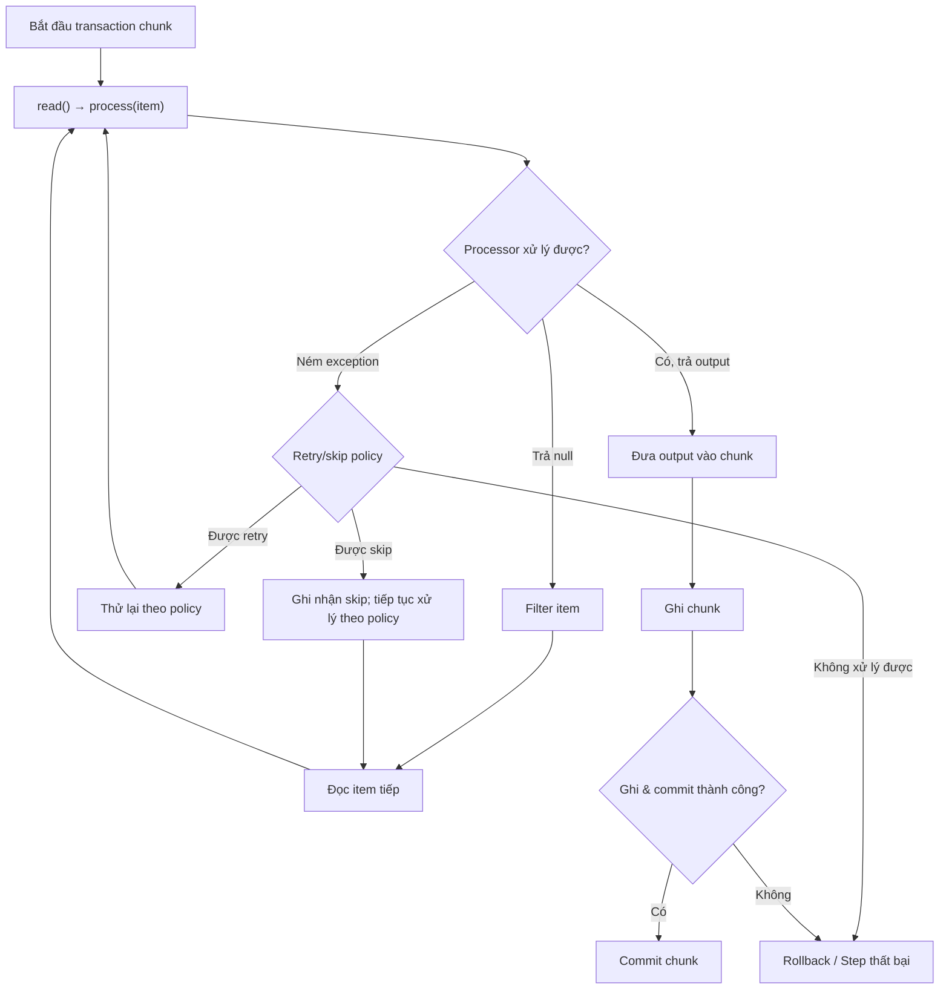
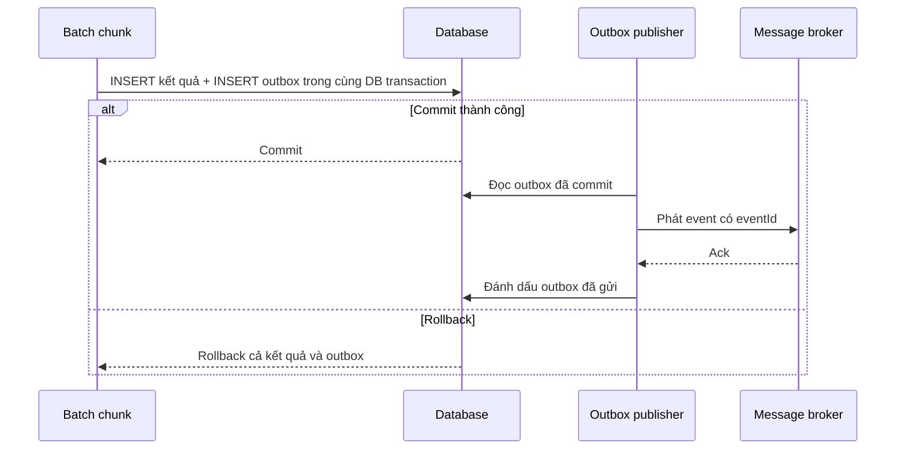
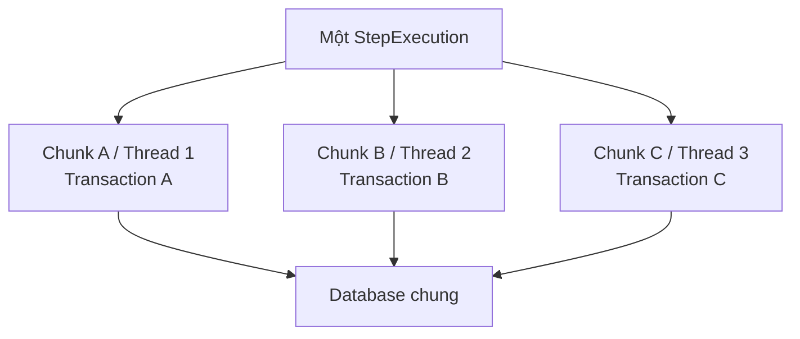

# Transaction của chunk processor trong Spring Batch

Khi xây dựng một **chunk-oriented Step**, Spring Batch thường đọc nhiều item, xử lý từng item bằng `ItemProcessor`, sau đó ghi cả chunk bằng `ItemWriter`. Trong cấu hình xử lý chunk đồng bộ thông thường, **`process(item)` chạy bên trong transaction bao quanh chunk**, cùng luồng với thao tác đọc và ghi. Điều này **không có nghĩa mỗi lần `process()` có một transaction riêng**, cũng không có nghĩa mọi side effect do processor tạo ra sẽ được rollback.

Hiểu đúng ranh giới transaction là điều kiện để mở rộng Spring Batch cho workload lớn bằng multi-threaded step, parallel steps, partitioning và worker phân tán mà vẫn giữ được tính đúng đắn khi lỗi. Một job chạy nhanh hơn nhưng gửi thông báo trùng, trừ tiền hai lần hoặc bỏ sót item khi restart chưa thể coi là mở rộng thành công.

Bài này thuộc chương **Local Chunking**, module **SPRING_BATCH_SCALING_OPERATIONS**. Sau khi học, bạn có thể:

- Xác định transaction bắt đầu và kết thúc ở đâu trong một chunk, phân biệt callback với commit.
- Giải thích vì sao processor có thể được gọi lại khi retry, skip, rollback hoặc restart.
- Thiết kế processor thuần dữ liệu, writer chịu được ghi lặp và ranh giới side effect phù hợp.
- Kiểm tra thread safety và transaction khi nhiều chunk hoặc partition thực thi đồng thời.
- Đo, kiểm thử và vận hành chunk processing ở trạng thái bình thường lẫn khi có lỗi.

## 1. Một chunk có một ranh giới transaction chính

Giả sử Step dùng `chunk(100, transactionManager)`, không có filter, skip hoặc retry. Một chunk đọc 100 item, gọi processor trên từng item và chuyển 100 kết quả sang writer.

```mermaid
sequenceDiagram
    participant S as Chunk-oriented Step
    participant TM as TransactionManager
    participant R as ItemReader
    participant P as ItemProcessor
    participant W as ItemWriter
    participant DB as Database
    S->>TM: Begin transaction cho chunk
    loop Tối đa 100 item (hoặc đến EOF)
        S->>R: read()
        R-->>S: item
        S->>P: process(item)
        P-->>S: processed item / null
    end
    S->>W: write(Chunk<output>)
    W->>DB: INSERT / UPDATE / batch statement
    DB-->>W: Kết quả lệnh ghi
    S->>TM: Cập nhật checkpoint/metadata phù hợp; commit
    TM-->>S: Commit thành công
    Note over S,DB: Chunk tiếp theo dùng transaction riêng
```

Các điểm cần phân biệt:

1. `ItemReader.read()` và `ItemProcessor.process()` trong chu trình chunk thông thường được gọi **trong phạm vi thao tác chunk có transaction**.
2. Processor được gọi **theo item**, nhưng chúng không tự có transaction độc lập theo item. Toàn bộ chunk có cùng ranh giới commit chính.
3. `ItemWriter.write(...)` nhận một chunk kết quả; với cách dùng transaction manager và resource đúng, thao tác ghi DB sẽ tham gia transaction của chunk.
4. Commit xảy ra **sau** khi writer trả về và các bước checkpoint cần thiết được thực hiện. Writer trả về không có nghĩa dữ liệu chắc chắn đã commit.
5. Khi không đủ 100 item vì hết nguồn, chunk cuối có thể nhỏ hơn 100. Nếu processor trả `null`, item bị filter nên số output đưa cho writer có thể nhỏ hơn số item đọc.
6. Một job gồm nhiều chunk sẽ có **nhiều transaction**; Spring Batch không mở một transaction dài bao trùm toàn bộ job theo mặc định.

Điều kiện “cùng transaction” phụ thuộc resource, cấu hình transaction manager và thread. Nếu processor gọi HTTP, ghi file hoặc thao tác trên database khác mà không tham gia cùng transaction, những side effect đó **không tự động** được rollback khi transaction của chunk rollback.

### Ví dụ số lượng

Một chunk đọc 100 đơn hàng. Trong đó 8 đơn bị filter (`process()` trả `null`), 92 đơn được đưa vào writer.

| Số liệu | Giá trị trong ví dụ |
| --- | ---: |
| Lượt đọc trả về item của chunk | 100 |
| Lượt gọi processor ban đầu | 100 |
| Số item bị filter | 8 |
| Số item đưa tới writer | 92 |
| Số lần gọi writer ở đường thành công đơn giản | 1 |
| Số lần commit transaction cho chunk | 1 |

Nếu writer lỗi và framework thực hiện retry hoặc rollback, **số lần gọi processor/writer thực tế có thể lớn hơn** các con số đường thành công. Không dùng số lần callback để kết luận có bao nhiêu item đã commit.

## 2. Phân biệt bốn loại công việc bên trong process()

Một processor thực tế có thể thực hiện nhiều việc. Tính rollback của chúng không giống nhau.

| Việc trong `process()` | Khi chunk rollback | Điều cần làm |
| --- | --- | --- |
| Chuyển đổi giá trị, tính toán trên object bất biến | Kết quả của lần thử có thể bị bỏ; tính lại thường an toàn | Ưu tiên phép biến đổi tất định, không side effect |
| Đọc dữ liệu qua cùng transaction/resource được cấu hình | Quy tắc isolation/transaction áp dụng; thao tác đọc đã diễn ra không thể “chưa từng tốn thời gian” | Theo dõi truy vấn, timeout, isolation và cache |
| Cập nhật DB bằng connection tham gia đúng transaction chunk | Thay đổi DB thông thường bị rollback nếu transaction rollback | Kiểm chứng thực tế transaction manager, datasource và propagation |
| Gọi HTTP, gửi Kafka/message, ghi file, gửi email, cập nhật hệ khác | Thường **không** được rollback chỉ vì transaction DB rollback | Di chuyển side effect sang cơ chế bền vững, idempotent hoặc outbox |

Một `@Transactional` trên method service mà processor gọi **không tạo sự nhất quán xuyên mọi hệ thống**. Nếu service được gọi qua Spring proxy và dùng `Propagation.REQUIRED` cùng transaction manager/resource thích hợp, nó thường tham gia transaction đang tồn tại. `REQUIRES_NEW` lại tạo transaction riêng; việc commit của transaction mới có thể tồn tại dù chunk bên ngoài rollback.

Trong lập trình phân tán, không có một local JDBC transaction bao phủ mặc định cả database, broker và API bên ngoài. Thiết kế phải phản ánh đúng các ranh giới tài nguyên.

## 3. Processor lý tưởng: tính toán tất định và không side effect

Processor dễ retry nhất là processor thuần dữ liệu: nhận item, xác thực, biến đổi, trả item mới hoặc `null` để filter.

```java
import java.math.BigDecimal;
import java.math.RoundingMode;
import java.util.Objects;
import org.springframework.batch.item.ItemProcessor;

public record RawOrder(long id, String tenant, BigDecimal amount) {}
public record ReadyOrder(long id, String tenant, BigDecimal amount) {}

public final class NormalizeOrderProcessor
        implements ItemProcessor<RawOrder, ReadyOrder> {

    @Override
    public ReadyOrder process(RawOrder source) {
        Objects.requireNonNull(source);

        if (source.amount() == null || source.amount().signum() < 0) {
            throw new InvalidOrderException("Invalid amount: " + source.id());
        }
        if (source.amount().signum() == 0) {
            return null; // Filter: không chuyển item này đến writer.
        }

        return new ReadyOrder(
                source.id(),
                source.tenant(),
                source.amount().setScale(2, RoundingMode.HALF_UP)
        );
    }
}

public final class InvalidOrderException extends RuntimeException {
    public InvalidOrderException(String message) {
        super(message);
    }
}
```

Ví dụ cần đặt các kiểu `public` vào file Java phù hợp khi tích hợp dự án thực tế; chúng được đặt cùng nhau để minh họa.

**Vì sao mẫu này phù hợp với transaction của chunk?**

- Không thay đổi shared mutable state nên nhiều thread có thể gọi processor cùng lúc nếu các dependency khác cũng an toàn.
- Xử lý lại cùng `RawOrder` cho cùng `ReadyOrder`, nên phù hợp khi framework retry hoặc restart.
- Trả `null` có ngữ nghĩa **filter**, không phải lỗi cần rollback.
- Ném `InvalidOrderException` cho đầu vào không hợp lệ, để fault-tolerant Step có thể quyết định fail/skip theo chính sách.

Một processor dùng `AtomicLong` để đếm callback có thể thread-safe cho phép cộng, nhưng tổng đó vẫn có thể tăng nhiều lần trên cùng item khi retry, không được rollback cùng DB và mất khi restart. Không sử dụng counter in-memory làm số item đã commit.

## 4. Cấu hình transaction bằng chunk(..., transactionManager)

Mẫu dưới dùng Spring Batch 5+ theo cấu hình Java. Để tập trung vào ranh giới transaction, giả sử có reader và writer đã được định nghĩa thành bean với contract phù hợp, và transaction manager quản lý datasource được writer sử dụng.

```java
import org.springframework.batch.core.Step;
import org.springframework.batch.core.repository.JobRepository;
import org.springframework.batch.core.step.builder.StepBuilder;
import org.springframework.batch.item.ItemProcessor;
import org.springframework.batch.item.ItemReader;
import org.springframework.batch.item.ItemWriter;
import org.springframework.context.annotation.Bean;
import org.springframework.transaction.PlatformTransactionManager;

@Bean
public Step normalizeOrdersStep(
        JobRepository jobRepository,
        PlatformTransactionManager transactionManager,
        ItemReader<RawOrder> orderReader,
        ItemProcessor<RawOrder, ReadyOrder> orderProcessor,
        ItemWriter<ReadyOrder> orderWriter) {

    return new StepBuilder("normalizeOrdersStep", jobRepository)
            .<RawOrder, ReadyOrder>chunk(100, transactionManager)
            .reader(orderReader)
            .processor(orderProcessor)
            .writer(orderWriter)
            .build();
}
```

Ở đây `chunk(100, transactionManager)` đặt kích thước chunk và cung cấp transaction manager cho chunk-oriented Step. **Đừng nhầm transaction manager của Step với transaction manager “của processor”**: processor không cần thêm `@Transactional` để được gọi trong transaction chunk thông thường.

Nếu dùng nhiều datasource, cần phân biệt nguồn đọc, đích ghi và `JobRepository`. Một local transaction manager thường quản lý **một phạm vi tài nguyên cụ thể**; nếu nguồn và đích thuộc hai resource riêng, checkpoint và dữ liệu đích có thể không commit nguyên tử. Khi cần đảm bảo xuyên hệ thống, hãy thiết kế idempotency, staging/outbox hoặc cơ chế phối hợp thích hợp.

### Cấu hình writer có giao thức ghi lặp an toàn

Ví dụ PostgreSQL với unique constraint trên `(batch_id, order_id)`, writer có thể dùng upsert. Đoạn code sau giả định `ReadyOrder` có thêm `batchId` trong ứng dụng thật hoặc lấy batch ID ổn định ở lớp writer; để không lẫn đơn vị nghiệp vụ, dưới đây dùng khóa `(tenant_id, order_id)` cho một bảng trạng thái kết quả hiện tại.

```java
import javax.sql.DataSource;
import org.springframework.batch.item.database.JdbcBatchItemWriter;
import org.springframework.batch.item.database.builder.JdbcBatchItemWriterBuilder;
import org.springframework.context.annotation.Bean;

@Bean
public JdbcBatchItemWriter<ReadyOrder> orderWriter(
        DataSource dataSource) {

    return new JdbcBatchItemWriterBuilder<ReadyOrder>()
            .dataSource(dataSource)
            .sql("""
                INSERT INTO normalized_orders (tenant_id, order_id, amount)
                VALUES (?, ?, ?)
                ON CONFLICT (tenant_id, order_id)
                DO UPDATE SET amount = EXCLUDED.amount
                """)
            .itemPreparedStatementSetter((item, ps) -> {
                ps.setString(1, item.tenant());
                ps.setLong(2, item.id());
                ps.setBigDecimal(3, item.amount());
            })
            .build();
}
```

Cần tạo unique constraint/index `(tenant_id, order_id)` trong database. Upsert tránh nhân đôi hàng ở ví dụ nhưng **không tự giải quyết mọi idempotency**: nếu nghiệp vụ có lịch sử phiên bản, sự kiện tích lũy hoặc thao tác cộng dồn, `DO UPDATE` có thể không phù hợp. Với batch chạy nhiều đợt, thường cần đưa `batch_id` hoặc khóa phiên bản vào khóa nghiệp vụ để bảo toàn lịch sử.

Writer cùng datasource với transaction manager phù hợp sẽ tham gia commit/rollback của chunk qua hạ tầng transaction Spring. Cần xác minh điều đó bằng kiểm thử lỗi thực, không chỉ nhìn cấu hình.

## 5. Điều gì xảy ra khi processor ném exception?

**Không cấu hình fault tolerance:** lỗi ở `process()` làm chunk thất bại, thường kích hoạt rollback transaction của chunk và khiến Step ở trạng thái thất bại. Các ghi DB trong transaction đó không được commit. Chunk đã commit trước đó vẫn tồn tại.

**Có fault tolerance:** Spring Batch có thể retry hoặc skip theo loại exception và giới hạn đã đặt. Quyết định rollback chi tiết phụ thuộc exception, vị trí lỗi và chính sách. Không suy ra rằng mọi lần skip luôn rollback toàn bộ chunk hoặc mọi lần retry luôn chạy lại đúng cùng callback.



Sơ đồ mô tả nhánh logic, không nhằm khẳng định thứ tự callback nội bộ khi framework phục hồi sau rollback. Trong trường hợp lỗi writer, framework có thể cần retry hoặc xác định item gây lỗi bằng một số lần gọi lại; số lần processor chạy có thể khác đường thành công.

### Ví dụ Step có retry/skip giới hạn

```java
import org.springframework.dao.TransientDataAccessException;

// Nối sau .reader(...).processor(...).writer(...)
.faultTolerant()
    .retry(TransientDataAccessException.class)
    .retryLimit(3)
    .skip(InvalidOrderException.class)
    .skipLimit(10)
.build();
```

Đoạn trên là **phần nối của StepBuilder** trong ví dụ mục 4, không phải một file Java độc lập. `retryLimit(3)` thiết lập số lần thử tối đa theo cơ chế retry của Spring Batch, không có nghĩa “3 lần retry thêm sau lần đầu” trong mọi cách diễn giải. Hãy xác minh giá trị này với exception thực tế, chiến lược retry và phiên bản framework.

`TransientDataAccessException` là nhóm lỗi truy cập dữ liệu có tính tạm thời được Spring phân loại; không nên mặc định mọi lỗi DB đều có thể retry an toàn. `InvalidOrderException` chỉ là lỗi ví dụ dùng cho skip. Trong production cần đặt skip/retry budget theo nghiệp vụ, log rõ nguyên nhân và đối soát các item bị bỏ qua.

### Bảng tình huống thường gặp

| Tình huống | Điều có thể xảy ra | Cách kiểm chứng |
| --- | --- | --- |
| Processor trả `null` | Item được filter; không gửi item đó vào writer | `filterCount`, số output mong đợi |
| Processor ném lỗi không retry/skip | Chunk fail và rollback theo chính sách | `BatchStatus`, `rollbackCount`, dữ liệu DB |
| Processor ném lỗi được skip | Item bị bỏ qua; các item khác được tiếp tục theo cơ chế fault tolerance | `processSkipCount`, danh sách khóa bị skip |
| Processor ném lỗi tạm thời được retry | `process()` có thể được gọi lại trên cùng item | Số lần callback, retry log, kết quả cuối |
| Writer lỗi và rollback chunk | Writer có thể được gọi lại; processor có thể phải chạy lại | Kiểm tra dấu vết callback và tổng output |
| Job crash sau vài chunk đã commit | Chỉ phần việc chưa hoàn thành được xử lý lại theo checkpoint/restart | Restart test, `ExecutionContext`, kiểm tra dữ liệu đích |

## 6. Retry và rollback không hoàn tác mọi thứ processor đã làm

### Ví dụ sai: phát sự kiện ngay trong processor

```java
public ReadyOrder process(RawOrder item) {
    ReadyOrder result = normalize(item);
    notificationClient.send("ORDER_NORMALIZED", item.id());
    return result;
}
```

Giả sử item 42 đã gửi thông báo thành công, nhưng đến lúc writer cập nhật DB thì bị deadlock. Transaction chunk rollback. Framework retry chunk và processor chạy lại, khiến thông báo cho item 42 được gửi **hai lần** trong khi chỉ một lần ghi DB được commit.

Đây là lỗi **side effect ngoài transaction**, không phải lỗi do số thread. Chuyển từ multi-threaded step về một thread cũng không sửa được cơ chế nhân đôi khi retry.

### Mẫu tốt hơn: transactional outbox

Nếu phải phát một event sau khi dữ liệu được ghi:

1. Processor chỉ tạo dữ liệu kết quả và metadata event cần phát, không gọi hệ ngoài trực tiếp.
2. Trong cùng transaction DB với writer, ghi kết quả **và** một dòng outbox kèm khóa event duy nhất.
3. Sau commit, một publisher riêng đọc outbox, gửi message và đánh dấu trạng thái gửi.
4. Publisher có thể gửi lại sau crash, do đó consumer cần xử lý **idempotent** theo event ID.



Ngay cả outbox cũng không mặc định tạo exactly-once delivery: crash giữa lúc broker nhận message và publisher ghi nhận đã gửi có thể gây phát lại. Thiết kế idempotency cho consumer là phần quan trọng của kiến trúc.

### Tại sao “gọi sau commit” vẫn cần suy nghĩ?

`@TransactionalEventListener(phase = AFTER_COMMIT)` hoặc transaction synchronization có thể giúp trì hoãn một callback đến sau commit DB. Nhưng nếu process dừng ngay sau DB commit mà trước khi callback thực hiện, event có thể bị mất; nếu gửi thành công rồi process dừng trước khi ghi nhận, retry ở tầng khác có thể gửi trùng. Với tác vụ nghiệp vụ bắt buộc phải được giao bền vững, outbox thường phù hợp hơn callback in-memory.

## 7. `@Transactional` ở processor: có cần không?

Trong chunk-oriented Step thông thường, callback `process()` đã được gọi trong transaction của chunk. Thêm `@Transactional` lên service/processor phải có lý do cụ thể và hiểu propagation.

| Propagation | Ý nghĩa khi đã có chunk transaction | Rủi ro/cân nhắc |
| --- | --- | --- |
| `REQUIRED` (mặc định) | Tham gia transaction đang có, nếu invocation đi qua proxy và dùng đúng manager | Không tạo commit riêng cho item; phải bảo đảm resource phù hợp |
| `SUPPORTS` | Tham gia nếu đã có transaction | Không thay thế transaction boundary của chunk |
| `REQUIRES_NEW` | Tạm ngưng transaction ngoài và mở transaction riêng | Side effect commit riêng có thể còn lại dù chunk rollback |
| `NOT_SUPPORTED` | Chạy không có transaction cho đoạn được proxy xử lý | DB update/side effect không còn theo atomicity của chunk |
| `NESTED` | Có thể dùng savepoint tùy transaction manager và resource | Không phải mọi manager/resource đều hỗ trợ; không coi là transaction phân tán |

Ví dụ nguy hiểm:

```java
import org.springframework.stereotype.Service;
import org.springframework.transaction.annotation.Propagation;
import org.springframework.transaction.annotation.Transactional;

@Service
public class AuditSideEffectService {
    @Transactional(propagation = Propagation.REQUIRES_NEW)
    public void persistAudit(long orderId) {
        // Ghi bảng audit rồi commit riêng.
    }
}
```

Nếu processor gọi `persistAudit(42)` rồi writer của chunk lỗi, audit có thể đã commit độc lập, nhưng kết quả đơn hàng không có. Nếu retry, audit có thể bị ghi lặp.

Ngoài ra, annotation transaction của Spring thường được áp dụng qua proxy. **Tự gọi method cùng class** có thể bỏ qua proxy; chuyển việc sang thread khác cũng không tự mang theo transaction context đang gắn với thread ban đầu. Đừng dùng `@Transactional` như “vá nhanh” cho lỗi không nhất quán mà chưa xác định transaction manager thực sự.

### Quan sát transaction context khi điều tra

Trong lúc phát triển, có thể kiểm tra Spring đã gắn transaction vào thread đang thực thi hay chưa:

```java
import org.springframework.transaction.support.TransactionSynchronizationManager;

boolean txActive =
        TransactionSynchronizationManager.isActualTransactionActive();
```

Kết quả `true` chỉ chứng tỏ đang có transaction thực tế theo hạ tầng Spring ở thread hiện tại. Nó **không chứng minh** HTTP, file hoặc một datasource khác nằm trong transaction đó, cũng không chứng minh transaction sẽ commit. Dùng tracing, SQL log và test rollback để xác nhận resource tham gia.

## 8. Transaction của reader và checkpoint khác nhau thế nào?

Đối với JDBC reader hoặc file reader, `read()` có thể chạy trong **cùng callback transaction chunk** nhưng nguồn dữ liệu không nhất thiết có thao tác đọc có thể rollback.

- **JDBC cursor/paging:** transaction và hành vi cursor phụ thuộc loại reader, driver, datasource, isolation, connection; checkpoint phải phản ánh phần dữ liệu đã xử lý thành công.
- **File reader:** con trỏ dòng có thể tiến trong bộ nhớ; rollback DB không “cuộn lại file” vật lý. Spring Batch quản lý state, buffer và cơ chế restart theo contract của reader.
- **Queue/message reader:** một số hệ thống có receive được bao trong transaction; với reader nhận message từ transactional queue, Spring Batch có lựa chọn như `readerIsTransactionalQueue()` để tránh buffer sai ngữ nghĩa nhận lại. Phải dùng đúng contract reader/transaction.

Trạng thái phục hồi được quản lý qua `ItemStream` và `ExecutionContext`, đồng thời metadata Step/Job được ghi vào `JobRepository`. Với kết nối transaction manager, datasource nguồn/đích và repository khác nhau, phải hiểu **ranh giới commit của từng hệ**; không khẳng định checkpoint và ghi đích luôn nguyên tử trong mọi cấu hình.

### Sai lầm thường gặp

Một processor giữ field `lastSeenId`, cập nhật nó sau mỗi item và ghi ra nơi ngoài transaction. Nếu writer rollback chunk sau khi `lastSeenId` đã tiến, lần restart có thể bỏ qua những item chưa commit nếu dùng giá trị này làm offset. Không dùng “ID cuối được processor nhìn thấy” làm checkpoint trừ khi có thiết kế chính xác gắn với commit và thứ tự xử lý.

Với multi-threaded chunk, các chunk có thể hoàn thành **khác thứ tự** đọc. Checkpoint dựa trên một vị trí đọc chung càng cần đánh giá kỹ; `@StepScope` không tạo state riêng cho từng thread trong cùng StepExecution. Nếu không chứng minh được restartability, cân nhắc partition theo phạm vi dữ liệu ổn định, mỗi worker có StepExecution riêng.

## 9. Concurrency ảnh hưởng đến transaction ra sao?

### 9.1. Multi-threaded step (local chunking)

Một Step có thể dùng `TaskExecutor` để xử lý nhiều chunk đồng thời trong một JVM. Trong thiết kế hỗ trợ concurrency, mỗi chunk hoạt động trong context/transaction tương ứng trên thread thực thi; **không có một transaction duy nhất dùng chung cho tất cả thread**.



Hệ quả:

- Chunk B có thể commit trước chunk A dù A đọc dữ liệu sớm hơn.
- Rollback chunk A không có nghĩa chunk B hoặc C cũng rollback.
- Reader/processor/writer/listener của cùng StepExecution có thể bị gọi đồng thời; state mutable phải an toàn.
- Một khóa DB hoặc unique constraint có thể gây lock/deadlock khi nhiều transaction cùng truy cập dữ liệu.
- Tổng số transaction đang mở và connection đang dùng phải nằm trong sức chứa thực tế của database pool.
- Không dùng side effect không idempotent trong processor chỉ vì “nó nằm trong Step transaction”.

### 9.2. Parallel steps và partitioning

Mỗi worker Step/partition có StepExecution riêng và tiến hành các chunk với transaction riêng. Khi partition theo `customer_id` hoặc hash bucket, cần đảm bảo các partition **không vô tình ghi cùng phần dữ liệu** nếu nghiệp vụ không cho phép; transaction isolation không sửa được mọi sai sót ở cách phân vùng.

Nếu partition 1 bị rollback trong một chunk, các chunk đã commit ở partition 2 vẫn tồn tại. Manager thường tổng hợp trạng thái các worker, nhưng không cung cấp một transaction toàn cục bao trùm mọi partition. Restart phải dựa trên state của từng partition và writer idempotent.

### 9.3. Remote chunking và remote partitioning

Khi manager và worker ở nhiều JVM, transaction local của manager **không tự lan qua broker** để bao phủ transaction DB của worker. Một chunk message được gửi, xử lý và xác nhận có thể trải qua những thời điểm commit khác nhau. Network timeout có thể khiến manager không biết worker đã commit hay chưa.

Vì vậy cần:

- Phân biệt transaction ghi dữ liệu với acknowledgement của message.
- Chịu được message redelivery, retry và việc worker chạy lại.
- Dùng khóa nghiệp vụ/khóa request hoặc event ID ổn định cho idempotency.
- Có metric số request/chunk in-flight, số retry, queue backlog và độ trễ.
- Không tuyên bố exactly-once chỉ vì cấu hình local chunk transaction.

## 10. Chunk size, lock, timeout và giới hạn tài nguyên

Chunk size tác động đến tần suất commit, lượng item giữ trong RAM và thời gian transaction mở.

| Chunk nhỏ | Chunk lớn |
| --- | --- |
| Commit thường xuyên, giảm thời gian mỗi transaction | Ít lần commit, có thể tối ưu batch write |
| Chi phí commit/metadata cao hơn trên mỗi item | Giữ nhiều item/buffer và connection lâu hơn |
| Khi rollback, số item phải xử lý lại thường ít hơn | Một lỗi có thể làm nhiều item phải xử lý lại |
| Dễ giữ lock ngắn hơn nhưng throughput có thể thấp | Lock/transaction log/timeout có thể tăng |

Không có kích thước “tốt nhất” cho mọi workload. Hãy thử nhiều cấu hình trên **cùng snapshot dữ liệu**, đo toàn Step và mọi tài nguyên liên quan.

Ví dụ giả định job ghi 1 triệu item, không filter hay lỗi:

- Chunk size 100: khoảng 10.000 lần commit.
- Chunk size 1.000: khoảng 1.000 lần commit.
- Nếu writer dựa trên JDBC batch, chunk lớn hơn có thể giảm round-trip; nếu database lock tranh chấp hoặc RAM cao, kết quả có thể xấu hơn.

**Lưu ý:** số commit thực tế do framework ghi nhận có thể bao gồm hoặc chịu ảnh hưởng của các đường xử lý khác, chunk cuối, recovery và rollback. Các phép tính trên chỉ là ước lượng lý tưởng từ số item/chunk, không phải cam kết `commitCount` chính xác.

### Timeout và isolation

Trong một số workload, cần xác định transaction timeout, isolation và propagation phù hợp với yêu cầu nghiệp vụ. Thay đổi isolation có thể ảnh hưởng độ nhất quán snapshot và lock; tăng timeout có thể che query chậm hoặc deadlock. Để cấu hình thuộc tính transaction trên StepBuilder, dùng API tương ứng phiên bản Spring Batch đang chạy và xác minh bằng integration test; không thêm tùy chọn dựa trên suy đoán.

Khi mở rộng từ 1 lên 8 hoặc 16 worker, tổng số connection, lock và transaction cùng tồn tại sẽ tăng. Việc processor thuần dữ liệu không loại bỏ bottleneck của writer/database.

## 11. Quan sát đúng transaction và processor

Khi benchmark local chunking, hãy thu thập số liệu ở nhiều tầng:

| Nhóm | Chỉ số chính | Mục đích |
| --- | --- | --- |
| Toàn Step | Wall-clock, throughput output item/s | Đánh giá tốc độ hoàn thành workload |
| Tiến độ | `readCount`, `writeCount`, `filterCount`, skip theo pha | Hiểu đầu vào/đầu ra đã ghi nhận |
| Transaction | `commitCount`, `rollbackCount`, chunk duration | Thấy chi phí commit và xử lý lỗi |
| Processor | Tổng callback, average và p95/p99 latency | Tìm CPU, chờ API/DB, retry bất thường |
| Writer | Số lượt ghi chunk, latency, DB lock/commit latency | Phân biệt callback với commit thực tế |
| Thread và pool | Active thread, queue wait, DB connection wait | Xác định nút thắt do concurrency |
| Tính đúng đắn | ID đầu ra thiếu/trùng, checksum/tổng nghiệp vụ | Bảo đảm scaling không phá dữ liệu |

**Đừng nhầm tổng processor time với thời gian thực của Step**: trong 8 thread, 8 processor cùng chạy 10 giây có thể tạo tổng timer khoảng 80 giây, dù Step hoàn tất trong khoảng 10 giây ở giai đoạn đó. Dùng wall-clock để tính throughput thực tế và dùng timer cộng dồn để xác định tải.

Để điều tra retry, so sánh **số lần gọi `process()` thực tế** với số item được ghi nhận ở Step và dữ liệu đích. Retry/rollback có thể khiến một item được xử lý nhiều lần; việc filter và skip cũng ảnh hưởng chênh lệch.

### Dấu hiệu lỗi thiết kế

- `afterProcess` đã phát event nhưng `rollbackCount` tăng: side effect ngoài DB có thể bị lặp.
- `afterWrite` ghi log “đã thành công” trước khi commit và sau đó DB rollback: log chưa phản ánh dữ liệu đã commit.
- `readCount` tăng nhưng dữ liệu đích không khớp: kiểm tra filter, skip, checkpoint, transaction và writer.
- Tăng worker làm `db_pool_pending` hoặc lock wait tăng mạnh: throughput có thể không tăng dù CPU còn rảnh.
- Restart tạo bản ghi trùng: writer thiếu idempotency hoặc phạm vi dữ liệu/partition thay đổi.

## 12. Kiểm thử rollback, retry và restart có chủ đích

Kiểm thử đường thành công là chưa đủ. Với một Step cần chạy production, nên có ma trận thử lỗi phù hợp:

| Kịch bản | Cách tạo tình huống | Kỳ vọng cần đối soát |
| --- | --- | --- |
| Processor trả `null` | Một số đơn hàng amount = 0 | Item được filter, output đúng, không tạo bản ghi cho item đó |
| Processor ném lỗi không retry | Lỗi được đánh dấu không hợp lệ và không skip | Chunk fail/rollback theo chính sách; chunk đã commit trước còn |
| Processor được phép skip | Một số item âm, cấu hình skip giới hạn | Chỉ item lỗi bị bỏ; số lượng/khóa output chính xác |
| Writer gặp lỗi DB tạm thời | Giả lập transient failure tại một lần ghi | Có retry theo giới hạn; cuối cùng không trùng/thiếu |
| Lỗi sau side effect ngoài DB | Gửi thông báo rồi chủ động làm writer fail | Phát hiện event trùng; xác nhận giải pháp idempotency/outbox |
| Worker dừng trước commit | Kill process ở cửa sổ lỗi có kiểm soát | Restart không bỏ sót chunk chưa commit |
| Worker dừng sau commit | Kill process trước/đúng lúc chuyển trạng thái | Idempotency giữ dữ liệu đúng khi trạng thái chưa chắc chắn |
| Chạy nhiều chunk đồng thời | Multi-threaded step với dữ liệu chồng lấn có kiểm soát | Không có lost update, race, duplicate |
| Restart partition lỗi | Partition khác đã commit, một partition fail | Chỉ xử lý lại phần cần thiết theo cấu hình, kết quả đúng |

### Đối soát SQL minh họa

Với output của ví dụ, có thể kiểm tra khóa trùng (nếu bảng chưa có unique constraint), số item theo tenant và tổng tiền:

```sql
SELECT tenant_id, order_id, COUNT(*) AS duplicate_count
FROM normalized_orders
GROUP BY tenant_id, order_id
HAVING COUNT(*) > 1;

SELECT tenant_id,
       COUNT(*) AS total_orders,
       SUM(amount) AS total_amount
FROM normalized_orders
GROUP BY tenant_id
ORDER BY tenant_id;
```

Với bảng lưu nhiều `batch_id`, hãy giới hạn truy vấn theo đợt đang kiểm tra. Unique constraint có thể làm truy vấn khóa trùng trả 0, nhưng vẫn cần **kiểm tra khóa thiếu/thừa và giá trị sai**, vì bản ghi sai có thể ghi đè bản ghi đúng mà không tạo bản sao.

Khi thử rollback, cần xác minh **trạng thái dữ liệu thực trong DB**, không chỉ kiểm tra `StepExecution.rollbackCount` hoặc exception trong log.

## 13. Những lỗi phổ biến trong thiết kế chunk transaction

| Sai lầm | Tác động | Cách khắc phục |
| --- | --- | --- |
| Cho rằng mỗi lần `process()` là một commit | Hiểu sai rollback và số lần retry | Ghi rõ transaction theo chunk, test lỗi trước/ sau writer |
| Gửi HTTP, email, message trong processor | Side effect lặp dù DB rollback | Tách side effect, dùng outbox/idempotency |
| Dùng `@Transactional(REQUIRES_NEW)` tùy tiện trong processor | DB phụ commit trước chunk | Xác định propagation đúng, tránh commit riêng ngoài ý muốn |
| Tin rằng `@Transactional` bao phủ mọi datasource/broker | Sai ranh giới atomicity | Kiểm kê transaction manager và các resource tham gia |
| Processor giữ mutable state theo item/chunk | Race khi multi-thread, state không rollback | Thiết kế stateless hoặc state riêng theo phạm vi đúng |
| Reader checkpoint theo “item đã nhìn thấy” | Restart bỏ sót item chưa commit | Dùng ItemStream/ExecutionContext đúng contract và test restart |
| Xem `afterWrite` là mốc commit chắc chắn | Báo thành công trước khi transaction commit | Phân biệt callback trước commit và xác nhận bền vững |
| Retry mọi exception không giới hạn | Lặp lỗi nghiệp vụ, kéo dài transaction, bão hòa nguồn đích | Phân loại retry/skip/fail, giới hạn và backoff |
| Chunk size cực lớn để giảm commit | Nhiều item rollback lại, lock và RAM tăng | Benchmark throughput, latency, lock, bộ nhớ |
| Tăng thread khi DB đã đầy connection | Timeout, tranh chấp và throughput giảm | Theo dõi pool wait/DB lock; giới hạn concurrency |
| Dựa vào `COMPLETED` mà không kiểm dữ liệu | Không phát hiện ghi thiếu hoặc sai giá trị | Đối soát ID, checksum, tổng nghiệp vụ |

## 14. Checklist production: transaction của chunk processor

- [ ] Đã xác định transaction manager và resource của reader, processor, writer, JobRepository.
- [ ] Biết rõ `process()` được gọi ở đâu trong chunk; không nhầm callback với commit.
- [ ] Processor ưu tiên stateless, tất định, không có side effect không thể rollback.
- [ ] Nếu processor truy cập DB, đã kiểm tra transaction propagation và isolation thực tế.
- [ ] Không dùng `REQUIRES_NEW` hoặc resource ngoài transaction mà không có thiết kế nhất quán.
- [ ] Retry, skip, rollback được đặt giới hạn theo exception và được thử bằng lỗi chủ động.
- [ ] Reader/ItemStream/ExecutionContext hỗ trợ checkpoint và restart đúng với concurrency đã cấu hình.
- [ ] Writer idempotent khi phải xử lý lại; output có unique key hoặc cơ chế chống trùng phù hợp.
- [ ] External event/API có outbox/idempotency/reconciliation; không mặc định exactly-once.
- [ ] Multi-threaded step/partitioning không chia sẻ mutable state không an toàn.
- [ ] Chunk size, DB connection pool, transaction timeout và lock được benchmark dưới tải đại diện.
- [ ] Đã đo wall-clock throughput, p95 callback latency, commit/rollback và queue/pool wait.
- [ ] Đã thử crash trước/sau commit, restart và đối soát khóa/giá trị đầu ra.
- [ ] Có hướng dẫn vận hành khi một chunk bị lỗi lặp lại, khi nào dừng job và khi nào restart.

## 15. Câu hỏi tự kiểm tra

1. Trong Step có `chunk(100, transactionManager)`, liệu 100 lần gọi processor tương ứng 100 transaction hay một transaction chính của chunk?
2. Vì sao một thông báo gửi từ `process()` có thể được gửi hai lần dù writer chỉ commit DB một lần?
3. `@Transactional(propagation = REQUIRES_NEW)` bên trong processor khác gì `REQUIRED` khi chunk rollback?
4. Khi processor trả `null`, item đó bị skip hay filter? Chỉ số nào phản ánh điều này?
5. Vì sao `ItemWriteListener.afterWrite` không phải là dấu hiệu chắc chắn rằng transaction đã commit?
6. Trong multi-threaded step, rollback chunk A có ảnh hưởng đến chunk B vừa commit không? Những bất biến dữ liệu nào cần kiểm tra?
7. Nếu một JDBC writer ghi vào datasource khác với transaction manager của Step, điều gì cần xác minh trước khi tuyên bố rollback an toàn?
8. Chunk size tăng từ 100 lên 1.000 giúp giảm commit count lý thuyết, nhưng điều gì có thể khiến throughput thực tế giảm?
9. Hãy đề xuất thử nghiệm để phát hiện checkpoint bỏ sót item sau khi crash giữa hai chunk.
10. Khi chuyển từ local chunking sang remote chunking, transaction nào có thể và không thể bao phủ broker và worker?

**Ghi nhớ:** Trong xử lý chunk đồng bộ thông thường, `ItemProcessor` thực thi bên trong ranh giới transaction của **chunk**, không có commit riêng cho mỗi item. Transaction DB chỉ rollback những resource thực sự tham gia; side effect bên ngoài và trạng thái mutable trong bộ nhớ không tự quay lại. Muốn mở rộng Spring Batch an toàn, hãy giữ processor có thể chạy lại, writer có idempotency, checkpoint đáng tin cậy và kiểm chứng bằng retry/restart cùng đối soát dữ liệu.
