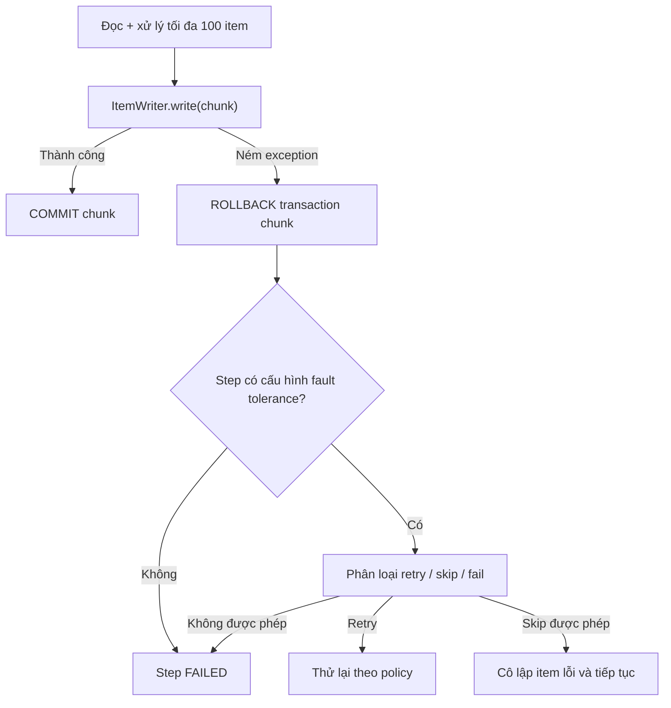
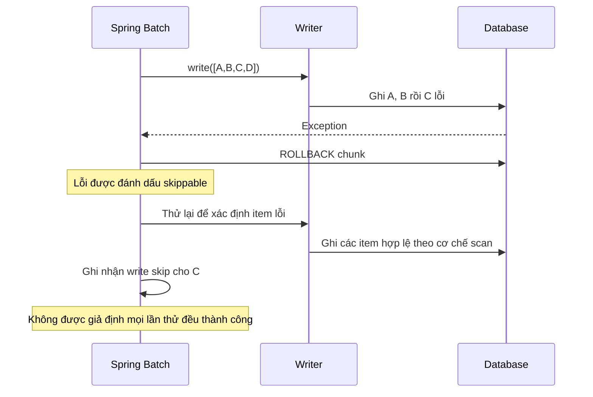
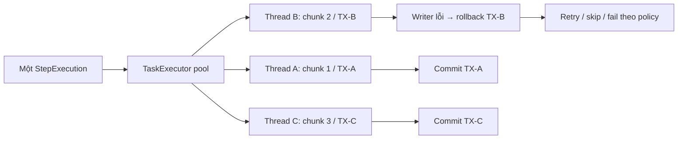

# Retry và skip không tự động trong writer của Spring Batch

> **Chương:** Local Chunking  
> **Mục tiêu:** Hiểu tại sao lỗi ở `ItemWriter` có thể làm rollback cả chunk, cách cấu hình **retry** và **skip** có chủ đích, cách Spring Batch xác định item gây lỗi ghi, và các điều kiện an toàn khi mở rộng số worker. Các ví dụ dùng **Spring Batch 5.2.x** theo mô hình transaction imperative (JDBC).

## 1. Bài toán thực tế: 1 item lỗi trong chunk 100 item

Một job nhập 5 triệu hóa đơn theo quy trình `read → process → write`. Mỗi chunk gồm tối đa 100 hóa đơn. Writer gửi các bản ghi của chunk vào PostgreSQL. Trong một chunk, hóa đơn thứ 67 có giá trị không được chấp nhận; một lúc khác, kết nối DB bị timeout hoặc deadlock.

Nếu ứng dụng xử lý hai trường hợp ấy như nhau, kết quả có thể là:

- **Dừng toàn bộ job** vì một dòng dữ liệu lỗi có thể sửa được;
- **Bỏ qua sai dữ liệu** khi hệ thống DB thật ra đang lỗi;
- **Ghi trùng hoặc tạo side effect lặp lại** vì retry cả chunk mà writer không idempotent;
- **Báo COMPLETED với dữ liệu thiếu**, vì skip quá rộng mà không đo chất lượng.

Yêu cầu nghiệp vụ nên phân biệt:

| Loại tình huống | Hướng xử lý ưu tiên | Ví dụ |
| --- | --- | --- |
| Dữ liệu sai đã được xác định và chấp nhận loại bỏ | Skip có quota, ghi nhận quarantine | Hóa đơn có lượng âm theo quy tắc import |
| Lỗi tạm thời có khả năng phục hồi | Retry hữu hạn, backoff khi phù hợp | Deadlock, timeout thoáng qua |
| Vi phạm tính toàn vẹn hoặc lỗi hạ tầng kéo dài | Fail step và điều tra | Schema sai, thiếu quyền, DB unavailable |
| Side effect ngoài transaction | Idempotency/outbox, chính sách phục hồi riêng | Gọi API thu tiền, phát message, gửi email |

**Điểm chính:** `ItemWriter` **không tự quyết định** item nào được retry hoặc skip chỉ vì step dùng chunk processing hay có nhiều worker thread. Các quyết định ấy thuộc về cấu hình fault tolerance, cơ chế transaction và hợp đồng của writer.

## 2. Mặc định: Exception ở writer làm rollback chunk

Với một chunk-oriented step thông thường:

1. `ItemReader` trả về các item.
2. `ItemProcessor` (nếu có) biến đổi hoặc lọc item.
3. `ItemWriter.write(Chunk<? extends T>)` nhận **cả chunk**, thực hiện các thao tác ghi.
4. Nếu tất cả thành công, transaction của chunk được commit.
5. Nếu writer ném exception, **mặc định transaction chunk bị rollback**; nếu lỗi không được xử lý bằng retry/skip, step thất bại.

`chunk(100)` **không có nghĩa** “mỗi item có transaction riêng”. Trong đường xử lý bình thường, các thao tác ghi thuộc cùng chunk transaction, tùy transaction manager và tài nguyên được sử dụng.



Ví dụ: writer ghi item A, B vào DB rồi gặp lỗi ở C. **Nếu cả ba thao tác cùng tham gia transaction JDBC của chunk**, rollback hủy cả A và B, dù các lệnh INSERT cho chúng đã trả về thành công trước đó. Khi retry hoặc skip, framework có thể gọi lại writer cho A và B.

Tuy nhiên, rollback **không tự hoàn tác** cuộc gọi HTTP, message đã phát hành, file ngoài transaction hay transaction độc lập được mở trong writer. Đây là lý do phải phân biệt “rollback SQL thành công” với “mọi side effect đều được rollback”.

## 3. Vì sao lỗi ghi khó skip hơn lỗi đọc/xử lý?

Với lỗi ở `read()`, framework biết lời gọi đọc thất bại. Với lỗi ở `process(item)`, framework biết **item nào** gây exception. Nhưng `ItemWriter.write(chunk)` thường nhận **nhiều item cùng lúc**. Một exception từ thao tác bulk JDBC không luôn cho biết bản ghi nghiệp vụ nào là nguyên nhân.

Xét chunk `[A, B, C, D]`:

- Writer ghi A, B, đến C thì DB báo lỗi.
- Transaction của lần ghi chunk ban đầu rollback.
- Nếu loại lỗi **được cấu hình skippable** và quota còn, framework có thể chuyển sang bước **scan/cô lập**, thử lại bằng các lượt ghi nhỏ để nhận diện C.
- A, B và D có thể được ghi thành công trong các transaction hợp lệ; C được ghi nhận là **write skip**.
- Nếu không thể quy lỗi cho một item hoặc lỗi tiếp tục xảy ra ở các item khác, step có thể thất bại hoặc vượt skip limit.



**Hệ quả cần chuẩn bị:**

- Writer có thể được gọi **nhiều lần cho cùng item** sau rollback; số lần gọi `write()` không đồng nghĩa số item được commit.
- Đối tượng đầu ra của processor có thể được tạo lại khi xử lý lại chunk; nếu writer sửa trực tiếp những đối tượng đó, cần thận trọng với cache.
- Một lỗi hạ tầng toàn cục (DB mất kết nối) không thể được giải quyết an toàn bằng cách “skip từng item” vì tất cả item đều thất bại do cùng nguyên nhân.
- Cơ chế scan tốn thời gian và transaction hơn đường bình thường, nhất là chunk lớn. Dữ liệu không hợp lệ xuất hiện thường xuyên nên được xác thực **trước writer** khi có thể.

## 4. Retry, skip, rollback và fail khác nhau

| Quyết định | Điều kiện | Hành vi | Mục tiêu |
| --- | --- | --- | --- |
| **Rollback** | Writer ném lỗi theo quy tắc transaction | Hủy thay đổi chưa commit trong transaction chunk | Khôi phục trạng thái nhất quán |
| **Retry** | Exception thuộc nhóm retryable, chưa hết retry policy | Thử lại thao tác; có thể rollback/reprocess theo cơ chế step | Vượt qua lỗi tạm thời |
| **Skip** | Exception thuộc nhóm skippable và còn quota | Không ghi thành công item lỗi, tiếp tục với item hợp lệ | Chấp nhận lỗi dữ liệu có kiểm soát |
| **Fail** | Exception fatal, hết retry hoặc hết skip quota | Dừng step với trạng thái lỗi, xử lý restart theo metadata | Tránh báo thành công sai |

Một exception có thể thuộc cả nhóm retryable và skippable. Khi đó framework có thể thử lại trước, rồi mới xét khả năng skip sau khi không phục hồi. Quyết định này phải được thiết kế và kiểm thử cho từng loại exception; không nên dùng `.retry(Exception.class)` hoặc `.skip(Exception.class)` để “cứ chạy tiếp”.

### Cấu hình cơ bản trong Spring Batch 5.2

```java
return new StepBuilder("importInvoicesStep", jobRepository)
        .<Invoice, Invoice>chunk(100, transactionManager)
        .reader(invoiceReader)
        .writer(invoiceWriter)
        .faultTolerant()
        .retry(TransientDataAccessException.class)
        .retryLimit(3)
        .skip(InvalidInvoiceForWriteException.class)
        .skipLimit(10)
        .build();
```

Trong đó:

- `TransientDataAccessException` thuộc hệ thống Spring DAO, dùng để đại diện các lỗi truy cập dữ liệu **tạm thời**; cần xem loại lỗi thực tế của driver và cơ chế chuyển đổi exception.
- `InvalidInvoiceForWriteException` là exception nghiệp vụ **do ứng dụng định nghĩa** cho dữ liệu bị từ chối khi ghi, không phải exception hệ thống.
- `retryLimit(3)` giới hạn retry theo policy; không hiểu đó là “ba transaction bổ sung chắc chắn thành công”.
- `skipLimit(10)` cho phép **tối đa 10 lần skip** của toàn bộ `StepExecution` theo read + process + write. Khi cần skip lần thứ 11, step thất bại.
- `faultTolerant()` **cho phép cấu hình** retry/skip; chính các lời gọi `retry(...)` và `skip(...)` quyết định loại exception được xử lý.
- Nếu dùng `skipPolicy(customPolicy)`, custom policy phải tự kiểm soát hạn mức; không mặc định dựa vào `skipLimit(...)` thay cho policy tùy chỉnh.

Đây là một đoạn cấu hình rút gọn. Phần tiếp theo cung cấp ví dụ bean và writer cụ thể.

## 5. Ví dụ Java: Writer chủ động ném lỗi nghiệp vụ, step quyết định skip

Ví dụ dùng **Spring Batch 5.2.x**, **Java 17**, JDBC và **PostgreSQL**. Giả định bảng đích:

```sql
CREATE TABLE invoice_import (
    invoice_id BIGINT PRIMARY KEY,
    amount NUMERIC(18, 2) NOT NULL
);
```

Một hóa đơn có `amount < 0` là lỗi nghiệp vụ có thể loại bỏ trong ví dụ; retry chỉ dành cho lỗi tạm thời ở hạ tầng. Writer không tự nuốt exception. Để giảm thiểu duplicate khi restart, câu lệnh ghi được minh họa bằng upsert theo khóa `invoice_id`.

```java
package com.example.batch;

import java.math.BigDecimal;
import org.slf4j.Logger;
import org.slf4j.LoggerFactory;
import org.springframework.batch.core.SkipListener;
import org.springframework.batch.core.Step;
import org.springframework.batch.core.repository.JobRepository;
import org.springframework.batch.core.step.builder.StepBuilder;
import org.springframework.batch.item.ItemReader;
import org.springframework.batch.item.ItemWriter;
import org.springframework.beans.factory.annotation.Qualifier;
import org.springframework.context.annotation.Bean;
import org.springframework.context.annotation.Configuration;
import org.springframework.dao.TransientDataAccessException;
import org.springframework.jdbc.core.JdbcTemplate;
import org.springframework.scheduling.concurrent.ThreadPoolTaskExecutor;
import org.springframework.transaction.PlatformTransactionManager;

@Configuration(proxyBeanMethods = false)
public class InvoiceImportConfig {
    private static final Logger log =
            LoggerFactory.getLogger(InvoiceImportConfig.class);

    public record Invoice(long id, BigDecimal amount) {}

    public static final class InvalidInvoiceForWriteException
            extends RuntimeException {
        public InvalidInvoiceForWriteException(long id) {
            super("Rejected invoice id=" + id);
        }
    }

    @Bean
    public ItemWriter<Invoice> invoiceWriter(JdbcTemplate jdbc) {
        return chunk -> {
            for (Invoice item : chunk) {
                // Kiểm tra chỉ biết được tại ranh giới ghi của ví dụ.
                if (item.amount() == null ||
                        item.amount().signum() < 0) {
                    throw new InvalidInvoiceForWriteException(item.id());
                }

                // Cú pháp PostgreSQL: ghi có khóa nghiệp vụ ổn định.
                jdbc.update("""
                    INSERT INTO invoice_import (invoice_id, amount)
                    VALUES (?, ?)
                    ON CONFLICT (invoice_id)
                    DO UPDATE SET amount = EXCLUDED.amount
                    """, item.id(), item.amount());
            }
        };
    }

    @Bean
    public SkipListener<Invoice, Invoice> invoiceSkipListener() {
        return new SkipListener<>() {
            @Override
            public void onSkipInRead(Throwable error) {
                log.warn("invoice_read_skipped cause={}",
                        error.getClass().getSimpleName());
            }

            @Override
            public void onSkipInProcess(Invoice item, Throwable error) {
                log.warn("invoice_process_skipped id={} cause={}",
                        item.id(), error.getClass().getSimpleName());
            }

            @Override
            public void onSkipInWrite(Invoice item, Throwable error) {
                log.warn("invoice_write_skipped id={} cause={}",
                        item.id(), error.getClass().getSimpleName());
            }
        };
    }

    @Bean
    public ThreadPoolTaskExecutor invoiceChunkExecutor() {
        ThreadPoolTaskExecutor executor = new ThreadPoolTaskExecutor();
        executor.setCorePoolSize(4);
        executor.setMaxPoolSize(4);
        executor.setQueueCapacity(16);
        executor.setThreadNamePrefix("invoice-chunk-");
        return executor;
    }

    @Bean
    public Step importInvoicesStep(
            JobRepository jobRepository,
            PlatformTransactionManager transactionManager,
            @Qualifier("invoiceReader") ItemReader<Invoice> reader,
            @Qualifier("invoiceWriter") ItemWriter<Invoice> writer,
            @Qualifier("invoiceSkipListener")
                    SkipListener<Invoice, Invoice> skipListener,
            @Qualifier("invoiceChunkExecutor")
                    ThreadPoolTaskExecutor executor) {

        return new StepBuilder("importInvoicesStep", jobRepository)
                .<Invoice, Invoice>chunk(100, transactionManager)
                .reader(reader)
                .writer(writer)
                .faultTolerant()
                // Lỗi dữ liệu có thể loại bỏ, với giới hạn tổng.
                .skip(InvalidInvoiceForWriteException.class)
                .skipLimit(10)
                // Lỗi DB thoáng qua được thử lại trước khi fail.
                .retry(TransientDataAccessException.class)
                .retryLimit(3)
                .listener(skipListener)
                .taskExecutor(executor)
                .build();
    }
}
```

**Các giả định để dùng đúng mẫu:**

1. Ứng dụng đã tạo `invoiceReader`, `JdbcTemplate`, `JobRepository`, `PlatformTransactionManager` và job gọi step. `invoiceReader` phải được thiết kế để chạy cùng executor; không chia sẻ reader có con trỏ một cách tùy tiện.
2. `JdbcTemplate` phải dùng `DataSource` có transaction manager tương ứng; nếu DB của writer khác transaction manager của step, rollback chunk có thể không bao trùm thao tác ghi.
3. Writer dùng biến cục bộ, không giữ danh sách mutable giữa các chunk. `JdbcTemplate` được thiết kế để sử dụng đồng thời sau khi cấu hình.
4. `ON CONFLICT DO UPDATE` là ví dụ idempotent cho **cùng dữ liệu đầu vào**; có thể **ghi đè giá trị mới hơn** nếu upstream phát nhiều phiên bản của cùng invoice. Production cần điều kiện version, source timestamp hoặc quy tắc immutable thích hợp.
5. `amount < 0` có thể kiểm tra ở processor; nếu chuyển kiểm tra sang processor, lỗi sẽ là **process skip** thay vì **write skip**. Đặt ở writer trong bài này để minh họa thuật toán xử lý lỗi ghi.
6. `ThreadPoolTaskExecutor` được Spring quản lý vòng đời; với Spring Batch 5.x, concurrency hiệu dụng còn phụ thuộc cơ chế throttle/step operations, không chỉ kích cỡ pool.
7. Ví dụ chưa kèm số liệu đầu vào, cấu hình Job hay test DB; cần kiểm chứng bằng integration test trên PostgreSQL và transaction manager thực tế trước khi vận hành.

**Không biến việc skip thành hành vi trong writer** như:

```java
// Phản ví dụ: writer tự nuốt lỗi khiến Spring Batch không biết đã bỏ item.
for (Invoice item : chunk) {
    try {
        writeOne(item);
    } catch (Exception ignored) {
        // Sai: skipCount không được cập nhật, loại lỗi bị che giấu.
    }
}
```

Khi writer “nuốt” lỗi, step có thể commit và báo thành công mà không có `writeSkipCount`. Trách nhiệm phân loại lỗi và quyết định có được phép mất item hay không nên nằm ở fault-tolerant step; writer cần ném exception có ý nghĩa.

## 6. Thứ tự xử lý một chunk có writer error

Giả sử chunk có A, B, C, D; C mang `amount = -10`:

| Bước | Chuyện gì xảy ra | Dữ liệu sau bước |
| --- | --- | --- |
| 1 | Writer nhận `[A,B,C,D]` | Chưa commit |
| 2 | Writer ghi A, B, ném `InvalidInvoiceForWriteException` tại C | A/B chỉ tồn tại trong transaction chưa commit |
| 3 | Spring Batch rollback chunk | A/B của lần thử này được hoàn tác nếu cùng DB transaction |
| 4 | Fault-tolerant step thấy lỗi được phép skip | Bắt đầu quá trình xác định item lỗi |
| 5 | Framework thử lại theo đường scan/recovery phù hợp | A/B/D có thể được commit thành công; C bị bỏ |
| 6 | `onSkipInWrite(C, exception)` được gọi theo hợp đồng listener | Có thể ghi dấu vết quarantine |
| 7 | Step tiếp tục cho đến khi hoàn thành hoặc lỗi khác | `writeSkipCount` phản ánh item đã skip |

**Không cam kết** số lần `write()` chính xác bằng một con số cố định: retry, rollback, cách framework cô lập item và điều kiện transaction đều có thể tạo các lời gọi bổ sung. Nếu mọi lần thử đều vẫn thất bại do DB down, skip không biến lỗi ấy thành “dòng dữ liệu không hợp lệ”.

### Trường hợp bulk writer

Với `JdbcBatchItemWriter` hoặc writer ghép SQL batch, một ngoại lệ như `BatchUpdateException` có thể được Spring bọc thành `DataAccessException`; exception này **không nhất thiết nêu chính xác item lỗi**. Không tự động đánh dấu cả chunk là dữ liệu xấu. Muốn skip từng item, cần phân loại exception phù hợp và kiểm tra framework có thể quét/cô lập item khi rollback.

Cũng cần nhớ: một số DB đánh dấu transaction không còn sử dụng được sau một câu lệnh lỗi. Vì vậy các lần thử để cô lập item cần một transaction hợp lệ mới; cố tiếp tục SQL trong transaction đã lỗi có thể khiến mọi item tiếp theo thất bại.

## 7. Vì sao writer phải có tính idempotent?

**Idempotent** có nghĩa là việc áp dụng lại cùng thao tác với cùng định danh nghiệp vụ không tạo tác dụng ngoài ý muốn mới. Nó quan trọng vì writer có thể bị gọi lại sau:

- rollback và retry một chunk;
- scan để cô lập lỗi write;
- restart JobInstance bị thất bại;
- worker crash sau khi ghi nhưng trước khi metadata được lưu đồng bộ;
- message/partition được xử lý lại trong mô hình phân tán.

| Kiểu writer | Rủi ro khi gọi lại | Cách thiết kế |
| --- | --- | --- |
| `INSERT` không có khóa duy nhất | Duplicate row | Unique business key, upsert/merge có điều kiện |
| `UPDATE balance = balance + amount` | Cộng tiền hai lần | Bảng ledger có event ID duy nhất, kiểm tra version hoặc dedup |
| Gửi email trong `write()` | Gửi lặp khi DB rollback | Transactional outbox và worker gửi có idempotency |
| Gọi API charge credit card | Thu tiền nhiều lần | Idempotency key end-to-end; tránh gắn trực tiếp vào retry chunk |
| Ghi file ngoài DB transaction | File đã đổi trong khi DB rollback | Ghi tạm, finalize theo giao thức riêng, đối soát/reconcile |
| Writer sửa đối tượng item mutable | Retry dùng object đã đổi dở | Giữ output immutable, tránh mutate đầu vào |

**Một transaction per chunk không có nghĩa exactly-once end-to-end.** DB transaction bảo vệ các thay đổi **tham gia transaction ấy**. Side effect ngoài DB và metadata ở transaction/resource khác vẫn cần cơ chế phục hồi riêng.

### `processorNonTransactional()` không phải tối ưu mặc định

Trong fault-tolerant step, khi writer rollback, framework có thể xử lý lại item qua processor. Có thể dùng `processorNonTransactional()` để cache kết quả processor khi output đủ an toàn để tái sử dụng. Nhưng nếu writer đã **thay đổi state của output** (ví dụ JPA entity nhận ID trong lần flush thất bại), cache kết quả có thể làm lần retry tiếp theo thất bại theo cách khác.

Chỉ bật tối ưu này khi đã kiểm chứng output của processor **bất biến hoặc an toàn để ghi lại**, và writer không làm thay đổi nó theo cách gây lỗi.

## 8. Phân loại exception: Đừng skip toàn bộ DataAccessException

Một số ví dụ phân loại để bắt đầu thiết kế (cần đối chiếu exception thực tế do driver/ORM ném):

| Exception hoặc nhóm lỗi | Retry? | Skip? | Ghi chú |
| --- | --- | --- | --- |
| `InvalidInvoiceForWriteException` | Không | Có giới hạn | Lỗi dữ liệu xác định; lý tưởng kiểm tra sớm |
| `DeadlockLoserDataAccessException` / nhóm transient phù hợp | Có giới hạn | Không | Lỗi DB tạm thời; retry có thể giúp |
| `CannotGetJdbcConnectionException` | Tùy chính sách và thời hạn phục hồi | Không | Mất kết nối kéo dài phải làm step fail |
| `DuplicateKeyException` | Thường không | Chỉ khi được nghiệp vụ xác nhận | Duplicate có thể là bug/replay, không nên tự bỏ qua |
| `DataIntegrityViolationException` tổng quát | Thường không | Không mặc định | Có thể biểu thị khóa ngoại, schema hoặc inconsistency |
| `OutOfMemoryError` / lỗi JVM nặng | Không | Không | Không cố skip/retry trong writer |
| Exception không nhận diện | Không mặc định | Không | Fail để điều tra |

Không nhất thiết cấu hình retry cho **mọi** `TransientDataAccessException` trong mọi dịch vụ. Có những thao tác không idempotent hoặc đã tạo side effect khi DB báo lỗi, nên cần phân loại sâu hơn và kiểm tra tính an toàn khi lặp.

Tránh:

```java
.faultTolerant()
.skip(Exception.class)
.skipLimit(1000000)
```

Cấu hình này có thể che giấu lỗi driver, timeout, lỗi logic hoặc bug của writer. Nếu cần loại trừ cụ thể, `noSkip(SomeException.class)` có thể tinh chỉnh chính sách theo cây kế thừa exception. Giới hạn skip phải thể hiện **ngưỡng chấp nhận dữ liệu bị mất**, không chỉ là giá trị để job tiếp tục chạy.

### Rollback tùy chỉnh cần sự thận trọng

Trong Spring Batch, **writer exception mặc định gây rollback**, kể cả khi có cơ chế skip/retry. Có thể dùng `noRollback(SomeException.class)` với một số loại exception đã biết không làm hỏng transaction; nhưng làm vậy khi DB đã ở trạng thái rollback-only hoặc khi writer đã ghi một phần dữ liệu có thể dẫn tới kết quả không nhất quán.

`noRollback` **không thay thế** `skip` hay `retry` và không biến exception thành “lỗi vô hại”. Chỉ cân nhắc sau khi hiểu chính xác hiệu ứng của exception trên resource/transaction được sử dụng.

## 9. Khác biệt khi chạy local chunking nhiều thread

Thêm `.taskExecutor(executor)` vào step không tự thêm retry/skip. Nó chỉ làm nhiều **lượt xử lý chunk** chạy trên các worker thread; fault-tolerance vẫn cần cấu hình riêng.



Điểm quan trọng khi kết hợp writer fault tolerance với concurrency:

1. **Transaction độc lập:** Chunk A commit rồi thì lỗi ở chunk B không rollback A. Nếu phải restart, dữ liệu đã commit phải xử lý lại được an toàn.
2. **Reader stateful:** Một reader chia sẻ con trỏ có thể không thread-safe. `SynchronizedItemStreamReader` giúp đồng bộ `read()`, nhưng **không tự bảo đảm checkpoint chính xác** khi các chunk commit lệch thứ tự.
3. **Writer thread safety:** `ItemWriter` singleton hoặc step-scoped có thể được gọi đồng thời bởi các worker; không đặt danh sách đệm mutable chia sẻ nếu không có đồng bộ và hợp đồng rõ ràng.
4. **Step-scoped không đồng nghĩa thread-scoped:** Một `StepExecution` dùng chung cho nhiều thread/chunk; `@StepScope` không tạo writer độc lập cho mỗi thread.
5. **Thống kê skip:** `readSkipCount`, `processSkipCount` và `writeSkipCount` được tổng hợp theo `StepExecution`, không phải bộ đếm riêng mỗi worker thread. Với partitioning, mỗi partition thường có một `StepExecution` riêng, cần tổng hợp quota toàn job nếu nghiệp vụ yêu cầu.
6. **Quota và in-flight work:** Nhiều chunk đã được dispatch có thể hoàn thành khác thứ tự. Đừng dựa vào thời điểm xuất hiện log của lần skip thứ N để suy ra tất cả worker sẽ dừng ngay lập tức.
7. **Downstream contention:** Retry có thể khuếch đại lock wait, số connection và transaction khi pool đang bận. Giới hạn concurrency theo DB pool và đặc tính workload.
8. **Thread-local context:** Transaction và MDC phục vụ logging thuộc thread xử lý hiện tại; không tự truyền sang một async worker khác do writer tạo ra.

Nếu yêu cầu dữ liệu đầu ra phải được xử lý đúng một lần với checkpoint nghiêm ngặt, cân nhắc **partitioning theo range/key cố định** với reader riêng, writer idempotent và quy trình đối soát. Multi-threaded step là lựa chọn cần kiểm thử restart thực tế, nhất là với reader/cursor chia sẻ.

## 10. Retry và restart: Chạy lại không có nghĩa khôi phục tự động toàn bộ

Cần phân biệt:

- **Retry:** Cùng lần chạy step, thử lại một thao tác thất bại theo policy. Writer có thể nhận lại item đã thử trước đó.
- **Skip:** Chấp nhận không xử lý thành công một item cụ thể. Job có thể hoàn thành nhưng dữ liệu đầu ra **không đủ mọi item nguồn**.
- **Restart:** Sau khi `JobInstance` thất bại/dừng, chạy tiếp theo metadata của `JobRepository` và khả năng restart của reader/writer. Các step đã `COMPLETED` được bỏ qua theo cấu hình mặc định khi restart cùng instance.
- **Replay quarantine:** Một job riêng đưa các item đã skip trở lại sau khi sửa dữ liệu, **không tự xảy ra** chỉ vì restart.

Ví dụ có ba chunk A, B, C. A đã commit, B rollback và step FAILED, C có thể đã commit vì đang chạy đồng thời. Khi restart, **đừng giả định** mọi item nằm giữa checkpoint của A và C đều đã commit. Với writer có khóa idempotent và có kiểm tra đủ/không trùng business key, ứng dụng có thể phát hiện và xử lý việc đọc/ghi lại; nếu reader/checkpoint không đủ mạnh, cần đổi cách chia dữ liệu.

Nếu `JobRepository` và database nghiệp vụ dùng **các transaction manager khác nhau**, cập nhật metadata và dữ liệu nghiệp vụ cũng có thể lệch nhau trong sự cố. Cần thiết kế idempotency, đối soát hoặc transaction coordination phù hợp, không coi step status là bằng chứng duy nhất mọi row đã tồn tại.

## 11. Quan sát đúng bằng SkipListener và StepExecution

Đừng dùng `ItemWriteListener.onWriteError` để kết luận item đã skip. Callback ấy có thể chạy khi lỗi được retry và **sau đó ghi thành công**. Trong khi đó, `SkipListener.onSkipInWrite(item, throwable)` phản ánh item được bỏ qua ở pha ghi theo hợp đồng framework.

Có thể theo dõi bộ đếm của `StepExecution` sau khi step chạy:

```java
long writeSkipped = stepExecution.getWriteSkipCount();
long readSkipped = stepExecution.getReadSkipCount();
long processSkipped = stepExecution.getProcessSkipCount();
long allSkipped = stepExecution.getSkipCount();
long committed = stepExecution.getCommitCount();
long rolledBack = stepExecution.getRollbackCount();
long written = stepExecution.getWriteCount();

log.info("stepExecutionId={} writeCount={} " +
                "skipRead={} skipProcess={} skipWrite={} " +
                "skipTotal={} commitCount={} rollbackCount={}",
        stepExecution.getId(), written,
        readSkipped, processSkipped, writeSkipped,
        allSkipped, committed, rolledBack);
```

Đoạn trên giả định `stepExecution` lấy từ `StepExecutionListener.afterStep` hoặc nơi có đúng context step, và `log` là logger ứng dụng. Các bộ đếm giúp điều tra nhưng không thay thế đối soát bản ghi nguồn/đích khi có restart bất thường.

Với workload lớn, nên lưu quarantine gồm:

| Trường | Công dụng |
| --- | --- |
| `sourceRecordId` / `invoiceId` | Định danh item nguồn ổn định |
| `jobInstanceId`, `stepExecutionId` | Truy vết lần xử lý và restart |
| `phase=WRITE`, `exceptionType` | Biết lỗi xuất hiện ở pha nào |
| `errorCode` / mô tả được làm sạch | Hỗ trợ sửa dữ liệu, tránh lộ PII |
| `payloadReference` | Dẫn tới bản gốc ở kho có kiểm soát truy cập |
| `recoveryStatus` | Theo dõi NEW, FIXED, REPLAYED, REJECTED |

Cần khóa chống trùng cho quarantine. Spring Batch gọi skip listener gần thời điểm commit để hỗ trợ ghi audit transactional; tuy nhiên crash/restart, resource khác transaction hoặc cách lưu audit không idempotent vẫn có thể tạo event lặp.

### Cảnh báo nên có

- Tỷ lệ `writeSkipCount / số bản ghi nguồn` vượt SLA (mẫu số cần thống nhất).
- Số lần rollback tăng bất thường so với baseline.
- Retry DB tăng đột biến, có liên hệ với connection pool pending/lock wait.
- Lỗi writer lặp cùng exception trên nhiều item/chunk, dấu hiệu **lỗi hệ thống** chứ không phải item cụ thể.
- Job COMPLETED nhưng số invoice ghi thành công khác số hợp lệ dự kiến.

Trong Prometheus/Micrometer, tránh đưa `stepExecutionId` hay `invoiceId` làm metric label vì độ phân biệt quá cao. Giữ ID ở **structured log**, truy vấn metadata qua `JobRepository`; metric dùng nhãn ổn định như job name, step name, phase, error family.

## 12. Chi phí của retry/skip và cách đo nút thắt

Một writer ghi chunk 500 item bằng batch SQL có thể rất nhanh khi tất cả dữ liệu hợp lệ. Nếu chỉ 1 item lỗi nhưng framework phải rollback và scan để cô lập, throughput có thể giảm mạnh so với cấu hình chunk nhỏ hơn hoặc validation trước writer.

Ví dụ các giá trị **minh họa**:

| Kịch bản | Chunk size | Số lỗi dữ liệu | Throughput giả định | Nhận xét |
| --- | ---: | ---: | ---: | --- |
| Dữ liệu sạch | 100 | 0 | 25.000 item/s | Baseline |
| 0,01% lỗi write | 100 | 100 / 1 triệu | 20.000 item/s | Có rollback/scan phát sinh |
| 2% lỗi write | 100 | 20.000 / 1 triệu | 4.000 item/s | Scan chiếm nhiều thời gian; có thể vượt skip quota |
| Dữ liệu được validate trước write | 100 | lỗi chuyển sang process skip | 22.000 item/s | Giảm lỗi bulk write, vẫn cần quota chất lượng |

Bảng không phải benchmark và không định nghĩa tốc độ chuẩn. Hãy đo thật trên dữ liệu và database của ứng dụng:

1. Tạo baseline tuần tự, dữ liệu sạch và các mức lỗi thực tế.
2. Ghi `writeCount`, `writeSkipCount`, `rollbackCount`, elapsed time, số lần gọi writer và số transaction.
3. Theo dõi thời gian `ItemWriter.write`, DB lock/connection wait, số worker active và executor queue.
4. Thử các chunk size (50, 100, 500) và concurrency hiệu dụng (1, 2, 4), giữ nguyên điều kiện đầu vào.
5. Chủ động gây deadlock/timeout/kill giữa lúc xử lý để kiểm tra dữ liệu sau retry/restart.
6. Nếu dữ liệu lỗi thường xuyên, chuyển kiểm tra xác định được sang processor hoặc bước validation riêng, thay vì dựa vào write scan.

**Không tăng số thread để che chi phí rollback.** Khi DB đã bão hòa, nhiều chunk + nhiều retry có thể làm số connection đang chờ và deadlock tăng, kéo throughput xuống.

## 13. Sự cố thường gặp

| Triệu chứng | Nguyên nhân có thể | Hành động |
| --- | --- | --- |
| Writer lỗi một dòng, cả step FAILED | Chưa cấu hình `faultTolerant` / loại lỗi không nằm trong skip policy | Xác định class exception thực tế, cấu hình whitelist đúng |
| Đã có `retryLimit` nhưng không retry | Thiếu `retry(ExceptionClass.class)` hoặc exception bị bọc thành loại khác | Kiểm tra stack trace, phân loại theo exception thực tế |
| Writer bị gọi nhiều lần cho một invoice | Retry, rollback và write scan là hành vi dự kiến | Thiết kế idempotent; không đếm invocation là commit |
| `writeSkipCount=0` dù có item không được ghi | Writer tự `catch` rồi nuốt lỗi, hoặc processor filter bằng `null` | Để exception đi tới step; phân biệt filter và skip |
| Cấu hình `skipLimit(10)` mà custom policy skip nhiều hơn | `skipPolicy(custom)` thay cơ chế limit mặc định | Tự thực thi quota bằng `skipCount` trong policy |
| Chunk ghi một phần dù báo rollback | Writer dùng resource ngoài transaction hoặc side effect không transactional | Đồng nhất TX boundary, dùng outbox/idempotency |
| DB mất kết nối nhưng job vẫn COMPLETED | Đã đánh dấu nhóm lỗi DB skippable quá rộng | Bỏ skip lỗi hệ thống, dùng retry hạn chế rồi fail |
| Write skip làm job rất chậm | Chunk lớn, scan từng item và rollback nhiều | Validate sớm, thu hẹp whitelist, giảm dữ liệu lỗi |
| Multi-threaded step ghi thiếu/trùng khi restart | Reader chia sẻ state/checkpoint lệch commit, writer không idempotent | Test kill/restart, dùng partitioning với reader riêng nếu cần |
| `onWriteError` log liên tục nhưng không tăng write skip | Lỗi được retry và ghi thành công, hoặc cuối cùng step fail | Dùng `SkipListener.onSkipInWrite` và metadata để xác định skip thật |

## 14. Thực hành

**Bài A — Đo hành vi mặc định.** Cấu hình step `chunk(4)` không có `faultTolerant()`. Tạo 4 invoice, trong đó invoice thứ ba có amount âm, writer ném exception. Quan sát rollback của chunk, trạng thái FAILED và DB không chứa thay đổi của chunk đó nếu mọi lệnh dùng cùng transaction.

**Bài B — Bật write skip có quota.** Thêm `faultTolerant().skip(InvalidInvoiceForWriteException.class).skipLimit(2)`. Dùng 1 invoice âm, kiểm tra item hợp lệ có thể ghi được và `writeSkipCount` tăng. Dùng 3 invoice âm, kiểm tra step thất bại khi cần skip vượt quota.

**Bài C — Retry lỗi tạm thời.** Mô phỏng lỗi `TransientDataAccessException` có thể phục hồi (ví dụ writer ném giả lập 2 lượt rồi thành công) và cấu hình retry có giới hạn. Xác nhận success không tăng `writeSkipCount`. Tiếp đó giả lập lỗi kéo dài và kiểm tra step fail.

**Bài D — Chứng minh idempotency.** Cho một chunk thành công rồi lỗi xảy ra ở chunk khác; restart đúng JobInstance hoặc chạy lại input theo kịch bản có kiểm soát. So sánh số dòng, business key và giá trị cuối, đảm bảo không có ghi trùng, không ghi đè phiên bản mới ngoài ý muốn.

**Bài E — Local chunking.** Bật pool 4 worker với reader/writer phù hợp concurrent use, sinh lỗi xác định trong một chunk và lỗi DB thoáng qua trong chunk khác. Quan sát `thread`, `stepExecutionId`, các lần commit/rollback. Đối chiếu kết quả nguồn/đích và số skip cuối step; không suy ra thứ tự commit từ thứ tự xuất hiện log.

**Bài F — Quarantine và replay.** Ghi nhận `onSkipInWrite` theo business key vào bảng quarantine có unique constraint. Sửa invoice lỗi, chạy job replay chuyên biệt và chạy lại replay lần hai. Đảm bảo việc chạy bù không tạo duplicate.

### Checklist chấp nhận đưa vào production

- [ ] Exception được chia thành **retryable**, **skippable** và **fatal** theo nghiệp vụ.
- [ ] Có quota skip tuyệt đối, ngưỡng chất lượng dữ liệu và cảnh báo.
- [ ] Writer **không nuốt lỗi** và chỉ ghi qua transaction/resource đã hiểu rõ.
- [ ] Writer an toàn khi được gọi lại; side effect ngoài transaction có idempotency/outbox.
- [ ] Có `SkipListener` và quarantine để xử lý các item bị loại.
- [ ] Đã kiểm tra write scan, rollback, retry exhaustion, skip exhaustion, restart.
- [ ] Reader/processor/writer được kiểm chứng thread safety khi bật `TaskExecutor`.
- [ ] Đã đo throughput item ghi **thành công**, số rollback, DB waits và chi phí scan.

## 15. Tài liệu tham khảo chính thức

- [Spring Batch 5.2 — Chunk-oriented Processing](https://docs.spring.io/spring-batch/reference/5.2/step/chunk-oriented-processing.html)
- [Spring Batch 5.2 — Configuring Skip Logic](https://docs.spring.io/spring-batch/reference/5.2/step/chunk-oriented-processing/configuring-skip.html)
- [Spring Batch 5.2 — Configuring Retry Logic](https://docs.spring.io/spring-batch/reference/5.2/step/chunk-oriented-processing/retry-logic.html)
- [Spring Batch 5.2 — Controlling Rollback](https://docs.spring.io/spring-batch/reference/5.2/step/chunk-oriented-processing/controlling-rollback.html)
- [Spring Batch 5.2 — Intercepting Step Execution / SkipListener](https://docs.spring.io/spring-batch/reference/5.2/step/chunk-oriented-processing/intercepting-execution.html)
- [Spring Batch 5.2 — Scaling and Parallel Processing](https://docs.spring.io/spring-batch/reference/5.2/scalability.html)
- [Spring Batch 5.2 — FaultTolerantStepBuilder Javadoc](https://docs.spring.io/spring-batch/docs/5.2.6/api/org/springframework/batch/core/step/builder/FaultTolerantStepBuilder.html)

> **Giới hạn phiên bản:** Code ở đây chọn Spring Batch **5.2.x** (`chunk(size, transactionManager)`, `faultTolerant()`, `TaskExecutor`). Spring Batch 6 có thay đổi builder và package nên cần đối chiếu Javadoc của phiên bản dùng thật; tránh trộn API 5.x và 6.x trong cùng ví dụ.

**Ghi nhớ:** `ItemWriter` có thể nhận nhiều item trong **một transaction chunk**. Lỗi writer mặc định rollback và có thể làm step fail. Muốn retry hoặc skip phải phân loại exception và khai báo policy rõ ràng; ngay cả khi đã cấu hình, writer vẫn có thể được gọi lại và phải an toàn về transaction, idempotency, restart và xử lý song song.
