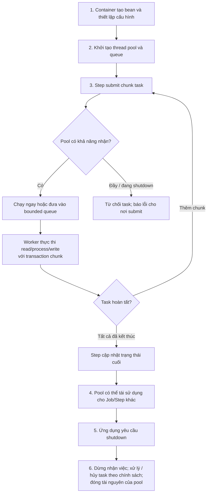
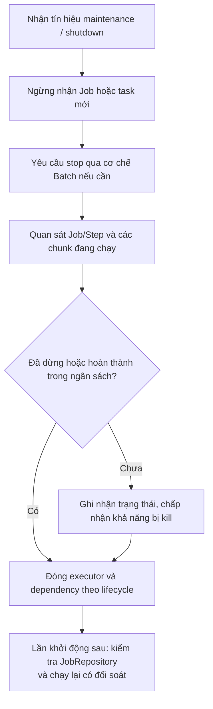

# Lifecycle của TaskExecutor trong Spring Batch Local Chunking

Khi cấu hình `TaskExecutor` cho một chunk-oriented Step, Spring Batch có thể xử lý nhiều chunk trên các thread khác nhau để tăng throughput. Nhưng tăng concurrency cũng tạo ra những câu hỏi vận hành: executor được khởi tạo và sở hữu bởi ai, lúc nào task được nhận, Step đợi worker hoàn tất thế nào, khi queue đầy phải làm gì và điều gì xảy ra khi ứng dụng bị dừng giữa một chunk?

Bài học thuộc chương **Local Chunking** của module **SPRING_BATCH_SCALING_OPERATIONS**, tập trung mở rộng workload dữ liệu lớn bằng multi-threaded step, parallel steps, partitioning và các mô hình phân tán phù hợp. Trong bài này, **lifecycle của TaskExecutor** được xem từ lúc tạo bean, nhận việc, thực thi chunk, điều tiết tải, cho đến shutdown và restart; mọi quyết định phải đi cùng thread safety, transaction, độ tin cậy của job và giới hạn tài nguyên thực tế.

**Sau bài học, bạn có thể:**

- Phân biệt lifecycle của executor với lifecycle của `Job`, `Step`, `StepExecution` và transaction chunk.
- Cấu hình `ThreadPoolTaskExecutor` với thread pool và queue có giới hạn, cho phép giám sát tải.
- Hiểu lỗi submit/rejection, thread reuse, context propagation và các cách shutdown.
- Thiết kế stop/restart không nhầm công việc còn ở RAM với checkpoint đã commit.
- Kiểm chứng hiệu năng và tính đúng đắn trước khi chạy production.

## 1. TaskExecutor là gì trong local chunking?

`TaskExecutor` là abstraction của Spring cho việc **thực thi một tác vụ `Runnable`**. Nó không tự quyết định chunk được đọc, checkpoint lưu khi nào hoặc transaction commit thế nào; những việc này thuộc cơ chế Step/transaction của Spring Batch.

Trong local chunking:

1. Spring Batch quyết định công việc xử lý chunk cần thực hiện.
2. `TaskExecutor` nhận `Runnable` và sắp lịch lên worker thread theo implementation.
3. Trong task, framework chạy các bước đọc, xử lý, ghi theo cấu hình chunk và transaction.
4. Step thu thập trạng thái thực thi để xác định thành công/thất bại trước khi kết thúc.
5. `JobRepository` lưu thông tin thực thi, còn bản thân executor giữ thread/queue trong bộ nhớ của JVM.

**Cần phân biệt ba nơi có thể dùng executor:**

| Vị trí | Vai trò | Tác động lên completion |
| --- | --- | --- |
| `JobLauncher` bất đồng bộ | Chạy **toàn Job** trên executor khác | Caller có thể nhận quyền điều khiển trước khi Job hoàn tất; phải theo dõi JobExecution |
| `StepBuilder.taskExecutor(...)` | Phân phối công việc chunk của **multi-threaded Step** | Các chunk có thể chạy trên các thread khác nhau; Step quản lý completion |
| Manager Step trong partitioning | Phân phối **worker StepExecution** của các partition | Mỗi partition chạy Step/chunk riêng; đồng thời phụ thuộc partition handler và executor |

Bài này tập trung vào mục thứ hai. Nguyên tắc sở hữu pool, quá tải và shutdown cũng áp dụng cho local partitioning nhưng **đơn vị công việc** khi đó là worker Step/partition, không phải mặc định từng chunk.

## 2. Vòng đời tổng quát của một TaskExecutor

Với một `ThreadPoolTaskExecutor` là bean Spring, có thể chia vòng đời thành sáu giai đoạn.



| Giai đoạn | Ai chịu trách nhiệm chính | Điều cần kiểm tra |
| --- | --- | --- |
| Tạo và cấu hình | Spring container / người cấu hình | Loại executor, thread count, queue size, thread name, rejection |
| Khởi tạo | Lifecycle của bean executor | Pool đã sẵn sàng trước khi Step submit; không tạo pool mới cho mỗi chunk |
| Nhận task | Step/partition handler gọi executor | Nếu queue đầy hoặc pool đóng, task không được nhận |
| Chạy task | Worker thread và Spring Batch | Transaction, listener, scoped bean và lỗi có context đúng |
| Step hoàn tất | Cơ chế Step/JobRepository | Không báo thành công khi còn công việc bắt buộc chưa kết thúc |
| Shutdown | Spring container và quy trình vận hành | Dừng nhận job, yêu cầu stop, đợi trong giới hạn, xác nhận dữ liệu đã commit |

**Một TaskExecutor thường sống lâu hơn một Step**: nhiều lần chạy Job có thể dùng chung bean executor. Kết thúc Step **không đồng nghĩa shutdown pool**. Nếu gọi `shutdown()` sau từng Step trên một bean executor dùng chung, lần chạy tiếp theo có thể bị từ chối vì pool đã đóng.

## 3. Các trạng thái task trong pool

Một tác vụ chunk khi được submit vào `ThreadPoolExecutor` có thể:

- **Đang chạy:** một worker thread đã nhận và đang thực hiện.
- **Đang đợi:** `Runnable` đã được executor chấp nhận, còn nằm trong queue.
- **Bị từ chối:** pool đã hết năng lực nhận việc hoặc đang đóng, nên chính sách rejection được kích hoạt.
- **Đã hoàn thành:** task chạy xong, có thể thành công hoặc gặp lỗi; cần để Spring Batch ghi nhận kết quả.
- **Bị gián đoạn/hủy:** do cơ chế shutdown/cancel hoặc môi trường gặp lỗi; phải đánh giá phần dữ liệu đã commit và khả năng chạy lại.

**Không nhầm task đã submit với task đã commit.** Một `Runnable` đang trong queue chỉ tồn tại trong RAM. JVM crash làm mất queue này; sự phục hồi phụ thuộc `JobRepository`, `ExecutionContext` và thiết kế reader/writer, không phụ thuộc queue của executor.

### Ngưỡng `corePoolSize`, `maxPoolSize` và `queueCapacity`

`ThreadPoolTaskExecutor` dùng cơ chế pool của Java. Với hàng đợi dung lượng dương, khi số worker đã đạt `corePoolSize`, executor thường **xếp task mới vào queue** trước khi tăng số worker lên trên core. Chỉ khi queue không còn chỗ mới cân nhắc tạo thêm worker tới `maxPoolSize`; nếu không tạo được nữa sẽ từ chối.

Ví dụ:

| Cấu hình | Diễn giải |
| --- | --- |
| `core=4, max=4, queue=8` | Tối đa 4 task đồng thời và 8 task chờ trong executor |
| `core=4, max=16, queue=10_000` | Queue có thể tăng dài trong khi pool vẫn chỉ quanh 4 thread |
| `core=8, max=8, queue=0` | Không giữ task chờ bằng queue thông thường; việc phải được bàn giao trực tiếp cho worker rảnh |
| `core=8, max=8, queue=32` | Tối đa 8 task chạy và 32 task chờ, không kể backlog ở nơi khác |

Đó là mô hình đơn giản của **một executor**. Nếu ứng dụng có nhiều producer, nhiều pool hoặc message broker, cần tính cả lượng việc chờ ngoài pool. Tăng queue không tăng tốc database hay CPU; nó chỉ hấp thụ burst và làm tăng khả năng task phải chờ.

## 4. Cấu hình ThreadPoolTaskExecutor do Spring quản lý

Ví dụ dành cho ứng dụng Spring Batch 5.x / Spring Framework 6.x, với một executor cố định và bounded queue. Khi khai báo bean, Spring container tự thực hiện callback khởi tạo và hủy bean; không cần gọi `initialize()` thủ công trong mỗi Step.

```java
import java.util.concurrent.ThreadPoolExecutor;

import org.springframework.context.annotation.Bean;
import org.springframework.context.annotation.Configuration;
import org.springframework.scheduling.concurrent.ThreadPoolTaskExecutor;

@Configuration
public class ChunkExecutorConfiguration {

    @Bean
    public ThreadPoolTaskExecutor chunkTaskExecutor() {
        ThreadPoolTaskExecutor executor = new ThreadPoolTaskExecutor();

        executor.setThreadNamePrefix("batch-chunk-");
        executor.setCorePoolSize(4);
        executor.setMaxPoolSize(4);
        executor.setQueueCapacity(8);

        // Báo lỗi khi hết khả năng nhận task; không bỏ task im lặng.
        executor.setRejectedExecutionHandler(
                new ThreadPoolExecutor.AbortPolicy());

        // Phương án shutdown minh họa: ưu tiên hoàn tất task đã nhận.
        executor.setWaitForTasksToCompleteOnShutdown(true);
        executor.setAwaitTerminationSeconds(60);

        return executor;
    }
}
```

**Diễn giải cấu hình:**

- `corePoolSize=4` và `maxPoolSize=4` đặt trần 4 worker trong executor này, giúp tránh hành vi bất ngờ do queue đầy rồi mở rộng thêm thread.
- `queueCapacity=8` giới hạn số `Runnable` chờ; có thể chịu burst ngắn, nhưng nếu producer luôn nhanh hơn worker thì queue vẫn đầy.
- `AbortPolicy` làm submission bị từ chối một cách rõ ràng. Trong tầng `TaskExecutor` của Spring, lỗi có thể được biểu diễn thành `TaskRejectedException` tùy API được gọi. Đừng nuốt lỗi.
- `setWaitForTasksToCompleteOnShutdown(true)` yêu cầu executor ưu tiên để các task đã được nhận hoàn thành khi shutdown; việc này có thể kéo dài shutdown và cần phối hợp với tài nguyên mà task sử dụng.
- `setAwaitTerminationSeconds(60)` yêu cầu chờ pool kết thúc trong một khoảng giới hạn khi hủy bean. **Nó không phải transaction timeout**, không bảo đảm mọi task đã hoàn tất trước hạn và không tự biến kết quả thành checkpoint bền vững.

Hành vi lifecycle/shutdown chi tiết có thay đổi giữa các phiên bản Spring Framework; cần kiểm tra phiên bản đang chạy và **thử dừng ứng dụng thật**. Trong hệ thống production, nên chủ động ngừng nhận Job mới, yêu cầu Job đang chạy dừng/hoàn tất có kiểm soát và chỉ sau đó đóng các dependency như datasource. Không dùng cấu hình executor đơn lẻ làm cam kết rằng toàn bộ job sẽ hoàn thành trong giai đoạn shutdown.

### Ai nên tạo và hủy pool?

Đặt executor trong Spring container dưới dạng bean, cho phép các Step sử dụng qua dependency injection. Tránh:

```java
// Anti-pattern: mỗi lần chạy chunk tự tạo một executor và bỏ quên lifecycle.
public void processChunk() {
    var executor = new ThreadPoolTaskExecutor();
    executor.setCorePoolSize(8);
    executor.initialize();
    executor.execute(() -> doSomething());
    // Không có cơ chế đợi, shutdown, trạng thái JobRepository...
}
```

Mẫu này dễ làm rò rỉ thread và tạo các task ngoài cơ chế điều phối của Spring Batch. Với xử lý chunk, hãy để Step submit và theo dõi công việc qua `.taskExecutor(...)`. Với một task riêng do ứng dụng tự submit, cần cơ chế quản lý completion, lỗi và restart riêng.

## 5. Gắn executor vào chunk-oriented Step

Ví dụ cấu hình Step theo API Spring Batch 5.x:

```java
import org.springframework.batch.core.Step;
import org.springframework.batch.core.repository.JobRepository;
import org.springframework.batch.core.step.builder.StepBuilder;
import org.springframework.batch.item.ItemProcessor;
import org.springframework.batch.item.ItemReader;
import org.springframework.batch.item.ItemWriter;
import org.springframework.context.annotation.Bean;
import org.springframework.scheduling.concurrent.ThreadPoolTaskExecutor;
import org.springframework.transaction.PlatformTransactionManager;

@Bean
public Step importOrdersStep(
        JobRepository jobRepository,
        PlatformTransactionManager transactionManager,
        ItemReader<RawOrder> safeReader,
        ItemProcessor<RawOrder, NormalizedOrder> processor,
        ItemWriter<NormalizedOrder> safeWriter,
        ThreadPoolTaskExecutor chunkTaskExecutor) {

    return new StepBuilder("importOrdersStep", jobRepository)
            .<RawOrder, NormalizedOrder>chunk(200, transactionManager)
            .reader(safeReader)
            .processor(processor)
            .writer(safeWriter)
            .taskExecutor(chunkTaskExecutor)
            .build();
}
```

`RawOrder`, `NormalizedOrder`, reader, processor và writer là các kiểu/bean nghiệp vụ ứng dụng cung cấp; ví dụ không giả định bất kỳ reader nào cũng dùng đồng thời an toàn. Tên `safeReader` và `safeWriter` là **yêu cầu thiết kế**, cần chứng minh bằng code review và kiểm thử. Khi dùng nhiều thread trong cùng StepExecution, nhiều reader có cursor/offset không hỗ trợ gọi `read()` đồng thời hoặc checkpoint theo thứ tự commit không được bảo đảm.

**Cấu hình Step không tự tạo transaction riêng cho toàn bộ Job.** `chunk(200, transactionManager)` điều khiển transaction **theo chunk**; mỗi chunk có thể chạy trên worker thread khác và commit/rollback độc lập. Với Step cụ thể, phải biết transaction manager có quản lý đúng datasource writer hay không.

Một số cấu hình giới hạn đồng thời của Step (như `throttleLimit` trong API cũ) đã bị deprecated ở các phiên bản Spring Batch hiện đại. Khi tuning, kiểm tra API của phiên bản đang dùng và đo mức đồng thời thực tế; không suy rằng `maxPoolSize`, `queueCapacity` hoặc thuộc tính `gridSize` của partitioning là một mức giới hạn áp dụng tự động cho mọi cách điều phối.

## 6. Diễn biến từ lúc Job khởi chạy đến lúc chunk commit

Hình dung một lần chạy:

1. Ứng dụng đã tạo và khởi tạo bean `chunkTaskExecutor` khi container sẵn sàng.
2. Job được launch; Spring Batch tạo hoặc lấy metadata `JobExecution` và `StepExecution` phù hợp.
3. Step bắt đầu, framework chuẩn bị reader/writer/listener và phân phối các chunk task qua executor.
4. Pool quyết định task chạy ngay, chờ trong queue hoặc bị từ chối.
5. Worker được chọn thực thi chunk: transaction được tạo trên thread thực thi theo transaction manager của Step.
6. Trong transaction chunk thông thường, framework gọi `read()`, `process()`, `write()` rồi thực hiện các bước commit/checkpoint cần thiết.
7. Nếu chunk thành công, transaction commit; nếu lỗi theo chính sách, chunk có thể rollback/retry/skip.
8. Step tổng hợp kết quả. Sau khi hoàn tất hợp lệ, Job cập nhật trạng thái; pool có thể tiếp tục phục vụ Job khác.

```mermaid
sequenceDiagram
    participant J as Job / Step
    participant E as ThreadPoolTaskExecutor
    participant W as Worker thread
    participant TX as TransactionManager
    participant DB as Database
    J->>E: execute(chunkTask)
    alt Có năng lực nhận
        E->>W: Chạy Runnable
        W->>TX: Begin chunk transaction
        W->>DB: read / process / write
        alt Chunk thành công
            W->>TX: Commit
        else Chunk lỗi
            W->>TX: Rollback / retry theo policy
        end
        W-->>J: Completion / lỗi
        J->>J: Cập nhật trạng thái Step
    else Queue đầy hoặc pool đóng
        E-->>J: Submission rejected
        J->>J: Xử lý lỗi; không được báo success giả
    end
```

**TaskExecutor không giữ nguyên transaction từ thread gọi.** Transaction imperative của Spring gắn với thread thực thi. Nếu một caller đã mở transaction rồi submit chunk/task lên thread khác, transaction đó không tự chuyển sang worker. Spring Batch tạo transaction chunk ở **worker thread**; một service `@Transactional(REQUIRED)` được gọi qua Spring proxy trong chunk có thể tham gia transaction đó nếu manager/resource tương thích.

## 7. Thread reuse, ThreadLocal, scope và listener

Worker thread thuộc pool thường **được tái sử dụng** để xử lý nhiều task và nhiều JobExecution. Vì thế, dữ liệu gắn tạm vào thread không được xem là trạng thái của item hay của Step:

- `ThreadLocal` tự tạo trong processor cần được cleanup bằng `try/finally`; nếu quên `remove()`, task sau có thể nhìn thấy thông tin tenant hoặc request trước.
- Spring quản lý transaction context và step context theo lifecycle của framework; không tự chuyển `TransactionSynchronizationManager` hoặc `ConnectionHolder` sang thread khác.
- `MDC`/tracing context có thể cần một `TaskDecorator` phù hợp nếu muốn giữ correlation ID khi chuyển thread; propagation của tracing **khác với** propagation transaction.
- `@StepScope` tạo bean theo **`StepExecution`**, không phải theo worker thread. Multi-threaded Step có **một StepExecution**, vì thế nhiều thread vẫn có thể cùng dùng một reader/processor step-scoped.
- Với local partitioning, mỗi partition có StepExecution riêng nên `@StepScope` thường phù hợp để tạo reader và cấu hình riêng cho từng partition.

### Ví dụ minh họa cleanup ThreadLocal

```java
private static final ThreadLocal<String> TENANT_CONTEXT =
        new ThreadLocal<>();

public void runForTenant(String tenantId, Runnable task) {
    TENANT_CONTEXT.set(tenantId);
    try {
        task.run();
    } finally {
        TENANT_CONTEXT.remove(); // Tránh sót context trên thread được tái sử dụng.
    }
}
```

Đoạn này chỉ minh họa dọn dẹp một `ThreadLocal` ứng dụng tự quản. Với Spring Batch, nên truyền metadata partition qua `ExecutionContext` và bean scope đúng thiết kế thay vì đặt tùy ý vào `ThreadLocal`. Không dùng code trên để tái tạo thủ công transaction context.

### Listener có thể chạy đồng thời

Khi Step xử lý chunk trên nhiều thread, callback của `ItemReadListener`, `ItemProcessListener`, `ItemWriteListener` hoặc `ChunkListener` cần được xem xét về khả năng gọi chồng lấn. Một singleton listener có field `long count` cập nhật bằng `count++` có thể mất số lần tăng. Có thể dùng metric/counter thread-safe để **quan sát**, nhưng số callback quan sát không phải số item commit vì retry/rollback có thể làm callback chạy lại.

## 8. Khi queue đầy hoặc submit task thất bại

Bounded queue cần một chính sách phản ứng. Nếu không còn thread có thể nhận thêm và queue đã đầy, executor có thể từ chối task.

| Chính sách | Tác dụng | Hệ quả với batch |
| --- | --- | --- |
| `AbortPolicy` | Ném lỗi rõ ràng khi từ chối | Cho phép tầng Step/điều phối biết task chưa được chấp nhận; cần xác minh xử lý fail/restart |
| `CallerRunsPolicy` | Khi chưa shutdown, chạy task trên thread gọi | Có thể làm producer chậm lại, nhưng đổi thread thực thi, kéo dài manager/caller và ảnh hưởng giả định context |
| `DiscardPolicy` | Bỏ task mà không báo lỗi | Không phù hợp với chunk/partition phải xử lý đầy đủ |
| `DiscardOldestPolicy` | Loại task cũ trong queue để thử nhận task mới | Rủi ro mất dữ liệu và sai trạng thái; không thích hợp |
| Admission control riêng | Producer đợi hoặc giảm phát khi hết slot | Cần timeout/cancel và tránh block các worker đang chờ nhau |

**Không sử dụng discard im lặng cho công việc Batch bắt buộc.** Không được coi một `TaskRejectedException` là “đã xử lý xong” hoặc bỏ qua rồi đánh dấu Step thành công. Khi Step nhận nhiều task trong thời gian ngắn, cần kiểm thử đúng đường rejection của phiên bản/config đang dùng; tác vụ nào được nhận, tác vụ nào chưa nhận và trạng thái JobRepository phải được nhất quán.

`CallerRunsPolicy` có thể tạo backpressure nhưng không nên bật theo cảm tính. Ví dụ caller đang giữ một resource/transaction hoặc đang chạy callback điều phối mà một task cần để hoàn thành; việc chạy task trực tiếp trên caller có thể thay đổi thứ tự, độ trễ và context được quan sát. Trong local chunking, ưu tiên làm rõ giới hạn executor, hợp đồng của Step và phép thử quá tải trước.

### Bài toán queue nhỏ

Giả sử pool 4 thread, mỗi chunk mất trung bình 0,2 giây (bao gồm read/process/write và commit), nên năng lực xử lý lý tưởng gần:

\[
\mu \approx \frac{4}{0.2}=20\ \text{chunk/giây}
\]

Nếu nơi submit tạo 30 chunk/giây liên tục, backlog tăng xấp xỉ 10 chunk/giây. Queue 8 vị trí có thể đầy sau khoảng **0,8 giây** từ trạng thái rỗng nếu không có điều tiết khác.

Đây chỉ là mô hình tải cố định, **không phải dự đoán chính xác** của cơ chế scheduling trong Spring Batch: tốc độ submit chunk thực tế phụ thuộc reader, concurrency control, framework và tài nguyên. Kết luận thực hành là: nếu input liên tục vượt throughput xử lý, **queue chỉ trì hoãn quá tải**, không chữa nút thắt.

## 9. Shutdown: các lựa chọn và giới hạn

Shutdown executor không chỉ là gọi một method. Với Batch job đang chạy, cần giữ nhất quán giữa các trạng thái: nhận Job mới, submit chunk mới, các chunk đang chạy, commit/checkpoint và đóng datasource.

### 9.1. Hai ý nghĩa shutdown thường gặp

**Ưu tiên hoàn tất task đã nhận (`waitForTasksToCompleteOnShutdown=true`)**: executor cố gắng xử lý các task đang chạy và còn chờ trong queue. Điều này hữu ích khi muốn tránh cắt ngang tác vụ. Nhưng nếu shutdown khởi phát trong lúc Step vẫn đang cố submit thêm chunk, task mới có thể bị từ chối; các task đã nhận có thể cần datasource, broker hoặc service đang bị container đóng. Vì vậy phải điều phối **ngừng nhận việc → dừng/chờ Job → shutdown pool và dependency** theo runbook.

**Cho phép ngắt/hủy công việc còn dở (`waitForTasksToCompleteOnShutdown=false` hoặc phương án đóng sớm của từng phiên bản)**: executor có thể hủy task chờ và yêu cầu interrupt task đang chạy theo chính sách. Chỉ một số API blocking thực sự phản ứng với interrupt; DB query, HTTP hoặc filesystem có thể cần timeout riêng. Lúc này phải dựa vào transaction rollback và restart logic để xử lý lại phần chưa commit.

Không có lựa chọn nào bảo đảm “đóng JVM an toàn tuyệt đối”. Khi hệ điều hành kill process hoặc pod bị buộc dừng, không có guarantee các hook Java kịp chạy. **Recovery cần thiết kế độc lập với shutdown êm.**

### 9.2. Khác biệt giữa `awaitTermination` và hoàn thành Job

`awaitTerminationSeconds` là khoảng thời gian hạ tầng executor được cấu hình **chờ worker pool kết thúc** trong shutdown. Nó **không** đồng nghĩa:

- toàn bộ `JobExecution` đã chuyển sang `COMPLETED`;
- mọi side effect ngoài transaction đã được xác nhận;
- mọi trạng thái remote worker đã được tổng hợp;
- queue và checkpoint là dữ liệu bền vững;
- hết timeout thì Spring Batch tự khôi phục mọi thứ ngay tại chỗ.

Nếu thời gian chờ kết thúc mà worker chưa xong, quá trình đóng container vẫn có thể tiếp tục theo lifecycle của phiên bản framework đang dùng. Cần xác định timeout của database/network, giới hạn dừng ứng dụng và cơ chế restart sau crash.

### 9.3. Quy trình shutdown đề xuất



Trong ứng dụng có `JobOperator`, có thể yêu cầu stop một JobExecution đang chạy theo API được hỗ trợ. Yêu cầu stop thường mang tính **cooperative**: Step có thể cần hoàn thành điểm kiểm tra/chunk trước khi phản hồi, và một task đang block DB/API có thể không dừng tức thì.

**Không gọi `shutdown()` trực tiếp trên pool dùng chung giữa lúc Job vẫn tạo chunk** mà không quản lý đường lỗi rejection và trạng thái Job. Tốt nhất thực hiện qua quy trình vận hành có trạng thái và quan sát kết quả.

## 10. Retry, rollback, restart: lifecycle của TaskExecutor không thay thế JobRepository

Sự khác biệt cốt lõi:

| Thành phần | Giữ gì? | Có tồn tại sau JVM crash? |
| --- | --- | --- |
| Executor queue | `Runnable` chờ trong RAM | **Không** |
| Worker thread | Stack, ThreadLocal, transaction đang hoạt động | **Không** |
| `JobRepository` | Metadata JobExecution/StepExecution, trạng thái và ExecutionContext đã persist | **Có**, nếu lưu bền vững và cấu hình đúng |
| Database đích | Dữ liệu đã commit | **Có**, theo durability của DB |
| API/broker ngoài transaction | Side effect/ack theo contract hệ ngoài | Có thể có; không bị rollback bởi local transaction |
| Reader checkpoint | Vị trí/khóa tiến độ đã được ghi bền vững theo framework | Có thể khôi phục nếu reader và input giữ tính ổn định |

### Trường hợp 1 — Job bị kill khi task đang chờ

Một task còn trong executor queue nhưng chưa chạy. Khi process bị kill, queue mất. Nếu trạng thái Batch cho phép restart và reader/partitioner tái tạo được tập công việc cần làm, lần chạy tiếp theo có thể tiếp tục theo dữ liệu/checkpoint. Không dùng queue làm nguồn sự thật của tiến độ.

### Trường hợp 2 — Worker đã ghi DB nhưng chưa chắc checkpoint

Nếu dữ liệu đích commit và metadata checkpoint không được cập nhật nhất quán do dùng resource/transaction manager khác nhau hoặc crash ở biên commit, có thể xảy ra trạng thái “đã ghi nhưng sẽ xử lý lại”. Writer nên **idempotent** bằng unique constraint/khóa nghiệp vụ/upsert phù hợp; cũng cần đối soát giá trị.

### Trường hợp 3 — Retry trong cùng JobExecution

Một lỗi processor/writer có thể khiến chunk rollback, retry và gọi lại callback. Transaction của chunk bao quanh những resource đã tham gia; HTTP, file write hoặc event gửi trực tiếp từ processor không tự rollback. Không tạo side effect không idempotent trong processor.

### Trường hợp 4 — Restart multi-threaded Step

Khi nhiều chunk cùng StepExecution chạy đồng thời, thứ tự đọc và thứ tự commit có thể khác nhau. Reader có trạng thái, dù được đồng bộ ở `read()`, **không tự bảo đảm restartability**. Cần kiểm thử crash thật hoặc chọn partitioning với phạm vi dữ liệu xác định, reader StepScope riêng nếu workload đòi hỏi restart mạnh.

**Quan trọng:** Mức an toàn khi restart phụ thuộc implementation của ItemReader/ItemWriter, cách lưu ExecutionContext, transaction và đặc tính dữ liệu nguồn. TaskExecutor chỉ sắp lịch, không giải quyết thay các điều kiện này.

## 11. Phân biệt executor của multi-threaded Step và partitioning

Hai cấu hình có bề ngoài giống nhau nhưng mô hình lifecycle của task khác nhau.

### Multi-threaded Step

```java
new StepBuilder("multiThreadedStep", jobRepository)
        .<Input, Output>chunk(100, transactionManager)
        .reader(reader)
        .processor(processor)
        .writer(writer)
        .taskExecutor(chunkTaskExecutor)
        .build();
```

Một StepExecution có thể có nhiều chunk task đồng thời. Reader/processor/writer và listener thuộc Step cần chịu được gọi song song. Transaction riêng theo chunk tại thread thực thi.

### Local partitioning

```java
new StepBuilder("partitionManagerStep", jobRepository)
        .partitioner(workerStep.getName(), partitioner)
        .step(workerStep)
        .gridSize(8)
        .taskExecutor(partitionExecutor)
        .build();
```

Đoạn code giả định `workerStep` và `partitioner` đã được khai báo. Manager tạo các worker StepExecution/partition; executor lập lịch những worker Step. Các bean `@StepScope` như reader có thể có instance riêng từng partition, và mỗi worker tự quản lý chunk transaction. `gridSize` là gợi ý cho partitioner/handler, **không phải giới hạn tuyệt đối** của số task nếu custom Partitioner trả nhiều phần.

Nếu một worker Step bên trong partition cũng bật multi-threaded chunk, hệ thống có thể có **hai lớp concurrency**. Ví dụ 8 partition chạy đồng thời, mỗi partition xử lý tối đa 4 chunk, có thể tạo tới khoảng 32 chunk đang xử lý nếu không bị giới hạn ở nơi khác. Phải tính tổng concurrency vào DB pool, lock contention, memory và broker/API quota.

### Remote worker

Trong remote partitioning hoặc remote chunking, worker process có executor riêng và queue riêng; queue của manager JVM không giới hạn backlog tại broker. Shutdown của một manager không đảm bảo các remote worker đã dừng. Cần protocol ack/status, idempotency, redelivery và quy trình phục hồi phân tán.

## 12. Metrics và log cần có trong từng giai đoạn

Không thể điều hành pool chỉ bằng `BatchStatus`. Các metric quan trọng:

| Metric | Giải thích |
| --- | --- |
| `activeCount` | Số thread đang thực thi; có bão hòa không |
| `poolSize` / `maxPoolSize` | Quy mô pool hiện tại và giới hạn cấu hình |
| `queueSize` / `queueCapacity` | Số task chờ và tỷ lệ queue đầy |
| `completedTaskCount` | Số Runnable đã hoàn tất trong executor, **không phải số item commit** |
| `taskQueueWaitMs` p95/p99 | Từ lúc nhận task đến khi bắt đầu; phát hiện backlog |
| `taskDurationMs` p95/p99 | Thời gian chạy Runnable, bao gồm hoạt động chunk/transaction |
| `rejectedTasks` | Số lần từ chối submission; cần alert |
| `readCount`, `writeCount`, `filterCount` | Tiến độ Step theo nghĩa của Spring Batch |
| `commitCount`, `rollbackCount`, `skipCount` | Dấu hiệu lỗi và giao dịch |
| `dbPoolPending`, DB lock wait, CPU, GC | Nút thắt tài nguyên bên ngoài executor |
| `stepWallTime`, item/s, data reconciliation | Hiệu quả và tính đúng đắn đầu cuối |

Ví dụ đọc các số liệu từ bean `ThreadPoolTaskExecutor` đã khởi tạo:

```java
int active = executor.getActiveCount();
int poolSize = executor.getPoolSize();

var queue = executor.getThreadPoolExecutor().getQueue();
int queued = queue.size();
int remaining = queue.remainingCapacity();

long completed = executor.getThreadPoolExecutor()
        .getCompletedTaskCount();
```

`executor` ở đây là bean đã được container khởi tạo, không phải object mới được tạo nhưng chưa initialize. Một số metric có thể thu thập qua Micrometer/Actuator tùy binder và cấu hình phiên bản; tên meter thực tế phải được xác minh trong ứng dụng.

**Không lấy queueSize = 0 làm bằng chứng Job khỏe:** nếu producer bị throttled mạnh hoặc database đang chậm, queue có thể rỗng trong khi Step vẫn xử lý chậm. Ngược lại, một burst ngắn làm queue chạm trần không nhất thiết là sự cố nếu latency và SLO còn đạt.

Log tối thiểu nên có `jobExecutionId`, `stepExecutionId`, tên worker pool, thread name, kết quả chunk/retry/rollback và mốc shutdown; dùng metric tag có cardinality thấp, tránh gắn từng item ID vào tất cả timer.

## 13. Benchmark lifecycle và concurrency có kiểm soát

Một phép thử có ý nghĩa gồm:

1. **Baseline tuần tự:** cùng dataset, cùng chunk size, đo wall-clock, throughput, DB wait và tổng output.
2. **Bật pool 2 hoặc 4 worker:** giữ dataset và logic xử lý; đo CPU, queue wait, active count, p95 write/commit.
3. **Tăng concurrency từng bước:** tìm điểm throughput ngừng tăng, không tự động tăng đến số core/connection tối đa.
4. **Tăng tải submission:** cố ý làm queue đầy, xác minh rejection hoặc admission policy tạo trạng thái Batch đúng.
5. **Thử lỗi DB và timeout:** kéo dài chunk để thấy shutdown/queue behavior; đo JobRepository và lock.
6. **Thử shutdown khi đang chạy:** ngừng nhận Job mới, yêu cầu stop, quan sát active/queued task và thời gian dừng.
7. **Thử crash không báo trước:** kill process/worker tại các mốc khác nhau; restart rồi đối soát dữ liệu.
8. **Đối soát toàn workload:** kiểm tra item thiếu/trùng, checksum, tổng nghiệp vụ và trạng thái các partition/Step.

Tốc độ phải được đánh giá theo **wall-clock của Job/Step** và số item hoàn tất thực. Tổng callback time của nhiều thread có thể lớn hơn wall-clock vì công việc chồng lấn. Throughput cao hơn mà output sai, hoặc restart làm ghi trùng, không phải kết quả tối ưu có thể chấp nhận.

### Ví dụ quyết định từ số đo

Giả sử Step tuần tự mất 18 phút cho 1,8 triệu item. Với pool 4 thread, thời gian giảm còn 7 phút; với 8 thread, thời gian chỉ giảm còn 6,8 phút nhưng DB pool pending tăng cao và p99 commit latency tăng gấp nhiều lần. Kết quả gợi ý có thể đã chạm giới hạn database/lock; cần tối ưu SQL, transaction, partition key hoặc pool trong giới hạn an toàn trước khi tăng thêm thread.

Cũng cần kiểm tra queue wait: nếu pool 4 thread đã thường xuyên 100% active và queue cao nhưng DB/CPU còn dư, tăng concurrency có thể hữu ích; nếu DB đã bão hòa, tăng queue chủ yếu làm dài latency.

## 14. Sự cố production và phản ứng phù hợp

| Dấu hiệu | Khả năng nguyên nhân | Hành động |
| --- | --- | --- |
| Lần chạy đầu OK, lần chạy sau bị `TaskRejectedException` | Pool bị shutdown sau Step trước hoặc toàn ứng dụng đang đóng | Kiểm tra chủ sở hữu pool, lifecycle bean và đường shutdown |
| Task bị từ chối khi Job bận | Queue/pool đầy, số task submit vượt khả năng | Giảm mức tạo việc, áp dụng admission control, đo tài nguyên |
| JVM không thoát khi shutdown | Worker đang block I/O hoặc đợi queue drain | Kiểm tra thread dump, timeout DB/API, cấu hình wait/termination |
| Job báo thành công nhưng async task còn chạy | Có fire-and-forget ngoài Step hoặc không đợi completion | Đưa tác vụ vào cơ chế Batch quản lý, theo dõi Future/StepCompletion |
| Thiếu hoặc trùng item khi restart | Reader state/checkpoint không tương thích với concurrency | Audit reader/partitioning, test lỗi giữa chunk và idempotency |
| Sai tenant giữa các chunk | ThreadLocal không được dọn hoặc singleton mutable | Dùng context thích hợp, cleanup ThreadLocal, audit scope/bean |
| Đổi queue size mà job vẫn chậm | DB/API/CPU bottleneck, không phải queue | Tìm tài nguyên bão hòa, tối ưu nguyên nhân |
| Nhiều Job chạy chậm đồng thời | Chia sẻ cùng pool/DB pool không được tính tổng | Xác định quota/concurrency theo toàn ứng dụng |
| Task hoàn thành nhưng ghi DB chưa bền vững | Ghi ngoài transaction hoặc commit/checkpoint khác ranh giới | Xác minh manager/resource, test rollback và đối soát |

### Runbook ngắn khi bị kẹt trong shutdown

1. Ghi lại tên Job/Step, JobExecutionId, số active/queued task, thread dump và thời điểm nhận tín hiệu shutdown.
2. Kiểm tra worker đang chờ DB pool, query/lock, HTTP, file I/O hay chính task khác.
3. Ngừng nhận submission mới; xác định Job đã yêu cầu stop hoặc đã fail, không retry bừa khi chưa biết trạng thái DB.
4. Cho worker hoàn thành trong ngân sách shutdown nếu hợp lệ; nếu phải kill, ghi nhận metadata và dừng việc phát sinh side effect mới.
5. Sau khởi động lại, kiểm tra `JobRepository` và dữ liệu đã commit, chạy lại theo cơ chế Spring Batch phù hợp rồi đối soát.

## 15. Checklist production: lifecycle của TaskExecutor

- [ ] Executor là bean có ownership và lifecycle rõ ràng; không tạo pool mới trong từng chunk.
- [ ] Đã phân biệt executor của JobLauncher, chunk Step và partition manager.
- [ ] Biết chính xác số thread, kích thước queue, rejection policy và tổng concurrency trên toàn ứng dụng.
- [ ] Không dùng discard im lặng với chunk/partition bắt buộc phải xử lý.
- [ ] Chấp nhận task ≠ xử lý xong task ≠ commit transaction; có metric cho từng trạng thái.
- [ ] Có cơ chế xử lý và báo lỗi khi queue đầy/pool shutdown.
- [ ] Reader/processor/writer/listener hỗ trợ mô hình song song thực tế.
- [ ] Không nhầm `@StepScope` với thread scope, không để ThreadLocal dùng lại dữ liệu cũ.
- [ ] Transaction của chunk được mở trên worker thread, dùng đúng transaction manager/resource.
- [ ] Processor không phát side effect không idempotent ngoài transaction; writer chịu được retry/restart.
- [ ] Có runbook ngừng nhận Job, stop theo cơ chế Batch, chờ/đóng pool và xử lý force kill.
- [ ] Shutdown timeout được phối hợp với DB/API timeout và thời gian dừng của container/pod.
- [ ] Đã thử shutdown khi queue còn task, khi task đang block và khi Step đang commit.
- [ ] JobRepository/checkpoint có thể khôi phục công việc chưa commit sau crash.
- [ ] Đã đo active/queued, rejection, queue wait, throughput, CPU, GC, DB pool/lock và đối soát kết quả.
- [ ] Cấu hình được kiểm nghiệm trên đúng phiên bản Spring Batch/Spring Framework đang triển khai.

## 16. Câu hỏi và bài tập vận dụng

1. Tại sao kết thúc một Step không có nghĩa nên gọi `shutdown()` trên `ThreadPoolTaskExecutor` dùng chung?
2. Với `core=4, max=16, queueCapacity=10_000`, tại sao queue có thể rất dài nhưng chỉ có khoảng 4 worker đang chạy?
3. Pool 4 worker, queue 8 task đang đầy. Nếu chọn `AbortPolicy`, điều gì phải xảy ra ở phía Step khi task mới bị từ chối?
4. Sự khác nhau giữa một `Runnable` đang đợi trong executor queue và checkpoint đã ghi vào `JobRepository` là gì?
5. Vì sao `setAwaitTerminationSeconds(60)` không đồng nghĩa “toàn bộ Job chắc chắn hoàn thành trong 60 giây”?
6. Multi-threaded Step với `@StepScope` trên reader: các worker thread có reader riêng không? Tại sao?
7. Nếu processor lưu tenant trong `ThreadLocal` mà không dọn, thread pool tái sử dụng thread có thể tạo lỗi gì?
8. Khi dùng local partitioning, `gridSize(8)`, số worker 8 và custom Partitioner tạo 100 partition, cần kiểm soát những giới hạn nào?
9. Một job bị kill sau khi DB đã commit nhưng trước khi checkpoint hoàn tất. Cần thiết kế writer và quy trình restart ra sao?
10. Hãy đề xuất phép thử chứng minh rằng shutdown ở giữa job không làm mất/trùng dữ liệu dù queue còn tác vụ chưa chạy.

**Ghi nhớ:** `TaskExecutor` quyết định **cách task được nhận, xếp hàng, chạy và dừng**. Spring Batch quyết định **tiến độ Step, transaction chunk và checkpoint**; hai vòng đời phải được phối hợp. Muốn tăng throughput an toàn, hãy quản lý executor như tài nguyên của ứng dụng, đo giới hạn thật, xử lý rejection rõ ràng và kiểm chứng stop/restart bằng dữ liệu cuối cùng.
