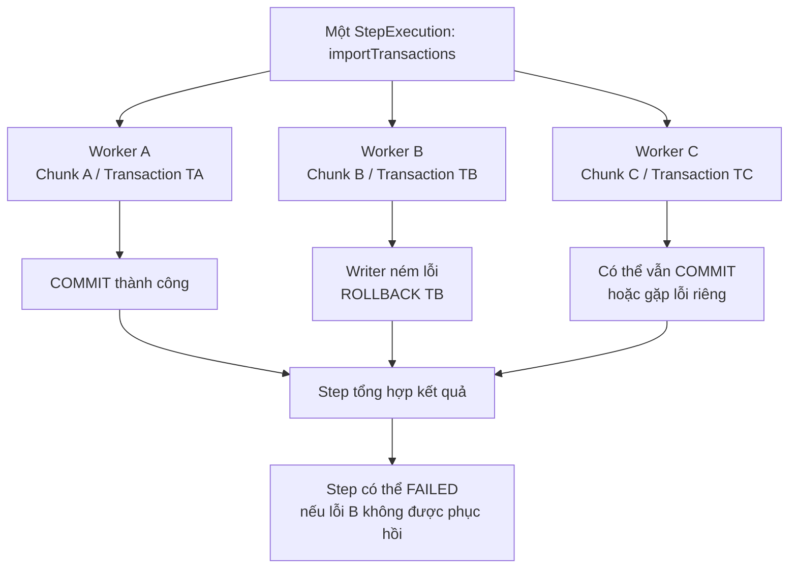
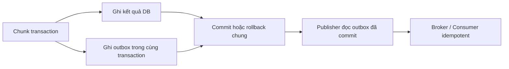
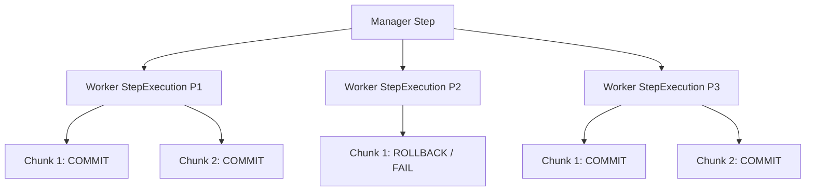

# Rollback khi chunk worker thất bại trong Spring Batch

Khi một Spring Batch Step xử lý hàng triệu bản ghi bằng **local chunking** và `TaskExecutor`, nhiều chunk có thể thực thi đồng thời trên các worker thread. Một chunk có thể gặp lỗi ở `ItemReader`, `ItemProcessor` hoặc `ItemWriter` trong khi các chunk khác đang ghi thành công. Câu hỏi quan trọng không chỉ là “Spring Batch có rollback hay không?” mà còn là **rollback transaction nào, dữ liệu nào đã commit, phần việc nào sẽ chạy lại và làm sao không mất hoặc nhân đôi kết quả?**

Bài thuộc chương **Local Chunking** của module **SPRING_BATCH_SCALING_OPERATIONS**. Module hướng tới mở rộng workload lớn bằng multi-threaded step, parallel steps, partitioning và mô hình phân tán phù hợp, nhưng vẫn giữ thread safety, retry/restart và vận hành an toàn. Bài này tập trung vào rollback trong **chunk worker cùng JVM**; các nguyên tắc về transaction và idempotency cũng là nền tảng khi chuyển sang partitioning hoặc worker từ xa.

Sau bài học, bạn có thể:

- Vẽ ranh giới transaction của từng chunk trên worker thread.
- Giải thích chính xác sự khác nhau giữa **rollback chunk**, **Step thất bại**, **Job thất bại** và **rollback toàn job**.
- Phân tích lỗi read/process/write/commit, retry, skip và các side effect không được rollback.
- Thiết kế writer idempotent, checkpoint có thể restart và chính sách retry hữu hạn.
- Kiểm thử lỗi giữa chừng khi nhiều chunk đang chạy để chứng minh không mất/trùng dữ liệu.

## 1. Tình huống mở đầu: ba worker, một chunk gặp lỗi

Giả sử Step nhập 120.000 giao dịch, kích thước chunk 100, sử dụng một executor có ba worker thread. Mỗi chunk gồm tối đa 100 item; trong cách xử lý chunk thông thường, việc đọc, xử lý, ghi và checkpoint được điều phối trong một transaction của chunk.



Nếu writer của chunk B ném lỗi khiến `TB` rollback:

- Các thay đổi đã thực hiện **trong transaction TB** trên resource tham gia transaction có thể được hoàn tác.
- Dữ liệu của chunk A **đã commit trước đó** không tự bị rollback theo TB.
- Chunk C có thể đang xử lý và có thể commit/rollback riêng, tùy thời điểm, cơ chế điều phối và chính sách lỗi.
- Nếu lỗi B không được retry/skip thành công, Step thường kết thúc với trạng thái thất bại; điều đó **không đồng nghĩa toàn bộ bản ghi từ đầu Job bị undo**.
- Một số side effect phát ra ngoài transaction (gọi API, ghi file, gửi email hoặc message) có thể **đã xảy ra** dù DB của chunk B rollback.

**Nguyên tắc:** trong mô hình nhiều chunk, **atomicity của một chunk không phải atomicity của toàn Step/Job**. Spring Batch quản lý tiến độ và khả năng restart; nó không tự tạo một global transaction bao trùm các chunk đã commit.

## 2. Ranh giới transaction thực tế của chunk

Với `StepBuilder.chunk(100, transactionManager)`, Spring Batch thiết lập transaction cho việc thực thi một chunk theo cấu hình. Trong xử lý chunk đồng bộ thông thường, read/process/write được thực hiện trong phạm vi transaction của chunk; các bước cập nhật `ExecutionContext` và metadata có quan hệ với commit nhưng khả năng atomic xuyên nguồn/đích phụ thuộc resource và transaction manager thực tế.

```mermaid
sequenceDiagram
    participant STEP as Worker chunk
    participant TM as TransactionManager
    participant READER as ItemReader
    participant PROC as ItemProcessor
    participant WRITER as ItemWriter
    participant DB as Database
    STEP->>TM: Begin transaction T1
    loop Đọc tối đa chunkSize item hoặc tới EOF
        STEP->>READER: read()
        READER-->>STEP: item
        STEP->>PROC: process(item)
        PROC-->>STEP: output hoặc null để filter
    end
    STEP->>WRITER: write(Chunk<output>)
    WRITER->>DB: DML trong transaction T1
    alt Thành công
        STEP->>TM: Checkpoint/update thích hợp; commit T1
        TM-->>STEP: Commit thành công
    else Lỗi không phục hồi trong chunk
        STEP->>TM: Rollback T1
        TM-->>STEP: T1 kết thúc không commit
    end
```

**Phân biệt các mốc:**

| Mốc | Điều đã xảy ra | Điều chưa được bảo đảm |
| --- | --- | --- |
| `read()` trả item | Reader đã cung cấp một item cho lần xử lý | Item chưa chắc được ghi hoặc commit |
| `process(item)` trả output | Processor đã chuyển đổi item | Output chưa chắc được writer nhận hoặc commit |
| `write(chunk)` trả về | Writer không ném lỗi ở lời gọi đó | Commit DB có thể vẫn thất bại sau đó |
| `ItemWriteListener.afterWrite` được gọi | Callback sau thao tác writer theo lifecycle | Không phải thông báo commit đã bền vững |
| Transaction commit thành công | Các thay đổi tham gia transaction được commit | API/file/broker khác có thể có trạng thái riêng |
| `BatchStatus.COMPLETED` | Framework coi Job/Step hoàn tất theo các trạng thái được quản lý | Chưa thay thế kiểm tra chất lượng dữ liệu nghiệp vụ |

Một transaction manager JDBC chỉ điều phối những connection/resource thật sự tham gia. Nếu writer dùng datasource khác với transaction manager được truyền vào Step, hoặc processor gọi hệ thống ngoài transaction, giả định “rollback tất cả” là sai.

### Rollback không phải undo chương trình Java

Rollback DB **không hoàn tác** việc processor tăng một biến `AtomicLong`, sửa một `Map` trong RAM, ghi file hay đã gọi API. Nó cũng không khiến CPU time hoặc request đã gửi “chưa từng xảy ra”. Vì vậy, processor nên được thiết kế **tất định và không side effect**, còn writer cần an toàn khi thực hiện lại.

## 3. Thread nào sở hữu transaction rollback?

Với multi-threaded Step, nhiều chunk của cùng `StepExecution` có thể thực thi trên các thread khác nhau. Mỗi thao tác chunk dùng transaction của nó trên thread đang chạy; transaction imperative của Spring **không tự truyền** từ thread tạo task qua `TaskExecutor`.

```mermaid
sequenceDiagram
    participant S as Step / coordinator
    participant EX as TaskExecutor
    participant A as Worker Thread A
    participant B as Worker Thread B
    participant DB as Database
    S->>EX: Submit chunk tasks
    EX->>A: Execute chunk A
    EX->>B: Execute chunk B
    A->>DB: Begin TA; write A
    B->>DB: Begin TB; write B
    A->>DB: COMMIT TA
    B->>DB: ROLLBACK TB
    A-->>S: Chunk A completed
    B-->>S: Chunk B failed
    Note over S,DB: COMMIT TA không bị đảo ngược bởi ROLLBACK TB
```

Điều này có một số hệ quả vận hành:

- **Transaction isolation và lock** được đánh giá trên nhiều transaction đồng thời. Hai chunk ghi cùng khóa có thể chờ lock, deadlock hoặc gây lost update nếu nghiệp vụ không được thiết kế đúng.
- **Transaction context gắn với worker thread**. Không truyền `Connection`, `EntityManager` hay `TransactionSynchronizationManager` của caller sang worker để cố dùng chung một transaction.
- **Reader/processor/writer có thể được truy cập đồng thời** trong một multi-threaded Step. `@StepScope` chỉ tạo bean theo `StepExecution`, **không phải theo thread**, nên vẫn có thể chia sẻ mutable state.
- Khi một chunk thất bại, Step có thể phải chờ/thu nhận trạng thái của các task khác trước khi kết thúc. Không giả định mọi worker lập tức dừng hoặc rằng các chunk đang chạy bị rollback đồng loạt.

Tại thời điểm Step báo lỗi, phải dựa trên `StepExecution`, checkpoint và đối soát DB để biết phần việc nào thực sự đã commit.

## 4. Các kiểu lỗi và phản ứng của chunk

### 4.1. Reader lỗi

Lỗi có thể xuất hiện khi lấy dữ liệu từ DB, file, API hoặc message queue. Tùy exception, loại reader và cấu hình fault tolerance, Step có thể rollback/retry/skip hoặc thất bại. Reader dùng cursor/offset cần giữ checkpoint nhất quán; rollback DB không tự đưa con trỏ file hoặc các kết nối ngoài transaction quay lại vị trí cũ.

Nếu reader dựa trên queue có ngữ nghĩa receive/rollback của broker, cách buffer item khác reader đọc file/database thông thường. Spring Batch có tùy chọn như `readerIsTransactionalQueue()` trong những cấu hình phù hợp, nhưng phải hiểu giao thức queue và contract của reader trước khi áp dụng.

### 4.2. Processor lỗi

Nếu processor ném exception không được xử lý bởi chính sách retry/skip, chunk có thể rollback và Step thất bại. Khi bật retry hoặc phục hồi sau rollback, **processor có thể được gọi lại** với cùng item. Processor có side effect bên ngoài transaction có nguy cơ lặp thao tác.

Processor trả `null` là **filter item**, không phải exception cần rollback. Không nên biến tất cả dữ liệu không hợp lệ thành exception retry: một lỗi nghiệp vụ cố định có thể cần fail hoặc skip theo chính sách thay vì thử nhiều lần.

### 4.3. Writer lỗi

Writer có thể gặp constraint violation, deadlock, connection timeout hoặc lỗi dịch vụ đích. Nếu writer ghi 40 trên 100 item rồi ném exception, và **mọi lệnh ghi DB đó thực sự tham gia cùng transaction chunk**, rollback sẽ hoàn tác những lệnh chưa commit trong transaction. Nhưng nếu writer đã gọi API không transactional hoặc commit riêng cho từng item, rollback bên ngoài không thể hoàn tác mọi side effect.

### 4.4. Commit lỗi

Writer đã trả thành công chưa có nghĩa commit chắc chắn thành công. Transaction có thể thất bại ở giai đoạn commit do network, database hay trạng thái rollback-only. Ở một số lỗi kết nối, client thậm chí **không biết chắc transaction có commit ở phía server hay chưa**. Khi restart, writer cần chịu được khả năng ghi lại, thay vì dựa vào giả định “lỗi commit chắc chắn đồng nghĩa DB chưa lưu gì”.

### 4.5. Một worker không phản hồi hoặc bị kill

Worker có thể dừng khi task đang xử lý hoặc trước khi trả completion. Transaction DB chưa commit thường được DB/connection xử lý rollback khi connection mất, nhưng thời điểm và khả năng nhận biết chính xác phụ thuộc hệ thống. Những chunk khác đã commit không tự mất. JobRepository và dữ liệu đích cần được kiểm tra để quyết định restart.

| Vị trí lỗi | Rủi ro đáng chú ý | Bằng chứng cần lấy |
| --- | --- | --- |
| Reader | Sai checkpoint, đọc lại hoặc bỏ sót item | `ExecutionContext`, khóa input, lỗi nguồn |
| Processor | Callback lặp, side effect ngoài transaction | ID item, số retry, dấu vết API, dữ liệu đích |
| Writer | Ghi một phần, lock, dữ liệu ở resource khác | Trạng thái transaction, unique key, truy vấn đối soát |
| Commit | Trạng thái commit có thể không chắc chắn | DB, JobRepository, log transaction, idempotency |
| Worker/JVM crash | Mất task trong RAM, mất context tạm | `StepExecution`, dữ liệu đã commit, checkpoint |

## 5. Ví dụ cấu hình multi-threaded chunk Step có rollback và retry

Đoạn sau mô tả Spring Batch 5.x. Kiểu `InputOrder`, `OutputOrder`, reader/writer và bean executor được ứng dụng cung cấp. **Đây là minh họa Step configuration**, không phải lời khẳng định mọi reader có thể được dùng trên nhiều thread.

```java
import org.springframework.batch.core.Step;
import org.springframework.batch.core.repository.JobRepository;
import org.springframework.batch.core.step.builder.StepBuilder;
import org.springframework.batch.item.ItemProcessor;
import org.springframework.batch.item.ItemReader;
import org.springframework.batch.item.ItemWriter;
import org.springframework.context.annotation.Bean;
import org.springframework.core.task.TaskExecutor;
import org.springframework.dao.TransientDataAccessException;
import org.springframework.transaction.PlatformTransactionManager;

@Bean
public Step importOrdersStep(
        JobRepository jobRepository,
        PlatformTransactionManager transactionManager,
        ItemReader<InputOrder> concurrentSafeReader,
        ItemProcessor<InputOrder, OutputOrder> processor,
        ItemWriter<OutputOrder> idempotentWriter,
        TaskExecutor chunkExecutor) {

    return new StepBuilder("importOrdersStep", jobRepository)
            .<InputOrder, OutputOrder>chunk(100, transactionManager)
            .reader(concurrentSafeReader)
            .processor(processor)
            .writer(idempotentWriter)
            .faultTolerant()
            .retry(TransientDataAccessException.class)
            .retryLimit(3)
            .skip(InvalidOrderException.class)
            .skipLimit(20)
            .taskExecutor(chunkExecutor)
            .build();
}
```

**Ý nghĩa:**

- `chunk(100, transactionManager)` thiết lập kích thước chunk và transaction manager. Không tạo transaction mới cho **mỗi** lần `process()`.
- `.retry(...)` và `.retryLimit(3)` yêu cầu framework thử lại lỗi thuộc nhóm được phép trong giới hạn đã cấu hình. Kiểm tra chính sách retry thực tế theo exception và phiên bản; không xem đây là “retry vô hạn”.
- `.skip(...)` và `.skipLimit(20)` cho phép bỏ qua một số item lỗi thuộc nhóm được khai báo, với giới hạn tổng theo cơ chế framework. Skip là quyết định nghiệp vụ và phải ghi nhận, đối soát.
- `.taskExecutor(chunkExecutor)` cho phép thực thi chunk đồng thời theo chính sách Step/executor tương ứng.
- Các tên `concurrentSafeReader` và `idempotentWriter` là **điều kiện phải chứng minh**, không phải thuộc tính Spring Batch tự tạo. Nếu không kiểm chứng được reader state/restartability, nên chọn chiến lược partition theo dữ liệu ổn định thay vì bật multi-threaded reader tùy tiện.

### Cấu hình executor có giới hạn

```java
import java.util.concurrent.ThreadPoolExecutor;
import org.springframework.context.annotation.Bean;
import org.springframework.scheduling.concurrent.ThreadPoolTaskExecutor;

@Bean
public ThreadPoolTaskExecutor chunkExecutor() {
    ThreadPoolTaskExecutor executor = new ThreadPoolTaskExecutor();
    executor.setCorePoolSize(4);
    executor.setMaxPoolSize(4);
    executor.setQueueCapacity(8);
    executor.setThreadNamePrefix("chunk-worker-");
    executor.setRejectedExecutionHandler(
            new ThreadPoolExecutor.AbortPolicy());
    return executor; // Spring quản lý khởi tạo và hủy bean.
}
```

Pool giới hạn tối đa bốn task đang chạy và tám task chờ trong hàng đợi của executor. **Queue đầy không phải rollback**: việc submit bị từ chối xảy ra trước khi task đó được thực thi. Step cần nhận và xử lý lỗi điều phối đúng cách. Không dùng `DiscardPolicy` để âm thầm bỏ chunk bắt buộc; việc một chunk chưa được submit thành công không được tính là đã xử lý.

**Chú ý phiên bản:** giới hạn đồng thời của Step không nhất thiết đồng nhất với số thread tối đa của executor. Các API throttle trong phiên bản Spring Batch khác nhau có thể thay đổi. Đo active thread, queue wait và số chunk thực tế thay vì đoán từ một thuộc tính đơn lẻ.

## 6. Processor an toàn khi phải chạy lại

Một processor tốt cho chunk nhiều thread nên **stateless**, tất định theo input và cấu hình bất biến, không gọi side effect bên ngoài transaction.

```java
import java.math.BigDecimal;
import java.math.RoundingMode;
import org.springframework.batch.item.ItemProcessor;

record InputOrder(long id, String batchId, BigDecimal amount) {}
record OutputOrder(long id, String batchId, BigDecimal amount) {}

final class InvalidOrderException extends RuntimeException {
    InvalidOrderException(long id) {
        super("Invalid order: " + id);
    }
}

public final class NormalizeOrderProcessor
        implements ItemProcessor<InputOrder, OutputOrder> {

    @Override
    public OutputOrder process(InputOrder order) {
        if (order.amount() == null || order.amount().signum() < 0) {
            throw new InvalidOrderException(order.id());
        }
        if (order.amount().signum() == 0) {
            return null; // Filter, không phải lỗi rollback.
        }
        BigDecimal normalized = order.amount()
                .setScale(2, RoundingMode.HALF_UP);
        return new OutputOrder(order.id(), order.batchId(), normalized);
    }
}
```

Với cùng input, `process()` cho cùng output. Không tăng counter nghiệp vụ trong field dùng chung, không gửi email và không ghi “đã xử lý” vào service ngoài transaction ở đây. Các kiểu `record` và exception nên được đặt ở file Java thích hợp khi tích hợp.

Nếu cần kiểm tra một dịch vụ ngoài như tính phí, hãy xác định rõ lời gọi đó có side effect hay không, response có ổn định khi retry không và cách version cấu hình. Một phép tính phụ thuộc “tỷ giá hiện tại” có thể trả kết quả khác giữa lần thử đầu và lần restart; cần chốt snapshot/phiên bản cho Job.

## 7. Writer có thể chạy lại mà không nhân bản dữ liệu

Khi xảy ra lỗi lúc commit, timeout hoặc restart, một chunk đã ghi dữ liệu có thể phải chạy lại. Giải pháp hay dùng với PostgreSQL là tạo **unique key theo định danh nghiệp vụ** và sử dụng upsert có ngữ nghĩa rõ ràng.

```sql
CREATE TABLE normalized_orders (
    batch_id    varchar(80) NOT NULL,
    order_id    bigint NOT NULL,
    amount      numeric(18, 2) NOT NULL,
    PRIMARY KEY (batch_id, order_id)
);
```

```java
import javax.sql.DataSource;
import org.springframework.batch.item.database.JdbcBatchItemWriter;
import org.springframework.batch.item.database.builder.JdbcBatchItemWriterBuilder;
import org.springframework.context.annotation.Bean;

@Bean
public JdbcBatchItemWriter<OutputOrder> idempotentWriter(
        DataSource dataSource) {

    return new JdbcBatchItemWriterBuilder<OutputOrder>()
            .dataSource(dataSource)
            .sql("""
                INSERT INTO normalized_orders (batch_id, order_id, amount)
                VALUES (?, ?, ?)
                ON CONFLICT (batch_id, order_id)
                DO UPDATE SET amount = EXCLUDED.amount
                """)
            .itemPreparedStatementSetter((item, ps) -> {
                ps.setString(1, item.batchId());
                ps.setLong(2, item.id());
                ps.setBigDecimal(3, item.amount());
            })
            .build();
}
```

Đoạn SQL dùng cú pháp PostgreSQL. Khi Step transaction manager thực sự quản lý datasource của writer và driver/cấu hình tham gia transaction đúng, các lệnh `INSERT/UPDATE` trong chunk được commit/rollback cùng transaction.

Tuy nhiên, upsert **không đủ cho mọi loại nghiệp vụ**:

- Nếu yêu cầu lưu lịch sử biến động, `DO UPDATE` có thể xóa dấu vết các phiên bản trước.
- Nếu writer cộng dồn kiểu `balance = balance + delta` mỗi lần chạy, retry có thể tăng số dư hai lần.
- Nếu hai chunk có thể ghi cùng `order_id` với **giá trị khác nhau**, upsert cuối cùng thắng là sai nghiệp vụ dù không tạo duplicate row.
- Nếu dữ liệu nguồn thay đổi giữa restart, cùng khóa có thể mang giá trị mới. Cần snapshot/`batchId` hoặc version để tái hiện.

Định nghĩa idempotency phải dựa vào **kết quả nghiệp vụ cuối cùng**, không chỉ “không có hai hàng cùng khóa”.

## 8. Tại sao retry khác rollback và skip?

Ba cơ chế có vai trò riêng:

- **Rollback:** kết thúc transaction mà không commit những thay đổi đang tham gia transaction đó.
- **Retry:** thử lại thao tác bị lỗi trong giới hạn, thường vì lỗi có khả năng tạm thời.
- **Skip:** chấp nhận loại bỏ một item không thể xử lý theo chính sách, tiếp tục với phần hợp lệ.

Bảng dưới là mô hình tư duy, không mô tả chi tiết thứ tự callback nội bộ mọi loại reader/writer.

| Tình huống | Hành vi chính sách | Điều cần đối soát |
| --- | --- | --- |
| Processor trả `null` | Filter item, tiếp tục chunk | `filterCount` và output |
| Processor ném lỗi không cấu hình skip/retry | Chunk lỗi; transaction có thể rollback; Step fail | `rollbackCount`, DB, trạng thái Step |
| Processor ném lỗi được retry | Framework thử lại trong giới hạn đã đặt | Số lượt gọi processor có thể nhiều hơn 1 |
| Processor ném lỗi được skip | Framework loại item theo chính sách | `processSkipCount`, các khóa bị loại |
| Writer ném lỗi tạm thời được retry | Chunk có thể rollback và được thử lại | Không nhân đôi side effect |
| Writer ném lỗi chỉ ở một item | Fault-tolerant logic có thể tách/xác định item lỗi để skip theo chính sách | Không giả định writer chỉ chạy đúng một lần |
| Commit không chắc chắn | Có thể cần retry/restart theo metadata thực tế | Unique key, dữ liệu bền vững, đối soát |

### Có phải cứ skip là không rollback?

**Không.** Việc exception được đánh dấu skip không đồng nghĩa mọi đường đi đều không rollback. Spring Batch có quy tắc rollback classifier và hành vi fault-tolerant khác nhau tùy lỗi ở read/process/write. Có tình huống framework cần rollback để phục hồi writer hoặc xác định item lỗi; có tình huống xử lý skip không yêu cầu rollback theo cùng cách. Đừng viết logic nghiệp vụ dựa trên giả định “skip luôn commit” hoặc “skip luôn rollback toàn chunk”.

Tương tự, `noRollback(SomeException.class)` (khi API/config hỗ trợ) chỉ thay đổi chính sách rollback **trong bối cảnh được cấu hình**, không thể sửa một transaction đã bị resource đánh dấu rollback-only. Không dùng `noRollback` tùy tiện để “bỏ qua lỗi DB” vì có thể gây ghi thiếu và checkpoint không nhất quán.

### Retry phải có giới hạn và phân loại lỗi

Lỗi ngắn hạn như deadlock/transient connection failure có thể đáng retry. Lỗi dữ liệu cố định như thiếu khóa bắt buộc thường không nên retry nhiều lần. Luôn:

1. Phân loại lỗi nghiệp vụ, lỗi hạ tầng tạm thời và lỗi không thể phục hồi.
2. Đặt giới hạn retry/skip và theo dõi tổng số lỗi.
3. Cân nhắc backoff, jitter hoặc giảm concurrency nếu backend bị quá tải.
4. Ghi khóa item/partition lỗi trong log có kiểm soát.
5. Đối soát dữ liệu sau khi Step kết thúc hoặc restart.

## 9. Side effect từ processor có thể tồn tại sau rollback

### 9.1. Anti-pattern: gửi email ngay trong process()

```java
public OutputOrder process(InputOrder input) {
    OutputOrder result = normalize(input);
    notificationClient.sendEmail(input.id()); // Không thuộc JDBC transaction.
    return result;
}
```

Giả sử email được gửi thành công cho 100 item, nhưng writer DB ném lỗi và transaction chunk rollback. Framework retry chunk, processor chạy lại và gửi thêm email. Kết quả là **mỗi đơn có thể nhận hai email** dù DB chỉ commit một lần.

### 9.2. Anti-pattern: commit riêng bên trong processor

```java
@Transactional(propagation = Propagation.REQUIRES_NEW)
public void writeAudit(long orderId) {
    auditRepository.insert(orderId);
}
```

Nếu lời gọi này đi qua Spring transaction proxy, `REQUIRES_NEW` tạo transaction riêng trên worker thread, tạm ngưng transaction chunk đang có theo chính sách manager. Audit có thể commit trong khi chunk ngoài rollback. Với nhiều worker, outer/inner transaction cũng có thể cần thêm connection và gây áp lực pool.

Không thêm `@Transactional` hoặc `REQUIRES_NEW` chỉ để “chắc chắn ghi được” mà chưa mô tả được transaction boundary và cơ chế khôi phục.

### 9.3. Transactional outbox: lưu dự định gửi cùng dữ liệu

Khi cần phát event gắn với dữ liệu DB đã ghi:

1. Processor tạo output và metadata event (không gửi event trực tiếp).
2. Writer ghi dữ liệu nghiệp vụ và **outbox record có event ID duy nhất** trong **cùng transaction DB**.
3. Sau commit, một publisher riêng đọc outbox và gửi đến broker/API.
4. Publisher có thể gửi lại khi mất acknowledgement, nên consumer phải idempotent.



Mẫu này giải quyết tình huống “DB rollback nhưng event đã phát” ở chiều phát sau commit. Nó **không mặc định bảo đảm exactly-once delivery**, vì publisher có thể gửi lại sau khi broker nhận event nhưng trước khi publisher kịp đánh dấu đã gửi.

## 10. Checkpoint sau rollback: điều gì được phép xử lý lại?

Spring Batch dùng `JobRepository`, `StepExecution` và `ExecutionContext` để lưu tiến độ và trạng thái, với sự hỗ trợ của các `ItemStream` reader/writer có state. Khi một chunk rollback, framework cần bảo đảm phần việc chưa hoàn thành có thể được xử lý lại theo hợp đồng của reader/transaction và cách lưu trạng thái.

**Không dùng field của processor làm checkpoint.** Ví dụ processor lưu `lastSeenId` sau mỗi lần `process()`. Nếu chunk đọc tới ID 500 nhưng writer rollback cả chunk, giá trị `lastSeenId=500` chỉ phản ánh **đã nhìn thấy**, không phản ánh **đã commit**. Dùng nó để bỏ qua ID ≤ 500 khi restart sẽ làm mất bản ghi.

### Những khác biệt theo loại reader

| Reader / nguồn | Đặc điểm trạng thái | Rủi ro khi rollback |
| --- | --- | --- |
| JDBC cursor | Cursor và vị trí đọc mutable | Có thể không rewind như mong muốn nếu cấu hình không phù hợp; checkpoint theo vị trí cần kiểm chứng |
| JDBC paging | Trang/offset và khóa sort | Input thay đổi giữa chunk/restart có thể dẫn tới thiếu/trùng; cần sort key duy nhất, ổn định |
| File reader | Số dòng/vị trí file | Rollback JDBC không trực tiếp cuộn lại file; framework phải quản lý state |
| Transactional message queue | Receive/ack theo ngữ nghĩa broker | Message rollback/redelivery có thể khác reader non-transactional; cần cấu hình đúng |
| Reader custom | Tự quyết định quản lý cursor/state | Phải tự chứng minh contract `ItemStream` và restart |

Trong **multi-threaded Step**, nhiều chunk của cùng `StepExecution` có thể đọc và commit **khác thứ tự**. Dùng mutex bảo vệ `read()` chưa đủ chứng minh checkpoint theo vị trí có thể phục hồi đúng. `@StepScope` cũng không tạo một reader riêng cho mỗi thread trong cùng StepExecution.

Nếu yêu cầu restart rất chặt, cân nhắc **local partitioning với reader step-scoped theo từng worker StepExecution**, sử dụng khoảng khóa hoặc bucket không chồng lấn và nguồn dữ liệu bất biến. Dù vậy mỗi partition vẫn cần writer idempotent và checkpoint đúng.

## 11. Restart Job sau khi một chunk worker thất bại

Một chuỗi sự kiện minh họa:

1. Job bắt đầu với một Step xử lý 1.000 item bằng các chunk 100.
2. Các chunk khác nhau có thể đang chạy song song.
3. Một chunk ném lỗi writer không phục hồi được; transaction của chunk đó rollback.
4. Một số chunk khác có thể đã commit trước khi Step cuối cùng chuyển sang `FAILED`.
5. Khi vận hành viên restart **cùng JobInstance** theo cơ chế Spring Batch và điều kiện restart cho phép, reader/Step sẽ tiếp tục dựa vào metadata đã persist.
6. Writer và dữ liệu đầu vào phải an toàn khi framework đọc/chạy lại phần việc chưa được xác nhận.

**Đừng giả định các chunk được đánh số 1, 2, 3... commit đúng thứ tự đọc.** Trong multi-threaded Step, commit đảo thứ tự có thể khiến một checkpoint vị trí đơn không đủ mô tả tập item đã commit. Khả năng restart phụ thuộc reader, cách Step quản lý chunk, data source và transaction.

### Những tình huống cần phân biệt

| Tình huống | Điều nên thực hiện |
| --- | --- |
| Chỉ một chunk rollback, các chunk khác đã commit | Không xóa dữ liệu đã commit nếu không có phương án nghiệp vụ rõ; xác định phần cần chạy lại |
| Step `FAILED` sau lỗi không phục hồi | Kiểm tra nguyên nhân, checkpoint, idempotency trước khi restart |
| Process crash giữa commit DB và cập nhật metadata khác resource | Đối soát nguồn dữ liệu đích; chạy lại có chống trùng |
| Worker gọi API ngoài transaction trước khi lỗi | Tìm dấu vết side effect và reconciliation; không gửi lại mù quáng |
| Thay đổi tham số partition/bucket hoặc input snapshot khi restart | Dừng và thiết kế một JobInstance mới có kiểm soát; không tráo tập công việc |

Một JobExecution `FAILED` không nói chính xác những bảng nào đã ghi thành công. Trạng thái framework là thông tin điều phối; dữ liệu đích vẫn phải được kiểm tra độc lập.

## 12. Local partitioning: rollback của worker Step khác rollback của chunk

Ngoài multi-threaded Step, một kiến trúc thường dùng là **manager Step** tạo nhiều worker `StepExecution`, mỗi worker xử lý **nhiều chunk theo tuần tự**, rồi chạy các worker Step đồng thời qua `TaskExecutor`.



Nếu chunk thuộc worker P2 rollback và worker Step P2 thất bại:

- Các chunk đã commit ở P1 và P3 **không bị tự động rollback**.
- Manager tổng hợp trạng thái worker; kết quả Job có thể thất bại tùy Step/Job flow.
- Tên partition, `ExecutionContext` và dữ liệu đọc phải ổn định để restart đúng phần.
- Reader `@StepScope` của mỗi worker có instance riêng theo `StepExecution`, giúp tránh một số rủi ro shared cursor. Nhưng singleton processor/writer/listener vẫn cần audit thread safety.

Sự khác biệt với **multi-threaded Step** là các partition có `StepExecution` và checkpoint riêng, làm ranh giới phần việc rõ hơn trong nhiều workload. Không có giải pháp tự động đúng cho mọi dữ liệu: partition không chồng lấn và writer idempotent vẫn là yêu cầu cốt lõi.

## 13. Remote worker và biên transaction phân tán

Khi chuyển sang remote partitioning hoặc remote chunking, rollback local của worker **không thể tự rollback** transaction ở manager hoặc broker.

Ví dụ remote chunking:

1. Manager gửi chunk message cho worker.
2. Worker ghi DB trong transaction local rồi commit.
3. Worker gặp lỗi mạng trước khi xác nhận thành công.
4. Broker/manager có thể giao lại công việc.
5. Một worker khác thực thi lại cùng chunk.

Trong tình huống này, **rollback của một transaction khác không đảo ngược lần commit đầu tiên**. Cần idempotency key ổn định, duy trì trạng thái bền vững, cơ chế ack/timeout phù hợp và đối soát khi kết quả không chắc chắn.

Đối với local chunking, ta có thể quan sát các thread cùng JVM; đối với remote worker, còn phải theo dõi consumer lag, message redelivery, timeout, worker heartbeat và các giới hạn lưu trữ queue.

## 14. Đo rollback khi tăng concurrency

Với workload lớn, tăng worker có thể làm throughput tốt hơn nhưng cũng làm lỗi do lock/connection pool nghiêm trọng hơn. Các chỉ số nên lưu:

| Nhóm metric | Ví dụ | Ý nghĩa |
| --- | --- | --- |
| Tốc độ toàn Step | Wall-clock, item/s đã ghi | Mục tiêu throughput thực tế |
| Chunk | Chunk duration, số chunk commit và fail | Quan sát lượng việc và transaction |
| Transaction | `commitCount`, `rollbackCount`, commit latency | Chi phí commit/rollback và lỗi |
| Processor | Lượt gọi, p95 latency, số item filter | Nút thắt CPU/API, callback chạy lại |
| Writer | p95 write latency, SQL error, lock wait | Phát hiện bottleneck DB |
| Retry/skip | Retry attempts, `processSkipCount`, `writeSkipCount` | Lỗi đang được xử lý hay che giấu |
| Executor | Active threads, queue wait, rejected tasks | Pool có quá tải không |
| Database | Connections active/pending, deadlock, transaction log | Tài nguyên và độ tranh chấp |
| Tính đúng đắn | Số ID thiếu/trùng, checksum/tổng tiền | Chống sai dữ liệu âm thầm |

**Cẩn trọng với cách cộng thời gian:** Khi bốn worker cùng chạy, tổng thời gian processor/writer có thể lớn hơn wall-clock của Step. Không lấy tổng timer của nhiều thread chia wall-clock rồi diễn giải là phần trăm thời gian tuần tự. Đo throughput theo lượng item đã commit và thời gian thực.

### Ví dụ ước lượng

Một job có 4 worker, mỗi chunk 100 item, bình thường hoàn thành trong 0,5 giây. Năng lực lý tưởng có thể gần:

\[
\frac{4 \times 100}{0.5} = 800 \text{ item/giây}
\]

Nhưng nếu nhiều chunk rollback và được thử lại, throughput *item đã commit* thấp hơn tốc độ callback read/process/write. Nếu tăng lên 8 worker mà database chờ lock, số rollback/deadlock có thể tăng, làm throughput thực tế **giảm**. Cần đo cả lỗi và resource, không chỉ đếm số thread.

## 15. Ma trận kiểm thử rollback trước production

Chạy trên snapshot dữ liệu cố định, với khóa input duy nhất và đầu ra có thể đối soát. Thiết kế cơ chế fault injection có kiểm soát để tạo lỗi tại nhiều điểm.

| Thử nghiệm | Cách tạo lỗi | Điều phải kiểm tra |
| --- | --- | --- |
| Processor ném lỗi nghiệp vụ | Một item có amount âm | Step fail hoặc skip đúng policy; item hợp lệ không mất |
| Processor gặp lỗi tạm thời | Throw ở lần đầu, thành công lần sau | Retry hữu hạn; kết quả cuối đúng |
| Writer fail trước khi ghi DB | Lỗi trước SQL | Transaction rollback; không có output nửa chừng |
| Writer fail sau một số câu SQL | Ném lỗi giữa batch DB cùng transaction | Không còn thay đổi chưa commit khi rollback |
| Writer gửi API rồi fail | External side effect trước rollback | Phát hiện lặp; thiết kế idempotency/outbox |
| DB commit timeout/mất kết nối | Tạo sự cố tại biên commit | Trạng thái không chắc chắn được reconcile; upsert không nhân đôi |
| 4 hoặc 8 chunk cùng chạy | Đồng bộ thời điểm bắt đầu, một chunk lỗi | Chunk khác có thể commit; Step không báo thành công giả |
| JVM bị kill giữa chunk | Kill worker trong môi trường thử | Restart xử lý đúng dữ liệu chưa commit |
| Reader có checkpoint theo vị trí | Lỗi khi chunk commit đảo thứ tự | Phát hiện đọc trùng/thiếu; đánh giá cần partitioning |
| Queue executor đầy | Tăng tải submit, giới hạn queue | Rejection rõ ràng, không mất task im lặng |

### Ví dụ truy vấn đối soát

```sql
-- Ví dụ PostgreSQL, giới hạn trong đúng một batch.
SELECT order_id, COUNT(*) AS duplicate_count
FROM normalized_orders
WHERE batch_id = :batchId
GROUP BY order_id
HAVING COUNT(*) > 1;

SELECT COUNT(*) AS output_count, SUM(amount) AS output_amount
FROM normalized_orders
WHERE batch_id = :batchId;

-- So sánh tập khóa đã xử lý với đầu vào đã chốt.
SELECT s.order_id
FROM staging_orders s
LEFT JOIN normalized_orders o
    ON o.batch_id = s.batch_id
   AND o.order_id = s.order_id
WHERE s.batch_id = :batchId
  AND o.order_id IS NULL;
```

Truy vấn tìm khóa thiếu cần điều chỉnh khi job có **filter/skip** hoặc khi một input sinh nhiều output; không phải mọi input đều bắt buộc có output. Nếu bảng đích có unique constraint thì duplicate count có thể luôn bằng 0, nhưng vẫn phải kiểm tra **khóa thiếu, khóa thừa và giá trị sai**.

Khi so sánh với baseline tuần tự, dùng cùng input snapshot, quy tắc nghiệp vụ và version. Lặp kiểm thử nhiều lần ở concurrency mục tiêu, đặc biệt tại ranh giới rollback/commit.

## 16. Những hiểu nhầm thường gặp

| Hiểu nhầm | Thực tế | Điều cần làm |
| --- | --- | --- |
| “Một chunk lỗi thì toàn Job tự rollback” | Chỉ transaction liên quan rollback; các chunk đã commit vẫn tồn tại | Xem checkpoint, DB và trạng thái từng Step |
| “Writer trả về thì commit xong” | Commit xảy ra sau writer trong lifecycle transaction | Kiểm tra lỗi commit và thiết kế idempotency |
| “`@StepScope` = mỗi thread một reader” | Scope theo `StepExecution`, không theo thread | Audit shared state; cân nhắc partitioning |
| “Thêm `synchronized` là restart an toàn” | Có thể vẫn commit đảo thứ tự và checkpoint sai | Test crash/restart với reader thực |
| “Skip luôn không rollback” | Phụ thuộc pha lỗi, rollback classifier và fault-tolerant policy | Test skip ở read/process/write |
| “`REQUIRES_NEW` sẽ đi cùng rollback chunk” | Transaction mới có thể commit độc lập | Tránh commit riêng nếu muốn atomicity chunk |
| “Task đã vào queue tức là xử lý xong” | Task còn ở RAM, chưa chạy hoặc commit | Để Batch quản lý trạng thái; xử lý rejection |
| “Không có row trùng nghĩa là dữ liệu đúng” | Upsert có thể ghi đè sai giá trị hoặc thiếu key | Đối soát checksum/giá trị và tập khóa |
| “Retry nhanh và nhiều lần luôn tốt hơn” | Có thể làm DB/APIs quá tải, kéo dài lỗi | Phân loại lỗi, giới hạn, backoff, đo bottleneck |

## 17. Checklist vận hành khi chunk worker thất bại

- [ ] Đã xác định transaction manager của Step và các datasource/resource mà reader, processor, writer sử dụng.
- [ ] Đã biết chunk nào commit, chunk nào rollback; không coi Step `FAILED` là rollback toàn Job.
- [ ] Đã phân loại exception theo retry/skip/fail; có giới hạn và metric tương ứng.
- [ ] Processor không có side effect không idempotent; mọi thay đổi ngoài transaction đều được thiết kế riêng.
- [ ] Writer có unique key hoặc cơ chế idempotency phù hợp với nghiệp vụ.
- [ ] Reader, processor, writer và listener được kiểm tra thread safety khi nhiều chunk cùng `StepExecution`.
- [ ] `ExecutionContext`/checkpoint có thể khôi phục khi thứ tự đọc khác thứ tự commit.
- [ ] Không dùng counter/lastSeenId trong processor làm checkpoint đã commit.
- [ ] Có khả năng xác định item/partition lỗi bằng log mà không lộ dữ liệu nhạy cảm.
- [ ] Executor có giới hạn thread, queue và xử lý rejection rõ ràng.
- [ ] Đã kiểm tra lỗi tại read, process, write và commit; đồng thời thử worker/JVM crash.
- [ ] Đã đối soát khóa, số lượng, checksum và giá trị sau retry/restart.
- [ ] Đã benchmark throughput thực và mức DB lock/connection wait dưới tải production.
- [ ] Có runbook: dừng job, giữ bằng chứng, xác minh commit, quyết định restart hoặc xử lý dữ liệu thủ công.

### Runbook ngắn cho một Step FAILED

1. **Ngừng kích hoạt thêm lần xử lý chồng lấn** với cùng dữ liệu nếu chưa có cơ chế cô lập rõ ràng.
2. Ghi nhận `jobExecutionId`, `stepExecutionId`, nguyên nhân exception, số rollback/retry, thời điểm lỗi và cấu hình worker.
3. Xác định transaction đã chắc chắn rollback, đã commit hay đang không rõ tại biên network/commit; kiểm tra DB đích và source snapshot.
4. Đối soát các khóa đã ghi, chưa ghi, bị skip, side effect ở API/broker và trạng thái outbox.
5. Sửa lỗi, xác minh idempotency và điều kiện restart; không khởi động lại liên tục khi lỗi chưa được hiểu.
6. Restart theo cơ chế Spring Batch nếu phù hợp; sau đó đối soát lần nữa và cập nhật tài liệu sự cố.

## 18. Bài tập thực hành

1. **Ba chunk đồng thời:** A commit, B ném lỗi khi writer, C commit sau B. Hãy giải thích vì sao Step có thể FAILED dù DB chứa kết quả của A và C.
2. **Processor có API:** processor gửi request trừ tiền rồi writer DB lỗi. Rollback có hoàn tác trừ tiền không? Hãy đề xuất một thiết kế idempotency hoặc outbox/saga phù hợp.
3. **Reader có offset chung:** chunk 2 đọc tới ID 200 và commit trước chunk 1 đang xử lý ID 1–100. Nếu lưu checkpoint = 200, rủi ro gì phát sinh khi chunk 1 rollback rồi restart?
4. **Retry policy:** một lỗi mạng tạm thời và một lỗi dữ liệu sai định dạng. Bạn sẽ retry, skip hay fail từng loại theo điều kiện nào?
5. **Biên commit:** writer trả thành công nhưng DB connection mất trong commit. Làm thế nào xác minh dữ liệu, và unique constraint/upsert giúp gì?
6. **Partitioning:** so sánh khả năng restart của một multi-threaded Step chia chung reader với tám worker StepExecution riêng theo range khóa.
7. **Tuning:** tăng từ 4 lên 12 worker khiến throughput giảm và deadlock tăng. Bạn sẽ đo/điều chỉnh những biến nào trước?
8. **Đối soát:** thiết kế truy vấn kiểm tra bản ghi thiếu/trùng/sai giá trị sau lần restart có 10 item bị filter và 2 item được skip hợp lệ.

## Kết luận

**Rollback khi một chunk worker thất bại chỉ bảo vệ transaction của chunk và các resource thật sự tham gia**, không tự đảo ngược những chunk đã commit hay side effect ngoài transaction. Trong multi-threaded local chunking, các chunk có thể commit khác thứ tự, khiến checkpoint và restart khó hơn xử lý tuần tự. Muốn mở rộng Spring Batch an toàn, hãy giữ processor có thể chạy lại, phân loại retry/skip, thiết kế writer idempotent, kiểm tra reader/thread safety, và chứng minh tính đúng đắn bằng lỗi chủ động cùng đối soát dữ liệu cuối cùng.
