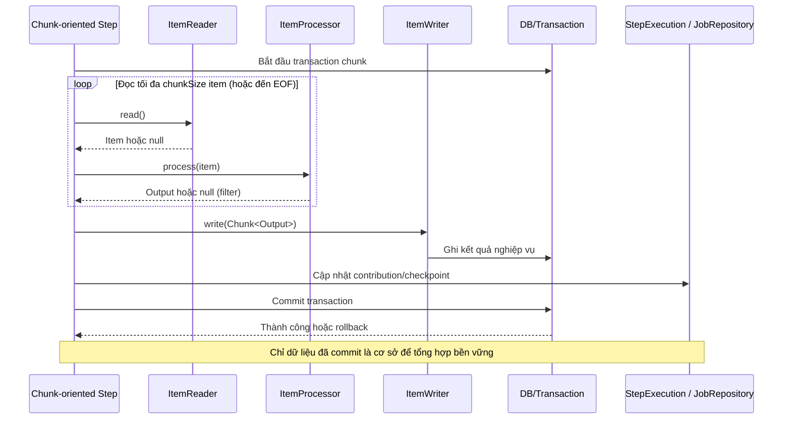
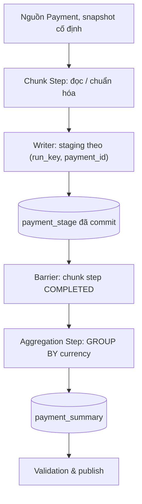
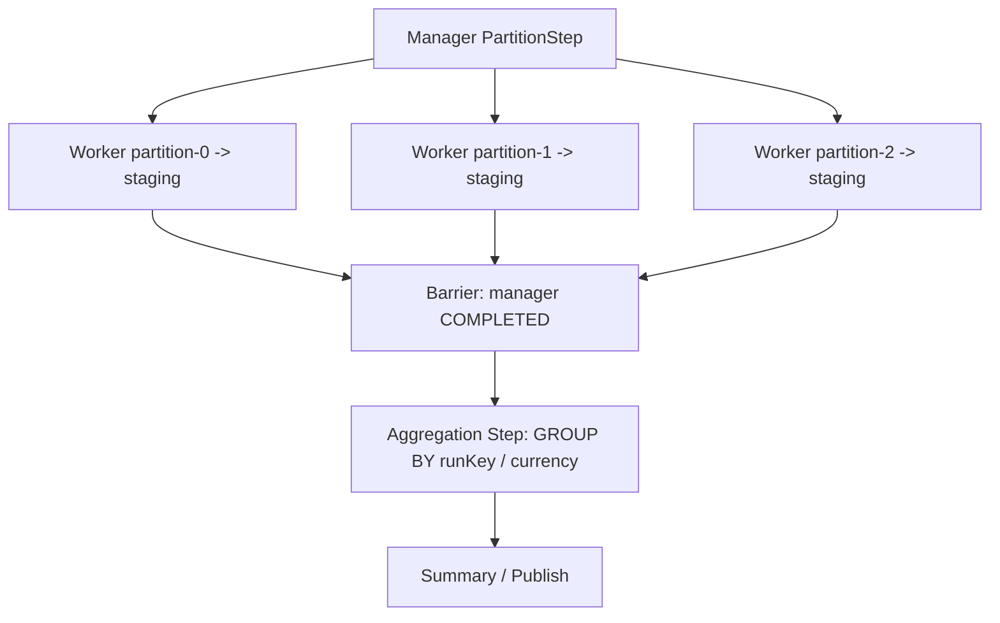

# Aggregation kết quả chunk trong Spring Batch Local Chunking

## Mục tiêu bài học

Trong module **SPRING_BATCH_SCALING_OPERATIONS**, chúng ta mở rộng Spring Batch cho workload dữ liệu lớn qua multi-threaded step, parallel steps, partitioning và các mô hình phân tán, nhưng phải giữ đúng transaction, thread safety, retry/restart và khả năng vận hành. Bài thuộc chương **Local Chunking** giải thích cách **tổng hợp (aggregation) kết quả các chunk** thành kết quả đáng tin cậy của một step hoặc toàn job.

Sau bài học, bạn có thể:

- Phân biệt dữ liệu **trong một chunk**, số đếm kỹ thuật của `StepExecution` và chỉ số nghiệp vụ tổng hợp.
- Nắm cách `Chunk`, `StepContribution`, `StepExecution` và `ExecutionContext` phối hợp quanh ranh giới transaction.
- Chọn cách aggregation trong bộ nhớ, SQL hoặc bước tổng hợp riêng sau khi mọi chunk/partition hoàn tất.
- Nhận diện nguy cơ đếm trùng khi rollback/retry/restart, ghi đè khi nhiều thread và sai lệch do filter/skip.
- Xây dựng pipeline local chunking với staging có khóa duy nhất rồi tổng hợp theo `runKey`.
- Đo throughput, chi phí aggregation và tính đúng trước khi tăng `chunkSize` hoặc concurrency.

> **Phạm vi ví dụ:** API Java minh họa Spring Batch **5.2.x**, Spring Framework 6.x và PostgreSQL. Phần xử lý chunk áp dụng rộng hơn, nhưng chữ ký interface và builder cần đối chiếu phiên bản thực tế. Các ví dụ tách phần lõi học thuật khỏi cấu hình đầy đủ DataSource, schema, migration và deployment.

## 1. “Kết quả chunk” có thể là ba loại khác nhau

Chunk-oriented processing thường làm việc theo lô: **read → process → write → commit**, rồi lặp đến hết dữ liệu. Tuy nhiên, “tổng hợp kết quả chunk” có thể mang nhiều ý nghĩa:

| Loại aggregation | Cần biết điều gì? | Nơi lấy số liệu phù hợp |
| --- | --- | --- |
| **Kỹ thuật (execution)** | Đã đọc, ghi, filter, skip, commit, rollback bao nhiêu item/chunk? | `StepExecution`, `JobRepository`, metrics sau commit |
| **Nghiệp vụ (business)** | Tổng tiền theo ngày, số đơn theo currency, checksum hoặc số dư? | Bảng nghiệp vụ/staging đã commit, query `GROUP BY`, bước reducer |
| **Điều phối (job/partition)** | Các step hay partition nào hoàn tất, lỗi hoặc cần retry? | `JobExecution`, tập `StepExecution` con và trạng thái thực thi |

Ba loại này không thể thay thế cho nhau. Chẳng hạn `writeCount=1000` nói framework ghi nhận 1000 item đã được chuyển đến writer theo tiến độ step, **không có nghĩa** bảng đích chắc chắn có 1000 hàng mới: writer có thể dùng UPSERT, `ON CONFLICT DO NOTHING` hoặc thực thi side effect không tương ứng một hàng mỗi item.

Ví dụ nghiệp vụ: 10.000 giao dịch đầu vào có 200 giao dịch bị filter và 50 giao dịch lỗi được skip theo chính sách; writer thực hiện upsert và 40 giao dịch đã tồn tại. Lúc này:

- Số bản ghi đọc được framework ghi nhận khác số item writer đã nhận.
- Số item writer nhận khác số hàng mới được insert.
- Tổng tiền theo currency phải tính theo quy tắc nghiệp vụ, không suy từ `writeCount`.
- `rollbackCount` hoặc số lần retry không thể dùng làm số tiền đã ghi nhận.

**Câu hỏi đầu tiên** là số liệu tổng hợp dùng để *quan sát job*, *đối soát nghiệp vụ* hay *ra quyết định cho bước tiếp theo*. Mức chính xác cần thiết sẽ quyết định nơi lưu và cách tính.

## 2. Vòng đời một chunk và thời điểm tổng hợp



Sơ đồ là mô hình khái niệm; chi tiết thứ tự callback, persist metadata và transaction phụ thuộc implementation/transaction manager. Trong Spring Batch 5.x:

- `Chunk<I>` đại diện nhóm item được xử lý/ghi trong một lần làm việc.
- `StepContribution` là nơi các thành phần của chunk ghi nhận đóng góp về số lượng đọc, ghi, filter, skip và trạng thái liên quan.
- `StepExecution` giữ **số đếm tích lũy của step** và trạng thái tiến độ; framework kết hợp contribution với StepExecution ở các điểm của vòng đời chunk.
- `JobRepository` lưu metadata thực thi để theo dõi và hỗ trợ restart.
- `ExecutionContext` lưu trạng thái checkpoint cần khôi phục, như vị trí reader, không phải một distributed atomic accumulator.

Về mặt logic, khi chunk thất bại và transaction rollback, kết quả của chunk đó **không được coi là kết quả nghiệp vụ đã commit**. Nếu job retry, một item có thể được `process` nhiều lần dù cuối cùng chỉ được ghi một lần.

### Nhìn từ API Java

Trong Spring Batch 5.2, `ItemWriter<T>` nhận một `Chunk<? extends T>`; nó xử lý cả nhóm output item của chunk:

```java
public final class LoggingItemWriter implements ItemWriter<String> {
    @Override
    public void write(Chunk<? extends String> chunk) {
        for (String item : chunk) {
            // Ghi/đẩy item tới sink phù hợp.
            // Đây chưa phải bằng chứng item đã commit bền vững.
        }
    }
}
```

`write(...)` có thể được gọi lại với một phần item sau rollback/retry tùy cấu hình. Vì vậy **không cộng thẳng vào một biến global bên ngoài transaction** chỉ dựa trên số lần gọi hàm này.

## 3. Aggregation kỹ thuật bằng StepExecution

Các chỉ số Spring Batch cung cấp ở cấp `StepExecution` gồm:

| Chỉ số | Ý nghĩa vận hành điển hình | Không nên suy diễn |
| --- | --- | --- |
| `readCount` | Số item framework ghi nhận đã đọc trong tiến độ xử lý | Không chắc bằng số row khác nhau trong nguồn |
| `writeCount` | Số item được ghi nhận đã gửi qua writer theo tiến độ step | Không chắc bằng số row insert mới hoặc số tiền |
| `filterCount` | Số item bị processor trả về `null` để loại khỏi output | Không đồng nghĩa skip do lỗi |
| `readSkipCount` | Số lỗi đọc bị skip theo cấu hình fault tolerance | Không chắc bằng tổng mọi lỗi đọc đã gặp |
| `processSkipCount` | Số item bị skip khi xử lý | Không thể coi là filter |
| `writeSkipCount` | Số item bị skip khi ghi | Không thể suy từ mã trả về SQL |
| `commitCount` | Số transaction commit được framework ghi nhận | Không phải tổng số item xử lý |
| `rollbackCount` | Số rollback xảy ra trong execution | Có thể có retry sau rollback, không được dùng để suy ra số item trùng |

Không nên áp dụng một công thức cố định như `readCount = writeCount + filterCount + skipCount` cho mọi job: skip/retry/rollback và semantics của reader/writer có thể khiến việc diễn giải khác nhau. Đối soát phải dùng invariant theo đúng pipeline và policy.

### Đọc thống kê khi step kết thúc

Có thể dùng `StepExecutionListener` để ghi lại metadata sau khi step kết thúc:

```java
@Bean
StepExecutionListener stepStatsLogger() {
    return new StepExecutionListener() {
        @Override
        public ExitStatus afterStep(StepExecution stepExecution) {
            System.out.printf(
                    "step=%s status=%s read=%d write=%d filter=%d " +
                    "readSkip=%d processSkip=%d writeSkip=%d " +
                    "commit=%d rollback=%d%n",
                    stepExecution.getStepName(),
                    stepExecution.getStatus(),
                    stepExecution.getReadCount(),
                    stepExecution.getWriteCount(),
                    stepExecution.getFilterCount(),
                    stepExecution.getReadSkipCount(),
                    stepExecution.getProcessSkipCount(),
                    stepExecution.getWriteSkipCount(),
                    stepExecution.getCommitCount(),
                    stepExecution.getRollbackCount());

            return null; // Không thay đổi ExitStatus đã được tính.
        }
    };
}
```

Gắn listener vào step bằng `.listener(stepStatsLogger)` khi xây step theo builder. Log dùng để quan sát; nếu một hệ thống khác cần số liệu phải tồn tại qua crash, hãy đọc `JobRepository` hoặc bảng nghiệp vụ sau khi trạng thái được ghi bền vững.

**Lưu ý:** `afterStep` có thể được gọi cả khi step kết thúc với trạng thái lỗi. Log phải kèm `BatchStatus`, `ExitStatus`, định danh step/job và run key. Một step `FAILED` có thể đã commit vài chunk trước khi lỗi.

## 4. Vì sao không nên cộng số liệu nghiệp vụ vào singleton?

Giả sử processor cần tính tổng tiền:

```java
@Component
class UnsafeTotalProcessor implements ItemProcessor<Payment, Payment> {
    private BigDecimal total = BigDecimal.ZERO;

    @Override
    public Payment process(Payment payment) {
        total = total.add(payment.amount());
        return payment;
    }
}
```

Thiết kế này sai khi mở rộng concurrency vì nhiều lý do:

1. Bean singleton có field mutable; multi-threaded step hoặc parallel steps có thể gọi cùng lúc, gây lost update.
2. Nếu chunk xử lý xong nhưng writer thất bại, tổng đã tăng **trước khi rollback**.
3. Khi Spring Batch retry cùng item, processor có thể chạy lại và tổng tăng lần nữa.
4. Hai `JobExecution` chạy đồng thời có thể cộng chung một field.
5. Nếu JVM dừng, giá trị trong RAM mất, không có checkpoint đáng tin cậy.

Thay `BigDecimal` bằng `AtomicReference<BigDecimal>` hoặc khóa `synchronized` chỉ giải quyết một phần race trong cùng JVM; **không tạo transaction coupling, idempotency hay restartability**.

### Local aggregation trong một lần gọi có an toàn không?

Có thể dùng map local để tổng hợp **trong một chunk**:

```java
Map<String, BigDecimal> totals = new HashMap<>();

for (Payment payment : chunk) {
    totals.merge(
            payment.currency(),
            payment.amount(),
            BigDecimal::add);
}
```

Một map mới trong mỗi lần gọi `write(...)` có thể tránh shared mutable state. Nhưng nó chỉ là **kết quả tính toán tạm**. Nếu sau đó gọi API ngoài transaction để cộng các totals vào tài khoản, retry vẫn có thể cộng trùng. Cần xác định cách persist kết quả cùng transaction hoặc đảm bảo idempotent khi publish.

## 5. Ba chiến lược aggregation

### 5.1. Cộng dồn trong bộ nhớ (chỉ cho giá trị tạm, không phải nguồn chân lý)

Phù hợp nếu:

- Chỉ tổng hợp kết quả tạm trong một chunk để giảm số phép tính/lời gọi tới sink.
- Tính metrics không đòi đúng tuyệt đối sau crash, và metric phân biệt rõ commit/rollback.
- Mọi state được cô lập theo một lần gọi hoặc theo một owner cụ thể.

Không phù hợp khi tổng cần tồn tại sau restart, dùng cho kế toán hoặc nhiều JVM cùng ghi. Một `ConcurrentHashMap` không giải quyết thất thoát do crash và không chia sẻ giữa các JVM.

### 5.2. Aggregation ngay trong transaction của chunk

Có thể gom dữ liệu của chunk thành các dòng theo khóa nghiệp vụ rồi ghi vào bảng aggregate **bằng transaction phù hợp**.

Ví dụ tư duy:

```text
Chunk gồm 500 payment
    -> map (currency -> totalAmount) của chunk
    -> SQL update/insert bảng aggregate trong transaction
    -> commit
```

Cách này giúp giảm số lần update, nhưng vẫn đòi:

- Phép update đúng trước cạnh tranh, ví dụ SQL increment nguyên tử hoặc optimistic locking.
- Metadata checkpoint và dữ liệu nghiệp vụ có transaction boundary được thiết kế nhất quán.
- Chống cộng trùng khi có phát lại sau crash hoặc khi dữ liệu và JobRepository không ở chung transaction.
- Hạn chế tranh chấp một hàng aggregate “nóng” khi nhiều chunk update cùng khóa.
- Cơ chế sửa sai nếu item bị skip/filter hoặc logic nghiệp vụ thay đổi.

**Cảnh báo:** `UPDATE summary SET total = total + :chunkTotal` có thể đúng trong một transaction rollback/commit duy nhất, nhưng **không tự idempotent** nếu cùng chunk bị thực thi lại sau một sự cố ở ranh giới commit hay hệ thống bên ngoài. Để có khả năng replay an toàn, cần identity cho contribution đã được áp dụng (theo lô công việc ổn định) hoặc chọn staging per-item.

### 5.3. Ghi staging theo item rồi aggregate trong step sau

Đây thường là lựa chọn dễ kiểm chứng nhất cho workload dữ liệu lớn cần **đúng sau retry/restart**:



Mỗi item được ghi theo **business key duy nhất**. Nếu retry cùng item, unique constraint hoặc upsert có điều kiện giúp writer an toàn. Sau khi chunk step thành công, aggregation step tính tổng từ **dữ liệu đã commit**, không phải các lần gọi processor trong RAM.

Ưu điểm: dễ restart, dễ đối soát, dễ phân biệt dữ liệu thô và kết quả tổng. Đánh đổi: thêm I/O staging, lưu trữ, bước SQL aggregate và công việc dọn dữ liệu sau khi đã publish an toàn.

## 6. Ví dụ Java/SQL: chunk staging rồi aggregate kết quả

Bài toán: xử lý các giao dịch ngày D; mỗi payment có ID, currency và amount. Job cần xuất **số giao dịch** và **tổng tiền** theo currency cho một lần chạy xác định bằng `runKey`. Mọi thao tác nghiệp vụ phải chống trùng khi chunk retry hoặc job restart.

### 6.1. Schema staging và summary

Ví dụ PostgreSQL:

```sql
CREATE TABLE payment_stage (
    run_key       varchar(100)  NOT NULL,
    payment_id    bigint        NOT NULL,
    currency      varchar(3)    NOT NULL,
    net_amount    numeric(20,2) NOT NULL,
    PRIMARY KEY (run_key, payment_id)
);

CREATE TABLE payment_summary (
    run_key       varchar(100)  NOT NULL,
    currency      varchar(3)    NOT NULL,
    payment_count bigint        NOT NULL,
    net_total     numeric(24,2) NOT NULL,
    PRIMARY KEY (run_key, currency)
);

CREATE INDEX idx_payment_stage_currency
    ON payment_stage (run_key, currency);
```

Hai bảng được khóa theo `run_key` để **các JobExecution khác nhau không trộn dữ liệu**. Trong production, `runKey` nên xác định một lần xử lý logic ổn định qua restart cùng `JobInstance`; nếu cùng run key được chủ động reprocess, cần chính sách xóa/tạo lại staging rõ ràng.

### 6.2. DTO item bất biến và processor thuần

```java
public record Payment(
        long id,
        String currency,
        BigDecimal amount) {}

public record StagedPayment(
        String runKey,
        long paymentId,
        String currency,
        BigDecimal netAmount) {}

@Bean("stagePaymentProcessor")
@StepScope
ItemProcessor<Payment, StagedPayment> stagePaymentProcessor(
        @Value("#{jobParameters['runKey']}") String runKey) {

    return input -> {
        String currency =
                input.currency().trim().toUpperCase(Locale.ROOT);
        BigDecimal amount =
                input.amount().setScale(2, RoundingMode.HALF_EVEN);

        return new StagedPayment(
                runKey, input.id(), currency, amount);
    };
}
```

Processor không cộng vào field `total`. Nó chỉ tạo output cho một item; nếu phải tính lại sau rollback, cùng input/runKey cho cùng kết quả.

**Giả định nghiệp vụ:** Ví dụ chỉ chuẩn hóa amount/currency để minh họa. Quy tắc làm tròn, âm/dương, duplicate và phí phải được định nghĩa theo domain; đừng dùng ví dụ này làm chính sách kế toán thực tế.

### 6.3. Writer với khóa chống trùng

```java
@Bean("paymentStageWriter")
JdbcBatchItemWriter<StagedPayment> paymentStageWriter(
        DataSource dataSource) {

    return new JdbcBatchItemWriterBuilder<StagedPayment>()
            .dataSource(dataSource)
            .sql("""
                INSERT INTO payment_stage
                    (run_key, payment_id, currency, net_amount)
                VALUES
                    (:runKey, :paymentId, :currency, :netAmount)
                ON CONFLICT (run_key, payment_id)
                DO UPDATE SET
                    currency = EXCLUDED.currency,
                    net_amount = EXCLUDED.net_amount
                """)
            .itemSqlParameterSourceProvider(item ->
                new MapSqlParameterSource()
                    .addValue("runKey", item.runKey())
                    .addValue("paymentId", item.paymentId())
                    .addValue("currency", item.currency())
                    .addValue("netAmount", item.netAmount()))
            .build();
}
```

UPSERT ghi một hàng cuối cùng cho mỗi `(runKey, paymentId)` dù item bị xử lý lại. Nếu input có thể thay đổi giữa các lần chạy, kết quả có thể bị ghi đè theo phiên bản mới; để giữ tính đúng, phải chốt snapshot và quy tắc xử lý update. Với ngân hàng/tài chính, có thể cần idempotency theo cả business version, không chỉ payment ID.

Writer này giả định cùng DataSource/transaction manager với step phù hợp; nếu JobRepository và bảng nghiệp vụ nằm ở hai transaction manager khác nhau, không thể tự suy ra commit hai bên nguyên tử. Thiết kế idempotency sẽ giúp phục hồi khi hai metadata/sink không đồng bộ.

### 6.4. Chunk step

```java
@Bean("stagePaymentsStep")
Step stagePaymentsStep(
        JobRepository jobRepository,
        PlatformTransactionManager transactionManager,
        @Qualifier("paymentReader") ItemReader<Payment> paymentReader,
        @Qualifier("stagePaymentProcessor")
        ItemProcessor<Payment, StagedPayment> processor,
        @Qualifier("paymentStageWriter")
        ItemWriter<StagedPayment> writer) {

    return new StepBuilder("stagePayments", jobRepository)
            .<Payment, StagedPayment>chunk(500, transactionManager)
            .reader(paymentReader)
            .processor(processor)
            .writer(writer)
            .build();
}
```

`paymentReader` là reader do ứng dụng cung cấp. Nó phải chọn đúng dataset theo `businessDate`/snapshot, sắp xếp khóa ổn định nếu dùng paging và hỗ trợ checkpoint nếu cần restart. `chunk(500)` là kích thước transaction tối đa theo số item trong ví dụ, **không** phải số worker song song.

### 6.5. Step aggregate sau khi chunk step COMPLETED

Tạo Tasklet tổng hợp từ các hàng staging đã commit:

```java
@Bean("aggregatePaymentsTasklet")
@StepScope
Tasklet aggregatePaymentsTasklet(
        NamedParameterJdbcTemplate jdbc,
        @Value("#{jobParameters['runKey']}") String runKey) {

    return (contribution, chunkContext) -> {
        Map<String, ?> params = Map.of("runKey", runKey);

        jdbc.update("""
            DELETE FROM payment_summary
            WHERE run_key = :runKey
            """, params);

        jdbc.update("""
            INSERT INTO payment_summary
                (run_key, currency, payment_count, net_total)
            SELECT run_key, currency, COUNT(*), SUM(net_amount)
            FROM payment_stage
            WHERE run_key = :runKey
            GROUP BY run_key, currency
            """, params);

        return RepeatStatus.FINISHED;
    };
}

@Bean("aggregatePaymentsStep")
Step aggregatePaymentsStep(
        JobRepository jobRepository,
        PlatformTransactionManager transactionManager,
        @Qualifier("aggregatePaymentsTasklet") Tasklet tasklet) {

    return new StepBuilder("aggregatePayments", jobRepository)
            .tasklet(tasklet, transactionManager)
            .build();
}
```

`DELETE` và `INSERT` cần nằm **trong cùng transaction của cùng DataSource** để không để lại summary nửa chừng nếu aggregate fail. Nếu hệ thống lưu summary ở data store khác, dùng cơ chế publish/version/manifest tương ứng. Với `runKey` chỉ được một job ghi tại một thời điểm, hai statement này tạo kết quả có thể chạy lại; **không cho hai JobExecution cùng run key aggregate đồng thời** khi chưa có khóa điều phối.

`SUM(net_amount)` chỉ tính tổng các item đã được staging. Nếu dữ liệu hợp lệ được phép không có hàng, cần xác định rõ hành vi khi `GROUP BY` trả rỗng. Nếu báo cáo cần các currency có tổng bằng 0 ngay cả khi không có giao dịch, tạo một bảng dimension currency rồi `LEFT JOIN` tương ứng.

### 6.6. Ghép flow điều phối

```java
@Bean
Job paymentsAggregationJob(
        JobRepository jobRepository,
        @Qualifier("stagePaymentsStep") Step stageStep,
        @Qualifier("aggregatePaymentsStep") Step aggregateStep) {

    return new JobBuilder("paymentsAggregationJob", jobRepository)
            .start(stageStep)
            .next(aggregateStep)
            .build();
}
```

Theo flow tuyến tính mặc định, aggregate step chỉ được thực thi sau khi stage step hoàn tất thành công. Nếu tự thêm transition `on("*")` hoặc các nhánh kết thúc đặc biệt, phải xác minh aggregate không chạy trên dữ liệu dở dang.

> **Mức độ hoàn chỉnh:** Code minh họa semantics chunk/aggregation; để chạy cần import Java, bean `paymentReader`, `DataSource`, `NamedParameterJdbcTemplate`, `JobRepository`, `PlatformTransactionManager`, schema và cấu hình ứng dụng. Phần hạ tầng không làm thay đổi nguyên tắc: writer staging bền vững, sau đó một step riêng tổng hợp từ dữ liệu đã commit.

## 7. Aggregation kết quả của nhiều chunk, nhiều step và nhiều partition

### Chunk tuần tự trong một step

Với step tuần tự, Spring Batch tích lũy metadata của các chunk đã xử lý vào `StepExecution`. Business summary có thể tính từ kết quả đích sau khi step hoàn thành.

### Multi-threaded step

Khi gắn `TaskExecutor` vào chunk-oriented step, nhiều chunk có thể chạy đồng thời trong **cùng một StepExecution**. Lúc này:

- Processor stateless và biến cục bộ là lựa chọn an toàn hơn.
- Không dùng `HashMap` singleton làm accumulator hay tăng `BigDecimal total` trong processor.
- `@StepScope` gắn với một StepExecution, **không** bảo đảm mỗi thread có một instance reader/writer.
- Chunk có thể hoàn tất khác thứ tự đọc; checkpoint/order cần được kiểm thử cụ thể.
- Các chunk update cùng một hàng summary có thể bị lock contention; staging theo khóa item rồi aggregate sau barrier thường dễ vận hành hơn.

### Partitioning

Trong partitioning, mỗi partition có **StepExecution riêng**. Manager có thể dùng `TaskExecutorPartitionHandler` hoặc remote handler để chờ các worker, nhưng tên và thời điểm hoàn thành không bảo đảm thứ tự. Sau khi **manager partition step thành công**, một step aggregate có thể đọc staging chung theo `runKey` và tính tổng.



Để aggregate **chỉ số kỹ thuật** qua nhiều partition, đọc các `StepExecution` con thuộc đúng `JobInstance/JobExecution` qua `JobRepository`/`JobExplorer`, xác định có partition retry hoặc nhiều execution, và lựa chọn lần hoàn tất phù hợp. Không cộng bừa các hàng lịch sử vì có thể cộng trùng một partition đã chạy lại.

### Parallel steps

Hai flow độc lập có thể ghi hai staging riêng. Đặt aggregate/join step phía sau split, khi cả hai nhánh đã hoàn thành theo status mong muốn; tránh cả hai flow cùng ghi chung một accumulator trong `JobExecutionContext`.

### Remote chunking là mô hình khác

Trong **remote chunking**, manager đọc/chia chunk rồi gửi payload tới worker qua messaging; có thể cần cơ chế nhận reply và correlation để biết chunk nào đã xử lý. **Local chunking** trong bài này diễn ra trong process và transaction của worker step; `StepContribution` hoặc SQL aggregate **không phải** Spring Integration reply aggregator. Không nhầm aggregation nghiệp vụ với việc tập hợp reply ở tầng messaging.

## 8. Retry, rollback và restart làm sai tổng như thế nào?

Xét một chunk có 100 payment:

1. Processor tính tổng tạm 1.000.000 đồng.
2. Writer ghi 80 payment rồi gặp deadlock; transaction rollback.
3. Spring Batch có thể retry/re-read tùy fault tolerance policy và trạng thái reader.
4. Processor tính lại cùng 100 payment; lần retry ghi thành công và transaction commit.

Nếu cộng 1.000.000 vào singleton accumulator **ở lần processor đầu** và cộng thêm khi retry, tổng RAM sẽ sai dù bảng DB cuối cùng chỉ có 100 payment. Nếu dùng staging khóa `(runKey, paymentId)` rồi `SUM` sau khi stage step thành công, tổng phản ánh dữ liệu cuối đã commit.

| Kịch bản | Lỗi aggregation thường gặp | Thiết kế phòng ngừa |
| --- | --- | --- |
| Chunk rollback rồi retry | Counter trong processor đã tăng trước rollback | Tổng hợp từ DB đã commit hoặc contribution theo transaction |
| Job dừng giữa chừng | Biến cộng dồn trong RAM mất | Staging/checkpoint bền vững |
| Restart cùng JobInstance | Những chunk/partition hoàn tất có thể không chạy lại | Giữ dữ liệu staging và runKey ổn định |
| Writer upsert tồn tại sẵn | `writeCount` có thể cao hơn số row mới | Đối soát qua khóa nghiệp vụ |
| Data source biến động | Cùng ID có giá trị amount khác sau restart | Snapshot/watermark, policy phiên bản |
| Hai job dùng chung accumulator | Số liệu các run bị trộn | Run key tách biệt, không giữ per-run state trong singleton |
| Remote redelivery | Một chunk/message có thể được xử lý lại | Item-level idempotency, message correlation và trạng thái bền vững |
| Publish khi một worker còn chạy | Báo cáo thiếu dữ liệu | Barrier từ manager/job flow, validation trước publish |

### Aggregation theo chunk ID có đủ không?

Nếu dùng một bảng `chunk_summary(run_key, chunk_id, total)`, phải bảo đảm `chunk_id` **ổn định qua retry/restart**, xác định đúng tập item, và ghi bản ghi contribution với chính sách transaction/idempotency rõ ràng. Một số chunk có thể được tạo lại với biên khác khi dữ liệu/paging thay đổi; một UUID mới mỗi lần writer gọi **không** ngăn cộng trùng.

Với các hệ thống cần độ chính xác cao, staging theo **business item key** rồi tổng hợp sau thường đơn giản hơn việc tạo một định danh chunk bền vững tùy ý.

## 9. Tránh chia sẻ mutable accumulator giữa nhiều thread

### Sai: dùng một map singleton

```java
@Component
class UnsafeAccumulator {
    private final Map<String, BigDecimal> totals = new HashMap<>();

    void add(String currency, BigDecimal amount) {
        totals.merge(currency, amount, BigDecimal::add);
    }
}
```

`HashMap` không thread-safe và phép merge này có thể lost update khi gọi đồng thời. Dùng `ConcurrentHashMap.merge` hoặc khóa có thể ngăn một số race, nhưng kết quả vẫn không tự rollback theo transaction và sẽ mất khi process chết.

### Tốt hơn: immutable item và tổng hợp sau commit

```java
public record NormalizedPayment(
        String runKey,
        long id,
        String currency,
        BigDecimal netAmount) {}

ItemProcessor<Payment, NormalizedPayment> processor = payment -> {
    BigDecimal normalized =
            payment.amount().setScale(2, RoundingMode.HALF_EVEN);
    return new NormalizedPayment(
            "example-run", payment.id(), payment.currency(), normalized);
};
```

Processor trên minh họa một phép biến đổi thuần; trong ứng dụng thật, `runKey` phải bind theo JobParameters chứ không hard-code. Worker xử lý nhiều item mà không phải đụng tới tổng shared mutable.

**Lưu ý:** Java record là shallowly immutable: nếu chứa reference tới list/map mutable, phần tử bên trong vẫn có thể bị sửa. Cần đánh giá ownership của mỗi field.

## 10. Khi nào nên aggregate trực tiếp từng chunk?

Mô hình staging rồi aggregate thường dễ xác minh nhưng có thể gây I/O lớn. Với data cực lớn, bài toán có thể chỉ cần tổng theo vài dimension. Khi đó có thể chọn **pre-aggregation theo chunk**, miễn thỏa các điều kiện:

1. Phép kết hợp có tính kết hợp (associative), ví dụ tổng số lượng và tổng tiền; để xử lý song song dễ hơn, nên tránh phụ thuộc thứ tự.
2. Semantics nghiệp vụ rõ: precision, rounding, duplicate, filter/skip và các trường hợp invalid.
3. Contribution của một chunk được áp dụng **nguyên tử** với nghiệp vụ hoặc có khóa idempotency để không cộng hai lần khi replay.
4. Không tạo một điểm nghẽn mới khi hàng trăm worker đều cập nhật một hàng tổng nóng.
5. Kết quả cuối được validate bằng invariant nguồn/đích và có khả năng recompute khi xảy ra lỗi.
6. Có cách theo dõi partition/chunk đã applied, tránh suy từ thứ tự chunk hoàn thành.

Ví dụ một chunk chứa 500 item có thể gom thành tối đa 10 dòng theo currency trước khi ghi. Tuy nhiên, cần đo xem giảm 500 insert xuống 10 update có thực sự nhanh hơn khi các update cùng tranh chấp một số hàng summary.

### Aggregation song song với phép toán nào?

| Phép toán | Có thể combine kết quả từng chunk? | Điều kiện |
| --- | --- | --- |
| `COUNT` | Có | Cùng định nghĩa item hợp lệ, không xử lý trùng |
| `SUM` | Có | Numeric precision và rounding đúng; decimal được khuyến nghị cho tiền |
| `MIN/MAX` | Có | Giá trị so sánh thống nhất, xử lý null rõ |
| `AVG` | Có qua `(sum, count)` | Không lấy trung bình đơn giản của các average chunk có kích thước khác nhau |
| `DISTINCT COUNT` | Cần cấu trúc đặc biệt hoặc merge dữ liệu | Cùng key xuất hiện ở nhiều chunk sẽ bị đếm trùng nếu chỉ cộng counts |
| Phân vị `p95` | Không gộp bằng trung bình p95 chunk | Cần phân phối đầy đủ hoặc thuật toán sketch có chính sách sai số |
| Tác động theo thứ tự sự kiện | Thường không thể đổi thứ tự tùy ý | Cần sequence/ordering theo business key |

**Ví dụ trung bình:** Chunk A có 10 giao dịch trung bình 100, chunk B có 90 giao dịch trung bình 200. Trung bình toàn bộ là `(10×100 + 90×200) / 100 = 190`, không phải `(100 + 200) / 2 = 150`. Khi pre-aggregate, lưu `sum` và `count` rồi tính `avg = sum / count` ở bước cuối.

## 11. Đo hiệu năng và vận hành aggregation

Một pipeline có thể tăng tốc xử lý chunk nhưng lại chậm ở bước aggregate. Hãy đo end-to-end thay vì chỉ đo thời gian của worker.

| Tín hiệu | Cách diễn giải | Hành động |
| --- | --- | --- |
| Chunk step nhanh, aggregate step chậm | Query `GROUP BY` đang là nút thắt | Index `(run_key, group_key)`, plan SQL, incremental approach khi an toàn |
| CPU worker thấp, DB pool đầy | I/O hoặc lock DB giới hạn throughput | Giảm concurrency, tối ưu batch SQL/pool |
| Nhiều rollback và retry | Lock/transaction lỗi; overcount nếu dùng RAM | Giảm transaction scope, retry có giới hạn, kiểm tra idempotency |
| Một currency/key quá nóng | Update aggregate cùng hàng bị tranh chấp | Staging/partition-local totals rồi merge |
| Summary count không khớp stage count | Lỗi filter, duplicate, snapshot hoặc aggregation | Query theo run key, đối soát trên business key |
| Tổng latency tăng sau khi tăng chunk size | Transaction dài, lock và memory cao | Thử chunk size nhỏ hơn, đo commit latency |
| Metadata DB tăng tải | Nhiều commit/step/partition hoặc polling | Điều chỉnh chunk size, concurrency, grid size có kiểm chứng |

### Chỉ số tối thiểu

- `JobExecution`/`StepExecution` status, thời gian end-to-end và thời gian của aggregation step.
- `readCount`, `writeCount`, `filterCount`, `skipCount`, `commitCount`, `rollbackCount` theo từng step.
- Tổng row staging, số business key duy nhất, tổng summary theo run key và currency.
- DB query latency, row lock wait, connection pool active/pending, index scan và temp spill.
- CPU, GC, worker concurrency, độ lệch thời gian giữa partition chậm nhất và nhanh nhất.

Để giảm cardinality metrics, không nhất thiết gắn mọi `paymentId` hoặc `StepExecutionId` vào tag của time series. Giữ ID chi tiết trong logs/traces có thể truy vết theo run key khi cần.

## 12. Kiểm thử aggregation dưới retry, restart và concurrency

Bộ kiểm thử tối thiểu cần bao quát:

1. **Happy path:** Với dữ liệu nhỏ có kết quả biết trước, xác nhận `COUNT`, `SUM` và số dòng staging/summary theo từng currency.
2. **Filter:** Processor trả `null` cho item không hợp lệ theo quy tắc; xác minh `filterCount` và summary chỉ gồm item được chấp nhận.
3. **Skip:** Gây lỗi được phép skip theo policy; đảm bảo item bị skip không bị tính vào tổng nghiệp vụ.
4. **Rollback/retry:** Tạo lỗi transient khi writer ghi dở chunk; sau retry, summary không cộng trùng.
5. **Restart:** Dừng job sau vài chunk đã commit, restart cùng identifying JobParameters; kết quả cuối bằng chạy một lần thành công.
6. **Concurrency:** Chạy multi-threaded step hoặc partitioning với thread count tăng dần; summary không thay đổi khi đổi thứ tự hoàn thành chunk.
7. **Hai run song song:** Dùng run key khác nhau; dữ liệu staging/summary hoàn toàn tách biệt.
8. **Rerun aggregation step:** Chạy lại tasklet aggregate cho cùng run key; output phải đồng nhất, không cộng dồn nhiều lần.
9. **Đầu vào thay đổi:** Insert/update khi job đang chạy; xác minh snapshot/watermark giữ tập item đúng theo hợp đồng.
10. **Tải lớn:** Đo p95/p99 thời gian chunk, tốc độ insert staging và `GROUP BY`; quan sát DB pool, deadlock, temporary disk.

### SQL đối soát đơn giản

```sql
-- Tổng từ stage (nguồn chân lý của lần xử lý logic).
SELECT currency,
       COUNT(*) AS expected_count,
       SUM(net_amount) AS expected_total
FROM payment_stage
WHERE run_key = :runKey
GROUP BY currency
ORDER BY currency;

-- Kết quả đã aggregate.
SELECT currency, payment_count, net_total
FROM payment_summary
WHERE run_key = :runKey
ORDER BY currency;
```

Hai tập kết quả phải khớp theo currency và quy tắc scale/rounding. Với production, cần thêm kiểm tra tổng số record nguồn dự kiến, filter/skip đã được chấp nhận, trạng thái job và dấu hiệu dữ liệu đến muộn trước khi publish.

## 13. Ma trận chọn cách aggregation

| Nhu cầu | Thiết kế ưu tiên | Đánh đổi |
| --- | --- | --- |
| Chỉ muốn theo dõi read/write/commit/rollback của step | `StepExecution`, JobRepository và metrics | Không đại diện trực tiếp cho tổng tiền/row insert thực |
| Cần tạm gom item trong một chunk để tối ưu writer | Map local trong `write(Chunk)` | Cần persist trong transaction/idempotent |
| Tổng tiền/chỉ số phải chính xác sau restart | Staging per-item unique → aggregation step | I/O và lưu trữ tăng |
| Nhiều partition phân tán, một output cuối | Staging theo `runKey` + step tổng hợp sau manager success | Cần barrier và điều phối publish |
| Chỉ có vài nhóm và DB hỗ trợ update atomic | Pre-aggregate có khóa/chứng cứ applied idempotent | Hot key, độ phức tạp retry/replay |
| Muốn tổng hợp report qua hai flow độc lập | Join/synchronization rồi aggregate | Phải đảm bảo cả hai flow hợp lệ |
| Cần thống kê không chính xác tuyệt đối (telemetry) | Meter/LongAdder theo scope hợp lý | Không dùng làm số liệu kế toán |
| Yêu cầu rolling aggregation theo event-time | Pipeline stream/event với watermark và state store | Mô hình khác với batch chunk completion; cần thiết kế riêng |

### Checklist production

- [ ] Định nghĩa rõ aggregation kỹ thuật hay nghiệp vụ; với nghiệp vụ, xác định tập item được tính và key nhóm.
- [ ] Đảm bảo reader/processor/writer không sử dụng singleton mutable accumulator sai phạm vi.
- [ ] Phép tính per-item deterministic theo snapshot/run key và quy tắc nghiệp vụ.
- [ ] Writer có transaction và idempotency phù hợp khi chunk rollback hoặc chạy lại.
- [ ] Không lấy `writeCount` làm số row insert mới nếu writer có upsert/skip/side effect.
- [ ] Có ranh giới **đã commit** trước khi tổng hợp và publish; không publish trên job/partition lỗi.
- [ ] Nếu pre-aggregate trực tiếp theo chunk, contribution có identity bền vững hoặc commit atomically theo thiết kế.
- [ ] Aggregation step chạy lại với cùng run key cho cùng kết quả; không trộn nhiều lần xử lý.
- [ ] Bảo vệ khỏi hai JobExecution cùng sửa một run key nếu hệ thống không cho phép.
- [ ] Kiểm thử duplicate, filter, skip, rollback, restart, chunk completion đảo thứ tự và tải lớn.
- [ ] Đo thêm chi phí của aggregation step, SQL plan và DB pool để chọn kiến trúc theo tài nguyên.

## Tài liệu tham khảo

- [Spring Batch Reference — Chunk-oriented Processing](https://docs.spring.io/spring-batch/reference/step/chunk-oriented-processing.html): reader/processor/writer, chunk và commit.
- [Spring Batch Reference — Controlling Step Flow](https://docs.spring.io/spring-batch/reference/step/controlling-flow.html): chuyển sang aggregation step sau khi step trước hoàn tất.
- [Spring Batch Reference — Scaling and Parallel Processing](https://docs.spring.io/spring-batch/reference/scalability.html): multi-threaded steps, partitioning và tài nguyên.
- [Spring Batch 5.2.x API — StepContribution](https://docs.spring.io/spring-batch/docs/5.2.x/api/org/springframework/batch/core/StepContribution.html): số đếm đóng góp trong một lần thực thi chunk.
- [Spring Batch 5.2.x API — StepExecution](https://docs.spring.io/spring-batch/docs/5.2.x/api/org/springframework/batch/core/StepExecution.html): thống kê lũy kế, trạng thái và metadata.
- [Spring Batch 5.2.x API — Chunk](https://docs.spring.io/spring-batch/docs/5.2.x/api/org/springframework/batch/item/Chunk.html): nhóm item được truyền giữa các thành phần.

**Điều cần nhớ:** **Aggregation kết quả chunk** có hai lớp: Spring Batch cung cấp metadata để đếm tiến độ thực thi, còn số liệu nghiệp vụ phải được tổng hợp từ kết quả đáng tin cậy theo ranh giới transaction. Với job lớn có retry/restart hoặc concurrency, lựa chọn dễ kiểm chứng là **writer idempotent → staging theo business key → bước aggregation sau khi tất cả công việc cần thiết đã thành công**. Khi cần tối ưu bằng pre-aggregation theo chunk, luôn giải quyết trước bài toán transaction, chống cộng trùng và tranh chấp tài nguyên.
