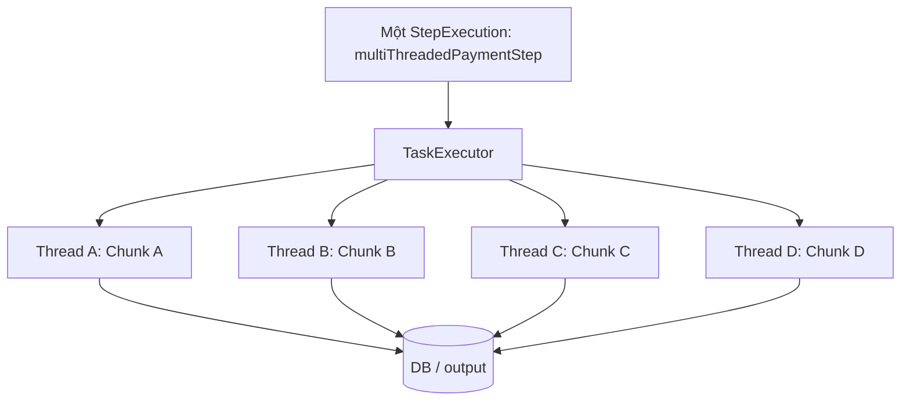
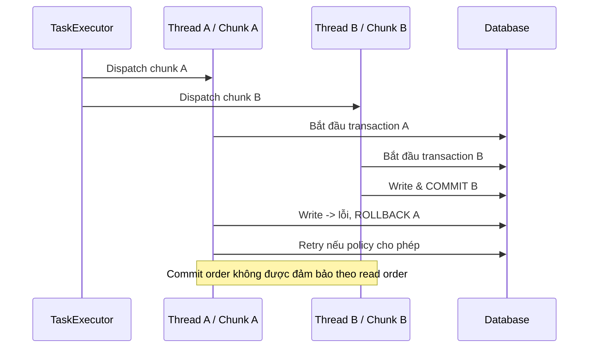
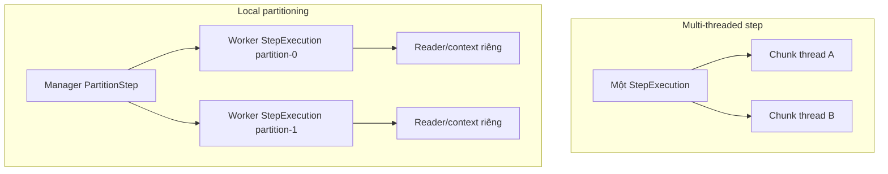

# Local chunking so với multi-threaded step trong Spring Batch

## Mục tiêu bài học

Trong module **SPRING_BATCH_SCALING_OPERATIONS**, chúng ta tìm cách mở rộng Spring Batch cho workload dữ liệu lớn thông qua multi-threaded step, parallel steps, partitioning và các mô hình phân tán. Hiệu năng chỉ có ý nghĩa nếu vẫn giữ **thread safety, transaction, retry/restart, khả năng vận hành và độ chính xác nghiệp vụ**.

Bài thuộc chương **Local Chunking** này so sánh hai cách thực thi **cùng một bước xử lý theo chunk**:

1. **Local chunking tuần tự:** một chunk-oriented `Step` chạy bằng một luồng xử lý tại một thời điểm trong một JVM.
2. **Multi-threaded step:** thêm `TaskExecutor` vào chunk-oriented `Step` để các chunk có thể được xử lý đồng thời trong **cùng JVM và cùng một `StepExecution`**.

Sau bài học, bạn có thể:

- Định nghĩa đúng sự khác nhau giữa chunk size, concurrency, `TaskExecutor`, `StepExecution` và `PartitionStep`.
- Giải thích vì sao multi-threaded step không chỉ đơn giản là “local chunking nhưng nhanh hơn”.
- Chỉ ra nguy cơ về reader/writer state, thứ tự chunk, transaction, checkpoint, retry và restart.
- Cấu hình một baseline tuần tự và một step có `TaskExecutor` bằng Java DSL của Spring Batch 5.2.x.
- Đo nút thắt CPU/DB/I/O để quyết định dùng multi-threaded step, giữ tuần tự hay chuyển sang partitioning.
- Đặt tiêu chí kiểm thử và rollback an toàn trước khi tăng concurrency trong production.

> **Thuật ngữ:** “Local chunking” trong bài là **cách gọi mô tả** chunk-oriented processing chạy cục bộ trong một JVM, **không phải tên một loại Step/SPI riêng** của Spring Batch. Chunk-oriented step vẫn có thể chạy đa luồng. Đừng nhầm “local chunking” với **remote chunking** (gửi chunk qua middleware tới worker process khác) hoặc **local partitioning** (tạo nhiều `StepExecution` con với `TaskExecutorPartitionHandler`).

> **Phiên bản:** Ví dụ hướng tới Spring Batch **5.2.x**. Tài liệu 5.2 ghi nhận `throttleLimit` đã deprecated từ 5.0; phần cấu hình bên dưới tránh phụ thuộc API này. Với Spring Batch 6.x hoặc phiên bản khác, cần kiểm tra tài liệu/Javadoc của phiên bản triển khai.

## 1. Bắt đầu từ chunk-oriented step tuần tự

Một chunk-oriented `Step` thường làm các việc sau:

1. Mở reader và khởi tạo `StepExecution`/`ExecutionContext`.
2. Đọc item bằng `ItemReader.read()` cho tới đủ commit interval hoặc gặp EOF.
3. Chuyển đổi từng item bằng `ItemProcessor.process()` nếu có; processor có thể trả `null` để filter.
4. Gửi tập output item tới `ItemWriter.write(Chunk<? extends T>)`.
5. Commit transaction, cập nhật metadata và checkpoint theo cơ chế Spring Batch.
6. Tiếp tục chunk kế tiếp; khi hết dữ liệu, kết thúc step.


Trong **cấu hình tuần tự thông thường**, mỗi lần chỉ một chunk đi qua pipeline của step. Reader có trạng thái (cursor, offset, page), writer và processor không bị gọi đồng thời bởi chính step này.

### Ví dụ baseline Spring Batch 5.2.x

```java
@Bean("sequentialPaymentStep")
Step sequentialPaymentStep(
        JobRepository jobRepository,
        PlatformTransactionManager transactionManager,
        @Qualifier("paymentReader") ItemReader<Payment> reader,
        ItemProcessor<Payment, PreparedPayment> processor,
        ItemWriter<PreparedPayment> writer) {

    return new StepBuilder("sequentialPaymentStep", jobRepository)
            .<Payment, PreparedPayment>chunk(500, transactionManager)
            .reader(reader)
            .processor(processor)
            .writer(writer)
            .build();
}
```

`chunk(500, transactionManager)` đặt **commit interval**, không phải số thread hay số partition. Nếu step đọc được 100.000 item và không có filter/skip đáng kể, sẽ có khoảng **200 chunk** được xử lý lần lượt (còn phụ thuộc hành vi kết thúc/transaction và chính sách fault tolerance).

**Ưu điểm:** Luồng xử lý dễ hình dung; dễ debug; ít tranh chấp state và tài nguyên; thông thường dễ thiết kế checkpoint tuần tự. **Giới hạn:** Khi xử lý mỗi item tốn nhiều CPU hoặc I/O, chỉ một chunk hoạt động tại một thời điểm, nên khó tận dụng hết tài nguyên còn trống.

## 2. Multi-threaded step thay đổi điều gì?

Trong Spring Batch 5.2.x, một trong những cách cơ bản nhất để thêm xử lý đồng thời là cấu hình `TaskExecutor` cho chunk-oriented step:

```java
new StepBuilder("multiThreadedPaymentStep", jobRepository)
        .<Payment, PreparedPayment>chunk(500, transactionManager)
        .reader(reader)
        .processor(processor)
        .writer(writer)
        .taskExecutor(taskExecutor)
        .build();
```

Các chunk có thể được thực thi trên những thread khác nhau. **Không có bảo đảm thứ tự** giữa các item/chunk khi xử lý hoặc khi commit; một chunk có thể chứa các item không liên tiếp so với cách chạy đơn luồng, tùy cách reader và executor phối hợp.



**Điểm cần nhớ:** Cả bốn chunk vẫn thuộc **cùng một `StepExecution`**, không phải bốn partition. Không có `StepExecutionSplitter`, `Partitioner` hay `PartitionHandler` ở bước này. Một step được xử lý đồng thời khác với việc manager tạo nhiều worker step độc lập.

### Bảng so sánh nền tảng

| Khía cạnh | Local chunking tuần tự | Multi-threaded step |
| --- | --- | --- |
| Phạm vi thực thi | Một JVM, một chunk hoạt động tại một thời điểm | Một JVM, nhiều chunk có thể hoạt động đồng thời |
| StepExecution | Một | **Vẫn một** |
| TaskExecutor | Không cần executor async | Cần `TaskExecutor` phù hợp |
| Reader và writer | Theo thứ tự gọi tuần tự | Có thể được nhiều thread gọi; phải kiểm tra thread safety |
| Thứ tự đọc/xử lý/commit | Dễ dự đoán hơn, tùy reader/writer | **Không bảo đảm thứ tự toàn cục** |
| Context/checkpoint | State tuần tự thường dễ kiểm soát | Một `ExecutionContext` cho một StepExecution; khôi phục từ các chunk hoàn tất lệch thứ tự có thể phức tạp |
| Transaction | Một transaction chunk tại một thời điểm | Các chunk có thể nằm trong các transaction đồng thời |
| Throughput | Bị giới hạn bởi một luồng thực thi | Có thể tăng nếu tài nguyên còn dư và component an toàn |
| Rủi ro chính | Nút thắt một luồng, step lâu | Race, duplicate/skip, lock contention, restart, mất ordering |
| Khi bắt đầu | **Baseline mặc định nên đo trước** | Sau khi chứng minh được correctness và bottleneck có thể song song hóa |

## 3. `chunkSize` khác gì `threadCount`?

Ba cấu hình dễ bị nhầm:

| Thông số | Chức năng | Ví dụ |
| --- | --- | --- |
| `chunkSize` | Số item tối đa xử lý trong một transaction chunk thông thường | `chunk(500, transactionManager)` |
| `taskExecutor` | Cách tổ chức thực thi các chunk và mức song song tài nguyên được cấp | `ThreadPoolTaskExecutor` với 4 thread |
| Giới hạn scheduling/throttling của step | Số chunk được phép xử lý đồng thời bởi machinery của step | Cần xem đúng phiên bản và cấu hình `RepeatOperations` |

Ví dụ step đọc 100.000 item, `chunkSize=500` tạo khoảng 200 chunk. Nếu executor có tối đa bốn worker nhưng step-side scheduling có giới hạn nhỏ hơn thì **không tự suy ra có bốn chunk chạy đồng thời tại mọi thời điểm**. Ngược lại, tăng pool lên 16 thread không làm tăng throughput nếu DB pool/API chỉ chịu được bốn request đồng thời.

### Lưu ý quan trọng về `throttleLimit`

Tài liệu Spring Batch 5.2 ghi nhận giới hạn `throttleLimit` cũ đã **deprecated từ 5.0 và không có API thay thế trực tiếp**. Nếu cần thay cách throttle mặc định của `TaskExecutorRepeatTemplate`, tài liệu đề xuất cung cấp một `RepeatOperations` tùy chỉnh, dựa trên executor có bounded queue, rồi đặt qua `StepBuilder.stepOperations(...)`.

Không dùng `.throttleLimit(20)` như lời giải sản xuất lâu dài chỉ vì thấy nó trong một ví dụ legacy. Cũng không chỉ tăng `maxPoolSize` rồi giả định step đã được phép tạo đủ work tasks để tận dụng pool. Đo active chunk thực tế, xem implementation của phiên bản sử dụng và thiết kế cơ chế giới hạn tải có chủ đích.

## 4. Ví dụ thực tế: chuẩn hóa giao dịch thanh toán

Giả sử job nhận 100.000 payment để chuẩn hóa amount/currency và ghi bảng `prepared_payment` theo khóa duy nhất `(run_key, payment_id)`. Chúng ta dùng **cùng logic nghiệp vụ** trong hai chế độ để so sánh; phần quan trọng nhất là chọn reader và writer đúng hợp đồng concurrency.

### 4.1. Input và output immutable

```java
public record Payment(
        long id,
        String currency,
        BigDecimal amount) {}

public record PreparedPayment(
        String runKey,
        long paymentId,
        String currency,
        BigDecimal amount) {}
```

Java record giúp giữ reference field cố định. Ở đây các component `long`, `String` và `BigDecimal` đều phù hợp với cách dùng immutable. Nếu record chứa danh sách hoặc entity mutable, record chỉ shallowly immutable; cần snapshot/deep copy khi handoff giữa thread.

### 4.2. Processor stateless

```java
@Bean("paymentProcessor")
@StepScope
ItemProcessor<Payment, PreparedPayment> paymentProcessor(
        @Value("#{jobParameters['runKey']}") String runKey) {

    return payment -> {
        BigDecimal normalized = payment.amount()
                .setScale(2, RoundingMode.HALF_EVEN);
        String currency = payment.currency()
                .trim()
                .toUpperCase(Locale.ROOT);

        return new PreparedPayment(
                runKey, payment.id(), currency, normalized);
    };
}
```

Mỗi lần `process(payment)` dùng biến cục bộ để tính kết quả của một item. Processor không có field mutable `lastAmount`, bộ đếm dùng chung hoặc cache động theo job, nên logic có thể dùng an toàn nếu cùng target instance được nhiều thread gọi.

`@StepScope` ở đây dùng để bind `runKey` theo `JobParameters`, **không** có nghĩa một target processor cho mỗi thread. Multi-threaded step vẫn có **một `StepExecution`**.

### 4.3. Reader cho baseline tuần tự

```java
@Bean("paymentReader")
@StepScope
JdbcPagingItemReader<Payment> paymentReader(
        DataSource dataSource,
        @Value("#{jobParameters['snapshotMaxId']}") Long maxId) {

    return new JdbcPagingItemReaderBuilder<Payment>()
            .name("paymentReader")
            .dataSource(dataSource)
            .selectClause("SELECT id, currency, amount")
            .fromClause("FROM payment")
            .whereClause("WHERE id <= :maxId")
            .parameterValues(Map.of("maxId", maxId))
            .sortKeys(Map.of("id", Order.ASCENDING))
            .pageSize(500)
            .rowMapper((rs, rowNum) -> new Payment(
                    rs.getLong("id"),
                    rs.getString("currency"),
                    rs.getBigDecimal("amount")))
            .build();
}
```

Reader này thích hợp làm ví dụ baseline: dữ liệu phải được đóng băng hợp lý theo `snapshotMaxId` hoặc cơ chế snapshot thật. **`id <= maxId` chỉ chặn insert có ID lớn hơn; nó không tự chặn UPDATE/DELETE bản ghi cũ, insert có ID thấp hơn hoặc dữ liệu đến muộn.** Nếu workload yêu cầu tập đầu vào tuyệt đối cố định, cần snapshot table/version/temporal query hoặc giải pháp DB tương ứng.

`JdbcPagingItemReader` có paging state. Không truyền nguyên bean này cho multi-threaded step mà mặc định cho rằng nó thread-safe. Ngoài ra, sort key phải xác định duy nhất (ví dụ primary key `id`), có index và phù hợp cách paging hoạt động.

### 4.4. Writer với khóa idempotency

```java
@Bean("preparedPaymentWriter")
JdbcBatchItemWriter<PreparedPayment> preparedPaymentWriter(
        DataSource dataSource) {

    return new JdbcBatchItemWriterBuilder<PreparedPayment>()
            .dataSource(dataSource)
            .sql("""
                INSERT INTO prepared_payment
                    (run_key, payment_id, currency, amount)
                VALUES (:runKey, :paymentId, :currency, :amount)
                ON CONFLICT (run_key, payment_id)
                DO UPDATE SET
                    currency = EXCLUDED.currency,
                    amount = EXCLUDED.amount
                """)
            .itemSqlParameterSourceProvider(item ->
                    new MapSqlParameterSource()
                            .addValue("runKey", item.runKey())
                            .addValue("paymentId", item.paymentId())
                            .addValue("currency", item.currency())
                            .addValue("amount", item.amount()))
            .build();
}
```

Với PostgreSQL, bảng đích cần khóa duy nhất tương ứng. Nếu item bị đọc lại sau rollback/restart, UPSERT giúp cùng payment ID không tạo hai row. Điều này **không thay thế** snapshot cố định, quy tắc cập nhật phiên bản hay đảm bảo exactly-once của side effect ở hệ thống ngoài.

Trong môi trường đa luồng, writer cần được kiểm tra theo Javadoc của implementation cụ thể và cách cấu hình transaction. Một `JdbcBatchItemWriter` đã được cấu hình hoàn tất thường dùng ít mutable shared processing state hơn writer tự viết bằng `ArrayList`/`StringBuilder` dùng chung; tuy nhiên vẫn cần integration test với transaction manager và connection pool thật.

### 4.5. Chạy baseline trước

Lắp `paymentReader`, `paymentProcessor`, `preparedPaymentWriter` vào `sequentialPaymentStep` ở phần 1. Đo thời gian chạy, số row nguồn/đích, transaction/commit và CPU/DB utilization.

Chỉ sau khi baseline đạt correctness mới thử mode multi-threaded.

## 5. Đưa chunk qua nhiều thread một cách có kiểm soát

### 5.1. Executor có giới hạn

```java
@Bean("chunkExecutor")
TaskExecutor chunkExecutor() {
    ThreadPoolTaskExecutor executor = new ThreadPoolTaskExecutor();
    executor.setCorePoolSize(4);
    executor.setMaxPoolSize(4);
    executor.setQueueCapacity(8);
    executor.setThreadNamePrefix("payments-chunk-");
    executor.initialize();
    return executor;
}
```

Executor giới hạn số thread và task chờ theo cách cấu hình. Với `ThreadPoolTaskExecutor`, số task active thực tế còn phụ thuộc task submission và giới hạn của step, không chỉ ba thuộc tính pool ở trên. Chạy tải thực và quan sát `activeCount`/queue để xác nhận.

### 5.2. Tài liệu 5.2 có `SynchronizedItemStreamReader`, nhưng cần hiểu giới hạn

Khi một reader có state không thread-safe, Spring Batch có wrapper `SynchronizedItemStreamReader` để đồng bộ lời gọi `read()` của delegate. Ví dụ minh họa:

```java
@Bean("synchronizedPaymentReader")
@StepScope
SynchronizedItemStreamReader<Payment> synchronizedPaymentReader(
        @Qualifier("paymentReader") ItemStreamReader<Payment> delegate) {

    SynchronizedItemStreamReader<Payment> reader =
            new SynchronizedItemStreamReader<>();
    reader.setDelegate(delegate);
    return reader;
}
```

**Cảnh báo quan trọng:** Bọc `read()` bằng khóa chỉ giải quyết việc đọc đồng thời ở một phần của reader; **không bảo đảm reader checkpoint/restart an toàn** khi các chunk được xử lý và commit lệch thứ tự. Tài liệu của `SynchronizedItemStreamReader` cảnh báo cách này có thể làm một job không còn restartable khi reprocessing item có vấn đề. Cần xem Javadoc chính xác và kiểm thử failure/restart.

Vì vậy, đoạn trên chỉ mô tả một hướng giảm race; không xem nó là phương án mặc định an toàn cho job xử lý tiền hoặc dữ liệu có SLA correctness chặt chẽ. Với loại job đó, **local partitioning** có reader riêng theo `StepExecution` hoặc mô hình process-indicator có trạng thái bền vững có thể dễ kiểm chứng hơn.

### 5.3. Step multi-threaded — chỉ khi reader/writer phù hợp

```java
@Bean("multiThreadedPaymentStep")
Step multiThreadedPaymentStep(
        JobRepository jobRepository,
        PlatformTransactionManager transactionManager,
        @Qualifier("synchronizedPaymentReader")
        ItemStreamReader<Payment> reader,
        @Qualifier("paymentProcessor")
        ItemProcessor<Payment, PreparedPayment> processor,
        @Qualifier("preparedPaymentWriter")
        ItemWriter<PreparedPayment> writer,
        @Qualifier("chunkExecutor") TaskExecutor executor) {

    return new StepBuilder("multiThreadedPaymentStep", jobRepository)
            .<Payment, PreparedPayment>chunk(500, transactionManager)
            .reader(reader)
            .processor(processor)
            .writer(writer)
            .taskExecutor(executor)
            .build();
}
```

Đây là **minh họa cấu hình**, không phải chứng nhận production-ready. Phần 5.2 có cảnh báo restart; phần 6–9 trình bày cách đánh giá tính đúng trước khi áp dụng. Không đăng ký cả `sequentialPaymentStep` và `multiThreadedPaymentStep` vào cùng một job nếu chỉ muốn A/B test thay thế nhau; hãy tạo hai Job định danh khác nhau hoặc cấu hình profile và so sánh trên những run key/snapshot khác nhau.

### Một câu hỏi dễ nhầm

**Nếu \`@StepScope\` đã tạo một bean reader, tại sao còn cần đồng bộ?** Vì scope theo **`StepExecution`**, còn các chunk của multi-threaded step có thể dùng **chung StepExecution**. Trong local partitioning, mỗi partition có StepExecution riêng nên step-scoped reader thường cô lập instance theo partition; đó là kiến trúc khác.

## 6. Transaction của các chunk khi chạy đồng thời

Trong local chunking tuần tự, các chunk commit lần lượt; nếu chunk 3 gặp lỗi, thường dễ lý luận về vị trí reader và chunk cuối đã commit.

Trong multi-threaded step:

- Chunk A và B có thể thực thi trên các thread khác nhau, mỗi chunk có transaction.
- Chunk B có thể commit trước chunk A dù được lên lịch sau.
- Nếu chunk A rollback và retry trong khi B đã commit, trạng thái đầu ra có thể không là một prefix liên tục của dữ liệu đã đọc.
- `StepExecution` và `ExecutionContext` là metadata của **cùng step**, không biến thành một checkpoint độc lập cho từng thread.
- Không có transaction bao trùm toàn bộ step để rollback những chunk đã commit khi một chunk khác thất bại.



Sự cố không chỉ là **thread-safety của Java object** mà còn là **định danh item đã commit**. Một reader tuần tự chỉ lưu “offset cuối” không phải lúc nào cũng diễn tả được một tập chunk đã commit không liên tiếp.

### Side effect và idempotency

Nếu processor gọi API bên ngoài rồi DB chunk rollback, API có thể đã hoàn tất trong khi StepExecution chưa ghi nhận chunk thành công. Retry sẽ gọi lại API. Giữ processor stateless và đặt side effect qua writer có outbox/transaction hoặc idempotency key tại đích là hướng an toàn hơn.

Ví dụ PostgreSQL:

```sql
CREATE TABLE prepared_payment (
    run_key     varchar(100) NOT NULL,
    payment_id  bigint       NOT NULL,
    currency    varchar(3)   NOT NULL,
    amount      numeric(20,2) NOT NULL,
    PRIMARY KEY (run_key, payment_id)
);
```

Khóa `(run_key, payment_id)` bảo vệ chống duplicate row, nhưng **không bảo đảm không bỏ sót payment**. Cần đối soát độ phủ tập ID theo snapshot, đặc biệt sau failure/restart.

## 7. Reader, processor, writer: điểm nào thường là nút thắt?

| Thành phần | Baseline tuần tự | Vấn đề mới khi multi-threaded | Hướng xử lý |
| --- | --- | --- | --- |
| `ItemReader` | Thường một caller, cursor dễ theo dõi | Nhiều thread đọc chung state; paging/offset/race | Reader thread-safe hoặc chuyển sang partitioning/process indicator; test restart |
| `ItemProcessor` | Thường chạy trên một thread | Shared mutable fields/caches, API quota | Stateless, immutable item, CPU profile, rate limit |
| `ItemWriter` | Gọi lần lượt theo chunk | Concurrent writes, duplicate, row locks, file append | Writer thread-safe, transaction/idempotency, staging, file riêng |
| `StepExecutionContext` | Một trình tự checkpoint thường dễ hiểu | Cùng context với nhiều chunk có thể hoàn tất lệch thứ tự | Không dùng làm shared mutable counter; thiết kế restart theo item key |
| `JobRepository` | Ghi metadata tuần tự | Nhiều commit/retry, contention với DB | Theo dõi query latency, pool, metadata overhead |
| DataSource/API pool | Sử dụng tương đối ổn định | Nhu cầu connection/request đồng thời tăng | Giới hạn concurrency theo tài nguyên thật |

### Thread-safe không đồng nghĩa restart-safe

Một `ItemReader` có thể an toàn khỏi race khi gọi `read()` đồng thời, nhưng sau crash vẫn không biết chính xác item nào của các chunk đã hoàn tất. Ngược lại, reader có checkpoint rất tốt khi chạy tuần tự chưa chắc chấp nhận concurrent `read()`.

Để quyết định multi-threaded step, cần **chứng minh cả hai thuộc tính** thay vì chỉ bọc một khóa quanh `read()`.

### Một processor stateless cũng chưa đủ

```java
class UnsafeProcessor
        implements ItemProcessor<Payment, PreparedPayment> {

    private BigDecimal lastAmount; // Shared mutable field.

    public PreparedPayment process(Payment item) {
        lastAmount = item.amount();
        return new PreparedPayment(
                "run", item.id(), item.currency(), lastAmount);
    }
}
```

Đổi `lastAmount` thành biến cục bộ tránh một race đơn giản. Nhưng nếu processor vẫn gọi chung cache mutable, bean state theo job hoặc external API, vẫn phải kiểm soát thread safety và idempotency.

## 8. Ordering: khi nào multi-threaded step không phù hợp?

Nếu yêu cầu **đầu ra file theo ID tăng dần**, đồng thời nhiều chunk ghi vào cùng stream có thể khiến record xen kẽ hoặc đảo thứ tự. Trong cách tuần tự, ordering vẫn cần được định nghĩa qua reader `ORDER BY` và writer; multi-threaded step bỏ giả định chunk commit tuần tự.

Nếu yêu cầu **event của cùng tài khoản phải áp dụng theo sequence**, hai chunk có thể mang event cùng account và chạy đảo thứ tự. Chỉ sắp sort input không đủ để bảo đảm nghiệp vụ.

Các phương án:

1. **Chạy tuần tự** nếu có phụ thuộc toàn cục không thể song song hóa.
2. **Partition theo business key** và xử lý thứ tự trong mỗi partition nếu chỉ cần ordering theo tài khoản/tenant.
3. **Ghi staging riêng rồi merge/sort** sau khi mọi partition/step thành công nếu chỉ cần ordering ở output cuối.
4. **Tách compute và ordered commit/publish** khi có thể tính song song nhưng phải áp tác động theo sequence.

Không thêm `TaskExecutor` chỉ để rút thời gian trong job mà đầu ra bắt buộc có ordering chưa được bảo vệ.

## 9. Retry, skip và restart: kiểm tra bằng tình huống cụ thể

Giả sử có các payment ID 1..2.000, chunk size 500. Khi chạy nhiều thread, một tình huống giả định:

| Chunk logic | Trạng thái | Hệ quả |
| --- | --- | --- |
| A | Commit thành công | Một tập item đã bền vững |
| B | Commit thành công | Tập item khác đã bền vững |
| C | Rollback rồi retry | Có thể process các item thêm một lần |
| D | Commit thành công trước C | Output không nhất thiết theo thứ tự ID |
| Job fail sau đó | Một số chunk đã commit | Restart không được tạo duplicate hay bỏ sót item |

Một `ItemProcessor` có thể chạy lại sau rollback, nên **không cộng tiền vào singleton accumulator trong `process(item)`**. Số liệu kế toán nên tính từ bảng đã commit theo `runKey`, không lấy bộ đếm trong RAM.

### Các điều kiện tối thiểu của restart

- Input phải được xác định ổn định bằng `businessDate`, `snapshotId`, watermark và quy tắc xử lý update/delete.
- Worker phải có cơ chế nhận diện item đã xử lý ở hệ thống bền vững nếu checkpoint theo offset không đủ diễn tả trạng thái song song.
- Writer cần idempotency key hoặc unique constraint phù hợp; cần phân biệt duplicate hợp lệ với bản ghi sai phiên bản.
- JobInstance phải giữ cùng **identifying JobParameters** khi restart; tạo một run key mới có thể tạo JobInstance mới, không phải tiếp tục job lỗi.
- Cần thử crash sau khi DB commit nhưng trước khi toàn bộ metadata được quan sát, cùng các kịch bản retry/skip và worker timeout.
- Không dựa vào `readCount`/`writeCount` một mình để khẳng định tập row đích đã đầy đủ.

### Process indicator là một lựa chọn

Thay vì chỉ nhớ “đã đọc tới ID X”, bảng nguồn có thể có trạng thái `PENDING/CLAIMED/DONE` (hoặc bảng tracking riêng). Worker claim item theo transaction, ghi output idempotent, sau đó đánh dấu DONE với logic phục hồi claim hết hạn.

```sql
-- Ví dụ chỉ minh họa cấu trúc, KHÔNG phải thuật toán claim hoàn chỉnh.
CREATE TABLE payment_processing_status (
    run_key      varchar(100) NOT NULL,
    payment_id   bigint       NOT NULL,
    status       varchar(20)  NOT NULL,
    attempt      integer      NOT NULL DEFAULT 0,
    PRIMARY KEY (run_key, payment_id)
);
```

Một hệ thống claim thực tế phải xử lý row lock, lease timeout, crash giữa claim và commit, recovery, idempotency và tránh hai worker cùng nhận một item. Không coi bảng trạng thái đơn giản là giải pháp exactly-once tự động.

**Lựa chọn thay thế:** Nếu dữ liệu chia dải ổn định, **local partitioning** với `@StepScope` reader riêng trên mỗi `StepExecution` thường dễ kiểm chứng checkpoint hơn multi-threaded step dùng một shared cursor.

## 10. Bài toán đo hiệu năng: có đáng đánh đổi độ phức tạp?

Giả định 1 triệu item, bước tuần tự mất 50 phút. Profile chỉ ra:

- Đọc input: 5 phút.
- Process CPU: 35 phút.
- Ghi output và commit: 10 phút.

Trong trường hợp process CPU chiếm phần lớn và hệ thống có nhiều core còn rảnh, concurrency có thể cải thiện đáng kể. Nhưng nếu processor chủ yếu gọi một API có quota thấp, hoặc thời gian thực nằm ở DB lock wait, thêm thread có thể làm job chậm hơn.

### Benchmark minh họa

| Chế độ | Thời gian đo giả định | Speedup so với baseline | Ghi chú |
| --- | ---: | ---: | --- |
| 1 thread, chunk 500 | 50 phút | 1,00× | Baseline correctness |
| 2 thread | 31 phút | 1,61× | CPU còn dư |
| 4 thread | 21 phút | 2,38× | DB bắt đầu tăng latency |
| 8 thread | 22 phút | 2,27× | DB pool chờ và GC tăng |
| Local partitioning, 4 worker | 20 phút | 2,50× | Giả định mỗi reader có partition riêng |

Số liệu chỉ để minh họa cách quyết định, **không phải benchmark chuẩn**. Tốc độ còn phụ thuộc item size, chunk size, index, transaction, CPU, network, GC, cache và data skew.

### Mô hình đơn giản

```text
T_seq ~= T_read + T_process + T_write + T_commit

T_parallel >= T_serial_fraction
             + T_parallelizable_fraction / effective_workers
             + T_contention_and_overhead
```

Không có bảo đảm speedup tuyến tính. Nếu phải dùng một reader được đồng bộ hóa, phần đọc vẫn tuần tự; nếu DB connection pool bão hòa, tăng worker chỉ thêm thời gian chờ.

### Chỉ số cần theo dõi

- Tổng thời gian job, throughput item/giây và p95/p99 thời gian chunk.
- `readCount`, `writeCount`, `filterCount`, `skipCount`, `commitCount`, `rollbackCount`.
- Executor active threads, queue depth, task rejection, CPU, heap allocation, GC pause.
- DB pool active/pending, lock wait, deadlock, query latency, thời gian transaction.
- Tập ID nguồn và đích, số duplicate key, độ đầy đủ sau restart.
- Các job chạy đồng thời khác sử dụng chung pool và DB.

Nếu không chứng minh được correct output dưới multi-threaded step, benchmark nhanh hơn không đủ để đưa vào production.

## 11. So sánh với local partitioning và parallel steps

“Multi-threaded step” thường được nhắc gần “local partitioning” nhưng topology khác nhau:



| Mô hình | Đơn vị song song | Metadata/checkpoint | Khi cân nhắc |
| --- | --- | --- | --- |
| Local chunking tuần tự | Một chunk hoạt động tại một thời điểm | Một StepExecution, tiến độ tuần tự | Baseline, stateful reader, ordering hoặc workload vừa |
| **Multi-threaded step** | Nhiều chunk trong một StepExecution | Một StepExecution, shared state phải được kiểm soát | Một step có xử lý item độc lập, thread-safe components, còn CPU/I/O |
| **Local partitioning** | Nhiều worker StepExecution trên một JVM | Mỗi partition có StepExecution/ExecutionContext riêng | Có thể chia input thành vùng độc lập, reader stateful muốn cô lập |
| **Parallel steps** | Các flow/step nghiệp vụ khác nhau | Mỗi step có StepExecution riêng | Có nhiều công đoạn độc lập trong một job |
| **Remote chunking** | Chunk chuyển qua messaging tới worker khác process | Có phối hợp request/reply và hạ tầng broker | Muốn phân tán xử lý chunk, manager đọc không thành bottleneck |
| **Remote partitioning** | Nhiều worker StepExecution ở các JVM/máy | Metadata partition trong JobRepository dùng chung | Dataset chia vùng và cần scale ngang nhiều host |

### Vì sao partitioning có thể tốt hơn với reader có state?

Trong local partitioning, mỗi partition chạy cùng logic worker nhưng nhận `ExecutionContext` riêng như `fromId/toId`. Mỗi `StepExecution` có thể dùng reader `@StepScope` riêng và checkpoint riêng. Bài toán chuyển từ “đồng bộ một cursor chung” sang “thiết kế các vùng dữ liệu không chồng lấn”. Đổi lại, bạn phải quản lý partitioner, data skew, grid size, tên partition ổn định và tổng hợp kết quả.

Không nên nói partitioning luôn nhanh hơn; mỗi mô hình có overhead và nút thắt tài nguyên khác nhau.

## 12. Quy trình chuyển từ chunking tuần tự sang multi-threaded step

### Bước 1 — Khóa baseline tính đúng

Chạy trên snapshot ổn định, lưu tập business key đầu ra, checksum/tổng theo nhóm, số row, log failure/retry và thời gian tổng. Giữ bản cấu hình tuần tự có thể rollback nhanh.

### Bước 2 — Profile bottleneck

Đo phần trăm thời gian đọc, xử lý, ghi, commit; CPU, DB connection pool và API quota. Nếu bottleneck đã là DB, hãy tối ưu SQL, index, batch size và connection trước khi tăng concurrency.

### Bước 3 — Audit thread safety của từng component

Tìm instance/static mutable fields, reader cursor, cache, writer buffer, formatter, listener, `ExecutionContext`, external client và transaction boundary. Kiểm tra Javadoc cụ thể; khi không rõ thì không giả định thread-safe.

### Bước 4 — Quyết định restart model

Nếu reader state phụ thuộc một offset duy nhất, hãy xác minh cách recovery khi chunks commit đảo thứ tự. Nếu không thể đảm bảo không bỏ sót/trùng item, chọn process indicator có transaction/lease đúng hoặc chuyển local partitioning.

### Bước 5 — Thêm concurrency có giới hạn

Bắt đầu hai thread và tăng theo nấc, quan sát actual concurrency. Không dùng `throttleLimit` deprecated như tối ưu lâu dài; nếu cần custom scheduling, dựa trên `RepeatOperations`/`stepOperations` đúng phiên bản.

### Bước 6 — Kiểm thử fault injection

Cố ý cho chunk A rollback, chunk B commit trước; lỗi ở reader, processor, writer; shutdown process giữa commit; restart với cùng identifying JobParameters; kiểm tra tập ID và side effect cuối.

### Bước 7 — Đo lại toàn job và có ngưỡng rollback

Chọn cấu hình khi throughput cải thiện bền vững ở tải cao và không tăng lỗi/duplicate/DB contention. Có thể quay về cấu hình tuần tự khi DB pool pending, rollback hoặc SLA chất lượng vượt ngưỡng.

## 13. Kiểm thử có thể đưa vào pipeline

### Correctness invariants

- **Độ phủ:** Mọi input hợp lệ trong snapshot được xử lý, không bỏ sót.
- **Tính duy nhất:** Một business key thuộc một run key chỉ có một output logic.
- **Nội dung:** Output của cùng item độc lập thứ tự chunk, giống baseline tuần tự theo phép so sánh nghiệp vụ.
- **Rollback:** Item đã process trong chunk rollback không gây side effect không thể bù trừ.
- **Restart:** Sau crash/retry, tập output cuối tương đương lần chạy hoàn chỉnh với input như nhau.
- **Ordering:** Nếu hợp đồng yêu cầu thứ tự, phải có cơ chế bảo đảm riêng; không dựa vào thứ tự thread.

### Những ca cần chạy

1. Chạy tuần tự và multi-threaded trên cùng snapshot với run key riêng, so sánh checksum/count/tập ID.
2. Tăng 2/4/8 thread; kiểm tra race ở reader/writer/processor/listener.
3. Cho thread xử lý ID lớn kết thúc trước ID nhỏ; xác minh kết quả không phụ thuộc ordering.
4. Gây exception sau vài item của chunk A trong lúc chunk B commit thành công; restart và so sánh output.
5. Chạy hai JobExecution đồng thời với run key khác nhau; kiểm tra không trộn state giữa lần chạy.
6. Test filter/skip/retry và writer UPSERT với duplicate input; phân biệt metadata counts và row insert.
7. Dùng dữ liệu skew, item có latency lớn, DB connection pool nhỏ và API rate limit sát ngưỡng.
8. Nếu dùng wrapper synchronized reader, cố tình dừng JVM giữa các chunk hoàn thành không liên tiếp; chỉ chấp nhận nếu restart được chứng minh an toàn.

### Query kiểm tra metadata

```sql
SELECT STEP_EXECUTION_ID,
       STEP_NAME,
       STATUS,
       READ_COUNT,
       WRITE_COUNT,
       COMMIT_COUNT,
       ROLLBACK_COUNT
FROM BATCH_STEP_EXECUTION
WHERE JOB_EXECUTION_ID = :jobExecutionId
ORDER BY STEP_EXECUTION_ID;
```

Multi-threaded step thông thường có **một StepExecution** tương ứng với step đó trong lần JobExecution, không có một hàng metadata cho từng chunk thread. Trong local partitioning, bạn sẽ thấy manager và các worker StepExecution có tên như `paymentWorker:partition-0`. Nếu restart, cần truy lịch sử JobInstance qua nhiều JobExecution thay vì chỉ một lần chạy.

## 14. Ma trận quyết định cuối

| Tình huống | Ưu tiên | Lý do |
| --- | --- | --- |
| Job đạt SLA, reader có state, cần restart đơn giản | **Giữ local chunking tuần tự** | Ít complexity nhất, tránh race vô ích |
| Processor nặng CPU, item độc lập, reader/writer có hợp đồng concurrent an toàn | **Thử multi-threaded step** | Có thể khai thác nhiều core trong cùng JVM |
| Reader stateful, mỗi phần dữ liệu chia được thành dải ổn định | **Local partitioning** | StepExecution/reader/context riêng mỗi partition |
| Nhiều phép ETL khác nhau không phụ thuộc nhau | **Parallel steps** | Concurrent flow, không chia chung một StepExecution |
| Cần worker xử lý ở nhiều host, manager đọc được throughput mong muốn | **Remote chunking** | Phân tán xử lý chunk qua messaging |
| Dataset lớn cần nhiều worker ở nhiều host và có partition key rõ | **Remote partitioning** | Scale ngang bằng worker StepExecution riêng |
| DB đã bão hòa hoặc API quota thấp | **Tối ưu nút thắt trước** | Concurrency cao hơn có thể làm chậm và tăng lỗi |
| Thứ tự commit toàn cục là yêu cầu bắt buộc | **Tuần tự hoặc ordered commit architecture** | Multi-threaded chunk không bảo đảm ordering |
| Cần exactly-once của side effect ngoài DB | **Idempotency/outbox/transaction design trước** | Không mô hình chunking nào tự giải quyết distributed exactly-once |

### Checklist trước production

- [ ] Xác nhận “local chunking” trong hệ thống là chunk-oriented step tuần tự hay đã được bật `TaskExecutor`; không đánh đồng với partitioning.
- [ ] Có baseline đo thời gian, memory, CPU, DB và correctness trước khi chỉnh concurrency.
- [ ] Reader/writer/processor/listener được kiểm tra thread safety theo implementation cụ thể.
- [ ] Không coi `@StepScope` là mỗi thread một instance trong cùng multi-threaded step.
- [ ] Snapshot, identifying JobParameters và idempotency key ổn định qua restart.
- [ ] Reader checkpoint an toàn khi các chunk hoàn thành không liên tiếp, hoặc có phương án partition/process indicator.
- [ ] Đã kiểm thử chunk rollback đồng thời với chunk khác commit và crash giữa transaction/metadata.
- [ ] Không dựa vào `throttleLimit` deprecated mà bỏ qua giới hạn executor/scheduling của phiên bản.
- [ ] Có budget cho CPU, DB connection, API quota, queue depth và các job cùng chạy.
- [ ] Output có đủ/đúng duy nhất theo business key, không chỉ job status `COMPLETED`.
- [ ] Có dashboard/alert và khả năng rollback cấu hình về chạy tuần tự khi concurrency gây lỗi hoặc nghẽn.

## Tài liệu tham khảo

- [Spring Batch 5.2 — Chunk-oriented Processing](https://docs.spring.io/spring-batch/reference/5.2/step/chunk-oriented-processing.html): chu trình đọc, xử lý, ghi theo chunk và commit.
- [Spring Batch 5.2 — Scaling and Parallel Processing](https://docs.spring.io/spring-batch/reference/5.2/scalability.html): multi-threaded step, executor, ordering, thread safety, `throttleLimit` deprecation, partitioning và remote chunking.
- [Spring Batch 5.2 — Configuring a Step](https://docs.spring.io/spring-batch/reference/5.2/step/chunk-oriented-processing/configuring.html): cấu hình chunk-oriented step, transaction và listener.
- [Spring Batch 5.2 API — SynchronizedItemStreamReader](https://docs.spring.io/spring-batch/docs/5.2.x/api/org/springframework/batch/item/support/SynchronizedItemStreamReader.html): đồng bộ `read()` và cảnh báo restart.
- [Spring Batch 5.2 API — TaskletStepBuilder](https://docs.spring.io/spring-batch/docs/5.2.x/api/org/springframework/batch/core/step/builder/TaskletStepBuilder.html): cấu hình task executor và step operations.
- [Spring Batch 5.2 — Late Binding of Job and Step Attributes](https://docs.spring.io/spring-batch/reference/5.2/step/late-binding.html): StepScope và JobParameters.

**Điều cần nhớ:** **Multi-threaded step vẫn là chunk-oriented step local**, nhưng cho phép nhiều chunk trong **một StepExecution** chạy đồng thời. Nó có thể cải thiện throughput khi công việc độc lập và tài nguyên còn dư, song cũng đưa vào race, thứ tự commit không xác định và yêu cầu restart phức tạp hơn. Hãy bắt đầu bằng **chunking tuần tự làm baseline**, chỉ tăng concurrency sau khi chứng minh reader/writer/thread safety và dữ liệu sau retry/restart vẫn chính xác; nếu shared reader state là rào cản lớn, hãy cân nhắc **local partitioning** với reader riêng từng partition.
