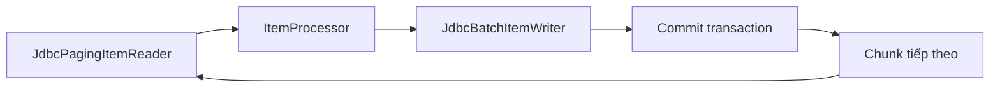

# Sample local chunking và cách kiểm thử trong Spring Batch

## Mục tiêu bài học

Trong chương **Local Chunking** của module **SPRING_BATCH_SCALING_OPERATIONS**, chúng ta xây dựng một ví dụ Spring Batch đủ cụ thể để hiểu cách **đọc → xử lý → ghi → commit** và kiểm tra kết quả sau mỗi lần chạy. Đây là nền tảng cần có trước khi mở rộng workload dữ liệu lớn bằng multi-threaded step, parallel steps, partitioning hoặc mô hình phân tán.

Sau bài học, bạn có thể:

- Tạo một `Job` gồm một chunk-oriented `Step` chạy cục bộ, tuần tự trong JVM.
- Viết `ItemReader`, `ItemProcessor`, `ItemWriter` với dữ liệu mẫu có thể tính trước kết quả.
- Giải thích vai trò của `chunkSize`, transaction manager, `StepExecution` và `JobRepository`.
- Dùng **Spring Batch Test** với JUnit 5 để chạy job và xác minh status, count, dữ liệu thực sự đã commit.
- Thiết kế kiểm thử filter, rollback, restart, idempotency, tính ổn định đầu vào và trường hợp dữ liệu rỗng.
- Biết cách đo baseline, phát hiện nút thắt và chỉ tăng concurrency sau khi kết quả tuần tự đã đúng.

> **Phiên bản và giới hạn:** Ví dụ dùng API **Spring Batch 5.2.x**, Java 17+, Spring Boot 3.x tương thích và cơ sở dữ liệu H2 2.x cho bài test. Các ví dụ SQL `MERGE ... KEY(...)` là cú pháp **H2**, không phải SQL chuẩn cho mọi database. Với PostgreSQL có thể dùng `INSERT ... ON CONFLICT` theo nghiệp vụ. Việc triển khai thực tế cần chọn phiên bản dependency tương thích từ BOM của Spring Boot.

## 1. Local chunking là gì trong ví dụ này?

“Local chunking” ở đây là tên mô tả **chunk-oriented processing thực thi trong một JVM**; nó không phải một interface hoặc loại `Step` riêng của Spring Batch. Trong cấu hình mặc định không có `TaskExecutor`, một chunk được xử lý tại một thời điểm trong step.



Với `chunk(2, transactionManager)`, framework tạo các nhóm tối đa hai input item để thực hiện chu trình xử lý trong một transaction. Trong trường hợp bình thường, mỗi chunk:

1. Đọc tối đa hai item hoặc gặp cuối dữ liệu.
2. Chuyển đổi từng item; processor có thể trả `null` để **filter**.
3. Ghi nhóm output còn lại bằng `ItemWriter.write(Chunk)`.
4. Commit transaction và cập nhật metadata/checkpoint theo hợp đồng Spring Batch.
5. Lặp lại đến khi reader trả về `null` (EOF).

Chunk size là **commit interval**, không phải số thread, số partition hay kích thước một JDBC batch được đảm bảo. Các chi tiết commit tại EOF, retry/skip và update checkpoint còn phụ thuộc cấu hình và vòng đời nội bộ, vì vậy không áp một công thức cứng cho mọi chỉ số kỹ thuật.

### Topology của bài mẫu

```text
Job: localPaymentsJob
  |
  +-- Step: importPayments
        |
        +-- JdbcPagingItemReader<RawPayment>
        |     WHERE business_date = :businessDate ORDER BY id
        |
        +-- ItemProcessor<RawPayment, ReadyPayment>
        |     eligible=false => filter; eligible=true => net=amount*0.98
        |
        +-- JdbcBatchItemWriter<ReadyPayment>
              H2 MERGE by (business_date, payment_id)
```

Tất cả công đoạn thuộc **một StepExecution** của step `importPayments`. Chưa có `TaskExecutor`, `Partitioner`, `PartitionHandler` hay worker process ngoài JVM.

## 2. Định nghĩa dữ liệu đầu vào và kết quả kỳ vọng

Giả sử nguồn chứa sáu thanh toán của ngày nghiệp vụ `2026-11-25`; một thanh toán bị loại do `eligible=false`. Phí giả lập là 2% giá trị ban đầu; `net_amount = gross_amount × 0.98`, làm tròn đến hai chữ số thập phân bằng `HALF_EVEN`.

| ID | Currency | Gross amount | Eligible | Expected net |
| --- | --- | ---: | --- | ---: |
| 1 | USD | 100.00 | true | 98.00 |
| 2 | USD | 70.00 | true | 68.60 |
| 3 | VND | 50.00 | false | *Filter — không ghi* |
| 4 | USD | 25.00 | true | 24.50 |
| 5 | VND | 80.00 | true | 78.40 |
| 6 | USD | 20.00 | true | 19.60 |

**Bất biến kỳ vọng:**

| Kiểm tra | Giá trị |
| --- | ---: |
| `StepExecution.readCount` | 6 |
| `StepExecution.filterCount` | 1 |
| `StepExecution.writeCount` | 5 |
| Tổng số hàng `payment_result` của ngày này | 5 |
| Số hàng đích với `payment_id=3` | 0 |
| Tổng `net_amount` của 5 hàng đã ghi | 289.10 |

Những số này là kết quả của **dữ liệu và cấu hình cụ thể trong bài mẫu**, không phải công thức áp dụng chung cho mọi reader/writer. `writeCount` biểu thị số item đã được framework ghi nhận qua writer, còn số **row mới thực sự được insert** phải kiểm tra ở database, nhất là khi dùng upsert.

> **Lưu ý về tiền tệ:** Ví dụ cộng các số amount khác currency chỉ để kiểm thử cơ học của sample. Trong một hệ thống tài chính thực tế, **không cộng các đơn vị tiền tệ khác nhau để tạo một tổng có ý nghĩa nghiệp vụ**. Hãy so sánh theo từng currency, hoặc quy đổi bằng tỷ giá/snapshot đã định nghĩa. Giá trị 289.10 ở đây chỉ là checksum số học của dữ liệu mẫu.

## 3. Bộ dependency tối thiểu

Với ứng dụng Spring Boot 3.x tương thích Spring Batch 5.2.x, các dependency thường cần là:

```xml
<dependencies>
    <dependency>
        <groupId>org.springframework.boot</groupId>
        <artifactId>spring-boot-starter-batch</artifactId>
    </dependency>
    <dependency>
        <groupId>org.springframework.boot</groupId>
        <artifactId>spring-boot-starter-jdbc</artifactId>
    </dependency>
    <dependency>
        <groupId>com.h2database</groupId>
        <artifactId>h2</artifactId>
        <scope>runtime</scope>
    </dependency>
    <dependency>
        <groupId>org.springframework.boot</groupId>
        <artifactId>spring-boot-starter-test</artifactId>
        <scope>test</scope>
    </dependency>
    <dependency>
        <groupId>org.springframework.batch</groupId>
        <artifactId>spring-batch-test</artifactId>
        <scope>test</scope>
    </dependency>
</dependencies>
```

BOM/parent Spring Boot chịu trách nhiệm chọn các version tương thích; **không tự trộn Spring Batch 5.x và 6.x** vào cùng classpath. Trong project thật, còn cần dependency driver của database sản xuất và migrations cho schema Spring Batch metadata cùng bảng nghiệp vụ.

Một ứng dụng tối giản:

```java
@SpringBootApplication
public class LocalChunkingApplication {
    public static void main(String[] args) {
        SpringApplication.run(LocalChunkingApplication.class, args);
    }
}
```

Đặt `LocalChunkingApplication` cùng package gốc chứa class cấu hình để Spring Boot quét được các bean. Các phương thức `@Bean` ở phần 5–8 thuộc về một class cấu hình, ví dụ:

```java
@Configuration
public class LocalPaymentJobConfig {
    // Đặt các @Bean rawPaymentReader, paymentProcessor,
    // paymentWriter, importPaymentsStep và localPaymentsJob vào đây.
}
```

Khi dựng project, thay comment bằng những phương thức `@Bean` bên dưới; không đặt hai khai báo trùng tên cho cùng bean. Các code block biểu diễn những class/record riêng (cần import Java/Spring Batch thích hợp); không chép tất cả `public` type vào một tệp Java duy nhất.

## 4. Schema cho test H2

Có hai bảng: một bảng nguồn và một bảng đích. H2 phù hợp chạy integration test nhanh; không dùng các đặc tính của H2 để suy ra semantics của PostgreSQL/Oracle ở production.

```sql
CREATE TABLE IF NOT EXISTS raw_payment (
    id             BIGINT PRIMARY KEY,
    business_date  VARCHAR(10) NOT NULL,
    currency       VARCHAR(3) NOT NULL,
    gross_amount   DECIMAL(18, 2) NOT NULL,
    eligible       BOOLEAN NOT NULL
);

CREATE TABLE IF NOT EXISTS payment_result (
    business_date  VARCHAR(10) NOT NULL,
    payment_id     BIGINT NOT NULL,
    currency       VARCHAR(3) NOT NULL,
    net_amount     DECIMAL(18, 2) NOT NULL,
    PRIMARY KEY (business_date, payment_id)
);

CREATE INDEX IF NOT EXISTS idx_payment_date
    ON raw_payment (business_date, id);
```

Ràng buộc `PRIMARY KEY (business_date, payment_id)` cho phép kiểm tra idempotency theo ngày. Nếu một ngày nghiệp vụ có nhiều phiên bản xử lý logic được phép cùng tồn tại, khóa phải thêm `run_key` hoặc `snapshot_version` phù hợp.

Trong sample, tập nguồn được coi là **bất biến suốt một JobInstance**. Tại production, lọc bằng `business_date` không tự tạo snapshot transaction xuyên toàn bộ job: dữ liệu có thể bị thêm/sửa/xóa trong lúc paging. Cần snapshot/watermark và quy định update/delete/late-arrival rõ ràng.

## 5. Mô hình Java và phép biến đổi thuần

### 5.1. Hai DTO dạng record

```java
public record RawPayment(
        long id,
        String businessDate,
        String currency,
        BigDecimal grossAmount,
        boolean eligible) {}

public record ReadyPayment(
        String businessDate,
        long paymentId,
        String currency,
        BigDecimal netAmount) {}
```

Các component đều là immutable value trong ví dụ; processor có thể tạo output mới mà không sửa input. Khi record chứa list/entity mutable, cần kiểm tra shallow immutability và quyền sở hữu reference.

### 5.2. Processor filter và tính phí

```java
@Bean
ItemProcessor<RawPayment, ReadyPayment> paymentProcessor() {
    BigDecimal multiplier = new BigDecimal("0.98");

    return item -> {
        if (!item.eligible()) {
            return null; // Filter có chủ đích, không phải skip do exception.
        }

        BigDecimal net = item.grossAmount()
                .multiply(multiplier)
                .setScale(2, RoundingMode.HALF_EVEN);

        return new ReadyPayment(
                item.businessDate(),
                item.id(),
                item.currency().toUpperCase(Locale.ROOT),
                net);
    };
}
```

Processor không lưu `currentPayment`, `lastAmount` hoặc `total` trong bean field. Giá trị chỉ thuộc một lần gọi `process`. Nếu chunk rollback rồi retry, cùng input sẽ cho cùng output, giảm nguy cơ side effect trùng.

**Phân biệt filter với skip:** Processor trả `null` là filter bình thường, tăng `filterCount`. Nếu processor ném exception, step mặc định lỗi trừ khi cấu hình fault tolerance/skip/retry rõ ràng. Không dùng `try/catch` rồi im lặng trả `null` cho mọi lỗi vì như vậy biến lỗi dữ liệu/hạ tầng thành filter mà không có dấu vết.

## 6. Reader theo JobParameter và paging ổn định

`JdbcPagingItemReader` hỗ trợ đọc theo trang và lưu trạng thái theo `ItemStream`. Trong ví dụ, `businessDate` được truyền từ JobParameters:

```java
@Bean("rawPaymentReader")
@StepScope
JdbcPagingItemReader<RawPayment> rawPaymentReader(
        DataSource dataSource,
        @Value("#{jobParameters['businessDate']}") String businessDate) {

    return new JdbcPagingItemReaderBuilder<RawPayment>()
            .name("rawPaymentReader")
            .dataSource(dataSource)
            .selectClause("""
                SELECT id, business_date, currency,
                       gross_amount, eligible
                """)
            .fromClause("FROM raw_payment")
            .whereClause("WHERE business_date = :businessDate")
            .parameterValues(Map.of("businessDate", businessDate))
            .sortKeys(Map.of("id", Order.ASCENDING))
            .pageSize(2)
            .rowMapper((rs, index) -> new RawPayment(
                    rs.getLong("id"),
                    rs.getString("business_date"),
                    rs.getString("currency"),
                    rs.getBigDecimal("gross_amount"),
                    rs.getBoolean("eligible")))
            .build();
}
```

Các điểm đáng chú ý:

- `@StepScope` cho phép late binding `businessDate` tại thời điểm thực thi step, không phải lúc Spring tạo ApplicationContext.
- `name("rawPaymentReader")` giúp định danh trạng thái của reader trong `ExecutionContext`.
- `sortKeys(Map.of("id", Order.ASCENDING))` tạo thứ tự paging theo khóa `id`; khóa sort phải đủ duy nhất để không bỏ sót/trùng khi phân trang.
- `pageSize(2)` chỉ làm ví dụ dễ quan sát, **không** phải recommendation cho dữ liệu lớn.
- Reader cần được Spring Batch gọi lifecycle `open/update/close` để checkpoint đúng; khai báo return type cụ thể giúp proxy `@StepScope` bộc lộ các hợp đồng `ItemStream`.
- Dù chỉ chạy local/tuần tự, việc cố định đầu vào và chọn sort key đúng vẫn cần thiết để restart an toàn.

Với multi-threaded step, `@StepScope` **không tự cung cấp một reader cho mỗi thread** trong cùng `StepExecution`. Mẫu này trước hết dùng cho chunking tuần tự; không bật `TaskExecutor` cho nó khi chưa audit thread safety và checkpoint.

## 7. Writer idempotent bằng H2 MERGE

Từng output item được upsert theo khóa `(business_date, payment_id)`:

```java
@Bean("paymentWriter")
JdbcBatchItemWriter<ReadyPayment> paymentWriter(
        DataSource dataSource) {

    return new JdbcBatchItemWriterBuilder<ReadyPayment>()
            .dataSource(dataSource)
            .sql("""
                MERGE INTO payment_result
                    (business_date, payment_id, currency, net_amount)
                KEY (business_date, payment_id)
                VALUES (:businessDate, :paymentId, :currency, :netAmount)
                """)
            .itemSqlParameterSourceProvider(item ->
                    new MapSqlParameterSource()
                        .addValue("businessDate", item.businessDate())
                        .addValue("paymentId", item.paymentId())
                        .addValue("currency", item.currency())
                        .addValue("netAmount", item.netAmount()))
            .build();
}
```

**Vì sao dùng MERGE?** Nếu một item được ghi lại do retry/restart hoặc bài test chủ động nạp lại, đích chỉ có một hàng theo khóa. Lặp lại cùng item/same business date cho cùng dữ liệu cuối.

Đây là idempotency **ở tầng hàng DB**; nó không tự bảo đảm reader không bỏ sót item, dữ liệu nguồn bất biến, hoặc sự kiện ngoài DB (API, email, queue) đúng một lần. H2 `MERGE ... KEY` là cú pháp vendor-specific. Khi chuyển sang PostgreSQL, dùng `INSERT ... ON CONFLICT (...) DO UPDATE ...` và cân nhắc điều kiện version.

Nếu cần ghi business count thực, kiểm tra bảng đích. `StepExecution.writeCount` đếm item writer ghi nhận; với MERGE cập nhật lại một hàng đã tồn tại, writeCount không có nghĩa “số hàng mới được insert”.

## 8. Xây Step, Job và transaction

### 8.1. Step tuần tự có commit interval 2

```java
@Bean("importPaymentsStep")
Step importPaymentsStep(
        JobRepository jobRepository,
        PlatformTransactionManager transactionManager,
        @Qualifier("rawPaymentReader")
        ItemStreamReader<RawPayment> reader,
        ItemProcessor<RawPayment, ReadyPayment> processor,
        @Qualifier("paymentWriter")
        ItemWriter<ReadyPayment> writer) {

    return new StepBuilder("importPayments", jobRepository)
            .<RawPayment, ReadyPayment>chunk(2, transactionManager)
            .reader(reader)
            .processor(processor)
            .writer(writer)
            .build();
}
```

Cấu hình này không gọi `taskExecutor(...)`; các chunk chạy tuần tự theo cách mặc định. `chunk(2, transactionManager)` tạo các transaction chunk qua transaction manager được truyền vào. Nếu writer cùng DataSource và transaction manager phù hợp, ghi DB của chunk thất bại có thể rollback.

Không cần `@JobScope` trên step. Các component cần late binding được tạo trong `@StepScope` như reader; bean `Step` là định nghĩa quá trình xử lý.

### 8.2. Job

```java
@Bean("localPaymentsJob")
Job localPaymentsJob(
        JobRepository jobRepository,
        @Qualifier("importPaymentsStep") Step importStep) {

    return new JobBuilder("localPaymentsJob", jobRepository)
            .start(importStep)
            .build();
}
```

Tên job và **identifying JobParameters** xác định `JobInstance`. Trong sample, dùng `businessDate` làm tham số identifying. Muốn xử lý lại cùng business date sau khi job đã COMPLETED, cần **chính sách JobInstance mới có chủ đích** (ví dụ thêm version identifying) và tách hoặc tái tạo dữ liệu đích đúng nghiệp vụ. Không chỉnh metadata tùy tiện để “chạy lại”.

### 8.3. Cấu hình test runtime

Với Spring Boot test, có thể đặt trực tiếp properties trong annotation:

```java
@SpringBatchTest
@SpringBootTest(
    classes = LocalChunkingApplication.class,
    properties = {
        "spring.batch.job.enabled=false",
        "spring.batch.jdbc.initialize-schema=always",
        "spring.datasource.url=jdbc:h2:mem:chunkdemo;DB_CLOSE_DELAY=-1",
        "spring.datasource.driver-class-name=org.h2.Driver"
    })
class LocalChunkingIntegrationTest {
    // Xem phần 9.
}
```

`spring.batch.job.enabled=false` tránh việc Spring Boot tự chạy job lúc khởi tạo ApplicationContext trước khi test kịp chuẩn bị fixture. `spring.batch.jdbc.initialize-schema=always` yêu cầu khởi tạo bảng metadata cho Spring Batch. Dự án cần cấu hình khác nếu đã tự quản lý migrations/batch schema.

## 9. Integration test với Spring Batch Test và JUnit 5

Mục tiêu kiểm thử là xác nhận **cả metadata của framework lẫn trạng thái DB đã commit**. Không chỉ assert `JobExecution.getStatus() == COMPLETED`.

### 9.1. Chuẩn bị fixture bằng JdbcTemplate

```java
@Autowired JobLauncherTestUtils jobLauncherTestUtils;
@Autowired JobRepositoryTestUtils jobRepositoryTestUtils;
@Autowired JdbcTemplate jdbc;

@BeforeEach
void prepareData() {
    // Chỉ chạy trên H2 test database chuyên dụng.
    jobRepositoryTestUtils.removeJobExecutions();

    jdbc.execute("""
        CREATE TABLE IF NOT EXISTS raw_payment (
            id BIGINT PRIMARY KEY,
            business_date VARCHAR(10) NOT NULL,
            currency VARCHAR(3) NOT NULL,
            gross_amount DECIMAL(18,2) NOT NULL,
            eligible BOOLEAN NOT NULL
        )
        """);

    jdbc.execute("""
        CREATE TABLE IF NOT EXISTS payment_result (
            business_date VARCHAR(10) NOT NULL,
            payment_id BIGINT NOT NULL,
            currency VARCHAR(3) NOT NULL,
            net_amount DECIMAL(18,2) NOT NULL,
            PRIMARY KEY (business_date, payment_id)
        )
        """);

    jdbc.update("DELETE FROM payment_result");
    jdbc.update("DELETE FROM raw_payment");

    String sql = """
        INSERT INTO raw_payment
        (id, business_date, currency, gross_amount, eligible)
        VALUES (?, ?, ?, ?, ?)
        """;

    String day = "2026-11-25";
    jdbc.update(sql, 1L, day, "USD", new BigDecimal("100.00"), true);
    jdbc.update(sql, 2L, day, "USD", new BigDecimal("70.00"), true);
    jdbc.update(sql, 3L, day, "VND", new BigDecimal("50.00"), false);
    jdbc.update(sql, 4L, day, "USD", new BigDecimal("25.00"), true);
    jdbc.update(sql, 5L, day, "VND", new BigDecimal("80.00"), true);
    jdbc.update(sql, 6L, day, "USD", new BigDecimal("20.00"), true);
}
```

Đoạn `@BeforeEach` này nằm trong `LocalChunkingIntegrationTest` ở phần 8.3. Nó cố ý tạo schema nghiệp vụ tại chỗ để người học không phải thêm một file `schema.sql` mới. Trong project thật, nên dùng Flyway/Liquibase hoặc script fixture riêng; không chạy `removeJobExecutions()` trên repository production.

### 9.2. Tạo JobParameters ổn định

```java
private JobParameters jobParameters() {
    return new JobParametersBuilder()
            .addString("businessDate", "2026-11-25", true)
            .toJobParameters();
}
```

Tham số `businessDate` là **identifying**. Nếu cùng một JobInstance đã COMPLETED, launch lần nữa với đúng identifying parameters sẽ không tạo thêm một lần thực thi job tương tự.

### 9.3. Kiểm tra JobExecution, StepExecution và dữ liệu đích

```java
@Test
void processesAndFiltersPayments() throws Exception {
    JobExecution execution =
            jobLauncherTestUtils.launchJob(jobParameters());

    assertEquals(BatchStatus.COMPLETED, execution.getStatus());

    StepExecution step = execution.getStepExecutions().stream()
            .filter(s -> s.getStepName().equals("importPayments"))
            .findFirst()
            .orElseThrow();

    assertEquals(BatchStatus.COMPLETED, step.getStatus());
    assertEquals(6L, step.getReadCount());
    assertEquals(1L, step.getFilterCount());
    assertEquals(5L, step.getWriteCount());

    Long storedRows = jdbc.queryForObject("""
        SELECT COUNT(*) FROM payment_result
        WHERE business_date = ?
        """, Long.class, "2026-11-25");
    assertEquals(5L, storedRows);

    Long invalidRows = jdbc.queryForObject("""
        SELECT COUNT(*) FROM payment_result
        WHERE business_date = ? AND payment_id = ?
        """, Long.class, "2026-11-25", 3L);
    assertEquals(0L, invalidRows);

    BigDecimal storedTotal = jdbc.queryForObject("""
        SELECT SUM(net_amount) FROM payment_result
        WHERE business_date = ?
        """, BigDecimal.class, "2026-11-25");

    assertNotNull(storedTotal);
    assertEquals(
            0,
            new BigDecimal("289.10").compareTo(storedTotal));
}
```

Tại sao dùng `BigDecimal.compareTo` thay vì `equals`? `BigDecimal.equals` còn so cả scale; một cột `DECIMAL(18,2)` hoặc JDBC driver có thể trả giá trị với scale khác nhưng số học tương đương. `compareTo == 0` kiểm tra đúng giá trị.

**Kiểm thử nghiệp vụ nên theo từng currency:** Trong sản phẩm thật, tính riêng `USD = 210.70` và `VND = 78.40`, không cộng hai đơn vị làm số báo cáo. Ví dụ kiểm tra bổ sung:

```java
BigDecimal usd = jdbc.queryForObject("""
    SELECT SUM(net_amount)
    FROM payment_result
    WHERE business_date = ? AND currency = ?
    """, BigDecimal.class, "2026-11-25", "USD");

assertEquals(0, new BigDecimal("210.70").compareTo(usd));
```

### 9.4. Kỳ vọng JobInstance đã COMPLETED không được launch lại

```java
@Test
void doesNotLaunchCompletedInstanceTwice() throws Exception {
    JobParameters parameters = jobParameters();

    JobExecution first = jobLauncherTestUtils.launchJob(parameters);
    assertEquals(BatchStatus.COMPLETED, first.getStatus());

    assertThrows(
            JobInstanceAlreadyCompleteException.class,
            () -> jobLauncherTestUtils.launchJob(parameters));
}
```

Đây là **hành vi JobRepository chuẩn** khi cố launch cùng JobInstance đã hoàn tất, không phải lỗi của reader/writer. Nếu test runner đã xóa metadata trong `@BeforeEach` thì ca này bắt đầu với repository sạch. Đừng diễn giải việc đổi `run.id` tùy tiện thành “restart”; khi tham số identifying thay đổi, đó là **JobInstance khác**.

### 9.5. Trường hợp đầu vào rỗng

```java
@Test
void completesWithEmptyInput() throws Exception {
    jdbc.update("DELETE FROM raw_payment");

    JobExecution execution =
            jobLauncherTestUtils.launchJob(jobParameters());

    assertEquals(BatchStatus.COMPLETED, execution.getStatus());

    StepExecution step = execution.getStepExecutions().iterator().next();
    assertEquals(0L, step.getReadCount());
    assertEquals(0L, step.getWriteCount());

    Long rows = jdbc.queryForObject(
            "SELECT COUNT(*) FROM payment_result", Long.class);
    assertEquals(0L, rows);
}
```

Tùy nghiệp vụ, input rỗng có thể hợp lệ hoặc là dấu hiệu upstream lỗi. Sample cho phép job COMPLETED; trong production, có thể cần bước validate và fail job nếu kỳ vọng tối thiểu N bản ghi.

## 10. Kiểm thử transaction rollback và restart có chủ đích

Đoạn happy path chỉ chứng minh kết quả khi **không có lỗi**. Một chunk-oriented job dùng trong production phải được thử khi writer lỗi sau một hoặc nhiều chunk đã commit.

### 10.1. Kịch bản fail-once

Với `chunk(2)`, sáu input và một item filter:

1. Chunk đầu đọc item 1, 2 và commit hai hàng đích.
2. Chunk tiếp theo đọc 3, 4; item 3 được filter.
3. Test writer **ném lỗi một lần** khi nhìn thấy output item 4, trước khi delegate ghi chunk đó.
4. Job lần đầu kết thúc `FAILED`; các hàng của chunk đã commit trước đó vẫn còn.
5. Launch lại **cùng identifying JobParameters** sau khi writer không ném lỗi nữa.
6. Spring Batch dùng `JobRepository`/reader checkpoint để tiếp tục; output cuối phải chứa đúng năm payment hợp lệ, không trùng, không thiếu.

Một writer decorator dùng để mô phỏng lỗi **trong test profile**:

```java
final class FailOnceOnPaymentWriter
        implements ItemWriter<ReadyPayment> {

    private final ItemWriter<ReadyPayment> delegate;
    private final AtomicBoolean shouldFail;

    FailOnceOnPaymentWriter(
            ItemWriter<ReadyPayment> delegate,
            AtomicBoolean shouldFail) {
        this.delegate = delegate;
        this.shouldFail = shouldFail;
    }

    @Override
    public void write(Chunk<? extends ReadyPayment> chunk)
            throws Exception {

        boolean includesPayment4 = chunk.getItems().stream()
                .anyMatch(item -> item.paymentId() == 4L);

        if (includesPayment4
                && shouldFail.compareAndSet(true, false)) {
            throw new IllegalStateException("Injected test failure");
        }

        delegate.write(chunk);
    }
}
```

Cách sử dụng trong test:

- Tạo `AtomicBoolean(true)` trong cấu hình test có vòng đời bao trùm **hai lần launch**.
- Bọc bean `paymentWriter` gốc bằng `FailOnceOnPaymentWriter` và inject **decorator** vào step thay cho writer gốc. Có thể dùng profile test và qualifier riêng để tránh vòng phụ thuộc bean.
- Lần đầu writer ném lỗi ở chunk chứa item 4; lần thứ hai switch đã chuyển sang `false` nên delegate chạy bình thường.
- Không đưa fault injector vào cấu hình production và không đặt một ngoại lệ chưa kiểm soát trong processor để mô phỏng lỗi database commit.

**Đây là test fixture bổ sung, chưa được wiring vào code ví dụ mặc định.** Nếu muốn chạy test này, cấu hình một bean decorator cho test một cách rõ ràng; không chỉ sao chép class rồi kỳ vọng Spring Batch tự gọi nó.

### 10.2. Assertions sau fail và restart

Kịch bản assertion (khi test đã wire decorator):

```java
JobParameters parameters = jobParameters();

JobExecution first = jobLauncherTestUtils.launchJob(parameters);
assertEquals(BatchStatus.FAILED, first.getStatus());

// Kết quả đã commit trước lỗi; kiểm tra riêng, không suy từ
// trạng thái FAILED rằng database phải trống.
Long rowsAfterFailure = jdbc.queryForObject(
        "SELECT COUNT(*) FROM payment_result",
        Long.class);
assertEquals(2L, rowsAfterFailure);

JobExecution second = jobLauncherTestUtils.launchJob(parameters);
assertEquals(BatchStatus.COMPLETED, second.getStatus());

Long rowsAfterRestart = jdbc.queryForObject(
        "SELECT COUNT(*) FROM payment_result",
        Long.class);
assertEquals(5L, rowsAfterRestart);
```

Kết quả `2` sau lần lỗi phụ thuộc chính xác **vị trí fault injection**, commit interval và transaction wiring đã mô tả. Nếu lỗi được tiêm sau một side effect bên ngoài transaction, kiểm thử phải tính đến khả năng side effect đã xảy ra. Không hard-code kỳ vọng `2` trong các kịch bản lỗi khác.

### 10.3. Những điều cần xác minh ngoài JobStatus

| Tình huống | Phải xác minh |
| --- | --- |
| Writer lỗi trước commit | Những write trong chunk lỗi được rollback trên cùng transaction |
| Lỗi sau một chunk đã commit | Dữ liệu của chunk cũ vẫn còn; restart không xóa nhầm |
| Retry xử lý lại item | Unique key/idempotency ngăn side effect trùng |
| Reader paging restart | Bắt đầu ở vị trí checkpoint đúng, không skip vì nguồn đổi |
| Hai lần launch cùng JobInstance | Lần `FAILED` có thể restart; lần `COMPLETED` không được launch lại cùng identifying parameters |
| Process bị kill thay vì ném exception | Có thể cần cơ chế phục hồi `STARTED`/`UNKNOWN`/abandoned theo quy trình vận hành phù hợp; không tự sửa metadata tùy tiện |
| API/file/message ngoài transaction | Idempotency key/outbox hoặc compensation; rollback DB không tự hoàn tác ngoại tác |

## 11. Phân biệt filter, skip, retry và rollback

| Cơ chế | Cách kích hoạt | Điều muốn kiểm thử |
| --- | --- | --- |
| **Filter** | `ItemProcessor` trả `null` | `filterCount` tăng, item không được gửi tới writer |
| **Skip** | Exception thuộc loại cấu hình `skip(...)`, trong giới hạn `skipLimit(...)` | Item lỗi được bỏ qua có kiểm soát; `read/process/writeSkipCount` phù hợp |
| **Retry** | Exception thuộc loại cấu hình `retry(...)`, trong giới hạn `retryLimit(...)` | Transient error được thử lại; không tạo dữ liệu trùng |
| **Rollback** | Transaction chunk bị hủy khi lỗi/rollback policy | Những thao tác DB cùng transaction không tồn tại sau rollback |
| **Restart** | Launch lại JobInstance bị lỗi qua `JobRepository` | Reader khôi phục checkpoint, output cuối đầy đủ |

**Ví dụ mở rộng** nếu muốn test fault tolerance:

```java
new StepBuilder("importPayments", jobRepository)
        .<RawPayment, ReadyPayment>chunk(2, transactionManager)
        .reader(reader)
        .processor(processor)
        .writer(writer)
        .faultTolerant()
        .retry(DeadlockLoserDataAccessException.class)
        .retryLimit(3)
        .skip(BusinessValidationException.class)
        .skipLimit(5)
        .build();
```

Hai exception class chỉ nhằm minh họa policy: `DeadlockLoserDataAccessException` là exception của Spring DAO; `BusinessValidationException` là loại giả định do ứng dụng tự định nghĩa. Không dùng `skip(Exception.class)` hoặc retry vô hạn để che mọi lỗi. Cần bảo đảm lỗi skip/retry thực tế được ném ở tầng tương ứng và có tác dụng đúng với transaction manager.

> Lưu ý: Chỉ thêm fault tolerance khi cần; code sample chính không khai báo skip/retry, vì vậy các lỗi unexpected sẽ khiến job fail, phù hợp để test restart.

## 12. Kiểm thử metadata và đối soát dữ liệu

Đôi khi `JobExecution` báo COMPLETED nhưng đầu ra vẫn sai vì query, business rule hoặc upstream dữ liệu biến đổi. Kết hợp cả hai lớp xác minh.

### 12.1. Metadata query

```sql
SELECT STEP_EXECUTION_ID,
       JOB_EXECUTION_ID,
       STEP_NAME,
       STATUS,
       READ_COUNT,
       WRITE_COUNT,
       FILTER_COUNT,
       COMMIT_COUNT,
       ROLLBACK_COUNT
FROM BATCH_STEP_EXECUTION
WHERE JOB_EXECUTION_ID = :jobExecutionId
ORDER BY STEP_EXECUTION_ID;
```

Bảng này chứa số đếm và trạng thái `StepExecution`. Với sample một step và một JobExecution, bạn thường thấy một row tên `importPayments`.

Nếu job restart, cùng JobInstance có thể có **nhiều JobExecution và StepExecution**. Đừng cộng bừa `readCount` của tất cả lần chạy để suy ra số business item duy nhất; hãy lấy kết quả DB theo business key, snapshot/run key và trạng thái cuối.

### 12.2. Đối soát theo currency

```sql
SELECT currency,
       COUNT(*) AS item_count,
       SUM(net_amount) AS total_amount
FROM payment_result
WHERE business_date = '2026-11-25'
GROUP BY currency
ORDER BY currency;
```

Kỳ vọng đối với fixture:

| Currency | Item count | Net total |
| --- | ---: | ---: |
| USD | 4 | 210.70 |
| VND | 1 | 78.40 |

Đây là báo cáo đúng đơn vị, khác với checksum cộng mọi currency. Trong production, thêm business dimension như tenant, exchange-rate version hoặc account khi cần.

### 12.3. Đối chiếu độ phủ ID

```sql
SELECT p.id
FROM raw_payment p
LEFT JOIN payment_result r
  ON r.payment_id = p.id
 AND r.business_date = p.business_date
WHERE p.business_date = '2026-11-25'
  AND p.eligible = TRUE
  AND r.payment_id IS NULL;
```

Truy vấn phải trả **0 hàng** nếu mọi item hợp lệ đã được ghi. Nếu chỉ kiểm tra `COUNT(*)`, có thể bỏ sót một item nhưng ghi trùng một item khác rồi count vẫn tình cờ bằng nhau khi không có constraint phù hợp. Đối chiếu theo business key mạnh hơn.

## 13. Benchmark local chunking: từ đúng sang nhanh

Chỉ tối ưu hiệu năng khi test tính đúng đã pass. Local chunking tuần tự là **baseline** quan trọng để so sánh với multi-threaded step, parallel steps, local/remote partitioning.

### Các thay đổi nên thử có kiểm soát

| Thí nghiệm | Giữ nguyên | Quan sát |
| --- | --- | --- |
| `chunkSize` 50 → 200 → 500 | Cùng snapshot, processor, writer, index | Commit count, lock time, CPU, heap, job duration |
| `pageSize` 100 → 500 → 1.000 | Cùng input/sort key | Số round trip DB, memory, restart |
| Đổi JDBC batch strategy | Cùng schema và business result | DB throughput, contention, statement time |
| Tối ưu query/index | Cùng tập item | Read latency, execution plan, pool load |
| Tăng thread sau khi đã audit an toàn | Cùng correctness invariants | Throughput, race, restart, DB saturation |
| Partition theo dải ID độc lập | Cùng nguồn và business key | Data skew, metadata overhead, checkpoint từng partition |

Không suy ra `chunkSize=1.000` là “một transaction gồm chính xác 1.000 row ghi mới”: filter, EOF, skip/retry và writer UPSERT thay đổi số lượng thực. Tăng chunk size có thể giảm commit overhead nhưng làm transaction dài, tốn memory và tăng rollback cost.

### Chỉ số cần thu

- End-to-end `JobExecution` duration và thời gian `importPayments`.
- `readCount`, `filterCount`, `writeCount`, `commitCount`, `rollbackCount`, `skipCount`.
- CPU, heap allocation/GC, DB pool active/pending, query latency, lock wait.
- Số hàng đích thực, số business key thiếu/trùng, checksum/tổng theo currency.
- Thời gian từ job fail tới restart thành công; lượng công việc phải làm lại.

### Vì sao không bật `TaskExecutor` ngay trong sample?

Multi-threaded step có thể gọi reader/writer trên nhiều thread trong **cùng StepExecution**. Reader paging có state; `@StepScope` không tự cho mỗi thread một reader. Nếu chưa chứng minh concurrency và checkpoint an toàn, chỉ gắn `.taskExecutor(executor)` có thể tạo race hoặc bỏ sót item khi chunks commit khác thứ tự.

Khi workload lớn thật, đánh giá local partitioning (mỗi partition có `StepExecution` và reader state riêng), multi-threaded step (chỉ khi reader/writer có hợp đồng concurrent phù hợp), parallel steps (công đoạn nghiệp vụ độc lập), hoặc remote chunking/partitioning nếu phải phân tán qua nhiều host. Chọn theo bottleneck, không theo số thread mong muốn.

## 14. Những lỗi thường gặp khi chạy sample

| Triệu chứng | Nguyên nhân có thể | Cách xử lý |
| --- | --- | --- |
| Job đã chạy trước khi fixture được seed | Boot tự launch job khi startup | `spring.batch.job.enabled=false` trong test |
| Lỗi không tìm thấy bảng `BATCH_JOB_INSTANCE` | Schema Spring Batch metadata chưa khởi tạo | Bật initialize-schema cho H2 hoặc chạy migrations đúng |
| `@StepScope` reader không nhận `businessDate` | Chạy bean ngoài StepExecution context, thiếu JobParameters | Launch qua JobLauncher/TestUtils; kiểm tra tên tham số |
| Paging reader đọc trùng hoặc thiếu | Sort key không duy nhất, nguồn thay đổi giữa các page | Dùng unique sort key, snapshot/watermark |
| `writeCount` khác số row mới | Writer UPSERT hoặc filter/skip | Kiểm tra bảng đích theo business key |
| Job thứ hai báo `JobInstanceAlreadyCompleteException` | Cùng identifying JobParameters với JobInstance đã COMPLETED | Tạo lần xử lý logic mới có chủ đích hoặc reset repo trong test cô lập |
| Restart không được dữ liệu mong muốn | Source thay đổi, checkpoint sai, new JobInstance vô tình | Giữ nguồn/snapshot, tham số identifying ổn định |
| Writer lỗi nhưng đã có row đích | Chunk trước đã commit hoặc side effect ngoài transaction | Kiểm tra transaction boundary và idempotency |
| Query H2 chạy, PostgreSQL báo syntax error | `MERGE ... KEY(...)` dành cho H2 | Viết upsert theo dialect production |
| Test có tổng tiền khác mong đợi | Rule rounding/filter/data fixture không khớp | So sánh per-item, per-currency và BigDecimal bằng compareTo |
| Nhiều test dùng cùng in-memory DB gây trùng key | Metadata/fixture không được tách, test chạy song song | Test DB riêng, cleanup có kiểm soát, không parallelize cùng fixture |

## 15. Checklist hoàn thành bài mẫu

- [ ] Có một `Job` với đúng một chunk-oriented `Step` tuần tự (không vô tình bật `TaskExecutor`).
- [ ] `ItemReader` có thứ tự ổn định, dữ liệu đầu vào được xác định và reader tham gia ItemStream/checkpoint.
- [ ] Processor stateless, dùng local variables, filter bằng `null` theo quy tắc minh bạch.
- [ ] Writer có unique key/idempotency phù hợp với cách retry/restart.
- [ ] `chunkSize` và transaction manager được cấu hình rõ; không nhầm commit interval với concurrency.
- [ ] Test dùng `@SpringBatchTest`, `JobLauncherTestUtils`, repository metadata riêng và datasource H2 riêng.
- [ ] Happy path assert `JobExecution`/`StepExecution` status, `readCount`, `filterCount`, `writeCount`.
- [ ] Test kiểm tra dữ liệu DB cuối cùng: row count, business key, net amount theo currency.
- [ ] Test input rỗng, repeated JobInstance, fault injection trước commit và restart cùng identifying JobParameters.
- [ ] Không dựa vào counter trong processor hoặc singleton để kết luận bao nhiêu item đã commit.
- [ ] Không chạy thử `removeJobExecutions()` hoặc `DELETE` fixture trên database production.
- [ ] Đã đo baseline và có tiêu chí quyết định khi nào chuyển sang multi-threaded step/partitioning.
- [ ] Test fault injection được giới hạn trong profile test và tắt hoàn toàn khi deploy.

## Tài liệu tham khảo

- [Spring Batch 5.2 — Chunk-oriented Processing](https://docs.spring.io/spring-batch/reference/5.2/step/chunk-oriented-processing.html): chu trình reader/processor/writer và commit interval.
- [Spring Batch 5.2 — Testing](https://docs.spring.io/spring-batch/reference/5.2/testing.html): `@SpringBatchTest`, `JobLauncherTestUtils` và kiểm thử Job/Step.
- [Spring Batch 5.2 — Configuring a Step](https://docs.spring.io/spring-batch/reference/5.2/step/chunk-oriented-processing/configuring.html): transaction, step builder và listener.
- [Spring Batch 5.2 — Scaling and Parallel Processing](https://docs.spring.io/spring-batch/reference/5.2/scalability.html): điều kiện chuyển từ local chunking tuần tự sang multi-threaded step/partitioning.
- [Spring Batch 5.2 — Late Binding of Job and Step Attributes](https://docs.spring.io/spring-batch/reference/5.2/step/late-binding.html): `@StepScope`, JobParameters và ExecutionContext.
- [Spring Batch 5.2 API — JdbcPagingItemReader](https://docs.spring.io/spring-batch/docs/5.2.x/api/org/springframework/batch/item/database/JdbcPagingItemReader.html): paging, sort key, restart và thread safety.
- [Spring Batch 5.2 API — JdbcBatchItemWriter](https://docs.spring.io/spring-batch/docs/5.2.x/api/org/springframework/batch/item/database/JdbcBatchItemWriter.html): ghi JDBC batch.
- [Spring Batch 5.2 API — JobRepositoryTestUtils](https://docs.spring.io/spring-batch/docs/5.2.x/api/org/springframework/batch/test/JobRepositoryTestUtils.html): hỗ trợ cleanup metadata của test.

**Điều cần nhớ:** Một sample local chunking hữu ích phải **dự đoán được dữ liệu đầu ra** và có kiểm thử tự động ở cả hai lớp: metadata `Job/StepExecution` và kết quả đã commit trong database. Bắt đầu từ chunk-oriented step tuần tự, processor stateless, writer idempotent và nguồn có thứ tự/snapshot; sau đó kiểm thử filter, rollback và restart trước khi tăng concurrency. **Job COMPLETED không đủ chứng minh dữ liệu đúng** — hãy kiểm tra bằng khóa nghiệp vụ, transaction và các phép đối soát thực tế.
