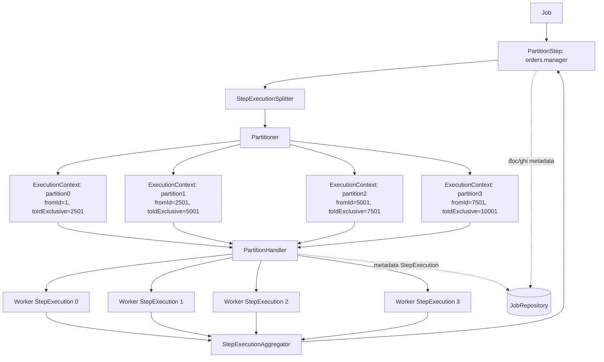

# PartitionStep và vai trò manager trong Spring Batch

## 1. Bài toán: mở rộng một Step khi dữ liệu quá lớn

Giả sử một job cần xử lý 10 triệu đơn hàng trong bảng `orders`. Nếu chỉ có một `Step` đọc tuần tự, thời gian hoàn thành có thể vượt cửa sổ chạy ban đêm. Ta muốn chia đơn hàng thành các vùng ID **không giao nhau**, ví dụ `[1, 2500001)`, `[2500001, 5000001)`…, rồi xử lý đồng thời. Spring Batch cung cấp cơ chế **partitioning** cho trường hợp này.

`PartitionStep` là **bước điều phối (manager step)**: nó chia công việc thành nhiều `StepExecution` con, giao chúng cho các worker, đợi kết quả và tổng hợp trạng thái. Mỗi worker thực thi **cùng một định nghĩa Step** nhưng với `ExecutionContext` riêng, do đó chỉ đọc phần dữ liệu được giao. Manager thường không tự xử lý từng bản ghi nghiệp vụ.

Sau bài này, bạn có thể:

- Phân biệt manager `PartitionStep` với worker `Step`, `Partitioner`, `StepExecutionSplitter`, `PartitionHandler` và `JobRepository`.
- Cấu hình partitioning nội bộ một JVM bằng `TaskExecutor` và dữ liệu chia theo khoảng ID.
- Lý giải vì sao tên partition, ranh giới dữ liệu, `@StepScope`, tính idempotent và metadata quyết định khả năng retry/restart.
- Đo nút thắt và chọn số partition, số worker theo CPU, I/O, connection pool và tải cơ sở dữ liệu.

> **Phạm vi:** bài tập trung vào kiến trúc và trách nhiệm của manager trong partitioning. Ví dụ Java dùng API Spring Batch **5.x (minh họa với 5.2)**. Spring Batch 6 vẫn giữ khái niệm này nhưng một số package/API infrastructure đã thay đổi; cần kiểm tra import khi nâng phiên bản.

## 2. PartitionStep nằm ở đâu trong kiến trúc?



Sơ đồ dùng khoảng ID của **10.000 bản ghi để dễ quan sát**, không phải số lượng của bài toán 10 triệu ở phần mở đầu. Với hệ thống thật, partition có thể mang phạm vi khóa chính, tên file, mã khách hàng, shard hoặc một khóa nghiệp vụ bảo đảm không trùng lặp.

| Thành phần | Trách nhiệm chính | Không nên làm |
| --- | --- | --- |
| **`PartitionStep` (manager)** | Khởi động phân vùng, điều phối worker, tổng hợp kết quả thành trạng thái Step của manager | Trực tiếp lặp qua mọi bản ghi và xử lý nghiệp vụ |
| **`Partitioner`** | Trả về `Map<String, ExecutionContext>`: tên partition duy nhất và tham số đầu vào | Tự tạo thread, tự chạy worker hoặc giữ trạng thái tiến độ xử lý |
| **`StepExecutionSplitter`** | Dựa trên `Partitioner`, trạng thái trong `JobRepository` và lần chạy để xác định các `StepExecution` con cần thực thi | Tự quyết cách truyền thông đến remote worker |
| **`PartitionHandler`** | Thực thi/phân phối các worker `StepExecution`, thu kết quả; có thể local hoặc remote | Tự tính ranh giới dữ liệu thay cho `Partitioner` |
| **Worker `Step`** | Xử lý một `ExecutionContext` riêng bằng chunk/tasklet, commit, retry/skip theo cấu hình của nó | Dùng chung reader có trạng thái giữa nhiều partition |
| **`JobRepository`** | Lưu metadata `JobExecution`, manager/worker `StepExecution`, trạng thái và `ExecutionContext` phục vụ theo dõi/restart | Thay thế kho dữ liệu đầu ra hoặc tự bảo đảm idempotency cho hệ thống ngoài |

Một job có thể có nhiều Step tuần tự hoặc song song; trong đó `PartitionStep` bản thân là **một Step** của job. Nó lại quản lý nhiều **lần thực thi của worker Step**, không tạo một định nghĩa Spring Bean `Step` khác nhau cho từng partition.

### Luồng chạy của manager

1. Job đến `orders.manager`, tạo `StepExecution` cho manager.
2. Manager thông qua splitter yêu cầu phân vùng. `Partitioner.partition(gridSize)` tạo các tên `partition0`, `partition1`… kèm `ExecutionContext` (ví dụ `fromId`, `toIdExclusive`).
3. Framework đăng ký/khôi phục các worker `StepExecution` tương ứng trong metadata; tên thường có dạng `orders.worker:partition0`, `orders.worker:partition1`…
4. `PartitionHandler` quyết định **cách chạy** các worker. Với `TaskExecutorPartitionHandler`, worker chạy trong các thread của cùng JVM. Với remote partitioning, việc phân phối qua hạ tầng thông điệp do cấu hình/tích hợp đảm nhiệm.
5. Mỗi worker tạo reader/processor/writer theo ngữ cảnh của partition, xử lý dữ liệu và cập nhật trạng thái riêng.
6. `StepExecutionAggregator` gom kết quả của các worker về manager; mặc định Spring Batch cung cấp bộ tổng hợp thông dụng. Job chuyển bước tiếp theo hay dừng dựa vào trạng thái/luồng đã cấu hình.

**Phân biệt tên dễ nhầm:** `orders.manager` là tên manager Step; `orders.worker` là tên worker Step; `orders.worker:partition2` là tên của một **worker StepExecution**. `gridSize` là gợi ý số đơn vị công việc, **không đồng nghĩa** với số thread, số máy hay cam kết luôn tạo đúng từng ấy partition. `Partitioner` có thể trả về ít/nhiều hơn tùy cách chia, và restart có thể tái sử dụng phân vùng đã lưu.

## 3. Thiết kế ranh giới partition trước khi viết code

Hai yêu cầu quan trọng nhất là **bao phủ toàn bộ dữ liệu cần xử lý** và **không xử lý trùng vùng**. Với khoảng nửa mở `[fromId, toIdExclusive)`, các ranh giới tiếp giáp mà không giao nhau:

```text
partition0:  1 <= id <  2501
partition1: 2501 <= id <  5001
partition2: 5001 <= id <  7501
partition3: 7501 <= id < 10001
```

Một `ExecutionContext` nên chứa **tham số nhỏ, có thể tuần tự hóa và đủ để tái tạo truy vấn** (ID đầu/cuối, tên file, định danh shard). Đừng đặt toàn bộ danh sách hàng triệu ID hoặc đối tượng không thể serialize vào metadata.

Phân vùng theo ID **không đòi hỏi ID liên tục**: các khoảng vẫn không giao nhau dù có lỗ hổng ID. Nhưng nếu dữ liệu lệch mạnh, mỗi khoảng ID có thể chứa số bản ghi khác nhau; khi đó hãy chia theo bucket dựa trên thống kê, file, tenant hay danh sách khoảng được tính từ dữ liệu thực tế.

## 4. Ví dụ cấu hình local partitioning (Spring Batch 5.2)

Ví dụ giả định PostgreSQL có bảng `orders(id BIGINT PRIMARY KEY, processed BOOLEAN NOT NULL DEFAULT FALSE)` và một Spring Boot/Spring Batch app đã cấu hình `DataSource`, `JobRepository`, `PlatformTransactionManager`. Để dễ kiểm chứng, ta xử lý dải ID `[1, 10001)` thành tối đa 4 partition. Trong thực tế, hãy cố định dải đầu vào cho **từng lần chạy job** (ví dụ snapshot/high-water mark ghi nhận trước khi job bắt đầu), tránh lấy lại biên thay đổi liên tục trong lúc restart.

```java
import java.util.LinkedHashMap;
import java.util.Map;
import javax.sql.DataSource;

import org.springframework.batch.core.Job;
import org.springframework.batch.core.Step;
import org.springframework.batch.core.configuration.annotation.StepScope;
import org.springframework.batch.core.job.builder.JobBuilder;
import org.springframework.batch.core.partition.support.Partitioner;
import org.springframework.batch.core.repository.JobRepository;
import org.springframework.batch.core.step.builder.StepBuilder;
import org.springframework.batch.item.ExecutionContext;
import org.springframework.batch.item.database.JdbcBatchItemWriter;
import org.springframework.batch.item.database.JdbcPagingItemReader;
import org.springframework.batch.item.database.Order;
import org.springframework.batch.item.database.builder.JdbcBatchItemWriterBuilder;
import org.springframework.batch.item.database.builder.JdbcPagingItemReaderBuilder;
import org.springframework.beans.factory.annotation.Value;
import org.springframework.context.annotation.Bean;
import org.springframework.context.annotation.Configuration;
import org.springframework.core.task.TaskExecutor;
import org.springframework.scheduling.concurrent.ThreadPoolTaskExecutor;
import org.springframework.transaction.PlatformTransactionManager;

@Configuration
public class OrdersPartitionJobConfig {

    @Bean
    public Partitioner ordersPartitioner() {
        return gridSize -> {
            if (gridSize <= 0) {
                throw new IllegalArgumentException("gridSize must be positive");
            }
            long min = 1L;          // Demo: cố định đầu vào của lần chạy
            long maxExclusive = 10_001L;
            long total = maxExclusive - min;
            long width = Math.max(1L, (total + gridSize - 1) / gridSize);

            Map<String, ExecutionContext> partitions = new LinkedHashMap<>();
            int index = 0;
            for (long from = min; from < maxExclusive; from += width) {
                ExecutionContext context = new ExecutionContext();
                context.putLong("fromId", from);
                context.putLong("toIdExclusive", Math.min(from + width, maxExclusive));
                partitions.put("partition" + index++, context);
            }
            return partitions;
        };
    }

    @Bean
    public ThreadPoolTaskExecutor partitionExecutor() {
        ThreadPoolTaskExecutor executor = new ThreadPoolTaskExecutor();
        executor.setCorePoolSize(4);
        executor.setMaxPoolSize(4);
        executor.setQueueCapacity(16);
        executor.setThreadNamePrefix("orders-partition-");
        executor.initialize();
        return executor;
    }

    // Một reader INSTANCE cho mỗi worker StepExecution.
    @Bean
    @StepScope
    public JdbcPagingItemReader<Long> ordersReader(
            DataSource dataSource,
            @Value("#{stepExecutionContext['fromId']}") Long fromId,
            @Value("#{stepExecutionContext['toIdExclusive']}") Long toIdExclusive) {

        return new JdbcPagingItemReaderBuilder<Long>()
                .name("ordersReader")
                .dataSource(dataSource)
                .selectClause("SELECT id")
                .fromClause("FROM orders")
                .whereClause("WHERE id >= :fromId AND id < :toId")
                .parameterValues(Map.of("fromId", fromId, "toId", toIdExclusive))
                .sortKeys(Map.of("id", Order.ASCENDING))
                .rowMapper((rs, rowNum) -> rs.getLong("id"))
                .pageSize(500)
                .build();
    }

    // Writer có thể được chia sẻ vì không giữ con trỏ đọc/trạng thái partition.
    @Bean
    public JdbcBatchItemWriter<Long> ordersWriter(DataSource dataSource) {
        return new JdbcBatchItemWriterBuilder<Long>()
                .dataSource(dataSource)
                .sql("UPDATE orders SET processed = TRUE "
                        + "WHERE id = ? AND processed = FALSE")
                .itemPreparedStatementSetter((id, ps) -> ps.setLong(1, id))
                .assertUpdates(false) // ID đã xử lý => 0 hàng cập nhật vẫn hợp lệ
                .build();
    }

    @Bean
    public Step ordersWorkerStep(
            JobRepository repository,
            PlatformTransactionManager transactionManager,
            JdbcPagingItemReader<Long> ordersReader,
            JdbcBatchItemWriter<Long> ordersWriter) {
        return new StepBuilder("orders.worker", repository)
                .<Long, Long>chunk(500, transactionManager)
                .reader(ordersReader)
                .writer(ordersWriter)
                .build();
    }

    @Bean
    public Step ordersManagerStep(
            JobRepository repository,
            Partitioner ordersPartitioner,
            Step ordersWorkerStep,
            TaskExecutor partitionExecutor) {
        return new StepBuilder("orders.manager", repository)
                .partitioner("orders.worker", ordersPartitioner)
                .step(ordersWorkerStep)
                .gridSize(4)
                .taskExecutor(partitionExecutor)
                .build();
    }

    @Bean
    public Job ordersPartitionJob(JobRepository repository, Step ordersManagerStep) {
        return new JobBuilder("ordersPartitionJob", repository)
                .start(ordersManagerStep)
                .build();
    }
}
```

**Đọc ví dụ theo trách nhiệm:**

- `ordersPartitioner()` chỉ tính `Map<partitionName, ExecutionContext>` và trả về manager. `LinkedHashMap` giúp thứ tự ví dụ dễ theo dõi; thứ tự này không bảo đảm worker sẽ **hoàn thành** theo thứ tự.
- `.partitioner("orders.worker", ...)` cấu hình splitter dựa trên partitioner và tên worker; `.step(ordersWorkerStep)` chọn logic worker; `.gridSize(4)` yêu cầu mức phân chia ban đầu; `.taskExecutor(...)` dùng `TaskExecutorPartitionHandler` mặc định để chạy local.
- `@StepScope` trì hoãn tạo reader đến khi worker thực sự chạy và có `stepExecutionContext`. Mỗi worker nhận hai biên riêng, thay vì tất cả cùng dùng một `JdbcPagingItemReader` có con trỏ/trạng thái đọc dùng chung.
- `sortKeys(id ASC)` chọn khóa sắp xếp duy nhất cho paging/restart. Câu truy vấn **không lọc `processed = FALSE`**: nếu vừa đọc vừa loại dần bản ghi khỏi tập kết quả đang phân trang, trang kế tiếp có thể bị lệch/bỏ sót dữ liệu tùy cách paging. Writer đặt cờ theo ID; cập nhật lại bản ghi đã xử lý không làm sai kết quả.
- `.assertUpdates(false)` phù hợp **riêng cho ví dụ idempotent này**, vì một số lần cập nhật có thể hợp lệ trả về 0 hàng. Trong nghiệp vụ yêu cầu đúng một hàng mỗi lệnh, phải kiểm tra số hàng cập nhật và báo lỗi thay vì bỏ kiểm tra.

Ví dụ minh họa kiến trúc và các API chính, chưa bao gồm cấu hình khởi tạo schema, xử lý bản ghi mới xuất hiện giữa chừng, mã nghiệp vụ, bảo mật hay cấu hình hạ tầng production. Với dữ liệu thực, hãy xem xét snapshot đầu vào, isolation level, thiết kế index và chiến lược xử lý đồng thời giữa các job.

### Vì sao `@StepScope` quan trọng?

`ItemReader` thường giữ trạng thái: số bản ghi đã đọc, trang hiện tại, cursor và dữ liệu checkpoint. Nếu inject **một singleton reader không an toàn cho truy cập đồng thời** vào nhiều worker, các partition có thể ghi đè vị trí đọc của nhau, tạo mất/trùng bản ghi và gây restart sai. Scope theo StepExecution tạo ngữ cảnh độc lập. Reader được cấu hình với expression:

```java
@Value("#{stepExecutionContext['fromId']}") Long fromId
```

Giá trị này đến từ `ExecutionContext` của **worker**, không phải manager. `@StepScope` giúp late binding nhưng **không tự giải quyết mọi vấn đề thread safety**: writer/processor dùng chung vẫn phải an toàn hoặc được scope riêng; DAO và service không nên chứa mutable state theo partition trong trường singleton.

## 5. Manager quản lý lỗi, retry và restart như thế nào?

Partitioning có thể chạy lại an toàn khi **metadata và dữ liệu đầu vào được thiết kế đúng**. Cần tách ba khái niệm:

| Tình huống | Hành vi mong muốn | Điều kiện |
| --- | --- | --- |
| **Retry trong worker** | Thử lại thao tác lỗi tạm thời, theo chính sách retry/rollback của worker Step | Chỉ retry lỗi có thể phục hồi; side effect phải an toàn khi thử lại |
| **Worker partition bị FAILED** | Manager tổng hợp thất bại; job có thể dừng. Khi restart **cùng JobInstance**, Spring Batch dựa vào metadata để xử lý lại phần cần chạy | `JobRepository` bền vững, `ExecutionContext` lưu được và input ổn định |
| **Worker đã COMPLETED** | Khi restart đúng cách, partition hoàn thành thường không cần chạy lại | Giữ định danh partition và metadata gốc; không ép tạo một JobInstance mới |
| **Chạy lại job với JobParameters mới** | Là một JobInstance khác nếu tham số định danh khác; có thể xử lý lại dữ liệu | Nghiệp vụ phải quy định rõ replay/duplicate và idempotency |

Giả sử `partition0`, `partition1`, `partition3` thành công nhưng `partition2` lỗi ở bản ghi thứ 600. Ở lần restart cùng JobInstance, metadata giúp framework nhận diện worker chưa hoàn thành và khôi phục tiến độ theo checkpoint/transaction của reader. Chỉ tin rằng “chạy lại phần chưa xong” khi writer, reader, checkpoint và `JobRepository` đều hỗ trợ restart tương ứng; side effect ngoài transaction (gọi API, gửi email, gửi message) cần cơ chế chống trùng riêng.

**Những điều manager không bảo đảm thay bạn:**

1. **Exactly-once của hiệu ứng bên ngoài:** gửi HTTP/message có thể được thực hiện trước khi transaction hoặc metadata được commit. Cân nhắc idempotency key theo business ID, unique constraint, inbox/outbox hoặc cơ chế dedupe.
2. **Input cố định:** partition theo `MAX(id)` hoặc thống kê động giữa các lần chạy có thể thay đổi. Tạo snapshot/high-water mark và lưu trong job parameters hoặc metadata thích hợp; không âm thầm đổi ranh giới của JobInstance đang restart.
3. **Dữ liệu không chồng lấn:** hai partition cùng cập nhật một ID vẫn có nguy cơ race/lock; tên partition khác nhau không thay thế điều kiện SQL loại trừ.
4. **Giao dịch xuyên toàn bộ job:** mỗi chunk của worker commit độc lập; việc một partition lỗi không tự rollback các chunk đã commit của các partition khác.
5. **Giới hạn tài nguyên:** manager có thể tạo nhiều execution hơn khả năng DB hoặc dịch vụ downstream chịu được. Cần giới hạn thread/connections và đo thực tế.

### Chẩn đoán restart bằng metadata

Với schema metadata mặc định của Spring Batch, có thể quan sát `BATCH_JOB_EXECUTION`, `BATCH_STEP_EXECUTION`, `BATCH_STEP_EXECUTION_CONTEXT` và các bảng liên quan. Ví dụ truy vấn vận hành (thay tên bảng/schema theo cấu hình thực tế):

```sql
SELECT step_name, status, read_count, write_count,
       commit_count, rollback_count, start_time, end_time
FROM BATCH_STEP_EXECUTION
WHERE job_execution_id = :jobExecutionId
ORDER BY step_execution_id;
```

Kỳ vọng thấy một dòng cho `orders.manager` và các dòng `orders.worker:partitionN`. Metadata là bằng chứng **đã thực thi đến đâu**, nhưng khi cần đối soát nghiệp vụ, vẫn phải kiểm tra số lượng hàng/ID thực tế ở nguồn và đích.

## 6. `gridSize` khác gì số thread, chunk size và số worker?

| Tham số | Ảnh hưởng | Ví dụ | Cách chọn |
| --- | --- | --- | --- |
| `gridSize` | Gợi ý số `StepExecution`/phân vùng được tạo ban đầu | `4` → có thể có 4 partition | Theo kích thước đơn vị công việc, độ lệch dữ liệu, overhead tạo partition |
| Pool `core/maxPoolSize` | Giới hạn số worker local có thể thực sự chạy cùng lúc | Pool `4` → tối đa khoảng 4 worker đồng thời với cấu hình này | Theo CPU, RAM, I/O, connection pool, quota downstream |
| `chunk(500)` | Số item tối đa xử lý trong một giao dịch chunk thông thường | Commit theo lô 500 item | Cân bằng overhead commit, bộ nhớ, rollback và lock |
| `pageSize(500)` | Số hàng đọc mỗi lần paging query | 500 dòng/trang | Theo hiệu suất SQL, mạng và bộ nhớ; không nhất thiết bằng chunk size |
| Số node worker remote | Sức chứa thực tế khi dùng remote partitioning | 3 node × 2 worker/node | Theo topology, cơ chế phân phối và tài nguyên của từng node |

Nếu có `gridSize = 16`, pool chỉ 4 thread, manager có thể tạo 16 partition nhưng chỉ khoảng 4 worker local xử lý cùng lúc; phần còn lại chờ tài nguyên. Ngược lại pool 16 thread với 4 partition cũng không làm xuất hiện 16 công việc hữu ích. `gridSize` không phải công tắc tăng tốc vô hạn.

Để chọn cấu hình, hãy đo **trước và sau** trên cùng bộ dữ liệu và cùng điều kiện tải:

- **Throughput:** số item hoàn thành/giây, tổng thời gian job, thời gian từng partition; chênh lệch lớn giữa partition nhanh/chậm là dấu hiệu lệch tải.
- **DB:** thời gian query, số kết nối bận, lock wait, deadlock, IOPS, buffer/cache hit; tăng thread khi DB đã bão hòa thường làm job chậm hơn.
- **Ứng dụng:** CPU, GC, heap, hàng đợi executor, thời gian chờ I/O, số lỗi/retry.
- **Downstream:** rate limit, latency, timeout; nếu phải gọi API, concurrency cần phù hợp hạn mức dịch vụ.

Ví dụ hệ thống chỉ có 8 connection DB dùng chung cho job, metadata và tác vụ khác thì khởi tạo pool 16 worker có thể gây cạn kết nối. Hãy dự trù số connection mỗi worker có thể dùng đồng thời, cộng chỗ cho `JobRepository` và workload khác, sau đó benchmark theo bước 1 → 2 → 4 → 8 worker. Giữ mức tăng tốc theo số liệu thay vì suy từ số lõi CPU.

## 7. Manager local và manager remote: phần nào thay đổi?

Trong cả hai mô hình, **manager vẫn chịu trách nhiệm phân vùng, khởi tạo/điều phối và tổng hợp kết quả**. Phần thay đổi chủ yếu là cách `PartitionHandler` thực thi worker:

| Khía cạnh | Local partitioning | Remote partitioning |
| --- | --- | --- |
| Nơi chạy worker | Các thread trong cùng JVM với manager | JVM/process/node khác, thông qua message/middleware và tích hợp thích hợp |
| Cách phân phối | `TaskExecutorPartitionHandler` + `TaskExecutor` | Spring Batch Integration remote partitioning manager/worker builders hoặc `PartitionHandler` phù hợp |
| Lợi thế | Cấu hình đơn giản, chi phí truyền thông thấp | Mở rộng ngang qua nhiều máy, cách ly tài nguyên tốt hơn |
| Chi phí | Giới hạn bởi một JVM và khả năng chịu tải của DB | Hạ tầng broker/transport, heartbeat, timeout, duplicate delivery, cấu hình metadata và vận hành phức tạp hơn |
| Yêu cầu chung | Partition độc lập, metadata bền vững, reader/writer đúng scope | Cùng các yêu cầu bên trái, cộng khả năng truyền và tái nhận yêu cầu, đồng bộ kết quả an toàn |

Đừng nhầm **remote partitioning** với **remote chunking**. Partitioning chia **đầu vào thành các StepExecution độc lập**; remote chunking thường để manager đọc dữ liệu, gửi chunk cho các worker xử lý. Nếu nguồn dữ liệu có thể được chia rõ thành file, tenant hoặc khoảng ID, partitioning thường là lựa chọn tự nhiên. Nếu bài toán cần chia công đoạn thành các Step khác nhau chạy song song, cân nhắc `split`/parallel flows thay vì partitioning.

Khi chuyển từ local sang remote, logic `Partitioner` và worker Step có thể được tái sử dụng về mặt khái niệm, nhưng phải kiểm tra phiên bản Spring Batch/Spring Batch Integration, giao thức, xử lý duplicate message và cách worker truy cập `JobRepository`/resource. Không mặc định rằng chỉ cần đổi `taskExecutor()` thành message broker là đã có thiết kế phân tán an toàn.

## 8. Tình huống lỗi thường gặp và hướng xử lý

| Dấu hiệu | Nguyên nhân cần kiểm tra | Hành động |
| --- | --- | --- |
| Mọi partition đọc cùng dữ liệu | Reader dùng chung singleton; chưa bind context hoặc SQL bỏ qua ranh giới | Dùng `@StepScope`, kiểm tra expression và SQL `WHERE` theo partition |
| Một số ID bị xử lý hai lần/bỏ sót | Khoảng ID giao nhau, điều kiện `<=`/`<` sai, dữ liệu thay đổi khi phân trang | Chuẩn hóa `[from, to)`, kiểm tra tập ID, giữ sort key duy nhất và snapshot |
| Manager không nhanh hơn Step tuần tự | Pool quá nhỏ, DB/IO đã bão hòa, partition lệch tải, lock chờ | Đo thời gian từng worker; tối ưu SQL/index, điều chỉnh partition và concurrency |
| Restart xử lý lại nhiều dữ liệu | Chạy JobInstance mới, checkpoint không lưu, đầu vào không ổn định | Kiểm tra JobParameters định danh, metadata và cơ chế `ItemStream` |
| Lỗi kết nối/timeout tăng khi tăng grid | Tổng concurrency vượt giới hạn DB/dịch vụ | Giảm pool, giới hạn connection, thêm backoff/retry có kiểm soát |
| Job hoàn tất nhưng đích thiếu dữ liệu | Logic writer/đối soát nghiệp vụ lỗi, lọc nguồn động hoặc bỏ qua lỗi quá mức | Đối soát tổng ID, read/write/skip counts, kiểm thử partition boundaries |

### Checklist trước khi đưa partitioning vào vận hành

- [ ] Bài toán có công việc **độc lập** để chia; không cần thứ tự xử lý toàn cục.
- [ ] Mỗi partition có tên ổn định và phạm vi đầu vào không giao nhau; toàn bộ dữ liệu mục tiêu được bao phủ.
- [ ] Reader/processor/writer có trạng thái được tạo đúng scope hoặc được chứng minh an toàn khi chia sẻ.
- [ ] `JobRepository` dùng storage bền vững; metadata, checkpoint, retry/restart được thử bằng lỗi có chủ đích.
- [ ] Giao dịch, writer và side effect ngoài DB chịu được việc retry/replay, có cơ chế idempotency phù hợp.
- [ ] Pool thread, pool DB, giới hạn downstream và `gridSize` được hiệu chỉnh bằng benchmark.
- [ ] Có dashboard/log theo JobExecution ID, StepExecution/partition, throughput, lỗi, số lần retry và thời gian chậm nhất.
- [ ] Có thủ tục vận hành khi một partition lỗi: điều tra nguyên nhân, đối soát tiến độ, restart **cùng JobInstance** khi phù hợp.

## 9. Bài tập tự kiểm tra

**Bài tập 1 — Suy luận phân vùng.** Dải ID `[1, 101)` được chia bởi `gridSize = 3` với thuật toán `ceil(total/gridSize)`. Hãy ghi các cặp `[fromId, toIdExclusive)` và chứng minh không ID nào xuất hiện ở hai partition. (*Gợi ý:* độ rộng là 34; partition cuối có thể nhỏ hơn.)

**Bài tập 2 — Thiết kế restart.** Một job có bốn partition. Ba partition `COMPLETED`, một partition `FAILED` sau ba chunk. Hãy mô tả metadata nào cần còn nguyên và vì sao tạo JobParameters định danh mới có thể khiến dữ liệu bị xử lý lại. Đề xuất idempotency key cho thao tác gọi API bên ngoài.

**Bài tập 3 — Đọc biểu đồ tải.** Khi tăng pool từ 4 lên 8 thread, throughput không tăng nhưng DB connection usage và lock waits tăng mạnh. Giải thích tại sao manager/partitioner vẫn có thể đúng mà job không nhanh hơn; nêu hai thay đổi bạn sẽ thử trước khi tiếp tục tăng thread.

## 10. Ghi nhớ

`PartitionStep` đóng vai **manager của nhiều worker StepExecution**. `Partitioner` định nghĩa *mỗi worker xử lý phần nào*; splitter và repository hỗ trợ quản lý execution/restart; `PartitionHandler` định nghĩa *worker chạy ở đâu và bằng cách nào*; aggregator đưa kết quả trở lại manager. Hiệu quả thực tế phụ thuộc chất lượng phân vùng, tính độc lập và an toàn của worker, cơ chế checkpoint/idempotency và nút thắt tài nguyên — không chỉ ở số thread.

**Tài liệu tham khảo chính thức:**

- [Spring Batch Reference — Scaling and Parallel Processing (partitioning)](https://docs.spring.io/spring-batch/reference/5.2/scalability.html)
- [Spring Batch 5.2 API — `PartitionStepBuilder`](https://docs.spring.io/spring-batch/docs/5.2.x/api/org/springframework/batch/core/step/builder/PartitionStepBuilder.html)
- [Spring Batch 5.2 API — `Partitioner`](https://docs.spring.io/spring-batch/docs/5.2.x/api/org/springframework/batch/core/partition/support/Partitioner.html)
- [Spring Batch 5.2 API — `JdbcPagingItemReaderBuilder`](https://docs.spring.io/spring-batch/docs/5.2.x/api/org/springframework/batch/item/database/builder/JdbcPagingItemReaderBuilder.html)
