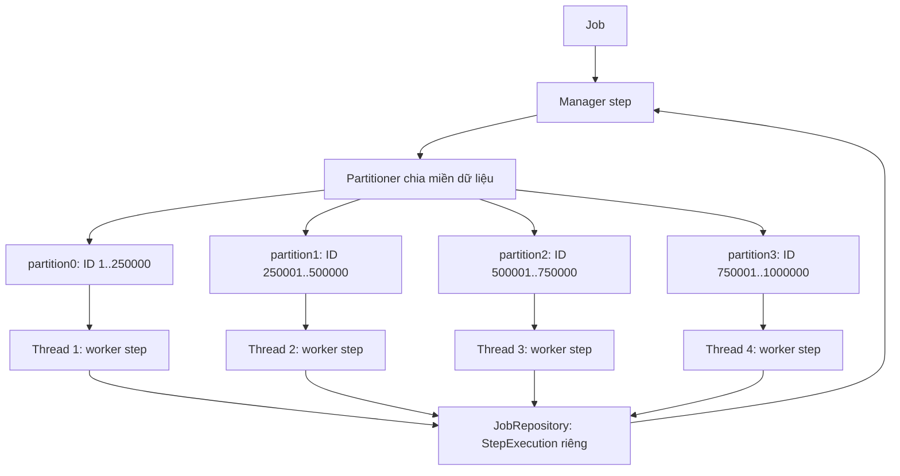

# Partitioning cục bộ bằng thread trong Spring Batch

## 1. Bài toán và mục tiêu

Giả sử một job phải đánh dấu đã xử lý cho hàng triệu đơn hàng. Chạy tuần tự một step có thể khiến tổng thời gian quá dài, trong khi máy chủ còn nhiều CPU và cơ sở dữ liệu vẫn có khả năng phục vụ thêm truy vấn. **Partitioning cục bộ bằng thread** cho phép chia tập dữ liệu thành những phần không giao nhau, rồi chạy cùng một *worker step* trên nhiều thread trong **một tiến trình JVM**.

Bài này thuộc chủ đề **Partitioning** của module `SPRING_BATCH_SCALING_OPERATIONS`: mở rộng Spring Batch cho workload dữ liệu lớn, đồng thời đo nút thắt, giữ an toàn khi chạy đồng thời, hỗ trợ retry/restart và lựa chọn mức song song theo tài nguyên thực tế.

Sau bài học, người đọc có thể:

- Phân biệt partitioning bằng thread với một multi-threaded step thông thường.
- Thiết kế `Partitioner` tạo các vùng dữ liệu độc lập và cấu hình `TaskExecutor` giới hạn số thread.
- Dùng `ExecutionContext` và `@StepScope` để mỗi partition sở hữu reader riêng.
- Phân tích restart, tính lặp an toàn (*idempotency*), phân bố tải và cách đo hiệu năng trước khi tăng concurrency.

Ví dụ dưới đây dùng **Spring Batch 5.x, Java 17+ và cơ sở dữ liệu quan hệ**; tên bảng và cấu hình cần điều chỉnh cho ứng dụng thật. Partitioning tăng tốc khi các phần dữ liệu độc lập và còn tài nguyên xử lý. Nó không bảo đảm nhanh hơn nếu database, mạng hoặc writer đã là nút thắt.

## 2. Một partition chạy như thế nào?

Trong mô hình local partitioning có hai vai trò:

| Thành phần | Trách nhiệm |
|---|---|
| **Manager step** (còn gọi là partitioned step) | Gọi `Partitioner` tạo các phần việc, phân phối worker và tổng hợp trạng thái. |
| **Partitioner** | Trả về `Map<String, ExecutionContext>`; mỗi key là tên partition ổn định, mỗi context chứa ranh giới dữ liệu của phần đó. |
| **Partition handler** | Dùng `TaskExecutor` để thực thi các worker step song song trong JVM. Cấu hình `.taskExecutor(...)` trên partition step sử dụng handler phù hợp. |
| **Worker step** | Thực hiện đọc, xử lý, ghi dữ liệu theo chunk; mỗi partition có một `StepExecution` riêng được theo dõi bởi `JobRepository`. |
| **Step-scoped reader** | Lấy khoảng dữ liệu từ `stepExecutionContext` và tạo một reader độc lập cho từng `StepExecution`. |



Ví dụ, với 1.000.000 ID, bốn partition có thể được gán bốn khoảng như sơ đồ. Mỗi worker chỉ chọn bản ghi trong khoảng của mình. Nếu dùng `gridSize = 8` nhưng thread pool có bốn worker, Spring Batch có thể tạo tám partition và thực thi tối đa bốn worker cùng lúc; những partition còn lại đợi thread rảnh.

**Phân biệt với multi-threaded step:** multi-threaded step cho nhiều thread cùng xử lý các chunk trong **một** step; reader hoặc trạng thái được chia sẻ có thể đòi hỏi đồng bộ. Partitioning tạo **nhiều `StepExecution` riêng** với vùng dữ liệu và `ExecutionContext` riêng, nhờ đó dễ theo dõi kết quả và restart từng partition. Tuy vậy, các bean singleton, nguồn dữ liệu và tài nguyên bên ngoài vẫn có thể bị chia sẻ: partitioning không tự biến mọi component thành thread-safe.

## 3. Chia partition sao cho đúng

Với cách chia theo khoảng khóa chính (`id`), các partition cần thỏa mãn ba điều kiện:

1. **Không chồng lấn:** một ID chỉ thuộc một partition; dùng khoảng đóng `[minId, maxId]` và ranh giới liên tiếp.
2. **Không bỏ sót:** hợp của các khoảng phải phủ hết miền ID dự kiến xử lý. Bản ghi có ID bị khuyết trong bảng không gây lỗi.
3. **Ổn định khi restart:** tên partition và ranh giới cần được tái tạo nhất quán cho cùng một job instance; tránh thay đổi dữ liệu đầu vào hoặc thuật toán phân vùng giữa chừng.

Một `Partitioner` có thể chia miền ID thành các khoảng gần đều, bao gồm cả trường hợp không chia hết:

```java
import java.util.LinkedHashMap;
import java.util.Map;
import org.springframework.batch.core.partition.support.Partitioner;
import org.springframework.batch.item.ExecutionContext;

public class IdRangePartitioner implements Partitioner {
    private final long firstId;
    private final long lastId;

    public IdRangePartitioner(long firstId, long lastId) {
        if (firstId > lastId) {
            throw new IllegalArgumentException("Khoang ID khong hop le");
        }
        this.firstId = firstId;
        this.lastId = lastId;
    }

    @Override
    public Map<String, ExecutionContext> partition(int gridSize) {
        if (gridSize < 1) {
            throw new IllegalArgumentException("gridSize phai > 0");
        }

        long count = Math.addExact(Math.subtractExact(lastId, firstId), 1);
        int parts = (int) Math.min((long) gridSize, count);
        long baseSize = count / parts;
        long remainder = count % parts;

        Map<String, ExecutionContext> result = new LinkedHashMap<>();
        long cursor = firstId;

        for (int i = 0; i < parts; i++) {
            long size = baseSize + (i < remainder ? 1 : 0);
            long end = Math.addExact(cursor, size - 1);

            ExecutionContext context = new ExecutionContext();
            context.putLong("minId", cursor);
            context.putLong("maxId", end);
            result.put("partition" + i, context);

            if (i + 1 < parts) {
                cursor = Math.addExact(end, 1);
            }
        }
        return result;
    }
}
```

Với `firstId = 1`, `lastId = 10`, `gridSize = 3`, các khoảng là `1..4`, `5..7`, `8..10`: không trùng và không hụt. Dùng `Math.addExact`/`subtractExact` để phát hiện trường hợp tràn `long` thay vì âm thầm tạo ranh giới sai. Khi bảng rỗng, ứng dụng cần bỏ qua step hoặc không tạo job xử lý; ví dụ này giả định miền ID hợp lệ được cấp trước.

**Lưu ý quan trọng:** đều về *độ rộng khoảng ID* chưa chắc đều về *số bản ghi* hoặc *thời gian xử lý*. Nếu 80% dữ liệu chỉ nằm ở 20% khoảng ID, một partition sẽ chạy rất lâu. Với ID thưa hoặc chi phí xử lý chênh lệch, nên lấy histogram/count theo khoảng, dùng danh sách khóa được chốt trước hoặc chia theo ranh giới có số lượng bản ghi gần bằng nhau. Cách chia theo `MOD(id, n)` có thể cân bằng hơn trong một số tập dữ liệu nhưng có nguy cơ làm mất lợi thế truy vấn theo range có index; phải đo bằng kế hoạch truy vấn thực tế.

## 4. Cấu hình local partitioning với Spring Batch

Giả sử bảng PostgreSQL có cấu trúc tối giản:

```sql
CREATE TABLE orders (
    id BIGINT PRIMARY KEY,
    processed BOOLEAN NOT NULL DEFAULT FALSE
);
```

Mục đích: mỗi worker đọc ID trong khoảng được giao rồi cập nhật `processed = TRUE`. Ví dụ cố ý đọc theo ID mà **không lọc `processed = FALSE`**, để thứ tự đọc không biến đổi khi worker cập nhật cột `processed`. Câu lệnh ghi có tính lặp an toàn: chạy lại cùng ID vẫn để `processed = TRUE`.

Đoạn cấu hình sau minh họa đầy đủ job, manager step, worker step, reader, writer và executor. Giả định Spring Boot/Spring Batch đã cấu hình `DataSource`, `JobRepository`, transaction manager và các bảng metadata của Spring Batch.

```java
import javax.sql.DataSource;

import org.springframework.batch.core.Job;
import org.springframework.batch.core.Step;
import org.springframework.batch.core.configuration.annotation.StepScope;
import org.springframework.batch.core.job.builder.JobBuilder;
import org.springframework.batch.core.partition.support.Partitioner;
import org.springframework.batch.core.step.builder.StepBuilder;
import org.springframework.batch.item.database.JdbcBatchItemWriter;
import org.springframework.batch.item.database.JdbcCursorItemReader;
import org.springframework.batch.item.database.builder.JdbcBatchItemWriterBuilder;
import org.springframework.batch.item.database.builder.JdbcCursorItemReaderBuilder;
import org.springframework.beans.factory.annotation.Qualifier;
import org.springframework.beans.factory.annotation.Value;
import org.springframework.context.annotation.Bean;
import org.springframework.context.annotation.Configuration;
import org.springframework.core.task.TaskExecutor;
import org.springframework.jdbc.core.namedparam.MapSqlParameterSource;
import org.springframework.scheduling.concurrent.ThreadPoolTaskExecutor;
import org.springframework.transaction.PlatformTransactionManager;
import org.springframework.batch.core.repository.JobRepository;

@Configuration
public class OrderPartitionJobConfiguration {

    @Bean
    public Job processOrdersJob(JobRepository repository,
            @Qualifier("partitionedOrdersStep") Step managerStep) {
        return new JobBuilder("processOrdersJob", repository)
                .start(managerStep)
                .build();
    }

    @Bean
    public Step partitionedOrdersStep(JobRepository repository,
            @Qualifier("ordersWorkerStep") Step worker,
            @Qualifier("orderPartitioner") Partitioner partitioner,
            @Qualifier("partitionExecutor") TaskExecutor executor) {
        return new StepBuilder("partitionedOrdersStep", repository)
                .partitioner("ordersWorkerStep", partitioner)
                .step(worker)
                .gridSize(8)
                .taskExecutor(executor)
                .build();
    }

    @Bean
    public Partitioner orderPartitioner(
            @Value("${demo.orders.from-id}") long fromId,
            @Value("${demo.orders.to-id}") long toId) {
        return new IdRangePartitioner(fromId, toId);
    }

    @Bean
    public Step ordersWorkerStep(JobRepository repository,
            PlatformTransactionManager transactionManager,
            @Qualifier("ordersReader") JdbcCursorItemReader<Long> reader,
            JdbcBatchItemWriter<Long> ordersWriter) {
        return new StepBuilder("ordersWorkerStep", repository)
                .<Long, Long>chunk(500, transactionManager)
                .reader(reader)
                .writer(ordersWriter)
                .build();
    }

    @Bean
    @StepScope
    public JdbcCursorItemReader<Long> ordersReader(DataSource dataSource,
            @Value("#{stepExecutionContext['minId']}") Long minId,
            @Value("#{stepExecutionContext['maxId']}") Long maxId) {
        return new JdbcCursorItemReaderBuilder<Long>()
                .name("ordersRangeReader")
                .dataSource(dataSource)
                .sql("SELECT id FROM orders "
                        + "WHERE id >= ? AND id <= ? ORDER BY id")
                .preparedStatementSetter(ps -> {
                    ps.setLong(1, minId);
                    ps.setLong(2, maxId);
                })
                .rowMapper((rs, row) -> rs.getLong("id"))
                .build();
    }

    @Bean
    public JdbcBatchItemWriter<Long> ordersWriter(DataSource dataSource) {
        return new JdbcBatchItemWriterBuilder<Long>()
                .dataSource(dataSource)
                .sql("UPDATE orders SET processed = TRUE WHERE id = :id")
                .itemSqlParameterSourceProvider(
                        id -> new MapSqlParameterSource("id", id))
                .build();
    }

    @Bean
    public TaskExecutor partitionExecutor() {
        ThreadPoolTaskExecutor executor = new ThreadPoolTaskExecutor();
        executor.setCorePoolSize(4);
        executor.setMaxPoolSize(4);
        executor.setQueueCapacity(8);
        executor.setThreadNamePrefix("orders-partition-");
        return executor;
    }
}
```

Ví dụ properties:

```yaml
demo:
  orders:
    from-id: 1
    to-id: 1000000
```

Ở đây `gridSize = 8` là số partition mong muốn truyền cho `Partitioner`, còn pool tối đa bốn thread mới là giới hạn chạy đồng thời ở mức executor. Hai giá trị có mục đích khác nhau. `queueCapacity` giúp các tác vụ vượt quá số thread được xếp hàng thay vì bị từ chối ngay khi executor bận. Nên cấu hình pool thực tế cùng chính sách shutdown và giới hạn tài nguyên của ứng dụng.

**Trong hệ thống thật, chốt `fromId`/`toId` theo từng lần chạy**, chẳng hạn từ một snapshot hoặc bảng manifest gắn với `JobParameters`, rồi khôi phục đúng ranh giới đó khi restart. Properties cố định trong ví dụ chỉ để minh họa; nếu thay đổi chúng giữa hai lần chạy lại cùng job instance, việc phân chia có thể không còn phản ánh đầu vào ban đầu. Nếu nguồn liên tục có dữ liệu mới, cần một quy tắc cutoff/snapshot rõ ràng, thay vì cho các partition tùy ý nhìn thấy dữ liệu mới.

### Tại sao `@StepScope` quan trọng?

`StepExecutionContext` chứa `minId` và `maxId` của **partition đang chạy**. Annotation `@StepScope` trì hoãn việc tạo reader đến khi có `StepExecution` phù hợp. Nhờ vậy, mỗi partition nhận một `JdbcCursorItemReader` và cursor riêng, cùng checkpoint riêng trong metadata. Nếu cấu hình reader dạng singleton có trạng thái rồi dùng chung giữa nhiều worker, các thao tác `open/read/update/close` có thể tranh chấp nhau, gây bỏ sót, đọc lặp hoặc trạng thái restart sai.

Trong mẫu trên writer là singleton nhưng không giữ con trỏ đọc hay bộ đếm dữ liệu mutable theo partition; thao tác ghi dùng input và tài nguyên database do Spring quản lý. Với writer/processor tự viết, cần kiểm tra kỹ biến instance, bộ đệm, formatter không thread-safe và side effect bên ngoài. `@StepScope` chỉ cô lập bean được đánh dấu; nó không cô lập các singleton mà bean đó tham chiếu đến.

## 5. Chunk, transaction và restart

Mỗi worker xử lý các chunk độc lập. Với `chunk(500, transactionManager)`, tối đa 500 item được đọc và ghi trong một chunk, rồi transaction của worker được commit. Một partition lỗi có thể khiến các chunk sau cùng của partition đó rollback, trong khi những partition khác đã commit thành công.

`JobRepository` ghi metadata cho manager và các worker `StepExecution`; Spring Batch dùng trạng thái này khi restart job instance. Với phân vùng ổn định, các partition đã **COMPLETED** có thể được giữ nguyên, còn partition lỗi/chưa hoàn thành được thực thi tiếp theo khả năng restart của reader/writer và chính sách step. Tránh hiểu restart là “toàn bộ job tự chạy lại từ đầu”. Cụ thể:

- Cấu hình `ItemStream` có tên ổn định, như `.name("ordersRangeReader")`, để checkpoint reader được lưu vào `ExecutionContext` của worker tương ứng.
- Giữ ổn định tên partition (`partition0`, `partition1`, …), bộ dữ liệu đầu vào, SQL `ORDER BY` theo khóa duy nhất và ranh giới khi restart.
- Thiết kế ghi dữ liệu **idempotent**. Chunk đã commit có thể được thử lại ở một số tình huống lỗi, đặc biệt khi có side effect không cùng transaction database. Không giả định *exactly once* cho email, HTTP hoặc message broker chỉ nhờ partitioning.
- Nếu reader dùng điều kiện lọc một trường bị writer thay đổi, thứ tự/tập kết quả có thể dịch chuyển trong lúc đọc; checkpoint theo vị trí trở nên khó tin cậy. Ưu tiên nguồn đọc ổn định hoặc điều kiện truy vấn không bị các worker làm thay đổi.

Để retry, cấu hình *fault tolerance* trên worker step, ví dụ (chỉ khi lỗi thực sự có thể phục hồi):

```java
.faultTolerant()
.retry(org.springframework.dao.TransientDataAccessException.class)
.retryLimit(3)
```

Đặt đoạn trên sau `.writer(...)` và trước `.build()` trong DSL của worker step. Không retry vô hạn các lỗi dữ liệu hoặc SQL sai. Retry xảy ra trong phạm vi chunk/step có lỗi, chứ không biến manager thành một cơ chế tự khắc phục mọi vấn đề. Khi cần skip bản ghi lỗi, hãy xác định giới hạn skip, cách lưu bản ghi bị bỏ qua và tác động đến tính đúng đắn của kết quả.

Với tác vụ gọi dịch vụ bên ngoài, có thể cần **outbox, khóa nghiệp vụ duy nhất hoặc bảng deduplication** để chống thực hiện trùng sau rollback/restart. Nếu yêu cầu đồng nhất snapshot ở mức toàn job, cần thêm chiến lược isolation/version/cutoff phù hợp với DB; transaction theo chunk không mặc nhiên tạo snapshot toàn cục cho tất cả partition.

## 6. Đặt `gridSize`, thread pool và chunk size theo dữ liệu đo được

Ba tham số thường bị nhầm với nhau:

| Tham số | Điều khiển | Tác động thường gặp |
|---|---|---|
| `gridSize` | Số phần việc được yêu cầu tạo ra | Nhiều partition giúp chia nhỏ tải nhưng tăng số `StepExecution`, metadata và chi phí khởi tạo. |
| `corePoolSize`/`maxPoolSize` | Số worker thread có thể chạy cùng lúc | Tăng song song nhưng tăng áp lực DB connection, lock, CPU, heap và I/O. |
| `chunk size` | Số item trong một giao dịch | Chunk lớn giảm commit overhead nhưng tăng thời gian giữ transaction, bộ nhớ và phạm vi rollback. |

Không có giá trị “8 thread là tối ưu” cho mọi ứng dụng. Bắt đầu với cấu hình thấp, sau đó tăng có kiểm soát và quan sát bottleneck:

1. Chạy baseline một worker, giữ cố định dữ liệu, SQL và máy chủ; đo throughput, wall-clock time, CPU, RAM, GC, truy vấn chậm và thời gian chờ connection.
2. Chạy 2 rồi 4 worker trên cùng một loại workload; quan sát throughput có tiếp tục tăng hay không. Đảm bảo giới hạn connection pool, transaction lock và DB IOPS đáp ứng concurrency.
3. Xem duration/`readCount`/`writeCount`/`rollbackCount` của **từng partition**. Nếu nhiều worker đã xong nhưng một partition còn chạy lâu, cần chia lại dữ liệu trước khi tăng thread.
4. Đo lại khi thay đổi chunk size. Dừng tăng concurrency khi throughput đi ngang hoặc lỗi timeout, lock contention và GC tăng.

Ví dụ đo tốc độ tăng (*speedup*) với cùng lượng dữ liệu:

\[
S(p) = \frac{T_1}{T_p}, \qquad E(p) = \frac{S(p)}{p}
\]

Trong đó `T1` là thời gian chạy một worker, `Tp` là thời gian khi cho tối đa `p` worker đồng thời, `E(p)` là hiệu quả sử dụng song song. Nếu một worker mất 80 phút, bốn worker mất 28 phút thì `S(4) ≈ 2,86` và `E(4) ≈ 0,71`. Sự chênh lệch so với 4× phản ánh overhead và các thành phần không thể song song hóa; cần tìm nguyên nhân cụ thể thay vì quy cho Spring Batch.

Một danh sách chỉ số nên theo dõi khi vận hành:

| Lớp | Chỉ số cần chú ý | Dấu hiệu cần điều tra |
|---|---|---|
| Spring Batch | Job/step duration, số partition thành công/thất bại, `readCount`, `writeCount`, `commitCount`, `rollbackCount`, skip/retry | Một partition kéo dài, rollback tăng hoặc step bị treo. |
| Executor/JVM | Active threads, queue depth, CPU, heap, GC, thread dump | Nhiều thread nhưng CPU nhàn vì chờ I/O/lock; hoặc GC chiếm thời gian lớn. |
| Database | Connection pool active/wait, IOPS, lock wait, slow query, scan/index plan | Cạn connection, tranh chấp update hoặc truy vấn partition quét toàn bảng. |
| Nghiệp vụ | Tổng số ID dự kiến, số bản ghi thực xử lý, số bản ghi trùng/bỏ sót | Kết quả đếm không khớp hoặc side effect bị nhân đôi. |

## 7. Những lỗi thiết kế thường gặp

| Triệu chứng | Nguyên nhân có thể | Hướng xử lý |
|---|---|---|
| Cùng bản ghi được xử lý hai lần | Khoảng giao nhau; truy vấn không áp dụng ranh giới; retry có side effect | Kiểm tra tính không giao nhau, ràng buộc khóa/idempotency và SQL thực tế của từng worker. |
| Bỏ sót bản ghi | Sai dấu `<`/`<=`; thay đổi tập kết quả khi đang đọc; thay đổi cutoff | Dùng khoảng nhất quán, test điểm biên, chốt tập dữ liệu của một lần chạy. |
| Lỗi `ReaderNotOpenException` hoặc checkpoint kỳ lạ | Reader stateful bị dùng chung; sai lifecycle bean | Tạo reader `@StepScope`, kiểm tra bean proxy và tên `ItemStream`. |
| Nhiều thread nhưng job không nhanh hơn | DB đã bão hòa, I/O chậm, partition lệch tải | Đo per-partition throughput, connection/lock wait, SQL plan; cân bằng lại partition. |
| Task bị từ chối | Executor ít thread và không đủ queue; executor đang shutdown | Giới hạn lượng partition, chỉnh pool/queue, kiểm soát lifecycle. |
| Restart cho kết quả khác dự kiến | Tên/range partition đổi; nguồn dữ liệu thay đổi; writer không idempotent | Giữ version của partition plan, khóa cutoff, thiết kế ghi an toàn khi lặp. |

### Checklist trước khi dùng trên production

- [ ] Mỗi partition có key duy nhất, ranh giới không giao nhau và query dùng đúng ranh giới đó.
- [ ] Tập dữ liệu nguồn/cutoff và partition plan ổn định cho một job instance, kể cả lúc restart.
- [ ] Reader, cursor và trạng thái mutable được tạo riêng theo `StepExecution`; các bean dùng chung được kiểm tra thread safety.
- [ ] Writer có chiến lược idempotency; side effect ngoài transaction có cơ chế chống trùng.
- [ ] Executor, DB pool, chunk size và số partition được giới hạn theo số đo tài nguyên thực tế.
- [ ] Có phép đối soát số bản ghi và metric/log theo partition để khoanh vùng lỗi.
- [ ] Đã thử dừng một worker giữa chừng, restart job và kiểm chứng rằng bản ghi không mất/trùng tác động nghiệp vụ.

## 8. Khi nào chọn local partitioning và khi nào không?

| Bối cảnh | Hướng phù hợp |
|---|---|
| Một JVM còn dư CPU/I/O; dữ liệu chia độc lập; cần checkpoint theo phần việc | **Local partitioning** với `TaskExecutor`. |
| Cần chạy nhiều chunk đồng thời trên cùng step, cấu trúc dữ liệu/reader cho phép chia sẻ an toàn | Cân nhắc **multi-threaded step**, sau khi xác minh thread safety. |
| Có nhiều giai đoạn độc lập, chẳng hạn xử lý đơn hàng và tổng hợp log | Cân nhắc **parallel flows/steps**, vì đây là song song giữa các bước khác nhau. |
| Một JVM không đủ tài nguyên, worker phải phân bố trên nhiều máy | Cân nhắc **remote partitioning** hoặc mô hình phân tán khác, kèm điều phối và giám sát mạng/worker. |
| DB là nút thắt và đã bão hòa ở một worker | Tối ưu truy vấn, index, data layout, batch write và giới hạn I/O trước khi thêm thread. |

Local partitioning là bước mở rộng hữu ích trước khi phải vận hành nhiều worker trên nhiều máy: cùng một JVM, cấu hình đơn giản hơn, vẫn có `StepExecution` và checkpoint độc lập. Giá trị thực của nó nằm ở **khả năng chia dữ liệu đúng, khôi phục đúng và chứng minh hiệu năng qua phép đo**, không nằm ở số lượng thread tạo ra.

## 9. Bài tập thực hành

1. Tạo dữ liệu có ID `1..103`, chạy `gridSize = 8`, in `minId/maxId` của từng partition. Kiểm tra tổng phạm vi phủ đúng 103 ID và không có khoảng giao nhau.
2. Tạo dữ liệu lệch: 90% bản ghi tập trung ở khoảng ID cuối. So sánh duration của các partition và đề xuất cách chia cân bằng theo số bản ghi.
3. Cố tình gây lỗi ở một partition sau khi một số chunk đã commit. Restart cùng job instance, kiểm tra metadata partition và đối soát số đơn hàng `processed = TRUE`.
4. Đo ba cấu hình pool có 1, 2 và 4 thread với cùng dữ liệu. Tính `S(p)` và `E(p)`; ghi nhận thời gian chờ DB connection, lock wait và thời gian từng partition.

**Câu hỏi tự kiểm tra:** Vì sao chỉ thêm `.taskExecutor(...)` không thể bảo đảm job chạy nhanh hơn? Vì sao `@StepScope` và partition name ổn định quan trọng với restart? Nếu writer gửi email sau khi cập nhật database, cần bổ sung cơ chế gì để tránh gửi trùng khi retry?
