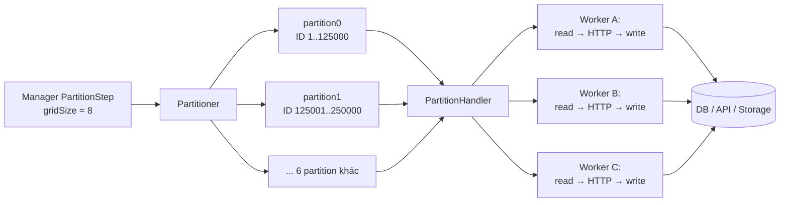

# Partitioning cho workload IO-intensive

## 1. Khi nào I/O trở thành nút thắt của batch job?

Trong chương **Partitioning** thuộc module **SPRING_BATCH_SCALING_OPERATIONS**, mục tiêu là mở rộng Spring Batch để xử lý dữ liệu lớn nhưng vẫn kiểm soát thread safety, retry/restart và tài nguyên vận hành. Một tình huống rất phổ biến là **workload I/O-intensive (I/O-bound)**: thời gian xử lý item chủ yếu dùng để **đợi** database, dịch vụ HTTP, object storage, ổ đĩa hoặc mạng, chứ không phải chạy tính toán CPU.

Ví dụ một job xử lý 4 triệu đơn hàng:

1. Đọc đơn hàng từ database nguồn.
2. Gọi dịch vụ HTTP để lấy thông tin rủi ro cho từng đơn.
3. Ghi kết quả vào database đích.

Nếu CPU mỗi item chỉ cần 10 ms nhưng phải chờ HTTP và database 190 ms, chạy từng item một khiến CPU rảnh phần lớn thời gian. **Partitioning** chia tập dữ liệu thành những vùng độc lập để nhiều worker có thể đọc/xử lý/ghi **đồng thời**, che lấp một phần thời gian đợi I/O.

Tuy nhiên, tăng số worker không đồng nghĩa tốc độ tăng vô hạn. Mọi worker có thể cùng chờ một connection pool, rate limit API, khóa database hoặc giới hạn IOPS. Thiết kế đúng là **chia việc có thể phục hồi, giới hạn concurrency bằng tài nguyên thật, và đo thông lượng trước khi mở rộng**.

### Mục tiêu học tập

Sau bài này, bạn có thể:

- Phân biệt workload I/O-bound và CPU-bound; nhận diện đúng điểm nghẽn.
- Giải thích lý do partitioning có thể tăng throughput khi worker thường xuyên đợi I/O.
- Thiết kế `Partitioner` với dải dữ liệu không chồng lấn, tên partition ổn định và `ExecutionContext` riêng.
- Cấu hình local partitioning bằng Spring Batch 5.x với `@StepScope` cho reader và executor có giới hạn.
- Biết cách đưa xử lý sang remote partitioning khi một JVM hoặc một máy không đủ tài nguyên.
- Đo thời gian chờ I/O, connection pool, queue, API rate limit, retry và thời gian partition chậm nhất.
- Xử lý restart, checkpoint, dữ liệu nguồn biến động và khả năng ghi lặp an toàn.

> **Ý chính:** Partitioning không làm từng truy vấn hay từng HTTP call nhanh hơn. Nó **cho phép nhiều vùng dữ liệu được xử lý cùng lúc** để sử dụng tốt thời gian chờ I/O, miễn các dịch vụ phía sau đủ sức chịu tải và partition có ranh giới/restart rõ ràng.

## 2. Đặc trưng của workload IO-intensive

Một worker thực hiện liên tiếp nhiều thao tác:

```text
Worker A:
  [CPU] [   đợi DB   ] [CPU] [       đợi HTTP       ] [ ghi DB ]
```

Phần `đợi DB/HTTP` có thể lớn hơn rất nhiều so với phần `CPU`. Nếu có các partition độc lập, executor có thể chạy worker khác trong thời gian một worker đang đợi:

```mermaid
gantt
    title Minh họa che lấp thời gian chờ I/O
    dateFormat X
    axisFormat %s
    section Partition 0
    CPU, đọc và gọi API   :a1, 0, 2
    Chờ I/O              :a2, 2, 7
    Ghi kết quả          :a3, 7, 9
    section Partition 1
    CPU, đọc và gọi API   :b1, 0, 3
    Chờ I/O              :b2, 3, 7
    Ghi kết quả          :b3, 7, 9
    section Partition 2
    CPU, đọc và gọi API   :c1, 0, 1
    Chờ I/O              :c2, 1, 6
    Ghi kết quả          :c3, 6, 8
```



Sơ đồ chỉ minh họa các hoạt động có thể **chồng lấn**; không phải benchmark hay thứ tự chính xác của Spring Batch. Với lập trình blocking JDBC/HTTP, thread thường bị chiếm trong khi chờ; việc dùng nhiều worker tạo ra nhiều request đang chờ cùng lúc. Do đó **concurrency hữu ích** phải được cân bằng với giới hạn kết nối và request của hệ thống phía sau.

| Dấu hiệu quan sát | Khả năng nguyên nhân | Kiểm tra tiếp |
| --- | --- | --- |
| CPU thấp nhưng job chạy lâu | Worker thường đợi I/O | HTTP latency, DB query time, connection wait, storage |
| Nhiều thread `WAITING` hoặc đợi socket | I/O blocking hoặc queue | Thread dump, metric client, timeout |
| Thêm worker tăng item/s lúc đầu | Có thể che lấp thời gian chờ | Giám sát API QPS, DB connections, CPU |
| Thêm worker chỉ tăng timeout và lỗi 429 | API có rate limit hoặc đang quá tải | QPS, token bucket, retry-after, circuit breaker |
| Thêm worker làm database chậm hơn | Pool, lock, IOPS hoặc log ghi bị bão hòa | Pending connections, lock wait, slow queries |
| Một partition chạy lâu gấp nhiều lần | Dữ liệu lệch hoặc shard/endpoint chậm | Duration và item count theo partition |

**Không phân loại workload chỉ từ CPU tổng của máy.** CPU thấp có thể do lock contention, thiếu connection hoặc một thread xử lý tuần tự, không nhất thiết vì network latency. Hãy đo các giai đoạn `read`, `process`, `write` và `commit` trước khi quyết định.

## 3. Partitioning tăng concurrency ở cấp nào?

Trong Spring Batch, `Partitioner` tạo một map **tên partition → `ExecutionContext`**. Manager dùng splitter và `PartitionHandler` để tạo/điều phối các worker `StepExecution`. Mỗi worker thường có reader, context và checkpoint riêng, xử lý một phạm vi dữ liệu cụ thể.



Trong ví dụ, `gridSize=8` và partitioner **quyết định tạo tám context**; không có nghĩa chỉ có ba partition vì sơ đồ chỉ vẽ ba worker đại diện. Số worker chạy cùng lúc do executor hoặc remote workers quyết định. Mỗi worker vẫn thực hiện nhiều chunk bên trong partition.

### Các tham số không được nhầm

| Tham số | Điều khiển | Không bảo đảm |
| --- | --- | --- |
| `gridSize` | Gợi ý cho `Partitioner.partition(gridSize)` | Đúng `gridSize` partition hoặc thread |
| `partitionCount` thực | Số entry trong map partitioner trả về | Số worker thực thi đồng thời |
| `poolSize` / số remote consumers | Năng lực chạy đồng thời | Database/API đủ sức phục vụ |
| `chunkSize` | Số item tối đa được gom cho một chu kỳ chunk/transaction thông thường | Số partition hoặc số HTTP call |
| `connectionPoolSize` | Số kết nối đồng thời được pool quản lý | Throughput tuyến tính theo số connection |
| Rate limit | Số request được hệ thống bên ngoài chấp nhận theo đơn vị thời gian | Mọi request đều thành công hoặc latency cố định |

Partitioning phù hợp khi có thể xác định **những tập dữ liệu độc lập** và mỗi worker được phép xử lý tập của mình. Nó không phù hợp nếu tất cả worker đều phải cập nhật cùng một bản ghi tổng hợp theo cách gây khóa nóng hoặc ghi vào cùng một stream duy nhất.

## 4. Thiết kế khóa phân vùng cho workload nhiều I/O

Một partition an toàn cần:

1. **Không chồng lấn:** Không có item nghiệp vụ nào thuộc hai partition trong cùng một lần chạy.
2. **Bao phủ đầy đủ:** Không bỏ sót item thuộc snapshot/kỳ dữ liệu cần xử lý.
3. **Có thể tái tạo:** Tên partition và phạm vi ổn định khi restart cùng `JobInstance`.
4. **Có mức tải hợp lý:** Tránh một partition cực lớn làm manager phải chờ lâu.
5. **Có thể checkpoint:** Reader/writer giữ được tiến độ riêng của partition.
6. **Không tranh tài nguyên không cần thiết:** Tách file, shard, key hoặc giới hạn ghi theo đúng khả năng đích.

### Các chiến lược phân vùng

| Phương pháp | Ví dụ | Ưu điểm | Điểm cần chú ý |
| --- | --- | --- | --- |
| Dải ID | `id BETWEEN fromId AND toId` | Dễ lập index và truyền context | ID phân bố không đều, nguồn thay đổi |
| Khoảng thời gian | Mỗi ngày/tháng một partition | Phù hợp dữ liệu giao dịch | Chênh tải theo ngày, timezone, late arrivals |
| Tenant/shard | Mỗi tenant hoặc shard | Có thể khớp tài nguyên độc lập | Tenant lớn gây straggler |
| Danh sách file | Mỗi file trong object storage | I/O độc lập theo object | Số file nhỏ rất lớn làm tăng overhead |
| Hash/modulo | `MOD(id, N) = partitionIndex` | Phân bố tương đối đều theo khóa | Cần cân nhắc index/query plan và N khi restart |

**Không nên dùng tên thread hoặc số thứ tự nhận task làm partition key.** Lịch chạy task có thể thay đổi; khóa phân vùng cần phản ánh **phạm vi dữ liệu**, không phải worker nào được giao việc.

### Ví dụ phân dải ID không chồng lấn

Với ID 1 đến 1.000.000 và tám partition:

| Partition | `fromId` | `toId` |
| --- | ---: | ---: |
| `partition0` | 1 | 125.000 |
| `partition1` | 125.001 | 250.000 |
| `partition2` | 250.001 | 375.000 |
| `partition3` | 375.001 | 500.000 |
| `partition4` | 500.001 | 625.000 |
| `partition5` | 625.001 | 750.000 |
| `partition6` | 750.001 | 875.000 |
| `partition7` | 875.001 | 1.000.000 |

Mỗi reader dùng predicate `WHERE id BETWEEN ? AND ? ORDER BY id`. Cách này đơn giản nhưng **không tự tạo snapshot nhất quán**: nếu dữ liệu được chèn/sửa/xóa trong lúc chạy, tập thực đọc có thể khác kỳ vọng. Với hệ thống tài chính, nên đóng băng kỳ dữ liệu bằng watermark, snapshot, trạng thái nguồn hoặc một tập business ID bất biến.

## 5. Mã Spring Batch 5.x: local partitioning cho DB + HTTP + DB

Ví dụ dưới đây mô tả một job lấy các đơn hàng, gọi dịch vụ HTTP chỉ-đọc để lấy điểm rủi ro và ghi bảng kết quả. Đây là mô hình I/O-bound với hai dạng I/O: **JDBC** và **HTTP**.

**Giả định trước khi chạy:**

- Dự án dùng Java 17+, Spring Batch 5.x và Spring Framework 6.1+ nếu sử dụng `RestClient`.
- Đã cấu hình `JobRepository`, `PlatformTransactionManager` và `DataSource`.
- Database có bảng `order_source(id, amount)` và `order_score(order_id, amount, risk_score)` với `order_score.order_id` là khóa duy nhất.
- Có bean `RestClient` kết nối dịch vụ rủi ro; HTTP client có connect/read timeout hữu hạn và hạn mức concurrency/QPS phù hợp.
- Dải ID 1–1.000.000 là **dữ liệu mẫu ổn định**, không phải phép quét metadata tự động.

### 5.1. Partitioner và reader riêng theo StepExecution

```java
import java.math.BigDecimal;
import java.util.LinkedHashMap;
import java.util.Map;
import javax.sql.DataSource;

import org.springframework.batch.core.configuration.annotation.StepScope;
import org.springframework.batch.core.partition.support.Partitioner;
import org.springframework.batch.item.ExecutionContext;
import org.springframework.batch.item.database.JdbcCursorItemReader;
import org.springframework.batch.item.database.builder.JdbcCursorItemReaderBuilder;
import org.springframework.beans.factory.annotation.Value;
import org.springframework.context.annotation.Bean;
import org.springframework.context.annotation.Configuration;

@Configuration
class OrderIoComponents {

    record OrderRow(long id, BigDecimal amount) {}
    record RiskResponse(int score) {}
    record ScoredOrder(long id, BigDecimal amount, int score) {}

    @Bean
    Partitioner orderRangePartitioner() {
        return gridSize -> {
            long minId = 1L;
            long maxId = 1_000_000L;
            if (gridSize <= 0) {
                throw new IllegalArgumentException("gridSize must be > 0");
            }

            long total = maxId - minId + 1;
            int partitions = (int) Math.min(total, (long) gridSize);
            long span = (total + partitions - 1) / partitions;

            Map<String, ExecutionContext> result = new LinkedHashMap<>();
            int index = 0;
            for (long from = minId; from <= maxId; from += span) {
                long to = Math.min(maxId, from + span - 1);
                ExecutionContext context = new ExecutionContext();
                context.putLong("fromId", from);
                context.putLong("toId", to);
                result.put("partition" + index++, context);
            }
            return result;
        };
    }

    @Bean
    @StepScope
    JdbcCursorItemReader<OrderRow> orderRangeReader(
            DataSource dataSource,
            @Value("#{stepExecutionContext['fromId']}") Long fromId,
            @Value("#{stepExecutionContext['toId']}") Long toId) {

        return new JdbcCursorItemReaderBuilder<OrderRow>()
            .name("orderRangeReader")
            .dataSource(dataSource)
            .sql("""
                SELECT id, amount
                FROM order_source
                WHERE id BETWEEN ? AND ?
                ORDER BY id
                """)
            .preparedStatementSetter(ps -> {
                ps.setLong(1, fromId);
                ps.setLong(2, toId);
            })
            .rowMapper((rs, rowNum) -> new OrderRow(
                rs.getLong("id"),
                rs.getBigDecimal("amount")))
            .saveState(true)
            .build();
    }
}
```

**Vì sao `@StepScope` quan trọng?** Mỗi worker partition có một `StepExecution` và context riêng, nên mỗi `JdbcCursorItemReader` nhận dải ID thích hợp. Reader chứa cursor/trạng thái; chia sẻ một reader singleton không thread-safe giữa các partition dễ gây race condition. `@StepScope` tách instance **theo StepExecution**, không phải theo mỗi thread tùy ý.

### 5.2. Processor có I/O HTTP và writer JDBC

```java
import org.springframework.batch.item.ItemProcessor;
import org.springframework.batch.item.database.JdbcBatchItemWriter;
import org.springframework.batch.item.database.builder.JdbcBatchItemWriterBuilder;
import org.springframework.beans.factory.annotation.Bean;
import org.springframework.jdbc.core.namedparam.MapSqlParameterSource;
import org.springframework.web.client.RestClient;

// Các kiểu OrderRow, ScoredOrder và RiskResponse
// là những record trong OrderIoComponents ở mục trước.

@Bean
ItemProcessor<OrderRow, ScoredOrder> riskProcessor(RestClient riskClient) {
    return order -> {
        // Endpoint chỉ-đọc, ví dụ GET /risk/{orderId}.
        RiskResponse risk = riskClient.get()
            .uri("/risk/{id}", order.id())
            .retrieve()
            .body(RiskResponse.class);

        if (risk == null) {
            throw new IllegalStateException(
                "Risk service returned empty body for " + order.id());
        }
        return new ScoredOrder(order.id(), order.amount(), risk.score());
    };
}

@Bean
JdbcBatchItemWriter<ScoredOrder> orderScoreWriter(DataSource dataSource) {
    return new JdbcBatchItemWriterBuilder<ScoredOrder>()
        .dataSource(dataSource)
        .sql("""
            INSERT INTO order_score (order_id, amount, risk_score)
            VALUES (:id, :amount, :riskScore)
            """)
        .itemSqlParameterSourceProvider(item ->
            new MapSqlParameterSource()
                .addValue("id", item.id())
                .addValue("amount", item.amount())
                .addValue("riskScore", item.score()))
        .build();
}
```

Các bean trên chỉ trình bày logic; để biên dịch ví dụ thành một file Java, đặt các phương thức và record trong cùng `@Configuration` hoặc import các DTO từ một package dùng chung. `riskClient` phải được cấu hình ở ứng dụng với base URL, authentication, pool HTTP, timeout và metric.

`JdbcBatchItemWriter` có thể chia sẻ cho nhiều worker khi được cấu hình hoàn tất và không bị thay đổi trong lúc chạy; nó dùng các connection/transaction phù hợp với runtime. **Nhưng database vẫn có thể nghẽn** do pool, lock, index hoặc write-ahead log, dù writer Java là thread-safe.

### 5.3. Worker step, executor và manager step

```java
import org.springframework.batch.core.Job;
import org.springframework.batch.core.Step;
import org.springframework.batch.core.job.builder.JobBuilder;
import org.springframework.batch.core.partition.support.Partitioner;
import org.springframework.batch.core.repository.JobRepository;
import org.springframework.batch.core.step.builder.StepBuilder;
import org.springframework.batch.item.ItemProcessor;
import org.springframework.batch.item.database.JdbcBatchItemWriter;
import org.springframework.batch.item.database.JdbcCursorItemReader;
import org.springframework.beans.factory.annotation.Qualifier;
import org.springframework.context.annotation.Bean;
import org.springframework.core.task.TaskExecutor;
import org.springframework.scheduling.concurrent.ThreadPoolTaskExecutor;
import org.springframework.transaction.PlatformTransactionManager;

@Bean
Step orderIoWorker(
        JobRepository repository,
        PlatformTransactionManager tx,
        JdbcCursorItemReader<OrderRow> orderRangeReader,
        ItemProcessor<OrderRow, ScoredOrder> riskProcessor,
        JdbcBatchItemWriter<ScoredOrder> orderScoreWriter) {

    return new StepBuilder("orderIoWorker", repository)
        .<OrderRow, ScoredOrder>chunk(100, tx)
        .reader(orderRangeReader)
        .processor(riskProcessor)
        .writer(orderScoreWriter)
        .build();
}

@Bean
TaskExecutor ioPartitionExecutor() {
    ThreadPoolTaskExecutor executor = new ThreadPoolTaskExecutor();
    executor.setCorePoolSize(6);
    executor.setMaxPoolSize(6);
    executor.setQueueCapacity(16);
    executor.setThreadNamePrefix("order-io-");
    executor.initialize();
    return executor;
}

@Bean
Step orderIoManager(
        JobRepository repository,
        @Qualifier("orderIoWorker") Step worker,
        Partitioner orderRangePartitioner,
        @Qualifier("ioPartitionExecutor") TaskExecutor executor) {

    return new StepBuilder("orderIoManager", repository)
        .partitioner("orderIoWorker", orderRangePartitioner)
        .step(worker)
        .gridSize(12)
        .taskExecutor(executor)
        .build();
}

@Bean
Job orderIoJob(
        JobRepository repository,
        @Qualifier("orderIoManager") Step manager) {
    return new JobBuilder("orderIoJob", repository)
        .start(manager)
        .build();
}
```

Với `gridSize(12)`, partitioner trong ví dụ trả về 12 dải và executor cho phép tối đa **sáu worker task** hoạt động cùng lúc; các partition còn lại chờ được giao. `queueCapacity(16)` là số task có thể xếp hàng, **không phải 16 thread chạy thêm**. Mỗi worker tiến hành nhiều chunk 100 item theo transaction manager đã truyền.

**Lưu ý về xử lý thật:** Việc gọi HTTP bên trong `ItemProcessor` diễn ra trong vòng đời xử lý chunk và có thể kéo dài transaction hoặc thời gian chiếm các tài nguyên đọc/ghi. Không để timeout HTTP vô hạn. Nếu dữ liệu phải được enrich bằng API chậm, cân nhắc bước staging/enrichment riêng hoặc kiến trúc I/O bất đồng bộ có backpressure, thay vì chỉ tiếp tục tăng số worker.

## 6. Ước lượng concurrency: nhiều thread giúp tới mức nào?

### 6.1. Che lấp thời gian chờ

Giả sử một worker chỉ thực hiện **một HTTP call đang chờ tại một thời điểm**, với latency trung bình `L` giây/request. Với `C` worker đang gọi API, trần throughput theo latency trong điều kiện lý tưởng là:

\[
R_{\text{latency}} \lesssim \frac{C}{L}\quad\text{request/giây}.
\]

Ví dụ:

- HTTP latency trung bình `L = 0,25` giây.
- Có `C = 8` worker đồng thời.
- Giới hạn lý tưởng riêng từ việc đợi HTTP là `8 / 0,25 = 32` request/giây.

Nhưng nếu API chỉ cho phép **20 request/giây**, throughput bền vững không thể vượt giới hạn đó, bất kể có 8 hay 80 worker. Nếu DB đích chỉ ghi ổn định 15 item/giây, giới hạn lại còn thấp hơn.

Mô hình gần đúng:

\[
R_{\text{job}} \lesssim
\min(R_{\text{source}},\, C/L,\, R_{\text{API limit}},
R_{\text{destination}},\, R_{\text{other}}).
\]

Đây là **ước lượng trực giác** ở trạng thái ổn định, không bao gồm overhead, retry, nhiều I/O tuần tự trong mỗi item và phân bố tail latency. Khi đo thực tế hãy dùng item/s hoàn tất thành công và latency P95/P99, không chỉ giá trị trung bình.

### 6.2. Little's Law và backlog

Ở hệ thống ổn định, Little's Law phát biểu:

\[
N \approx \lambda W,
\]

trong đó `N` là số yêu cầu trung bình đang ở trong hệ thống, `\lambda` là throughput hoàn tất yêu cầu/giây, còn `W` là thời gian lưu lại trung bình của một yêu cầu trong hệ thống.

Ví dụ cần xử lý 40 request/giây ở latency trung bình 300 ms, lượng request đang tồn tại trung bình vào khoảng `40 × 0,3 = 12`. Nhưng không nên thiết lập ngay 12/20/50 worker mà chưa kiểm tra **API quota, HTTP connection pool, bộ nhớ và DB pool**. Nếu đích quá tải, latency tăng làm backlog tăng thêm; số worker cao có thể **khuếch đại sự cố** thay vì cải thiện.

### 6.3. Vì sao tăng gridSize chưa đủ?

| Cấu hình minh họa | Partition | Worker song song tối đa | Khả năng hữu ích |
| --- | ---: | ---: | --- |
| `gridSize=2, poolSize=8` | 2 | 2 | Sáu thread không có partition để làm |
| `gridSize=8, poolSize=8` | 8 | 8 | Tận dụng đủ tám worker nếu I/O còn công suất |
| `gridSize=16, poolSize=8` | 16 | 8 | Có thể giảm lệch tải, worker xử lý nhiều partition nối tiếp |
| `gridSize=128, poolSize=8` | 128 | 8 | Tăng overhead metadata/khởi tạo, chưa chắc nhanh hơn |
| `gridSize=16, poolSize=2` | 16 | 2 | Phần lớn partition chờ; không có 16 worker thực thi |

`gridSize` chỉ là gợi ý đưa cho `Partitioner`; số partition thật do map được trả về. Ví dụ này giả định partitioner tôn trọng gợi ý. Tối ưu số partition có thể lớn hơn số worker một chút để cân bằng tải, nhưng cần đo vì tạo quá nhiều `StepExecution`, connection và reader cũng tiêu tốn tài nguyên.

## 7. Kiểm soát connection pool, rate limit và timeout

### 7.1. Database connection pool

Một worker đọc bằng `JdbcCursorItemReader` có thể giữ connection/cursor trong thời gian step. Cùng lúc worker còn ghi dữ liệu theo transaction và Spring Batch cập nhật metadata trong `JobRepository`. Tùy cấu hình datasource, transaction và cách reader mở cursor, **một worker có thể tạo áp lực lên hơn một connection hoặc nhiều pool khác nhau**.

Không áp dụng công thức cứng “poolSize bằng số worker” cho mọi ứng dụng. Hãy đo connection đang dùng và connection pending, rồi dự trù chỗ cho:

- Cursor hoặc truy vấn của reader.
- Transaction và batch write.
- Metadata transaction của `JobRepository`.
- Các job/step khác dùng cùng datasource.
- Kết nối dành cho quản trị và dự phòng khi lỗi.

Nếu tăng worker từ 4 lên 16 mà pool chỉ có 8 connection, các thread có thể dành phần lớn thời gian đợi pool. Nhiều transaction kéo dài còn làm tăng lock wait.

### 7.2. HTTP rate limit là giới hạn toàn hệ thống

Mỗi JVM tự đặt rate limiter `20 request/giây` không tạo được **giới hạn tổng** 20 request/giây khi có 5 worker JVM: nếu không phối hợp, hệ thống có thể phát tới 100 request/giây. Với remote partitioning cần limiter tập trung hoặc phân bổ quota cho từng node, và vẫn xử lý phản hồi `429 Too Many Requests`, `Retry-After` theo hợp đồng API.

**Không retry vô hạn:** retry đồng loạt có thể tạo *retry storm*. Nên dùng backoff có jitter, giới hạn số lần thử và tổng thời gian; phân loại lỗi tạm thời với lỗi nghiệp vụ không thể phục hồi.

### 7.3. Timeout và failure isolation

Mỗi HTTP/JDBC client phải có timeout hữu hạn phù hợp SLA. Các tình huống:

| Tình huống | Rủi ro | Biện pháp |
| --- | --- | --- |
| HTTP endpoint ngừng phản hồi | Worker giữ thread và transaction quá lâu | Connect/read timeout, bounded concurrency |
| API trả `429` | Quota đã cạn, retry ngay càng quá tải | Rate limit, `Retry-After`, jitter |
| API trả lỗi 4xx do dữ liệu sai | Retry nhiều lần vô ích | Phân loại non-retryable, skip/failed record theo chính sách |
| DB bị deadlock | Chunk rollback, xử lý lại | Transaction ngắn, thứ tự cập nhật, retry có giới hạn |
| Worker mất kết nối remote | Manager không rõ worker đã commit tới đâu | Đối chiếu repository và đích, idempotency |
| Object storage chậm | Tail latency kéo dài cả partition | Theo dõi P95/P99, giảm concurrency hoặc chia lại vùng dữ liệu |

Trong worker chunk step, có thể cấu hình retry có chọn lọc:

```java
// Chỉ là ví dụ về chính sách retry cho lỗi kết nối HTTP tạm thời.
// Cần kiểm tra exception thực tế của HTTP client đang dùng.
.faultTolerant()
.retry(org.springframework.web.client.ResourceAccessException.class)
.retryLimit(3)
```

Đoạn trên là phần nối vào `StepBuilder.chunk(...)`, **không phải một bean độc lập**. Không retry tất cả `Exception` một cách vô điều kiện; phân loại `4xx`, lỗi validation, lỗi dữ liệu không hợp lệ, lỗi authentication và cả thao tác có side effect trước khi áp dụng. Mỗi retry có thể làm tăng số lần gọi API và kéo dài transaction.

## 8. Thread safety: tách partition chưa loại bỏ mọi xung đột

Partitioning thường dễ kiểm soát hơn việc nhiều thread cùng gọi một reader/writer có trạng thái vì **mỗi partition có `StepExecution` riêng**. Với `@StepScope`, các reader có thể có state riêng. Nhưng vẫn còn các lớp chia sẻ:

1. **Đích ghi:** nhiều writer cùng ghi một bảng, index hoặc một hàng tổng hợp có thể lock lẫn nhau.
2. **Singleton processor:** không được chia sẻ mutable collection, mutable sequence hoặc cache không thread-safe.
3. **HTTP client/pool:** phải dùng loại hỗ trợ đồng thời và có pool/timeout giới hạn.
4. **Filesystem:** hai partition không nên cùng mở file output không hỗ trợ concurrent write.
5. **Kho metadata:** nhiều `StepExecution` làm tăng ghi vào `JobRepository` và dùng connection.
6. **Kết hợp multi-threaded step bên trong partition:** `@StepScope` vẫn chỉ có một target instance **cho mỗi StepExecution**, không bảo đảm writer/reader an toàn nếu nhiều chunk thread trong cùng partition.

**Quy tắc thiết kế:** chia dữ liệu/đích trước, chọn scope bean sau, kiểm tra transaction cuối cùng. Nếu mọi worker cùng phải update một counter row, partitioning có thể dồn tất cả contention về database dù mã Java không có data race.

## 9. Restart, checkpoint và idempotency khi nhiều I/O

### 9.1. Trạng thái riêng cho từng partition

Một partition thường có:

- Tên `paymentWorker:partition0` (ví dụ), dùng nhận diện phần việc.
- `ExecutionContext` chứa `fromId`/`toId` và checkpoint reader.
- `StepExecution` với `BatchStatus`, `ExitStatus`, số đếm read/write/skip/commit/rollback và thông tin lỗi.

`JobRepository` lưu những thông tin này. Khi restart **cùng `JobInstance`**, Spring Batch có thể bỏ qua partition đã `COMPLETED` và thực thi lại phần chưa hoàn tất theo chính sách restart. Tuy nhiên tên partition và phạm vi phải ổn định.

### 9.2. Vấn đề đặc biệt: dữ liệu nguồn đang thay đổi

Reader `JdbcCursorItemReader` có thể lưu vị trí đọc phục vụ restart, nhưng vị trí đọc chỉ có ý nghĩa nếu **trật tự và tập nguồn ổn định**. Nếu trong lúc chạy có các đơn mới, đơn bị xóa hoặc giá trị sắp xếp thay đổi, tiếp tục từ “item thứ 523” có thể dẫn tới thiếu hoặc trùng.

Giải pháp tùy nghiệp vụ:

- Chốt watermark tại thời điểm bắt đầu job, ví dụ chỉ xử lý các ID hợp lệ trước một mốc thời gian.
- Dùng một bảng staging chứa danh sách business ID bất biến của kỳ chạy.
- Dùng snapshot/read consistency của DB theo yêu cầu.
- Giữ cấu hình `gridSize`, partition key, predicate và thứ tự đọc tương thích khi restart.
- Đối chiếu output bằng business key, không chỉ dựa vào read/write count.

### 9.3. I/O có side effect ngoài transaction

Trong ví dụ trên, HTTP call là `GET` chỉ-đọc; việc lặp lại khi retry thường có thể chấp nhận nếu API phù hợp. Nếu worker gọi **POST thanh toán, phát thông báo hoặc tạo hóa đơn**, một lần chunk rollback **không tự rollback side effect ở hệ thống bên ngoài**. Khi phát lại, thao tác có thể thực hiện hai lần.

Các lựa chọn an toàn hơn gồm:

- Idempotency key ổn định theo business operation.
- Transactional outbox cho việc phát sự kiện từ database.
- Deduplication ở đích dựa trên business key.
- Staging và một bước publish tách biệt, có kiểm tra trạng thái toàn job.
- Cơ chế bù và reconciliation khi không có giao dịch phân tán.

**`saveState(true)` không có nghĩa exactly-once business effect.** Checkpoint giúp khôi phục tiến độ kỹ thuật; đúng-một-lần về nghiệp vụ phụ thuộc thiết kế end-to-end.

### 9.4. Tình huống lỗi một partition

Ví dụ 12 partition, trong đó 11 `COMPLETED`, một `FAILED` vì HTTP timeout:

1. Các partition hoàn thành đã có thể commit dữ liệu thật.
2. Manager tổng hợp trạng thái và job có thể thất bại.
3. Khi khắc phục endpoint và restart cùng `JobInstance`, partition lỗi thường được xem xét chạy lại theo checkpoint; 11 partition hoàn tất thường được bỏ qua theo mặc định.
4. Nếu worker đã ghi một số chunk trước khi thất bại, writer/đích phải xử lý việc tiếp tục hoặc replay.
5. Kiểm tra tổng business key và nguồn trước khi cho step công bố kết quả chạy tiếp.

Nếu thay đổi `gridSize` giữa lần lỗi và restart khiến cùng tên partition chuyển sang dải ID khác, checkpoint cũ có thể không còn phù hợp. **Không đổi thuật toán chia dữ liệu của một JobInstance đang dang dở** nếu chưa có chiến lược migration trạng thái rõ ràng.

## 10. Local partitioning hay remote partitioning cho I/O-bound?

| Tiêu chí | Local partitioning | Remote partitioning |
| --- | --- | --- |
| Nơi chạy worker | Cùng JVM với manager | JVM/host khác qua messaging |
| Nút thắt thường gặp | Thread/heap/JDBC pool chung, CPU và I/O của một máy | Network/broker, API quota toàn hệ thống, DB chung |
| Độ phức tạp triển khai | Thấp hơn | Cao hơn: broker, worker deployment, metadata |
| Scale | Giới hạn bởi máy và khả năng datasource chung | Có thể scale thêm node nhưng không vượt quota của đích |
| Retry/restart | `JobRepository` và checkpoint theo partition | Thêm delivery, redelivery, timeout, worker mất kết nối |
| Khi phù hợp | I/O latency cao nhưng hệ thống còn sức chứa trên một JVM | Cần tách môi trường/địa lý/tài nguyên hoặc vượt giới hạn một máy |

Remote partitioning giao **partition/`StepExecution`** cho worker; mỗi worker tự đọc nguồn của mình. Đây là khác biệt quan trọng so với **remote chunking**, trong đó manager đọc và gửi chunk cho worker. Nếu reader nguồn có thể chạy song song theo các dải ID và chính nguồn đó là bottleneck của một reader trung tâm, remote partitioning thường phù hợp hơn remote chunking.

**Không chọn remote chỉ vì đã có nhiều máy.** Nếu mọi worker cùng bị giới hạn bởi một API tối đa 100 request/giây, thêm 10 máy không biến quota thành 1.000 request/giây. Trước khi mở rộng node, đo hệ thống đích và chi phí vận hành broker/repository.

## 11. Đo throughput và xác định cấu hình tốt nhất

### 11.1. Đọc metadata từng worker

Mỗi `StepExecution` lưu status, read/write count và thời gian. Có thể truy vấn:

```sql
SELECT
    STEP_EXECUTION_ID,
    JOB_EXECUTION_ID,
    STEP_NAME,
    STATUS,
    READ_COUNT,
    WRITE_COUNT,
    COMMIT_COUNT,
    ROLLBACK_COUNT,
    START_TIME,
    END_TIME
FROM BATCH_STEP_EXECUTION
WHERE JOB_EXECUTION_ID = ?
ORDER BY START_TIME, STEP_EXECUTION_ID;
```

Trong kết quả, các tên worker thường có dạng `orderIoWorker:partition0`, `orderIoWorker:partition1` ...; manager step có một `StepExecution` riêng. Manager có thể được tổng hợp count từ các worker nên **đừng cộng manager count với toàn bộ worker count** nếu không muốn đếm trùng.

### 11.2. Bộ metric nên có

| Metric | Đo tại | Câu hỏi |
| --- | --- | --- |
| Item/s, chunk/s, thời gian job | Batch manager | Có tăng hiệu năng thật không? |
| Duration và read/write count từng partition | `JobRepository`, APM | Partition nào là straggler? |
| JDBC query/commit latency | DB và worker | Đọc hay ghi đang chậm? |
| Connection active/idle/pending | Connection pool | Worker có đang chờ lấy connection? |
| HTTP request rate, P50/P95/P99 latency, timeout, 429 | HTTP client/API gateway | Có vượt quota hoặc gặp tail latency? |
| Thread active, queue size, heap, GC | Executor/JVM | Tăng worker có quá tải ứng dụng? |
| DB lock wait, IOPS, WAL/redo | Database/storage | Đích đã tới giới hạn vật lý? |
| Retry count, skip count, rollback count | Worker StepExecution | Có retry storm hoặc dữ liệu lỗi? |
| Business-key duplicates/missing, checksum | Bảng đích/reconciliation | Dữ liệu sau restart có đúng không? |

### 11.3. Thực nghiệm có kiểm soát

Thử các cấu hình với cùng snapshot dữ liệu và một chính sách timeout/retry:

| Thí nghiệm | `gridSize` | Pool worker | Mục đích |
| --- | ---: | ---: | --- |
| A | 2 | 2 | Baseline gần tuần tự |
| B | 4 | 4 | Kiểm tra lợi ích ban đầu của overlap I/O |
| C | 8 | 4 | Kiểm tra nhiều partition hơn worker có giảm skew không |
| D | 12 | 6 | Kiểm tra mức tăng concurrency vừa phải |
| E | 24 | 12 | Kiểm tra ngưỡng database/API bắt đầu quá tải |

Ghi lại item/s **thành công**, HTTP 429/timeouts, thời gian chờ connection, P95 latency, số lần retry, `StepExecution` chậm nhất và số bản ghi đích đúng. Nếu throughput không tăng khi chuyển từ D sang E nhưng timeout/lock wait tăng, **giảm concurrency** hoặc tối ưu dịch vụ đích thay vì nâng `gridSize` tiếp.

### 11.4. Straggler và thời gian hoàn tất manager

Kể cả 11 trên 12 partition hoàn thành nhanh, manager thường phải chờ kết quả partition cuối. Trong các partition chạy song song đủ tài nguyên, thời gian hoàn tất có thể bị chi phối bởi:

\[
T_{\text{job}} \gtrsim \max(T_1,T_2,\ldots,T_P) + T_{\text{overhead}}.
\]

Nếu số worker ít hơn số partition, chúng phải chạy thành nhiều đợt nên thời gian còn có thể lớn hơn. Để giảm straggler:

- Phân vùng theo **số item/cost thực tế** thay vì chỉ độ rộng ID.
- Cân nhắc nhiều partition hơn số worker một mức vừa phải.
- Tách shard/tenant “rất nặng” thành các vùng nhỏ nếu nghiệp vụ cho phép.
- Đảm bảo không làm mất tính ổn định của partition mapping khi restart.

## 12. Những sai lầm thường gặp

| Nhận định/cách làm | Vấn đề | Cách xử lý |
| --- | --- | --- |
| “CPU thấp thì cứ tăng thật nhiều partition.” | Có thể đang chờ pool/lock/quota | Đo nguồn chờ cụ thể trước |
| “`gridSize(16)` nghĩa là có 16 worker chạy.” | `gridSize` là gợi ý cho partitioner | Theo dõi pool/consumer thực |
| “`@StepScope` làm mọi bean thread-safe.” | Chỉ tách target theo `StepExecution` | Kiểm tra state/resource chia sẻ |
| “Có 20 thread thì cần đúng 20 connection.” | Reader, writer, metadata dùng tài nguyên khác nhau | Đo connection active/pending, dự phòng |
| “HTTP retry vô hạn giúp job chắc chắn thành công.” | Có thể gây retry storm và kéo dài transaction | Giới hạn retry + backoff + rate limit |
| “Bọc API call trong chunk transaction sẽ rollback cả HTTP.” | Transaction JDBC không rollback side effect bên ngoài | Idempotency/outbox/bù |
| “Tăng partition làm một API có quota cố định xử lý nhanh hơn mãi.” | Đích vẫn có throughput cap | Thực thi trong ngân sách QPS |
| “Reader đã có saveState nên nguồn thay đổi vẫn restart đúng.” | Vị trí đọc có thể không còn khớp | Snapshot/watermark/ID ổn định |
| “Từng partition thành công thì không cần đối soát.” | Count không chứng minh dữ liệu nghiệp vụ đầy đủ | Kiểm tra business keys/checksum |
| “Thêm remote worker là giải quyết hết I/O-bound.” | Có thể chỉ chuyển bottleneck sang broker hoặc DB | So sánh end-to-end latency và chi phí |

## 13. Bài thực hành: xử lý giao dịch cần tra cứu API

**Tình huống:** Job phải xử lý 2 triệu giao dịch, đọc từ PostgreSQL, gọi API phân loại rủi ro, ghi điểm vào bảng đích. Dịch vụ API giới hạn **60 request/giây** trên **toàn bộ hệ thống**; latency thông thường 200–500 ms, thỉnh thoảng xuất hiện `429`. Job phải restart được và không được ghi kết quả trùng business key.

Thực hiện:

1. Tạo `Partitioner` chia giao dịch theo dải ID hoặc khoảng ngày đã chốt, gắn tên partition ổn định và context `fromId`/`toId`.
2. Dùng `@StepScope` cho reader. Ghi `order_id` hoặc `transaction_id` làm khóa duy nhất ở bảng đích; định nghĩa chính sách ghi idempotent.
3. Bắt đầu với `gridSize=8`, executor bốn worker, chunk size 100. Đo item/s, P95 HTTP latency và thời gian chờ DB.
4. Tăng executor lên 6 rồi 10 worker nhưng giữ rate limit chung 60 QPS. Theo dõi xem latency/429 có tăng không và throughput có vượt ngưỡng không.
5. Giả lập HTTP timeout ở partition thứ ba giữa một chunk, cho phép retry có giới hạn; xác nhận `StepExecution` và dữ liệu đích không bị ghi trùng sau restart.
6. Thử tăng `gridSize` thành 16 khi giữ sáu worker, xem liệu việc chia nhỏ giúp giảm straggler hay chỉ tăng overhead.
7. Tạo một partition có nhiều record nặng hơn; đề xuất thay đổi thuật toán chia dữ liệu mà **không phá khả năng restart của các JobInstance đang chạy dở**.
8. So sánh local partitioning với remote partitioning nếu cần chạy thêm máy. Đánh giá xem API quota và database đích có cho phép tăng công suất thực hay không.

**Câu hỏi tự kiểm tra:**

1. Partitioning cải thiện workload I/O-bound theo cơ chế nào, và tại sao nó không làm một HTTP call nhanh hơn?
2. `gridSize`, số partition và pool size có phải luôn bằng nhau không?
3. Vì sao `@StepScope` phù hợp với `JdbcCursorItemReader` trong local partitioning?
4. Nếu API có giới hạn 60 QPS toàn hệ thống, tăng từ 6 lên 24 worker có thể tạo ra rủi ro gì?
5. Vì sao một lần HTTP `POST` thành công vẫn có thể bị gọi lại sau chunk rollback?
6. Tại sao checkpoint của reader không đủ nếu dữ liệu nguồn thay đổi giữa hai lần chạy?
7. Khi nào nên chuyển từ local sang remote partitioning, và remote chunking khác ở nơi đặt reader ra sao?
8. Những metric nào giúp phân biệt bottleneck tại reader, HTTP, connection pool và database writer?

## 14. Tài liệu tham khảo

- [Spring Batch Reference — Scaling and Parallel Processing / Partitioning](https://docs.spring.io/spring-batch/reference/scalability.html).
- [Spring Batch 5.2 — Scaling and Parallel Processing](https://docs.spring.io/spring-batch/reference/5.2/scalability.html).
- [Spring Batch Reference — Late Binding of Job and Step Attributes](https://docs.spring.io/spring-batch/reference/step/late-binding.html).
- [Spring Batch Reference — Configuring Retry Logic](https://docs.spring.io/spring-batch/reference/step/chunk-oriented-processing/retry-logic.html).
- [Spring Batch Reference — Externalizing Batch Process Execution](https://docs.spring.io/spring-batch/reference/spring-batch-integration/externalizing-execution.html).

**Ghi nhớ:** Với workload IO-intensive, partitioning tăng khả năng **chồng lấn thời gian chờ I/O** nhờ các worker có `StepExecution` và context độc lập. Thành công phụ thuộc chia dữ liệu ổn định, reader/writer an toàn, connection pool, API quota, timeout và giới hạn concurrency đúng thực tế. Hãy đo throughput cùng retry, latency và dữ liệu đích; thiết kế checkpoint/idempotency từ đầu để mở rộng vẫn có thể restart và vận hành tin cậy.
