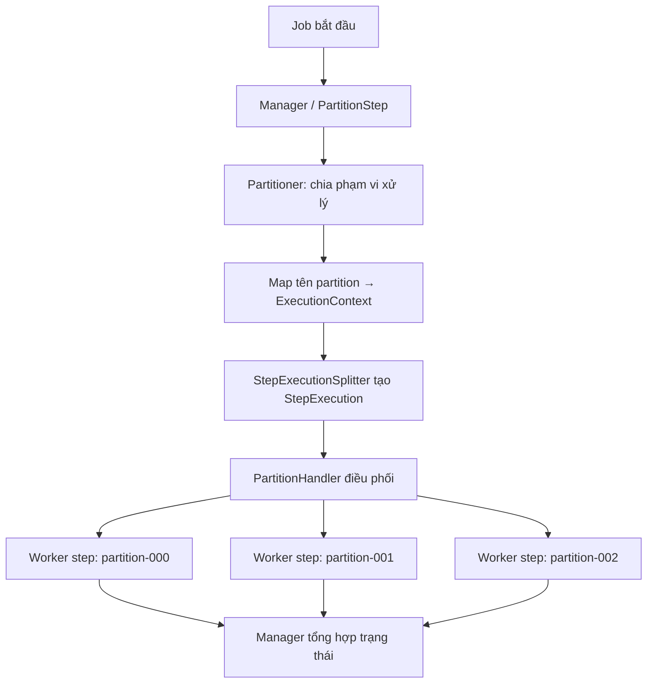

# Trách nhiệm của Partitioner trong Spring Batch

Trong một Spring Batch job xử lý khối lượng dữ liệu lớn, một **worker step** có thể đọc, xử lý và ghi một phần dữ liệu độc lập. **`Partitioner` là thành phần xác định mỗi worker step phải xử lý phần nào**. Nó biến một tập công việc logic thành nhiều phân vùng (*partition*) được mô tả bằng các giá trị trong `ExecutionContext`.

Điểm cần phân biệt ngay từ đầu: `Partitioner` **phân chia công việc**, còn `PartitionHandler` **điều phối thực thi** các phân vùng. Số luồng, máy chạy worker, giao dịch, retry và xử lý bản ghi thuộc các thành phần khác của Spring Batch. Một thiết kế partitioning tốt bắt đầu từ ranh giới dữ liệu đúng và có thể khôi phục, sau đó mới tối ưu mức song song.

## 1. Partitioner nằm ở đâu trong luồng xử lý?

Trong mô hình *partitioned step*, một step điều phối (thường gọi là *manager step*) tạo nhiều `StepExecution` của cùng một worker step. Mỗi `StepExecution` có một `ExecutionContext` riêng để worker biết phạm vi dữ liệu của mình.



Spring Batch định nghĩa giao diện cốt lõi như sau:

```java
public interface Partitioner {
    Map<String, ExecutionContext> partition(int gridSize);
}
```

Đọc kết quả của `partition(gridSize)` theo ba ý:

| Thành phần | Ý nghĩa | Ví dụ |
| --- | --- | --- |
| `gridSize` | Quy mô phân vùng được yêu cầu; **không phải** số luồng chắc chắn sẽ chạy | `3` |
| Khóa của `Map` | Tên ổn định, phân biệt từng partition; Spring Batch dùng để định danh các worker `StepExecution` | `partition-001` |
| `ExecutionContext` | Tập tham số nhỏ mô tả phần việc của partition, được lưu cùng metadata thực thi | `fromId=5`, `toId=7` |

Ví dụ, tập đơn hàng có ID từ 1 đến 10 được chia thành ba phần:

```text
partition-000 -> {fromId: 1, toId: 4}
partition-001 -> {fromId: 5, toId: 7}
partition-002 -> {fromId: 8, toId: 10}
```

Worker dùng cặp `fromId`/`toId` để đọc `WHERE id BETWEEN :fromId AND :toId`. Các khoảng không chồng lấn và phủ hết miền ID từ 1 đến 10. **ID bị khuyết** (chẳng hạn không tồn tại ID 6) không gây trùng dữ liệu; chỉ làm lượng công việc thực tế giữa các partition có thể khác nhau.

## 2. Những trách nhiệm thực sự của Partitioner

### 2.1. Xác định phạm vi công việc rõ ràng và không giao nhau

Trách nhiệm quan trọng nhất là tạo các tập con dữ liệu mà worker có thể xử lý độc lập. Một cách chia đúng phải thỏa các điều kiện sau:

1. **Đủ phạm vi (*coverage*):** mọi bản ghi thuộc phạm vi của job được gán vào một partition, trừ khi yêu cầu nghiệp vụ chủ động loại trừ nó.
2. **Không giao nhau (*disjointness*):** một bản ghi không thuộc hai partition cùng lúc. Với dữ liệu phải được ghi đúng một lần, điều này giúp tránh hai worker cùng ghi một đối tượng.
3. **Xác định được bằng điều kiện đọc:** worker có thể diễn đạt phạm vi bằng câu SQL, vị trí file, khóa nghiệp vụ hoặc tiêu chí tương đương.
4. **Không phụ thuộc thứ tự chạy:** partition A hoàn thành trước hay sau B đều không làm kết quả sai. Nếu các partition cùng cập nhật một tổng chung, phải có cơ chế đồng bộ/tổng hợp thích hợp.

Các chiến lược chia thường gặp:

| Chiến lược | `ExecutionContext` thường chứa | Khi phù hợp | Điều cần kiểm tra |
| --- | --- | --- | --- |
| Khoảng khóa chính | `fromId`, `toId` | Bảng có ID ổn định, truy vấn theo index | ID thưa, phân bố dữ liệu lệch, hàng bị thêm/xóa khi job chạy |
| Khóa băm | `remainder`, `modulus` | Cần phân phối khóa có độ trải tương đối đều | Giữ nguyên `modulus` khi restart; biểu thức băm/modulo nhất quán |
| Danh sách file | `inputFile` hoặc đường dẫn/URI | Nhiều file có thể xử lý độc lập | File không đổi trong lần chạy/restart; file lớn, nhỏ không cân |
| Phân vùng nghiệp vụ | `tenantId`, `region` | Có ranh giới dữ liệu theo tenant/khu vực | Một tenant quá lớn; sự phụ thuộc hoặc dữ liệu dùng chung |
| Khoảng thời gian | `fromTime`, `toTime` | Sự kiện có thời gian xác định và được chốt phạm vi | Dùng khoảng nửa mở để tránh trùng ở mốc biên; sự kiện đến muộn |

Với thời gian, nên dùng quy ước `timestamp >= fromTime AND timestamp < toTime`; hai khoảng kề nhau khi đó không cùng chứa bản ghi đúng tại mốc ranh giới. Với ID, có thể dùng khoảng đóng `BETWEEN fromId AND toId` nếu bảo đảm `toId` của partition trước nhỏ hơn `fromId` của partition sau.

### 2.2. Cung cấp tham số tối thiểu để worker tự đọc phần của mình

`Partitioner` trả về `ExecutionContext`, **không tải toàn bộ dữ liệu rồi gắn danh sách bản ghi vào context**. `ExecutionContext` là metadata có thể được Spring Batch lưu trong `JobRepository`; nhét hàng nghìn đối tượng lớn, kết nối JDBC hay stream đang mở vào đây làm tăng chi phí lưu trữ và gây vấn đề khôi phục.

Nên lưu những giá trị nhỏ, có thể tuần tự hóa và có ý nghĩa tái lập: ID đầu/cuối, shard ID, URI file, checkpoint/snapshot ID. Worker đọc dữ liệu thực từ nguồn sau khi nhận những tham số đó. Không đặt mật khẩu, token hay tài nguyên kết nối trong `ExecutionContext`.

### 2.3. Đặt tên partition ổn định để hỗ trợ restart

Tên của từng partition trở thành một phần định danh worker `StepExecution`. Khi job lỗi và được restart, Spring Batch dựa vào metadata đã lưu để nhận biết những phần đã hoàn thành và những phần cần chạy lại. Vì vậy:

- Đặt tên **duy nhất trong lần chia** và **tái lập được** cho cùng một `JobInstance`, chẳng hạn `partition-000`, `partition-001`.
- Cố định cách chia và các tham số ảnh hưởng đến ranh giới trong suốt vòng đời của job. Tự ý đổi `gridSize`, bộ lọc hoặc miền ID khi restart có thể làm danh sách partition khác lần đầu.
- Không dùng `UUID.randomUUID()`, thời gian hiện tại hoặc thứ tự trả về ngẫu nhiên để đặt tên partition.
- Nếu tạo danh sách partition tốn kém, có thể nghiên cứu `PartitionNameProvider` để cung cấp tên trên đường restart; tên phải khớp chính xác với tên mà `Partitioner` đã tạo. Đây là tối ưu nâng cao, không thay thế thiết kế phân vùng ổn định.

**Lưu ý:** restart chính xác còn phụ thuộc vào reader, writer, checkpoint, giao dịch và trạng thái dữ liệu nguồn. Một `Partitioner` có tên ổn định không tự bảo đảm tác động ngoài hệ thống chỉ xảy ra đúng một lần.

### 2.4. Chia công việc vừa đủ và có chi phí hợp lý

`gridSize` là thông số gợi ý/số phân vùng mục tiêu được manager chuyển đến `partition(int gridSize)`. Số phần tử thực tế của `Map` do mã `Partitioner` quyết định. **Số partition không đồng nghĩa với số worker đồng thời:** `PartitionHandler`, thread pool, connection pool, CPU, database và giới hạn hệ thống ngoài mới quyết định mức đồng thời có thể đạt.

Ví dụ, tạo 32 partition với thread pool chỉ có 4 luồng thường dẫn đến tối đa khoảng 4 worker thực thi cùng lúc; các partition còn lại được chờ điều phối. Nếu một partition chứa 70% dữ liệu, khi các worker khác đã hoàn thành, worker cuối vẫn có thể kéo dài toàn bộ job. Vì thế phải đo và điều chỉnh độ lớn/phân bố của các partition, không chỉ tăng `gridSize`.

## 3. Ví dụ: chia khoảng ID cho bảng đơn hàng

Giả sử `orders` có `id` không âm và ổn định. Job cần xử lý miền ID đã xác định từ `firstId` đến `lastId`. Lớp dưới đây chia dải ID thành tối đa `gridSize` khoảng liên tiếp; các khoảng chênh nhau nhiều nhất một giá trị ID.

```java
import java.util.LinkedHashMap;
import java.util.Locale;
import java.util.Map;
import org.springframework.batch.core.partition.support.Partitioner;
import org.springframework.batch.item.ExecutionContext;

public final class OrderIdPartitioner implements Partitioner {
    private final long firstId;
    private final long lastId;

    public OrderIdPartitioner(long firstId, long lastId) {
        // Mẫu dùng miền ID không âm; chặn tràn số ở phép tính cộng cuối.
        if (firstId < 0 || lastId < firstId || lastId == Long.MAX_VALUE) {
            throw new IllegalArgumentException("Invalid ID range");
        }
        this.firstId = firstId;
        this.lastId = lastId;
    }

    @Override
    public Map<String, ExecutionContext> partition(int gridSize) {
        if (gridSize <= 0) {
            throw new IllegalArgumentException("gridSize must be positive");
        }

        long span = lastId - firstId + 1;
        int count = (int) Math.min((long) gridSize, span);
        long baseSize = span / count;
        long extra = span % count;
        long from = firstId;

        Map<String, ExecutionContext> partitions = new LinkedHashMap<>();
        for (int i = 0; i < count; i++) {
            long size = baseSize + (i < extra ? 1 : 0);
            long to = from + size - 1;

            ExecutionContext context = new ExecutionContext();
            context.putLong("fromId", from);
            context.putLong("toId", to);
            partitions.put(String.format(Locale.ROOT, "partition-%03d", i), context);

            from = to + 1;
        }
        return partitions;
    }
}
```

Với `new OrderIdPartitioner(1, 10).partition(3)`, kết quả lần lượt là `[1, 4]`, `[5, 7]`, `[8, 10]` như ở đầu bài. `LinkedHashMap` giúp dễ quan sát thứ tự khi log/debug; **không dựa vào thứ tự này để bảo đảm thứ tự thực thi**.

Mã trên chủ động có phạm vi áp dụng rõ ràng: miền ID phải có cận hợp lệ, không vượt giới hạn `long`; với bảng rỗng, bước lập kế hoạch cần xử lý riêng thay vì truyền miền ID giả. Khi ID thưa hoặc dữ liệu phân bố không đều, các khoảng có chiều rộng gần bằng nhau **không chắc có số dòng hoặc chi phí xử lý gần bằng nhau**. Một hệ thống thực tế có thể dùng thống kê số dòng, phân vị khóa hay danh sách công việc cố định để chia hợp lý hơn.

### Worker lấy phạm vi như thế nào?

Reader của worker có thể nhận tham số bằng biểu thức `stepExecutionContext`. Ví dụ minh họa với Spring Batch cấu hình Java (các import/cấu hình step khác được lược bớt):

```java
@Bean
@StepScope
public JdbcCursorItemReader<Order> orderReader(
        DataSource dataSource,
        @Value("#{stepExecutionContext['fromId']}") Long fromId,
        @Value("#{stepExecutionContext['toId']}") Long toId) {

    return new JdbcCursorItemReaderBuilder<Order>()
            .name("orderReader")
            .dataSource(dataSource)
            .sql("SELECT id, amount FROM orders "
                    + "WHERE id BETWEEN ? AND ? ORDER BY id")
            .preparedStatementSetter(ps -> {
                ps.setLong(1, fromId);
                ps.setLong(2, toId);
            })
            .rowMapper((rs, rowNum) ->
                    new Order(rs.getLong("id"), rs.getBigDecimal("amount")))
            .build();
}
```

`Order` ở ví dụ là kiểu dữ liệu ứng dụng có constructor nhận `(long id, BigDecimal amount)`. `@StepScope` giúp mỗi worker `StepExecution` có reader riêng và lấy đúng `ExecutionContext` của nó. Không dùng một instance reader có trạng thái cho nhiều thread vì những thay đổi vị trí đọc/checkpoint có thể va chạm. Nếu xử lý từ nhiều nguồn, nguyên tắc tương tự áp dụng cho các stream, session, trạng thái xử lý hoặc writer không thread-safe.

Trong cấu hình manager, có thể nối `partitioner("workerStep", orderIdPartitioner)`, `.step(workerStep)`, `.gridSize(3)` và một `TaskExecutor` phù hợp. `TaskExecutorPartitionHandler` thường được dùng để thực thi song song trong cùng tiến trình; trong mô hình *remote partitioning*, `PartitionHandler` phù hợp sẽ chuyển phần việc sang các worker từ xa. Dù chọn cách nào, các context `fromId`/`toId` vẫn do `Partitioner` cung cấp.

## 4. Partitioner không chịu trách nhiệm cho những gì?

| Việc cần làm | Thành phần chịu trách nhiệm chủ yếu | Vai trò của Partitioner |
| --- | --- | --- |
| Đọc từng bản ghi, xử lý, ghi dữ liệu | `ItemReader`, `ItemProcessor`, `ItemWriter` trong worker step | Chỉ cung cấp phạm vi hoặc tham số để reader biết cần đọc gì |
| Mở luồng, phân phối worker, chạy từ xa | `PartitionHandler`, `TaskExecutor`, hạ tầng messaging | Chỉ định nghĩa các phần việc logic, không tạo thread hay gửi message |
| Commit/rollback và chính sách chunk | Transaction manager và worker step | Thiết kế phần dữ liệu độc lập để giảm tranh chấp |
| Retry, skip và trạng thái lỗi | Chính sách fault tolerance của step, `JobRepository` và cơ chế restart | Tên/context ổn định giúp nhận diện phần việc khi restart |
| Chống ghi trùng vào database/API đích | Giao dịch, unique key, idempotency key, upsert hoặc outbox | Tránh chồng lấn tập đầu vào, nhưng không bảo đảm exactly-once side effect |
| Thu thập metric và cảnh báo | Batch metadata, logging, monitoring/observability | Đặt tên partition rõ ràng để dễ truy vết |

Điều này giải thích vì sao một `Partitioner` chia đúng dải ID vẫn có thể chạy chậm hoặc gây lỗi ghi trùng: nút thắt có thể nằm ở database, writer, connection pool hoặc cách restart thay vì thuật toán chia.

## 5. Retry, restart và dữ liệu thay đổi trong lúc chạy

Giả sử ba partition được tạo từ một lần chạy:

```text
partition-000 [1..4]   COMPLETED
partition-001 [5..7]   FAILED
partition-002 [8..10]  COMPLETED
```

Khi job được **restart đúng `JobInstance`**, Spring Batch dùng thông tin các `StepExecution` đã lưu để quyết định chạy lại những phần chưa hoàn thành theo quy tắc restart của step. Để mô hình này đáng tin cậy:

- Giữ **cùng tên partition và cùng phạm vi** qua các lần restart. Đầu vào tốt nhất là snapshot, bảng danh sách ID công việc hoặc ranh giới được lưu theo tham số của job.
- Phân biệt **retry trong một worker step** (chẳng hạn thử lại lỗi kết nối tạm thời) với **restart job** sau khi thất bại. Hai cơ chế có tác động khác nhau đến trạng thái đọc và các tác dụng phụ.
- Thiết kế writer có khả năng **idempotent**. Ví dụ, `INSERT ... ON CONFLICT ...`/`MERGE` khi phù hợp hoặc unique key theo ID nghiệp vụ giúp chạy lại không nhân đôi kết quả. Với API ngoài giao dịch, dùng idempotency key hoặc cơ chế bù trừ thích hợp.
- Lưu trạng thái/checkpoint của reader đúng theo vòng đời step. Không đánh dấu hoàn thành một partition chỉ dựa vào việc hàm `partition()` đã trả về thành công.

Một tình huống khó: lúc bắt đầu job, `max(id) = 10_000`; trong khi job đang chạy, bảng tiếp tục thêm/sửa/xóa đơn hàng. Nếu chỉ dùng điều kiện `id BETWEEN ...` và không xác định tập dữ liệu mục tiêu, hai lần chạy/restart có thể quan sát các tập bản ghi khác nhau. `created_at <= T` chỉ là điều kiện lọc; bản thân nó **không tạo snapshot bất biến** nếu dữ liệu cũ còn có thể sửa/xóa hoặc đến muộn.

Tùy yêu cầu nhất quán, nên dùng một trong các cách sau: chốt danh sách khóa cần xử lý vào bảng staging có `run_id`; đọc một nguồn dữ liệu bất biến; hoặc thiết kế snapshot/cơ chế phiên bản dữ liệu được nguồn hỗ trợ. Chọn cách cụ thể dựa trên khả năng chịu thay đổi và chi phí hệ thống. Không kỳ vọng `Partitioner` tự giải quyết tính nhất quán của nguồn dữ liệu.

## 6. Chọn số partition dựa trên tài nguyên thực tế

Giả sử job xử lý 8 triệu bản ghi, một worker cần đồng thời một JDBC connection và có ghi vào cùng database. Tăng từ 4 lên 16 partition có thể giúp phân phối dữ liệu tốt hơn, nhưng nếu database hoặc connection pool chỉ chịu được 4–6 truy vấn nặng đồng thời thì thời gian tổng có thể **không giảm**; lock wait, I/O và số kết nối chờ có thể còn tăng.

Một quy trình thử tải có kiểm soát:

1. Đo baseline với một worker: throughput (bản ghi/giây), CPU, thời gian query/commit, I/O, memory và độ trễ hệ thống đích.
2. Chọn `gridSize` đủ để giảm tình trạng một partition quá lớn; cấu hình số luồng của handler phù hợp với CPU, JDBC pool và giới hạn dịch vụ đích.
3. Chạy thử với 2, 4, 8 worker đồng thời trên tập dữ liệu có phân bố gần thực tế; ghi nhận tốc độ tổng và **thời gian partition chậm nhất**.
4. Kiểm tra tỉ lệ partition rỗng, chênh lệch số bản ghi, thời gian chờ connection, lỗi lock/deadlock, số lần retry và dung lượng metadata.
5. Dừng tăng đồng thời khi throughput không còn cải thiện hoặc chi phí/độ ổn định xấu đi. Nếu một partition nổi bật lâu hơn các phần khác, cân nhắc chia lại theo thống kê dữ liệu thay vì chỉ thêm thread.

**Đừng nhầm các kiến trúc scaling của Spring Batch:**

| Mô hình | Đơn vị song song | Khác biệt chính |
| --- | --- | --- |
| Multi-threaded step | Nhiều chunk/luồng trong cùng một step | Các thành phần có trạng thái cần xem xét thread safety rất kỹ |
| Parallel steps | Các step độc lập trong một job | Thích hợp cho những luồng nghiệp vụ khác nhau không phụ thuộc nhau |
| Local partitioning | Nhiều `StepExecution` của cùng worker step trong một JVM | `Partitioner` chia công việc, local handler chạy các partition |
| Remote partitioning | Nhiều `StepExecution` trên các tiến trình/máy worker | Vẫn phân chia công việc bằng `Partitioner`, cần hạ tầng điều phối từ xa |
| Remote chunking | Manager đọc dữ liệu rồi gửi từng chunk cho worker xử lý | Phân phối *chunk*, không dùng `Partitioner` để chia từng phạm vi dữ liệu như partitioning |

Nếu dữ liệu có thể chia độc lập nhưng một JVM thiếu CPU/RAM, remote partitioning là hướng mở rộng tự nhiên. Nếu reader là nút thắt tập trung và không thể chia nguồn dữ liệu hiệu quả, cần cân nhắc mô hình khác hoặc cải thiện truy vấn trước khi tăng số worker.

## 7. Tự kiểm tra một thiết kế Partitioner

Trước khi cho chạy production, hãy chứng minh bằng ví dụ hoặc bài test nhỏ rằng thuật toán chia thỏa những tính chất cần thiết:

- **Phạm vi:** với miền ID `1..10`, `gridSize=3`, kết quả phải phủ mọi ID từ 1 đến 10 và không có ID nào xuất hiện hai lần.
- **Ranh giới:** kiểm tra khi số ID nhỏ hơn `gridSize`, khi ID có khoảng trống, khi một partition trống trên thực tế và ở các giá trị sát biên cho phép.
- **Tái lập:** cùng input và cùng `gridSize` tạo cùng tên và cùng context, kể cả sau khi ứng dụng khởi động lại.
- **Độc lập:** hai worker không dùng chung reader/writer có trạng thái nguy hiểm, không cùng ghi đè một tài nguyên đầu ra.
- **Khôi phục:** cố ý làm một worker thất bại, restart cùng `JobInstance`, đối chiếu kết quả với chạy một luồng; không mất hoặc nhân đôi dữ liệu.
- **Vận hành:** ghi log `jobExecutionId`, `stepExecutionId`, partition name, phạm vi dữ liệu, số bản ghi đọc/ghi, thời gian, retry và lỗi để tìm được partition bất thường.

> **Ghi nhớ:** `Partitioner` chịu trách nhiệm tạo **bản đồ công việc chính xác, độc lập, có thể tái lập và cân bằng hợp lý**. Đúng bản đồ là điều kiện cần; độ an toàn của chạy song song và restart còn phải được bảo đảm tại worker, kho metadata, hạ tầng thực thi và hệ thống dữ liệu đích.
