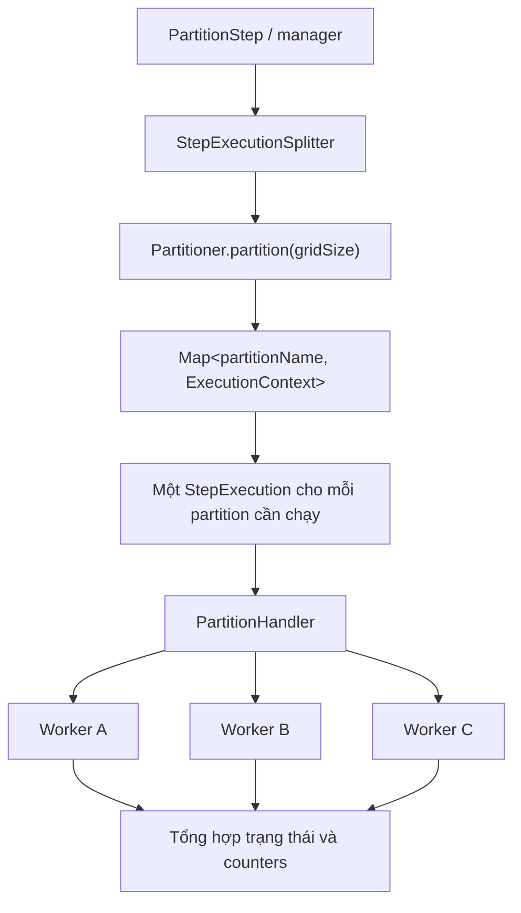

# Ý nghĩa của gridSize trong partition() của Spring Batch

> **Chương:** Partitioner  
> **Mục tiêu:** Hiểu chính xác đối số `gridSize` trong `Partitioner.partition(int gridSize)`, phân biệt số partition với số thread/worker, thiết kế thuật toán chia dữ liệu không chồng lấn và lựa chọn mức song song theo tài nguyên thực tế. Mã Java minh họa dùng **Spring Batch 5.2.x** và Java 17.

## 1. Vì sao gridSize dễ bị hiểu nhầm?

Một job cần nhập 1 triệu bản ghi vào cơ sở dữ liệu. Kỹ sư cấu hình:

```java
handler.setGridSize(8);
```

Sau đó họ kỳ vọng tám worker cùng chạy, mỗi worker nhận đúng 125.000 bản ghi. Kỳ vọng này **không luôn đúng**:

- `gridSize=8` được truyền như **gợi ý kích thước chia công việc** cho `Partitioner`; Spring Batch không tự hiểu ranh giới dữ liệu của ứng dụng.
- Số partition thực tế do **`Map<String, ExecutionContext>` mà `partition()` trả về** quyết định.
- Số partition **được chạy đồng thời** còn phụ thuộc `TaskExecutor`, số worker process, CPU, DB pool, I/O và phương án điều phối.
- Dù có tám partition cùng kích thước theo **khoảng ID**, số bản ghi hoặc chi phí xử lý trong mỗi khoảng có thể rất khác nhau.

Với module `SPRING_BATCH_SCALING_OPERATIONS`, hiểu rõ điều này là điều kiện để chọn local/remote partitioning, đo bottleneck và bảo đảm retry/restart khi workload lớn.

**Định nghĩa ngắn:** `gridSize` là tham số `int` mà hạ tầng partitioning truyền đến `Partitioner.partition(int gridSize)` để **gợi ý cách chia dữ liệu**. Nó không phải giao kèo bắt buộc phải trả về đúng chừng ấy partition và không phải lệnh tạo chừng ấy thread.

## 2. Ba con số khác nhau trong một job partitioning

| Con số | Được xác định ở đâu? | Có tự động bằng `gridSize` không? |
| --- | --- | --- |
| **Requested grid size** | `PartitionHandler` hoặc cấu hình manager step | Đây chính là giá trị yêu cầu |
| **Actual partition count** | Số entry trong `Map<String, ExecutionContext>` từ `partition()` | **Không bắt buộc**; do implementation quyết định |
| **Concurrent executions** | Pool executor, remote worker slots và giới hạn tài nguyên | **Không**; có thể nhỏ hơn số partition |
| **Record count mỗi partition** | Thuật toán phân vùng và phân bố dữ liệu thật | **Không**; số lượng có thể chênh lệch mạnh |

Ví dụ một manager có `gridSize=12` và pool 4 thread:

```text
gridSize (gợi ý)                    = 12
partition() trả về                 = 12 partition
TaskExecutor core/max pool size    = 4
số partition có thể đang chạy      ≤ 4 (ở ví dụ này)
các partition chờ                  = còn lại, theo lịch điều phối
```

Khi một worker hoàn tất partition đầu tiên, thread có thể được tái sử dụng cho partition khác. Không có ràng buộc `partition0` phải luôn chạy trên `thread-0`.

Nếu `partition()` trả về **5 entry** dù `gridSize=12`, handler chỉ có **5 partition để điều phối**. Không có tám/dư bảy partition rỗng được framework tự sinh để đủ 12.

## 3. Hợp đồng của Partitioner.partition(int gridSize)

Interface trong Spring Batch 5.2:

```java
import java.util.Map;
import org.springframework.batch.item.ExecutionContext;

public interface Partitioner {
    Map<String, ExecutionContext> partition(int gridSize);
}
```

Một implementation trả về:

- **Key**: tên partition duy nhất và ổn định trong một partitioned step, ví dụ `partition0`, `partition1`.
- **Value**: `ExecutionContext` chứa thông tin worker cần để chọn đúng phần dữ liệu (range, file path, shard ID...). Không nên nhét danh sách hàng triệu record vào context.
- **Số lượng entry**: tùy thuật toán. `gridSize` chỉ là đầu vào tham khảo.
- **Tính tách biệt**: các partition nên có vùng dữ liệu không giao nhau hoặc có quy tắc phân phối rõ ràng để không mất/trùng item.

Trong thực tế `PartitionStep` nhờ `StepExecutionSplitter` tạo các `StepExecution` cho từng partition và sử dụng `PartitionHandler` để chạy chúng.



Đây là sơ đồ khái niệm: cách hạ tầng tạo/tái sử dụng execution khi restart phụ thuộc trạng thái đã lưu ở `JobRepository`.

### Khi nào gridSize bị bỏ qua?

Một partitioner chia **theo danh sách file** có thể trả về một partition cho mỗi file, bất kể giá trị `gridSize`:

```java
@Override
public Map<String, ExecutionContext> partition(int gridSize) {
    Map<String, ExecutionContext> parts = new LinkedHashMap<>();
    for (int i = 0; i < files.size(); i++) {
        ExecutionContext context = new ExecutionContext();
        context.putString("filePath", files.get(i).toString());
        parts.put("file" + i, context);
    }
    return parts; // Số entry bằng số file, không nhất thiết bằng gridSize.
}
```

Đây là một cách hợp lệ, vì partitioner quyết định thực tế cần bao nhiêu đơn vị công việc. `MultiResourcePartitioner` có sẵn của Spring Batch cũng là một ví dụ điển hình về cách phân vùng theo resource: số resource quyết định số partition; `gridSize` không tự cắt một file thành nhiều file.

Ngược lại, một partitioner kiểu `SimplePartitioner` có thể tạo số context đúng theo `gridSize`, nhưng chính **implementation cụ thể** mới đưa ra quyết định ấy.

## 4. Ví dụ số học: gridSize=3 trên 10 bản ghi

Giả sử tập dữ liệu được đánh số liên tục từ ID 1 đến 10. Ta muốn chia thành ba partition gần bằng nhau:

```text
IDs:       1  2  3  4  5  6  7  8  9  10
           └──── P0 ────┘ └─── P1 ──┘ └ P2 ┘

P0: minId=1, maxId=4  → 4 ID
P1: minId=5, maxId=7  → 3 ID
P2: minId=8, maxId=10 → 3 ID
```

Có thể chia theo hai cách tương đương về tính đầy đủ: “phần dư đặt ở partition đầu” hoặc “dùng kích thước ceil và cho partition cuối ngắn hơn”. Điều quan trọng là **không chồng lấn, không bỏ sót, không tạo khoảng vô nghĩa**.

Trường hợp biên:

| Tổng số ID khả dụng | `gridSize` | Số partition hợp lý | Vì sao |
| ---: | ---: | ---: | --- |
| 10 | 1 | 1 | Chỉ một khoảng |
| 10 | 3 | 3 | Chia 4 / 3 / 3 |
| 10 | 10 | 10 | Mỗi partition một ID |
| 10 | 16 | 10 | Không cần tạo sáu partition rỗng |
| 1 | 8 | 1 | Không thể chia một ID thành tám phần độc lập |
| 0 | 8 | 0 hoặc báo không có dữ liệu | Ứng dụng cần chính sách rõ ràng |
| 10 | 0 | Lỗi cấu hình | Không có kích thước gợi ý hợp lệ |

**Cẩn thận:** “Có 10 ID trong khoảng 1–10” khác “có 10 bản ghi thật”. Nếu bảng xóa mất ID 4, 7, hoặc ID phân bố cực thưa, khoảng ID vẫn chia được nhưng số row thực tế không cân bằng.

## 5. RangePartitioner dùng gridSize đúng mục đích

Dưới đây là implementation Spring Batch 5.2 cho vùng ID **đã biết và bất biến** `[firstId, lastId]`. Nó coi `gridSize` như **số partition mục tiêu**, nhưng không tạo partition rỗng khi số ID nhỏ hơn số yêu cầu.

```java
package com.example.batch.partition;

import java.util.LinkedHashMap;
import java.util.Map;

import org.springframework.batch.core.partition.support.Partitioner;
import org.springframework.batch.item.ExecutionContext;

public final class RangePartitioner implements Partitioner {

    private final long firstId;
    private final long lastId;

    public RangePartitioner(long firstId, long lastId) {
        if (firstId < 0 || lastId < firstId) {
            throw new IllegalArgumentException("Invalid ID range");
        }
        // Ví dụ giả định độ rộng vùng ID vừa đủ để tính bằng long.
        this.firstId = firstId;
        this.lastId = lastId;
    }

    @Override
    public Map<String, ExecutionContext> partition(int gridSize) {
        if (gridSize <= 0) {
            throw new IllegalArgumentException(
                    "gridSize must be greater than zero");
        }

        long totalIds = lastId - firstId + 1L;
        int partitions = (int) Math.min((long) gridSize, totalIds);

        long baseSize = totalIds / partitions;
        long remainder = totalIds % partitions;
        long nextId = firstId;

        Map<String, ExecutionContext> result = new LinkedHashMap<>();
        for (int i = 0; i < partitions; i++) {
            // Những partition đầu được thêm một ID nếu còn dư.
            long count = baseSize + (i < remainder ? 1 : 0);
            long minId = nextId;
            long maxId = minId + count - 1;

            ExecutionContext context = new ExecutionContext();
            context.putLong("minId", minId);
            context.putLong("maxId", maxId);

            result.put("partition%05d".formatted(i), context);
            nextId = maxId + 1;
        }
        return result;
    }
}
```

Ví dụ chạy trực tiếp thuật toán (chỉ để minh họa kết quả):

```java
Partitioner p = new RangePartitioner(1, 10);
Map<String, ExecutionContext> parts = p.partition(3);

// partition00000 -> minId=1, maxId=4
// partition00001 -> minId=5, maxId=7
// partition00002 -> minId=8, maxId=10
```

### Vì sao thuật toán dùng quotient/remainder?

Với `totalIds=10`, `gridSize=3`:

- `baseSize = 10 / 3 = 3` (phép chia nguyên).
- `remainder = 10 % 3 = 1`.
- Partition 0 nhận `3 + 1 = 4` ID; partition 1 và 2 mỗi phần 3 ID.
- Tổng phần việc `4 + 3 + 3 = 10`, không trùng khoảng.

Những bất biến cần kiểm tra:

1. Mỗi partition có `minId <= maxId`.
2. Partition đầu tiên bắt đầu đúng tại `firstId`.
3. Partition cuối kết thúc đúng tại `lastId`.
4. `maxId` của partition thứ i cộng 1 bằng `minId` của partition thứ i+1.
5. Số partition không lớn hơn số ID khả dụng và không vượt `gridSize` trong **implementation này**.

**Giới hạn mã mẫu:** Công thức `lastId - firstId + 1L` có thể overflow nếu phạm vi chạm sát giới hạn `long`. Dùng `Math.subtractExact`/`Math.addExact` hoặc `BigInteger` cho miền ID cực lớn. Ví dụ này cũng giả định ID dương/non-negative, không tự tính `MIN(id)`/`MAX(id)` từ DB và chưa xử lý bảng được cập nhật trong lúc job đang chạy.

## 6. Worker Step đọc đúng range do partitioner cấp

Sau khi `partition()` tạo `ExecutionContext` chứa `minId` và `maxId`, worker dùng `@StepScope` để lấy hai tham số ấy cho reader riêng của mỗi partition.

Ví dụ dùng `JdbcCursorItemReader` (Spring Batch 5.2.x), bảng nguồn `invoice_source(id BIGINT, amount NUMERIC)`:

```java
package com.example.batch.partition;

import java.math.BigDecimal;
import javax.sql.DataSource;

import org.springframework.batch.core.Step;
import org.springframework.batch.core.configuration.annotation.StepScope;
import org.springframework.batch.core.repository.JobRepository;
import org.springframework.batch.core.step.builder.StepBuilder;
import org.springframework.batch.item.ItemWriter;
import org.springframework.batch.item.database.JdbcCursorItemReader;
import org.springframework.batch.item.database.builder.JdbcCursorItemReaderBuilder;
import org.springframework.beans.factory.annotation.Qualifier;
import org.springframework.beans.factory.annotation.Value;
import org.springframework.context.annotation.Bean;
import org.springframework.context.annotation.Configuration;
import org.springframework.transaction.PlatformTransactionManager;

@Configuration(proxyBeanMethods = false)
public class InvoicePartitionWorkerConfig {

    public record Invoice(long id, BigDecimal amount) {}

    @Bean
    @StepScope
    public JdbcCursorItemReader<Invoice> invoiceRangeReader(
            @Value("#{stepExecutionContext['minId']}") Long minId,
            @Value("#{stepExecutionContext['maxId']}") Long maxId,
            DataSource dataSource) {

        return new JdbcCursorItemReaderBuilder<Invoice>()
                .name("invoiceRangeReader")
                .dataSource(dataSource)
                .sql("""
                    SELECT id, amount
                    FROM invoice_source
                    WHERE id >= ? AND id <= ?
                    ORDER BY id
                    """)
                .preparedStatementSetter(ps -> {
                    ps.setLong(1, minId);
                    ps.setLong(2, maxId);
                })
                .rowMapper((rs, rowNum) -> new Invoice(
                        rs.getLong("id"),
                        rs.getBigDecimal("amount")))
                .build();
    }

    @Bean
    public Step invoiceWorkerStep(
            JobRepository repository,
            PlatformTransactionManager transactionManager,
            @Qualifier("invoiceRangeReader")
                    JdbcCursorItemReader<Invoice> reader,
            @Qualifier("invoiceWriter") ItemWriter<Invoice> writer) {

        return new StepBuilder("invoiceWorkerStep", repository)
                .<Invoice, Invoice>chunk(200, transactionManager)
                .reader(reader)
                .writer(writer)
                .build();
    }
}
```

Ở đây `invoiceWriter` do ứng dụng cung cấp; nó phải giao dịch với resource thích hợp và hỗ trợ retry/restart theo yêu cầu. Code reader/worker trên **không phải ứng dụng runnable độc lập**: còn thiếu bean writer, database và Job.

**Điểm quan trọng về thread safety:** `@StepScope` tạo reader theo **`StepExecution`**, mỗi partition có `StepExecution` riêng, nên không chia sẻ con trỏ reader giữa các partition. Trong ví dụ, chunk của mỗi worker step vẫn chạy **tuần tự**; chúng ta chỉ song song hóa ở cấp partition.

**Điểm quan trọng về nhất quán:** Query `ORDER BY id` giúp thứ tự đọc ổn định **nếu snapshot/nguồn dữ liệu ổn định**. Khi bảng nguồn bị INSERT/DELETE/UPDATE trong lúc job chạy, các lần query/restart có thể nhìn tập dữ liệu khác. Với yêu cầu xử lý chính xác, cần snapshot hoặc watermark/version được đóng băng và chính sách isolation phù hợp.

## 7. gridSize đi từ manager đến Partitioner như thế nào?

Một cấu hình local partitioning Spring Batch 5.2 dùng `TaskExecutorPartitionHandler`:

```java
package com.example.batch.partition;

import org.springframework.batch.core.Step;
import org.springframework.batch.core.partition.support.Partitioner;
import org.springframework.batch.core.partition.support.TaskExecutorPartitionHandler;
import org.springframework.batch.core.repository.JobRepository;
import org.springframework.batch.core.step.builder.StepBuilder;
import org.springframework.beans.factory.annotation.Qualifier;
import org.springframework.context.annotation.Bean;
import org.springframework.context.annotation.Configuration;
import org.springframework.scheduling.concurrent.ThreadPoolTaskExecutor;

@Configuration(proxyBeanMethods = false)
public class InvoicePartitionManagerConfig {

    @Bean
    public Partitioner invoicePartitioner() {
        return new RangePartitioner(1L, 1_000_000L);
    }

    @Bean
    public ThreadPoolTaskExecutor partitionExecutor() {
        ThreadPoolTaskExecutor executor = new ThreadPoolTaskExecutor();
        executor.setCorePoolSize(4);
        executor.setMaxPoolSize(4);
        executor.setQueueCapacity(16);
        executor.setThreadNamePrefix("invoice-partition-");
        return executor;
    }

    @Bean
    public TaskExecutorPartitionHandler invoicePartitionHandler(
            @Qualifier("invoiceWorkerStep") Step worker,
            @Qualifier("partitionExecutor") ThreadPoolTaskExecutor executor) {
        TaskExecutorPartitionHandler handler =
                new TaskExecutorPartitionHandler();
        handler.setStep(worker);
        handler.setTaskExecutor(executor);
        handler.setGridSize(8);
        return handler;
    }

    @Bean
    public Step invoiceManagerStep(
            JobRepository repository,
            @Qualifier("invoicePartitioner") Partitioner partitioner,
            @Qualifier("invoicePartitionHandler")
                    TaskExecutorPartitionHandler handler) {
        return new StepBuilder("invoiceManagerStep", repository)
                .partitioner("invoiceWorkerStep", partitioner)
                .partitionHandler(handler)
                .build();
    }
}
```

**Diễn giải đúng:**

1. Manager dùng handler có `gridSize=8` để yêu cầu partitioner chia workload.
2. `RangePartitioner(1, 1_000_000)` trả về **tám** khoảng vì implementation chọn tối đa tám partition cho miền có một triệu ID.
3. Worker step có tên logic `invoiceWorkerStep` được chạy riêng cho từng `StepExecution`.
4. Pool có **tối đa bốn thread**, nên không có chuyện tám partition chắc chắn chạy cùng lúc.
5. Mỗi worker đọc các ID trong context của mình; database, connection pool và reader giới hạn throughput thực tế.
6. Khi một worker hoàn thành, executor có thể dùng thread ấy để xử lý partition đang chờ.
7. `gridSize` có thể khác `maxPoolSize` mà không mâu thuẫn: hai tham số điều khiển **hai tầng khác nhau**.

Với ví dụ này, `gridSize=8` và pool 4 thread là lựa chọn để **queue tám partition trong khi chỉ có bốn partition chạy đồng thời**. Nếu đổi partitioner thành implementation trả về một partition cho mỗi file, số partition có thể lớn hơn hoặc nhỏ hơn tám.

## 8. Ba phép thử giúp phát hiện hiểu sai gridSize

**Trường hợp A: gridSize lớn hơn số item.** Nguồn có ID từ 1 đến 5, `gridSize=10`.

```text
partition00000: [1,1]
partition00001: [2,2]
partition00002: [3,3]
partition00003: [4,4]
partition00004: [5,5]

Kết quả: 5 partition, không phải 10.
```

**Trường hợp B: gridSize nhỏ hơn số tài nguyên.** Có 24 file CSV độc lập, partitioner tạo một partition cho mỗi file, `gridSize=8`.

```text
Map có 24 entry
Pool 4 thread
→ Có thể chạy tối đa 4 partition cùng lúc ở ví dụ executor này;
  24 file vẫn được xử lý qua nhiều lượt.
```

**Trường hợp C: gridSize không cân bằng dữ liệu.** Có 8 range ID bằng nhau, nhưng 80% bản ghi nằm trong range đầu.

```text
P0 ████████████████████████████████ 80% record
P1 ██                               3%
P2 ██                               3%
P3 ██                               3%
P4 ██                               3%
P5 ██                               3%
P6 ██                               3%
P7 █                                2%
```

Tám partition không đồng nghĩa công việc chia đều. Sau khi bảy partition nhỏ hoàn thành, một worker vẫn phải xử lý partition P0 rất lâu; những worker khác có thể rảnh.

**Bài học:** `gridSize` là tham số chia công việc, **không phải cơ chế tự cân bằng tải**. Độ lệch dữ liệu (skew), transaction và tài nguyên cần được đo độc lập.

## 9. Chọn gridSize theo loại Partitioning

| Loại input | Cách hiểu gridSize hữu ích | Điểm cần cảnh giác |
| --- | --- | --- |
| Dải ID liên tục | Số khoảng mục tiêu | ID sparse gây số bản ghi không đều |
| Nhiều file độc lập | Số nhóm file mục tiêu hoặc chỉ là hint | Một-file-một-partition có thể bỏ qua gridSize |
| Theo ngày/tháng | Số cửa sổ thời gian dự kiến | Lưu lượng mỗi ngày khác nhau |
| Hash theo khóa nghiệp vụ | Số bucket mục tiêu | Hash collision, workload trên từng key khác nhau |
| Dataset đã chia shard cố định | Độ chi tiết mong muốn | Thay đổi số shard phá mapping/restart |
| Remote partitioning | Số đơn vị công việc để phân phối trên cluster | Không bằng số remote worker hay số message đang chạy |
| Tập dữ liệu nhỏ | Giới hạn partition tối đa có ích | Tạo partition rỗng làm tăng overhead |

Một cách khởi đầu: chọn `gridSize` đủ tạo **nhiều đơn vị công việc hơn số worker hiệu dụng** để worker hoàn tất sớm có thể nhận việc tiếp theo. Tuy nhiên, không có quy tắc cứng “cứ gấp 2 hoặc gấp 4 số worker” áp dụng cho mọi workload: partition quá nhỏ sẽ làm tăng chi phí mở reader, giao dịch và cập nhật metadata.

## 10. gridSize, thread pool, chunk size và connection pool

Bốn tham số tương tác nhưng không hoán đổi cho nhau:

| Tham số | Quyết định | Nếu tăng quá cao |
| --- | --- | --- |
| `gridSize` | Gợi ý số partition và độ mịn chia workload | Tăng overhead nếu partitioner tạo nhiều entry |
| `TaskExecutor` pool size | Số partition cục bộ chạy đồng thời | Cạn CPU, I/O, JDBC pool, tăng lock contention |
| `chunkSize` của worker step | Số item theo transaction/ghi batch | Transaction dài, bộ nhớ cao, chi phí rollback lớn |
| JDBC connection pool | Số connection có thể cấp | Quá nhiều connection có thể gây áp lực DB; quá ít thì worker chờ |

Tình huống minh họa: `gridSize=16`, pool 4 thread, `chunkSize=500`, connection pool có 5 connection.

- Handler có 16 partition để điều phối.
- Tối đa khoảng bốn worker step thực thi đồng thời theo pool.
- Mỗi worker chunk có thể cần một transaction JDBC.
- `JobRepository` cũng cần connection, trừ khi dùng datasource riêng.
- Nếu truy vấn của reader dùng connection riêng ngoài chunk transaction, số connection cần có thể nhiều hơn số worker.

**Không kết luận connection pool 5 chắc chắn đủ** chỉ từ phép tính 4 worker + 1. Cần đo `active`, `idle`, `pending`, thời gian chờ connection, reader cursor lifetime và nguồn kết nối của metadata.

```text
Throughput = số item được ghi thành công / thời gian job thực tế

Speedup = thời gian chạy với 1 worker / thời gian chạy với N worker

T_job ≈ thời gian của các lượt xử lý partition trên số worker hiệu dụng
        + overhead chia/điều phối
        + thời gian chờ DB, I/O và partition chậm nhất
```

Công thức cuối là mô hình trực giác, không phải dự báo chính xác. Nên đo `p95` duration theo partition, số lượng item, retry/rollback và DB waits để biết có lợi khi tăng `gridSize` hay không.

## 11. Giới hạn restart: gridSize không nên làm thay đổi partition identity

Spring Batch có cơ chế restart dựa trên `JobRepository` và trạng thái `StepExecution` của các partition. Nhưng nếu cùng một JobInstance được restart với **bản đồ partition khác**, rất dễ phát sinh xử lý trùng hoặc bỏ sót.

Giả sử lần đầu `gridSize=2`, range 1–100:

```text
partition00000 = [1, 50]    (COMPLETED)
partition00001 = [51,100]   (FAILED)
```

Nếu khi restart bạn đổi sang `gridSize=4` và tự sinh lại tên theo chỉ số:

```text
partition00000 = [1,25]
partition00001 = [26,50]
partition00002 = [51,75]
partition00003 = [76,100]
```

Tên `partition00000` vẫn giống trước nhưng có **ý nghĩa dữ liệu khác**. Nếu metadata/logic restart tái sử dụng trạng thái `COMPLETED` của partition cũ, việc coi partition mới đã xử lý có thể tạo lỗ hổng dữ liệu. Tùy đường restart, framework có thể tái sử dụng `ExecutionContext` cũ thay vì thay thế nó; điều cốt yếu là **không được tự ý đổi mapping** trong cùng JobInstance.

Để an toàn:

1. **Đóng băng dữ liệu nguồn:** snapshot ID/range, file manifest hoặc watermark.
2. **Giữ mapping ổn định:** tên partition ↔ range/file/shard của cùng JobInstance không thay đổi.
3. **Lưu manifest/version:** đưa ID manifest vào `JobParameters` định danh.
4. **Không thay gridSize tùy tiện khi restart:** nếu muốn chia lại dữ liệu, lập kế hoạch chạy **JobInstance mới** và xử lý dữ liệu đã commit theo idempotency.
5. **Kiểm tra end-to-end:** đối chiếu tập business key đầu vào/đầu ra sau khi kill/restart giữa chừng.
6. **Giữ reader state hợp lệ:** `@StepScope` reader riêng theo partition, nguồn có thứ tự ổn định và checkpoint không bị tái sử dụng cho nguồn khác.

`Partitioner` phải đủ **deterministic** trong phạm vi snapshot và JobInstance. Không dựa vào thứ tự liệt kê file ngẫu nhiên hoặc dữ liệu bảng đang thay đổi để đánh số partition.

### Mở rộng sang remote partitioning

Trong remote partitioning, manager có thể phân phối các partition đến những JVM khác. Dù worker remote nhiều hơn, `gridSize` vẫn chỉ là cách manager yêu cầu tạo đơn vị công việc; **nó không phân phối worker node, không bảo đảm giới hạn concurrency và không chuyển transaction giữa tiến trình**.

Mỗi worker cần đọc `StepExecution`/`ExecutionContext` đúng và có transaction/checkpoint độc lập. Cần giao thức timeout, idempotent dispatch, duplicate handling và khả năng phục hồi khi worker chết hoặc mất reply.

## 12. Retry, skip và quality gate khi tăng gridSize

Mỗi partition thường là **một StepExecution độc lập**. Nếu worker step có:

```java
.faultTolerant()
.skip(InvalidInvoiceException.class)
.skipLimit(10)
.retry(TransientDataAccessException.class)
.retryLimit(3)
```

thì giới hạn `skipLimit(10)` được áp dụng **theo StepExecution của mỗi partition**, không tự gom thành 10 skip trên toàn bộ job. Với tám partition, job có thể chấp nhận nhiều hơn 10 item lỗi tổng cộng nếu không có quality gate riêng.

Một thiết kế an toàn cho dữ liệu quan trọng:

- Worker step chỉ skip **lỗi nghiệp vụ đã xác định**, ghi lại item lỗi vào quarantine.
- Manager hoặc bước validation sau partition tổng hợp `readSkipCount`, `processSkipCount`, `writeSkipCount` của toàn bộ partitions.
- Nếu vượt ngưỡng **toàn job**, không publish kết quả đã ghi vào hệ downstream; thực hiện cách ly hoặc rollback cấp nghiệp vụ nếu được thiết kế.
- Retry hữu hạn dành cho lỗi tạm thời (DB deadlock/network) với idempotency phù hợp.
- Không dùng `skip(Exception.class)` để tránh step FAILED, và không giả định JobRepository tự phục hồi các side effect ngoài transaction.

Với nhiều partition song song, một partition lỗi không tự rollback các partition khác đã commit. `gridSize` lớn hơn có thể làm tăng số đơn vị dữ liệu đã commit trước lúc phát hiện lỗi. Đây là trade-off cần tính khi quyết định concurrency và cách publish kết quả.

## 13. Tối ưu gridSize bằng số liệu thay vì trực giác

Một cách tuning thực tế:

1. **Baseline:** chạy một partition (hoặc một worker), ghi throughput, CPU, disk/DB waits, thời gian.
2. **Tăng độ phân vùng:** thử `gridSize=2,4,8,16` với snapshot dữ liệu cố định; kiểm tra số partition **thực tạo ra**.
3. **Giữ pool cố định:** ví dụ 4 thread khi thay `gridSize`, để đánh giá overhead và load balancing riêng.
4. **Tăng worker có kiểm soát:** thử pool 1, 2, 4, 8 khi dữ liệu còn đủ partition, theo dõi connection pool.
5. **Đo skew:** ghi `readCount`/`writeCount` và duration từng partition; phân biệt số item với chi phí xử lý.
6. **Thử lỗi:** kill giữa chừng, timeout DB, retry/skip exhaustion và restart với **cùng snapshot + mapping**.
7. **Chọn cấu hình có lợi thực:** ưu tiên throughput **ghi thành công**, tỷ lệ lỗi, độ tin cậy restart và chi phí tài nguyên thay vì số thread cao nhất.

Bảng số liệu **giả định**:

| `gridSize` | Partition tạo ra | Pool threads | Thời gian | Nhận xét |
| ---: | ---: | ---: | ---: | --- |
| 1 | 1 | 4 | 300 s | Chỉ một worker có việc |
| 4 | 4 | 4 | 100 s | Tận dụng 4 worker |
| 8 | 8 | 4 | 86 s | Cân bằng tốt hơn, không tăng số thread |
| 16 | 16 | 4 | 88 s | Overhead bắt đầu lấn lợi ích |
| 32 | 32 | 4 | 112 s | Quá nhiều partition, metadata/DB waits tăng |

Những số này chỉ minh họa cách đọc hiệu năng. `gridSize=8` không phải công thức tối ưu mặc định; cần xác định từ dữ liệu production giống thực tế.

### Log và metrics nào cần lưu?

- `jobExecutionId`, `stepExecutionId`, partition name, `gridSize` được yêu cầu, số partition thực tạo ra.
- `minId/maxId` hoặc file/shard ID đã làm sạch cho từng partition.
- Duration, `readCount`, `writeCount`, `skipCount`, `commitCount`, `rollbackCount` từng StepExecution.
- Executor active threads, queue depth, pending connection và DB lock wait.
- Tổng input/output record, duplicate business key, checksum hoặc manifest version.

Không đưa `stepExecutionId` hay `partitionName` có số lượng biến đổi liên tục vào label của metric Prometheus; giữ chúng trong structured logs/trace, còn metric dùng tag ổn định như tên job, tên worker step và trạng thái.

## 14. Các lỗi thường gặp

| Triệu chứng | Hiểu sai/nguyên nhân | Cách xử lý |
| --- | --- | --- |
| `gridSize=8` nhưng chỉ có 4 thread chạy | `gridSize` không cấu hình executor pool | Kiểm tra `TaskExecutor` pool và khả năng DB/CPU |
| `gridSize=8` nhưng có 20 partition | Partitioner trả một partition cho mỗi file | Đây là hợp đồng hợp lệ; quyết định nhóm file nếu cần |
| `gridSize=8` nhưng một partition xử lý 80% dữ liệu | Dải ID không phản ánh phân bố record/chi phí | Phân vùng theo thống kê dữ liệu hoặc bucket được cân bằng |
| `gridSize=100` mà chỉ có 10 record | Tạo partition rỗng gây overhead | Giới hạn số partition theo số đơn vị dữ liệu |
| Có thiếu/trùng ID giữa partitions | Tính sai ranh giới `minId/maxId` | Kiểm tra bất biến, quy ước inclusive/exclusive nhất quán |
| Tăng gridSize nhưng job chậm hơn | Quá nhiều partition nhỏ, DB contention | Đo overhead/lock waits, giảm grid size |
| Restart đọc nhầm dải ID | Mapping tên partition bị thay đổi | Manifest bất biến, cùng partition identity/JobInstance |
| Cùng một reader bị race | Dùng singleton reader stateful cho nhiều StepExecution | `@StepScope` reader theo partition |
| Worker DB connection timeout | Pool executor quá lớn, reader cursor mở connection riêng | Đo pending connections, giảm đồng thời và chỉnh cấu hình nguồn |
| Một partition FAILED nhưng dữ liệu đích đã có row | Chunk khác/partition khác đã commit độc lập | Writer idempotent, validate kết quả và restart có kiểm soát |
| Tổng skip vượt SLA dù từng worker trong quota | `skipLimit` theo StepExecution | Tổng hợp skip toàn job trước khi publish |

## 15. Bài tập và phép kiểm chứng

**Bài A — Giá trị gridSize không phải số thread.** Tạo `RangePartitioner(1, 100)`, `gridSize=10` và `TaskExecutorPartitionHandler` với pool hai thread. Đo số partition thực, số thread active lớn nhất và tiến độ xử lý. Giải thích tại sao 10 ≠ 2.

**Bài B — Tình huống số lượng nhỏ.** Gọi `partition(20)` trên range ID 1–7. Kiểm tra có bảy partition không rỗng, mỗi ID đúng một lần, không có range vượt 7.

**Bài C — Partition theo file.** Tạo 15 file CSV và một partitioner trả một context/file, gọi với `gridSize=4`. Chứng minh map có 15 entry; chạy pool ba thread, đo độ đồng thời thực và số file hoàn thành.

**Bài D — Data skew.** Tạo bảng có 10% ID đầu tiên chứa 90% bản ghi thực. Chia theo khoảng ID bằng nhau rồi đo `readCount` và duration. Đề xuất cách chia theo thống kê row count, hash key hoặc manifest đã cân bằng.

**Bài E — Kiểm tra bất biến.** Với 1.003 ID và `gridSize=8`, viết kiểm thử xác minh các khoảng liên tiếp, không chồng lấn, phủ đủ miền, gần cân bằng (kích thước lớn nhất và nhỏ nhất chênh tối đa một ID).

**Bài F — Restart.** Chạy `gridSize=4`, để một partition fail giữa chừng, sau đó thử thay `gridSize=8` khi restart trong môi trường kiểm thử. Quan sát rủi ro khác mapping; sửa thiết kế bằng snapshot/manifest cố định, kiểm tra dữ liệu đích không mất/trùng.

**Bài G — Tuning thực.** Chạy cùng dataset với `gridSize=1/4/8/16`, cố định pool bốn thread và `chunkSize=200`. Ghi throughput, duration p95 từng partition, DB connections, rollback/retry và kết luận số partition thích hợp.

### Checklist trước khi đưa vào production

- [ ] Đã phân biệt **gridSize**, **actual partitions** và **worker concurrency**.
- [ ] Thuật toán `partition()` tạo context riêng, không trùng/lọt dữ liệu.
- [ ] Có xử lý `gridSize <= 0`, dữ liệu ít và không có dữ liệu.
- [ ] Partition names và mapping dữ liệu ổn định qua restart cùng JobInstance.
- [ ] Reader theo `StepExecution`, transaction và writer có khả năng idempotent.
- [ ] Pool thread, DB pool, I/O và queue chịu được số partition.
- [ ] Có quan sát phân bố dữ liệu, skew và throughput thật.
- [ ] Tổng skip/quality gate đáp ứng yêu cầu toàn job.
- [ ] Đã chạy test lỗi, retry, restart và đối soát nguồn/đích.

## 16. Tài liệu chính thức

- [Spring Batch 5.2 — Scaling and Parallel Processing / Partitioning](https://docs.spring.io/spring-batch/reference/5.2/scalability.html)
- [Spring Batch 5.2 — Partitioner Javadoc](https://docs.spring.io/spring-batch/docs/5.2.x/api/org/springframework/batch/core/partition/support/Partitioner.html)
- [Spring Batch 5.2 — SimplePartitioner Javadoc](https://docs.spring.io/spring-batch/docs/5.2.x/api/org/springframework/batch/core/partition/support/SimplePartitioner.html)
- [Spring Batch 5.2 — MultiResourcePartitioner Javadoc](https://docs.spring.io/spring-batch/docs/5.2.x/api/org/springframework/batch/core/partition/support/MultiResourcePartitioner.html)
- [Spring Batch 5.2 — TaskExecutorPartitionHandler Javadoc](https://docs.spring.io/spring-batch/docs/5.2.x/api/org/springframework/batch/core/partition/support/TaskExecutorPartitionHandler.html)
- [Spring Batch 5.2 — Late Binding / Step Scope](https://docs.spring.io/spring-batch/reference/5.2/step/late-binding.html)
- [Spring Batch 5.2 — Restartability](https://docs.spring.io/spring-batch/reference/5.2/step/chunk-oriented-processing/restart.html)
- [Spring Framework — ThreadPoolTaskExecutor](https://docs.spring.io/spring-framework/docs/current/javadoc-api/org/springframework/scheduling/concurrent/ThreadPoolTaskExecutor.html)

> **Giới hạn phiên bản:** Code sử dụng Spring Batch **5.2.x** với `TaskExecutorPartitionHandler`, `Partitioner.partition(int)`, `StepBuilder` và `@StepScope`. API builder/package có thể đổi trong Spring Batch 6, cần kiểm tra phiên bản đang dùng. Mọi số liệu benchmark và record count trong bài đều là ví dụ minh họa, không phải kết quả đo của hệ thống thực.

**Ghi nhớ:** `gridSize` trong `partition(int gridSize)` là **gợi ý về độ chi tiết chia workload**, không phải số thread, số máy hay lời hứa số partition chính xác. `Partitioner` quyết định số partition thực; `PartitionHandler` và hạ tầng executor/worker quyết định mức thực thi đồng thời. Muốn scale đúng, cần ranh giới dữ liệu không giao nhau, mapping ổn định khi restart và đo cả throughput lẫn chi phí tài nguyên.
