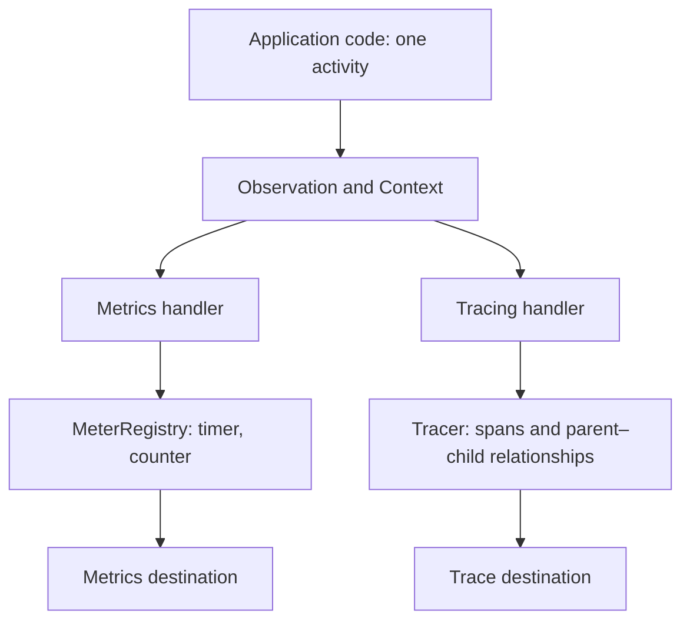

# How Observation Connects Metrics and Traces

## 1. One Observation Point, Two Perspectives on the Same Activity

Suppose a user reports that the checkout processing step is slow. Metrics help answer: how many processing runs occurred, what is the total time, and how has the latency distribution changed. Execution traces help answer: which steps did a specific run pass through, which step is a child of which, and where did the time go.

Both perspectives need to agree on the boundaries of the measured activity. If you write one piece of timing code for metrics and another piece of span-creation code for traces, it is very easy to set two different boundaries or miss the error path. Micrometer Observation provides a single shared lifecycle so handlers can react and produce data for their respective purposes. [Source: Micrometer — Observation Introduction](https://docs.micrometer.io/micrometer/reference/observation/introduction.html).

The connection point lies in **the same observed activity, the same context, and the same lifecycle events**. Metrics are not converted into traces; nor are traces a required input to produce metrics.

This lesson uses the context of Spring Boot 3.3.x, Micrometer 1.13.x, and Micrometer Tracing 1.3.x. The hands-on section pins these versions to show timers, spans, tags, and context directly, without needing to run an external monitoring system.

### Concepts to Distinguish

| Component | Role |
| --- | --- |
| `Observation` | Represents one observation of an activity: start, error if any, events, and stop |
| `ObservationRegistry` | Holds observation configuration: handlers, predicates, naming conventions, and filters |
| `Observation.Context` | Carries data for the observation run, shared across handlers |
| `MeterRegistry` | Manages meters to record counts, durations, and other measurements |
| `Tracer` | Creates and manages spans along with trace context via Micrometer Tracing |
| Span | A segment of execution in a trace, with identifiers, timing, and descriptive data |
| Scope | The scope that makes an observation/span the current context during an execution block |

`ObservationRegistry` and `MeterRegistry` are two different types. The fact that a handler uses `MeterRegistry` does not make them a single registry.

## 2. Data Flow: Branching from Observation



The metrics handler and tracing handler are both invoked when the context matches. The metrics branch uses the lifecycle to measure duration and update meters. The tracing branch uses the lifecycle to create a span, put the span in scope, record errors/events, and finish the span. That is how Observation decouples instrumentation code from how each type of telemetry is stored and exported. [Source: Micrometer Tracing — Configuring with Micrometer Observation](https://docs.micrometer.io/tracing/reference/configuring.html).

Simply creating an `Observation` object does not guarantee that both a timer and a trace will appear. You must have handlers, a registry/tracer, and appropriate configuration. A newly created observation registry with no handlers does not automatically generate useful signals; it may return a no-op observation that performs no recording.

In an application, you might enable only metrics; when tracing is properly added later, the same observation point can also provide spans. However, other measurements such as JVM memory gauges do not necessarily originate from a business Observation. Do not infer backwards that every metric must have a corresponding span.

## 3. How Do Both Branches Use the Shared Lifecycle?

### 3.1. Starting and Stopping

A convenient pattern for synchronous code is:

```java
Observation.createNotStarted("checkout.process", observationRegistry)
    .lowCardinalityKeyValue("channel", "web")
    .highCardinalityKeyValue("order.id", orderId)
    .observe(() -> processCheckout(orderId));
```

This is an illustrative snippet inside an application method: `observationRegistry` has already been provided, `orderId` is an input, and `processCheckout` is the operation to observe. It is not a standalone Java program; the complete program is in the hands-on section.

`observe(...)` manages starting, opening the scope, running the task, recording an error if the task throws one, closing the scope, and stopping the observation. [Source: Micrometer — Observation Introduction](https://docs.micrometer.io/micrometer/reference/observation/introduction.html).

| Lifecycle point | What does the metrics branch typically do? | What does the tracing branch typically do? |
| --- | --- | --- |
| Start | Starts a timing sample | Creates and starts a span; determines the parent span |
| Open scope | Code inside sees the current observation | Places the span into the current context |
| On error | Context stores the error so meter recording reflects the outcome | Handler records the error on the span |
| On event | Handler may record an event measurement | Handler may add an event to the span |
| Close scope | Restores the previous observation | Restores the previous span context |
| Stop | Completes the timing measurement | Attaches data and ends the span; forwards according to trace processing config |

With Micrometer 1.13's `DefaultMeterObservationHandler`, the timer for the activity is recorded on stop; the handler can also track in-flight activities using a long-task timer. Errors are added to the `error` tag of the finished timer. [Source: DefaultMeterObservationHandler 1.13.0](https://github.com/micrometer-metrics/micrometer/blob/v1.13.0/micrometer-core/src/main/java/io/micrometer/core/instrument/observation/DefaultMeterObservationHandler.java).

A `Timer` already has a recording count and a total duration. Seeing `count=1` on a timer does not mean the application had to create a separate `Counter` for the same invocation.

### 3.2. Scope and Lifecycle Are Two Different Things

`start()` marks the start; `openScope()` sets the current active scope. Similarly, closing the scope restores the previous context, whereas `stop()` ends the observation. Do not substitute one operation for the other.

When controlling it manually, an appropriate structure for synchronous code is:

```java
Observation observation = Observation.createNotStarted("checkout.process", observationRegistry)
    .lowCardinalityKeyValue("channel", "web")
    .start();
try (Observation.Scope scope = observation.openScope()) {
    processCheckout(orderId);
} catch (RuntimeException | Error error) {
    observation.error(error);
    throw error;
} finally {
    observation.stop();
}
```

This is still an illustrative snippet inside a method using the variables and operations already described. `try` manages closing the scope, and `finally` ensures the observation stops. If you omit `stop()`, completion data may not be recorded; if you omit closing the scope, subsequent work on the same thread may see the wrong context.

`observation.error(error)` only reports the error to the observation. It does not rethrow the exception, does not alter the business outcome, and does not replace all stop operations. If the application catches and swallows an exception inside the `observe(...)` task, you must explicitly report the error when you still want failure reflected; the API cannot infer a hidden error.

## 4. Shared Context Unifies the Meaning of Metrics and Spans

### 4.1. Activity Name and Contextual Name

Keep the observation name stable, for example `checkout.process`. Do not append the order ID to form `checkout.process.ORD-42`, because each new ID creates another name and makes aggregation hard to control.

`contextualName` can make the span name more readable, while the observation name is still used for meters by the corresponding handler. In the experiment, the observation is named `checkout.process`, and the span is named `checkout-process`. The tracing handler prefers the contextual name when present and normalizes the span name. [Source: TracingObservationHandler 1.3.0](https://github.com/micrometer-metrics/tracing/blob/v1.3.0/micrometer-tracing/src/main/java/io/micrometer/tracing/handler/TracingObservationHandler.java).

An `ObservationConvention` helps centralize naming and key–value rules instead of scattering the same conventions across many places in the code. The context is not a global data store: each observation run has its own data and processing state.

### 4.2. Cardinality Determines Where Tags Go

Cardinality is the number of distinct values or tag combinations that can appear. `channel=web|mobile` has a small value set; `order.id` can grow with every order. Low-cardinality tags are used for both metrics and traces; high-cardinality tags are only used for traces in the standard processing flow. [Source: Spring Boot 3.3 — Observability](https://docs.spring.io/spring-boot/3.3/reference/actuator/observability.html).

| Data | Appropriate placement in example | Reason |
| --- | --- | --- |
| `channel=web` | Low cardinality | Groups measurements across a small set of channels |
| `operation=reserve` | Low cardinality | Operation type with a controlled set of values |
| `order.id=ORD-42` | High cardinality | Used to look up a specific run, not to create a metric series per order |
| `traceId`, `spanId` | Tracing identifiers | Do not add these as metric tags on every call |
| Secret information | Do not collect into tags | High cardinality does not mean it is safe to record arbitrary data |

Design calculation example: if there are 3 channels, 4 operation types, and 2 outcomes, combinations can reach `3 × 4 × 2 = 24` before counting other dimensions. Adding an order ID with millions of values causes the combination space to grow sharply. This is an estimate to identify risk, not a claim that every system will generate every single combination.

High-cardinality tags still have storage and search costs and may contain sensitive data. Only include information genuinely needed for diagnosis. Key–values on an observation also do not automatically become data propagated across every network request; trace context and baggage propagation are configured separately.

You should declare known tags before starting. Some active measurements are created right at the start step, so tags added late will not necessarily appear on every meter, even though the timer on stop can receive them. [Source: DefaultMeterObservationHandler 1.13.0](https://github.com/micrometer-metrics/micrometer/blob/v1.13.0/micrometer-core/src/main/java/io/micrometer/core/instrument/observation/DefaultMeterObservationHandler.java).

## 5. Parent–Child Relationships Come from the Active Context

Suppose inside the checkout processing observation there is an inventory reservation observation. When the outer observation is in scope, the inner observation can inherit the parent relationship. The tracing handler uses that relationship to create a child span. [Source: DefaultTracingObservationHandler 1.3.0](https://github.com/micrometer-metrics/tracing/blob/v1.3.0/micrometer-tracing/src/main/java/io/micrometer/tracing/handler/DefaultTracingObservationHandler.java).

```text
Trace of one processing run
└── checkout-process
    └── inventory-reserve
```

Two spans in the same trace share the same `traceId` and have different `spanId`s; the child span's `parentId` points to the parent span's `spanId`. This does not mean every tag on the parent is automatically copied down to the child.

The duration of the outer activity usually includes the inner execution segment. Therefore, do not sum the durations of all parent and child spans to infer the total trace duration: summing them like that double-counts overlapping intervals, and branches can also run in parallel.

Across another thread, queue, or another application, this relationship requires an appropriate context propagation and restoration mechanism. The running thread's `ThreadLocal` does not automatically appear on every new thread. With reactive code, you also cannot assume a scope persists merely because a lambda was created inside a method.

In a Spring Boot application, use auto-configured HTTP client builders such as `RestClient.Builder`, `RestTemplateBuilder`, and `WebClient.Builder` to leverage trace propagation integration. Creating clients manually outside those builders can lose automatic integration. [Source: Spring Boot — Propagating Traces](https://docs.spring.io/spring-boot/3.3/reference/actuator/tracing.html#propagating-traces).

For asynchronous processing, you must observe the true execution interval. A synchronous `observe(...)` wrapping only a call that returns a `CompletableFuture` does not automatically wait for the future to complete; in that case, the measurement may only reflect scheduling time. Use the context propagation and lifecycle integration suited to the async mechanism in use.

## 6. Metrics and Traces Are Related Without a Strict One-to-One Mapping

### 6.1. Metrics Aggregate; Traces Describe Specific Runs

A timer can aggregate many calls that share the same name and tags. Traces preserve the execution structure of recorded runs. Therefore, a point on a metric chart does not by default point to a single trace, and you cannot reconstruct each individual trace from counts/total durations.

### 6.2. Trace Sampling Is Not Metric Sampling

Sampling configuration decides which traces/spans are recorded for reporting according to the tracer's mechanism. It does not automatically cause the metrics handler's timer to drop the same proportion of calls. In Spring Boot 3.3, the default trace sampling probability is 10%; it can be adjusted via `management.tracing.sampling.probability`. [Source: Spring Boot 3.3 — Tracing](https://docs.spring.io/spring-boot/3.3/reference/actuator/tracing.html).

In a hypothetical example where 100 observations are all successfully recorded by the timer: the timer can have `count=100` while tracing stores only a subset. With probabilistic sampling, do not expect an exact 10 traces for every group of 100 runs. Incoming parent trace decisions can also influence the child trace's selection.

A trace context can still exist even when the trace is not recorded for reporting. Therefore, `currentSpan() != null` alone does not prove the span was sampled or reached the trace backend. The experiment will check the in-scope context and the count of finished spans received by the collector separately.

### 6.3. Export Paths Are Two Separate Pipelines

The metrics export registry and the trace exporter have separate dependencies, protocols, destinations, and connection failures. Prometheus scraping metrics successfully does not prove the OTLP trace exporter has connected successfully; losing connectivity to the trace store does not cause measurements held in the meter registry to disappear.

Code that calls `meterRegistry.counter(...)` directly without going through Observation does not automatically create a span. Likewise, creating a span directly through Tracer does not automatically create a business timer for that activity. It is the shared observation point together with its handlers that produces both views along the same boundary.

### 6.4. Linking from a Data Point to a Trace with Exemplars

Some systems support exemplars: a metric sample can attach a trace/span reference so operators can open the related trace. An exemplar is not a dimension tag on the entire metric series, so there is no need to add `traceId` to metric tags. Display also depends on the registry, available trace data, export format, and monitoring tool; sharing Observation alone does not guarantee the UI shows a trace link button. [Source: Micrometer Prometheus — Exemplars](https://docs.micrometer.io/micrometer/reference/implementations/prometheus.html#_exemplars).

The hands-on program below uses a Simple registry and an in-memory span collector; it verifies data relationships rather than configuring exemplars or dashboards.

## 7. In Spring Boot, What Is Auto-Configured?

Actuator provides Micrometer Observation integration. In application code, you normally inject the Spring-managed `ObservationRegistry` bean instead of calling `ObservationRegistry.create()`. A standalone registry created manually does not automatically receive all handlers that Boot registers on the application bean.

When a tracer and the required conditions are present, Boot registers tracing handlers, including the default handler and specialized handlers for network sending/receiving. These handlers are ordered to select the appropriate handling. Do not arbitrarily register multiple tracing handlers that all create spans for the same context. [Source: MicrometerTracingAutoConfiguration 3.3.0](https://github.com/spring-projects/spring-boot/blob/v3.3.0/spring-boot-project/spring-boot-actuator-autoconfigure/src/main/java/org/springframework/boot/actuate/autoconfigure/tracing/MicrometerTracingAutoConfiguration.java).

One integration option to send traces via OTLP in a Boot application is:

```text
org.springframework.boot:spring-boot-starter-actuator
io.micrometer:micrometer-tracing-bridge-otel
io.opentelemetry:opentelemetry-exporter-otlp
```

This is a dependency list for an OpenTelemetry-based application, distinct from the Brave experiment below. In a Boot application, let Boot's dependency management choose compatible versions; do not copy and mix two tracer configurations just to get more traces.

Once tracing configuration is complete, you can set `management.tracing.sampling.probability=1.0` during hands-on practice to observe traces easily. The OTLP receiver must also be configured and running on the right protocol. You do not need a dummy business endpoint just to demonstrate Observation; you can observe a background task or a meaningful service operation.

If you want to view metrics over HTTP, you also need to configure the corresponding endpoint; that is the read path for metrics, not a prerequisite for internal timers to receive measurements. Web/client systems already instrumented by the framework should be checked before wrapping them further, to avoid double-recording the same boundary.

## 8. Java Hands-On: Same Observation Creating Timer and Span

### 8.1. Objective and How to Run

This is a standalone Java program that does not start Spring Boot. It wires handlers manually so the connection becomes visible:

- Metrics: `SimpleMeterRegistry`, stored only in memory.
- Trace: Micrometer Tracing bridged to Brave; a `SpanHandler` holds finished spans in a list without sending them over the network.
- Time: `MockClock` advances deterministically, without using `sleep` or relying on machine speed.
- Two separate runs: full sampling and no sampling; each run uses a fresh registry, tracer, and list.

JDK 17 or newer and Maven are required. The first dependency download requires network access. Create a dedicated practice directory and place the following two files side by side.

### 8.2. File pom.xml

```xml
<project xmlns="http://maven.apache.org/POM/4.0.0"
         xmlns:xsi="http://www.w3.org/2001/XMLSchema-instance"
         xsi:schemaLocation="http://maven.apache.org/POM/4.0.0 https://maven.apache.org/xsd/maven-4.0.0.xsd">
  <modelVersion>4.0.0</modelVersion>
  <groupId>example</groupId>
  <artifactId>observation-bridge-demo</artifactId>
  <version>1.0.0</version>
  <dependencies>
    <dependency>
      <groupId>io.micrometer</groupId>
      <artifactId>micrometer-core</artifactId>
      <version>1.13.0</version>
    </dependency>
    <dependency>
      <groupId>io.micrometer</groupId>
      <artifactId>micrometer-tracing-bridge-brave</artifactId>
      <version>1.3.0</version>
    </dependency>
    <dependency>
      <groupId>org.slf4j</groupId>
      <artifactId>slf4j-nop</artifactId>
      <version>1.7.36</version>
      <scope>runtime</scope>
    </dependency>
  </dependencies>
</project>
```

The Brave bridge at this version brings in Brave 6.0.3. SLF4J no-op is only so the experiment does not require a logging system; it does not enable or disable span creation. Do not apply this no-op logging choice as a requirement for a Boot application.

### 8.3. File ObservationBridgeDemo.java

```java
import java.time.Duration;
import java.util.ArrayList;
import java.util.List;
import java.util.Locale;
import java.util.Map;

import brave.Tracing;
import brave.handler.MutableSpan;
import brave.handler.SpanHandler;
import brave.propagation.ThreadLocalCurrentTraceContext;
import brave.propagation.TraceContext;
import brave.sampler.Sampler;
import io.micrometer.core.instrument.MockClock;
import io.micrometer.core.instrument.Timer;
import io.micrometer.core.instrument.observation.DefaultMeterObservationHandler;
import io.micrometer.core.instrument.simple.SimpleConfig;
import io.micrometer.core.instrument.simple.SimpleMeterRegistry;
import io.micrometer.observation.Observation;
import io.micrometer.observation.ObservationRegistry;
import io.micrometer.tracing.Tracer;
import io.micrometer.tracing.brave.bridge.BraveBaggageManager;
import io.micrometer.tracing.brave.bridge.BraveCurrentTraceContext;
import io.micrometer.tracing.brave.bridge.BraveTracer;
import io.micrometer.tracing.handler.DefaultTracingObservationHandler;

public class ObservationBridgeDemo {
    record Finished(String traceId, String spanId, String parentId,
                    String name, Map<String, String> tags) {}

    private static void runCase(String label, Sampler sampler) {
        List<Finished> finished = new ArrayList<>();
        MockClock clock = new MockClock();
        SimpleMeterRegistry meters = new SimpleMeterRegistry(SimpleConfig.DEFAULT, clock);
        ThreadLocalCurrentTraceContext current = ThreadLocalCurrentTraceContext.newBuilder().build();
        try (Tracing tracing = Tracing.newBuilder()
                 .localServiceName("observation-demo")
                 .currentTraceContext(current)
                 .sampler(sampler)
                 .addSpanHandler(new SpanHandler() {
                     @Override
                     public boolean end(TraceContext context, MutableSpan span, Cause cause) {
                         finished.add(new Finished(context.traceIdString(),
                             context.spanIdString(), context.parentIdString(),
                             span.name(), Map.copyOf(span.tags())));
                         return true;
                     }
                 }).build()) {
            Tracer tracer = new BraveTracer(tracing.tracer(),
                new BraveCurrentTraceContext(current), new BraveBaggageManager());
            ObservationRegistry observations = ObservationRegistry.create();
            observations.observationConfig()
                .observationHandler(new DefaultMeterObservationHandler(meters))
                .observationHandler(new DefaultTracingObservationHandler(tracer));

            Observation.createNotStarted("checkout.process", observations)
                .contextualName("checkout-process")
                .lowCardinalityKeyValue("channel", "web")
                .highCardinalityKeyValue("order.id", "ORD-42")
                .observe(() -> {
                    System.out.println(label + " inScope="
                        + (observations.getCurrentObservation() != null
                           && tracer.currentSpan() != null));
                    Observation.createNotStarted("inventory.reserve", observations)
                        .contextualName("inventory-reserve")
                        .observe(() -> clock.add(Duration.ofMillis(5)));
                    clock.add(Duration.ofMillis(10));
                });

            Timer timer = meters.get("checkout.process").timer();
            System.out.println(label + " timer.count=" + timer.count());
            System.out.printf(Locale.ROOT, "%s timer.totalMs=%.1f%n",
                label, timer.totalTime(java.util.concurrent.TimeUnit.MILLISECONDS));
            System.out.println(label + " timer.channel=" + timer.getId().getTag("channel"));
            System.out.println(label + " timer.hasOrderId="
                + (timer.getId().getTag("order.id") != null));
            System.out.println(label + " completedSpans=" + finished.size());
            if (!finished.isEmpty()) {
                Finished root = finished.stream()
                    .filter(s -> s.name().equals("checkout-process")).findFirst().orElseThrow();
                Finished child = finished.stream()
                    .filter(s -> s.name().equals("inventory-reserve")).findFirst().orElseThrow();
                System.out.println(label + " sameTrace=" + root.traceId().equals(child.traceId()));
                System.out.println(label + " childOfRoot=" + root.spanId().equals(child.parentId()));
                System.out.println(label + " span.orderId=" + root.tags().get("order.id"));
            }
            System.out.println(label + " scopeCleared="
                + (observations.getCurrentObservation() == null && tracer.currentSpan() == null));
        } finally {
            meters.close();
        }
    }

    public static void main(String[] args) {
        runCase("SAMPLED", Sampler.ALWAYS_SAMPLE);
        runCase("NOT_SAMPLED", Sampler.NEVER_SAMPLE);
    }
}
```

`Finished` holds a copy of the data needed for verification when a span ends. The tracer and tracing handler in the example are real libraries; the list merely substitutes for a destination so results can be inspected immediately inside the program. The example runs on a single thread, so it uses `ArrayList`; a multi-threaded collector would need appropriate synchronization.

### 8.4. Compiling and Running with PowerShell

```powershell
mvn dependency:copy-dependencies -DincludeScope=runtime
New-Item -ItemType Directory -Force -Path target/classes | Out-Null
javac --release 17 -encoding UTF-8 -cp "target/dependency/*" -d target/classes ObservationBridgeDemo.java
java -cp "target/classes;target/dependency/*" ObservationBridgeDemo
```

On Linux/macOS, create the directory with `mkdir -p target/classes` and use `:` instead of `;` between the two classpath entries when running `java`.

Program stdout:

```text
SAMPLED inScope=true
SAMPLED timer.count=1
SAMPLED timer.totalMs=15.0
SAMPLED timer.channel=web
SAMPLED timer.hasOrderId=false
SAMPLED completedSpans=2
SAMPLED sameTrace=true
SAMPLED childOfRoot=true
SAMPLED span.orderId=ORD-42
SAMPLED scopeCleared=true
NOT_SAMPLED inScope=true
NOT_SAMPLED timer.count=1
NOT_SAMPLED timer.totalMs=15.0
NOT_SAMPLED timer.channel=web
NOT_SAMPLED timer.hasOrderId=false
NOT_SAMPLED completedSpans=0
NOT_SAMPLED scopeCleared=true
```

### 8.5. Reading the Evidence in the Output

1. `inScope=true` proves the code is executing within a scope that has both a current observation and a current span, even in the unsampled run.
2. `timer.count=1` in both runs proves that trace sampling policy does not cause the example's timer to drop recordings.
3. `timer.totalMs=15.0` comes from advancing the mock clock by 5 ms in the child step and 10 ms in the outer step; the outer timer includes the child step.
4. `timer.channel=web` and `timer.hasOrderId=false` show that high-cardinality tags are not added to the default timer.
5. In the sampled run, the collector receives two spans; `sameTrace=true` and `childOfRoot=true` verify both shared trace identity and the parent–child relationship rather than only looking at names.
6. `span.orderId=ORD-42` proves the order ID is still present on the outer activity's span.
7. In the unsampled run, `completedSpans=0` while the timer still has data. An empty list here does not mean there was never a trace context.
8. `scopeCleared=true` shows that after the outer activity, the current observation and span have been restored to their initial context-free state.

Do not interpret `15.0 ms` as real checkout processing time or actual Brave span duration. `MockClock` was only supplied to the meter branch; the example intentionally avoids printing trace durations or random trace IDs to keep output deterministic.

## 9. Common Mistakes That Cause the Two Views to Mismatch

| Symptom | Cause to check |
| --- | --- |
| Metrics exist but no spans are reported | Missing handler/tracer, not sampled, or trace exporter/destination is not working |
| Spans exist but no business timer | Using Tracer directly, missing metrics handler, or meter filtered out |
| Self-created Observation produces no data | Using an unconfigured standalone registry instead of the Boot-managed bean |
| Child span becomes an independent trace | Missing parent scope or lost context across thread/network boundaries |
| Number of metric series grows per transaction | Putting per-item identifiers into low-cardinality tags or into the observation name |
| Two nearly identical timers/spans for the same operation | Double-wrapping a boundary already observed by the framework, or registering duplicate handlers |
| Task reports success despite internal failure | Exception caught/swallowed before `observe` sees it, without reporting error to observation |
| Duration is shorter than async task execution | Observing only the scheduling step rather than the interval until completion |

Disabling an Observation via a predicate or observation configuration can prevent both branches of that observation point from receiving the lifecycle. Disabling a metrics exporter only changes the metrics path; it is not equivalent to disabling observations or disabling the tracer. Determine which layer you are acting on before changing configuration.

Having a trace for a request also does not guarantee every SQL query, every method, and every subtask will have a span. Each boundary you want to see must have the corresponding integration or observation point, with context wired properly.

## 10. Self-Check

1. Why does an `ObservationRegistry` not replace a `MeterRegistry`?
2. An observation is named `checkout.process`, with tags `channel=web` and `order.id=ORD-42`. Under the default handlers being studied, which data should be on the timer and which on the span?
3. If trace sampling is turned off, must the timer stop incrementing?
4. Why can calling `start()` without opening a scope affect the context of child operations?
5. Why is seeing `currentSpan()` not `null` insufficient to conclude that the trace was stored on the server?
6. If the parent span's total duration is 100 ms and a child span completely inside it is 60 ms, should you conclude the whole trace took 160 ms?
7. Why should you not add `traceId` as a metric tag to link the two types of telemetry?

Answers: (1) The observation registry manages lifecycle/handlers, while the meter registry manages measurements. (2) The timer has `channel`, and the span has both tags; high-cardinality tags do not go onto the default timer. (3) No; the two branches have separate policies. (4) Starting the lifecycle is not equivalent to setting the current context; child operations need an appropriate parent context. (5) The context can exist even when not sampled or when export fails. (6) No; the child interval is already included within the parent duration. (7) Each trace ID creates a new tag value; when supported by the system, use exemplars to attach references on samples instead of increasing metric series dimensionality.
