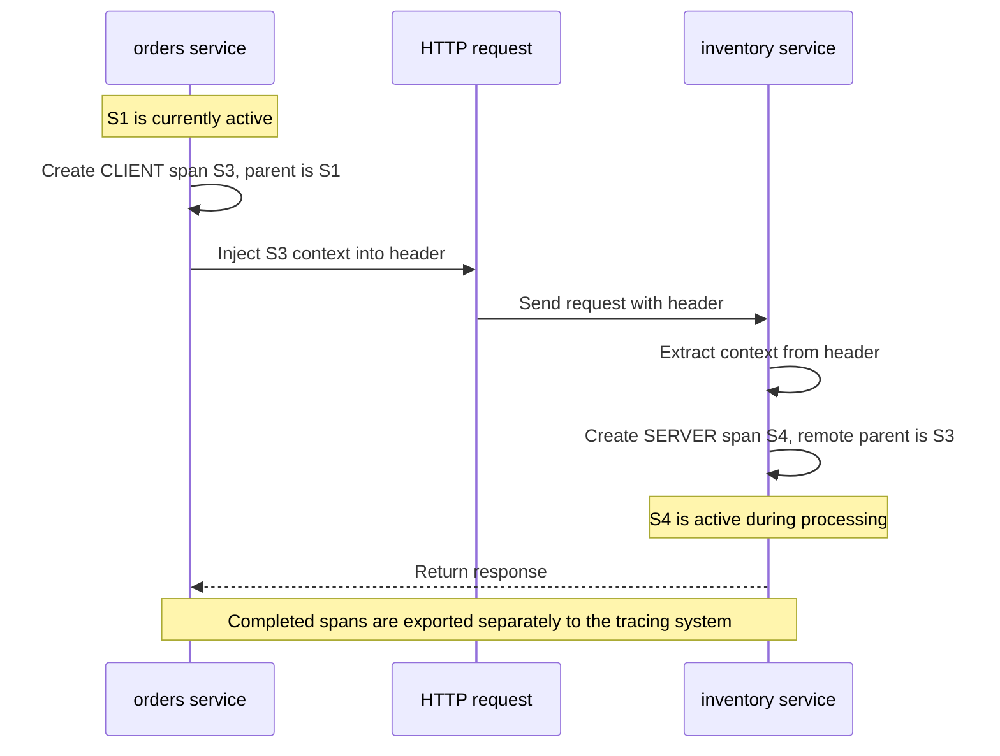

# Distinguishing Traces, Spans, Parent-Child Relationships, and Cross-Service Context Propagation

## 1. Starting from a Purchase Request

A user calls the orders service. This service validates the data, calls the inventory service, and waits for the result to respond. If the response is slow, a single log line saying "order processed" does not tell you whether the time was spent in validation, over the network, or in the inventory query.

Distributed tracing records units of work and the relationships between them. Three questions need to be separated clearly:

- **Trace:** which units of work belong to the same processing journey?
- **Span:** how does a specific unit of work start, finish, and what is its outcome?
- **Trace context:** when moving to another processing location, what information enables the new work to link correctly into the existing journey?

A trace can exist entirely within a single application. When the journey crosses multiple services, the context propagation mechanism preserves that continuity. You do not need to turn every Java method into a span to have useful tracing.

## 2. Distinguishing the Identifiers

| Component | Meaning | Question It Answers |
| --- | --- | --- |
| Trace | A collection of related spans within a single journey | Which units of work did this request pass through? |
| `traceId` | Shared identifier of the trace | Which journey does this span belong to? |
| Span | A unit of work with a start time and an end time | What did this step do, and how long did it take? |
| `spanId` | Identifier of a span within a trace | Which step is this? |
| `parentSpanId` | Identifier of the parent span; the root span has no parent | Under which unit of work did this step originate? |
| Span context | The identifiers along with trace flags and state that need to be propagated | What must be carried along to continue the relationship? |
| Scope | The execution interval during which a span is set as the current span | If child work is created right here, who is the default parent? |

In the OpenTelemetry model, child spans keep the same `traceId` as their parent and have their own `spanId`. The root span has no parent span. `parentSpanId` belongs to the span's relationship metadata; it should not be confused with the `spanId` inside that span's own context. [Span creation and parent resolution rules](https://opentelemetry.io/docs/specs/otel/trace/api/#span-creation).

Span names can be identical across multiple calls. Two calls to `GET /stock/{sku}` are not the same span just because they share the same name. Conversely, a single service can create multiple spans within the same trace: receiving HTTP, business processing, making an HTTP call, and accessing data.

**A trace ID is also not an order ID.** An order may be read again, paid again, or synchronized at multiple points in time, generating multiple traces. Keep business identifiers and tracing identifiers dedicated to their own purposes.

## 3. Reading Parent-Child Relationships with a Concrete Tree

Suppose a request is recorded as follows. The labels `S1` through `S5` are used for learning; real IDs are shown in the header example below.

```text
Trace T
S1  orders: receive POST /orders                    SERVER
├── S2  orders: validate data                       INTERNAL
└── S3  orders: call GET inventory/stock/{sku}      CLIENT
    └── S4  inventory: receive GET /stock/{sku}     SERVER
        └── S5  inventory: query stock              CLIENT
```

S5 assumes the data access library has instrumentation attached. This is the expected tree when sufficient instrumentation is present, not a claim that every JDBC query automatically generates a span.

| Span | Parent | Service | Hypothetical Time Range | Duration |
| --- | --- | --- | --- | --- |
| S1 | None | orders | 0–120 ms | 120 ms |
| S2 | S1 | orders | 5–15 ms | 10 ms |
| S3 | S1 | orders | 20–100 ms | 80 ms |
| S4 | S3 | inventory | 25–90 ms | 65 ms |
| S5 | S4 | inventory | 35–75 ms | 40 ms |

From this hypothetical data:

1. There is **one trace and five spans**, not two traces because there are two services.
2. S2 and S3 are sibling spans sharing the same parent. S3 does not become a child of S2 merely because it runs after S2.
3. S4 connects to S3 across a process boundary. A parent-child relationship does not require two spans to reside on the same machine or on the same thread.
4. S3 and S4 describe two sides of a single call: the caller measures the outbound call duration, while the receiver measures the inbound handling duration.
5. The end-to-end time covered by span S1 is 120 ms in the example; adding all durations together gives 315 ms and double-counts nested time.

The caller-side duration may include waiting for a connection, transmitting data, receiver-side processing, and reading the response, depending on the library's measurement boundaries. Do not take the difference S3−S4 and claim all of it is network latency.

With parallel branches, you cannot sum branch durations to obtain response time. Nor can you subtract all descendant spans from the root span to compute "self time," because intervals may be nested or overlapping. In real systems, clocks across machines can also drift; use parent-child IDs to read relationships before inferring anything from timestamp positions.

## 4. How Is Context Propagated Across Services?

An HTTP call with complete tracing typically goes through this sequence of operations:



The two key operations are **context injection (inject)** on the sender side and **context extraction (extract)** on the receiver side. The carrier here is the HTTP headers; for messaging systems, it can be message metadata. [Context propagation mechanism](https://opentelemetry.io/docs/concepts/context-propagation/).

The header does not carry the entire trace, span tree, logs, or all span attributes. It carries just enough information for the receiver to continue the relationship. The receiver still needs tracing and appropriate instrumentation to create and manage its own units of work.

There are two independent flows to check:

| Flow | Path | Purpose |
| --- | --- | --- |
| Context propagation | orders → inventory, alongside the business request | Link relationships between spans |
| Data export | Each application → collector or trace storage backend | Send span data for storage and viewing |

The collector is not a mandatory hop that every business request must pass through. An export failure can cause the tracing UI to miss spans even when headers were propagated properly. Conversely, successful export from both services can still produce two disconnected traces if context did not get through.

## 5. Reading the W3C `traceparent` Header

Example where orders is sending a request under CLIENT span S3:

```http
GET /stock/SKU-7 HTTP/1.1
Host: inventory.internal
traceparent: 00-6a21b47e91ce438db620a7c590d2148f-3333333333333333-01
```

With format version `00`:

| Part | Example Value | Meaning |
| --- | --- | --- |
| Version | `00` | Format version |
| Trace ID | `6a21b47e91ce438db620a7c590d2148f` | 32 hex characters, trace identifier |
| Parent ID | `3333333333333333` | 16 hex characters, sender span ID |
| Trace flags | `01` | Sampled bit is enabled |

Trace ID and parent ID must not be all zeros. Use a propagator library to handle validity and versioning; do not build a production parser by simple string splitting. [W3C Trace Context format](https://www.w3.org/TR/trace-context/#traceparent-header).

Inventory creates SERVER span S4:

```text
traceId      = 6a21b47e91ce438db620a7c590d2148f
spanId       = 4444444444444444
parentSpanId = 3333333333333333
```

**The `parent-id` on the wire is the sender's `spanId` and becomes the `parentSpanId` of the new span on the receiver side.** Inventory does not take ID `3333333333333333` as S4's own ID in this model.

If S4 subsequently calls another service through CLIENT span S6 with ID `6666666666666666`, the header for that call carries parent ID `6666666666666666`. The Trace ID stays the same, while the unit-of-work ID at each hop is updated. Therefore, do not save the header from the beginning of the request and copy it verbatim to all subsequent calls.

The `tracestate` header can carry vendor-specific state for tracing systems. The sampled flag communicates a sampling-related decision; it does not guarantee that the span has reached storage. Data loss, buffering, or export errors can still happen. [State and flags in the W3C standard](https://www.w3.org/TR/trace-context/).

## 6. In-Process Context: Creating a Span and Making It Current

Inside the application, the library needs to know which span is currently active to select the parent for a new span. Creating a span object and putting it into an active scope are two operations with distinct meanings.

The following snippet illustrates Micrometer Tracing in an application that already has a `Tracer` bean. This is a method body, not a standalone Java program:

```java
import io.micrometer.tracing.Span;
import io.micrometer.tracing.Tracer;

// tracer is injected; when the method is called, an HTTP span may be active.
Span child = tracer.nextSpan().name("reserve-stock").start();
try (Tracer.SpanInScope scope = tracer.withSpan(child)) {
    // Handle stock reservation.
    // A new span created in this scope can use child as its parent.
} catch (RuntimeException ex) {
    child.error(ex);
    throw ex;
} finally {
    child.end();
}
```

`nextSpan()` selects the parent from the current context; if there is no parent, it can start a new trace. `withSpan(child)` sets child as the current span and closing the scope restores the previous context. `end()` finishes the measurement; closing the scope is not a substitute for ending the span. [Micrometer span lifecycle example](https://docs.micrometer.io/tracing/reference/api.html).

Practical limits to remember:

- When switching to an executor or `CompletableFuture`, do not assume the current context automatically follows. You need a context capture and restoration mechanism suited to the library and execution model.
- In reactive flows, processing context cannot be inferred solely from thread names.
- A single thread can serve multiple requests sequentially; a single request can traverse multiple threads.
- Leaving a scope open in the wrong place can attach later work to the wrong request. Ending a span too early prevents the measurement from covering the intended work.

Spring Boot uses the Context Propagation library for supported thread and reactive boundaries; this capability still depends on configuration and usage. JDBC instrumentation also requires dedicated support and does not appear just by adding Actuator. [Observability in Spring Boot 3.3](https://docs.spring.io/spring-boot/3.3/reference/actuator/observability.html).

### Where Do Logs, Attributes, and Baggage Fit?

A log containing a trace ID helps locate the trace; that log does not automatically become a span. Copying `traceId` into MDC for pretty printing also does not create parent-child relationships or propagate context over HTTP.

Attributes (tags) describe a single span. Baggage is contextual data that can be propagated to another processing location; adding an attribute is not the same as propagating baggage. Baggage also does not automatically become an attribute on every span. Only propagate necessary and permitted data, as it can continue onward to third parties; never use baggage as proof of authentication or authorization. [Distinguishing baggage and attributes](https://opentelemetry.io/docs/concepts/signals/baggage/).

## 7. Connecting to Spring Boot 3.3 and Actuator

In Spring Boot 3.3, Actuator supports configuring Micrometer Tracing. One combination using OpenTelemetry and Zipkin includes:

```groovy
// The project's dependencies section already manages versions with Spring Boot 3.3.x.
implementation 'org.springframework.boot:spring-boot-starter-actuator'
implementation 'io.micrometer:micrometer-tracing-bridge-otel'
implementation 'io.opentelemetry:opentelemetry-exporter-zipkin'
```

An HTTP application also needs an appropriate web starter. The lines above are not a complete `build.gradle`. You do not need to add multiple bridges at the same time just to "make sure tracing works."

To make a client receive Boot's instrumentation configuration, obtain the builder from the container:

```java
import org.springframework.context.annotation.Bean;
import org.springframework.context.annotation.Configuration;
import org.springframework.web.client.RestClient;

@Configuration(proxyBeanMethods = false)
class InventoryClientConfiguration {
    @Bean
    RestClient inventoryClient(RestClient.Builder builder) {
        return builder
                .baseUrl("http://localhost:8081")
                .build();
    }
}
```

This is a configuration class inside a Spring Boot project, not run via `java InventoryClientConfiguration.java`. Calling `RestClient.create(...)` yourself under the default configuration bypasses the Boot-configured builder and can lose automatic context propagation. [Dependency combinations and trace propagation in Spring Boot 3.3](https://docs.spring.io/spring-boot/3.3/reference/actuator/tracing.html).

You do not need to expose an `/actuator/traces` endpoint for services to exchange context. Exposing management endpoints and instrumenting HTTP are two separate concerns. You must verify both the sender and receiver sides; having Actuator on one side is not enough to prove the chain is connected successfully.

## 8. Java Demonstration: Building a Tree from Existing Relationships

The following program runs standalone on Java 17+. It uses the hypothetical data from section 3 to verify how IDs and durations are read; **it does not send HTTP requests, does not generate real telemetry, and does not replace a tracing library**.

Save as `TraceRelations.java`:

```java
import java.util.List;

public class TraceRelations {
    record SpanRow(String traceId, String spanId, String parentSpanId,
                   String operation, long durationMs) {}

    private static final String TRACE =
            "6a21b47e91ce438db620a7c590d2148f";

    public static void main(String[] args) {
        List<SpanRow> spans = List.of(
                new SpanRow(TRACE, "1111111111111111", null,
                        "orders.receive", 120),
                new SpanRow(TRACE, "2222222222222222", "1111111111111111",
                        "orders.validate", 10),
                new SpanRow(TRACE, "3333333333333333", "1111111111111111",
                        "orders.http-client", 80),
                new SpanRow(TRACE, "4444444444444444", "3333333333333333",
                        "inventory.receive", 65),
                new SpanRow(TRACE, "5555555555555555", "4444444444444444",
                        "inventory.database", 40)
        );

        long traceCount = spans.stream()
                .map(SpanRow::traceId).distinct().count();
        SpanRow root = spans.stream()
                .filter(span -> span.parentSpanId() == null)
                .findFirst().orElseThrow();

        System.out.println("traces=" + traceCount + ", spans=" + spans.size());
        printTree(spans, root, 0);

        long durationSum = spans.stream()
                .mapToLong(SpanRow::durationMs).sum();
        System.out.println("rootDurationMs=" + root.durationMs());
        System.out.println("sumSpanDurationMs=" + durationSum);
    }

    private static void printTree(List<SpanRow> spans, SpanRow parent,
                                  int depth) {
        System.out.println("  ".repeat(depth)
                + parent.operation() + " [" + parent.durationMs() + " ms]");

        for (SpanRow child : spans) {
            if (parent.traceId().equals(child.traceId())
                    && parent.spanId().equals(child.parentSpanId())) {
                printTree(spans, child, depth + 1);
            }
        }
    }
}
```

Compile and run:

```shell
javac --release 17 TraceRelations.java
java TraceRelations
```

Exact stdout output:

```text
traces=1, spans=5
orders.receive [120 ms]
  orders.validate [10 ms]
  orders.http-client [80 ms]
    inventory.receive [65 ms]
      inventory.database [40 ms]
rootDurationMs=120
sumSpanDurationMs=315
```

The program traverses by the trace ID pair and the `parentSpanId → spanId` relationship, not by service name order or log order. The data is intentionally kept small, valid, with a single root and no cycles; this is not a validator for data from a trace storage system.

Try changing the parent of `orders.http-client` to `2222222222222222`: it moves beneath `orders.validate`. The Trace ID does not change so the trace count remains 1, but the structural meaning has changed. Try changing the trace ID of `inventory.receive`: it can no longer connect to the current tree via the identifier pair, even though the parent field still holds the old string. Do not "fix" real tracing data by forcing every span to share the same trace ID.

## 9. Not Every Relationship Is a Synchronous Call

In a parent-child tree, each span has at most one parent. Two tasks created under the same current span can be sibling branches sharing the same parent, even when running concurrently.

With asynchronous processing, a child span may finish after its parent span. Therefore, a causal relationship is not a guarantee that the child's time interval always falls completely inside the parent's.

A job that aggregates multiple messages from different sources should not be interpreted as having multiple parent fields. A span link represents additional relationships that a single parent field cannot adequately describe, including cross-trace relationships. [OpenTelemetry span links](https://opentelemetry.io/docs/concepts/signals/traces/#span-links).

How parents or links are attached for queues depends on the library and instrumentation conventions. Do not conclude that "asynchronous processing must always start a new trace" or that "every message must always stay in the original trace."

You also need to distinguish a **true root span** from the **topmost span in the visible slice of data**. If the parent portion is missing because it was not recorded or not exported, a child span may appear at the top of the screen while still carrying a parent ID. That is incomplete data, not sufficient proof that the journey started at that service.

## 10. Diagnosing a Broken Trace Tree

| Observation | Possibility to Check | Evidence to Look For |
| --- | --- | --- |
| orders and inventory have different trace IDs for the same call | Missing inject/extract, mismatched propagation format, context lost before sending, or a boundary intentionally starting a new trace | Actual headers right before sending and upon receiving; current span on both sides |
| Same trace ID but wrong parent relationship | Old header copied over, span created in the wrong scope | Outbound CLIENT span ID and inbound SERVER span's `parentSpanId` |
| Spans missing in the tracing system while logs have IDs | Sampling, exporter error, export queue, or data has not arrived yet | Sampling decision, export errors, and collector status |
| Logs in a background task are missing IDs | Context was not transferred across the execution boundary | Context before scheduling and inside the task |
| A single HTTP step has multiple duplicate-role spans | Multiple instrumentation layers measuring the same call | Agent, library configuration, and manually created spans |
| Inventory service has HTTP spans but no query spans | No instrumentation for the data layer | JDBC/R2DBC libraries and actual configuration |

Ordered inspection steps:

1. Send an easily distinguishable request and record the trace ID at the entry point.
2. Check the CLIENT span right before the outbound call.
3. Compare the trace ID and parent ID on the outbound header with the inbound header of the downstream service.
4. Check the receiving span: trace ID continues, distinct span ID, parent matches the outbound span.
5. If relationships are already correct yet the UI is still missing data, move on to checking sampling and export.

Do not manually add headers via string concatenation in individual controllers to mask configuration errors. Nor should you treat seeing the same trace ID in two log lines as sufficient proof: you still need to check distinct spans, parent relationships, and measurement data.

## 11. Self-Check Practice

**Scenario 1:** orders receives a request under S1, creates S2 for validation, closes S2's scope, and then calls inventory using CLIENT span S3. Who is S3's parent?

**Explanation:** If S1's scope was properly restored and is currently active, the parent is S1. The fact that S2 just finished running does not automatically make S2 the parent.

**Scenario 2:** The inbound header to inventory has trace ID T and parent ID P. Inventory creates SERVER span R under the OpenTelemetry model. What does R keep and what does it change?

**Explanation:** R keeps trace ID T, gets its own span ID, and records P as its remote parent. The received context continues the relationship; P is not reused as R's own ID.

**Scenario 3:** Two independent branches run concurrently for 80 ms each under a 100 ms root span. Can you conclude the request took 160 ms because the sum of the two branches is 160?

**Explanation:** No. Branch timings can overlap; you must inspect the execution intervals and wait points. Assuming the root span covers the entire processing, its duration is 100 ms.

**Scenario 4:** Both services already share the same trace ID, but inventory's spans are not visible in the UI yet. Should you immediately conclude that HTTP failed to propagate headers?

**Explanation:** No. Check the span relationships and actual context first, then check sampling, span completion, and export. Context propagation and data storage are two separate stages.

After this lesson, when reading a trace, locate the shared journey using the trace ID, identify each unit of work using the span ID, connect relationships using the parent ID, and verify context at each processing boundary. That reading approach helps pinpoint the exact hop to investigate before changing configuration or adding measurements.
