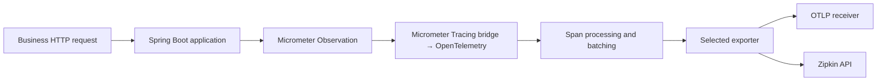

# Configuring Trace Export to OTLP or Zipkin

## 1. What Problem Does Trace Export Solve?

Your application already creates spans and logs contain trace IDs, yet the tracing UI remains empty. That can happen because **generating telemetry data** and **sending data to storage** are two separate concerns.

An exporter converts recorded spans into a format and protocol understood by the receiver. A collector can ingest, process, and forward data onward. A tracing backend handles querying and visualization.

This lesson uses Spring Boot **3.3.x**, Java 21, and Micrometer Tracing with OpenTelemetry. Two options are practiced separately:

- **OTLP:** the OpenTelemetry Protocol; the application sends to an OTLP receiver.
- **Zipkin:** the application sends data using the Zipkin protocol to Zipkin's span ingestion API.

OTLP is not a storage product with its own UI. Zipkin is both a tracing system and provides an ingestion API in the Zipkin format. Therefore, "using OpenTelemetry" does not mean "you must use OTLP"; OpenTelemetry also has a Zipkin exporter.

The practical goal is configuring the right **library → protocol → target address → proof that spans were received**.

## 2. View the Entire Path Before Editing YAML



The diagram shows two selectable destinations, not a requirement to enable two exporters simultaneously.

Distinguish three paths:

| Path | Data Transferred | Related Configuration |
| --- | --- | --- |
| Application A calls application B | Business request and trace context in headers | HTTP instrumentation, context propagation |
| Application sends spans to receiver | Span records in the export protocol | Exporter, endpoint, authentication, connectivity |
| Operator opens the UI | Querying stored data | UI URL, search time window, service name |

Being able to open the Zipkin UI does not prove the application exported successfully. Conversely, sending OTLP to a Collector using the `debug` exporter produces evidence in Collector logs, yet does not automatically provide a query UI.

Exporting spans also does not require exposing all Actuator endpoints. `management.endpoints.web.exposure.include` controls exposed management endpoints, not the trace export destination.

## 3. Choose the Right Dependency and Protocol Combination

Keep the OpenTelemetry bridge constant and swap the exporter according to the destination:

| Component | OTLP | Zipkin |
| --- | --- | --- |
| Actuator | `spring-boot-starter-actuator` | `spring-boot-starter-actuator` |
| Bridge | `micrometer-tracing-bridge-otel` | `micrometer-tracing-bridge-otel` |
| Exporter | `opentelemetry-exporter-otlp` | `opentelemetry-exporter-zipkin` |
| Property group | `management.otlp.tracing.*` | `management.zipkin.tracing.*` |
| Endpoint in lesson | `http://localhost:4318/v1/traces` | `http://localhost:9411/api/v2/spans` |

These are combinations supported by Spring Boot 3.3. Do not add both the Brave bridge and the OpenTelemetry bridge into a single experiment. If you choose Brave in another project, you must use the matching dependency combination rather than merely renaming properties. [Spring Boot 3.3 tracing combinations](https://docs.spring.io/spring-boot/3.3/reference/actuator/tracing.html).

**Common OTLP pitfall:** Boot 3.3's auto-configuration here creates `OtlpHttpSpanExporter`, which uses **HTTP/protobuf**. Changing the port to 4317 does not turn it into a gRPC exporter. Using gRPC requires configuring the corresponding exporter; that is outside this HTTP/protobuf experiment. [Boot 3.3.13 OTLP auto-configuration source](https://github.com/spring-projects/spring-boot/blob/v3.3.13/spring-boot-project/spring-boot-actuator-autoconfigure/src/main/java/org/springframework/boot/actuate/autoconfigure/tracing/otlp/OtlpAutoConfiguration.java).

Ports 4318 and 4317 are common conventions for OTLP/HTTP and OTLP/gRPC respectively; the receiving side may be configured on another port. Decide on the protocol first, then verify the actual address.

## 4. Standalone Practice Project

The example below is a small project for learning configuration, not a request to modify the build of your active working module. You need JDK 21, Gradle 8.5 to initialize the wrapper, and Docker Compose to run the receivers. The initial dependency download requires access to Maven and container image registries.

Structure:

```text
trace-export-demo/
├── settings.gradle
├── build.gradle
├── compose.yml
├── otel-collector.yml
└── src/main/
    ├── java/example/traceexport/TraceExportApplication.java
    └── resources/
        ├── application.yml
        ├── application-otlp.yml
        └── application-zipkin.yml
```

### 4.1. Build Selecting Exactly One Exporter

`settings.gradle`:

```groovy
rootProject.name = 'trace-export-demo'
```

`build.gradle`:

```groovy
plugins {
    id 'java'
    id 'org.springframework.boot' version '3.3.13'
}

group = 'example'
version = '1.0.0'

repositories {
    mavenCentral()
}

java {
    toolchain {
        languageVersion = JavaLanguageVersion.of(21)
    }
}

def traceDestination = providers.gradleProperty('traceDestination')
        .getOrElse('otlp')

if (!(traceDestination in ['otlp', 'zipkin'])) {
    throw new GradleException('traceDestination must be otlp or zipkin')
}

dependencies {
    implementation platform(
            'org.springframework.boot:spring-boot-dependencies:3.3.13')
    implementation 'org.springframework.boot:spring-boot-starter-web'
    implementation 'org.springframework.boot:spring-boot-starter-actuator'
    implementation 'io.micrometer:micrometer-tracing-bridge-otel'
    implementation "io.opentelemetry:opentelemetry-exporter-${traceDestination}"
}
```

Boot's BOM manages library versions. The `traceDestination` variable is a **build-time Gradle property**, not a Spring profile.

For this lesson, each run places one exporter on the classpath. A profile only selects runtime configuration; activating `zipkin` does not automatically fetch the Zipkin library if the build selected OTLP.

### 4.2. Java Code Creating an Easily Searchable Unit of Work

`src/main/java/example/traceexport/TraceExportApplication.java`:

```java
package example.traceexport;

import io.micrometer.observation.Observation;
import io.micrometer.observation.ObservationRegistry;
import org.springframework.boot.SpringApplication;
import org.springframework.boot.autoconfigure.SpringBootApplication;
import org.springframework.web.bind.annotation.GetMapping;
import org.springframework.web.bind.annotation.RestController;

@SpringBootApplication
@RestController
public class TraceExportApplication {
    private final ObservationRegistry observationRegistry;

    public TraceExportApplication(ObservationRegistry observationRegistry) {
        this.observationRegistry = observationRegistry;
    }

    public static void main(String[] args) {
        SpringApplication.run(TraceExportApplication.class, args);
    }

    @GetMapping("/demo/ping")
    public String ping() {
        return Observation.createNotStarted(
                        "demo.export", observationRegistry)
                .lowCardinalityKeyValue("operation", "ping")
                .observe(() -> "trace-export-ok");
    }
}
```

The endpoint returns a fixed string; the `demo.export` observation helps identify the span in exported data. When tracing is configured and the HTTP observation is active, this unit of work sits underneath the HTTP handling span. You do not need to add another span-creating annotation onto this same method.

This is a **complete Spring Boot application when paired with the build and configuration files in the lesson**. It does not run standalone via `javac TraceExportApplication.java` because it requires the framework classpath. Use Gradle to compile and run it. [Observation and tracing in Boot 3.3](https://docs.spring.io/spring-boot/3.3/reference/actuator/observability.html).

### 4.3. Shared Configuration for the Experiment

`src/main/resources/application.yml`:

```yaml
spring:
  application:
    name: trace-export-demo

management:
  tracing:
    enabled: true
    sampling:
      probability: 1.0
```

The service name helps locate the right data source. 100% sampling ensures new test requests are not dropped by probabilistic sampling at the start of a trace. When receiving an external parent context, the sampling decision also depends on the sampler and that context; invoke it directly with a test command without manually adding a `traceparent`.

Boot 3.3 has a default sampling probability of 0.1. `1.0` here serves the experiment; in operations, tune it according to traffic volume and ingestion capacity. Sampled status does not guarantee data reaches the receiver if the export path fails.

## 5. OTLP/HTTP Option

### 5.1. Endpoint Configuration in Spring Boot

`src/main/resources/application-otlp.yml`:

```yaml
management:
  otlp:
    tracing:
      endpoint: "${OTLP_TRACES_ENDPOINT:http://localhost:4318/v1/traces}"
      timeout: 10s
```

Use the complete URL for trace data, including `/v1/traces`. Do not confuse it with `/v1/metrics`, `/v1/logs`, a UI URL, or a gRPC address.

In Boot 3.3, typical property-based OTLP configuration requires an endpoint; do not assume merely adding the exporter to the classpath always yields a default destination. The source code creates connection details conditionally on the `management.otlp.tracing.endpoint` property. [OTLP endpoint configuration condition](https://github.com/spring-projects/spring-boot/blob/v3.3.13/spring-boot-project/spring-boot-actuator-autoconfigure/src/main/java/org/springframework/boot/actuate/autoconfigure/tracing/otlp/OtlpTracingConfigurations.java).

`timeout` is the limit for a single export call, not the response time of `/demo/ping`. Do not increase timeout to fix an endpoint with the wrong protocol.

### 5.2. Collector Receiving Traces and Printing Evidence

`otel-collector.yml`:

```yaml
receivers:
  otlp:
    protocols:
      http:
        endpoint: 0.0.0.0:4318

processors:
  batch: {}

exporters:
  debug:
    verbosity: detailed

service:
  pipelines:
    traces:
      receivers: [otlp]
      processors: [batch]
      exporters: [debug]
```

The four sections have distinct roles:

- `receivers`: where data enters; here it accepts OTLP/HTTP.
- `processors`: processes data before export; here it batches.
- `exporters`: where data is sent next; `debug` prints data for inspection.
- `service.pipelines.traces`: wires the components into an actual trace processing pipeline.

Declaring a receiver or exporter without wiring it into a pipeline does not make it participate in processing. [Collector pipeline configuration](https://opentelemetry.io/docs/collector/configuration/).

This Collector serves to verify arriving data; it does not persist traces for later lookup. To have a query system, you need to add a storage destination and matching exporter to the Collector.

### 5.3. Running the Receiver with Compose

`compose.yml` is used for both options:

```yaml
services:
  collector:
    image: otel/opentelemetry-collector:0.111.0
    command: ["--config=/etc/otelcol/config.yaml"]
    volumes:
      - ./otel-collector.yml:/etc/otelcol/config.yaml:ro
    ports:
      - "127.0.0.1:4318:4318"

  zipkin:
    image: openzipkin/zipkin:latest
    ports:
      - "127.0.0.1:9411:9411"
```

The Collector is pinned to an experiment version that includes the `debug` exporter. The Zipkin image uses `latest` for a quick project setup; when exact reproducibility is needed, pin a verified tag or digest. Ports published on the host bind only to loopback; the `0.0.0.0` address inside the Collector listens for connections inside the container.

Start only the receiver for the option being tested:

```shell
docker compose up -d collector
docker compose logs collector --tail=100
```

From the project directory, initialize the wrapper once with JDK 21:

```shell
gradle wrapper --gradle-version 8.5
```

On PowerShell:

```powershell
.\gradlew.bat -PtraceDestination=otlp bootRun --args="--spring.profiles.active=otlp"
```

On Linux/macOS, use `./gradlew` instead of `.\gradlew.bat`, keeping the same arguments.

In another terminal:

```shell
curl -sS http://localhost:8080/demo/ping
```

Windows PowerShell has a `curl` alias, so invoke the executable explicitly:

```powershell
curl.exe -sS http://localhost:8080/demo/ping
```

The exact response body is `trace-export-ok`, with no newline added by the Java method. Startup logs, IDs, timestamps, and debug output are not fixed output.

After the request completes, wait for the data to pass through batching and inspect:

```shell
docker compose logs collector --tail=200
```

Look for **evidence in the span data**:

1. Service name `trace-export-demo` in the resource.
2. Span named `demo.export`.
3. Trace ID, span ID, and timing measurements; concrete values change every run.
4. The `operation=ping` attribute from the example observation.

Do not assume the total span count equals one: the HTTP server may also be instrumented. Do not copy a fixed set of IDs and expect another run to match identically.

The Collector is outputting to logs, so do not look for this option's traces in the Zipkin UI merely because the Zipkin container is also running. The two data paths in the Compose file are not connected to each other.

## 6. Zipkin Option

### 6.1. Switching Exporter and Corresponding Profile

Stop the previous `bootRun` process with Ctrl+C before running the new application on port 8080.

`src/main/resources/application-zipkin.yml`:

```yaml
management:
  zipkin:
    tracing:
      endpoint: "${ZIPKIN_TRACES_ENDPOINT:http://localhost:9411/api/v2/spans}"
      connect-timeout: 1s
      read-timeout: 10s
```

Start the receiver and rerun the application:

```shell
docker compose up -d zipkin
```

```powershell
.\gradlew.bat -PtraceDestination=zipkin bootRun --args="--spring.profiles.active=zipkin"
```

Send a request:

```powershell
curl.exe -sS http://localhost:8080/demo/ping
```

The response body is still `trace-export-ok`. Business behavior does not change just by changing the export destination.

Open [Zipkin running locally](http://localhost:9411/zipkin/), select the `trace-export-demo` service, choose a time window covering the call, and search for traces. Inside the trace, look for the `demo.export` unit of work. Zipkin's span ingestion API is `/api/v2/spans`; that is not the UI URL. [Running Zipkin](https://zipkin.io/pages/quickstart.html), [Zipkin Server ingestion API](https://github.com/openzipkin/zipkin/blob/master/zipkin-server/README.md#http-collector).

You can query the list of service names to assist diagnostics:

```powershell
curl.exe -sS http://localhost:9411/api/v2/services
```

In a fresh Zipkin instance receiving only this application's data, after ingestion completes, the list contains `trace-export-demo`. Do not treat the entire returned JSON as fixed if other data sources are already present.

### 6.2. Why Not Just Change a Single URL?

The OTLP exporter sends payloads in OTLP format; the Zipkin API expects the Zipkin format. Two URLs both using HTTP does not make them understand the same payload.

Incorrect example:

```yaml
management:
  otlp:
    tracing:
      endpoint: http://localhost:9411/api/v2/spans
```

This YAML may be syntactically valid, yet violates the protocol contract. The fix in this lesson is selecting the Zipkin exporter and the `management.zipkin.tracing` group. Do not try to fix it by adding arbitrary JSON headers onto a protobuf payload.

If an organization uses a Collector as a central ingestion point, the application can continue exporting OTLP and let the Collector forward to another destination using an appropriate exporter. That is a different architecture from the two independent paths practiced here; it requires configuring a clear forwarding pipeline.

## 7. Network Addresses, Environment Variables, and Authentication

### Addresses Must Match Where the Application Runs

| Where the Application Runs | Receiver | Typical Host |
| --- | --- | --- |
| Java on host; Collector in Compose with published port | Collector | `localhost:4318` |
| Java on host; Zipkin in Compose with published port | Zipkin | `localhost:9411` |
| Java placed on the same Compose network | Collector or Zipkin | `collector:4318` or `zipkin:9411` |
| Java in a container on another network or remote receiver | Infrastructure-dependent | DNS/address reachable from that specific container |

Inside an application container, `localhost` refers only to that container itself. The `collector` name on the Compose network also does not automatically resolve via DNS for a Java process running on the host.

This lesson runs Java on the host, so the `localhost` defaults are intentional. Do not change them to Compose service names while Java is still running outside the Docker network.

You can override the OTLP destination in the PowerShell session starting the application:

```powershell
$env:OTLP_TRACES_ENDPOINT = 'http://localhost:4318/v1/traces'
.\gradlew.bat -PtraceDestination=otlp bootRun --args="--spring.profiles.active=otlp"
```

The name `OTLP_TRACES_ENDPOINT` is a variable referenced by the **variable substitution expression in the example**. Do not infer that it is a universal standard variable across every SDK. Likewise, setting `OTEL_EXPORTER_OTLP_ENDPOINT` for a Java agent or SDK autoconfigure does not prove Boot read that property in this Micrometer path.

### Remote Receivers May Require Headers

Example addition to the OTLP branch when the receiver requires authentication:

```yaml
management:
  otlp:
    tracing:
      endpoint: "${OTLP_TRACES_ENDPOINT}"
      headers:
        Authorization: "${OTLP_AUTHORIZATION}"
      timeout: 10s
```

`OTLP_AUTHORIZATION` holds the complete header value expected by the service, such as a Bearer token. This is an alternative configuration for an environment providing those variables, not a file to activate in the local experiment.

Obtain credentials from the environment or a secrets management system; use HTTPS when sending over networks that require data protection. Exporter authentication headers go to the telemetry receiver, not a user's login token on `/demo/ping`. [Boot 3.3 trace export properties](https://docs.spring.io/spring-boot/3.3/appendix/application-properties/index.html).

## 8. Batching, Sampling, and Application Shutdown

Do not assume a single endpoint call immediately triggers a trace export POST at the exact same moment. There can be batching in the SDK, additional batching in the Collector, and storage-side latency.

Implications when testing:

- Wait briefly, then recheck data across an appropriate time range.
- An application returning HTTP success can still log export errors on a background thread.
- Force-killing the process immediately after a request can drop unsent buffered data.
- Shut down the application through its normal lifecycle so components have a chance to finish flushing; do not treat that as an absolute delivery guarantee.
- In-process buffers and retry mechanisms do not replace a durable queue for every failure mode.

Merely increasing sampling probability will not fix wrong DNS, wrong endpoints, or a missing exporter. Conversely, sending to the right endpoint will not create spans that were never instrumented or recorded.

When switching destinations in experiments, keep the business endpoint, observation name, and input data unchanged. That way, observed differences focus squarely on the export path.

## 9. Layer-by-Layer Diagnostics

| Symptom | Layer to Check First | Verification Approach |
| --- | --- | --- |
| Actuator present but no trace data | Dependencies, tracing, and instrumentation | Bridge/exporter on runtime classpath; observations are created |
| Running Zipkin profile while build chose OTLP | Classpath and profile mismatch | Compare `-PtraceDestination` with `--spring.profiles.active` |
| OTLP not exporting despite dependency present | Endpoint and auto-configuration conditions | Endpoint property, active profile, overridden config |
| `Connection refused` | Receiving process, port, network address | Container running; port mapping; host as seen from the app |
| Cannot resolve hostname | DNS/networking | Is the Compose service name valid where Java runs? |
| HTTP 404 on export | Path or reverse proxy | `/v1/traces` vs `/api/v2/spans`; actual proxy route |
| HTTP 400 or 415 | Protocol, format, receiver configuration | OTLP/HTTP-protobuf vs Zipkin; error response body |
| HTTP 401/403 | Authentication or ingestion permissions | Header per provider contract; avoid printing tokens to logs |
| Collector starts but prints no spans | Receiver/pipeline or app not sending | Is receiver in the trace pipeline; did app finish any spans? |
| Collector has spans but Zipkin is empty when running OTLP | No forwarding path to Zipkin | Pipeline currently only has the `debug` exporter |
| Zipkin has the service yet the new call is hard to find | Search window, latency, sampling | Service name, request timestamp, query range |
| Trace appears twice or duplicate-role spans | Multiple instrumentation/export paths active | Agent, multiple SDKs, exporters, and manual config |

Error codes are clues for choosing which layer to investigate, not the sole conclusion: a proxy or provider may return different errors. Read the corresponding responses and logs.

You can inspect selected dependencies on PowerShell:

```powershell
.\gradlew.bat -PtraceDestination=otlp dependencies --configuration runtimeClasspath
```

To diagnose auto-configuration, run with the same build/profile options and append `--debug` to the application arguments. The condition report reveals why configuration was applied or skipped; read logs carefully if the environment contains sensitive configuration.

A GET request to port 4318 only checks partial reachability. OTLP/HTTP sends requests with the standard method, path, and payload; do not treat HTTP 404 on the root URL as proof the Collector is broken, or HTTP 200 on a homepage as proof trace export is working. [OTLP/HTTP contract](https://opentelemetry.io/docs/specs/otlp/#otlphttp-request).

## 10. Scenario Self-Check

**Scenario 1:** You added `opentelemetry-exporter-otlp`, then set the endpoint to `http://localhost:4317`. Does the application switch to gRPC?

**Explanation:** No. The exporter auto-configured by Boot 3.3 in this path is still HTTP/protobuf. You must match the protocol and the receiver listener; the experiment uses port 4318 with `/v1/traces`.

**Scenario 2:** `/demo/ping` returns `trace-export-ok`, yet the Collector has no data. Can you conclude export succeeded?

**Explanation:** Not yet. The response only proves the business path returned a result. You need to check observation, sampling, exporter, endpoint, network, and receiver-side evidence.

**Scenario 3:** The Collector printed span `demo.export`, yet Zipkin has no traces. With this lesson's configuration, where is the bug?

**Explanation:** There is no evidence of a bug. The OTLP branch ends at the `debug` exporter and does not forward to Zipkin. To view in Zipkin, run the Zipkin option or configure an appropriate forwarding pipeline.

**Scenario 4:** You switched the profile to `zipkin` while keeping the OTLP build. Why is merely adding `management.zipkin.tracing.endpoint` not enough?

**Explanation:** A profile does not change the runtime classpath selected by Gradle. You must have the matching exporter library and corresponding configuration.

**Scenario 5:** You moved the application into Docker while keeping endpoint `localhost:9411`. Why does it fail even though Zipkin is running?

**Explanation:** `localhost` now refers to the application container itself. If on the same Compose network, use the Zipkin service name and the appropriate container port.

Once practice is complete, the required evidence is seeing the same `demo.export` unit of work at the chosen receiver, with the right service name and invocation timestamp. Only from there should you evaluate trace completeness or deploy a long-term storage pipeline.
