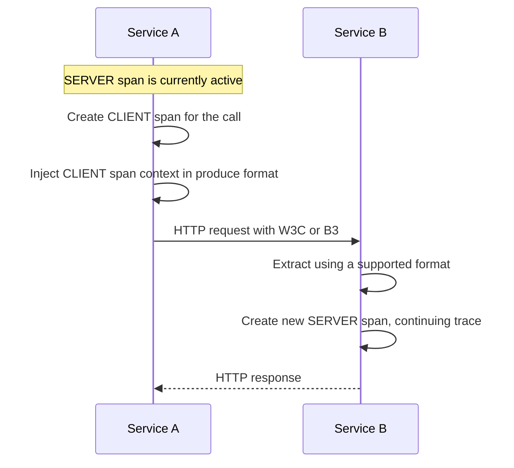

# Reading and Configuring W3C or B3 Context Propagation Formats

## 1. Why Do Two Services Still Create Two Traces When Both Have Tracing?

The orders service calls the inventory service. Both write logs with a trace ID and both send data to the same tracing system, yet a single purchase appears as two disconnected journeys.

One cause is that the two sides do not agree on the **context propagation format**: the sender writes W3C into HTTP headers, while the receiver only handles a different B3 configuration or lacks context-reading wiring.

Context propagation requires two operations:

- **Context injection (inject):** the sender writes the current context into a carrier, such as HTTP headers.
- **Context extraction (extract):** the receiver reads that information to continue the journey and create its own unit of work.

The library performing these two operations is called a **propagator**. The wire format must be understood by both sides, yet headers do not carry the entire span tree. [Role of propagators](https://opentelemetry.io/docs/specs/otel/context/api-propagators/).

This lesson focuses on reading headers, choosing Spring Boot **3.3.x** configuration, and verifying each boundary. Three names must be distinguished:

| Name | Role in This Lesson |
| --- | --- |
| W3C Trace Context | Context format using `traceparent` and `tracestate` |
| B3 | Format family with single-header `b3` or multi-header `X-B3-*` |
| OTLP or Zipkin API | Protocol for exporting span records to a receiver; a separate configuration axis |

Exporting data to Zipkin does not force every HTTP call to use B3. Using OpenTelemetry also does not automatically prove every service reads W3C properly. You must check the actual propagator configuration and HTTP client/server setup.

## 2. Reading W3C Trace Context

Example of an HTTP request carrying:

```http
GET /stock/SKU-8 HTTP/1.1
Host: inventory.internal
traceparent: 00-8a5e9c124fd3406ba271e8dcb3907f62-4a16c3f0e8b5927d-01
```

With version `00`, the `traceparent` string has four fields:

| Field | Example Value | How to Read It |
| --- | --- | --- |
| Version | `00` | Format version |
| Trace ID | `8a5e9c124fd3406ba271e8dcb3907f62` | 32 hex characters, journey identifier |
| Parent ID | `4a16c3f0e8b5927d` | 16 hex characters, sender unit-of-work identifier |
| Trace flags | `01` | Sampled bit is enabled |

IDs use lowercase hex; trace ID and parent ID must not be all zeros. Do not truncate a 32-character trace ID down to 16 characters to "make it look like B3." [W3C Trace Context format](https://www.w3.org/TR/trace-context/#traceparent-header).

### Parent ID Is Not the Receiver's New Span ID

If the call is measured by a CLIENT span with ID `4a16c3f0e8b5927d`, that value travels in the header. When inventory creates its own SERVER span, the expected outcome in this model is:

```text
traceId      = 8a5e9c124fd3406ba271e8dcb3907f62
spanId       = 5b27d4a1f9c6038e
parentSpanId = 4a16c3f0e8b5927d
```

The receiver span ID is an illustrative value, not a constant that must appear in every run. When inventory calls another service next, headers must be injected from the new call's context; do not copy the received header verbatim and keep the old parent ID for every hop.

### `tracestate` and Sampled Have Distinct Meanings

`tracestate` adds tracing-system-specific state. It does not replace `traceparent` and is not a place to put arbitrary passwords or business data. The `baggage` header is also a separate mechanism, not synonymous with `tracestate`.

The sampled flag supports data-recording decisions; `01` does not guarantee the exporter succeeded in sending. When reading flags, treat this as a bitfield; do not build a production handler by checking whether the string "differs from 00." Libraries must handle validity and versioning per the specification. [W3C flags and state](https://www.w3.org/TR/trace-context/).

## 3. Reading B3: Single-Header and Multi-Header

### 3.1. B3 Single-Header

The same trace ID and sender span ID can be represented as:

```http
b3: 8a5e9c124fd3406ba271e8dcb3907f62-4a16c3f0e8b5927d-1
```

The three fields in the example are:

```text
TraceId-SpanId-SamplingState
```

B3 has no leading `00` version field like `traceparent`. The sampling field is typically `1` to accept sampling and `0` to deny; omitting this field defers the decision. The value `d` represents debug and implies accepting sampling.

The specification also supports an optional trailing `ParentSpanId` field. Do not manually insert a `-` placeholder for an omitted field, and do not assume every B3 string must have exactly three parts.

### 3.2. B3 Multi-Header

Corresponding common form:

```http
X-B3-TraceId: 8a5e9c124fd3406ba271e8dcb3907f62
X-B3-SpanId: 4a16c3f0e8b5927d
X-B3-Sampled: 1
```

| Information | W3C | B3 Single-Header | B3 Multi-Header |
| --- | --- | --- | --- |
| Trace ID | Second field of `traceparent` | First field of `b3` | `X-B3-TraceId` |
| Sender span | Parent ID in `traceparent` | Second field of `b3` | `X-B3-SpanId` |
| Sampling | Sampled bit in flags | Sampling field | `X-B3-Sampled` |
| B3-specific debug | No direct one-to-one mapping | `d` | `X-B3-Flags: 1` |
| Trace ID length | 32 hex characters | 16 or 32 hex characters | 16 or 32 hex characters |

B3 also permits propagating only a sampling decision, such as `b3: 0`, without identifiers. That case does not supply a trace ID to continue; do not equate it with sending full identifiers with sampled equal to 0.

A missing header differs from an empty-valued header. For sampled, do not emit `true`/`false` instead of `1`/`0` merely because some implementation might accept legacy forms. When using debug in B3 multi, `X-B3-Flags: 1` already implies sampling acceptance. [B3 specification and HTTP forms](https://github.com/openzipkin/b3-propagation).

### 3.3. Do Not Confuse `X-B3-ParentSpanId` with the Receiver's New Parent

Some legacy B3 systems use a two-sided RPC model that shares span IDs; hence there is an `X-B3-ParentSpanId` field or an optional parent field in B3 single.

OpenTelemetry uses separate SERVER spans and does not reuse `X-B3-SpanId` as the new ID of the SERVER span; when injecting B3, it does not need to emit `X-B3-ParentSpanId`. The absence of that optional header does not mean the trace relationship is broken. [B3 requirements in OpenTelemetry](https://opentelemetry.io/docs/specs/otel/context/api-propagators/#b3-requirements).

In Boot 3.3's Brave configuration, shared span ID support is also off by default. Do not enable `management.tracing.brave.span-joining-supported` merely to make both sides' IDs identical when diagnosing a system that uses separate spans.

## 4. Recognizing a Format Does Not Mean Traces Are Linked Correctly

Typical flow with separate spans:



All four conditions must be checked:

1. The sender still has the right current context at outbound call time.
2. The HTTP client is wired with instrumentation and injects context.
3. Headers are not stripped or corrupted by a proxy, gateway, or middleware.
4. The receiver has a propagator that reads the format and creates spans under that context.

If context is lost when switching threads, changing W3C to B3 is unlikely to help. If the HTTP client lacks instrumentation configuration, a right `produce` property still does not automatically attach headers to arbitrary HTTP libraries.

HTTP header names are case-insensitive. If writing a custom adapter to read HTTP headers, do not use a case-sensitive `Map` and conclude `Traceparent` and `traceparent` are two different headers. [Requirements for the extract operation](https://opentelemetry.io/docs/specs/otel/context/api-propagators/#getter-argument).

## 5. Configuring Consume and Produce in Spring Boot 3.3

The three configuration values are:

| Value | Corresponding Emitted Form |
| --- | --- |
| `W3C` | `traceparent`, and `tracestate` when present |
| `B3` | Single `b3` header |
| `B3_MULTI` | `X-B3-*` headers |

`B3` and `B3_MULTI` distinctly select the emitted form. Reading both B3 variants may be combined by a single propagator; OpenTelemetry requires the B3 propagator to read both. Therefore, do not use `consume: [B3]` as a security boundary assuming it strictly rejects all B3 multi headers. [Spring Boot 3.3 Enum](https://docs.spring.io/spring-boot/3.3/api/java/org/springframework/boot/actuate/autoconfigure/tracing/TracingProperties.Propagation.PropagationType.html).

The properties:

- `management.tracing.propagation.consume`: context types read from incoming requests.
- `management.tracing.propagation.produce`: context types injected into outgoing requests.
- `management.tracing.propagation.type`: sets both together and overrides granular selections.

Boot 3.3 defaults to `consume=[W3C,B3,B3_MULTI]`, `produce=[W3C]`. Do not infer that receiving B3 makes outbound calls automatically emit B3 matching the incoming request. [Boot 3.3 propagation properties](https://docs.spring.io/spring-boot/3.3/appendix/application-properties/index.html).

The YAML snippets below are **mutually exclusive alternatives**; do not paste them all together into the same file.

### 5.1. Choosing W3C in Both Directions

```yaml
management:
  tracing:
    propagation:
      consume: [W3C]
      produce: [W3C]
```

Suitable when the contract between parties standardizes on W3C and B3 senders no longer need to be accepted on this path.

### 5.2. Emitting B3 Single-Header

```yaml
management:
  tracing:
    propagation:
      consume: [B3]
      produce: [B3]
```

When inspecting outbound requests, look for `b3`; do not look only for `X-B3-*` headers and conclude context is missing.

### 5.3. Emitting B3 Multi-Header

```yaml
management:
  tracing:
    propagation:
      consume: [B3_MULTI]
      produce: [B3_MULTI]
```

When inspecting outbound requests, look for `X-B3-TraceId`, `X-B3-SpanId`, and the corresponding sampling state.

### 5.4. Accepting Multiple Formats, Standardizing Output to W3C

```yaml
management:
  tracing:
    propagation:
      consume: [W3C, B3, B3_MULTI]
      produce: [W3C]
```

For example, a valid incoming B3 request is extracted into the application's context. The outbound call creates a new CLIENT span and writes W3C from the current context. This is not a header-renaming operation; the trace ID must remain continuous and the parent ID must describe the outbound call's span accurately.

### 5.5. Dual Emission During a Migration Period

```yaml
management:
  tracing:
    propagation:
      consume: [W3C, B3, B3_MULTI]
      produce: [W3C, B3_MULTI]
```

Use when targets still need two formats and compatibility has been verified. Both emitted formats must describe the same current context, not carry different trace IDs in each format.

Dual emission increases header count and adds collision risk if something copies old values. Once all sides have migrated, narrow down to a single unified format.

### 5.6. Be Careful with `type`

A unified setting:

```yaml
management:
  tracing:
    propagation:
      type: [W3C]
```

If another config source still sets `consume` or `produce`, `type` can make the effective result differ from what an operator reads in those two properties. When designing wide consume yet narrow produce, remove legacy `type` settings across related configuration sources and use the two granular properties.

Do not confuse raw-value getters on the properties class with the effective configuration: Boot's source code includes methods computing the effective lists, giving priority to `type` when set. [How Boot 3.3 resolves effective selections](https://github.com/spring-projects/spring-boot/blob/v3.3.13/spring-boot-project/spring-boot-actuator-autoconfigure/src/main/java/org/springframework/boot/actuate/autoconfigure/tracing/TracingProperties.java).

## 6. Configuration Must Be Paired with Appropriate Tracing and HTTP Client Components

The configurations above assume the application already has Actuator, an appropriate tracing bridge, and HTTP instrumentation. With OpenTelemetry, the tracing dependencies may include:

```groovy
// The project's dependencies section already manages versions with Spring Boot 3.3.x.
implementation 'org.springframework.boot:spring-boot-starter-actuator'
implementation 'io.micrometer:micrometer-tracing-bridge-otel'
```

This is not the complete build of a web application. Keep the project's appropriate web starter and export configuration. Do not add multiple bridges at once to try fixing header issues.

With `RestClient`, use the Boot-supplied builder, such as in this configuration class:

```java
import org.springframework.context.annotation.Bean;
import org.springframework.context.annotation.Configuration;
import org.springframework.web.client.RestClient;

@Configuration(proxyBeanMethods = false)
class InventoryHttpConfiguration {
    @Bean
    RestClient inventoryClient(RestClient.Builder builder) {
        return builder.baseUrl("http://localhost:8081").build();
    }
}
```

This is a class inside a Boot application, not a standalone Java program. Creating clients manually while bypassing the Boot-configured builder can lose automatic trace propagation. The same principle applies to `RestTemplateBuilder` and `WebClient.Builder`. [Propagating traces using Boot HTTP builders](https://docs.spring.io/spring-boot/3.3/reference/actuator/tracing.html#actuator.micrometer-tracing.propagating-traces).

Propagation configuration is also not a command that applies to any arbitrary HTTP library. If an agent is present or a custom propagator/SDK is declared, verify which configuration path actually owns header injection and extraction.

## 7. Java Demonstration: Loading Configuration with Boot's Real Binder

The program below verifies **default values and property binding**; it does not send HTTP requests and does not replace a networked propagator experiment. It uses the real configuration class rather than building custom enums or writing a custom header parser.

Place `PropagationConfigDemo.java` in `src/main/java/` of a standalone console project:

```java
import java.util.Map;
import org.springframework.boot.actuate.autoconfigure.tracing.TracingProperties;
import org.springframework.boot.context.properties.bind.Bindable;
import org.springframework.boot.context.properties.bind.Binder;
import org.springframework.boot.context.properties.source.MapConfigurationPropertySource;

public class PropagationConfigDemo {
    public static void main(String[] args) {
        TracingProperties defaults = new TracingProperties();
        System.out.println("default.consume="
                + defaults.getPropagation().getConsume());
        System.out.println("default.produce="
                + defaults.getPropagation().getProduce());

        Map<String, Object> values = Map.of(
                "management.tracing.propagation.consume",
                "W3C,B3,B3_MULTI",
                "management.tracing.propagation.produce",
                "B3_MULTI"
        );

        Binder binder = new Binder(new MapConfigurationPropertySource(values));
        TracingProperties configured = binder.bind(
                "management.tracing",
                Bindable.of(TracingProperties.class)
        ).get();

        System.out.println("configured.consume="
                + configured.getPropagation().getConsume());
        System.out.println("configured.produce="
                + configured.getPropagation().getProduce());
    }
}
```

Complete `build.gradle` for the console example:

```groovy
plugins {
    id 'application'
}

repositories {
    mavenCentral()
}

java {
    toolchain {
        languageVersion = JavaLanguageVersion.of(21)
    }
}

dependencies {
    implementation platform(
            'org.springframework.boot:spring-boot-dependencies:3.3.13')
    implementation 'org.springframework.boot:spring-boot'
    implementation 'org.springframework.boot:spring-boot-actuator-autoconfigure'
}

application {
    mainClass = 'PropagationConfigDemo'
}
```

With Gradle installed and JDK 21:

```shell
gradle -q run
```

If the project already has a Gradle wrapper, use the wrapper command instead of `gradle`. Do not run bare `javac` on this file because Boot APIs must be on the classpath.

Program stdout:

```text
default.consume=[W3C, B3, B3_MULTI]
default.produce=[W3C]
configured.consume=[W3C, B3, B3_MULTI]
configured.produce=[B3_MULTI]
```

String values are converted by `Binder` into enum lists. `consume` and `produce` are independent; accepting multiple formats on input does not make the output automatically emit all of those formats.

The example intentionally omits `type` so the two granular properties are not overridden by the unified setting. This result proves configuration data binding; it does not prove requests passed through an HTTP interceptor or that a server linked spans properly.

## 8. Inspecting Headers and Context of a Real Request

### 8.1. Diagnostic API for a Learning Environment

In a Spring Boot web application **that already has active tracing**, add the following class to inspect the current context and received tracing headers:

```java
import java.util.LinkedHashMap;
import java.util.List;
import java.util.Map;
import io.micrometer.tracing.Span;
import io.micrometer.tracing.Tracer;
import org.springframework.http.HttpHeaders;
import org.springframework.web.bind.annotation.GetMapping;
import org.springframework.web.bind.annotation.RequestHeader;
import org.springframework.web.bind.annotation.RestController;

@RestController
public class ContextProbeController {
    private final Tracer tracer;

    public ContextProbeController(Tracer tracer) {
        this.tracer = tracer;
    }

    @GetMapping("/context-probe")
    public Map<String, String> probe(@RequestHeader HttpHeaders headers) {
        Map<String, String> result = new LinkedHashMap<>();
        Span current = tracer.currentSpan();

        result.put("current.traceId",
                current == null ? "NONE" : current.context().traceId());
        result.put("current.spanId",
                current == null ? "NONE" : current.context().spanId());

        for (String name : List.of(
                "traceparent", "tracestate", "b3",
                "X-B3-TraceId", "X-B3-SpanId",
                "X-B3-Sampled", "X-B3-Flags")) {
            String value = headers.getFirst(name);
            if (value != null) {
                result.put(name, value);
            }
        }
        return result;
    }
}
```

This class must sit in a package scanned by the application and be saved with the exact filename `ContextProbeController.java`. It is an addition to the application, not run standalone with `java ContextProbeController.java`.

The API only returns the listed tracing fields, without echoing arbitrary user headers. Keep diagnostic tools in a learning environment or behind appropriate access controls.

Run the application on port 8080 and use the multi-format consume configuration from section 5.4.

### 8.2. Testing Each Format Separately

PowerShell with the `curl.exe` executable:

```powershell
curl.exe -sS -H "traceparent: 00-8a5e9c124fd3406ba271e8dcb3907f62-4a16c3f0e8b5927d-01" http://localhost:8080/context-probe
```

```powershell
curl.exe -sS -H "b3: 8a5e9c124fd3406ba271e8dcb3907f62-4a16c3f0e8b5927d-1" http://localhost:8080/context-probe
```

```powershell
curl.exe -sS -H "X-B3-TraceId: 8a5e9c124fd3406ba271e8dcb3907f62" -H "X-B3-SpanId: 4a16c3f0e8b5927d" -H "X-B3-Sampled: 1" http://localhost:8080/context-probe
```

On systems without PowerShell's alias, use `curl` instead of `curl.exe`.

With proper configuration and instrumentation, each individual test request should show:

- The sent header appears in the corresponding response fields.
- `current.traceId` continues trace ID `8a5e9c124fd3406ba271e8dcb3907f62`.
- `current.spanId` is the ID of the current receiving span; under the separate-span model, it does not equal the sender ID in the example.
- In exported span data, the SERVER span's parent links back to the sender's unit of work.

The illustrative headers intentionally use fixed IDs for easy comparison; do not generate IDs this way in a production application. The returned JSON has no fixed `current.spanId`. Do not write a fabricated JSON snippet as exact output for all runs.

### 8.3. Testing the Produce Side Separately

The three curl commands test **consume**, not `produce`. To test the produce side:

1. Prepare service B on port 8081 with a similar diagnostic API.
2. Have service A call B using a Boot-configured HTTP client.
3. Inspect the headers B actually receives, not only the headers curl sent to A.
4. Switch A's `produce` sequentially to W3C, B3, and B3 multi and restart the application.
5. Compare the A→B call's headers with the corresponding CLIENT span and the SERVER span at B.

The parent ID leaving A is typically the ID of the CLIENT span A created for the call, not necessarily the SERVER span ID A logged at request entry. Match the right span before concluding headers were altered incorrectly.

If B only echoes the header yet `current.traceId` differs, the data arrived without necessarily being extracted as context. If the context ID is right yet the trace store lacks spans, check sampling and the export pipeline as a separate issue.

## 9. When a Request Contains Multiple Header Sets

### B3 Single-Header and Multi-Header Appearing Together

The B3 specification gives precedence to the single-header form during extraction when both single and multi are present. If two sets carry different IDs, do not guess that every library picks whichever header you saw first in logs. In OpenTelemetry, B3 compatibility requirements also specify preferring single-header.

### W3C and B3 Appearing Together

There is no universal "W3C always beats B3" rule across all languages, bridges, and composite propagators. You must check the implementation, effective configuration, and tests in use.

During dual emission, let the same instrumentation mechanism generate both formats from **the same current context**. Avoid having a gateway keep an old W3C header while generating a fresh B3 header, or application code overwriting one header after the library injected it.

When diagnosing, send each format individually first. Combine them only after each path works; mixing them from the start makes it hard to tell which set is actually being read.

A proxy that merely forwards header bytes does not convert B3 into W3C. A translating service must extract the context and inject the target format via the proper mechanism; renaming `b3` to `traceparent` does not convert the structure.

## 10. Migrating W3C/B3 Without Breaking the Chain

A verifiable migration roadmap:

| Phase | Consume | Produce | What to Verify |
| --- | --- | --- | --- |
| Inventory | Record actual formats | Record actual formats | Legacy senders, proxies, and each party's libraries |
| Open compatibility on receiver | Support existing formats | Keep current output contract | Legacy requests still join traces properly |
| Switch senders | Keep consuming needed formats | Emit W3C, or intentional dual emission | Headers and span relationships across every hop |
| Narrow down | Drop legacy format once no source needs it | Unified format | No party still depends on the legacy format |

Depending on connected parties, pick the necessary phases and narrow emitted formats after the transition has been verified.

When encountering 64-bit B3 trace IDs, let the library handle representation compatibility with 128-bit formats; do not arbitrarily truncate, re-hash, or regenerate trace IDs at a gateway. Do not assume all metadata—especially debug flags or vendor-specific `tracestate` entries—has a one-to-one mapping across formats.

Check the modified boundary and subsequent hops: A consuming B3 and producing W3C may be fine, yet if C still only understands B3, the B→C chain still has a problem. Verify both consume and produce on every service.

## 11. Common Errors and How to Choose Evidence

| Observation | Possibility to Check | Useful Evidence |
| --- | --- | --- |
| `b3` present but no `X-B3-TraceId` | Emitting B3 single | Read `b3` header, check `produce` |
| B3 inbound yet W3C outbound | Two directions configured differently | `consume`, `produce`, and current context |
| Changed `produce` yet headers unchanged | `type` still set, overriding config source, custom propagator, or agent | Effective configuration and actual applied settings |
| No outbound headers despite right config | HTTP client bypassed instrumentation or context lost | How client was created and span at send time |
| Header arrives yet new trace ID starts | Format not read, invalid header, or intentional new trace | Header content and receiver-side current context |
| Same trace ID yet wrong parent relationship | Old header copied or wrong current span selected | Outbound CLIENT span ID and inbound SERVER span parent |
| Sampled equals 0 yet logs still have trace ID | Identifier exists for log correlation, not necessarily span recording/export | Sampling decision and actual receiver data |
| Zipkin looks empty so switched to B3 | Possibly confusing propagation with export | Check the two independent configuration axes |

Tracing headers are external input, not proof that a user is authenticated or authorized. The debug flag is also not a license to bypass traffic controls. Design trust boundaries and sampling policies according to the real environment.

Do not put secrets into `tracestate` or baggage "to make logs easier to find." When collecting diagnostic evidence, retain only fields needed for tracing and avoid logging complete header sets containing credentials.

## 12. Self-Check Practice

**Scenario 1:** An application accepts both W3C and B3 yet only has `produce: [W3C]`. If a valid B3 request enters, must the outbound request be B3?

**Explanation:** No. After extracting into context, the outbound direction uses the W3C selection. Maintain trace continuity and accurate span relationships, not the exact incoming header structure.

**Scenario 2:** `produce: [B3]` is set, yet a tester checks only for `X-B3-*` and reports missing headers. What step was missed?

**Explanation:** Check `b3`, because the `B3` option emits the single-header form. `B3_MULTI` is what emits the multi-header set.

**Scenario 3:** `consume: [W3C,B3,B3_MULTI]` and `produce: [B3_MULTI]` are set, while `type: [W3C]` is also present. How must the effective output be evaluated?

**Explanation:** In Boot 3.3, the unified `type` option takes precedence for both directions. Remove the unified setting if the goal is wide consume and narrow `B3_MULTI` produce.

**Scenario 4:** Trace IDs match between two services. Is that enough to conclude context propagation is complete?

**Explanation:** Not yet. Check distinct spans, the receiving span's parent, and the specific call's context. Matching IDs in logs do not prove the span tree is accurate or export succeeded.

**Scenario 5:** OpenTelemetry emits B3 multi without `X-B3-ParentSpanId`. Do you need to add it manually in application code?

**Explanation:** Not merely because this field is absent. Under the separate SERVER span model, sender info is in `X-B3-SpanId`; check actual relationships rather than mechanically applying legacy shared-span conventions.

When inspecting a request, identify the header format, understand which ID describes the sender, and then compare consume/produce settings against the spans actually created. That is the basis for fixing the exact boundary losing context.
