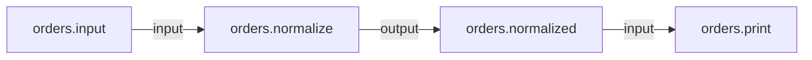

# Exploring Spring Integration Graphs with the integrationgraph Endpoint

An application receives messages through a channel, transforms data, and forwards them to the next handler. As the number of flows grows, reading individual Java classes no longer makes it clear how components are wired together in the initialized application. Spring Boot Actuator's `integrationgraph` endpoint provides a graph model of Spring Integration components to answer that question.

This article moves from understanding the graph, requirements for the endpoint to appear, and a runnable example, to reading the JSON and troubleshooting when the graph differs from expectations. The baseline is Spring Boot 3.3.x; the example pins Spring Boot 3.3.13, Spring Integration 6.3.11 managed by Boot, and JDK 21. Versions are pinned for reproducibility, not to imply these are the latest releases.

## 1. What Does integrationgraph Show?

Spring Integration builds processing flows around messages, channels, and processing components. Several terms to recognize:

- **Message:** carries the primary data, called the payload, along with headers.
- **Channel:** where messages are sent and received between components.
- **Handler:** performs work such as transforming, filtering, or invoking a business function.
- **Spring Integration Endpoint:** component connecting a handler or data source to message receiving/sending mechanics and lifecycle.
- **Node and link:** how the graph model represents the components above and their connections.

Distinguish two meanings of the word "endpoint": `/actuator/integrationgraph` is an HTTP management endpoint; an endpoint inside a Spring Integration flow is a message-processing component. These two concepts serve different roles.

Example of a string normalization flow:



The graph answers questions such as:

- Which channel is the transformer receiving messages from?
- Where is its output sent next?
- Is the final handler connected to the intended channel?
- Which error, discard, or routing branches are represented by the current model?

This is a view of the **wiring structure of the running application**. It is not a Java dependency graph, a list of all Spring beans, or a map of every service in the system. `beans` and `mappings` serve other purposes; nor can you use this graph to conclude a specific order passed through each node.

Spring Boot provides a starter to initialize Spring Integration infrastructure when auto-configuration conditions are met. There is no need to write a custom REST controller just to export the graph that Actuator already supports. [Spring Integration in Spring Boot 3.3](https://docs.spring.io/spring-boot/3.3/reference/messaging/spring-integration.html).

## 2. Requirements to Call the Endpoint

Check three layers of requirements separately.

### 2.1. Presence of the Graph-Building Component

The application must have Spring Integration libraries and initialized Integration infrastructure. Adding Actuator alone does not turn arbitrary Java code or every `@Service` into an Integration node.

In standard Spring Boot setups, `spring-boot-starter-integration` provides the needed dependencies. Actuator uses `IntegrationGraphServer` to obtain the graph model. When default configuration applies, Boot can create this bean if the application has not provided its own. Do not add a bean manually just because you see HTTP 404 without checking the remaining requirements.

### 2.2. Endpoint Enabled and Exposed over HTTP

In Spring Boot 3.3, enabling an endpoint and exposing an endpoint are two separate choices. By default, only `health` is exposed over HTTP; thus having the right dependencies is not enough to call `/actuator/integrationgraph`.

Minimal configuration relevant to this lesson:

```yaml
management:
  endpoint:
    integrationgraph:
      enabled: true
  endpoints:
    web:
      exposure:
        include: health,integrationgraph
```

`enabled: true` states the explicit intent to enable the endpoint; `include` selects endpoints provided over the web channel. If the effective configuration also has `exclude: integrationgraph`, the exclude list takes precedence. Check profiles, environment variables, and overriding configuration sources as well. [Endpoint enablement and exposure rules in Boot 3.3](https://docs.spring.io/spring-boot/3.3/reference/actuator/endpoints.html).

You do not need `include: "*"` to learn this endpoint. If the application changes the management port, context path, or Actuator base path, the actual URL changes too.

### 2.3. Caller Is Authorized

Exposure does not grant access permissions. When the application includes Spring Security, the caller must also satisfy active authentication and authorization policies.

The practice exercise below listens only on loopback and omits Spring Security to focus on observing the graph. Do not reuse that test configuration as-is to expose the endpoint on a network. Production policies are discussed separately at the end.

## 3. Two Operations: Reading and Rebuilding the Graph

| HTTP Request on Default Path | Effect | Success Response |
| --- | --- | --- |
| `GET /actuator/integrationgraph` | Retrieve the currently supplied graph model | `200 OK` and JSON |
| `POST /actuator/integrationgraph` | Request rebuilding the graph model | `204 No Content` |

`GET` uses the graph held by `IntegrationGraphServer`. `POST` invokes the rebuild mechanism, useful when the set of components has changed, such as when the application dynamically registers or removes a flow. After `POST`, call `GET` again to fetch the updated JSON; do not expect the graph payload inside the 204 response. [`integrationgraph` REST contract](https://docs.spring.io/spring-boot/api/rest/actuator/integrationgraph.html).

**Rebuilding the graph is not re-running the processing flow.** This request does not resend messages, does not create a new `IntegrationFlow`, does not reload `application.yml`, and is not a substitute for fixing application configuration. It refreshes the observation model from existing components.

Also distinguish connection structure from dynamic metrics. Data pulled from meters when reading the graph can change without rebuilding the entire structure. Do not design tooling that repeatedly calls `POST` every time it wants to see updated counters.

## 4. Reading the Three Main Sections in JSON

The response has three key sections: `contentDescriptor`, `nodes`, and `links`.

### 4.1. contentDescriptor: Information About the Model

| Common Field | How to Interpret |
| --- | --- |
| `provider` | Component supplying the model, here `spring-integration` |
| `providerVersion` | Spring Integration version supplying the data; not the Spring Boot version |
| `providerFormatVersion` | Graph format version |
| `name` | Application name if appropriately configured, such as `spring.application.name` |

Read this information before writing a parser or comparing two snapshots. Do not assume every version has the exact same set of fields and identical detail representation.

### 4.2. nodes: The Components

A node can provide:

- `nodeId`: identifier referenced by links within the same snapshot.
- `name`: component name, useful for matching against application configuration.
- `componentType`: implementation-level component type.
- `integrationPatternType`, `integrationPatternCategory`: integration pattern classification info.
- `input`, `output`: names of related channels when that node type has those properties.
- `properties` and additional fields: details depending on component type and management configuration.

Do not use element position in the `nodes` array as execution order. Do not assume the first element is the flow start or the last element is the final destination.

`nodeId` serves links within the current model. Across restarts, rebuilds, or component changes, do not treat this number as a durable business identifier. For long-term comparison, assign meaningful component names and compare both names and connection relationships.

Nor does one DSL call necessarily correspond to exactly one visible node. The framework can create intermediate channels or components; alongside custom flows, infrastructure components also exist. Auto-generated names and lambda class names can change between runs, so do not build parsers tightly coupled to them.

### 4.3. links: Directed Relationships

Each link uses `from` and `to` to reference `nodeId`, not array indices. The `type` field indicates the relationship role.

| Common type | How to Read |
| --- | --- |
| `input` | From channel to component consuming from that channel |
| `output` | From component producing output to output channel |
| `error` | Relationship to error channel when supported by component and known to model |
| `discard` | Relationship to channel receiving discarded messages when configured |
| `route` | Routing relationship to target channel |

Do not flip arrow direction just because you see the word `input`: resolve `from/to` to nodes and read from source to target. A graph can also have multiple branches, loops, and shared components; do not assume the entire model is a linear list.

Dynamic routing has its own limitations: targets known to the model do not necessarily represent every branch possible for every data value. The absence of a link is not enough to prove that branch is never taken. [Spring Integration 6.3 Integration Graph model](https://docs.spring.io/spring-integration/reference/6.3/graph.html).

## 5. Complete Example: Normalizing Then Printing Messages

The example creates a flow with four clearly named components:

```text
orders.input
  -> orders.normalize
  -> orders.normalized
  -> orders.print
```

Two sample strings are sent into the flow when the application starts. No extra business API is needed to publish messages in this article.

### 5.1. Project Structure

Create a new directory with the following files:

```text
integrationgraph-demo/
├── pom.xml
└── src/
    └── main/
        ├── java/
        │   └── example/
        │       └── IntegrationGraphDemoApplication.java
        └── resources/
            └── application.yml
```

Use installed JDK 21 and Maven. This is a standalone example; in an existing project, use the project's own dependency version management instead of mixing arbitrary Spring Integration versions.

### 5.2. pom.xml

```xml
<project xmlns="http://maven.apache.org/POM/4.0.0" xmlns:xsi="http://www.w3.org/2001/XMLSchema-instance" xsi:schemaLocation="http://maven.apache.org/POM/4.0.0 https://maven.apache.org/xsd/maven-4.0.0.xsd">
    <modelVersion>4.0.0</modelVersion>
    <parent>
        <groupId>org.springframework.boot</groupId>
        <artifactId>spring-boot-starter-parent</artifactId>
        <version>3.3.13</version>
        <relativePath/>
    </parent>
    <groupId>example</groupId>
    <artifactId>integrationgraph-demo</artifactId>
    <version>1.0.0</version>
    <properties>
        <java.version>21</java.version>
    </properties>
    <dependencies>
        <dependency>
            <groupId>org.springframework.boot</groupId>
            <artifactId>spring-boot-starter-web</artifactId>
        </dependency>
        <dependency>
            <groupId>org.springframework.boot</groupId>
            <artifactId>spring-boot-starter-actuator</artifactId>
        </dependency>
        <dependency>
            <groupId>org.springframework.boot</groupId>
            <artifactId>spring-boot-starter-integration</artifactId>
        </dependency>
    </dependencies>
    <build>
        <plugins>
            <plugin>
                <groupId>org.springframework.boot</groupId>
                <artifactId>spring-boot-maven-plugin</artifactId>
            </plugin>
        </plugins>
    </build>
</project>
```

The three starters have distinct roles: the web starter provides HTTP, the Actuator starter provides management endpoints, and the Integration starter provides message-flow infrastructure. You do not need to add the `spring-integration-http` module just to call this Actuator endpoint.

### 5.3. application.yml

```yaml
spring:
  application:
    name: integrationgraph-demo

server:
  address: 127.0.0.1
  port: 8098

management:
  endpoint:
    integrationgraph:
      enabled: true
  endpoints:
    web:
      exposure:
        include: health,integrationgraph
```

The application listens only on `127.0.0.1:8098`. The name `integrationgraph-demo` also helps identify the data in `contentDescriptor`. If the port is already in use, pick a free port and update the URLs in subsequent commands accordingly.

### 5.4. Java Code

Save at the exact path `src/main/java/example/IntegrationGraphDemoApplication.java`:

```java
package example;

import java.util.Locale;
import org.springframework.beans.factory.annotation.Qualifier;
import org.springframework.boot.ApplicationRunner;
import org.springframework.boot.SpringApplication;
import org.springframework.boot.autoconfigure.SpringBootApplication;
import org.springframework.context.annotation.Bean;
import org.springframework.integration.channel.DirectChannel;
import org.springframework.integration.dsl.IntegrationFlow;
import org.springframework.messaging.MessageChannel;
import org.springframework.messaging.support.MessageBuilder;

@SpringBootApplication
public class IntegrationGraphDemoApplication {
    public static void main(String[] args) {
        SpringApplication.run(IntegrationGraphDemoApplication.class, args);
    }

    @Bean(name = "orders.input")
    MessageChannel ordersInput() {
        return new DirectChannel();
    }

    @Bean
    IntegrationFlow ordersFlow(
            @Qualifier("orders.input") MessageChannel input) {
        return IntegrationFlow.from(input)
                .transformWith(spec -> spec
                        .transformer((String text) ->
                                text.trim().toUpperCase(Locale.ROOT))
                        .id("orders.normalize"))
                .channel("orders.normalized")
                .handle(message -> System.out.println(
                                "processed=" + message.getPayload()),
                        endpoint -> endpoint.id("orders.print"))
                .get();
    }

    @Bean
    ApplicationRunner sendSamples(
            @Qualifier("orders.input") MessageChannel input) {
        return args -> {
            input.send(MessageBuilder.withPayload("  java  ").build());
            input.send(MessageBuilder.withPayload(" spring ").build());
        };
    }
}
```

Following the code top to bottom:

1. `orders.input` is a `DirectChannel` explicitly declared as a bean.
2. `orders.normalize` trims leading/trailing whitespace and uppercases the string using `Locale.ROOT`.
3. `orders.normalized` is the intermediate channel registered by the Java DSL.
4. `orders.print` receives the normalized message and prints the payload.
5. `ApplicationRunner` sends two messages after the application context initializes.

`DirectChannel` dispatches messages directly to the handler on the sending thread in this configuration. No queue or async executor is added to the example; therefore the two send calls in the runner produce two results in the written order. [DirectChannel mechanics](https://docs.spring.io/spring-integration/reference/channel/implementations.html).

### 5.5. Compiling and Running

In the directory containing `pom.xml`:

```bash
mvn clean package
java -jar target/integrationgraph-demo-1.0.0.jar
```

This is an application with Spring dependencies, so it cannot be compiled with a bare `javac` command. Maven sets up the classpath, invokes the JDK compiler, and packages the JAR; `java -jar` runs the packaged application.

Aside from Spring Boot's startup logs, the program itself prints exactly:

```text
processed=JAVA
processed=SPRING
```

Those lines are proof the final handler received the sample data. Merely seeing four nodes in the graph would not be enough to prove that.

### 5.6. Fetching the Graph over HTTP

Keep the application running and open another terminal:

```bash
curl -i http://127.0.0.1:8098/actuator/integrationgraph
curl -fsS http://127.0.0.1:8098/actuator/integrationgraph -o integrationgraph.json
```

On Windows PowerShell, you can use `curl.exe` to invoke the real curl program. The first command checks HTTP status and headers; the second saves only the JSON payload to a file. Do not feed `curl -i` output containing headers directly into a JSON parser.

When configuration and permissions are proper, the read request returns `200 OK`. The JSON below is trimmed from the example's model: keeping only the flow's four nodes and three corresponding links, omitting other fields and infrastructure components. The `nodeId` numbers belong to one specific initialization, not constants guaranteed to appear on another machine.

```json
{
  "contentDescriptor": {
    "providerVersion": "6.3.11",
    "providerFormatVersion": 1.2,
    "provider": "spring-integration",
    "name": "integrationgraph-demo"
  },
  "nodes": [
    {
      "nodeId": 1,
      "name": "orders.input"
    },
    {
      "nodeId": 4,
      "name": "orders.normalized"
    },
    {
      "nodeId": 6,
      "name": "orders.normalize",
      "input": "orders.input",
      "output": "orders.normalized"
    },
    {
      "nodeId": 7,
      "name": "orders.print",
      "input": "orders.normalized"
    }
  ],
  "links": [
    {
      "from": 1,
      "to": 6,
      "type": "input"
    },
    {
      "from": 6,
      "to": 4,
      "type": "output"
    },
    {
      "from": 4,
      "to": 7,
      "type": "input"
    }
  ]
}
```

In the full response you may also see `errorChannel`, `nullChannel`, and `errorLogger`. Their presence does not mean the program just hit an error. They can simply be infrastructure registered by the framework.

How to read the three edges of the flow:

- `1 -> 6`, type `input`: the transformer receives from `orders.input`.
- `6 -> 4`, type `output`: the transformer sends results to `orders.normalized`.
- `4 -> 7`, type `input`: the printer consumes from `orders.normalized`.

If the numbers differ in your run, look up the `nodeId -> name` table within that same response. Names and relationships are what need to be cross-checked against flow configuration.

## 6. Resolving Nodes and Links Yourself

You do not need a drawing tool to understand the graph. A short program can resolve `from/to` to names and print readable edges.

The example below uses Python 3 and the standard library as a standalone JSON reader separate from the Java application. Save as `inspect_graph.py` next to `integrationgraph.json`:

```python
import json
import sys

with open(sys.argv[1], encoding="utf-8") as stream:
    graph = json.load(stream)

nodes = graph["nodes"]
by_id = {node["nodeId"]: node for node in nodes}
if len(by_id) != len(nodes):
    raise ValueError("Duplicate nodeId")

edges = []
for link in graph["links"]:
    source = by_id[link["from"]]["name"]
    target = by_id[link["to"]]["name"]
    if source.startswith("orders.") and target.startswith("orders."):
        edges.append((source, link["type"], target))

for source, kind, target in sorted(edges):
    print(f"{source} --{kind}--> {target}")
```

Run:

```bash
python inspect_graph.py integrationgraph.json
```

For the example's graph, stdout is:

```text
orders.input --input--> orders.normalize
orders.normalize --output--> orders.normalized
orders.normalized --input--> orders.print
```

The program builds a lookup table by `nodeId`, checks for duplicate identifiers, and only then pairs edges. If an edge references a node absent from the input data, the lookup raises an error instead of silently building a wrong diagram.

Output is sorted by name for easy comparison; that is the tool's presentation order, not an algorithm inferring execution sequence. The sample flow is linear so the three edges look like processing order, but do not apply that assumption to graphs with branches or loops.

A larger visualization tool still needs the same steps: read descriptor, index nodes, resolve edge references, then build layout. Tolerate unknown fields and new component types, and report clear errors for essential formatting issues rather than hard-coding dependencies on auto-generated class names.

## 7. When Do You Need to Rebuild the Graph?

For applications with only static flows initialized once, repeatedly requesting rebuilds is usually unnecessary. The scenario worth checking is when an application registers or unregisters components at runtime, such as via `IntegrationFlowContext`.

Procedure for observing structural changes:

1. Save the current graph snapshot.
2. Perform the flow change through the application's flow management mechanism.
3. Request the endpoint to rebuild the model.
4. Read again via `GET` and compare component names and relationships.

In the local example without Spring Security:

```bash
curl -i -X POST http://127.0.0.1:8098/actuator/integrationgraph
curl -fsS http://127.0.0.1:8098/actuator/integrationgraph -o integrationgraph-after.json
```

The first request succeeds with `204 No Content`. Because the example did not add or remove flows, you should not expect a new structure merely from sending `POST`.

`IntegrationGraphServer.getGraph()` returns the cached graph; `rebuild()` rebuilds and saves the model when components change. This is a model management API, not a business data control API. [IntegrationGraphServer API](https://docs.spring.io/spring-integration/api/org/springframework/integration/graph/IntegrationGraphServer.html).

When comparing two snapshots, do not diff raw JSON and conclude every difference is a flow change: element order, internal IDs, or timing values can differ. Normalize into named nodes and typed edges before comparing structure.

## 8. The Graph Does Not Replace Metrics, Traces, or Lifecycle Checks

A graph that looks right does not prove the entire flow is healthy. Know the limits of each kind of evidence.

| Question | Appropriate Evidence |
| --- | --- |
| Which channel is component A connected to? | Nodes and links from `integrationgraph` |
| Which steps did a specific message pass through? | Message history, correlated logs, or configured tracing |
| How are load levels and processing times changing? | Metrics collected over time |
| Is a handler running, stopped, or disconnected externally? | Lifecycle state and corresponding component checks |
| Is the output data business-correct? | Processing outputs and business verification checks |

In configurations with metrics support, the JSON can include `sendTimers`, `receiveCounters`, or extra info. Their presence and meaning depend on component type, version, and configured meters. Do not take a JSON example from another version as a promise that every node has the same fields.

In particular, `observed: false` does not mean "the node is not running" or "no messages arrived." It relates to the observation mechanism, not a general flag indicating whether the flow has processed data. In the example, the two `processed=...` lines prove data reached the destination; do not change your interpretation just because a node has `observed: false`.

Even when counters exist, do not assume every node records identically. Custom components and wrappers have different instrumentation support. To interpret a metric, first know where it measures and in what unit. Spring Boot uses Micrometer to integrate measurement systems; that is a complementary observation layer alongside the wiring graph. [Metrics in Boot 3.3](https://docs.spring.io/spring-boot/3.3/reference/actuator/metrics.html).

Similarly, a node still present in the model is not proof its internal endpoint is currently started. If you need lifecycle state exposed, configure or collect that information deliberately; do not infer it from node presence or a missing property.

## 9. Troubleshooting Common Cases

| Symptom | Helpful Checks |
| --- | --- |
| HTTP 404 on default path | Right port/path/profile; endpoint enabled and exposed; Integration libraries and infrastructure initialized |
| HTTP 401 or 403 | Identity, permissions, security filter chain; for `POST`, also check CSRF |
| `GET` works but `POST` fails | Management write permissions and CSRF; do not conclude the graph model is broken |
| Only infrastructure visible, custom flows missing | Is `IntegrationFlow` bean registered in the right context; is config in scan scope; are conditions/profiles excluding the flow |
| Many extra nodes beyond the four example names | Default components, intermediate channels, or other flows can appear; match node names and types |
| nodeId numbers differ from docs | Build lookup table from the current response; do not hard-code example constants |
| Graph appears not to reflect dynamic flow changes | Verify the change succeeded, trigger rebuild, then fetch fresh JSON; also check caches or proxies |
| Correct edges present but no processing output | Verify messages were sent, components are started, filters/routing, and execution errors; graph is only part of the evidence |
| Expected dynamic branch missing | Check routing mechanism and targets known to the model; do not infer all possibilities from one snapshot |

HTTP statuses can also be customized by security or proxies; the table above is a triage guide, not an absolute reverse-inference rule.

A common mistake is adding `@EnableIntegrationGraphController` to fix inability to reach Actuator. That annotation belongs to Spring Integration HTTP's graph controller mechanism, which is a different way of exposing an interface. It does not replace configuring the Actuator endpoint properly, and it can create an extra access path that must be secured. For this example, use `/actuator/integrationgraph` provided by Boot. [Integration Graph Controller](https://springframework.org/spring-integration/reference/6.3/http/int-graph-controller.html).

## 10. Exposing the Graph Under Control

The management graph can reveal channel names, processing step breakdowns, expressions, or component properties. Do not make it public just because the response does not directly contain a message's payload. If the application puts sensitive data into model properties or extensions, review those fields too.

In operational environments:

- Expose only endpoints actually needed; keep management paths within an appropriate network scope.
- Authenticate callers and grant permissions as needed. Viewing the graph and requesting a rebuild may need separate access control.
- Protect transport and storage of JSON snapshots; graph data is also internal information.
- With Spring Security, verify rules applying to Actuator. If you have a custom `SecurityFilterChain`, the application must ensure appropriate access rules itself.
- For `POST`, determine how to send CSRF tokens or configure policies for appropriate management clients. Do not disable CSRF application-wide just to make a curl command work.
- Avoid frequent rebuild requests on large graphs; management operations should align with specific structural update needs.

Once finished testing, stop the sample application with Ctrl+C. A sound way to use this endpoint is combining two layers of understanding: use the graph to confirm component relationships, then use execution evidence and appropriate metrics to verify the flow processes data as intended.
