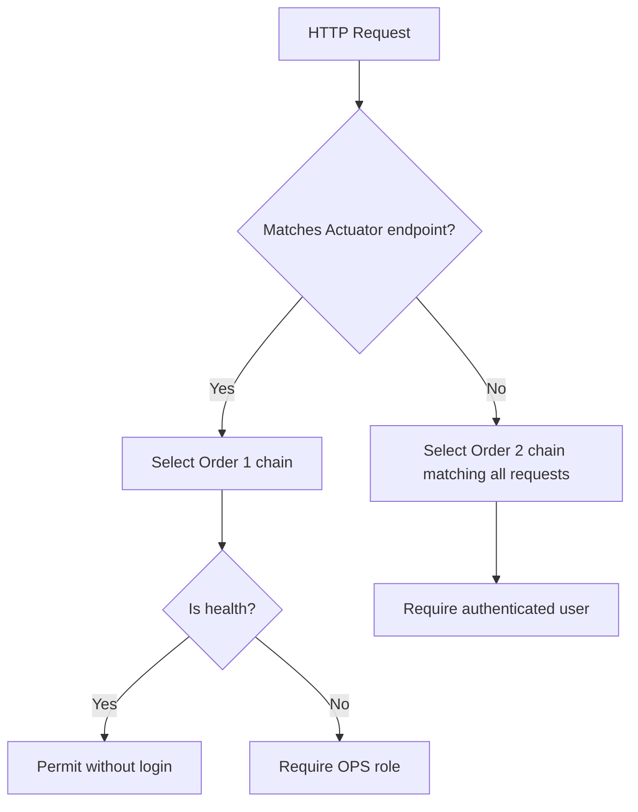

# Impact of a Custom SecurityFilterChain on Default Security Configuration

## 1. When Declaring a Custom Chain, What Responsibility Does the Application Assume?

A `SecurityFilterChain` is a Servlet security filter chain paired with a request-matching condition. Configuration typically takes an `HttpSecurity`, declares rules, and returns `http.build()` as a bean. Spring Security uses that chain to perform tasks such as authentication, authorization, CSRF protection, and adding security headers.

In an application with Actuator, what must be understood before modifying code is: **an application-provided `SecurityFilterChain` bean causes Spring Boot's corresponding default web security chain configuration to back off**. Boot does not keep a default chain around to protect URLs that your chain misses. The application must define the full scope and rules to be protected.

For example, writing a chain that only matches Actuator endpoints may protect `/actuator/info` as intended, while leaving `/api/ping` matched by no chain at all. Having added `spring-boot-starter-security` does not automatically fill this gap.

This article uses **Spring Boot 3.3.13, Java 21, and Spring MVC/Servlet**. That is a version baseline for reproducing behavior, not an announcement about the latest version. `SecurityFilterChain` and `HttpSecurity` in this article do not replace WebFlux's reactive security API.

## 2. What Does the Default Configuration Do Before a Custom Bean Exists?

With the Web, Actuator, and Security starters, no custom security chain declared, and no other replacement security mechanism, Boot provides a default configuration. In the typical scenario of this article:

- `health` can be accessed without login, while detail level depends on health configuration.
- Other exposed Actuator endpoints and business URLs require authentication.
- How unauthenticated responses behave may depend on content negotiation: browsers may be redirected to a login form, while API-style requests may receive `401` with HTTP Basic.

Do not confuse **exposing an endpoint** with **permitting access**. Boot 3.3 exposes only `health` over HTTP by default; to test `info` in this article, you must add it to `management.endpoints.web.exposure.include`. Security rules do not create endpoints that are not exposed. See [Boot 3.3: Actuator Security](https://docs.spring.io/spring-boot/3.3/reference/actuator/endpoints.html#actuator.endpoints.security).

Therefore, the statement “Actuator is secured by default” always needs context: which libraries are present, which beans have been declared, which endpoints exist, which profile is active, and which server receives the request.

## 3. Backing Off Does Not Mean Removing All of Spring Security

`ManagementWebSecurityAutoConfiguration` is responsible for configuring default security when Actuator participates in a Servlet application. It uses the `ConditionalOnDefaultWebSecurity` condition; when the application provides its own chain, this configuration backs off completely. This is a conditional configuration replacement mechanism, not appending default rules to the end of a custom chain.

The API documentation confirms this contract at [ManagementWebSecurityAutoConfiguration](https://docs.spring.io/spring-boot/3.3/api/java/org/springframework/boot/actuate/autoconfigure/security/servlet/ManagementWebSecurityAutoConfiguration.html) and [ConditionalOnDefaultWebSecurity](https://docs.spring.io/spring-boot/3.3/api/java/org/springframework/boot/autoconfigure/security/ConditionalOnDefaultWebSecurity.html).

Distinguish the following parts:

| Component/behavior | Effect when only adding a custom chain bean |
| --- | --- |
| Boot's default web chain, including the default Actuator policy | No longer provided by Boot as before; the application decides the new rules |
| Boot's auto-configured `UserDetailsService` | Not automatically disabled just by having a `SecurityFilterChain`; still depends on its own conditions |
| Authentication handling inside the chain, such as HTTP Basic or form login | Must be chosen and configured in the chain per application design |
| Default `HttpSecurity` mechanisms, such as CSRF | Does not mean automatically disabled; must inspect each chain's configuration |
| Exposing endpoints over HTTP | Still determined by exposure/enablement config and endpoint infrastructure |
| Method-level, network, or proxy security | Separate layers; cannot be inferred merely from having a chain bean |

In particular, `spring.security.user.name/password/roles` configures the user for the auto-configured mechanism when that mechanism is still active; these properties do not automatically create a chain covering the entire application. If you provide your own `UserDetailsService`, `AuthenticationProvider`, `AuthenticationManager`, or use another authentication mechanism, the default user creation conditions can also change. See [Boot 3.3: MVC Security](https://docs.spring.io/spring-boot/3.3/reference/web/spring-security.html#web.security.spring-mvc) and [UserDetailsServiceAutoConfiguration](https://docs.spring.io/spring-boot/3.3/api/java/org/springframework/boot/autoconfigure/security/servlet/UserDetailsServiceAutoConfiguration.html).

There is no need to exclude a long list of auto-configuration classes just to change access rules. Declare the proper beans and check actual configuration conditions; excluding entire security layers can alter many components beyond what you need.

## 4. Selecting a Chain and Selecting Rules Are Two Different Steps

### 4.1. `securityMatcher` Defines the Scope of the Chain

`http.securityMatcher(...)` answers: **which requests are handled by this chain?** For example, `EndpointRequest.toAnyEndpoint()` restricts the chain to the Actuator endpoint locations recognized by Boot.

`requestMatchers(...)` inside `authorizeHttpRequests(...)` answers: **for a request that has entered the chain, which permissions apply?** It does not automatically expand the chain beyond the scope selected by `securityMatcher`.

`anyRequest()` inside the authorization block means all remaining requests **within this chain**. If the chain only matches Actuator, `anyRequest().authenticated()` does not protect `/api/ping`.

### 4.2. Order Determines Which Chain Is Selected

`FilterChainProxy` evaluates chains in order; the first chain matching the request is used. With `@Order`, smaller values are evaluated first. If the first chain does not match, the next chain is evaluated; if it matched but denied authorization, execution does not fall through to a later chain to find a more permissive rule.

Rules from all matching chains are not combined. Authorization rules inside a single chain also need to be ordered from specific to general. `anyRequest()` is usually the last rule of the chain.

Flow of the two-chain approach in this article:



### 4.3. Matching No Chain Is a Different State From Being Denied

If none of the `securityMatcher`s match, the request is not protected by the filters of those Spring Security chains. It may still be blocked by the network tier, method security, or another layer; however, you cannot assume Boot's default web security chain will automatically appear to handle the remainder.

Therefore, if you want to protect the entire application, you usually need a final chain without a narrowing `securityMatcher`. This chain matches any request not selected by earlier chains. Its authorization rules still must be designed: require authentication, permit only certain routes, or deny everything else.

See [Spring Security: Multiple HttpSecurity and matcher scope](https://docs.spring.io/spring-security/reference/servlet/configuration/java.html#_multiple_httpsecurity_instances), along with [FilterChainProxy architecture](https://docs.spring.io/spring-security/reference/servlet/architecture.html#servlet-filterchainproxy).

## 5. Complete Experiment: Default, Under-Scoped, Then Full Protection

The following project is standalone from the module code being studied. It uses a small read API and a non-persisting POST operation to observe filters; it is not a production business API design pattern.

Three run modes use the same source and the same exposure:

| Mode | Profile | Chains declared by the application |
| --- | --- | --- |
| Default | No security profile enabled | None; Boot provides the default chain |
| Under-scoped | `actuator-only` | One chain matching only Actuator |
| Explicit full coverage | `explicit` | Actuator chain first, catch-all chain for the rest second |

Enable only one mode at a time. The `actuator-only` profile is **an intentional security-gap scenario for learning**, test on loopback only; do not use as a deployment configuration.

### 5.1. Project Structure

```text
security-chain-demo/
├── pom.xml
├── src/main/java/example/
│   ├── ChainDemoApplication.java
│   ├── PingController.java
│   ├── ActuatorOnlySecurity.java
│   └── ExplicitSecurity.java
└── src/main/resources/application.yml
```

Requires JDK 21, Maven 3.6.3 or newer, and ability to download dependencies on first run. Use `mvn -version` to check which Java Maven actually uses.

### 5.2. `pom.xml`

```xml
<project xmlns="http://maven.apache.org/POM/4.0.0"
         xmlns:xsi="http://www.w3.org/2001/XMLSchema-instance"
         xsi:schemaLocation="http://maven.apache.org/POM/4.0.0 https://maven.apache.org/xsd/maven-4.0.0.xsd">
  <modelVersion>4.0.0</modelVersion>
  <parent>
    <groupId>org.springframework.boot</groupId>
    <artifactId>spring-boot-starter-parent</artifactId>
    <version>3.3.13</version>
    <relativePath/>
  </parent>
  <groupId>example</groupId>
  <artifactId>security-chain-demo</artifactId>
  <version>1.0.0</version>
  <properties>
    <java.version>21</java.version>
  </properties>
  <dependencies>
    <dependency>
      <groupId>org.springframework.boot</groupId>
      <artifactId>spring-boot-starter-web</artifactId>
    </dependency>
    <dependency>
      <groupId>org.springframework.boot</groupId>
      <artifactId>spring-boot-starter-actuator</artifactId>
    </dependency>
    <dependency>
      <groupId>org.springframework.boot</groupId>
      <artifactId>spring-boot-starter-security</artifactId>
    </dependency>
  </dependencies>
  <build>
    <plugins>
      <plugin>
        <groupId>org.springframework.boot</groupId>
        <artifactId>spring-boot-maven-plugin</artifactId>
      </plugin>
    </plugins>
  </build>
</project>
```

The Security starter is chosen here to compare whether Boot provides a chain or not; do not add OAuth2 or other security libraries that change the experiment conditions.

### 5.3. `src/main/java/example/ChainDemoApplication.java`

```java
package example;

import org.springframework.boot.SpringApplication;
import org.springframework.boot.autoconfigure.SpringBootApplication;

@SpringBootApplication
public class ChainDemoApplication {
    public static void main(String[] args) {
        SpringApplication.run(ChainDemoApplication.class, args);
    }
}
```

Configuration classes and controllers reside in the package scanned by `@SpringBootApplication`. Merely writing a method returning `SecurityFilterChain` without registering a bean or bringing the class into the Spring context will not produce the effect being investigated.

### 5.4. `src/main/java/example/PingController.java`

```java
package example;

import org.springframework.web.bind.annotation.GetMapping;
import org.springframework.web.bind.annotation.PostMapping;
import org.springframework.web.bind.annotation.RestController;

@RestController
public class PingController {
    @GetMapping("/api/ping")
    public String ping() {
        return "pong";
    }

    @PostMapping("/api/ping")
    public String accept() {
        return "accepted";
    }
}
```

`GET` returns `pong`; `POST` only returns `accepted` without persisting state. They create a target outside Actuator to clearly show whether the chain missed or covered the API. The API returning success without login in the misconfigured profile does not mean that is the desired permission.

### 5.5. `src/main/resources/application.yml`

```yaml
server:
  address: 127.0.0.1
  port: 8080

spring:
  security:
    user:
      name: observer
      password: ${LAB_PASSWORD}
      roles: OPS

management:
  endpoints:
    web:
      exposure:
        include:
          - health
          - info
  endpoint:
    health:
      show-details: never
  info:
    env:
      enabled: true

info:
  lesson:
    topic: security-filter-chain
```

The lab account is `observer`, role `OPS`; the password is taken from the environment variable `LAB_PASSWORD`. This article does not define a custom `UserDetailsService`, so Boot's user source is still used in all three modes when other conditions remain unchanged.

Only expose `health` and `info`, do not open all endpoints. `management.info.env.enabled: true` allows the contributor to read `info.*` properties from the configuration environment; the data here is just a lab label. This configuration does not grant read permission for `info` to callers.

### 5.6. `src/main/java/example/ActuatorOnlySecurity.java`

```java
package example;

import org.springframework.boot.actuate.autoconfigure.security.servlet.EndpointRequest;
import org.springframework.context.annotation.Bean;
import org.springframework.context.annotation.Configuration;
import org.springframework.context.annotation.Profile;
import org.springframework.security.config.Customizer;
import org.springframework.security.config.annotation.web.builders.HttpSecurity;
import org.springframework.security.web.SecurityFilterChain;

@Configuration(proxyBeanMethods = false)
@Profile("actuator-only")
public class ActuatorOnlySecurity {
    @Bean
    SecurityFilterChain actuatorOnly(HttpSecurity http) throws Exception {
        http.securityMatcher(EndpointRequest.toAnyEndpoint());
        http.authorizeHttpRequests(access -> access
                .requestMatchers(EndpointRequest.to("health")).permitAll()
                .anyRequest().hasRole("OPS"));
        http.httpBasic(Customizer.withDefaults());
        return http.build();
    }
}
```

The design flaw lies in **the uncovered scope**, not in the `hasRole("OPS")` expression: the chain only matches Actuator and no chain matches the business API. This bean is already enough for the default chain configuration to back off. Therefore `/api/ping` is not protected merely because `.anyRequest().hasRole("OPS")` appears in the code.

Inside the Actuator chain, `health` is explicitly permitted. The remaining endpoints, including the Actuator links page when present, require role `OPS`. `hasRole("OPS")` corresponds to authority `ROLE_OPS`; do not change YAML to `roles: ROLE_OPS` just to make the two string literals look identical.

`EndpointRequest` uses the endpoint locations managed by Boot, instead of hardcoding `/actuator/**`. `toAnyEndpoint()` also matches the links page at the base path; a dedicated API exists to customize the links page if needed. See [Boot 3.3 EndpointRequest](https://docs.spring.io/spring-boot/3.3/api/java/org/springframework/boot/actuate/autoconfigure/security/servlet/EndpointRequest.html).

### 5.7. `src/main/java/example/ExplicitSecurity.java`

```java
package example;

import org.springframework.boot.actuate.autoconfigure.security.servlet.EndpointRequest;
import org.springframework.context.annotation.Bean;
import org.springframework.context.annotation.Configuration;
import org.springframework.context.annotation.Profile;
import org.springframework.core.annotation.Order;
import org.springframework.security.config.Customizer;
import org.springframework.security.config.annotation.web.builders.HttpSecurity;
import org.springframework.security.web.SecurityFilterChain;

@Configuration(proxyBeanMethods = false)
@Profile("explicit")
public class ExplicitSecurity {
    @Bean
    @Order(1)
    SecurityFilterChain actuatorRules(HttpSecurity http) throws Exception {
        http.securityMatcher(EndpointRequest.toAnyEndpoint());
        http.authorizeHttpRequests(access -> access
                .requestMatchers(EndpointRequest.to("health")).permitAll()
                .anyRequest().hasRole("OPS"));
        http.httpBasic(Customizer.withDefaults());
        return http.build();
    }

    @Bean
    @Order(2)
    SecurityFilterChain applicationRules(HttpSecurity http) throws Exception {
        http.authorizeHttpRequests(access -> access
                .anyRequest().authenticated());
        http.httpBasic(Customizer.withDefaults());
        return http.build();
    }
}
```

The `actuatorRules` chain is evaluated first due to `@Order(1)`. For Actuator requests, only that chain decides permissions. If the user is logged in but lacks `OPS`, the response is denied; execution does not fall through to `applicationRules` to use the authenticated-only rule.

The `applicationRules` chain does not set a `securityMatcher`, so it receives requests not selected by earlier chains. `anyRequest().authenticated()` protects the remainder, including the test API. This is the article's choice; a real system may need specific rules followed by `anyRequest().denyAll()` depending on design.

Both chains declare HTTP Basic so requests within their respective scopes have an authentication mechanism. The article does not declare form login, and does not ask Boot to auto-generate a default form as before. There is no line disabling CSRF, so `POST` in a protected chain still needs a valid CSRF token when default configuration requires it.

The numbers `1` and `2` only express relative order within this project. When integrating into a system that already has multiple chains, you must consider all other chains and matchers that might overlap them.

## 6. Run and Compare Using HTTP Requests

At the lab project root, open PowerShell and set a temporary password for the test session without writing it to a file:

```powershell
$secureLabPassword = Read-Host 'Password for observer' -AsSecureString
$env:LAB_PASSWORD = [System.Net.NetworkCredential]::new('', $secureLabPassword).Password
mvn -q -DskipTests package
```

Only run the application after Maven packages successfully. The example needs Spring libraries, so do not use standalone `javac` instead of dependency resolution. Keep this terminal open so the environment variable remains passed to the Java process.

### 6.1. Default Mode

Ensure no `SPRING_PROFILES_ACTIVE` or external configuration is enabling `actuator-only`/`explicit`. Start:

```powershell
java -jar target/security-chain-demo-1.0.0.jar
```

In another terminal, use `curl.exe` on Windows to avoid PowerShell alias confusion. Setting `Accept: application/json` keeps unauthenticated tests from being confused with redirects to a login form:

```powershell
curl.exe -i -H "Accept: application/json" "http://127.0.0.1:8080/actuator/health"
curl.exe -i -H "Accept: application/json" "http://127.0.0.1:8080/actuator/info"
curl.exe -i -H "Accept: application/json" "http://127.0.0.1:8080/api/ping"
```

When the application is healthy: `health` returns `200` with `{"status":"UP"}`, while `info` and the API return `401`. Test the authenticated API:

```powershell
curl.exe -i --user observer -H "Accept: application/json" "http://127.0.0.1:8080/api/ping"
```

`curl` prompts for the password; enter the value you set. When valid, the status is `200`, and the body is `pong`. This is the controller's HTTP response data, not the full application startup stdout.

### 6.2. Actuator-Only Chain Mode

Stop the previous process with `Ctrl+C`, then in the terminal holding the `LAB_PASSWORD` variable run:

```powershell
java -jar target/security-chain-demo-1.0.0.jar --spring.profiles.active=actuator-only
```

Re-run the commands without `--user`. `health` is still `200`, `info` is still `401`, but the `/api/ping` API now returns **`200` and `pong` without logging in**. This is the key demonstration: testing only Actuator will miss the exposed API gap.

Also test POST without a password or CSRF token:

```powershell
curl.exe -i -X POST "http://127.0.0.1:8080/api/ping"
```

In the misconfigured mode, the controller returns `200` and `accepted`: the request did not pass through any matching chain, so the authentication/authorization/CSRF filters of the Actuator chain do not apply to that API.

### 6.3. Explicit Full-Coverage Mode

Stop the application and run:

```powershell
java -jar target/security-chain-demo-1.0.0.jar --spring.profiles.active=explicit
```

The unauthenticated API returns `401` again. With valid Basic auth, the API returns `200` and `pong`; `info` also returns `200` with the `OPS` account. The `info` body matches the configured data:

```json
{
  "lesson": {
    "topic": "security-filter-chain"
  }
}
```

JSON line formatting may differ; the keys and values are what to compare. To view the raw `info` response:

```powershell
curl.exe -i --user observer -H "Accept: application/json" "http://127.0.0.1:8080/actuator/info"
```

### 6.4. Valid Login But Missing Role

Stop the application, change the lab user's role to `USER` via startup argument without editing source code:

```powershell
java -jar target/security-chain-demo-1.0.0.jar --spring.profiles.active=explicit --spring.security.user.roles=USER
```

Still using the same username/password, call the two paths:

```powershell
curl.exe -i --user observer -H "Accept: application/json" "http://127.0.0.1:8080/actuator/info"
curl.exe -i --user observer -H "Accept: application/json" "http://127.0.0.1:8080/api/ping"
```

`info` returns **`403`**, and the API returns **`200`**. The user is authenticated but lacks `OPS`, so the Actuator chain denies access. The `authenticated()` rule in the final chain does not weaken the role requirement of the first chain.

After the test session, stop the application. In the terminal where the password was set, you can run `Remove-Item Env:LAB_PASSWORD` to clear that session's environment variable. HTTP Basic is only suitable for this loopback experiment; when transmitting credentials over a network, you must use HTTPS and proper identity management.

## 7. Before-and-After Matrix to Detect Deviations

The table below uses the `OPS` account from YAML, except for the row explicitly noting `USER`. Application health status and exposure remain unchanged:

| Test | Boot default | Actuator chain only | Two `explicit` chains |
| --- | --- | --- | --- |
| `GET health`, unauthenticated | `200` | `200` due to explicit `permitAll` | `200` due to explicit `permitAll` |
| `GET info`, unauthenticated, expecting JSON | `401` | `401` | `401` |
| `GET /api/ping`, unauthenticated, expecting JSON | `401` | **`200` — missed** | `401` |
| `GET info`, valid Basic with `OPS` | `200` | `200` | `200` |
| `GET /api/ping`, valid Basic | `200` | `200`, does not prove filters ran | `200` |
| `POST /api/ping`, unauthenticated/no token | CSRF-protected, typically `403` | **`200` — no matching chain** | CSRF-protected, `403` |

Separate test with profile `explicit` and role `USER`: `GET info` with valid Basic must return `403`, while the read API with valid Basic still returns `200`. That verifies the right chain matched the request and permissions did not leak across chains.

`health` is public in the two custom configurations because the article explicitly wrote a permit rule. If you replace the authorization rules with `anyRequest().authenticated()` and drop the `health` exception, you also change health behavior; the default exception is not automatically inherited.

## 8. CSRF, `permitAll`, and Authentication Mechanisms After Replacing the Chain

### 8.1. Having a Custom Chain Does Not Mean CSRF Is Disabled

In profile `explicit`, sending valid Basic auth to `POST /api/ping` without a CSRF token is still rejected:

```powershell
curl.exe -i -X POST --user observer "http://127.0.0.1:8080/api/ping"
```

The expected result is `403`. Do not conclude the password is wrong from this code alone. With this article's `HttpSecurity`, CSRF still protects unsafe methods; when write operations are needed in a real application, you must supply the corresponding token/mechanism or design an appropriate CSRF policy. Do not disable CSRF globally just to make one test command succeed. See [Spring Security: CSRF](https://docs.spring.io/spring-security/reference/servlet/exploits/csrf.html).

In particular, these two cases differ: a request entering a chain with `permitAll`, and a request matching no chain. `permitAll` only passes the corresponding authorization step; other filters such as CSRF can still apply. Do not treat it as another name for bypassing all of Spring Security.

### 8.2. An Existing Password Does Not Prove URLs Are Protected

In profile `actuator-only`, Boot's user source can still authenticate calls to `info`, while the unmatched API does not even need to consult that user source. Therefore, seeing the default user log, having a `UserDetailsService` bean, or being able to set `spring.security.user.password` is not enough to prove every URL requires login.

If you choose HTTP Basic, form login, OAuth2 Resource Server, or another mechanism, make sure the corresponding authentication filter is actually present in the chain handling the request. For example, calling only `.authorizeHttpRequests(...)` does not mean Boot will automatically reattach the default form login/HTTP Basic configuration to your custom chain.

## 9. Inspecting Actual Configuration Instead of Looking at One Java File

### 9.1. Seeing Which Bean Caused the Default Configuration to Back Off

On a development machine, run with the condition report:

```powershell
java -jar target/security-chain-demo-1.0.0.jar --spring.profiles.active=explicit --debug
```

Compare the condition section of `ManagementWebSecurityAutoConfiguration` and the default web security configuration with the `actuatorRules` and `applicationRules` beans. Nested class names/message details can vary between patch releases; what must be proved is that the condition is no longer satisfied because the application provided a chain.

`--debug` is Boot's tool for inspecting auto-configuration, described in [Boot: Replacing Auto-configuration Selectively](https://docs.spring.io/spring-boot/3.3/reference/using/auto-configuration.html#using.auto-configuration.replacing-auto-configuration). Do not expose the `conditions` endpoint over the network just to obtain the same diagnostic information.

### 9.2. Seeing Which Chain Actually Handles a Request

You can temporarily enable TRACE for the chain selector in a development environment:

```powershell
java -jar target/security-chain-demo-1.0.0.jar --spring.profiles.active=explicit --logging.level.org.springframework.security.web.FilterChainProxy=TRACE
```

Observe the matcher and chain tried when calling `info` or the API. Do not include Basic headers, cookies, tokens, or log screenshots containing credentials in shared documentation. Turn off verbose logging after diagnosing.

In Spring MVC tests, keep security filters enabled when using `MockMvc`. Configurations that disable filters such as `addFilters = false` can make an API return `200` and create the illusion that security is correct, even though the test never passed through the chain.

### 9.3. When Changing Base Path or Separating the Management Port

If you change `management.endpoints.web.base-path`, you must call the new URL and verify the matcher works properly. `EndpointRequest` relies on endpoint locations provided by Boot; chains hardcoded to `/actuator/**` can break when the path changes. It does not automatically expose endpoints that have no HTTP mapping.

This lab uses a shared web and management port. When separating `management.server.port`, you must verify the actual management server/context, which chain is active there, and the business routes as well. Do not assume that one bean in one context properly secures every port; bean scanning and context boundaries must be verified with real requests or corresponding tests.

## 10. Mistakes to Spot When Reviewing a New Chain

| Mistake | Consequence or symptom | How to check/fix |
| --- | --- | --- |
| Assuming a custom chain only adds an exception to the default | Fails to declare complete Actuator/API policies | Re-list all chains and scopes after the bean is created |
| Matching only Actuator while believing `anyRequest()` covers the entire app | API may return `200` without login | Add a final catch-all chain and test a non-Actuator URL |
| A catch-all chain is evaluated before the Actuator chain | Actuator rules are shadowed by the general chain | Place the specific chain first; check all relevant `@Order` annotations |
| Overlapping chains without clear ordering | Actual rules are hard to predict during maintenance | Define explicit order and test routes in the overlap |
| Thinking denial in the first chain continues to the next chain | Misinterprets `403`, tries adding rules in an unselected chain | Check the first matching chain and fix rules right there |
| Omitting the `health` exception while expecting it to stay public | Probes may receive `401` or a login redirect | Explicitly declare health policy and test probes |
| Using `anyRequest().permitAll()` on a chain matching all URLs | Exposed Actuator endpoints may be readable without login | Narrow permissions as needed, test sensitive exposed endpoints |
| Interpreting every `403` as a missing role | Misses CSRF or another layer as the cause | Distinguish GET/POST, identity, and the rejecting filter |
| Having a default password and assuming all URLs are protected | Misses routes not matching any chain | Verify scope independently of the user source |
| Testing only controllers with filters disabled | Does not prove access policies | Run integration tests with filters enabled and negative test cases |

Do not rely on the number of chain beans to judge safety. A single chain can cover the entire application; multiple chains can still miss URLs or shadow each other. What must be evaluated are **scope, order, rules, authentication mechanism, and actual results**.

## 11. Practice Exercises and Self-Check Questions

1. Run all three modes. Record the unauthenticated results of `health`, `info`, and the API. Explain why testing only `health`/`info` will not catch the gap in `actuator-only` mode.
2. In the `explicit` lab setup, temporarily change the `health` rule to require authentication. Confirm that the default configuration does not automatically restore public access for it.
3. Run profile `explicit` with a user having role `USER`. Explain why the API is still readable after login while `info` returns `403`, even though there is a later chain only requiring `authenticated()`.
4. Compare POST in both `actuator-only` and `explicit` profiles. Point out the difference between being protected by no chain and being protected by a chain while missing a CSRF token.
5. On a copy of the lab, try placing the catch-all chain before the Actuator chain, then test a `USER` user's permission on `info`. Restore the correct order after the test and explain why the role rule was shadowed.
6. List the layers that must be re-verified when changing the base path or management port, rather than concluding from a single `/actuator/health` URL.

Being able to answer three core questions yourself: which auto-configuration a custom bean causes to back off; which chain selects each request; and who protects the remaining requests. That is the foundation for customizing Actuator security without unintentionally altering access permissions elsewhere.