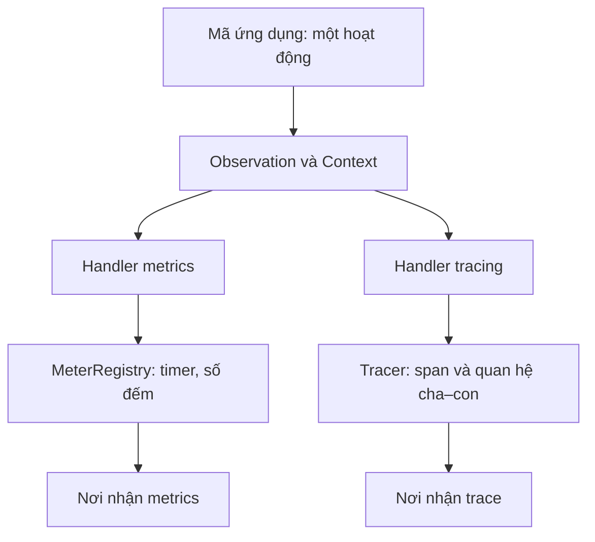

# Observation kết nối phép đo metrics và trace như thế nào

## 1. Một lần đặt điểm quan sát, hai cách nhìn về cùng hoạt động

Giả sử người dùng báo rằng bước xử lý thanh toán chậm. Số liệu đo (metrics) giúp trả lời: bao nhiêu lượt xử lý, tổng thời gian là bao nhiêu, phân bố độ trễ thay đổi ra sao. Dấu vết thực thi (trace) giúp trả lời: một lượt cụ thể đã đi qua những bước nào, bước nào là con của bước nào, thời gian đã nằm ở đâu.

Hai góc nhìn cần cùng hiểu ranh giới của hoạt động được đo. Nếu viết một bộ mã bấm giờ cho metrics rồi viết thêm một bộ mã tạo span cho trace, rất dễ đặt hai ranh giới khác nhau hoặc bỏ sót đường lỗi. Micrometer Observation cung cấp một vòng đời chung để các bộ xử lý (handler) phản ứng và tạo dữ liệu theo mục đích riêng. [Nguồn: Micrometer — Observation Introduction](https://docs.micrometer.io/micrometer/reference/observation/introduction.html).

Điểm kết nối nằm ở **cùng một hoạt động quan sát, cùng ngữ cảnh và cùng các sự kiện vòng đời**. Metrics không được biến đổi thành trace; trace cũng không phải nguyên liệu bắt buộc để có metrics.

Bài này dùng bối cảnh Spring Boot 3.3.x, Micrometer 1.13.x và Micrometer Tracing 1.3.x. Phần thực hành cố định phiên bản để thấy trực tiếp timer, span, nhãn và ngữ cảnh; không cần chạy hệ thống giám sát bên ngoài.

### Các khái niệm cần phân biệt

| Thành phần | Vai trò |
| --- | --- |
| `Observation` | Biểu diễn một lần quan sát hoạt động: bắt đầu, lỗi nếu có, các sự kiện và kết thúc |
| `ObservationRegistry` | Giữ cấu hình quan sát: handler, điều kiện, quy ước đặt tên và các bộ lọc |
| `Observation.Context` | Mang dữ liệu của lần quan sát, được chia sẻ giữa các handler |
| `MeterRegistry` | Quản lý meter để ghi số đếm, thời gian và các phép đo khác |
| `Tracer` | Tạo và quản lý span cùng ngữ cảnh trace thông qua Micrometer Tracing |
| Span | Một đoạn thực thi trong trace, có mã định danh, thời gian và dữ liệu mô tả |
| Scope | Phạm vi làm cho observation/span trở thành ngữ cảnh hiện tại trong đoạn thực thi |

`ObservationRegistry` và `MeterRegistry` là hai kiểu khác nhau. Việc một handler sử dụng `MeterRegistry` không làm chúng trở thành một registry duy nhất.

## 2. Dòng dữ liệu: tách nhánh từ Observation



Handler metrics và handler tracing cùng được gọi khi ngữ cảnh phù hợp. Nhánh metrics dùng vòng đời để đo thời gian, cập nhật meter. Nhánh tracing dùng vòng đời để tạo span, đưa span vào scope, ghi lỗi/sự kiện và kết thúc span. Đó là cách Observation tách mã đặt điểm quan sát khỏi cách lưu và gửi từng loại dữ liệu. [Nguồn: Micrometer Tracing — Configuring with Micrometer Observation](https://docs.micrometer.io/tracing/reference/configuring.html).

Không phải cứ tạo đối tượng `Observation` là chắc chắn xuất hiện cả timer lẫn trace. Phải có handler, registry/tracer và cấu hình phù hợp. Một registry quan sát mới tạo mà chưa có handler xử lý không tự sinh các tín hiệu hữu ích; nó có thể trả về observation không thực hiện ghi nhận (no-op).

Trong một ứng dụng, có thể chỉ bật metrics; khi bổ sung tracing đúng cách, cùng điểm quan sát có thể cung cấp thêm span. Tuy nhiên, những phép đo khác như gauge bộ nhớ JVM không nhất thiết bắt nguồn từ một Observation nghiệp vụ. Không suy ngược rằng mọi metric đều phải có span tương ứng.

## 3. Vòng đời chung được hai nhánh sử dụng ra sao?

### 3.1. Bắt đầu và kết thúc

Mẫu thuận tiện cho mã đồng bộ là:

```java
Observation.createNotStarted("checkout.process", observationRegistry)
    .lowCardinalityKeyValue("channel", "web")
    .highCardinalityKeyValue("order.id", orderId)
    .observe(() -> processCheckout(orderId));
```

Đây là đoạn minh họa trong phương thức của ứng dụng: `observationRegistry` đã được cấp, `orderId` là đầu vào, `processCheckout` là thao tác cần quan sát. Nó không phải chương trình Java độc lập; chương trình đầy đủ nằm ở phần thực hành.

`observe(...)` quản lý bắt đầu, mở scope, chạy tác vụ, ghi nhận lỗi nếu tác vụ ném lỗi, đóng scope và kết thúc observation. [Nguồn: Micrometer — Observation Introduction](https://docs.micrometer.io/micrometer/reference/observation/introduction.html).

| Thời điểm | Nhánh metrics thường làm gì? | Nhánh tracing thường làm gì? |
| --- | --- | --- |
| Bắt đầu | Bắt đầu mẫu đo thời gian | Tạo và bắt đầu span; xác định span cha |
| Mở scope | Mã bên trong có observation hiện tại | Đặt span vào ngữ cảnh hiện tại |
| Có lỗi | Ngữ cảnh lưu lỗi để việc ghi meter phản ánh kết quả | Handler ghi nhận lỗi lên span |
| Có sự kiện | Handler có thể tạo phép đo sự kiện | Handler có thể thêm sự kiện vào span |
| Đóng scope | Khôi phục observation trước đó | Khôi phục ngữ cảnh span trước đó |
| Kết thúc | Hoàn tất phép đo thời gian | Gắn dữ liệu và kết thúc span; chuyển tiếp theo cấu hình xử lý trace |

Với `DefaultMeterObservationHandler` của Micrometer 1.13, timer cho hoạt động được ghi khi kết thúc; handler còn có thể theo dõi hoạt động đang chạy bằng long-task timer. Lỗi được đưa vào nhãn `error` của timer kết thúc. [Nguồn: DefaultMeterObservationHandler 1.13.0](https://github.com/micrometer-metrics/micrometer/blob/v1.13.0/micrometer-core/src/main/java/io/micrometer/core/instrument/observation/DefaultMeterObservationHandler.java).

Một `Timer` đã có số lần ghi và tổng thời gian. Thấy `count=1` của timer không có nghĩa ứng dụng bắt buộc đã tạo thêm một `Counter` độc lập cho cùng lượt gọi.

### 3.2. Scope và khoảng đời là hai việc khác nhau

`start()` đánh dấu bắt đầu; `openScope()` mới thiết lập phạm vi ngữ cảnh hiện tại. Tương tự, đóng scope khôi phục ngữ cảnh trước đó, còn `stop()` kết thúc observation. Không thay thao tác này bằng thao tác kia.

Khi điều khiển thủ công, một cấu trúc phù hợp cho mã đồng bộ là:

```java
Observation observation = Observation.createNotStarted("checkout.process", observationRegistry)
    .lowCardinalityKeyValue("channel", "web")
    .start();
try (Observation.Scope scope = observation.openScope()) {
    processCheckout(orderId);
} catch (RuntimeException | Error error) {
    observation.error(error);
    throw error;
} finally {
    observation.stop();
}
```

Đây vẫn là mã minh họa bên trong phương thức, sử dụng các biến và thao tác đã mô tả. `try` quản lý việc đóng scope, `finally` bảo đảm kết thúc observation. Nếu bỏ `stop()`, dữ liệu kết thúc có thể không được ghi; nếu bỏ đóng scope, công việc tiếp theo trên cùng luồng có thể nhìn thấy ngữ cảnh sai.

`observation.error(error)` chỉ báo lỗi cho observation. Nó không tự ném lại ngoại lệ, không sửa kết quả nghiệp vụ và không tự thay thế mọi thao tác kết thúc. Nếu ứng dụng bắt rồi nuốt ngoại lệ ngay bên trong tác vụ của `observe(...)`, cần chủ động báo lỗi khi vẫn muốn phản ánh thất bại; API không thể tự suy ra lỗi đã bị che.

## 4. Ngữ cảnh chung làm metrics và span thống nhất về ý nghĩa

### 4.1. Tên hoạt động và tên theo ngữ cảnh

Giữ tên observation ổn định, ví dụ `checkout.process`. Không nối mã đơn hàng thành `checkout.process.ORD-42`, vì mỗi mã mới sẽ tạo thêm tên và làm việc tổng hợp khó kiểm soát.

`contextualName` có thể làm tên span dễ đọc hơn, trong khi tên observation vẫn được dùng cho meter theo handler tương ứng. Trong thí nghiệm, observation mang tên `checkout.process`, span có tên `checkout-process`. Handler tracing ưu tiên tên theo ngữ cảnh khi có và chuẩn hóa tên span. [Nguồn: TracingObservationHandler 1.3.0](https://github.com/micrometer-metrics/tracing/blob/v1.3.0/micrometer-tracing/src/main/java/io/micrometer/tracing/handler/TracingObservationHandler.java).

Một quy ước quan sát (`ObservationConvention`) giúp tập trung hóa tên và khóa–giá trị thay vì rải cùng quy tắc ở nhiều điểm trong mã. Ngữ cảnh không phải kho dữ liệu toàn cục: mỗi lần quan sát có dữ liệu và trạng thái xử lý của chính nó.

### 4.2. Độ đa dạng giá trị quyết định nơi đặt nhãn

Độ đa dạng giá trị (cardinality) là số giá trị hoặc tổ hợp nhãn có thể xuất hiện. `channel=web|mobile` có tập giá trị nhỏ; `order.id` có thể tăng theo từng đơn hàng. Nhãn có độ đa dạng thấp được dùng cho metrics và trace; nhãn có độ đa dạng cao chỉ được dùng cho trace trong luồng xử lý tiêu chuẩn. [Nguồn: Spring Boot 3.3 — Observability](https://docs.spring.io/spring-boot/3.3/reference/actuator/observability.html).

| Dữ liệu | Cách đặt phù hợp trong ví dụ | Lý do |
| --- | --- | --- |
| `channel=web` | Low cardinality | Chia nhóm phép đo theo một tập kênh nhỏ |
| `operation=reserve` | Low cardinality | Loại thao tác có tập giá trị được kiểm soát |
| `order.id=ORD-42` | High cardinality | Dùng tìm một lượt cụ thể, không tạo một chuỗi số liệu cho từng đơn |
| `traceId`, `spanId` | Định danh của tracing | Không thêm chúng làm nhãn metrics cho mỗi lượt gọi |
| Thông tin bí mật | Không thu thập vào nhãn | High cardinality không đồng nghĩa được phép ghi mọi dữ liệu |

Ví dụ tính toán thiết kế: nếu có 3 kênh, 4 loại thao tác và 2 kết quả thì tổ hợp có thể đạt `3 × 4 × 2 = 24` trước khi tính các chiều khác. Thêm mã đơn hàng với hàng triệu giá trị làm không gian tổ hợp tăng mạnh. Đây là ước lượng để nhận diện rủi ro, không phải lời khẳng định mọi hệ thống sẽ tạo đủ từng tổ hợp.

Nhãn high cardinality vẫn có chi phí lưu trữ, tìm kiếm và có thể chứa dữ liệu nhạy cảm. Chỉ đưa thông tin thật sự cần để chẩn đoán. Các khóa–giá trị trên observation cũng không mặc nhiên trở thành dữ liệu được truyền qua mọi yêu cầu mạng; việc truyền ngữ cảnh trace và baggage là cấu hình riêng.

Nên khai báo các nhãn đã biết trước khi bắt đầu. Một số phép đo đang hoạt động được tạo ngay ở bước bắt đầu, nên nhãn bổ sung muộn không nhất thiết xuất hiện trên mọi meter, dù timer khi kết thúc có thể nhận chúng. [Nguồn: DefaultMeterObservationHandler 1.13.0](https://github.com/micrometer-metrics/micrometer/blob/v1.13.0/micrometer-core/src/main/java/io/micrometer/core/instrument/observation/DefaultMeterObservationHandler.java).

## 5. Quan hệ cha–con được tạo từ ngữ cảnh đang hoạt động

Giả sử bên trong quan sát xử lý thanh toán có một quan sát giữ hàng. Khi observation ngoài đang ở trong scope, observation trong có thể nhận quan hệ cha. Handler tracing dùng quan hệ đó để tạo span con. [Nguồn: DefaultTracingObservationHandler 1.3.0](https://github.com/micrometer-metrics/tracing/blob/v1.3.0/micrometer-tracing/src/main/java/io/micrometer/tracing/handler/DefaultTracingObservationHandler.java).

```text
Trace của một lượt xử lý
└── checkout-process
    └── inventory-reserve
```

Hai span trong cùng trace có cùng `traceId`, có `spanId` khác nhau; `parentId` của span con trỏ đến `spanId` của span cha. Điều này không có nghĩa mọi nhãn trên cha tự động được sao chép xuống con.

Thời gian của hoạt động ngoài thường bao gồm cả đoạn chạy bên trong. Vì vậy không cộng tổng thời gian mọi span cha và con để suy ra thời gian toàn trace: cách cộng đó có thể đếm trùng khoảng thời gian, và các nhánh còn có thể chạy song song.

Qua một luồng khác, hàng đợi hoặc một ứng dụng khác, quan hệ này cần cơ chế truyền và khôi phục ngữ cảnh phù hợp. `ThreadLocal` của luồng đang chạy không tự xuất hiện trên mọi luồng mới. Với mã reactive, cũng không thể suy ra scope tồn tại chỉ từ việc lambda được tạo bên trong một phương thức.

Trong ứng dụng Spring Boot, dùng các builder HTTP client đã được tự cấu hình như `RestClient.Builder`, `RestTemplateBuilder`, `WebClient.Builder` để tận dụng tích hợp truyền trace. Tự tạo client ngoài các builder đó có thể mất tích hợp tự động. [Nguồn: Spring Boot — Propagating Traces](https://docs.spring.io/spring-boot/3.3/reference/actuator/tracing.html#propagating-traces).

Với xử lý bất đồng bộ, cần quan sát đúng khoảng thực thi thật. Một `observe(...)` đồng bộ chỉ bọc lời gọi trả về `CompletableFuture` không tự chờ tương lai hoàn thành; khi đó số đo có thể chỉ phản ánh thời gian lên lịch. Hãy dùng tích hợp truyền ngữ cảnh và vòng đời phù hợp với cơ chế bất đồng bộ đang dùng.

## 6. Metrics và trace liên quan nhưng không có quan hệ một–một bắt buộc

### 6.1. Metrics tổng hợp, trace mô tả lượt cụ thể

Một timer có thể gộp nhiều lượt gọi có cùng tên và nhãn. Trace giữ cấu trúc thực thi của những lượt được ghi nhận. Vì vậy một điểm trên biểu đồ không mặc định chỉ đến đúng một trace, và không thể phục dựng đầy đủ từng trace từ số đếm/tổng thời gian.

### 6.2. Lấy mẫu trace không phải lấy mẫu metrics

Cấu hình lấy mẫu (sampling) quyết định trace/span nào được ghi nhận để báo cáo theo cơ chế của tracer. Nó không tự làm timer của handler metrics bỏ qua cùng tỷ lệ lượt gọi. Trong Spring Boot 3.3, mặc định xác suất lấy mẫu trace là 10%; có thể điều chỉnh bằng `management.tracing.sampling.probability`. [Nguồn: Spring Boot 3.3 — Tracing](https://docs.spring.io/spring-boot/3.3/reference/actuator/tracing.html).

Ví dụ giả định có 100 lần quan sát đều được timer ghi thành công: timer có thể có `count=100` trong khi trace chỉ lưu một tập con. Với lấy mẫu theo xác suất, không kỳ vọng chắc chắn đúng 10 trace cho mỗi nhóm 100 lượt. Quyết định từ trace cha đi vào cũng có thể ảnh hưởng lựa chọn của trace con.

Một ngữ cảnh trace có thể vẫn tồn tại dù trace không được ghi để báo cáo. Vì vậy `currentSpan() != null` cũng chưa chứng minh span đã được lấy mẫu hoặc đã đến được nơi lưu trace. Thí nghiệm sẽ kiểm tra riêng ngữ cảnh trong scope và số span hoàn tất được bộ thu nhận.

### 6.3. Đường xuất là hai đường riêng

Registry xuất metrics và bộ xuất trace có dependency, giao thức, nơi nhận và lỗi kết nối riêng. Prometheus lấy số liệu thành công không chứng minh bộ xuất OTLP trace đã kết nối thành công; mất kết nối nơi lưu trace không làm các số đo đang giữ trong registry tự biến mất.

Đoạn mã tự gọi `meterRegistry.counter(...)` không đi qua Observation cũng không tự tạo span. Tương tự, trực tiếp tạo span qua Tracer không tự tạo timer nghiệp vụ cho hoạt động đó. Chính điểm quan sát chung cùng các handler mới tạo được hai góc nhìn theo cùng ranh giới.

### 6.4. Liên kết từ điểm đo đến trace bằng exemplar

Một số hệ thống hỗ trợ mẫu minh họa (exemplar): một mẫu đo có thể đính kèm tham chiếu trace/span để người vận hành mở trace liên quan. Exemplar không phải nhãn chiều của toàn bộ chuỗi số liệu, nên không cần thêm `traceId` vào nhãn metrics. Việc hiển thị còn phụ thuộc registry, dữ liệu trace sẵn có, định dạng xuất và công cụ giám sát; cùng dùng Observation không tự bảo đảm giao diện có nút mở trace. [Nguồn: Micrometer Prometheus — Exemplars](https://docs.micrometer.io/micrometer/reference/implementations/prometheus.html#_exemplars).

Chương trình thực hành dưới đây dùng Simple registry và bộ thu span trong bộ nhớ; nó kiểm chứng quan hệ dữ liệu, không cấu hình exemplar hay giao diện dashboard.

## 7. Trong Spring Boot, phần nào được tự cấu hình?

Actuator cung cấp tích hợp Micrometer Observation. Trong mã ứng dụng, thường tiêm bean `ObservationRegistry` do Spring quản lý thay vì tự gọi `ObservationRegistry.create()`. Registry tự tạo riêng không tự nhận toàn bộ handler mà Boot đã đăng ký trên bean của ứng dụng.

Khi có tracer và các điều kiện cần thiết, Boot đăng ký các handler tracing, gồm handler mặc định và các handler chuyên cho gửi/nhận qua mạng. Những handler này được sắp xếp để chọn cách xử lý phù hợp. Không tùy tiện đăng ký thêm nhiều handler tracing cùng tạo span cho một context. [Nguồn: MicrometerTracingAutoConfiguration 3.3.0](https://github.com/spring-projects/spring-boot/blob/v3.3.0/spring-boot-project/spring-boot-actuator-autoconfigure/src/main/java/org/springframework/boot/actuate/autoconfigure/tracing/MicrometerTracingAutoConfiguration.java).

Một lựa chọn tích hợp để gửi trace qua OTLP trong ứng dụng Boot là:

```text
org.springframework.boot:spring-boot-starter-actuator
io.micrometer:micrometer-tracing-bridge-otel
io.opentelemetry:opentelemetry-exporter-otlp
```

Đây là danh sách dependency cho ứng dụng dùng OpenTelemetry, khác với thí nghiệm Brave bên dưới. Trong ứng dụng Boot, để bộ quản lý dependency của Boot chọn các phiên bản tương thích; không sao chép lẫn hai bộ cấu hình tracer chỉ để có thêm trace.

Với cấu hình tracing đã đầy đủ, có thể dùng `management.tracing.sampling.probability=1.0` khi thực hành để dễ quan sát trace. Nơi nhận OTLP cũng phải được cấu hình và hoạt động đúng giao thức. Không cần có endpoint nghiệp vụ giả chỉ để chứng minh Observation; có thể quan sát một tác vụ nền hoặc một thao tác dịch vụ có ý nghĩa.

Nếu muốn xem metrics qua HTTP thì còn cần cấu hình endpoint tương ứng; đó là đường đọc số liệu, không phải điều kiện bắt buộc để timer nội bộ nhận phép đo. Các hệ thống web/client đã được framework đặt điểm quan sát sẵn cần được kiểm tra trước khi bọc thêm, tránh ghi trùng cùng ranh giới.

## 8. Thực hành Java: cùng Observation tạo timer và span

### 8.1. Mục tiêu và cách chạy

Đây là chương trình Java độc lập, không khởi động Spring Boot. Nó tự nối handler để phần kết nối trở nên nhìn thấy được:

- Metrics: `SimpleMeterRegistry`, chỉ lưu trong bộ nhớ.
- Trace: Micrometer Tracing nối với Brave; một `SpanHandler` giữ span hoàn tất trong danh sách, không gửi qua mạng.
- Thời gian: `MockClock` tăng có kiểm soát, không dùng `sleep` hay dựa vào tốc độ máy.
- Hai lần chạy tách biệt: lấy mẫu toàn bộ và không lấy mẫu; mỗi lần có registry, tracer và danh sách mới.

Cần JDK 17 trở lên và Maven. Lần tải dependency đầu cần mạng. Tạo thư mục thực hành riêng và đặt hai tệp sau cạnh nhau.

### 8.2. Tệp pom.xml

```xml
<project xmlns="http://maven.apache.org/POM/4.0.0"
         xmlns:xsi="http://www.w3.org/2001/XMLSchema-instance"
         xsi:schemaLocation="http://maven.apache.org/POM/4.0.0 https://maven.apache.org/xsd/maven-4.0.0.xsd">
  <modelVersion>4.0.0</modelVersion>
  <groupId>example</groupId>
  <artifactId>observation-bridge-demo</artifactId>
  <version>1.0.0</version>
  <dependencies>
    <dependency>
      <groupId>io.micrometer</groupId>
      <artifactId>micrometer-core</artifactId>
      <version>1.13.0</version>
    </dependency>
    <dependency>
      <groupId>io.micrometer</groupId>
      <artifactId>micrometer-tracing-bridge-brave</artifactId>
      <version>1.3.0</version>
    </dependency>
    <dependency>
      <groupId>org.slf4j</groupId>
      <artifactId>slf4j-nop</artifactId>
      <version>1.7.36</version>
      <scope>runtime</scope>
    </dependency>
  </dependencies>
</project>
```

Nhánh Brave ở phiên bản này kéo theo Brave 6.0.3. SLF4J no-op chỉ để thí nghiệm không cần một hệ thống log; nó không bật hay tắt việc tạo span. Không áp dụng lựa chọn log no-op này như một yêu cầu của ứng dụng Boot.

### 8.3. Tệp ObservationBridgeDemo.java

```java
import java.time.Duration;
import java.util.ArrayList;
import java.util.List;
import java.util.Locale;
import java.util.Map;

import brave.Tracing;
import brave.handler.MutableSpan;
import brave.handler.SpanHandler;
import brave.propagation.ThreadLocalCurrentTraceContext;
import brave.propagation.TraceContext;
import brave.sampler.Sampler;
import io.micrometer.core.instrument.MockClock;
import io.micrometer.core.instrument.Timer;
import io.micrometer.core.instrument.observation.DefaultMeterObservationHandler;
import io.micrometer.core.instrument.simple.SimpleConfig;
import io.micrometer.core.instrument.simple.SimpleMeterRegistry;
import io.micrometer.observation.Observation;
import io.micrometer.observation.ObservationRegistry;
import io.micrometer.tracing.Tracer;
import io.micrometer.tracing.brave.bridge.BraveBaggageManager;
import io.micrometer.tracing.brave.bridge.BraveCurrentTraceContext;
import io.micrometer.tracing.brave.bridge.BraveTracer;
import io.micrometer.tracing.handler.DefaultTracingObservationHandler;

public class ObservationBridgeDemo {
    record Finished(String traceId, String spanId, String parentId,
                    String name, Map<String, String> tags) {}

    private static void runCase(String label, Sampler sampler) {
        List<Finished> finished = new ArrayList<>();
        MockClock clock = new MockClock();
        SimpleMeterRegistry meters = new SimpleMeterRegistry(SimpleConfig.DEFAULT, clock);
        ThreadLocalCurrentTraceContext current = ThreadLocalCurrentTraceContext.newBuilder().build();
        try (Tracing tracing = Tracing.newBuilder()
                 .localServiceName("observation-demo")
                 .currentTraceContext(current)
                 .sampler(sampler)
                 .addSpanHandler(new SpanHandler() {
                     @Override
                     public boolean end(TraceContext context, MutableSpan span, Cause cause) {
                         finished.add(new Finished(context.traceIdString(),
                             context.spanIdString(), context.parentIdString(),
                             span.name(), Map.copyOf(span.tags())));
                         return true;
                     }
                 }).build()) {
            Tracer tracer = new BraveTracer(tracing.tracer(),
                new BraveCurrentTraceContext(current), new BraveBaggageManager());
            ObservationRegistry observations = ObservationRegistry.create();
            observations.observationConfig()
                .observationHandler(new DefaultMeterObservationHandler(meters))
                .observationHandler(new DefaultTracingObservationHandler(tracer));

            Observation.createNotStarted("checkout.process", observations)
                .contextualName("checkout-process")
                .lowCardinalityKeyValue("channel", "web")
                .highCardinalityKeyValue("order.id", "ORD-42")
                .observe(() -> {
                    System.out.println(label + " inScope="
                        + (observations.getCurrentObservation() != null
                           && tracer.currentSpan() != null));
                    Observation.createNotStarted("inventory.reserve", observations)
                        .contextualName("inventory-reserve")
                        .observe(() -> clock.add(Duration.ofMillis(5)));
                    clock.add(Duration.ofMillis(10));
                });

            Timer timer = meters.get("checkout.process").timer();
            System.out.println(label + " timer.count=" + timer.count());
            System.out.printf(Locale.ROOT, "%s timer.totalMs=%.1f%n",
                label, timer.totalTime(java.util.concurrent.TimeUnit.MILLISECONDS));
            System.out.println(label + " timer.channel=" + timer.getId().getTag("channel"));
            System.out.println(label + " timer.hasOrderId="
                + (timer.getId().getTag("order.id") != null));
            System.out.println(label + " completedSpans=" + finished.size());
            if (!finished.isEmpty()) {
                Finished root = finished.stream()
                    .filter(s -> s.name().equals("checkout-process")).findFirst().orElseThrow();
                Finished child = finished.stream()
                    .filter(s -> s.name().equals("inventory-reserve")).findFirst().orElseThrow();
                System.out.println(label + " sameTrace=" + root.traceId().equals(child.traceId()));
                System.out.println(label + " childOfRoot=" + root.spanId().equals(child.parentId()));
                System.out.println(label + " span.orderId=" + root.tags().get("order.id"));
            }
            System.out.println(label + " scopeCleared="
                + (observations.getCurrentObservation() == null && tracer.currentSpan() == null));
        } finally {
            meters.close();
        }
    }

    public static void main(String[] args) {
        runCase("SAMPLED", Sampler.ALWAYS_SAMPLE);
        runCase("NOT_SAMPLED", Sampler.NEVER_SAMPLE);
    }
}
```

`Finished` giữ bản sao dữ liệu cần đối chiếu khi span kết thúc. Tracer và handler tracing trong ví dụ là thư viện thật; danh sách chỉ thay nơi nhận để có thể kiểm tra ngay trong chương trình. Ví dụ chạy cùng một luồng, nên dùng `ArrayList`; một bộ thu dùng nhiều luồng cần cách đồng bộ phù hợp.

### 8.4. Biên dịch và chạy bằng PowerShell

```powershell
mvn dependency:copy-dependencies -DincludeScope=runtime
New-Item -ItemType Directory -Force -Path target/classes | Out-Null
javac --release 17 -encoding UTF-8 -cp "target/dependency/*" -d target/classes ObservationBridgeDemo.java
java -cp "target/classes;target/dependency/*" ObservationBridgeDemo
```

Trên Linux/macOS, tạo thư mục bằng `mkdir -p target/classes` và dùng `:` thay `;` giữa hai mục classpath khi chạy `java`.

Stdout của chương trình:

```text
SAMPLED inScope=true
SAMPLED timer.count=1
SAMPLED timer.totalMs=15.0
SAMPLED timer.channel=web
SAMPLED timer.hasOrderId=false
SAMPLED completedSpans=2
SAMPLED sameTrace=true
SAMPLED childOfRoot=true
SAMPLED span.orderId=ORD-42
SAMPLED scopeCleared=true
NOT_SAMPLED inScope=true
NOT_SAMPLED timer.count=1
NOT_SAMPLED timer.totalMs=15.0
NOT_SAMPLED timer.channel=web
NOT_SAMPLED timer.hasOrderId=false
NOT_SAMPLED completedSpans=0
NOT_SAMPLED scopeCleared=true
```

### 8.5. Đọc bằng chứng trong output

1. `inScope=true` chứng minh đoạn mã đang nằm trong phạm vi có cả observation và span hiện tại, kể cả lần không lấy mẫu.
2. `timer.count=1` ở cả hai lần chạy chứng minh chính sách lấy mẫu trace không làm timer của ví dụ bỏ lượt ghi.
3. `timer.totalMs=15.0` do đồng hồ mô phỏng tăng 5 ms trong bước con rồi 10 ms ở bước ngoài; timer ngoài bao gồm bước con.
4. `timer.channel=web` và `timer.hasOrderId=false` cho thấy nhãn có độ đa dạng cao không được đưa vào timer mặc định.
5. Ở lần lấy mẫu, bộ thu nhận hai span; `sameTrace=true` và `childOfRoot=true` kiểm chứng cả cùng trace lẫn quan hệ cha–con, thay vì chỉ nhìn tên.
6. `span.orderId=ORD-42` chứng minh mã đơn vẫn có trên span của hoạt động ngoài.
7. Ở lần không lấy mẫu, `completedSpans=0` trong khi timer vẫn có dữ liệu. Danh sách rỗng ở đây không đồng nghĩa chưa từng có ngữ cảnh trace.
8. `scopeCleared=true` cho thấy sau hoạt động ngoài, observation và span hiện tại đã được khôi phục về trạng thái ban đầu không có ngữ cảnh.

Không đọc `15.0 ms` thành thời gian thật của xử lý thanh toán hoặc thời gian thực tế của span Brave. `MockClock` chỉ được cấp cho nhánh meter; ví dụ chủ động không in thời lượng trace hay mã trace ngẫu nhiên để giữ output ổn định.

## 9. Những lỗi khiến hai góc nhìn không khớp

| Hiện tượng | Nguyên nhân cần kiểm tra |
| --- | --- |
| Có metrics nhưng không có span được báo cáo | Thiếu handler/tracer, không lấy mẫu, hoặc bộ xuất/nơi nhận trace chưa hoạt động |
| Có span nhưng không có timer nghiệp vụ | Chỉ dùng Tracer trực tiếp, thiếu handler metrics hoặc meter bị lọc |
| Observation tự tạo không có dữ liệu | Đang dùng registry riêng chưa được cấu hình thay vì bean Boot quản lý |
| Span con trở thành trace độc lập | Thiếu scope cha hoặc mất ngữ cảnh khi qua luồng/mạng |
| Số chuỗi metrics tăng theo từng giao dịch | Đưa định danh riêng vào nhãn low cardinality hoặc vào tên observation |
| Có hai timer/span gần giống cho cùng thao tác | Bọc trùng một ranh giới đã được framework quan sát, hoặc đăng ký handler trùng |
| Tác vụ báo thành công dù bên trong đã lỗi | Ngoại lệ bị bắt/nuốt trước khi observe nhìn thấy, chưa báo lỗi vào observation |
| Thời gian ngắn hơn thời gian tác vụ bất đồng bộ | Chỉ quan sát bước lên lịch thay vì khoảng chạy đến khi hoàn thành |

Tắt một Observation bằng predicate hoặc cấu hình quan sát có thể khiến cả hai nhánh của điểm quan sát đó không nhận vòng đời. Tắt một bộ xuất metrics chỉ thay đổi đường metrics tương ứng; nó không tương đương tắt observation hay tắt tracer. Hãy xác định đang tác động ở lớp nào trước khi sửa cấu hình.

Việc một request có trace cũng không tự bảo đảm mọi SQL, mọi phương thức và mọi tác vụ con đều có span. Mỗi ranh giới muốn nhìn thấy phải có tích hợp hoặc điểm quan sát tương ứng, với ngữ cảnh được nối đúng.

## 10. Tự kiểm tra

1. Vì sao một `ObservationRegistry` không thay thế `MeterRegistry`?
2. Một observation có tên `checkout.process`, nhãn `channel=web` và `order.id=ORD-42`. Theo các handler mặc định đang học, dữ liệu nào nên có trên timer và dữ liệu nào có trên span?
3. Nếu tắt lấy mẫu trace, timer có bắt buộc dừng tăng không?
4. Vì sao gọi `start()` nhưng không mở scope có thể ảnh hưởng ngữ cảnh của thao tác con?
5. Vì sao thấy `currentSpan()` khác `null` chưa đủ để kết luận trace đã được lưu ở máy chủ?
6. Nếu tổng thời gian span cha là 100 ms, span con nằm hoàn toàn bên trong là 60 ms, có nên kết luận toàn trace mất 160 ms không?
7. Vì sao không nên thêm `traceId` làm nhãn metrics để liên kết hai loại dữ liệu?

Đáp án: (1) Registry quan sát quản lý vòng đời/các handler, registry meter quản lý phép đo. (2) Timer có `channel`, span có cả hai nhãn; nhãn high cardinality không đi vào timer mặc định. (3) Không; hai nhánh có chính sách riêng. (4) Bắt đầu khoảng đời không đồng nghĩa thiết lập ngữ cảnh hiện tại; thao tác con cần ngữ cảnh cha phù hợp. (5) Ngữ cảnh có thể tồn tại dù không lấy mẫu hoặc xuất thất bại. (6) Không; khoảng thời gian con đã nằm trong thời gian cha. (7) Mỗi mã trace tạo giá trị nhãn mới; khi hệ thống hỗ trợ, dùng exemplar để gắn tham chiếu ở mẫu đo thay vì làm tăng chiều của chuỗi số liệu.
