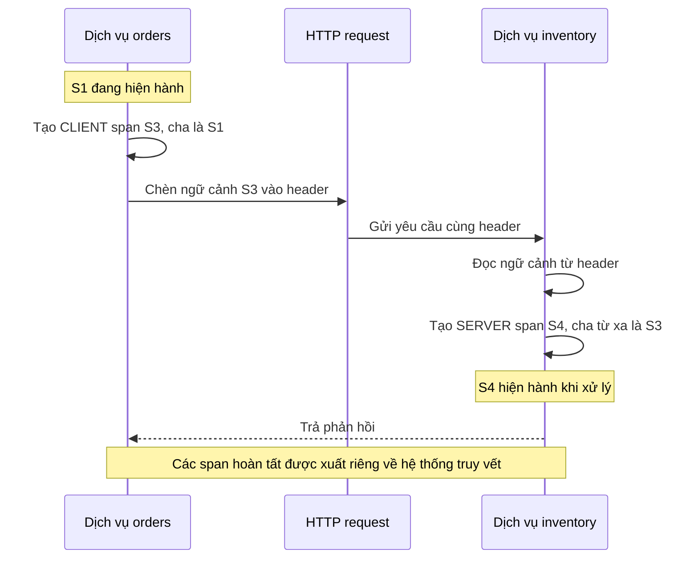

# Phân biệt trace, span, quan hệ cha con và ngữ cảnh truyền qua dịch vụ

## 1. Bắt đầu từ một yêu cầu mua hàng

Người dùng gọi dịch vụ đơn hàng. Dịch vụ này kiểm tra dữ liệu, gọi dịch vụ kho, rồi chờ kết quả để trả lời. Nếu phản hồi chậm, một dòng log “đã xử lý đơn hàng” chưa cho biết thời gian nằm ở bước kiểm tra, đường truyền hay truy vấn kho.

Truy vết phân tán (distributed tracing) ghi nhận các công việc và mối liên hệ giữa chúng. Ba câu hỏi cần tách rõ:

- **Trace:** những công việc nào thuộc cùng một hành trình xử lý?
- **Span:** một công việc cụ thể bắt đầu, kết thúc và có kết quả như thế nào?
- **Ngữ cảnh truy vết:** khi sang một nơi xử lý khác, thông tin nào giúp công việc mới nối đúng vào hành trình đang có?

Một trace có thể nằm hoàn toàn trong một ứng dụng. Khi hành trình đi qua nhiều dịch vụ, cơ chế truyền ngữ cảnh giữ lại sự liên tục đó. Không cần biến mỗi phương thức Java thành một span để có truy vết hữu ích.

## 2. Phân biệt các định danh

| Thành phần | Ý nghĩa | Câu hỏi nó trả lời |
| --- | --- | --- |
| Trace | Tập hợp các span liên quan trong một hành trình | Yêu cầu này đã đi qua những công việc nào? |
| `traceId` | Định danh chung của trace | Span này thuộc hành trình nào? |
| Span | Một đơn vị công việc có thời điểm bắt đầu và kết thúc | Bước này làm gì, mất bao lâu? |
| `spanId` | Định danh của một span trong trace | Đây là bước nào? |
| `parentSpanId` | Định danh span cha; span gốc không có cha | Bước này phát sinh dưới công việc nào? |
| Ngữ cảnh span (span context) | Các định danh cùng thông tin cờ và trạng thái truy vết cần truyền | Phải mang gì theo để nối tiếp quan hệ? |
| Phạm vi hoạt động (scope) | Khoảng thực thi mà một span được đặt làm span hiện hành | Nếu tạo công việc con ngay tại đây, cha mặc định là ai? |

Trong mô hình OpenTelemetry, các span con giữ cùng `traceId` với cha và có `spanId` riêng. Span gốc (root span) không có span cha. `parentSpanId` thuộc thông tin quan hệ của span; không nên nhầm nó với `spanId` bên trong chính ngữ cảnh span đó. [Quy tắc tạo span và xác định cha](https://opentelemetry.io/docs/specs/otel/trace/api/#span-creation).

Tên span có thể giống nhau giữa nhiều lần gọi. Hai lần gọi `GET /stock/{sku}` không phải cùng một span chỉ vì cùng tên. Ngược lại, một dịch vụ có thể tạo nhiều span trong cùng trace: nhận HTTP, xử lý nghiệp vụ, gọi HTTP và truy cập dữ liệu.

**Trace ID cũng không phải mã đơn hàng.** Một đơn hàng có thể được đọc lại, thanh toán lại hoặc đồng bộ ở nhiều thời điểm, tạo ra nhiều trace. Hãy giữ định danh nghiệp vụ và định danh truy vết theo đúng mục đích.

## 3. Đọc quan hệ cha con bằng một cây cụ thể

Giả sử một yêu cầu được ghi nhận như sau. Các nhãn `S1` đến `S5` dùng cho việc học; ID thật được trình bày ở ví dụ header bên dưới.

```text
Trace T
S1  orders: nhận POST /orders                    SERVER
├── S2  orders: kiểm tra dữ liệu                 INTERNAL
└── S3  orders: gọi GET inventory/stock/{sku}     CLIENT
    └── S4  inventory: nhận GET /stock/{sku}      SERVER
        └── S5  inventory: truy vấn tồn kho      CLIENT
```

S5 giả định thư viện truy cập dữ liệu đã được gắn cơ chế đo đạc (instrumentation). Đây là cây mong muốn khi có đủ instrumentation, không phải lời khẳng định rằng mọi truy vấn JDBC đều tự sinh span.

| Span | Cha | Dịch vụ | Khoảng thời gian giả định | Thời lượng |
| --- | --- | --- | --- | --- |
| S1 | Không có | orders | 0–120 ms | 120 ms |
| S2 | S1 | orders | 5–15 ms | 10 ms |
| S3 | S1 | orders | 20–100 ms | 80 ms |
| S4 | S3 | inventory | 25–90 ms | 65 ms |
| S5 | S4 | inventory | 35–75 ms | 40 ms |

Từ dữ liệu giả định này:

1. Có **một trace và năm span**, không phải hai trace vì có hai dịch vụ.
2. S2 và S3 là hai span cùng cha. S3 không trở thành con của S2 chỉ vì chạy sau S2.
3. S4 nối với S3 qua ranh giới tiến trình. Quan hệ cha con không đòi hỏi hai span nằm trên cùng máy hoặc cùng luồng.
4. S3 và S4 mô tả hai phía của một lần gọi: phía gửi đo thời gian gọi ra, phía nhận đo thời gian xử lý vào.
5. Thời gian đầu cuối được span S1 bao phủ là 120 ms trong ví dụ; cộng mọi thời lượng sẽ cho 315 ms và đếm lặp thời gian lồng nhau.

Thời gian phía gọi có thể bao gồm chờ kết nối, truyền dữ liệu, xử lý phía nhận và đọc phản hồi, tùy ranh giới đo của thư viện. Không lấy chênh lệch S3−S4 rồi khẳng định toàn bộ là độ trễ mạng.

Với các nhánh song song, không thể cộng thời lượng các nhánh để ra thời gian phản hồi. Cũng không thể trừ mọi span hậu duệ khỏi span gốc để tính “thời gian tự xử lý”, vì các khoảng có thể lồng nhau hoặc chồng lấn. Trên hệ thống thật, đồng hồ giữa máy còn có thể lệch; dùng ID cha con để đọc quan hệ trước khi suy diễn từ vị trí thời gian.

## 4. Ngữ cảnh được truyền qua dịch vụ như thế nào?

Một lần gọi HTTP có đủ tracing thường đi qua chuỗi thao tác:



Hai thao tác quan trọng là **chèn ngữ cảnh (inject)** ở phía gửi và **trích xuất ngữ cảnh (extract)** ở phía nhận. Vật mang ngữ cảnh (carrier) ở đây là HTTP header; với hệ thống thông điệp, nó có thể là metadata của thông điệp. [Cơ chế truyền ngữ cảnh](https://opentelemetry.io/docs/concepts/context-propagation/).

Header không mang theo toàn bộ trace, cây span, log hay mọi thuộc tính của span. Nó mang thông tin đủ để phía nhận tiếp tục quan hệ. Phía nhận vẫn cần tracing và instrumentation phù hợp để tạo, quản lý công việc của mình.

Có hai luồng độc lập cần kiểm tra:

| Luồng | Đường đi | Mục đích |
| --- | --- | --- |
| Truyền ngữ cảnh | orders → inventory, kèm yêu cầu nghiệp vụ | Nối quan hệ giữa các span |
| Xuất dữ liệu (export) | Mỗi ứng dụng → bộ thu nhận hoặc hệ thống lưu truy vết | Gửi dữ liệu span để lưu và xem |

Bộ thu nhận (collector) không phải điểm bắt buộc mà mọi yêu cầu nghiệp vụ phải đi qua. Xuất dữ liệu lỗi có thể làm giao diện truy vết thiếu span dù header đã được truyền đúng. Ngược lại, xuất dữ liệu thành công ở cả hai dịch vụ vẫn có thể tạo hai trace rời nhau nếu ngữ cảnh không đi qua.

## 5. Đọc header W3C `traceparent`

Ví dụ phía orders đang gửi yêu cầu dưới CLIENT span S3:

```http
GET /stock/SKU-7 HTTP/1.1
Host: inventory.internal
traceparent: 00-6a21b47e91ce438db620a7c590d2148f-3333333333333333-01
```

Với định dạng phiên bản `00`:

| Phần | Giá trị ví dụ | Ý nghĩa |
| --- | --- | --- |
| Version | `00` | Phiên bản định dạng |
| Trace ID | `6a21b47e91ce438db620a7c590d2148f` | 32 ký tự hex, định danh trace |
| Parent ID | `3333333333333333` | 16 ký tự hex, ID span phía gửi |
| Trace flags | `01` | Bit sampled đang bật |

Trace ID và parent ID không được toàn số 0. Dùng thư viện propagator để xử lý tính hợp lệ và phiên bản; không xây parser sản xuất bằng cách tách chuỗi đơn giản. [Định dạng W3C Trace Context](https://www.w3.org/TR/trace-context/#traceparent-header).

Inventory tạo SERVER span S4:

```text
traceId      = 6a21b47e91ce438db620a7c590d2148f
spanId       = 4444444444444444
parentSpanId = 3333333333333333
```

**`parent-id` trên đường truyền là `spanId` phía gửi và trở thành `parentSpanId` của span mới phía nhận.** Inventory không lấy ID `3333333333333333` làm ID riêng của S4 trong mô hình này.

Nếu S4 gọi tiếp dịch vụ khác qua CLIENT span S6 có ID `6666666666666666`, header cho lần gọi đó mang parent ID `6666666666666666`. Trace ID giữ nguyên, còn ID công việc tại mỗi chặng được cập nhật. Vì vậy không lưu header từ đầu yêu cầu rồi sao chép nguyên xi cho tất cả các lần gọi sau.

Header `tracestate` có thể mang trạng thái riêng của các hệ thống truy vết. Cờ sampled thông báo quyết định liên quan đến lấy mẫu; nó không bảo đảm span đã đến nơi lưu trữ. Mất dữ liệu, bộ đệm hoặc lỗi export vẫn có thể xảy ra. [Trạng thái và cờ trong chuẩn W3C](https://www.w3.org/TR/trace-context/).

## 6. Ngữ cảnh trong tiến trình: tạo span và đặt span hiện hành

Ở bên trong ứng dụng, thư viện cần biết span nào đang hiện hành để chọn cha cho span mới. Việc tạo một đối tượng span và việc đưa nó vào phạm vi hoạt động là hai thao tác có ý nghĩa khác nhau.

Đoạn sau minh họa Micrometer Tracing trong một ứng dụng đã có bean `Tracer`. Đây là phần thân phương thức, không phải chương trình Java độc lập:

```java
import io.micrometer.tracing.Span;
import io.micrometer.tracing.Tracer;

// tracer được inject; khi gọi phương thức, span HTTP có thể đang hiện hành.
Span child = tracer.nextSpan().name("reserve-stock").start();
try (Tracer.SpanInScope scope = tracer.withSpan(child)) {
    // Xử lý giữ chỗ tồn kho.
    // Span mới tạo trong phạm vi này có thể dùng child làm cha.
} catch (RuntimeException ex) {
    child.error(ex);
    throw ex;
} finally {
    child.end();
}
```

`nextSpan()` chọn cha từ ngữ cảnh hiện tại; nếu không có cha, nó có thể khởi tạo trace mới. `withSpan(child)` đặt child làm span hiện hành và đóng scope để khôi phục ngữ cảnh trước đó. `end()` kết thúc phép đo; đóng scope không thay thế cho kết thúc span. [Ví dụ vòng đời span của Micrometer](https://docs.micrometer.io/tracing/reference/api.html).

Giới hạn thực tế cần nhớ:

- Khi chuyển sang executor hoặc `CompletableFuture`, đừng mặc định ngữ cảnh hiện tại tự đi theo. Cần cơ chế chụp, khôi phục ngữ cảnh phù hợp với thư viện và cách thực thi.
- Trong luồng phản ứng, ngữ cảnh xử lý không thể chỉ được suy ra từ tên luồng.
- Một luồng có thể phục vụ nhiều yêu cầu nối tiếp; một yêu cầu có thể đi qua nhiều luồng.
- Giữ scope mở sai chỗ có thể gắn công việc sau vào nhầm yêu cầu. Kết thúc span quá sớm làm số đo không bao phủ công việc cần đo.

Spring Boot sử dụng thư viện Context Propagation cho các ranh giới luồng và luồng phản ứng được hỗ trợ; khả năng này vẫn phụ thuộc cấu hình và cách sử dụng. Việc đo JDBC cũng cần hỗ trợ riêng, không xuất hiện chỉ do thêm Actuator. [Observability trong Spring Boot 3.3](https://docs.spring.io/spring-boot/3.3/reference/actuator/observability.html).

### Log, thuộc tính và baggage nằm ở đâu?

Một log có trace ID giúp tìm về trace; log đó không tự trở thành span. Chép `traceId` vào MDC để in đẹp cũng chưa tạo quan hệ cha con hoặc truyền ngữ cảnh qua HTTP.

Thuộc tính (attribute/tag) mô tả một span. Thông tin mang kèm (baggage) là dữ liệu ngữ cảnh có thể được truyền sang nơi xử lý khác; thêm thuộc tính không đồng nghĩa truyền baggage. Baggage cũng không tự động biến thành thuộc tính của mọi span. Chỉ truyền dữ liệu cần thiết và được phép, vì nó có thể tiếp tục đi tới bên thứ ba; không dùng baggage làm bằng chứng xác thực hay phân quyền. [Phân biệt baggage và thuộc tính](https://opentelemetry.io/docs/concepts/signals/baggage/).

## 7. Liên hệ với Spring Boot 3.3 và Actuator

Trong Spring Boot 3.3, Actuator hỗ trợ cấu hình Micrometer Tracing. Một tổ hợp dùng OpenTelemetry và Zipkin gồm:

```groovy
// Phần dependencies của dự án đã quản lý phiên bản bằng Spring Boot 3.3.x.
implementation 'org.springframework.boot:spring-boot-starter-actuator'
implementation 'io.micrometer:micrometer-tracing-bridge-otel'
implementation 'io.opentelemetry:opentelemetry-exporter-zipkin'
```

Ứng dụng HTTP còn cần starter web phù hợp. Các dòng trên không phải toàn bộ `build.gradle`. Không cần thêm đồng thời nhiều bridge chỉ để “chắc chắn có tracing”.

Để client nhận cấu hình đo đạc của Boot, lấy builder từ container:

```java
import org.springframework.context.annotation.Bean;
import org.springframework.context.annotation.Configuration;
import org.springframework.web.client.RestClient;

@Configuration(proxyBeanMethods = false)
class InventoryClientConfiguration {
    @Bean
    RestClient inventoryClient(RestClient.Builder builder) {
        return builder
                .baseUrl("http://localhost:8081")
                .build();
    }
}
```

Đây là lớp cấu hình trong dự án Spring Boot, không chạy bằng `java InventoryClientConfiguration.java`. Tự gọi `RestClient.create(...)` trong cấu hình mặc định không đi qua builder đã được Boot cấu hình và có thể làm mất truyền ngữ cảnh tự động. [Tổ hợp phụ thuộc và truyền trace của Spring Boot 3.3](https://docs.spring.io/spring-boot/3.3/reference/actuator/tracing.html).

Không cần mở endpoint `/actuator/traces` để các dịch vụ trao đổi ngữ cảnh. Phơi bày endpoint quản trị và gắn đo đạc cho HTTP là hai mối quan tâm khác nhau. Phải kiểm tra ở cả phía gửi lẫn phía nhận; có Actuator ở một bên chưa đủ chứng minh chuỗi đã nối thành công.

## 8. Minh chứng Java: dựng cây từ các quan hệ đã có

Chương trình sau chạy độc lập với Java 17+. Nó dùng dữ liệu giả định của mục 3 để kiểm tra cách đọc ID và thời lượng; **không gửi HTTP, không tạo telemetry thật và không thay thế thư viện tracing**.

Lưu thành `TraceRelations.java`:

```java
import java.util.List;

public class TraceRelations {
    record SpanRow(String traceId, String spanId, String parentSpanId,
                   String operation, long durationMs) {}

    private static final String TRACE =
            "6a21b47e91ce438db620a7c590d2148f";

    public static void main(String[] args) {
        List<SpanRow> spans = List.of(
                new SpanRow(TRACE, "1111111111111111", null,
                        "orders.receive", 120),
                new SpanRow(TRACE, "2222222222222222", "1111111111111111",
                        "orders.validate", 10),
                new SpanRow(TRACE, "3333333333333333", "1111111111111111",
                        "orders.http-client", 80),
                new SpanRow(TRACE, "4444444444444444", "3333333333333333",
                        "inventory.receive", 65),
                new SpanRow(TRACE, "5555555555555555", "4444444444444444",
                        "inventory.database", 40)
        );

        long traceCount = spans.stream()
                .map(SpanRow::traceId).distinct().count();
        SpanRow root = spans.stream()
                .filter(span -> span.parentSpanId() == null)
                .findFirst().orElseThrow();

        System.out.println("traces=" + traceCount + ", spans=" + spans.size());
        printTree(spans, root, 0);

        long durationSum = spans.stream()
                .mapToLong(SpanRow::durationMs).sum();
        System.out.println("rootDurationMs=" + root.durationMs());
        System.out.println("sumSpanDurationMs=" + durationSum);
    }

    private static void printTree(List<SpanRow> spans, SpanRow parent,
                                  int depth) {
        System.out.println("  ".repeat(depth)
                + parent.operation() + " [" + parent.durationMs() + " ms]");

        for (SpanRow child : spans) {
            if (parent.traceId().equals(child.traceId())
                    && parent.spanId().equals(child.parentSpanId())) {
                printTree(spans, child, depth + 1);
            }
        }
    }
}
```

Biên dịch và chạy:

```shell
javac --release 17 TraceRelations.java
java TraceRelations
```

Kết quả stdout chính xác:

```text
traces=1, spans=5
orders.receive [120 ms]
  orders.validate [10 ms]
  orders.http-client [80 ms]
    inventory.receive [65 ms]
      inventory.database [40 ms]
rootDurationMs=120
sumSpanDurationMs=315
```

Chương trình duyệt bằng cặp trace ID và quan hệ `parentSpanId → spanId`, không dựa vào thứ tự tên dịch vụ hay thứ tự log. Dữ liệu được cố ý giữ nhỏ, hợp lệ, có một gốc và không có chu trình; đây không phải bộ kiểm tra dữ liệu từ hệ thống lưu truy vết.

Thử thay cha của `orders.http-client` thành `2222222222222222`: nó chuyển xuống dưới `orders.validate`. Trace ID không đổi nên số trace vẫn là 1, nhưng ý nghĩa cấu trúc đã khác. Thử thay trace ID của `inventory.receive`: nó không còn nối được vào cây hiện tại bằng cặp định danh, dù trường cha vẫn giữ chuỗi cũ. Đừng “sửa” dữ liệu truy vết thật bằng cách ép mọi span về cùng trace ID.

## 9. Không phải mọi quan hệ đều là một lời gọi đồng bộ

Trong cây cha con, mỗi span có tối đa một cha. Hai tác vụ được tạo dưới cùng một span hiện hành có thể là hai nhánh cùng cha, dù chạy đồng thời.

Với xử lý bất đồng bộ, span con có thể kết thúc sau span cha. Vì vậy, quan hệ nhân quả không phải lời cam kết rằng khoảng thời gian của con luôn nằm trọn trong cha.

Một công việc gom nhiều thông điệp từ các nguồn khác nhau không nên được hiểu là có nhiều trường cha. Liên kết span (span link) biểu diễn thêm các quan hệ mà một trường cha không mô tả đủ, kể cả quan hệ giữa các trace. [Span links của OpenTelemetry](https://opentelemetry.io/docs/concepts/signals/traces/#span-links).

Cách gắn cha hoặc link cho hàng đợi tùy thư viện và quy ước đo đạc. Không kết luận “bất đồng bộ luôn phải tạo trace mới” hoặc “mọi thông điệp luôn phải nằm trong trace ban đầu”.

Cũng cần phân biệt **span gốc thật** với **span đứng đầu phần dữ liệu đang nhìn thấy**. Nếu phần cha bị thiếu do không được ghi nhận hoặc không được xuất, span con có thể hiện ra ở đầu màn hình nhưng vẫn có ID cha. Đó là dữ liệu chưa đầy đủ, chưa đủ bằng chứng rằng hành trình bắt đầu tại dịch vụ ấy.

## 10. Chẩn đoán khi cây trace bị đứt

| Quan sát | Khả năng cần kiểm tra | Bằng chứng cần tìm |
| --- | --- | --- |
| orders và inventory có trace ID khác nhau cho cùng lần gọi | Thiếu inject/extract, khác định dạng truyền, ngữ cảnh mất trước khi gửi hoặc ranh giới cố ý bắt đầu trace mới | Header thực tế ngay trước gửi và khi nhận; span hiện hành hai phía |
| Cùng trace ID nhưng quan hệ cha sai | Header cũ bị sao chép, tạo span trong scope sai | ID CLIENT span gửi và `parentSpanId` của SERVER span nhận |
| Không thấy span ở hệ thống truy vết nhưng log có ID | Lấy mẫu, lỗi exporter, hàng đợi export hoặc dữ liệu chưa đến | Quyết định lấy mẫu, lỗi xuất và trạng thái bộ thu nhận |
| Log trong tác vụ nền thiếu ID | Ngữ cảnh không được chuyển qua ranh giới thực thi | Ngữ cảnh trước khi lên lịch và bên trong tác vụ |
| Cùng một bước HTTP có nhiều span trùng vai trò | Có nhiều lớp instrumentation cùng đo | Agent, cấu hình thư viện và span tạo thủ công |
| Dịch vụ kho có span HTTP nhưng không có span truy vấn | Chưa có instrumentation cho lớp dữ liệu | Thư viện JDBC/R2DBC và cấu hình thực tế |

Cách kiểm tra có thứ tự:

1. Gửi một yêu cầu dễ phân biệt và ghi lại trace ID ở phía đầu vào.
2. Kiểm tra CLIENT span ngay trước lần gọi ra.
3. Đối chiếu trace ID và parent ID trên header ra với header vào của dịch vụ sau.
4. Đối chiếu span nhận: trace ID tiếp tục, span ID riêng, cha đúng với span gửi.
5. Nếu quan hệ đã đúng mà giao diện vẫn thiếu dữ liệu, chuyển sang kiểm tra lấy mẫu và export.

Không tự thêm header bằng cách nối chuỗi trong từng controller để che lỗi cấu hình. Cũng không coi việc nhìn thấy cùng trace ID trong hai dòng log là bằng chứng đủ: còn cần kiểm tra span riêng, quan hệ cha và dữ liệu đo.

## 11. Thực hành tự kiểm tra

**Tình huống 1:** orders nhận yêu cầu dưới S1, tạo S2 để kiểm tra, đóng scope S2 rồi gọi inventory bằng CLIENT span S3. Cha của S3 là ai?

**Giải thích:** Nếu scope S1 được khôi phục đúng và đang hiện hành, cha là S1. Việc S2 vừa chạy xong không làm S2 tự động thành cha.

**Tình huống 2:** Header vào inventory có trace ID T và parent ID P. Inventory tạo SERVER span R theo mô hình OpenTelemetry. R giữ và thay những gì?

**Giải thích:** R giữ trace ID T, có span ID riêng và ghi P làm cha từ xa. Ngữ cảnh nhận được nối quan hệ; không tái sử dụng P làm ID của R.

**Tình huống 3:** Hai nhánh độc lập cùng chạy trong 80 ms dưới span gốc 100 ms. Có thể kết luận yêu cầu mất 160 ms vì tổng hai nhánh bằng 160 không?

**Giải thích:** Không. Thời gian các nhánh có thể chồng lấn; cần xem khoảng thực thi và điểm chờ. Trong giả định span gốc bao phủ toàn bộ xử lý, thời lượng của nó là 100 ms.

**Tình huống 4:** Hai dịch vụ đã có cùng trace ID, nhưng span của inventory chưa thấy trên giao diện. Có nên kết luận ngay rằng HTTP không truyền header?

**Giải thích:** Không. Kiểm tra quan hệ span và ngữ cảnh thực tế trước, sau đó kiểm tra lấy mẫu, kết thúc span và export. Truyền ngữ cảnh và lưu dữ liệu là hai giai đoạn riêng.

Sau bài này, khi đọc một trace, hãy tìm hành trình chung bằng trace ID, nhận diện từng công việc bằng span ID, nối quan hệ bằng ID cha và kiểm tra ngữ cảnh tại từng ranh giới xử lý. Cách đọc đó giúp xác định chính xác chặng cần điều tra trước khi thay đổi cấu hình hoặc thêm phép đo.
