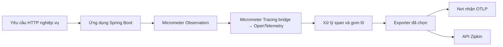

# Cấu hình xuất trace đến OTLP hoặc Zipkin

## 1. Xuất trace giải quyết việc gì?

Ứng dụng đã tạo span và log đã có trace ID, nhưng giao diện truy vết vẫn trống. Điều đó có thể xảy ra vì **tạo dữ liệu đo** và **gửi dữ liệu đến nơi lưu trữ** là hai việc riêng.

Bộ xuất dữ liệu (exporter) chuyển các span đã ghi nhận sang định dạng và giao thức mà phía nhận hiểu. Bộ thu nhận (collector) có thể tiếp nhận, xử lý rồi chuyển tiếp dữ liệu. Hệ thống lưu và xem truy vết (tracing backend) phục vụ truy vấn, hiển thị.

Bài này dùng Spring Boot **3.3.x**, Java 21 và Micrometer Tracing với OpenTelemetry. Hai lựa chọn được thực hành riêng:

- **OTLP:** giao thức OpenTelemetry Protocol; ứng dụng gửi đến nơi nhận OTLP.
- **Zipkin:** ứng dụng gửi dữ liệu theo giao thức Zipkin đến API thu nhận span của Zipkin.

OTLP không phải một sản phẩm lưu trữ có giao diện riêng. Zipkin vừa là một hệ thống truy vết, vừa cung cấp API nhận dữ liệu theo định dạng Zipkin. Vì vậy, “dùng OpenTelemetry” không đồng nghĩa “bắt buộc dùng OTLP”; OpenTelemetry cũng có exporter cho Zipkin.

Mục tiêu thực hành là cấu hình đúng **thư viện → giao thức → địa chỉ nhận → cách chứng minh nhận được span**.

## 2. Nhìn toàn bộ đường đi trước khi sửa YAML



Sơ đồ thể hiện hai đích có thể chọn, không yêu cầu bật đồng thời hai exporter.

Phân biệt ba đường đi:

| Đường đi | Dữ liệu được chuyển | Cấu hình liên quan |
| --- | --- | --- |
| Ứng dụng A gọi ứng dụng B | Yêu cầu nghiệp vụ và ngữ cảnh truy vết trong header | Instrumentation HTTP, truyền ngữ cảnh |
| Ứng dụng gửi span đến nơi thu nhận | Bản ghi span theo giao thức xuất dữ liệu | Exporter, endpoint, xác thực, kết nối |
| Người vận hành mở giao diện | Truy vấn dữ liệu đã lưu | URL giao diện, khoảng thời gian tìm kiếm, tên dịch vụ |

Mở được giao diện Zipkin chưa chứng minh ứng dụng gửi thành công. Ngược lại, gửi OTLP đến Collector dùng exporter `debug` sẽ tạo bằng chứng trong log Collector, nhưng không tự sinh một giao diện truy vấn.

Việc xuất span cũng không đòi hỏi mở toàn bộ endpoint Actuator. `management.endpoints.web.exposure.include` điều khiển endpoint quản trị được phơi bày, không phải địa chỉ xuất trace.

## 3. Chọn đúng tổ hợp phụ thuộc và giao thức

Giữ chung bridge OpenTelemetry, thay exporter theo đích:

| Thành phần | OTLP | Zipkin |
| --- | --- | --- |
| Actuator | `spring-boot-starter-actuator` | `spring-boot-starter-actuator` |
| Bridge | `micrometer-tracing-bridge-otel` | `micrometer-tracing-bridge-otel` |
| Exporter | `opentelemetry-exporter-otlp` | `opentelemetry-exporter-zipkin` |
| Nhóm thuộc tính | `management.otlp.tracing.*` | `management.zipkin.tracing.*` |
| Endpoint trong bài | `http://localhost:4318/v1/traces` | `http://localhost:9411/api/v2/spans` |

Đây là các tổ hợp được Spring Boot 3.3 hỗ trợ. Không cần thêm cả bridge Brave và bridge OpenTelemetry vào một thí nghiệm. Nếu chọn Brave ở một dự án khác, phải dùng tổ hợp phụ thuộc tương ứng, không chỉ đổi tên property. [Các tổ hợp tracing của Spring Boot 3.3](https://docs.spring.io/spring-boot/3.3/reference/actuator/tracing.html).

**Điểm dễ nhầm về OTLP:** auto-configuration của Boot 3.3 ở đây tạo `OtlpHttpSpanExporter`, sử dụng **HTTP/protobuf**. Đổi cổng thành 4317 không biến nó thành exporter gRPC. Dùng gRPC cần cấu hình exporter tương ứng; nằm ngoài thí nghiệm HTTP/protobuf này. [Mã nguồn auto-configuration OTLP của Boot 3.3.13](https://github.com/spring-projects/spring-boot/blob/v3.3.13/spring-boot-project/spring-boot-actuator-autoconfigure/src/main/java/org/springframework/boot/actuate/autoconfigure/tracing/otlp/OtlpAutoConfiguration.java).

Cổng 4318 và 4317 là quy ước phổ biến lần lượt cho OTLP/HTTP và OTLP/gRPC; phía nhận có thể được cấu hình cổng khác. Quyết định đúng giao thức trước, sau đó đối chiếu địa chỉ thực tế.

## 4. Dự án thực hành độc lập

Ví dụ sau là một dự án nhỏ để học cấu hình, không phải yêu cầu thay build của module đang làm việc. Cần JDK 21, Gradle 8.5 để khởi tạo wrapper và Docker Compose để chạy nơi nhận. Lần tải phụ thuộc đầu tiên cần truy cập kho Maven và kho image.

Cấu trúc:

```text
trace-export-demo/
├── settings.gradle
├── build.gradle
├── compose.yml
├── otel-collector.yml
└── src/main/
    ├── java/example/traceexport/TraceExportApplication.java
    └── resources/
        ├── application.yml
        ├── application-otlp.yml
        └── application-zipkin.yml
```

### 4.1. Build chọn đúng một exporter

`settings.gradle`:

```groovy
rootProject.name = 'trace-export-demo'
```

`build.gradle`:

```groovy
plugins {
    id 'java'
    id 'org.springframework.boot' version '3.3.13'
}

group = 'example'
version = '1.0.0'

repositories {
    mavenCentral()
}

java {
    toolchain {
        languageVersion = JavaLanguageVersion.of(21)
    }
}

def traceDestination = providers.gradleProperty('traceDestination')
        .getOrElse('otlp')

if (!(traceDestination in ['otlp', 'zipkin'])) {
    throw new GradleException('traceDestination phải là otlp hoặc zipkin')
}

dependencies {
    implementation platform(
            'org.springframework.boot:spring-boot-dependencies:3.3.13')
    implementation 'org.springframework.boot:spring-boot-starter-web'
    implementation 'org.springframework.boot:spring-boot-starter-actuator'
    implementation 'io.micrometer:micrometer-tracing-bridge-otel'
    implementation "io.opentelemetry:opentelemetry-exporter-${traceDestination}"
}
```

BOM của Boot quản lý phiên bản các thư viện. Biến `traceDestination` là thuộc tính **Gradle lúc build**, không phải Spring profile.

Với bài này, mỗi lần chạy chọn một exporter trên classpath. Profile chỉ chọn cấu hình runtime; kích hoạt `zipkin` không tự tải thư viện Zipkin nếu build đang chọn OTLP.

### 4.2. Java tạo một công việc có tên dễ tìm

`src/main/java/example/traceexport/TraceExportApplication.java`:

```java
package example.traceexport;

import io.micrometer.observation.Observation;
import io.micrometer.observation.ObservationRegistry;
import org.springframework.boot.SpringApplication;
import org.springframework.boot.autoconfigure.SpringBootApplication;
import org.springframework.web.bind.annotation.GetMapping;
import org.springframework.web.bind.annotation.RestController;

@SpringBootApplication
@RestController
public class TraceExportApplication {
    private final ObservationRegistry observationRegistry;

    public TraceExportApplication(ObservationRegistry observationRegistry) {
        this.observationRegistry = observationRegistry;
    }

    public static void main(String[] args) {
        SpringApplication.run(TraceExportApplication.class, args);
    }

    @GetMapping("/demo/ping")
    public String ping() {
        return Observation.createNotStarted(
                        "demo.export", observationRegistry)
                .lowCardinalityKeyValue("operation", "ping")
                .observe(() -> "trace-export-ok");
    }
}
```

Endpoint trả một chuỗi cố định; observation `demo.export` giúp nhận diện span trong dữ liệu xuất. Khi tracing được cấu hình và HTTP observation đang hiện hành, công việc này nằm dưới công việc xử lý HTTP. Không cần thêm annotation tạo span nữa lên chính phương thức này.

Đây là **ứng dụng Spring Boot đầy đủ khi đi cùng các file build và cấu hình trong bài**. Nó không chạy độc lập bằng `javac TraceExportApplication.java` vì cần classpath framework. Dùng Gradle để biên dịch và chạy. [Observation và tracing trong Boot 3.3](https://docs.spring.io/spring-boot/3.3/reference/actuator/observability.html).

### 4.3. Cấu hình chung cho thí nghiệm

`src/main/resources/application.yml`:

```yaml
spring:
  application:
    name: trace-export-demo

management:
  tracing:
    enabled: true
    sampling:
      probability: 1.0
```

Tên dịch vụ giúp tìm đúng nguồn dữ liệu. Lấy mẫu 100% giúp thí nghiệm mới không bỏ sót yêu cầu do xác suất lấy mẫu ở đầu trace. Khi nhận ngữ cảnh cha từ bên ngoài, quyết định lấy mẫu còn phụ thuộc sampler và ngữ cảnh đó; hãy gọi trực tiếp bằng lệnh thử không tự thêm `traceparent`.

Boot 3.3 có xác suất lấy mẫu mặc định 0.1. `1.0` ở đây phục vụ thí nghiệm; khi vận hành, điều chỉnh theo lưu lượng và khả năng tiếp nhận. Trạng thái sampled không bảo đảm dữ liệu sẽ đến nơi nhận nếu đường xuất bị lỗi.

## 5. Phương án OTLP/HTTP

### 5.1. Cấu hình endpoint trong Spring Boot

`src/main/resources/application-otlp.yml`:

```yaml
management:
  otlp:
    tracing:
      endpoint: "${OTLP_TRACES_ENDPOINT:http://localhost:4318/v1/traces}"
      timeout: 10s
```

Dùng URL hoàn chỉnh cho dữ liệu trace, có `/v1/traces`. Không nhầm với `/v1/metrics`, `/v1/logs`, URL giao diện hoặc địa chỉ gRPC.

Trong Boot 3.3, cấu hình OTLP thông thường theo property cần có endpoint; không suy ra rằng chỉ thêm exporter vào classpath là luôn có đích mặc định. Mã nguồn tạo connection details theo property có điều kiện `management.otlp.tracing.endpoint`. [Điều kiện cấu hình endpoint OTLP](https://github.com/spring-projects/spring-boot/blob/v3.3.13/spring-boot-project/spring-boot-actuator-autoconfigure/src/main/java/org/springframework/boot/actuate/autoconfigure/tracing/otlp/OtlpTracingConfigurations.java).

`timeout` là giới hạn cho một cuộc gọi xuất dữ liệu, không phải thời gian phản hồi của `/demo/ping`. Không dùng tăng timeout để chữa một endpoint sai giao thức.

### 5.2. Collector nhận trace và in bằng chứng

`otel-collector.yml`:

```yaml
receivers:
  otlp:
    protocols:
      http:
        endpoint: 0.0.0.0:4318

processors:
  batch: {}

exporters:
  debug:
    verbosity: detailed

service:
  pipelines:
    traces:
      receivers: [otlp]
      processors: [batch]
      exporters: [debug]
```

Bốn phần có vai trò riêng:

- `receivers`: chỗ nhận dữ liệu; ở đây nhận OTLP/HTTP.
- `processors`: xử lý dữ liệu trước khi xuất; ở đây có gom lô.
- `exporters`: chỗ chuyển dữ liệu tiếp; `debug` in dữ liệu để kiểm tra.
- `service.pipelines.traces`: nối các thành phần thành đường xử lý trace thực sự.

Khai báo receiver hoặc exporter nhưng không nối vào pipeline chưa làm nó tham gia xử lý. [Cấu hình pipeline Collector](https://opentelemetry.io/docs/collector/configuration/).

Collector này phục vụ kiểm chứng dữ liệu đến; không lưu trace để tìm lại sau. Muốn có hệ thống truy vấn cần thêm đích lưu trữ và exporter phù hợp ở Collector.

### 5.3. Chạy nơi nhận bằng Compose

`compose.yml` dùng cho cả hai phương án:

```yaml
services:
  collector:
    image: otel/opentelemetry-collector:0.111.0
    command: ["--config=/etc/otelcol/config.yaml"]
    volumes:
      - ./otel-collector.yml:/etc/otelcol/config.yaml:ro
    ports:
      - "127.0.0.1:4318:4318"

  zipkin:
    image: openzipkin/zipkin:latest
    ports:
      - "127.0.0.1:9411:9411"
```

Collector được khóa ở phiên bản thí nghiệm có exporter `debug`. Image Zipkin dùng `latest` theo cách chạy nhanh của dự án; khi cần tái hiện chính xác, khóa tag hoặc digest đã kiểm chứng. Cổng công bố trên máy chủ chỉ gắn vào loopback; địa chỉ `0.0.0.0` trong Collector để nhận kết nối trong container.

Chỉ khởi động nơi nhận cho phương án đang thử:

```shell
docker compose up -d collector
docker compose logs collector --tail=100
```

Từ thư mục dự án, khởi tạo wrapper một lần với JDK 21:

```shell
gradle wrapper --gradle-version 8.5
```

Trên PowerShell:

```powershell
.\gradlew.bat -PtraceDestination=otlp bootRun --args="--spring.profiles.active=otlp"
```

Trên Linux/macOS, dùng `./gradlew` thay `.\gradlew.bat`, giữ nguyên tham số.

Ở terminal khác:

```shell
curl -sS http://localhost:8080/demo/ping
```

Trên Windows PowerShell có alias `curl`, gọi rõ chương trình:

```powershell
curl.exe -sS http://localhost:8080/demo/ping
```

Nội dung phản hồi chính xác là `trace-export-ok`, không có ký tự xuống dòng do phương thức Java thêm vào. Log khởi động, ID, timestamp và dữ liệu debug không phải output cố định.

Sau khi yêu cầu hoàn tất, đợi dữ liệu đi qua gom lô rồi xem:

```shell
docker compose logs collector --tail=200
```

Cần tìm **bằng chứng trong dữ liệu span**:

1. Tên dịch vụ `trace-export-demo` trong resource.
2. Span tên `demo.export`.
3. Trace ID, span ID và thời gian đo; giá trị cụ thể thay đổi mỗi lần.
4. Thuộc tính `operation=ping` của observation trong ví dụ.

Không cam kết tổng số span bằng một: HTTP server cũng có thể được đo. Không chép một bộ ID cố định rồi yêu cầu lần chạy khác phải giống hệt.

Collector đang xuất ra log, nên không tìm trace của phương án này trên Zipkin UI chỉ vì container Zipkin cũng đang chạy. Hai đường dữ liệu trong file Compose chưa được nối với nhau.

## 6. Phương án Zipkin

### 6.1. Đổi exporter và profile tương ứng

Dừng tiến trình `bootRun` của phương án trước bằng Ctrl+C trước khi chạy ứng dụng mới trên cổng 8080.

`src/main/resources/application-zipkin.yml`:

```yaml
management:
  zipkin:
    tracing:
      endpoint: "${ZIPKIN_TRACES_ENDPOINT:http://localhost:9411/api/v2/spans}"
      connect-timeout: 1s
      read-timeout: 10s
```

Khởi động nơi nhận rồi chạy lại ứng dụng:

```shell
docker compose up -d zipkin
```

```powershell
.\gradlew.bat -PtraceDestination=zipkin bootRun --args="--spring.profiles.active=zipkin"
```

Gửi yêu cầu:

```powershell
curl.exe -sS http://localhost:8080/demo/ping
```

Nội dung phản hồi vẫn là `trace-export-ok`. Hành vi nghiệp vụ không thay đổi chỉ vì đổi nơi xuất dữ liệu.

Mở [Zipkin chạy trên máy cục bộ](http://localhost:9411/zipkin/), chọn dịch vụ `trace-export-demo`, chọn khoảng thời gian bao phủ lần gọi rồi tìm trace. Trong trace, tìm công việc `demo.export`. API thu nhận span của Zipkin là `/api/v2/spans`; đây không phải URL giao diện. [Cách chạy Zipkin](https://zipkin.io/pages/quickstart.html), [API thu nhận của Zipkin Server](https://github.com/openzipkin/zipkin/blob/master/zipkin-server/README.md#http-collector).

Có thể xem danh sách tên dịch vụ để hỗ trợ chẩn đoán:

```powershell
curl.exe -sS http://localhost:9411/api/v2/services
```

Trong một Zipkin mới chỉ nhận dữ liệu của ứng dụng này, sau khi dữ liệu đã được tiếp nhận, danh sách chứa `trace-export-demo`. Không coi toàn bộ JSON trả về là cố định nếu đã có các nguồn dữ liệu khác.

### 6.2. Vì sao không chỉ đổi một URL?

Exporter OTLP gửi nội dung theo OTLP; API Zipkin nhận định dạng Zipkin. Hai URL cùng dùng HTTP không làm chúng hiểu cùng một payload.

Ví dụ sai:

```yaml
management:
  otlp:
    tracing:
      endpoint: http://localhost:9411/api/v2/spans
```

YAML này có thể hợp lệ về cú pháp, nhưng sai hợp đồng giao thức. Cách sửa của bài là chọn exporter Zipkin và nhóm `management.zipkin.tracing`. Không sửa bằng cách thêm header JSON tùy ý lên payload protobuf.

Nếu tổ chức dùng Collector làm điểm nhận chung, ứng dụng có thể tiếp tục xuất OTLP và để Collector chuyển sang đích khác bằng exporter phù hợp. Đó là một kiến trúc khác với hai đường độc lập đang thực hành; cần cấu hình pipeline chuyển tiếp rõ ràng.

## 7. Địa chỉ mạng, biến môi trường và xác thực

### Địa chỉ phải đúng theo nơi ứng dụng chạy

| Nơi ứng dụng chạy | Nơi nhận | Host thường dùng |
| --- | --- | --- |
| Java trên máy chủ; Collector trong Compose có công bố cổng | Collector | `localhost:4318` |
| Java trên máy chủ; Zipkin trong Compose có công bố cổng | Zipkin | `localhost:9411` |
| Java được đưa vào cùng mạng Compose | Collector hoặc Zipkin | `collector:4318` hoặc `zipkin:9411` |
| Java trong container khác mạng hoặc nơi nhận từ xa | Phụ thuộc hạ tầng | DNS/địa chỉ có thể truy cập từ chính container đó |

Trong container ứng dụng, `localhost` chỉ chính container đó. Tên `collector` trong mạng Compose cũng không tự thành DNS cho tiến trình Java chạy trên máy chủ.

Bài này chạy Java trên máy chủ nên các mặc định `localhost` là có chủ đích. Không thay thành tên service Compose khi Java vẫn chạy ngoài mạng Docker.

Có thể đổi đích OTLP trong phiên PowerShell khởi động ứng dụng:

```powershell
$env:OTLP_TRACES_ENDPOINT = 'http://localhost:4318/v1/traces'
.\gradlew.bat -PtraceDestination=otlp bootRun --args="--spring.profiles.active=otlp"
```

Tên `OTLP_TRACES_ENDPOINT` là biến do **biểu thức tham chiếu biến trong ví dụ** tham chiếu. Không suy ra nó là biến chuẩn chung cho mọi SDK. Tương tự, cấu hình `OTEL_EXPORTER_OTLP_ENDPOINT` của Java agent hoặc SDK autoconfigure không tự chứng minh Boot đã nhận property trong đường Micrometer này.

### Nơi nhận từ xa có thể cần header

Ví dụ bổ sung vào nhánh OTLP khi phía nhận yêu cầu xác thực:

```yaml
management:
  otlp:
    tracing:
      endpoint: "${OTLP_TRACES_ENDPOINT}"
      headers:
        Authorization: "${OTLP_AUTHORIZATION}"
      timeout: 10s
```

`OTLP_AUTHORIZATION` chứa toàn bộ giá trị header mà dịch vụ yêu cầu, chẳng hạn theo dạng Bearer. Đây là cấu hình thay thế cho môi trường có các biến tương ứng, không phải file cần kích hoạt trong thí nghiệm cục bộ.

Lấy thông tin xác thực từ môi trường hoặc hệ thống quản lý bí mật; dùng HTTPS khi gửi qua mạng cần bảo vệ dữ liệu. Header xác thực cho exporter đi đến nơi thu nhận, không phải token đăng nhập của người dùng trên `/demo/ping`. [Thuộc tính xuất trace của Boot 3.3](https://docs.spring.io/spring-boot/3.3/appendix/application-properties/index.html).

## 8. Gom lô, lấy mẫu và kết thúc ứng dụng

Không nên hiểu một lần gọi endpoint sẽ lập tức tạo một lần POST xuất trace ngay trong cùng thời điểm. Có thể có gom lô ở SDK, thêm gom lô ở Collector và độ trễ phía lưu trữ.

Các hệ quả khi kiểm tra:

- Đợi một khoảng ngắn rồi kiểm tra lại dữ liệu theo khoảng thời gian thích hợp.
- Một ứng dụng trả HTTP thành công vẫn có thể báo lỗi xuất dữ liệu ở luồng nền.
- Kết thúc cưỡng bức tiến trình ngay sau yêu cầu có thể làm mất dữ liệu chưa gửi.
- Tắt ứng dụng theo vòng đời bình thường để các thành phần có cơ hội hoàn tất gửi; không xem đó là bảo đảm giao hàng tuyệt đối.
- Bộ đệm trong tiến trình và cơ chế thử lại không thay thế một hàng đợi bền vững cho mọi sự cố.

Chỉ tăng xác suất lấy mẫu sẽ không chữa DNS sai, endpoint sai hoặc thiếu exporter. Ngược lại, gửi đúng endpoint cũng không tạo ra những span chưa được instrumentation hoặc chưa được ghi nhận.

Khi đổi đích trong thí nghiệm, giữ nguyên endpoint nghiệp vụ, tên observation và dữ liệu đầu vào. Nhờ vậy, khác biệt quan sát được tập trung vào đường xuất dữ liệu.

## 9. Chẩn đoán theo từng tầng

| Hiện tượng | Tầng cần kiểm tra trước | Hướng xác minh |
| --- | --- | --- |
| Có Actuator nhưng không có dữ liệu trace | Phụ thuộc, tracing và instrumentation | Bridge/exporter trên runtime classpath; observation được tạo |
| Chạy profile Zipkin nhưng build chọn OTLP | Classpath và profile lệch nhau | Đối chiếu `-PtraceDestination` với `--spring.profiles.active` |
| OTLP không xuất dù dependency đã có | Endpoint và điều kiện auto-configuration | Property endpoint, profile đang kích hoạt, cấu hình bị ghi đè |
| `Connection refused` | Tiến trình nhận, cổng, địa chỉ mạng | Container có chạy; port mapping; host nhìn từ ứng dụng |
| Không phân giải được tên host | DNS/mạng | Tên Compose có hợp lệ ở nơi Java chạy không |
| HTTP 404 khi xuất | Đường dẫn hoặc reverse proxy | `/v1/traces` hay `/api/v2/spans`; route proxy thực tế |
| HTTP 400 hoặc 415 | Giao thức, định dạng, cấu hình phía nhận | OTLP/HTTP-protobuf hay Zipkin; nội dung phản hồi lỗi |
| HTTP 401/403 | Xác thực hoặc quyền gửi | Header theo hợp đồng của nhà cung cấp; tránh in token ra log |
| Collector khởi động nhưng không ghi span | Receiver/pipeline hoặc ứng dụng chưa gửi | Receiver có trong pipeline trace; app có phát sinh span hoàn tất |
| Collector có span nhưng Zipkin trống khi chạy OTLP | Chưa có đường chuyển tiếp đến Zipkin | Pipeline hiện chỉ có exporter `debug` |
| Zipkin có dịch vụ nhưng lần gọi mới khó tìm | Thời gian tìm kiếm, độ trễ, lấy mẫu | Tên dịch vụ, thời điểm request, khoảng truy vấn |
| Trace xuất hiện hai lần hoặc span trùng vai trò | Nhiều đường đo/xuất cùng hoạt động | Agent, nhiều SDK, exporter và cấu hình thủ công |

Các mã lỗi là dấu hiệu để chọn tầng điều tra, không phải kết luận duy nhất: proxy hoặc nhà cung cấp có thể trả lỗi khác. Đọc phản hồi và log tương ứng.

Có thể kiểm tra phụ thuộc đã chọn trên PowerShell:

```powershell
.\gradlew.bat -PtraceDestination=otlp dependencies --configuration runtimeClasspath
```

Muốn chẩn đoán auto-configuration, chạy với cùng lựa chọn build/profile và thêm `--debug` vào tham số ứng dụng. Condition report giúp biết vì sao cấu hình được áp dụng hay bỏ qua; đọc log có kiểm soát nếu môi trường có cấu hình nhạy cảm.

Một lệnh GET vào cổng 4318 chỉ kiểm tra được một phần khả năng kết nối. OTLP/HTTP gửi yêu cầu đúng phương thức, đường dẫn và payload theo chuẩn; không coi HTTP 404 ở URL gốc là bằng chứng Collector hỏng, hoặc HTTP 200 ở trang chủ là bằng chứng xuất trace đã hoạt động. [Hợp đồng OTLP/HTTP](https://opentelemetry.io/docs/specs/otlp/#otlphttp-request).

## 10. Tự kiểm tra bằng tình huống

**Tình huống 1:** Đã thêm `opentelemetry-exporter-otlp`, rồi đặt endpoint thành `http://localhost:4317`. Có phải ứng dụng chuyển sang gRPC không?

**Giải thích:** Không. Exporter do Boot 3.3 tự cấu hình trong đường này vẫn là HTTP/protobuf. Cần khớp giao thức và listener phía nhận; thí nghiệm dùng cổng 4318 cùng `/v1/traces`.

**Tình huống 2:** `/demo/ping` trả `trace-export-ok`, nhưng Collector không có dữ liệu. Có thể chốt export thành công không?

**Giải thích:** Chưa. Phản hồi chỉ chứng minh đường nghiệp vụ đã trả kết quả. Cần kiểm tra observation, lấy mẫu, exporter, endpoint, mạng và bằng chứng bên nhận.

**Tình huống 3:** Collector đã in span `demo.export`, nhưng Zipkin không có trace. Với cấu hình bài này, lỗi nằm ở đâu?

**Giải thích:** Chưa có bằng chứng lỗi. Nhánh OTLP kết thúc ở exporter `debug`, không chuyển sang Zipkin. Muốn xem ở Zipkin, chạy phương án Zipkin hoặc cấu hình một pipeline chuyển tiếp phù hợp.

**Tình huống 4:** Đổi profile sang `zipkin` nhưng giữ build OTLP. Vì sao chỉ thêm `management.zipkin.tracing.endpoint` chưa đủ?

**Giải thích:** Profile không thay đổi runtime classpath do Gradle đã chọn. Phải có thư viện exporter phù hợp và cấu hình tương ứng.

**Tình huống 5:** Chuyển ứng dụng vào Docker rồi giữ endpoint `localhost:9411`. Vì sao lỗi dù Zipkin vẫn chạy?

**Giải thích:** `localhost` nay chỉ container ứng dụng. Nếu cùng mạng Compose, dùng tên dịch vụ Zipkin và cổng container thích hợp.

Khi hoàn tất thực hành, bằng chứng cần có là cùng một công việc `demo.export` được nhìn thấy tại nơi nhận đã chọn, với đúng tên dịch vụ và thời điểm gọi. Từ đó mới đánh giá tiếp độ đầy đủ của trace hoặc triển khai đường lưu trữ lâu dài.
