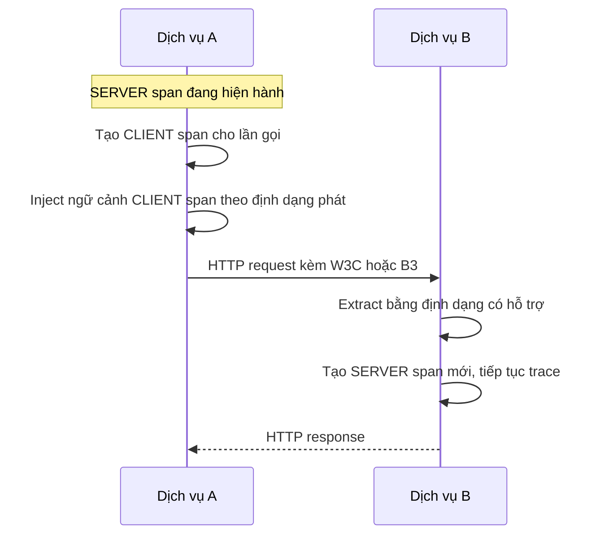

# Đọc và cấu hình định dạng truyền ngữ cảnh W3C hoặc B3

## 1. Vì sao cùng có tracing mà hai dịch vụ vẫn tạo hai trace?

Dịch vụ đặt hàng gọi dịch vụ kho. Cả hai đều ghi log có trace ID và đều gửi dữ liệu đến cùng hệ thống truy vết, nhưng một lần mua hàng lại xuất hiện thành hai hành trình rời nhau.

Một nguyên nhân là hai phía không thống nhất **định dạng truyền ngữ cảnh**: phía gửi ghi W3C vào HTTP header, phía nhận chỉ xử lý một cấu hình B3 khác hoặc không được gắn cơ chế đọc ngữ cảnh.

Truyền ngữ cảnh (context propagation) cần hai thao tác:

- **Chèn ngữ cảnh (inject):** phía gửi ghi ngữ cảnh hiện hành vào vật mang, chẳng hạn HTTP header.
- **Trích xuất ngữ cảnh (extract):** phía nhận đọc thông tin đó để tiếp tục hành trình và tạo công việc của mình.

Thư viện thực hiện hai thao tác này gọi là **propagator**. Định dạng trên đường truyền phải được hai phía hiểu, nhưng các header không mang theo toàn bộ cây span. [Vai trò của propagator](https://opentelemetry.io/docs/specs/otel/context/api-propagators/).

Bài này tập trung vào cách đọc header, chọn cấu hình Spring Boot **3.3.x** và kiểm tra từng ranh giới. Cần phân biệt ba tên:

| Tên | Vai trò trong bài |
| --- | --- |
| W3C Trace Context | Định dạng ngữ cảnh với `traceparent` và `tracestate` |
| B3 | Họ định dạng có dạng một header `b3` hoặc nhiều header `X-B3-*` |
| OTLP hoặc API Zipkin | Giao thức xuất bản ghi span đến nơi thu nhận; là một trục cấu hình khác |

Xuất dữ liệu đến Zipkin không bắt buộc mọi lời gọi HTTP phải dùng B3. Dùng OpenTelemetry cũng không tự chứng minh mọi dịch vụ đã đọc đúng W3C. Phải kiểm tra cấu hình propagator và HTTP client/server thực tế.

## 2. Đọc W3C Trace Context

Ví dụ một yêu cầu HTTP mang:

```http
GET /stock/SKU-8 HTTP/1.1
Host: inventory.internal
traceparent: 00-8a5e9c124fd3406ba271e8dcb3907f62-4a16c3f0e8b5927d-01
```

Với phiên bản `00`, chuỗi `traceparent` có bốn trường:

| Trường | Giá trị ví dụ | Cách đọc |
| --- | --- | --- |
| Version | `00` | Phiên bản định dạng |
| Trace ID | `8a5e9c124fd3406ba271e8dcb3907f62` | 32 ký tự hex, định danh hành trình |
| Parent ID | `4a16c3f0e8b5927d` | 16 ký tự hex, định danh công việc phía gửi |
| Trace flags | `01` | Bit sampled đang bật |

ID sử dụng hex chữ thường; trace ID và parent ID không được toàn số 0. Không rút một trace ID 32 ký tự thành 16 ký tự để “cho giống B3”. [Định dạng W3C Trace Context](https://www.w3.org/TR/trace-context/#traceparent-header).

### Parent ID không phải span ID mới của phía nhận

Nếu lời gọi đang được đo bằng CLIENT span có ID `4a16c3f0e8b5927d`, giá trị đó đi trong header. Khi phía inventory tạo SERVER span riêng, kết quả mong đợi trong mô hình này là:

```text
traceId      = 8a5e9c124fd3406ba271e8dcb3907f62
spanId       = 5b27d4a1f9c6038e
parentSpanId = 4a16c3f0e8b5927d
```

Span ID phía nhận là giá trị minh họa, không phải hằng số phải xuất hiện trong mọi lần chạy. Khi inventory gọi tiếp một dịch vụ khác, header cần được chèn từ ngữ cảnh của lần gọi mới; không sao chép nguyên header đã nhận rồi giữ parent ID cũ cho mọi chặng.

### `tracestate` và sampled có ý nghĩa riêng

`tracestate` bổ sung trạng thái riêng của các hệ thống truy vết. Nó không thay cho `traceparent` và không phải nơi đặt tùy ý mật khẩu hoặc dữ liệu nghiệp vụ. Header `baggage` cũng là cơ chế riêng, không đồng nghĩa với `tracestate`.

Cờ sampled hỗ trợ quyết định ghi nhận dữ liệu; `01` không bảo đảm exporter đã gửi thành công. Khi đọc cờ, hiểu đây là một trường bit; không xây bộ xử lý sản xuất bằng cách kiểm tra chuỗi “có khác 00 hay không”. Thư viện cần xử lý tính hợp lệ và phiên bản theo chuẩn. [Cờ và trạng thái W3C](https://www.w3.org/TR/trace-context/).

## 3. Đọc B3: một header và nhiều header

### 3.1. B3 một header

Cùng trace ID và span ID phía gửi có thể được biểu diễn:

```http
b3: 8a5e9c124fd3406ba271e8dcb3907f62-4a16c3f0e8b5927d-1
```

Ba trường ở ví dụ là:

```text
TraceId-SpanId-SamplingState
```

B3 không có trường version `00` đứng đầu như `traceparent`. Trường sampling thông thường là `1` để chấp nhận lấy mẫu, `0` để từ chối; vắng trường này là trì hoãn quyết định. Giá trị `d` biểu diễn debug và bao hàm chấp nhận lấy mẫu.

Chuẩn còn có dạng có trường ParentSpanId tùy chọn ở cuối. Không tự thêm một dấu `-` để thế chỗ trường vắng, và không coi mọi chuỗi B3 đều bắt buộc có đúng ba phần.

### 3.2. B3 nhiều header

Dạng phổ biến tương ứng:

```http
X-B3-TraceId: 8a5e9c124fd3406ba271e8dcb3907f62
X-B3-SpanId: 4a16c3f0e8b5927d
X-B3-Sampled: 1
```

| Thông tin | W3C | B3 một header | B3 nhiều header |
| --- | --- | --- | --- |
| Trace ID | Trường thứ hai của `traceparent` | Trường đầu của `b3` | `X-B3-TraceId` |
| Span phía gửi | Parent ID trong `traceparent` | Trường thứ hai của `b3` | `X-B3-SpanId` |
| Lấy mẫu | Bit sampled trong flags | Trường sampling | `X-B3-Sampled` |
| Debug riêng của B3 | Không có ánh xạ một-một trực tiếp | `d` | `X-B3-Flags: 1` |
| Độ dài trace ID | 32 ký tự hex | 16 hoặc 32 ký tự hex | 16 hoặc 32 ký tự hex |

B3 cũng cho phép chỉ truyền quyết định lấy mẫu, chẳng hạn `b3: 0`, không kèm định danh. Trường hợp đó không cung cấp một trace ID để nối tiếp; không đánh đồng nó với trường hợp gửi đủ định danh nhưng sampled bằng 0.

Header vắng khác header có giá trị rỗng. Với sampled, không nên phát `true`/`false` thay `1`/`0` chỉ vì một triển khai có thể đọc được dạng cũ. Khi dùng debug theo B3 multi, `X-B3-Flags: 1` đã bao hàm chấp nhận lấy mẫu. [Đặc tả B3 và các dạng HTTP](https://github.com/openzipkin/b3-propagation).

### 3.3. Đừng nhầm `X-B3-ParentSpanId` với cha mới phía nhận

Một số hệ thống B3 cũ dùng mô hình hai phía RPC chia sẻ span ID; vì vậy có trường `X-B3-ParentSpanId` hoặc trường cha tùy chọn trong B3 single.

OpenTelemetry sử dụng SERVER span riêng, không lấy `X-B3-SpanId` làm ID mới của SERVER span; khi chèn B3, nó không cần phát `X-B3-ParentSpanId`. Thiếu header tùy chọn đó không có nghĩa quan hệ truy vết bị đứt. [Yêu cầu B3 trong OpenTelemetry](https://opentelemetry.io/docs/specs/otel/context/api-propagators/#b3-requirements).

Trong cấu hình Brave của Boot 3.3, hỗ trợ chia sẻ span ID cũng mặc định tắt. Không bật `management.tracing.brave.span-joining-supported` chỉ để làm ID hai phía giống nhau khi đang chẩn đoán một hệ thống dùng span riêng.

## 4. Nhận dạng định dạng không đồng nghĩa đã nối đúng trace

Quy trình thông thường với span riêng:



Phải kiểm tra cả bốn điều:

1. Phía gửi còn ngữ cảnh hiện hành đúng ở thời điểm gọi ra.
2. HTTP client được gắn cơ chế đo và chèn ngữ cảnh.
3. Header không bị proxy, gateway hoặc mã trung gian làm mất/sai.
4. Phía nhận có propagator đọc được định dạng và tạo span theo ngữ cảnh ấy.

Nếu mất ngữ cảnh khi đổi luồng, đổi W3C sang B3 chưa chắc giúp được. Nếu HTTP client không được cấu hình instrumentation, một property `produce` đúng cũng chưa tự gắn header vào mọi thư viện HTTP.

Tên HTTP header không phân biệt hoa thường. Nếu tự viết adapter đọc HTTP headers, không dùng một Map phân biệt hoa thường rồi kết luận `Traceparent` và `traceparent` là hai header khác nhau. [Yêu cầu đối với thao tác extract](https://opentelemetry.io/docs/specs/otel/context/api-propagators/#getter-argument).

## 5. Cấu hình nhận và phát trong Spring Boot 3.3

Ba giá trị cấu hình là:

| Giá trị | Dạng phát tương ứng |
| --- | --- |
| `W3C` | `traceparent`, và `tracestate` khi có |
| `B3` | Một header `b3` |
| `B3_MULTI` | Các header `X-B3-*` |

`B3` và `B3_MULTI` phân biệt rõ dạng phát. Khả năng đọc hai biến thể B3 có thể được một propagator gộp chung; OpenTelemetry yêu cầu propagator B3 đọc cả hai. Vì thế không dùng lựa chọn `consume: [B3]` làm một hàng rào bảo mật với giả định nó chắc chắn từ chối mọi header B3 multi. [Enum của Spring Boot 3.3](https://docs.spring.io/spring-boot/3.3/api/java/org/springframework/boot/actuate/autoconfigure/tracing/TracingProperties.Propagation.PropagationType.html).

Các thuộc tính:

- `management.tracing.propagation.consume`: loại ngữ cảnh đọc từ yêu cầu vào.
- `management.tracing.propagation.produce`: loại ngữ cảnh chèn vào yêu cầu ra.
- `management.tracing.propagation.type`: đặt chung cho cả hai và ghi đè lựa chọn riêng.

Mặc định của Boot 3.3 là `consume=[W3C,B3,B3_MULTI]`, `produce=[W3C]`. Không suy diễn rằng nhận B3 thì lần gọi ra cũng tự phát B3 theo yêu cầu vào. [Thuộc tính propagation của Boot 3.3](https://docs.spring.io/spring-boot/3.3/appendix/application-properties/index.html).

Các đoạn YAML dưới đây là **những lựa chọn thay thế nhau**, không ghép nguyên khối vào cùng file.

### 5.1. Chọn W3C ở cả hai chiều

```yaml
management:
  tracing:
    propagation:
      consume: [W3C]
      produce: [W3C]
```

Phù hợp khi hợp đồng giữa các bên đã thống nhất W3C và không còn cần nhận các đầu gửi B3 trong đường này.

### 5.2. Phát B3 một header

```yaml
management:
  tracing:
    propagation:
      consume: [B3]
      produce: [B3]
```

Khi quan sát yêu cầu ra, tìm `b3`; đừng chỉ tìm các header `X-B3-*` rồi kết luận không có ngữ cảnh.

### 5.3. Phát B3 nhiều header

```yaml
management:
  tracing:
    propagation:
      consume: [B3_MULTI]
      produce: [B3_MULTI]
```

Khi quan sát yêu cầu ra, tìm `X-B3-TraceId`, `X-B3-SpanId` và trạng thái lấy mẫu tương ứng.

### 5.4. Nhận nhiều dạng, chuẩn hóa đầu ra về W3C

```yaml
management:
  tracing:
    propagation:
      consume: [W3C, B3, B3_MULTI]
      produce: [W3C]
```

Ví dụ một yêu cầu B3 hợp lệ được đọc thành ngữ cảnh trong ứng dụng. Lần gọi ra tạo CLIENT span mới và ghi W3C từ ngữ cảnh hiện tại. Đây không phải thao tác đổi tên header; trace ID phải giữ được tính liên tục và parent ID phải mô tả đúng span của lần gọi ra.

### 5.5. Phát song song trong giai đoạn chuyển đổi

```yaml
management:
  tracing:
    propagation:
      consume: [W3C, B3, B3_MULTI]
      produce: [W3C, B3_MULTI]
```

Dùng khi các đích còn cần hai dạng và đã kiểm chứng khả năng tương thích. Cả hai dạng được phát phải mô tả cùng ngữ cảnh hiện hành, không phải mỗi dạng chứa một trace ID khác nhau.

Phát song song làm tăng số header và thêm khả năng xung đột nếu có nơi sao chép giá trị cũ. Sau khi các bên đã chuyển đổi, thu hẹp về dạng thống nhất.

### 5.6. Cẩn thận với `type`

Một lựa chọn đặt chung:

```yaml
management:
  tracing:
    propagation:
      type: [W3C]
```

Nếu một cấu hình khác còn đặt `consume` hoặc `produce`, `type` có thể làm kết quả thực tế khác điều người vận hành đang đọc ở hai thuộc tính đó. Khi thiết kế nhận rộng nhưng phát hẹp, hãy bỏ cấu hình `type` cũ ở các nguồn cấu hình liên quan và dùng hai thuộc tính riêng.

Không nhầm getter lưu giá trị thô trong lớp properties với cấu hình hiệu lực: mã nguồn Boot có các phương thức tính danh sách hiệu lực, ưu tiên `type` nếu nó được đặt. [Cách Boot 3.3 xác định lựa chọn hiệu lực](https://github.com/spring-projects/spring-boot/blob/v3.3.13/spring-boot-project/spring-boot-actuator-autoconfigure/src/main/java/org/springframework/boot/actuate/autoconfigure/tracing/TracingProperties.java).

## 6. Cấu hình cần đi cùng các thành phần truy vết và HTTP client phù hợp

Các cấu hình trên giả định ứng dụng đã có Actuator, một bridge tracing phù hợp và cơ chế đo đạc HTTP. Với OpenTelemetry, phần phụ thuộc tracing có thể bao gồm:

```groovy
// Phần dependencies của dự án đã quản lý phiên bản bằng Spring Boot 3.3.x.
implementation 'org.springframework.boot:spring-boot-starter-actuator'
implementation 'io.micrometer:micrometer-tracing-bridge-otel'
```

Đây không phải toàn bộ build của một ứng dụng web. Giữ starter web và cấu hình xuất dữ liệu phù hợp của dự án. Không thêm đồng thời nhiều bridge để thử chữa lỗi header.

Với `RestClient`, dùng builder được Boot cấp, chẳng hạn lớp cấu hình:

```java
import org.springframework.context.annotation.Bean;
import org.springframework.context.annotation.Configuration;
import org.springframework.web.client.RestClient;

@Configuration(proxyBeanMethods = false)
class InventoryHttpConfiguration {
    @Bean
    RestClient inventoryClient(RestClient.Builder builder) {
        return builder.baseUrl("http://localhost:8081").build();
    }
}
```

Đây là một lớp trong ứng dụng Boot, không phải chương trình Java độc lập. Tự tạo client bỏ qua builder được Boot cấu hình có thể mất truyền trace tự động. Cùng nguyên tắc đó áp dụng cho `RestTemplateBuilder` và `WebClient.Builder`. [Truyền trace bằng các HTTP builder của Boot](https://docs.spring.io/spring-boot/3.3/reference/actuator/tracing.html#actuator.micrometer-tracing.propagating-traces).

Cấu hình propagation cũng không phải lệnh áp dụng cho mọi thư viện HTTP bất kỳ. Nếu có agent hoặc tự khai báo propagator/SDK, phải xác minh đường cấu hình nào thực sự đang sở hữu việc chèn và đọc header.

## 7. Minh chứng Java: nạp cấu hình bằng Binder thật của Boot

Chương trình dưới đây kiểm tra **giá trị mặc định và việc bind thuộc tính**, không gửi HTTP và không thay thế một thí nghiệm propagator qua mạng. Nó dùng lớp cấu hình thật thay vì tự dựng enum hoặc tự viết parser header.

Đặt `PropagationConfigDemo.java` trong `src/main/java/` của một dự án console độc lập:

```java
import java.util.Map;
import org.springframework.boot.actuate.autoconfigure.tracing.TracingProperties;
import org.springframework.boot.context.properties.bind.Bindable;
import org.springframework.boot.context.properties.bind.Binder;
import org.springframework.boot.context.properties.source.MapConfigurationPropertySource;

public class PropagationConfigDemo {
    public static void main(String[] args) {
        TracingProperties defaults = new TracingProperties();
        System.out.println("default.consume="
                + defaults.getPropagation().getConsume());
        System.out.println("default.produce="
                + defaults.getPropagation().getProduce());

        Map<String, Object> values = Map.of(
                "management.tracing.propagation.consume",
                "W3C,B3,B3_MULTI",
                "management.tracing.propagation.produce",
                "B3_MULTI"
        );

        Binder binder = new Binder(new MapConfigurationPropertySource(values));
        TracingProperties configured = binder.bind(
                "management.tracing",
                Bindable.of(TracingProperties.class)
        ).get();

        System.out.println("configured.consume="
                + configured.getPropagation().getConsume());
        System.out.println("configured.produce="
                + configured.getPropagation().getProduce());
    }
}
```

`build.gradle` đầy đủ cho ví dụ console:

```groovy
plugins {
    id 'application'
}

repositories {
    mavenCentral()
}

java {
    toolchain {
        languageVersion = JavaLanguageVersion.of(21)
    }
}

dependencies {
    implementation platform(
            'org.springframework.boot:spring-boot-dependencies:3.3.13')
    implementation 'org.springframework.boot:spring-boot'
    implementation 'org.springframework.boot:spring-boot-actuator-autoconfigure'
}

application {
    mainClass = 'PropagationConfigDemo'
}
```

Với Gradle đã được cài và JDK 21:

```shell
gradle -q run
```

Nếu dự án đã có Gradle wrapper, dùng lệnh wrapper tương ứng thay `gradle`. Không chạy `javac` trần cho file này vì các API Boot cần nằm trên classpath.

Stdout của chương trình:

```text
default.consume=[W3C, B3, B3_MULTI]
default.produce=[W3C]
configured.consume=[W3C, B3, B3_MULTI]
configured.produce=[B3_MULTI]
```

Các giá trị chuỗi được Binder chuyển thành danh sách enum. `consume` và `produce` độc lập; việc đầu vào nhận được nhiều kiểu không khiến đầu ra tự phát mọi kiểu đó.

Ví dụ cố ý không đặt `type`, để hai thuộc tính riêng không bị lựa chọn chung ghi đè. Kết quả này chứng minh việc bind dữ liệu cấu hình; nó chưa chứng minh request đã đi qua một HTTP interceptor hay server đã nối đúng span.

## 8. Kiểm tra header và ngữ cảnh của một yêu cầu thật

### 8.1. API chẩn đoán cho môi trường học

Trong ứng dụng Spring Boot web **đã có tracing hoạt động**, thêm lớp sau để xem ngữ cảnh hiện hành và các header truy vết được nhận:

```java
import java.util.LinkedHashMap;
import java.util.List;
import java.util.Map;
import io.micrometer.tracing.Span;
import io.micrometer.tracing.Tracer;
import org.springframework.http.HttpHeaders;
import org.springframework.web.bind.annotation.GetMapping;
import org.springframework.web.bind.annotation.RequestHeader;
import org.springframework.web.bind.annotation.RestController;

@RestController
public class ContextProbeController {
    private final Tracer tracer;

    public ContextProbeController(Tracer tracer) {
        this.tracer = tracer;
    }

    @GetMapping("/context-probe")
    public Map<String, String> probe(@RequestHeader HttpHeaders headers) {
        Map<String, String> result = new LinkedHashMap<>();
        Span current = tracer.currentSpan();

        result.put("current.traceId",
                current == null ? "NONE" : current.context().traceId());
        result.put("current.spanId",
                current == null ? "NONE" : current.context().spanId());

        for (String name : List.of(
                "traceparent", "tracestate", "b3",
                "X-B3-TraceId", "X-B3-SpanId",
                "X-B3-Sampled", "X-B3-Flags")) {
            String value = headers.getFirst(name);
            if (value != null) {
                result.put(name, value);
            }
        }
        return result;
    }
}
```

Lớp này cần nằm trong package được ứng dụng quét và lưu đúng tên file `ContextProbeController.java`. Nó là phần bổ sung cho ứng dụng, không chạy độc lập bằng `java ContextProbeController.java`.

API chỉ trả những trường truy vết được liệt kê, không phản chiếu toàn bộ header của người dùng. Giữ công cụ chẩn đoán trong môi trường học hoặc phạm vi truy cập phù hợp.

Đặt ứng dụng ở cổng 8080 và dùng cấu hình nhận nhiều dạng ở mục 5.4.

### 8.2. Thử riêng từng dạng

PowerShell với chương trình `curl.exe`:

```powershell
curl.exe -sS -H "traceparent: 00-8a5e9c124fd3406ba271e8dcb3907f62-4a16c3f0e8b5927d-01" http://localhost:8080/context-probe
```

```powershell
curl.exe -sS -H "b3: 8a5e9c124fd3406ba271e8dcb3907f62-4a16c3f0e8b5927d-1" http://localhost:8080/context-probe
```

```powershell
curl.exe -sS -H "X-B3-TraceId: 8a5e9c124fd3406ba271e8dcb3907f62" -H "X-B3-SpanId: 4a16c3f0e8b5927d" -H "X-B3-Sampled: 1" http://localhost:8080/context-probe
```

Trên hệ thống không có alias PowerShell, dùng `curl` thay `curl.exe`.

Với cấu hình và instrumentation đúng, mỗi yêu cầu thử riêng cần cho thấy:

- Header đã gửi hiện diện trong phần trả về tương ứng.
- `current.traceId` tiếp tục trace ID `8a5e9c124fd3406ba271e8dcb3907f62`.
- `current.spanId` là ID của span nhận hiện hành; với mô hình span riêng, không trùng ID phía gửi trong ví dụ.
- Trong dữ liệu span đã xuất, cha của SERVER span nối về công việc phía gửi.

Các header minh họa cố ý dùng ID cố định để dễ đối chiếu; không phát sinh ID theo cách này trong ứng dụng sản xuất. JSON trả về không có một `current.spanId` cố định. Đừng ghi một JSON giả làm output chính xác cho tất cả các lần chạy.

### 8.3. Kiểm tra chiều phát riêng

Ba lệnh curl kiểm tra **chiều nhận**, chưa kiểm tra `produce`. Để kiểm tra chiều phát:

1. Chuẩn bị dịch vụ B trên cổng 8081 với API chẩn đoán tương tự.
2. Cho dịch vụ A gọi B bằng HTTP client được Boot cấu hình.
3. Đọc header B thực sự nhận, không chỉ header của curl gửi vào A.
4. Đổi `produce` của A lần lượt sang W3C, B3 và B3 multi rồi chạy lại ứng dụng.
5. Đối chiếu header của lần gọi A→B với CLIENT span tương ứng và SERVER span ở B.

Parent ID ra khỏi A thường là ID của CLIENT span A tạo cho lời gọi, không nhất thiết là ID SERVER span A đang in ở đầu request. Đối chiếu đúng span trước khi kết luận header bị đổi sai.

Nếu B chỉ phản chiếu được header nhưng `current.traceId` lại khác, dữ liệu đã đến nhưng chưa chắc được extract thành ngữ cảnh. Nếu ID ngữ cảnh đúng nhưng nơi lưu truy vết chưa có span, kiểm tra lấy mẫu và đường export như một vấn đề riêng.

## 9. Khi một yêu cầu chứa nhiều bộ header

### B3 một header và nhiều header cùng xuất hiện

Đặc tả B3 ưu tiên dạng single khi extract nếu cùng có single và multi. Nếu hai bộ mang ID khác nhau, không được đoán rằng mọi thư viện sẽ chọn bộ header bạn đang nhìn trước trong log. Với OpenTelemetry, yêu cầu tương thích B3 cũng quy định ưu tiên single.

### W3C và B3 cùng xuất hiện

Không có một quy tắc chung “W3C luôn thắng B3” cho mọi ngôn ngữ, bridge và bộ composite propagator. Cần xem triển khai, cấu hình hiệu lực và kiểm thử đang dùng.

Trong giai đoạn phát song song, hãy để cùng cơ chế instrumentation tạo các dạng từ **cùng ngữ cảnh hiện hành**. Tránh một gateway giữ header W3C cũ nhưng tự tạo B3 mới, hoặc mã ứng dụng ghi đè một header sau khi thư viện đã chèn.

Khi chẩn đoán, trước hết gửi riêng từng định dạng. Chỉ sau khi từng đường hoạt động mới thử kết hợp; nếu trộn ngay từ đầu, khó biết bộ nào thực sự đang được đọc.

Một proxy chỉ chuyển tiếp byte header không tự biến B3 thành W3C. Dịch vụ chuyển đổi cần đọc ngữ cảnh rồi chèn dạng đích theo cơ chế đúng; thay tên `b3` thành `traceparent` không chuyển đổi cấu trúc.

## 10. Chuyển đổi W3C/B3 mà không làm đứt chuỗi

Một lộ trình có thể kiểm chứng:

| Giai đoạn | Chiều nhận | Chiều phát | Điều cần xác minh |
| --- | --- | --- | --- |
| Kiểm kê | Ghi nhận các dạng thực tế | Ghi nhận các dạng thực tế | Đầu gửi cũ, proxy và thư viện từng bên |
| Mở khả năng tương thích ở bên nhận | Hỗ trợ các dạng đang tồn tại | Giữ hợp đồng đầu ra đang dùng | Yêu cầu cũ vẫn nối đúng trace |
| Chuyển đầu gửi | Vẫn nhận các dạng cần thiết | Phát W3C, hoặc song song có chủ đích | Header và quan hệ span qua từng chặng |
| Thu hẹp | Bỏ dạng cũ khi không còn nguồn cần nó | Dạng đã thống nhất | Không còn bên phụ thuộc dạng cũ |

Tùy các bên đang kết nối, chọn giai đoạn cần thiết và thu hẹp số dạng phát sau khi chuyển đổi đã được xác minh.

Khi gặp trace ID B3 64 bit, để thư viện xử lý việc biểu diễn tương thích với định dạng 128 bit; không tùy ý cắt, băm lại hoặc tái sinh trace ID ở gateway. Không giả định mọi metadata, đặc biệt debug hoặc thông tin riêng trong `tracestate`, đều có ánh xạ một-một giữa các định dạng.

Kiểm tra ranh giới được sửa và những chặng tiếp theo: A nhận B3 rồi phát W3C có thể đúng, nhưng C vẫn chỉ hiểu B3 thì chuỗi B→C còn vấn đề. Xác minh cả chiều nhận lẫn phát ở từng dịch vụ.

## 11. Lỗi thường gặp và cách chọn bằng chứng

| Quan sát | Khả năng cần kiểm tra | Bằng chứng có ích |
| --- | --- | --- |
| Có `b3` nhưng không có `X-B3-TraceId` | Đang phát B3 single | Đọc header `b3`, đối chiếu `produce` |
| Có B3 vào nhưng W3C ra | Hai chiều được cấu hình khác nhau | `consume`, `produce` và ngữ cảnh hiện hành |
| Đã đổi `produce` nhưng header không đổi | Còn `type`, nguồn cấu hình ghi đè, custom propagator hoặc agent | Cấu hình hiệu lực và kết quả áp dụng cấu hình thực tế |
| Không có header ra dù cấu hình đúng | HTTP client bỏ qua instrumentation hoặc ngữ cảnh mất | Cách tạo client và span tại thời điểm gửi |
| Header đến nhưng trace ID mới | Định dạng không được đọc, header sai hoặc chủ đích bắt đầu trace mới | Nội dung header và ngữ cảnh hiện hành phía nhận |
| Cùng trace ID nhưng quan hệ cha không đúng | Sao chép header cũ hoặc chọn sai span hiện hành | ID CLIENT span gửi và cha SERVER span nhận |
| Sampled bằng 0 nhưng log vẫn có trace ID | Có định danh để liên hệ log, không nhất thiết ghi/xuất span | Quyết định lấy mẫu và dữ liệu thực tế bên nhận |
| Xem ở Zipkin trống rồi đổi sang B3 | Có thể đang nhầm propagation với export | Kiểm tra hai đường cấu hình độc lập |

Header truy vết là dữ liệu từ bên ngoài, không phải chứng cứ người dùng được xác thực hay có quyền truy cập. Cờ debug cũng không phải quyền bỏ qua kiểm soát lưu lượng. Thiết kế ranh giới tin cậy và chính sách lấy mẫu theo môi trường thực tế.

Không đưa bí mật vào `tracestate` hoặc baggage để “cho dễ tìm log”. Khi thu thập bằng chứng, chỉ giữ các trường cần thiết cho truy vết và tránh ghi nguyên bộ header chứa thông tin xác thực.

## 12. Thực hành tự kiểm tra

**Tình huống 1:** Ứng dụng nhận cả W3C và B3 nhưng chỉ có `produce: [W3C]`. Một request B3 hợp lệ vào thì request ra phải là B3 không?

**Giải thích:** Không. Sau khi extract thành ngữ cảnh, chiều phát dùng lựa chọn W3C. Cần giữ liên tục trace và đúng quan hệ span, không giữ nguyên cấu trúc header đầu vào.

**Tình huống 2:** `produce: [B3]` đã có nhưng người kiểm tra chỉ tìm `X-B3-*` rồi báo không có header. Thiếu bước nào?

**Giải thích:** Cần đọc `b3`, vì lựa chọn B3 phát dạng một header. B3 multi mới phát bộ header riêng.

**Tình huống 3:** Có `consume: [W3C,B3,B3_MULTI]`, `produce: [B3_MULTI]`, đồng thời còn `type: [W3C]`. Đầu ra hiệu lực phải được đánh giá thế nào?

**Giải thích:** Trong Boot 3.3, lựa chọn chung `type` được ưu tiên cho hai chiều. Bỏ cấu hình chung nếu mục tiêu là nhận rộng và phát riêng B3 multi.

**Tình huống 4:** Trace ID giống nhau giữa hai dịch vụ. Đã đủ kết luận truyền ngữ cảnh hoàn chỉnh chưa?

**Giải thích:** Chưa. Cần kiểm tra span riêng, cha của span nhận và ngữ cảnh của lần gọi cụ thể. Cùng ID trong log chưa chứng minh cây span đúng hoặc export thành công.

**Tình huống 5:** OpenTelemetry phát B3 multi nhưng không có `X-B3-ParentSpanId`. Có cần tự thêm bằng code ứng dụng không?

**Giải thích:** Không chỉ vì thiếu trường này. Trong mô hình SERVER span riêng, thông tin phía gửi nằm ở `X-B3-SpanId`; kiểm tra quan hệ thực tế thay vì áp dụng máy móc cách biểu diễn shared span cũ.

Khi đọc một request, hãy xác định dạng header, hiểu ID nào mô tả phía gửi, rồi đối chiếu lựa chọn nhận/phát và span thực sự được tạo. Đó là căn cứ để sửa đúng ranh giới đang mất ngữ cảnh.
