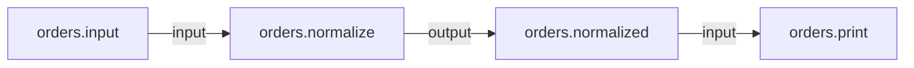

# Khám phá sơ đồ Spring Integration bằng endpoint integrationgraph

Một ứng dụng nhận thông điệp qua một kênh, biến đổi dữ liệu rồi chuyển sang bộ xử lý tiếp theo. Khi số luồng tăng lên, đọc riêng từng lớp Java không còn cho thấy rõ các thành phần đang nối với nhau ra sao trong ứng dụng đã khởi tạo. Endpoint `integrationgraph` của Spring Boot Actuator cung cấp mô hình đồ thị của các thành phần Spring Integration để trả lời câu hỏi đó.

Bài này đi từ cách hiểu sơ đồ, điều kiện để endpoint xuất hiện, một ví dụ chạy được, tới cách đọc JSON và chẩn đoán khi sơ đồ không giống mong đợi. Mốc sử dụng là Spring Boot 3.3.x; ví dụ cố định Spring Boot 3.3.13, Spring Integration 6.3.11 do Boot quản lý và JDK 21. Các phiên bản được cố định để tái lập ví dụ, không hàm ý đây là các phiên bản mới nhất.

## 1. integrationgraph cho biết điều gì?

Spring Integration xây dựng luồng xử lý dựa trên thông điệp, kênh và các thành phần xử lý. Một vài thuật ngữ cần nhận biết:

- **Thông điệp (message):** mang dữ liệu chính, gọi là payload, cùng các header.
- **Kênh (channel):** nơi gửi và nhận thông điệp giữa các thành phần.
- **Bộ xử lý (handler):** thực hiện công việc như biến đổi, lọc hoặc gọi một hàm nghiệp vụ.
- **Endpoint của Spring Integration:** thành phần kết nối bộ xử lý hoặc nguồn dữ liệu với cơ chế nhận/gửi thông điệp và vòng đời hoạt động.
- **Nút và liên kết (node/link):** cách mô hình đồ thị biểu diễn những thành phần trên và quan hệ kết nối của chúng.

Cần phân biệt hai nghĩa của từ “endpoint”: `/actuator/integrationgraph` là endpoint quản trị HTTP; một endpoint bên trong luồng Spring Integration là thành phần xử lý thông điệp. Hai khái niệm này phục vụ những vai trò khác nhau.

Ví dụ một luồng chuẩn hóa chuỗi:



Sơ đồ trả lời được các câu hỏi như:

- Bộ biến đổi đang nhận thông điệp từ kênh nào?
- Kết quả của nó được gửi tiếp tới đâu?
- Bộ xử lý cuối cùng có nối với kênh mong muốn không?
- Nhánh lỗi, nhánh loại bỏ hoặc nhánh định tuyến nào được mô hình hiện tại biểu diễn?

Đây là góc nhìn về **cấu trúc kết nối của ứng dụng đang chạy**. Nó không phải sơ đồ quan hệ phụ thuộc Java, danh sách toàn bộ Spring bean hay bản đồ mọi dịch vụ trong hệ thống. `beans` và `mappings` có mục đích khác; cũng không thể dùng sơ đồ này để kết luận một đơn hàng cụ thể đã đi qua từng nút.

Spring Boot có starter để khởi tạo hạ tầng Spring Integration khi các điều kiện tự cấu hình được đáp ứng. Không cần tự viết một REST controller chỉ để xuất lại sơ đồ mà Actuator đã hỗ trợ. [Spring Integration trong Spring Boot 3.3](https://docs.spring.io/spring-boot/3.3/reference/messaging/spring-integration.html).

## 2. Điều kiện để gọi được endpoint

Hãy kiểm tra riêng ba lớp điều kiện.

### 2.1. Có thành phần tạo sơ đồ

Ứng dụng phải có thư viện Spring Integration và hạ tầng Integration đã được khởi tạo. Chỉ thêm Actuator không biến mọi đoạn mã Java hoặc mọi `@Service` thành một nút Integration.

Trong cấu hình chuẩn của Spring Boot, `spring-boot-starter-integration` cung cấp các phụ thuộc cần thiết. Actuator sử dụng `IntegrationGraphServer` để lấy mô hình đồ thị. Khi cấu hình mặc định được áp dụng, Boot có thể tạo bean này nếu ứng dụng chưa cung cấp bean riêng. Không nên thêm bean thủ công chỉ vì thấy HTTP 404 mà chưa kiểm tra các điều kiện còn lại.

### 2.2. Endpoint được bật và được expose qua HTTP

Trong Spring Boot 3.3, bật endpoint và expose endpoint là hai lựa chọn khác nhau. Mặc định chỉ `health` được expose qua HTTP; vì vậy có phụ thuộc đúng chưa đủ để gọi được `/actuator/integrationgraph`.

Cấu hình tối thiểu liên quan tới bài học:

```yaml
management:
  endpoint:
    integrationgraph:
      enabled: true
  endpoints:
    web:
      exposure:
        include: health,integrationgraph
```

`enabled: true` ghi rõ chủ đích bật endpoint; `include` chọn các endpoint được cung cấp trên kênh web. Nếu cấu hình hiệu lực còn có `exclude: integrationgraph`, danh sách loại trừ được ưu tiên. Hãy kiểm tra cả profile, biến môi trường và các nguồn cấu hình ghi đè. [Quy tắc bật và expose endpoint trong Boot 3.3](https://docs.spring.io/spring-boot/3.3/reference/actuator/endpoints.html).

Không cần dùng `include: "*"` để học endpoint này. Nếu ứng dụng đổi management port, context path hoặc đường dẫn cơ sở Actuator, URL thực tế cũng thay đổi.

### 2.3. Người gọi được cấp quyền

Exposure không cấp quyền truy cập. Khi ứng dụng có Spring Security, người gọi còn phải thỏa mãn chính sách xác thực và phân quyền đang áp dụng.

Bài thực hành bên dưới chỉ lắng nghe trên loopback và không thêm Spring Security để tập trung quan sát sơ đồ. Không dùng nguyên cấu hình thử nghiệm đó để công khai endpoint trên mạng. Chính sách cho môi trường vận hành được bàn riêng ở phần cuối.

## 3. Hai thao tác: đọc và dựng lại sơ đồ

| Yêu cầu HTTP trên đường dẫn mặc định | Tác dụng | Phản hồi thành công |
| --- | --- | --- |
| `GET /actuator/integrationgraph` | Lấy mô hình đồ thị đang được cung cấp | `200 OK` và JSON |
| `POST /actuator/integrationgraph` | Yêu cầu dựng lại mô hình đồ thị | `204 No Content` |

`GET` sử dụng đồ thị do `IntegrationGraphServer` lưu giữ. `POST` gọi cơ chế dựng lại, phù hợp khi tập thành phần đã thay đổi, chẳng hạn ứng dụng đăng ký hoặc hủy một luồng động. Sau `POST`, gọi lại `GET` để lấy JSON mới; không chờ nội dung đồ thị nằm trong phản hồi 204. [Hợp đồng REST của integrationgraph](https://docs.spring.io/spring-boot/api/rest/actuator/integrationgraph.html).

**Dựng lại sơ đồ không phải chạy lại luồng xử lý.** Yêu cầu này không tự gửi lại thông điệp, không tạo một `IntegrationFlow` mới, không nạp lại `application.yml` và không thay thế việc sửa cấu hình ứng dụng. Nó cập nhật mô hình quan sát từ các thành phần hiện có.

Cũng cần phân biệt cấu trúc kết nối với các số liệu động. Những dữ liệu được lấy từ bộ đo khi đọc đồ thị có thể thay đổi mà không cần dựng lại toàn bộ cấu trúc. Không thiết kế công cụ theo kiểu cứ muốn xem bộ đếm mới là gọi `POST` liên tục.

## 4. Đọc ba phần chính trong JSON

Phản hồi có ba phần quan trọng: `contentDescriptor`, `nodes` và `links`.

### 4.1. contentDescriptor: thông tin về mô hình

| Trường thường gặp | Cách hiểu |
| --- | --- |
| `provider` | Thành phần cung cấp mô hình, ở đây là `spring-integration` |
| `providerVersion` | Phiên bản Spring Integration cung cấp dữ liệu; không phải phiên bản Spring Boot |
| `providerFormatVersion` | Phiên bản định dạng đồ thị |
| `name` | Tên ứng dụng nếu có cấu hình phù hợp, chẳng hạn `spring.application.name` |

Đọc thông tin này trước khi viết trình phân tích hoặc so sánh hai bản chụp. Không giả định mọi phiên bản đều có đúng tập trường và cùng cách biểu diễn chi tiết.

### 4.2. nodes: các thành phần

Một nút có thể cung cấp:

- `nodeId`: định danh để các liên kết trong cùng bản chụp tham chiếu tới.
- `name`: tên thành phần, hữu ích khi đối chiếu với cấu hình ứng dụng.
- `componentType`: loại thành phần ở mức triển khai.
- `integrationPatternType`, `integrationPatternCategory`: thông tin phân loại mẫu tích hợp.
- `input`, `output`: tên các kênh liên quan khi loại nút đó có các thuộc tính tương ứng.
- `properties` và những trường bổ sung: thông tin tùy loại thành phần và cấu hình quản trị.

Không dùng vị trí phần tử trong mảng `nodes` làm thứ tự thực thi. Không giả định phần tử thứ nhất là đầu luồng hoặc phần tử cuối cùng là đích cuối.

`nodeId` phục vụ liên kết trong mô hình hiện tại. Khi khởi động lại, dựng lại hoặc thay đổi thành phần, không được coi số này là định danh nghiệp vụ bền vững. Muốn đối chiếu lâu dài, hãy đặt tên thành phần có ý nghĩa và so sánh cả tên lẫn quan hệ kết nối.

Một lời gọi DSL cũng không nhất thiết tương ứng với đúng một nút nhìn thấy. Framework có thể tạo kênh hoặc thành phần trung gian; ngoài luồng tự viết còn có các thành phần hạ tầng. Tên sinh tự động và tên lớp lambda có thể thay đổi giữa các lần chạy, nên đừng xây bộ phân tích phụ thuộc cứng vào chúng.

### 4.3. links: các quan hệ có hướng

Mỗi liên kết dùng `from` và `to` để tham chiếu `nodeId`, không phải chỉ số mảng. Trường `type` cho biết vai trò của quan hệ.

| type thường gặp | Cách đọc |
| --- | --- |
| `input` | Từ kênh tới thành phần tiêu thụ từ kênh đó |
| `output` | Từ thành phần tạo kết quả tới kênh đầu ra |
| `error` | Quan hệ tới kênh lỗi khi thành phần hỗ trợ và mô hình xác định được |
| `discard` | Quan hệ tới kênh nhận thông điệp bị loại khi có cấu hình tương ứng |
| `route` | Quan hệ định tuyến tới kênh đích |

Không đảo chiều mũi tên chỉ vì thấy chữ `input`: hãy ghép `from/to` với nút rồi đọc từ nguồn tới đích. Một đồ thị cũng có thể có nhiều nhánh, vòng lặp và thành phần dùng chung; không mặc định toàn bộ mô hình là một danh sách tuyến tính.

Định tuyến động có giới hạn riêng: những đích được mô hình biết tới không nhất thiết đại diện mọi nhánh có thể xảy ra với mọi giá trị dữ liệu. Vắng một liên kết chưa đủ chứng minh nhánh đó không bao giờ được sử dụng. [Mô hình Integration Graph của Spring Integration 6.3](https://docs.spring.io/spring-integration/reference/6.3/graph.html).

## 5. Ví dụ hoàn chỉnh: chuẩn hóa rồi in thông điệp

Ví dụ tạo luồng có bốn thành phần được đặt tên rõ ràng:

```text
orders.input
  -> orders.normalize
  -> orders.normalized
  -> orders.print
```

Hai chuỗi mẫu được gửi vào luồng khi ứng dụng khởi động. Không cần tạo thêm API nghiệp vụ để phát thông điệp trong bài này.

### 5.1. Cấu trúc dự án

Tạo một thư mục mới với các tệp sau:

```text
integrationgraph-demo/
├── pom.xml
└── src/
    └── main/
        ├── java/
        │   └── example/
        │       └── IntegrationGraphDemoApplication.java
        └── resources/
            └── application.yml
```

Dùng JDK 21 và Maven đã cài đặt. Đây là ví dụ độc lập; trong dự án có sẵn, dùng cơ chế quản lý phiên bản phụ thuộc của chính dự án thay vì trộn các phiên bản Spring Integration tùy ý.

### 5.2. pom.xml

```xml
<project xmlns="http://maven.apache.org/POM/4.0.0" xmlns:xsi="http://www.w3.org/2001/XMLSchema-instance" xsi:schemaLocation="http://maven.apache.org/POM/4.0.0 https://maven.apache.org/xsd/maven-4.0.0.xsd">
    <modelVersion>4.0.0</modelVersion>
    <parent>
        <groupId>org.springframework.boot</groupId>
        <artifactId>spring-boot-starter-parent</artifactId>
        <version>3.3.13</version>
        <relativePath/>
    </parent>
    <groupId>example</groupId>
    <artifactId>integrationgraph-demo</artifactId>
    <version>1.0.0</version>
    <properties>
        <java.version>21</java.version>
    </properties>
    <dependencies>
        <dependency>
            <groupId>org.springframework.boot</groupId>
            <artifactId>spring-boot-starter-web</artifactId>
        </dependency>
        <dependency>
            <groupId>org.springframework.boot</groupId>
            <artifactId>spring-boot-starter-actuator</artifactId>
        </dependency>
        <dependency>
            <groupId>org.springframework.boot</groupId>
            <artifactId>spring-boot-starter-integration</artifactId>
        </dependency>
    </dependencies>
    <build>
        <plugins>
            <plugin>
                <groupId>org.springframework.boot</groupId>
                <artifactId>spring-boot-maven-plugin</artifactId>
            </plugin>
        </plugins>
    </build>
</project>
```

Ba starter có vai trò khác nhau: starter web cung cấp HTTP, starter Actuator cung cấp endpoint quản trị, starter Integration cung cấp hạ tầng luồng thông điệp. Không cần thêm module `spring-integration-http` chỉ để gọi endpoint Actuator này.

### 5.3. application.yml

```yaml
spring:
  application:
    name: integrationgraph-demo

server:
  address: 127.0.0.1
  port: 8098

management:
  endpoint:
    integrationgraph:
      enabled: true
  endpoints:
    web:
      exposure:
        include: health,integrationgraph
```

Ứng dụng chỉ nghe trên `127.0.0.1:8098`. Tên `integrationgraph-demo` còn giúp nhận biết dữ liệu trong `contentDescriptor`. Nếu cổng đã được dùng, chọn cổng trống và thay URL của các lệnh phía sau tương ứng.

### 5.4. Mã Java

Lưu đúng đường dẫn `src/main/java/example/IntegrationGraphDemoApplication.java`:

```java
package example;

import java.util.Locale;
import org.springframework.beans.factory.annotation.Qualifier;
import org.springframework.boot.ApplicationRunner;
import org.springframework.boot.SpringApplication;
import org.springframework.boot.autoconfigure.SpringBootApplication;
import org.springframework.context.annotation.Bean;
import org.springframework.integration.channel.DirectChannel;
import org.springframework.integration.dsl.IntegrationFlow;
import org.springframework.messaging.MessageChannel;
import org.springframework.messaging.support.MessageBuilder;

@SpringBootApplication
public class IntegrationGraphDemoApplication {
    public static void main(String[] args) {
        SpringApplication.run(IntegrationGraphDemoApplication.class, args);
    }

    @Bean(name = "orders.input")
    MessageChannel ordersInput() {
        return new DirectChannel();
    }

    @Bean
    IntegrationFlow ordersFlow(
            @Qualifier("orders.input") MessageChannel input) {
        return IntegrationFlow.from(input)
                .transformWith(spec -> spec
                        .transformer((String text) ->
                                text.trim().toUpperCase(Locale.ROOT))
                        .id("orders.normalize"))
                .channel("orders.normalized")
                .handle(message -> System.out.println(
                                "processed=" + message.getPayload()),
                        endpoint -> endpoint.id("orders.print"))
                .get();
    }

    @Bean
    ApplicationRunner sendSamples(
            @Qualifier("orders.input") MessageChannel input) {
        return args -> {
            input.send(MessageBuilder.withPayload("  java  ").build());
            input.send(MessageBuilder.withPayload(" spring ").build());
        };
    }
}
```

Đi theo mã từ trên xuống:

1. `orders.input` là một `DirectChannel` được khai báo rõ bằng bean.
2. `orders.normalize` cắt khoảng trắng ở hai đầu và chuyển chuỗi thành chữ hoa với `Locale.ROOT`.
3. `orders.normalized` là kênh trung gian được Java DSL đăng ký.
4. `orders.print` nhận thông điệp đã chuẩn hóa và in payload.
5. `ApplicationRunner` gửi hai thông điệp sau khi ngữ cảnh ứng dụng đã khởi tạo.

`DirectChannel` chuyển thông điệp trực tiếp tới bộ xử lý trong luồng gửi đối với cấu hình ở đây. Không có hàng đợi hay bộ thực thi bất đồng bộ được thêm vào ví dụ; vì vậy hai lệnh gửi trong runner tạo ra hai kết quả theo thứ tự đã viết. [Cơ chế DirectChannel](https://docs.spring.io/spring-integration/reference/channel/implementations.html).

### 5.5. Biên dịch và chạy

Trong thư mục chứa `pom.xml`:

```bash
mvn clean package
java -jar target/integrationgraph-demo-1.0.0.jar
```

Đây là ứng dụng có phụ thuộc Spring nên không biên dịch bằng một lệnh `javac` trần. Maven thiết lập classpath, gọi trình biên dịch của JDK và đóng gói JAR; lệnh `java -jar` chạy ứng dụng đã đóng gói.

Ngoài nhật ký khởi động của Spring Boot, phần chương trình tự in chính xác:

```text
processed=JAVA
processed=SPRING
```

Các dòng trên là bằng chứng bộ xử lý cuối đã nhận dữ liệu mẫu. Chỉ nhìn thấy bốn nút trong đồ thị sẽ chưa đủ chứng minh điều đó.

### 5.6. Lấy sơ đồ qua HTTP

Giữ ứng dụng chạy, mở terminal khác:

```bash
curl -i http://127.0.0.1:8098/actuator/integrationgraph
curl -fsS http://127.0.0.1:8098/actuator/integrationgraph -o integrationgraph.json
```

Trên Windows PowerShell, có thể dùng `curl.exe` để gọi đúng chương trình curl. Lệnh đầu giúp kiểm tra HTTP status và headers; lệnh thứ hai chỉ lưu phần JSON vào tệp. Không dùng đầu ra có headers của `curl -i` làm đầu vào trực tiếp cho chương trình đọc JSON.

Khi cấu hình và quyền truy cập phù hợp, yêu cầu đọc trả về `200 OK`. Bản JSON sau đã được rút gọn từ mô hình của ví dụ: chỉ giữ bốn nút của luồng và ba liên kết tương ứng, bỏ các trường khác cùng thành phần hạ tầng. Các số `nodeId` là của một lần khởi tạo cụ thể, không phải hằng số phải xuất hiện trên máy khác.

```json
{
  "contentDescriptor": {
    "providerVersion": "6.3.11",
    "providerFormatVersion": 1.2,
    "provider": "spring-integration",
    "name": "integrationgraph-demo"
  },
  "nodes": [
    {
      "nodeId": 1,
      "name": "orders.input"
    },
    {
      "nodeId": 4,
      "name": "orders.normalized"
    },
    {
      "nodeId": 6,
      "name": "orders.normalize",
      "input": "orders.input",
      "output": "orders.normalized"
    },
    {
      "nodeId": 7,
      "name": "orders.print",
      "input": "orders.normalized"
    }
  ],
  "links": [
    {
      "from": 1,
      "to": 6,
      "type": "input"
    },
    {
      "from": 6,
      "to": 4,
      "type": "output"
    },
    {
      "from": 4,
      "to": 7,
      "type": "input"
    }
  ]
}
```

Trong phản hồi đầy đủ còn có thể thấy `errorChannel`, `nullChannel` và `errorLogger`. Sự xuất hiện của chúng không có nghĩa chương trình vừa gặp lỗi. Đó có thể chỉ là hạ tầng được framework đăng ký.

Cách đọc ba cạnh của luồng:

- `1 -> 6`, loại `input`: bộ biến đổi nhận từ `orders.input`.
- `6 -> 4`, loại `output`: bộ biến đổi gửi kết quả tới `orders.normalized`.
- `4 -> 7`, loại `input`: bộ in tiêu thụ từ `orders.normalized`.

Nếu các số khác ở lần chạy của bạn, tra lại bảng `nodeId -> name` trong chính phản hồi đó. Tên và quan hệ mới là phần cần đối chiếu với cấu hình luồng.

## 6. Tự ghép các nút và liên kết

Không cần công cụ vẽ mới hiểu được đồ thị. Một chương trình ngắn có thể tra `from/to` sang tên để in các cạnh dễ đọc.

Ví dụ dưới đây dùng Python 3 và thư viện chuẩn, là công cụ đọc JSON độc lập với ứng dụng Java. Lưu thành `inspect_graph.py` cạnh tệp `integrationgraph.json`:

```python
import json
import sys

with open(sys.argv[1], encoding="utf-8") as stream:
    graph = json.load(stream)

nodes = graph["nodes"]
by_id = {node["nodeId"]: node for node in nodes}
if len(by_id) != len(nodes):
    raise ValueError("Duplicate nodeId")

edges = []
for link in graph["links"]:
    source = by_id[link["from"]]["name"]
    target = by_id[link["to"]]["name"]
    if source.startswith("orders.") and target.startswith("orders."):
        edges.append((source, link["type"], target))

for source, kind, target in sorted(edges):
    print(f"{source} --{kind}--> {target}")
```

Chạy:

```bash
python inspect_graph.py integrationgraph.json
```

Với sơ đồ của ví dụ, stdout là:

```text
orders.input --input--> orders.normalize
orders.normalize --output--> orders.normalized
orders.normalized --input--> orders.print
```

Chương trình tạo bảng tra theo `nodeId`, kiểm tra định danh trùng rồi mới ghép cạnh. Nếu một cạnh tham chiếu nút không có trong dữ liệu đầu vào, phép tra cứu sẽ báo lỗi thay vì lặng lẽ dựng sai sơ đồ.

Đầu ra được sắp theo tên để dễ đối chiếu; đó là thứ tự trình bày của công cụ, không phải thuật toán suy ra trình tự thực thi. Luồng mẫu tuyến tính nên ba cạnh nhìn giống thứ tự xử lý, nhưng không được áp dụng giả định đó cho đồ thị có nhánh hoặc vòng lặp.

Một công cụ trực quan hóa lớn hơn vẫn cần cùng các bước: đọc descriptor, lập bảng nút, giải tham chiếu cạnh, rồi dựng bố cục. Hãy chấp nhận trường chưa biết và kiểu thành phần mới, đồng thời báo rõ lỗi định dạng thiết yếu thay vì phụ thuộc cứng vào tên lớp sinh tự động.

## 7. Khi nào cần dựng lại sơ đồ?

Với ứng dụng chỉ có các luồng tĩnh khởi tạo một lần, thường không cần liên tục yêu cầu dựng lại. Tình huống đáng kiểm tra là ứng dụng có đăng ký hoặc hủy thành phần trong thời gian chạy, chẳng hạn thông qua `IntegrationFlowContext`.

Quy trình quan sát thay đổi cấu trúc:

1. Lưu bản đồ thị hiện tại.
2. Thực hiện thay đổi luồng bằng cơ chế quản lý luồng của ứng dụng.
3. Yêu cầu endpoint dựng lại mô hình.
4. Đọc lại bằng `GET` và so sánh tên thành phần cùng quan hệ.

Trong ví dụ cục bộ không có Spring Security:

```bash
curl -i -X POST http://127.0.0.1:8098/actuator/integrationgraph
curl -fsS http://127.0.0.1:8098/actuator/integrationgraph -o integrationgraph-after.json
```

Yêu cầu đầu thành công trả `204 No Content`. Vì ví dụ chưa thêm hoặc bớt luồng, bạn không nên mong đợi một cấu trúc mới chỉ vì đã gửi `POST`.

`IntegrationGraphServer.getGraph()` lấy đồ thị lưu giữ; `rebuild()` dựng và lưu lại mô hình khi thành phần thay đổi. Đây là API quản lý mô hình, không phải API điều khiển dữ liệu nghiệp vụ. [API IntegrationGraphServer](https://docs.spring.io/spring-integration/api/org/springframework/integration/graph/IntegrationGraphServer.html).

Khi so sánh hai bản chụp, không so nguyên JSON rồi kết luận mọi khác biệt là thay đổi luồng: thứ tự phần tử, định danh nội bộ hoặc giá trị đo thời gian có thể khác. Hãy chuẩn hóa thành các nút có tên và tập cạnh có loại trước khi so sánh cấu trúc.

## 8. Sơ đồ không thay thế metrics, trace hay kiểm tra vòng đời

Một đồ thị nhìn đúng chưa chứng minh toàn bộ luồng đang hoạt động tốt. Cần biết giới hạn của từng loại bằng chứng.

| Câu hỏi | Bằng chứng phù hợp |
| --- | --- |
| Thành phần A nối tới kênh nào? | Nút và liên kết của `integrationgraph` |
| Một thông điệp cụ thể đi qua những bước nào? | Theo dõi thông điệp, log có mã tương quan hoặc trace đã được cấu hình |
| Mức tải và thời gian xử lý biến đổi ra sao? | Metrics được thu thập theo thời gian |
| Bộ xử lý có đang chạy, đang dừng hoặc mất kết nối ngoài hệ thống không? | Trạng thái vòng đời và kiểm tra thành phần tương ứng |
| Dữ liệu đầu ra có đúng nghiệp vụ không? | Kết quả xử lý và phép kiểm chứng nghiệp vụ |

Trong cấu hình có hỗ trợ số liệu, JSON có thể chứa `sendTimers`, `receiveCounters` hoặc thông tin bổ sung. Sự có mặt và ý nghĩa của chúng phụ thuộc loại thành phần, phiên bản và bộ đo đang được cấu hình. Không lấy một ví dụ JSON của phiên bản khác làm cam kết mọi nút đều có cùng trường.

Đặc biệt, `observed: false` không có nghĩa “nút không chạy” hoặc “chưa có thông điệp”. Nó liên quan tới cơ chế observation, không phải một cờ tổng quát báo luồng đã xử lý dữ liệu hay chưa. Trong ví dụ, chính hai dòng `processed=...` chứng minh dữ liệu đã tới đích; không cần đổi diễn giải chỉ vì một nút có `observed: false`.

Ngay cả khi có bộ đếm, cũng không mặc định mọi nút phải ghi nhận giống nhau. Thành phần tùy biến và các lớp bao quanh có cách hỗ trợ đo đạc khác nhau. Muốn giải thích một chỉ số, trước hết phải biết nó đo tại điểm nào và đơn vị gì. Spring Boot sử dụng Micrometer để tích hợp hệ thống đo đạc; đó là một lớp quan sát bổ sung cho sơ đồ kết nối. [Metrics trong Boot 3.3](https://docs.spring.io/spring-boot/3.3/reference/actuator/metrics.html).

Tương tự, một nút vẫn tồn tại trong mô hình không phải bằng chứng endpoint bên trong nó đang được khởi chạy. Nếu cần hiển thị thêm trạng thái vòng đời, phải cấu hình hoặc thu thập thông tin ấy có chủ đích; không suy diễn từ việc nút có mặt hoặc từ một thuộc tính vắng mặt.

## 9. Chẩn đoán các trường hợp thường gặp

| Hiện tượng | Kiểm tra có ích |
| --- | --- |
| HTTP 404 khi gọi đường dẫn mặc định | Đúng cổng/đường dẫn/profile chưa; endpoint có bật và expose không; thư viện và hạ tầng Integration có được khởi tạo không |
| HTTP 401 hoặc 403 | Danh tính, quyền, chuỗi bộ lọc bảo mật; với `POST`, kiểm tra thêm CSRF |
| Đọc bằng `GET` được nhưng `POST` thất bại | Quyền ghi quản trị và CSRF; không kết luận mô hình đồ thị bị hỏng |
| Chỉ thấy hạ tầng, không thấy luồng tự viết | Bean `IntegrationFlow` có được đăng ký trong đúng ngữ cảnh không; cấu hình có nằm trong phạm vi quét không; có điều kiện/profile loại bỏ luồng không |
| Có thêm nhiều nút ngoài bốn tên của ví dụ | Thành phần mặc định, kênh trung gian hoặc luồng khác có thể cùng xuất hiện; đối chiếu tên và loại nút |
| Các số nodeId khác tài liệu | Lập bảng tra từ phản hồi hiện tại; không dùng hằng số của ví dụ |
| Sơ đồ có vẻ chưa phản ánh thay đổi luồng động | Kiểm tra thay đổi đã thành công, gọi dựng lại rồi lấy JSON mới; xem thêm cache hoặc proxy nếu có |
| Có cạnh đúng nhưng không có kết quả xử lý | Xác minh thông điệp đã được gửi, thành phần đang chạy, bộ lọc/định tuyến và lỗi thực thi; đồ thị chỉ là một phần bằng chứng |
| Thiếu nhánh động mong đợi | Đối chiếu cơ chế định tuyến và những đích mà mô hình đã biết; đừng suy ra toàn bộ khả năng từ một bản chụp |

HTTP status cũng có thể được tùy biến bởi bảo mật hoặc proxy; bảng trên là hướng khoanh vùng, không phải quy tắc suy ngược tuyệt đối.

Một lỗi dễ gặp là thêm annotation `@EnableIntegrationGraphController` để sửa việc không truy cập được Actuator. Annotation đó thuộc cơ chế controller đồ thị của Spring Integration HTTP, là một cách cung cấp giao diện khác. Nó không thay thế việc cấu hình đúng endpoint Actuator, và có thể tạo thêm đường truy cập phải bảo vệ. Với ví dụ này, dùng `/actuator/integrationgraph` đã được Boot cung cấp. [Integration Graph Controller](https://springframework.org/spring-integration/reference/6.3/http/int-graph-controller.html).

## 10. Cung cấp sơ đồ có kiểm soát

Sơ đồ quản trị có thể tiết lộ tên kênh, cách chia bước xử lý, biểu thức hoặc thuộc tính thành phần. Không nên công khai nó chỉ vì phản hồi không chứa trực tiếp payload của một thông điệp. Nếu ứng dụng đưa dữ liệu nhạy cảm vào thuộc tính hoặc phần mở rộng của mô hình, cần rà soát cả những trường đó.

Trong môi trường vận hành:

- Chỉ expose những endpoint thực sự cần; giữ đường quản trị trong phạm vi mạng phù hợp.
- Xác thực người gọi và cấp quyền theo nhu cầu. Quyền xem đồ thị và quyền yêu cầu dựng lại có thể cần được quản lý riêng.
- Bảo vệ đường truyền và nơi lưu các bản chụp JSON; dữ liệu sơ đồ cũng là thông tin nội bộ.
- Với Spring Security, kiểm tra quy tắc đang áp dụng cho Actuator. Nếu có `SecurityFilterChain` tự viết, ứng dụng phải tự bảo đảm quy tắc truy cập thích hợp.
- Đối với `POST`, xác định cách gửi CSRF token hoặc chính sách cho máy khách quản trị phù hợp. Không tắt CSRF toàn ứng dụng chỉ để một lệnh curl chạy được.
- Tránh yêu cầu dựng lại dồn dập trên đồ thị lớn; thao tác quản trị nên gắn với nhu cầu cập nhật cấu trúc cụ thể.

Sau khi thử xong, dừng ứng dụng mẫu bằng Ctrl+C. Một cách sử dụng đúng endpoint này là ghép hai lớp hiểu biết: dùng sơ đồ để xác định quan hệ giữa các thành phần, rồi dùng bằng chứng thực thi và số liệu phù hợp để xác minh luồng có xử lý đúng như mong muốn hay không.
