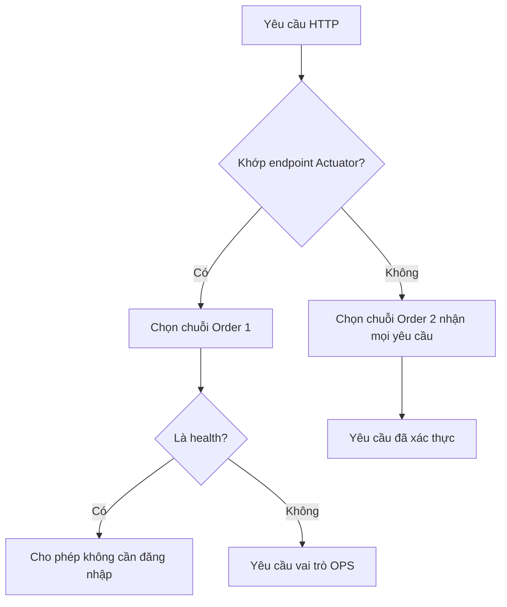

# Ảnh hưởng của SecurityFilterChain tự khai báo đến cấu hình bảo mật mặc định

## 1. Khi tự khai báo chuỗi, ứng dụng nhận trách nhiệm gì?

`SecurityFilterChain` là một chuỗi bộ lọc bảo mật Servlet gắn với điều kiện chọn yêu cầu. Cấu hình thường nhận một `HttpSecurity`, khai báo quy tắc rồi trả về `http.build()` dưới dạng bean. Spring Security dùng chuỗi đó để thực hiện những việc như xác thực, phân quyền, bảo vệ CSRF và thêm header bảo mật.

Trong ứng dụng có Actuator, điều cần hiểu trước khi sửa mã là: **một bean `SecurityFilterChain` do ứng dụng cung cấp làm cấu hình chuỗi bảo mật web mặc định liên quan của Spring Boot lùi lại (back off)**. Boot không tự giữ một chuỗi mặc định để bảo vệ những URL mà chuỗi của bạn bỏ sót. Ứng dụng phải xác định đầy đủ phạm vi và quy tắc cần bảo vệ.

Ví dụ, viết một chuỗi chỉ nhận endpoint Actuator có thể bảo vệ `/actuator/info` đúng như mong muốn nhưng khiến `/api/ping` không còn được chuỗi nào nhận. Việc đã thêm `spring-boot-starter-security` không tự lấp khoảng trống này.

Bài dùng **Spring Boot 3.3.13, Java 21 và Spring MVC/Servlet**. Đó là mốc phiên bản để tái hiện hành vi, không phải thông báo về phiên bản mới nhất. `SecurityFilterChain` và `HttpSecurity` trong bài không thay thế API bảo mật reactive của WebFlux.

## 2. Cấu hình mặc định đang làm gì trước khi có bean riêng?

Với các starter Web, Actuator và Security, không có chuỗi bảo mật tự khai báo và không có cơ chế bảo mật khác thay thế, Boot cung cấp cấu hình mặc định. Trong tình huống thông thường của bài:

- `health` có thể được truy cập không cần đăng nhập, còn nội dung chi tiết phụ thuộc cấu hình sức khỏe.
- Các endpoint Actuator khác đã được công bố và các URL nghiệp vụ được yêu cầu xác thực.
- Cách phản hồi khi chưa đăng nhập có thể phụ thuộc thương lượng nội dung: trình duyệt có thể được chuyển tới form đăng nhập, còn yêu cầu dạng API có thể nhận `401` với HTTP Basic.

Không nhầm **công bố endpoint** với **cho phép truy cập**. Boot 3.3 mặc định chỉ công bố `health` qua HTTP; muốn thử `info` trong bài phải đưa nó vào `management.endpoints.web.exposure.include`. Quy tắc bảo mật không tạo endpoint chưa được công bố. Xem [Boot 3.3: bảo mật Actuator](https://docs.spring.io/spring-boot/3.3/reference/actuator/endpoints.html#actuator.endpoints.security).

Do đó, câu “mặc định Actuator có bảo mật” luôn cần ngữ cảnh: thư viện nào có mặt, bean nào đã được khai báo, endpoint nào tồn tại, profile nào đang chạy và yêu cầu đi vào server nào.

## 3. Cơ chế lùi lại không phải xóa toàn bộ Spring Security

`ManagementWebSecurityAutoConfiguration` chịu trách nhiệm cấu hình bảo mật mặc định khi Actuator tham gia ứng dụng Servlet. Nó dùng điều kiện `ConditionalOnDefaultWebSecurity`; khi ứng dụng có chuỗi riêng, phần cấu hình này lùi lại hoàn toàn. Đây là cơ chế thay thế cấu hình có điều kiện, không phải ghép quy tắc mặc định vào cuối chuỗi tự viết.

Tài liệu API xác nhận hợp đồng này ở [ManagementWebSecurityAutoConfiguration](https://docs.spring.io/spring-boot/3.3/api/java/org/springframework/boot/actuate/autoconfigure/security/servlet/ManagementWebSecurityAutoConfiguration.html) và [ConditionalOnDefaultWebSecurity](https://docs.spring.io/spring-boot/3.3/api/java/org/springframework/boot/autoconfigure/security/ConditionalOnDefaultWebSecurity.html).

Cần phân biệt những phần sau:

| Thành phần/hành vi | Ảnh hưởng khi chỉ thêm bean chuỗi riêng |
| --- | --- |
| Chuỗi web mặc định của Boot, bao gồm chính sách mặc định cho Actuator | Không còn được Boot cung cấp như trước; ứng dụng quyết định quy tắc mới |
| `UserDetailsService` tự cấu hình của Boot | Không tự bị tắt chỉ vì có `SecurityFilterChain`; còn phụ thuộc điều kiện riêng |
| Xử lý xác thực trong chuỗi, như HTTP Basic hoặc form login | Cần chọn và cấu hình trong chuỗi theo thiết kế của ứng dụng |
| Những cơ chế mặc định của `HttpSecurity`, như CSRF | Không đồng nghĩa tự bị tắt; phải xét cấu hình của từng chuỗi |
| Công bố endpoint qua HTTP | Vẫn do cấu hình exposure/enablement và hạ tầng endpoint quyết định |
| Bảo mật ở mức phương thức, mạng, proxy | Là các lớp riêng; không được suy ra chỉ từ việc có một bean chuỗi |

Đặc biệt, `spring.security.user.name/password/roles` cấu hình người dùng của cơ chế tự động khi cơ chế đó còn có hiệu lực; các thuộc tính này không tự tạo một chuỗi bao phủ toàn ứng dụng. Nếu tự cung cấp `UserDetailsService`, `AuthenticationProvider`, `AuthenticationManager` hoặc dùng cơ chế xác thực khác, điều kiện tạo người dùng mặc định còn có thể thay đổi. Xem [Boot 3.3: MVC Security](https://docs.spring.io/spring-boot/3.3/reference/web/spring-security.html#web.security.spring-mvc) và [UserDetailsServiceAutoConfiguration](https://docs.spring.io/spring-boot/3.3/api/java/org/springframework/boot/autoconfigure/security/servlet/UserDetailsServiceAutoConfiguration.html).

Không cần loại bỏ hàng loạt lớp auto-configuration để thay đổi quy tắc truy cập. Hãy khai báo đúng bean và kiểm tra điều kiện cấu hình thực tế; việc loại bỏ cả lớp bảo mật có thể làm thay đổi nhiều thành phần vượt nhu cầu.

## 4. Chọn chuỗi và chọn quy tắc là hai bước khác nhau

### 4.1. `securityMatcher` xác định phạm vi của chuỗi

`http.securityMatcher(...)` trả lời: **yêu cầu nào được chuỗi này xử lý?** Ví dụ, `EndpointRequest.toAnyEndpoint()` giới hạn chuỗi vào các vị trí endpoint Actuator mà Boot nhận diện.

`requestMatchers(...)` bên trong `authorizeHttpRequests(...)` trả lời: **với yêu cầu đã đi vào chuỗi, cần áp dụng quyền nào?** Nó không làm chuỗi tự mở rộng ra ngoài phạm vi được chọn bởi `securityMatcher`.

`anyRequest()` trong khối phân quyền có nghĩa là mọi yêu cầu còn lại **trong chuỗi này**. Nếu chuỗi chỉ nhận Actuator, `anyRequest().authenticated()` không bảo vệ `/api/ping`.

### 4.2. Thứ tự quyết định chuỗi được chọn

`FilterChainProxy` xét các chuỗi theo thứ tự; chuỗi đầu tiên khớp yêu cầu được dùng. Với `@Order`, giá trị nhỏ hơn được xét trước. Nếu chuỗi đầu không khớp, mới xét chuỗi tiếp theo; nếu đã khớp nhưng bị từ chối quyền, không chuyển xuống chuỗi sau để tìm một quy tắc dễ hơn.

Không cộng dồn quy tắc của mọi chuỗi khớp. Quy tắc phân quyền bên trong một chuỗi cũng cần xếp từ cụ thể đến tổng quát. `anyRequest()` thường là quy tắc cuối cùng của chuỗi.

Luồng của phương án hai chuỗi trong bài:



### 4.3. Không có chuỗi khớp là một trạng thái khác với bị từ chối

Nếu mọi `securityMatcher` đều không khớp, yêu cầu không được các bộ lọc của những chuỗi Spring Security đó bảo vệ. Nó vẫn có thể bị tầng mạng, bảo mật phương thức hoặc một lớp khác chặn; nhưng không thể coi chuỗi bảo mật web mặc định của Boot sẽ tự xuất hiện để xử lý phần còn lại.

Vì vậy, nếu muốn bảo vệ toàn ứng dụng, thường cần một chuỗi cuối không đặt `securityMatcher` riêng. Chuỗi này nhận mọi yêu cầu chưa được chuỗi trước chọn. Nội dung quyền ở đó vẫn phải được thiết kế: yêu cầu xác thực, chỉ cho một số tuyến, hoặc từ chối tất cả phần còn lại.

Tham khảo [Spring Security: nhiều HttpSecurity và phạm vi matcher](https://docs.spring.io/spring-security/reference/servlet/configuration/java.html#_multiple_httpsecurity_instances), cùng [kiến trúc FilterChainProxy](https://docs.spring.io/spring-security/reference/servlet/architecture.html#servlet-filterchainproxy).

## 5. Thí nghiệm hoàn chỉnh: mặc định, thiếu phạm vi, rồi bảo vệ đầy đủ

Dự án sau độc lập với mã module đang học. Nó dùng một API đọc nhỏ và một thao tác POST không lưu dữ liệu để quan sát bộ lọc; không phải mẫu thiết kế API nghiệp vụ sản xuất.

Ba chế độ chạy dùng cùng nguồn và cùng exposure:

| Chế độ | Profile | Các chuỗi do ứng dụng khai báo |
| --- | --- | --- |
| Mặc định | Không bật profile bảo mật nào | Không có; Boot cung cấp chuỗi mặc định |
| Thiếu phạm vi | `actuator-only` | Một chuỗi chỉ nhận Actuator |
| Khai báo đầy đủ | `explicit` | Chuỗi Actuator trước, chuỗi nhận phần còn lại sau |

Chỉ bật một chế độ mỗi lần. Profile `actuator-only` là **tình huống cố ý có khoảng trống bảo vệ để học**, chỉ thử trên loopback; không dùng làm cấu hình triển khai.

### 5.1. Cấu trúc dự án

```text
security-chain-demo/
├── pom.xml
├── src/main/java/example/
│   ├── ChainDemoApplication.java
│   ├── PingController.java
│   ├── ActuatorOnlySecurity.java
│   └── ExplicitSecurity.java
└── src/main/resources/application.yml
```

Cần JDK 21, Maven 3.6.3 trở lên và khả năng tải phụ thuộc lần đầu. Dùng `mvn -version` để kiểm tra Java mà Maven thực sự sử dụng.

### 5.2. `pom.xml`

```xml
<project xmlns="http://maven.apache.org/POM/4.0.0"
         xmlns:xsi="http://www.w3.org/2001/XMLSchema-instance"
         xsi:schemaLocation="http://maven.apache.org/POM/4.0.0 https://maven.apache.org/xsd/maven-4.0.0.xsd">
  <modelVersion>4.0.0</modelVersion>
  <parent>
    <groupId>org.springframework.boot</groupId>
    <artifactId>spring-boot-starter-parent</artifactId>
    <version>3.3.13</version>
    <relativePath/>
  </parent>
  <groupId>example</groupId>
  <artifactId>security-chain-demo</artifactId>
  <version>1.0.0</version>
  <properties>
    <java.version>21</java.version>
  </properties>
  <dependencies>
    <dependency>
      <groupId>org.springframework.boot</groupId>
      <artifactId>spring-boot-starter-web</artifactId>
    </dependency>
    <dependency>
      <groupId>org.springframework.boot</groupId>
      <artifactId>spring-boot-starter-actuator</artifactId>
    </dependency>
    <dependency>
      <groupId>org.springframework.boot</groupId>
      <artifactId>spring-boot-starter-security</artifactId>
    </dependency>
  </dependencies>
  <build>
    <plugins>
      <plugin>
        <groupId>org.springframework.boot</groupId>
        <artifactId>spring-boot-maven-plugin</artifactId>
      </plugin>
    </plugins>
  </build>
</project>
```

Chọn starter Security ở đây để so sánh việc Boot có cung cấp chuỗi hay không; không bổ sung OAuth2 hoặc thư viện bảo mật khác làm thay đổi điều kiện thí nghiệm.

### 5.3. `src/main/java/example/ChainDemoApplication.java`

```java
package example;

import org.springframework.boot.SpringApplication;
import org.springframework.boot.autoconfigure.SpringBootApplication;

@SpringBootApplication
public class ChainDemoApplication {
    public static void main(String[] args) {
        SpringApplication.run(ChainDemoApplication.class, args);
    }
}
```

Các lớp cấu hình và controller nằm trong package được `@SpringBootApplication` quét. Chỉ viết một phương thức trả `SecurityFilterChain` mà không đăng ký bean hoặc không đưa lớp vào ngữ cảnh Spring sẽ không tạo ra tác động đang khảo sát.

### 5.4. `src/main/java/example/PingController.java`

```java
package example;

import org.springframework.web.bind.annotation.GetMapping;
import org.springframework.web.bind.annotation.PostMapping;
import org.springframework.web.bind.annotation.RestController;

@RestController
public class PingController {
    @GetMapping("/api/ping")
    public String ping() {
        return "pong";
    }

    @PostMapping("/api/ping")
    public String accept() {
        return "accepted";
    }
}
```

`GET` trả `pong`; `POST` chỉ trả `accepted`, không ghi trạng thái. Chúng tạo một đích ngoài Actuator để thấy rõ chuỗi đã bỏ sót hay bao phủ API. Việc API trả thành công khi chưa đăng nhập trong profile thử lỗi không có nghĩa đó là quyền mong muốn.

### 5.5. `src/main/resources/application.yml`

```yaml
server:
  address: 127.0.0.1
  port: 8080

spring:
  security:
    user:
      name: observer
      password: ${LAB_PASSWORD}
      roles: OPS

management:
  endpoints:
    web:
      exposure:
        include:
          - health
          - info
  endpoint:
    health:
      show-details: never
  info:
    env:
      enabled: true

info:
  lesson:
    topic: security-filter-chain
```

Tài khoản thực hành là `observer`, vai trò `OPS`; mật khẩu lấy từ biến môi trường `LAB_PASSWORD`. Bài không tự tạo `UserDetailsService`, nên nguồn người dùng của Boot còn được dùng trong cả ba chế độ khi các điều kiện khác giữ nguyên.

Chỉ công bố `health` và `info`, không mở tất cả endpoint. `management.info.env.enabled: true` cho phép contributor đọc thông tin `info.*` của môi trường cấu hình; dữ liệu ở đây chỉ là nhãn bài thực hành. Cấu hình này không cấp quyền đọc `info` cho người gọi.

### 5.6. `src/main/java/example/ActuatorOnlySecurity.java`

```java
package example;

import org.springframework.boot.actuate.autoconfigure.security.servlet.EndpointRequest;
import org.springframework.context.annotation.Bean;
import org.springframework.context.annotation.Configuration;
import org.springframework.context.annotation.Profile;
import org.springframework.security.config.Customizer;
import org.springframework.security.config.annotation.web.builders.HttpSecurity;
import org.springframework.security.web.SecurityFilterChain;

@Configuration(proxyBeanMethods = false)
@Profile("actuator-only")
public class ActuatorOnlySecurity {
    @Bean
    SecurityFilterChain actuatorOnly(HttpSecurity http) throws Exception {
        http.securityMatcher(EndpointRequest.toAnyEndpoint());
        http.authorizeHttpRequests(access -> access
                .requestMatchers(EndpointRequest.to("health")).permitAll()
                .anyRequest().hasRole("OPS"));
        http.httpBasic(Customizer.withDefaults());
        return http.build();
    }
}
```

Lỗi thiết kế nằm ở **phạm vi chưa được bao phủ**, không nằm ở biểu thức `hasRole("OPS")`: chuỗi chỉ nhận Actuator và không có chuỗi nào nhận API nghiệp vụ. Bean này đã đủ để cấu hình chuỗi mặc định lùi lại. Vì vậy `/api/ping` không được bảo vệ chỉ vì trong mã có `.anyRequest().hasRole("OPS")`.

Trong chuỗi Actuator, `health` được cho phép rõ ràng. Các endpoint còn lại, kể cả trang liên kết Actuator khi có, yêu cầu vai trò `OPS`. `hasRole("OPS")` tương ứng authority `ROLE_OPS`; không đổi YAML thành `roles: ROLE_OPS` chỉ để làm cho hai chuỗi ký tự giống nhau.

`EndpointRequest` dùng vị trí endpoint do Boot quản lý, thay vì cố định `/actuator/**`. `toAnyEndpoint()` cũng nhận trang liên kết tại base path; có API riêng để tùy chỉnh trang liên kết nếu cần. Xem [EndpointRequest của Boot 3.3](https://docs.spring.io/spring-boot/3.3/api/java/org/springframework/boot/actuate/autoconfigure/security/servlet/EndpointRequest.html).

### 5.7. `src/main/java/example/ExplicitSecurity.java`

```java
package example;

import org.springframework.boot.actuate.autoconfigure.security.servlet.EndpointRequest;
import org.springframework.context.annotation.Bean;
import org.springframework.context.annotation.Configuration;
import org.springframework.context.annotation.Profile;
import org.springframework.core.annotation.Order;
import org.springframework.security.config.Customizer;
import org.springframework.security.config.annotation.web.builders.HttpSecurity;
import org.springframework.security.web.SecurityFilterChain;

@Configuration(proxyBeanMethods = false)
@Profile("explicit")
public class ExplicitSecurity {
    @Bean
    @Order(1)
    SecurityFilterChain actuatorRules(HttpSecurity http) throws Exception {
        http.securityMatcher(EndpointRequest.toAnyEndpoint());
        http.authorizeHttpRequests(access -> access
                .requestMatchers(EndpointRequest.to("health")).permitAll()
                .anyRequest().hasRole("OPS"));
        http.httpBasic(Customizer.withDefaults());
        return http.build();
    }

    @Bean
    @Order(2)
    SecurityFilterChain applicationRules(HttpSecurity http) throws Exception {
        http.authorizeHttpRequests(access -> access
                .anyRequest().authenticated());
        http.httpBasic(Customizer.withDefaults());
        return http.build();
    }
}
```

Chuỗi `actuatorRules` được xét trước nhờ `@Order(1)`. Với yêu cầu Actuator, chỉ chuỗi đó quyết định quyền. Nếu người dùng đã đăng nhập nhưng thiếu `OPS`, phản hồi bị từ chối; không chuyển sang `applicationRules` để dùng quy tắc chỉ cần đăng nhập.

Chuỗi `applicationRules` không đặt `securityMatcher`, nên nhận những yêu cầu chưa được chuỗi trước chọn. `anyRequest().authenticated()` bảo vệ phần còn lại, bao gồm API thử nghiệm. Đây là lựa chọn của bài; hệ thống thật có thể cần quy tắc cụ thể rồi `anyRequest().denyAll()` tùy thiết kế.

Hai chuỗi đều khai báo HTTP Basic để yêu cầu trong phạm vi tương ứng có cách xác thực. Bài không khai báo form login, không yêu cầu Boot tự tạo form mặc định như trước. Không có dòng tắt CSRF, nên `POST` trong chuỗi bảo vệ vẫn cần CSRF token hợp lệ khi cấu hình mặc định yêu cầu.

Những con số `1` và `2` chỉ thể hiện thứ tự tương đối trong dự án này. Khi tích hợp vào hệ thống đã có nhiều chuỗi, phải xét cả các chuỗi khác và những matcher có thể bao trùm chúng.

## 6. Chạy và so sánh bằng yêu cầu HTTP

Tại gốc dự án thực hành, mở PowerShell, đặt mật khẩu riêng cho buổi thử mà không ghi vào tệp:

```powershell
$secureLabPassword = Read-Host 'Mật khẩu cho observer' -AsSecureString
$env:LAB_PASSWORD = [System.Net.NetworkCredential]::new('', $secureLabPassword).Password
mvn -q -DskipTests package
```

Chỉ chạy ứng dụng sau khi Maven đóng gói thành công. Ví dụ cần thư viện Spring nên không dùng `javac` đơn lẻ thay bước giải quyết phụ thuộc. Giữ terminal này để biến môi trường còn được truyền cho tiến trình Java.

### 6.1. Chế độ mặc định

Đảm bảo không có `SPRING_PROFILES_ACTIVE` hoặc cấu hình bên ngoài đang bật `actuator-only`/`explicit`. Khởi động:

```powershell
java -jar target/security-chain-demo-1.0.0.jar
```

Trong terminal khác, dùng `curl.exe` trên Windows để tránh nhầm bí danh PowerShell. Đặt `Accept: application/json` giúp phép thử chưa xác thực không bị lẫn với chuyển hướng tới form đăng nhập:

```powershell
curl.exe -i -H "Accept: application/json" "http://127.0.0.1:8080/actuator/health"
curl.exe -i -H "Accept: application/json" "http://127.0.0.1:8080/actuator/info"
curl.exe -i -H "Accept: application/json" "http://127.0.0.1:8080/api/ping"
```

Khi ứng dụng khỏe: `health` trả `200` với `{"status":"UP"}`, còn `info` và API trả `401`. Thử API có xác thực:

```powershell
curl.exe -i --user observer -H "Accept: application/json" "http://127.0.0.1:8080/api/ping"
```

`curl` hỏi mật khẩu; nhập giá trị đã đặt. Khi đúng, trạng thái là `200`, phần thân đúng `pong`. Đây là dữ liệu HTTP của controller, không phải toàn bộ stdout khởi động ứng dụng.

### 6.2. Chế độ chỉ có chuỗi Actuator

Dừng tiến trình trước bằng `Ctrl+C`, rồi trong terminal giữ biến `LAB_PASSWORD` chạy:

```powershell
java -jar target/security-chain-demo-1.0.0.jar --spring.profiles.active=actuator-only
```

Gọi lại các lệnh không có `--user`. `health` vẫn `200`, `info` vẫn `401`, nhưng API `/api/ping` giờ trả **`200` và `pong` khi chưa đăng nhập**. Đây là minh chứng quan trọng: chỉ thử Actuator sẽ không phát hiện được việc bỏ sót API.

Thử thêm POST không có mật khẩu hoặc CSRF token:

```powershell
curl.exe -i -X POST "http://127.0.0.1:8080/api/ping"
```

Trong chế độ thử lỗi, controller trả `200` và `accepted`: yêu cầu không đi qua một chuỗi khớp, nên các bộ lọc xác thực/phân quyền/CSRF của chuỗi Actuator không áp dụng cho API đó.

### 6.3. Chế độ khai báo đầy đủ

Dừng ứng dụng rồi chạy:

```powershell
java -jar target/security-chain-demo-1.0.0.jar --spring.profiles.active=explicit
```

API chưa có xác thực trở lại `401`. Có Basic đúng thì API trả `200` và `pong`; `info` cũng trả `200` với tài khoản `OPS`. Phần thân `info` tương ứng dữ liệu đã cấu hình:

```json
{
  "lesson": {
    "topic": "security-filter-chain"
  }
}
```

Cách xuống dòng JSON có thể khác; khóa và giá trị mới là phần cần đối chiếu. Để xem nguyên trạng phản hồi `info`:

```powershell
curl.exe -i --user observer -H "Accept: application/json" "http://127.0.0.1:8080/actuator/info"
```

### 6.4. Đăng nhập đúng nhưng thiếu vai trò

Dừng ứng dụng, đổi vai trò người dùng thực hành thành `USER` bằng tham số khởi động, không sửa mã nguồn:

```powershell
java -jar target/security-chain-demo-1.0.0.jar --spring.profiles.active=explicit --spring.security.user.roles=USER
```

Vẫn dùng đúng tài khoản/mật khẩu để gọi hai đường dẫn:

```powershell
curl.exe -i --user observer -H "Accept: application/json" "http://127.0.0.1:8080/actuator/info"
curl.exe -i --user observer -H "Accept: application/json" "http://127.0.0.1:8080/api/ping"
```

`info` trả **`403`**, API trả **`200`**. Người dùng đã xác thực nhưng thiếu `OPS`, vì vậy chuỗi Actuator từ chối. Quy tắc `authenticated()` ở chuỗi cuối không làm giảm yêu cầu vai trò của chuỗi đầu.

Sau buổi thử, dừng ứng dụng. Trong terminal đã đặt mật khẩu, có thể dùng `Remove-Item Env:LAB_PASSWORD` để xóa biến môi trường của phiên đó. HTTP Basic chỉ phù hợp trong thí nghiệm loopback này; khi truyền thông tin xác thực qua mạng phải dùng HTTPS và cơ chế quản lý danh tính phù hợp.

## 7. Ma trận trước và sau để phát hiện sai lệch

Bảng dưới dùng tài khoản `OPS` theo YAML, trừ hàng có ghi rõ `USER`. Tình trạng ứng dụng khỏe và exposure giữ nguyên:

| Phép thử | Boot mặc định | Chỉ chuỗi Actuator | Hai chuỗi `explicit` |
| --- | --- | --- | --- |
| `GET health`, không xác thực | `200` | `200` do tự khai báo `permitAll` | `200` do tự khai báo `permitAll` |
| `GET info`, không xác thực, nhận JSON | `401` | `401` | `401` |
| `GET /api/ping`, không xác thực, nhận JSON | `401` | **`200` — bị bỏ sót** | `401` |
| `GET info`, Basic đúng với `OPS` | `200` | `200` | `200` |
| `GET /api/ping`, Basic đúng | `200` | `200`, không chứng minh bộ lọc đã chạy | `200` |
| `POST /api/ping`, không xác thực/token | Bị bảo vệ CSRF, thường `403` | **`200` — không có chuỗi khớp** | Bị bảo vệ CSRF, `403` |

Phép thử riêng với profile `explicit` và vai trò `USER`: `GET info` có Basic đúng phải `403`, trong khi API đọc có Basic đúng vẫn `200`. Đó là cách kiểm tra rằng chuỗi đúng đã nhận yêu cầu và quyền không bị trộn giữa các chuỗi.

`health` công khai trong hai cấu hình riêng vì bài đã chủ động viết quy tắc cho phép. Nếu thay phần phân quyền bằng `anyRequest().authenticated()` mà bỏ ngoại lệ `health`, bạn cũng thay đổi hành vi health; ngoại lệ mặc định không tự được kế thừa.

## 8. CSRF, `permitAll` và cơ chế xác thực sau khi thay chuỗi

### 8.1. Có chuỗi riêng không có nghĩa CSRF đã tắt

Trong profile `explicit`, gửi Basic đúng tới `POST /api/ping` nhưng thiếu CSRF token vẫn bị từ chối:

```powershell
curl.exe -i -X POST --user observer "http://127.0.0.1:8080/api/ping"
```

Kết quả mong đợi là `403`. Không kết luận mật khẩu sai chỉ từ mã này. Với `HttpSecurity` của bài, CSRF vẫn bảo vệ phương thức không an toàn; khi cần thực hiện thao tác ghi từ ứng dụng thật phải cung cấp token/cơ chế tương ứng hoặc thiết kế chính sách CSRF phù hợp. Không tắt CSRF toàn cục chỉ để làm một lệnh gọi thử thành công. Xem [Spring Security: CSRF](https://docs.spring.io/spring-security/reference/servlet/exploits/csrf.html).

Đặc biệt, hai trường hợp sau khác nhau: một yêu cầu đi vào chuỗi có `permitAll`, và một yêu cầu không khớp chuỗi nào. `permitAll` chỉ cho qua bước phân quyền tương ứng; các bộ lọc khác như CSRF vẫn có thể áp dụng. Không dùng nó như tên gọi khác của việc bỏ qua toàn bộ Spring Security.

### 8.2. Mật khẩu còn tồn tại không chứng minh URL đã được bảo vệ

Trong profile `actuator-only`, nguồn người dùng của Boot vẫn xác thực được khi gọi `info`, nhưng API không khớp chuỗi lại không cần dùng nguồn người dùng đó. Vì vậy, nhìn thấy log người dùng mặc định, có bean `UserDetailsService` hoặc đặt được `spring.security.user.password` chưa đủ để chứng minh mọi URL đều cần đăng nhập.

Nếu chọn HTTP Basic, form login, OAuth2 Resource Server hoặc một cơ chế khác, hãy đảm bảo bộ lọc xác thực tương ứng thực sự nằm trong chuỗi nhận yêu cầu. Ví dụ chỉ gọi `.authorizeHttpRequests(...)` không có nghĩa Boot sẽ tự ghép lại cấu hình form login/HTTP Basic mặc định cho chuỗi tự viết.

## 9. Kiểm tra cấu hình thực tế thay vì chỉ nhìn một tệp Java

### 9.1. Xem bean nào đã khiến cấu hình mặc định lùi lại

Trong máy phát triển, chạy với báo cáo điều kiện:

```powershell
java -jar target/security-chain-demo-1.0.0.jar --spring.profiles.active=explicit --debug
```

Đối chiếu phần điều kiện của `ManagementWebSecurityAutoConfiguration` và cấu hình web security mặc định với các bean `actuatorRules`, `applicationRules`. Tên lớp lồng/chi tiết thông báo có thể thay đổi giữa các bản vá; điều cần chứng minh là điều kiện không còn thỏa vì ứng dụng đã cung cấp chuỗi.

`--debug` là công cụ kiểm tra auto-configuration của Boot, được mô tả trong [Boot: thay thế auto-configuration từng phần](https://docs.spring.io/spring-boot/3.3/reference/using/auto-configuration.html#using.auto-configuration.replacing-auto-configuration). Không công bố endpoint `conditions` ra mạng chỉ để lấy cùng thông tin chẩn đoán.

### 9.2. Xem chuỗi nào thực sự nhận yêu cầu

Có thể tạm bật TRACE cho bộ chọn chuỗi trong môi trường phát triển:

```powershell
java -jar target/security-chain-demo-1.0.0.jar --spring.profiles.active=explicit --logging.level.org.springframework.security.web.FilterChainProxy=TRACE
```

Quan sát matcher và chuỗi được thử khi gọi `info` hoặc API. Không đưa header Basic, cookie, token hay ảnh log chứa thông tin xác thực vào tài liệu chia sẻ. Tắt mức log chi tiết sau khi chẩn đoán.

Trong kiểm thử Spring MVC, cần giữ bộ lọc bảo mật khi dùng `MockMvc`. Cấu hình bỏ filter như `addFilters = false` có thể khiến API trả `200` và tạo cảm giác bảo mật đang đúng, dù phép thử chưa hề đi qua chuỗi.

### 9.3. Khi thay base path hoặc tách cổng quản trị

Nếu đổi `management.endpoints.web.base-path`, phải gọi URL mới và kiểm tra matcher đúng. `EndpointRequest` dựa trên vị trí endpoint do Boot cung cấp; chuỗi cố định vào `/actuator/**` có thể sai khi đường dẫn đổi. Nó không tự công bố endpoint chưa có HTTP mapping.

Bài thử dùng chung cổng web và quản trị. Khi tách `management.server.port`, phải kiểm tra server/context quản trị thực tế, chuỗi có hiệu lực ở đó và cả tuyến nghiệp vụ. Không suy ra rằng một bean ở một ngữ cảnh đã bảo vệ đúng mọi cổng; việc quét bean và ranh giới ngữ cảnh cần được xác minh bằng yêu cầu thật hoặc kiểm thử tương ứng.

## 10. Các lỗi cần nhận diện khi review một chuỗi mới

| Sai lầm | Hậu quả hoặc dấu hiệu | Cách kiểm tra/sửa |
| --- | --- | --- |
| Cho rằng chuỗi tự viết chỉ bổ sung một ngoại lệ vào mặc định | Không tự khai báo đủ chính sách Actuator/API | Liệt kê lại tất cả chuỗi và phạm vi sau khi bean được tạo |
| Chỉ nhận Actuator nhưng tin `anyRequest()` bao phủ cả ứng dụng | API có thể trả `200` khi chưa đăng nhập | Bổ sung chuỗi cuối và thử một URL ngoài Actuator |
| Chuỗi nhận mọi yêu cầu được xét trước chuỗi Actuator | Quy tắc Actuator bị chuỗi tổng quát che khuất | Đặt chuỗi cụ thể trước; kiểm tra mọi `@Order` liên quan |
| Các chuỗi chồng lấn nhưng không xác định thứ tự rõ | Quy tắc thực tế khó dự đoán khi bảo trì | Xác định thứ tự và kiểm thử tuyến nằm trong phần giao nhau |
| Nghĩ bị từ chối ở chuỗi đầu sẽ chạy tiếp chuỗi sau | Hiểu sai `403`, cố thêm quy tắc ở nơi không được chọn | Kiểm tra chuỗi đầu tiên khớp và sửa quyền ở đúng đó |
| Bỏ ngoại lệ `health` nhưng mong nó vẫn công khai | Probe có thể nhận `401` hoặc chuyển hướng đăng nhập | Khai báo rõ chính sách health và kiểm thử probe |
| Dùng `anyRequest().permitAll()` trên chuỗi nhận toàn bộ URL | Actuator đã công bố có thể đọc được không cần đăng nhập | Thu hẹp quyền theo nhu cầu, thử cả endpoint nhạy cảm đã công bố |
| Hiểu mọi `403` là thiếu vai trò | Bỏ sót nguyên nhân CSRF hoặc lớp khác | Phân biệt GET/POST, danh tính và bộ lọc từ chối |
| Có mật khẩu mặc định nên tin toàn bộ URL đã được bảo vệ | Bỏ sót tuyến không khớp chuỗi | Kiểm tra phạm vi độc lập với nguồn người dùng |
| Chỉ kiểm thử controller và tắt filter | Không chứng minh được chính sách truy cập | Chạy kiểm thử tích hợp có bộ lọc và ca từ chối |

Không dựa vào số lượng bean chuỗi để đánh giá an toàn. Một chuỗi có thể bao phủ đầy đủ ứng dụng; nhiều chuỗi vẫn có thể bỏ sót URL hoặc che khuất nhau. Điều cần đánh giá là **phạm vi, thứ tự, quy tắc, cơ chế xác thực và kết quả thực tế**.

## 11. Bài thực hành và câu hỏi tự kiểm tra

1. Chạy cả ba chế độ. Ghi lại kết quả không xác thực của `health`, `info` và API. Giải thích vì sao chỉ kiểm tra `health`/`info` sẽ không phát hiện khoảng trống ở chế độ `actuator-only`.
2. Trong bản thực hành `explicit`, đổi tạm quy tắc `health` thành yêu cầu xác thực. Xác nhận cấu hình mặc định không tự trả lại quyền công khai cho nó.
3. Chạy profile `explicit` với người dùng vai trò `USER`. Giải thích vì sao API vẫn đọc được sau đăng nhập nhưng `info` trả `403`, dù phía sau có chuỗi chỉ cần `authenticated()`.
4. So sánh POST ở hai profile `actuator-only` và `explicit`. Chỉ ra khác biệt giữa không được chuỗi nào bảo vệ và được chuỗi bảo vệ nhưng thiếu CSRF token.
5. Trên bản sao thực hành, thử để chuỗi nhận mọi yêu cầu đứng trước chuỗi Actuator, rồi kiểm tra quyền của người dùng `USER` với `info`. Khôi phục thứ tự đúng sau phép thử và giải thích vì sao quy tắc vai trò đã bị che khuất.
6. Nêu những lớp cần kiểm tra lại khi đổi base path hoặc cổng quản trị, thay vì kết luận từ một URL `/actuator/health` duy nhất.

Tự trả lời được ba câu hỏi cốt lõi: bean riêng làm phần tự cấu hình nào lùi lại; mỗi yêu cầu được chuỗi nào chọn; và những yêu cầu còn lại được ai bảo vệ. Đó là cơ sở để tùy chỉnh bảo mật Actuator mà không vô tình thay đổi quyền truy cập của phần khác.