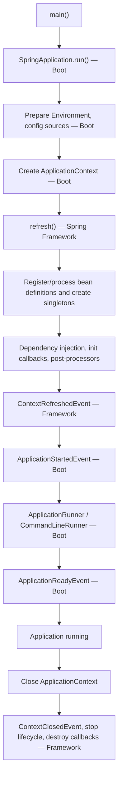

# Role of Spring Boot vs. Spring Framework Container Lifecycle

## 1. The big picture

When running a Spring Boot application, two layers of responsibility work together:

- **Spring Framework** provides the IoC container (`BeanFactory`, typically used through `ApplicationContext`): reading bean definitions, instantiating objects, injecting dependencies, applying `BeanPostProcessor`s, managing scopes, publishing context events, and destroying beans when closing the context.
- **Spring Boot** organizes the application startup process around that container: preparing configuration and `Environment`, choosing/creating the `ApplicationContext` type, registering configuration sources, enabling auto-configuration, integrating a web server when appropriate, publishing application-level events, and invoking `ApplicationRunner`/`CommandLineRunner`.

The core point: **Spring Boot uses Spring Framework's container lifecycle; Boot does not replace that lifecycle with a different IoC container.** When you see `SpringApplication.run(...)`, picture Boot orchestrating the creation and refreshing of a Framework `ApplicationContext`.

In this topic, "container" means the **Spring IoC container**, not a Docker container or a servlet container (Tomcat/Jetty). A servlet container may be created and managed by Boot in a web application, but it is a different concept.

## 2. Responsibility boundary: what does Boot do, and what does Framework do?

| Task | Primarily responsible component | Significance |
| --- | --- | --- |
| Receiving the startup command from `main()` | `SpringApplication` (Boot) | Chooses how to start, runs preparation steps, and returns `ConfigurableApplicationContext`. |
| Aggregating CLI arguments, profiles, config files, and environment | Boot's configuration infrastructure built on Framework's `Environment` | Beans can read configuration via `@Value`, `@ConfigurationProperties`, etc. |
| Selecting context type based on application kind | Boot | Can create a context without a web server, a servlet web context, or a reactive context depending on classpath/configuration. |
| Reading `@Configuration`, `@Component`, `@Bean`, `@Import` and registering bean definitions | Spring Framework | Builds the model of beans to be managed by the container. |
| Selecting conditional auto-configurations | Boot auto-configuration, processed within Framework's configuration mechanism | Creates default configuration matching dependencies and properties; users can still configure manually. |
| Bean instantiation, dependency injection, init/destroy callbacks, scope, proxies | Spring Framework | This is the actual lifecycle of each bean. |
| Refreshing context via `refresh()` and publishing `ContextRefreshedEvent` | Spring Framework | Sets up the bean factory, post-processors, event multicaster, eager singletons, and completes refresh. |
| Publishing `ApplicationStartedEvent`/`ApplicationReadyEvent`, running runners | Spring Boot | Marks application-level milestones after the context is refreshed. |
| Integrating an embedded web server in web applications | Boot together with Spring's context/integration classes | Connects the HTTP server lifecycle to the application context. |
| Closing context, publishing `ContextClosedEvent`, destroying singletons | Spring Framework; Boot may register a shutdown hook | Releases resources managed by the context. |

`@SpringBootApplication` combines three common roles: `@SpringBootConfiguration`, `@EnableAutoConfiguration`, and `@ComponentScan`. It helps Boot configure the entry point and discover application components. **This annotation does not create beans by itself**; Spring Framework processes bean definitions and executes their lifecycles when the context is refreshed.

An auto-configuration such as `DataSourceAutoConfiguration` does not mean every project gets a `DataSource`. Conditions on the classpath, properties, and existing beans determine whether a configuration takes effect. Whether a bean is declared manually or comes from auto-configuration, bean creation and management still flow through Framework's container.

## 3. Two nested lifecycles

You can view this along two axes:

1. **Application lifecycle:** prepare environment → create context → refresh context → run post-startup tasks → application ready → close application. Boot orchestrates most of the steps surrounding `refresh()`.
2. **Bean lifecycle:** register definition → instantiate object → inject dependencies → initialization/post-process callbacks → in use → destruction callbacks. Framework orchestrates this inside the context.



The diagram illustrates the typical success flow. If startup fails, Boot can publish `ApplicationFailedEvent`; the application does not reach `ApplicationReadyEvent`. `@Lazy`, prototype, or on-demand beans may be initialized later than the "create singletons" position in the diagram.

### 3.1. What actually happens inside `ApplicationContext.refresh()`?

At a conceptual level, Framework's key steps are:

- Preparing the context and `BeanFactory`; gathering bean definitions from configuration, component scanning, imports, and other sources.
- Running `BeanFactoryPostProcessor`/`BeanDefinitionRegistryPostProcessor` to inspect or adjust metadata/bean definitions **before creating most regular beans**. The mechanism that processes `@Configuration` classes also runs during this phase.
- Registering `BeanPostProcessor`s to intervene in bean creation, such as handling lifecycle annotations or creating AOP proxies.
- Setting up the event infrastructure and auxiliary context components.
- Instantiating remaining non-lazy singletons; resolving dependencies and executing initialization callbacks for each bean.
- Completing refresh, starting `Lifecycle`/`SmartLifecycle` beans configured to auto-start, and publishing `ContextRefreshedEvent`.

This is a description of responsibilities, not a list of every internal method. `ApplicationContext` has different implementations; web applications also integrate additional web server steps.

### 3.2. Lifecycle of a singleton bean

For an ordinary, non-lazy singleton, the general order is:

1. Framework selects a bean definition and creates the instance (constructor or `@Bean` factory method).
2. Framework resolves and assigns dependencies and properties.
3. Runs `BeanPostProcessor`s **before** initialization; `@PostConstruct` is typically triggered by a post-processor in this group.
4. Calls `InitializingBean.afterPropertiesSet()` (if implemented), followed by a custom `initMethod` if declared.
5. Runs `BeanPostProcessor`s **after** initialization; the bean may be returned wrapped in a proxy.
6. The bean is used in the application; when the context closes, Framework calls the appropriate destruction callback such as `@PreDestroy`, `DisposableBean.destroy()`, or a custom destroy method.

Do not assume a fixed ordering **across all beans**. Ordering is governed by the dependency graph, scopes, lazy initialization, and container mechanics. The lifecycle above is the general order **for a single bean**.

`@PostConstruct` only indicates that **that bean** has gone through initial injection; it does not mean the entire application is ready to serve traffic. For prototype beans, the container normally does not invoke destruction callbacks when the context closes; the caller is responsible for the lifecycle after obtaining the bean.

## 4. Where do Spring Boot milestones fit?

In a typical successful startup, the milestones to distinguish are:

| Milestone | Owner | When does it occur and what should it be used for? |
| --- | --- | --- |
| `ApplicationStartingEvent` | Boot | Very early startup, before a complete `Environment`/context exists. Intended for bootstrap-level listeners. |
| `ApplicationEnvironmentPreparedEvent` | Boot | `Environment` is prepared, context not yet created. Used for specialized startup configuration integration. |
| `ApplicationContextInitializedEvent` | Boot | Context created and `ApplicationContextInitializer`s have run, bean definitions not yet fully loaded. |
| `ApplicationPreparedEvent` | Boot | Context prepared and bean definition sources loaded, right before refresh. |
| `ContextRefreshedEvent` | Framework | Context just finished refreshing; **not equivalent** to Boot having finished runners. |
| `ApplicationStartedEvent` | Boot | Context refreshed, **before** `ApplicationRunner`/`CommandLineRunner`. |
| `ApplicationRunner` / `CommandLineRunner` | Boot | Runs startup tasks after refresh. Runners can receive parsed arguments (`ApplicationRunner`) or raw argument strings (`CommandLineRunner`). |
| `ApplicationReadyEvent` | Boot | After runners complete; the right milestone to know Boot's startup sequence has ended. |
| `ApplicationFailedEvent` | Boot | Startup failure branch; not part of the success sequence above. |
| `ContextClosedEvent` | Framework | When the context begins closing; stopping lifecycle beans and destroy callbacks follow during close. |

Several of Boot's earliest events occur **before an ApplicationContext exists to register bean listeners**. If you need to catch them, register an `ApplicationListener` with `SpringApplication` or the bootstrap listener mechanism; do not expect `@EventListener` on a bean to catch events fired before that bean even exists.

For tasks that only need to run once after regular singletons have been initialized, a runner is usually clearer in intent than `@PostConstruct`. For logic that needs to know Boot has finished all runners, use `ApplicationReadyEvent`. Avoid placing time-consuming operations or external service calls inside constructors or `@PostConstruct` callbacks if doing so makes startup and error handling harder to control.

## 5. Practice: observing the order of milestones

Create a **Spring Boot 3.x or later, Java 17+** project with the `spring-boot-starter` dependency. Place the following file at `src/main/java/com/example/runtime/RuntimeDemoApplication.java`. The example intentionally uses `WebApplicationType.NONE` to examine only the context without opening an HTTP port.

```java
package com.example.runtime;

import jakarta.annotation.PostConstruct;
import jakarta.annotation.PreDestroy;
import org.springframework.boot.ApplicationRunner;
import org.springframework.boot.Banner;
import org.springframework.boot.SpringApplication;
import org.springframework.boot.WebApplicationType;
import org.springframework.boot.autoconfigure.SpringBootApplication;
import org.springframework.boot.context.event.ApplicationReadyEvent;
import org.springframework.context.ConfigurableApplicationContext;
import org.springframework.context.annotation.Bean;
import org.springframework.context.event.EventListener;
import org.springframework.stereotype.Component;

@SpringBootApplication
public class RuntimeDemoApplication {

    public static void main(String[] args) {
        SpringApplication app = new SpringApplication(RuntimeDemoApplication.class);
        app.setWebApplicationType(WebApplicationType.NONE);
        app.setBannerMode(Banner.Mode.OFF);
        app.setLogStartupInfo(false);

        ConfigurableApplicationContext context = app.run(args);
        System.out.println("05 - run() returned");
        context.close();
    }

    @Bean
    ApplicationRunner startupRunner() {
        return args -> System.out.println("03 - ApplicationRunner");
    }

    @Component
    static class SampleBean {

        SampleBean() {
            System.out.println("01 - bean constructor");
        }

        @PostConstruct
        void init() {
            System.out.println("02 - @PostConstruct");
        }

        @EventListener(ApplicationReadyEvent.class)
        void onReady() {
            System.out.println("04 - ApplicationReadyEvent");
        }

        @PreDestroy
        void destroy() {
            System.out.println("06 - @PreDestroy");
        }
    }
}
```

Run from the project root directory using the Maven Wrapper:

```bash
./mvnw spring-boot:run
```

On Windows PowerShell, use `.\mvnw.cmd spring-boot:run`. For a Gradle Boot project, you can use `./gradlew bootRun` (Windows: `.\gradlew.bat bootRun`).

Among the lines printed by the **example itself**, the expected order is:

```text
01 - bean constructor
02 - @PostConstruct
03 - ApplicationRunner
04 - ApplicationReadyEvent
05 - run() returned
06 - @PreDestroy
```

The banner has been turned off; depending on logging configuration, the console may still contain other logs interleaved. What needs to be verified is the **relative order of those six lines**.

**Why is this order right?**

- `SampleBean` is a non-lazy singleton component. Framework instantiates the bean and calls `@PostConstruct` during context refresh, before runners execute.
- After refresh succeeds, Boot invokes `ApplicationRunner`, then publishes `ApplicationReadyEvent`.
- `SpringApplication.run()` only returns the context after completing the successful startup flow, so line `05` appears after `04`.
- `context.close()` triggers Framework's context closing lifecycle, leading to `@PreDestroy` for the managed singleton.

If `context.close()` is omitted, the program can still clean up via Boot/JVM's shutdown hook when the process exits; in the example `close()` is called explicitly to show the boundary clearly. In a real web application, the context usually lives alongside the process until the application is asked to stop.

**Try changing it:** Make `startupRunner()` throw `IllegalStateException`. Then the runner causes startup to fail: there is no `ApplicationReadyEvent` and no `run() returned` line from the success path. Boot handles the startup failure branch and closes the created context where appropriate.

## 6. Compared to initializing the container manually with Spring Framework

If using only Spring Framework, you can open a context manually as follows (standalone illustrative code in a project with `spring-context`):

```java
package com.example.plain;

import org.springframework.context.annotation.AnnotationConfigApplicationContext;
import org.springframework.context.annotation.Bean;
import org.springframework.context.annotation.Configuration;

public class PlainSpringDemo {
    public static void main(String[] args) {
        try (AnnotationConfigApplicationContext context =
                     new AnnotationConfigApplicationContext(AppConfig.class)) {
            System.out.println(context.getBean(Greeting.class).message());
        }
    }

    @Configuration
    static class AppConfig {
        @Bean
        Greeting greeting() {
            return new Greeting("Hello Spring");
        }
    }

    record Greeting(String message) {}
}
```

Output from `System.out` of the example:

```text
Hello Spring
```

Here, the `AnnotationConfigApplicationContext(AppConfig.class)` constructor registers the configuration and refreshes the context; `try` closes the context at the end of the block. Framework still performs DI and manages beans even without `SpringApplication`, `@SpringBootApplication`, or `ApplicationReadyEvent`.

When moving to Boot, developers usually only need to point to the main configuration class and call `SpringApplication.run(...)`: Boot handles many bootstrap steps you would otherwise assemble manually, while adding auto-configuration and startup events. **Both approaches rely on Spring Framework's context and bean lifecycle mechanisms.**

## 7. When running a web app, how is the web server involved?

In an application with a suitable web starter, Boot selects the appropriate web context type and integrates the embedded web server lifecycle (for example, Tomcat for servlet applications). This **does not turn the servlet container into an IoC container**:

- **The IoC container** manages Spring beans such as controllers, services, repositories, and web infrastructure beans.
- **The servlet container** accepts HTTP connections, runs servlets/filters, and processes requests according to the Servlet API model.
- **Boot** auto-configures, connects, and coordinates both parts based on classpath and configuration.

After context refresh, the web server may already be initialized/available while runners are still executing. Therefore "port is open" and "Boot has published `ApplicationReadyEvent`" are two separate milestones. When designing readiness/health checks, evaluate the application's actual startup status and relevant dependencies, not just whether the port is open.

When closing a web application, `ApplicationContext.close()` leads to stopping components in the context lifecycle. If graceful shutdown is enabled (`server.shutdown=graceful`, along with an appropriate timeout setting such as `spring.lifecycle.timeout-per-shutdown-phase`), Boot coordinates stopping new intake and completing in-flight requests depending on the web server type; this process is distinct from individual bean destruction callbacks. Specific timeout settings and behavior also depend on the web server version/integration.

## 8. Choosing the right extension point

| Practical need | Appropriate place | Why? |
| --- | --- | --- |
| Initialize a bean's internal state after dependency injection | `@PostConstruct` or custom init | Tied to the **bean** lifecycle, independent of whether the entire application is ready. |
| Run logic after context refresh, e.g., checking data at startup | `ApplicationRunner` / `CommandLineRunner` | Boot invokes them after Framework has refreshed the context. |
| Execute once Boot finishes all runners | `ApplicationReadyEvent` listener | Clearly distinguishes "context refreshed" from "application ready". |
| Hook deeply into property/context preparation | `ApplicationContextInitializer` or bootstrap listener | Runs early enough; requires understanding startup order. |
| Manage a component with start/stop tied to the context | `SmartLifecycle` | Has `start()`, `stop()`, and phases to coordinate ordering. |
| Release resources owned by a singleton | `@PreDestroy`, `DisposableBean`, or custom destroy | Framework invokes it when the bean/context is destroyed during normal shutdown. |

Do not use `BeanFactoryPostProcessor` to call business logic requiring regular services; it operates on bean metadata before regular beans are created. Likewise, do not call `new` directly to instantiate an object and expect `@Autowired`, `@PostConstruct`, and `@PreDestroy` to run automatically: those callbacks belong to **Spring-managed** instances.

## 9. Common misunderstandings

1. **"Boot performs dependency injection itself."** Spring Framework is what creates and manages the dependency graph. Boot prepares configuration sources and makes declaration/startup convenient.
2. **"`SpringApplication.run()` finishes before beans are created."** On the contrary, non-lazy singletons have normally already been created during `refresh()` before `run()` returns. Lazy and special-scope beans are exceptions.
3. **"`@PostConstruct` proves the application is ready."** This callback belongs to a single bean; runners and post-refresh activities may not have run yet.
4. **"`ContextRefreshedEvent` is synonymous with `ApplicationReadyEvent`."** `ContextRefreshedEvent` is a Framework milestone; Boot still runs runners afterward.
5. **"Having `@SpringBootApplication` means everything is auto-configured."** Auto-configuration is conditional; it depends on dependencies, properties, and beans provided by the application.
6. **"Having embedded Tomcat means Tomcat manages Spring beans."** Tomcat is the servlet container, whereas `ApplicationContext` is the Spring IoC container.
7. **"Every bean is destroyed on shutdown."** Automatic destroy callbacks apply mainly to beans whose full lifecycle is tracked by the container, such as singletons. Prototypes usually require callers to release them; a forcefully killed process may skip cleanup.
8. **"Runners always run in the same order."** When multiple runners exist, use `@Order` or `Ordered` if order matters; do not rely on incidental scan order.
9. **"The application opening its port means all startup tasks are done."** The web server and `ApplicationReadyEvent` are two distinct milestones; a failing runner can still cause startup to fail.
10. **"Creating a bean with `new` gives it the full Spring lifecycle."** An instance created manually outside the container does not automatically receive injection or lifecycle callbacks.

## 10. Self-test your knowledge

**Scenario A.** A `@Service` needs to read already-injected configuration to build an internal cache, without making network calls. Where should this go?  
**Hint:** `@PostConstruct` or a bean custom init method is usually appropriate because the task is tied to the instance.

**Scenario B.** A data check must run when the application starts; if the check fails, startup must not be considered successful. What should you consider?  
**Hint:** An `ApplicationRunner` can throw an exception on failure, preventing Boot from publishing `ApplicationReadyEvent` on the success startup path. Error handling and execution time must be controlled.

**Scenario C.** You see a `ContextRefreshedEvent` log, but have not seen `ApplicationReadyEvent` yet. Is this necessarily a bug in the IoC container?  
**Answer:** No. The context may have refreshed successfully while a runner is still executing or has failed.

**Scenario D.** With `@Lazy` on a bean, why don't you see its `@PostConstruct` right when the app starts?  
**Answer:** The bean may not have been instantiated yet. Lifecycle callbacks run when the bean itself is created, not necessarily at startup.

## 11. Takeaway

A helpful distinction is to ask **"Who owns this milestone?"**: if the milestone concerns **beans, dependency injection, or refreshing/closing the ApplicationContext**, that is the core responsibility of **Spring Framework**. If the milestone concerns **preparing the application, auto-configuration, runners, ready/failure events, or integrating an embedded server**, that is what **Spring Boot orchestrates on top of Framework**.

Understanding these two layers helps you place initialization code in the right spot, diagnose slow or failing startups, avoid confusing `@PostConstruct` with readiness, and shut down resources properly.