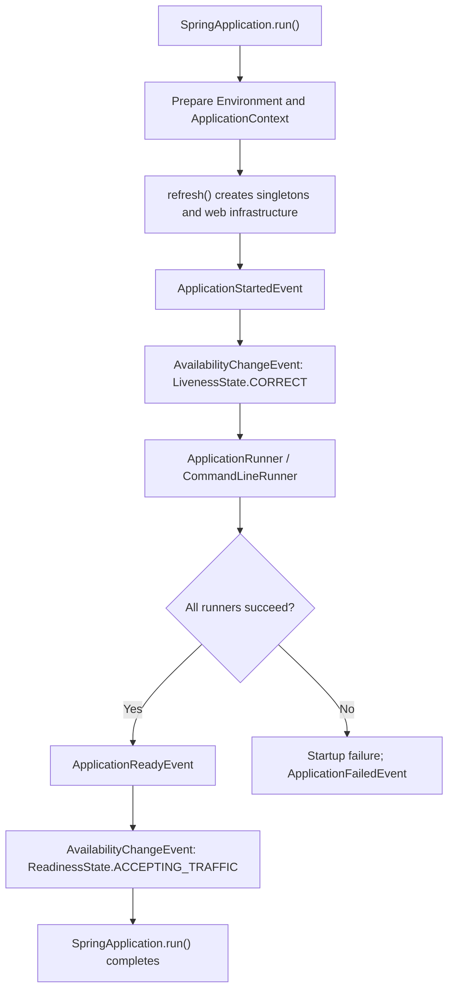

# Long-Running Runners, Startup Deadlines, and Readiness

## 1. Runners Can Keep the Application in an Unready State

`ApplicationRunner` and `CommandLineRunner` are Spring Boot's two extension points for executing tasks after Spring Framework has refreshed the `ApplicationContext` yet before `SpringApplication.run()` completes. They are typically used to validate essential data, warm up caches, check connectivity, or perform a business preparation step.

If a runner takes a long time, Spring Boot still waits for the runner **to return successfully** before publishing `ApplicationReadyEvent` and announcing `ReadinessState.ACCEPTING_TRAFFIC`. During that time:

- The Spring container may already be fully initialized.
- The embedded web server may already have bound its HTTP port.
- `ApplicationStartedEvent` may already have been published.
- **The application is still not in the ready state**, because the runner is working.

Therefore, "has the server opened its port?" and "can the application accept business traffic?" are two separate questions. A load balancer or orchestrator should use a readiness probe rather than merely checking the TCP port.

This lesson uses **Spring Boot 3.3.x, Java 17+**, focusing on `SpringApplication`'s default behavior and managing deadlines in Kubernetes.

## 2. Lifecycle Sequence and Availability States



`ApplicationStartedEvent` is published **before** runners. `ApplicationReadyEvent` is published **after** runners. In the normal flow, Boot publishes `ACCEPTING_TRAFFIC` immediately after `ApplicationReadyEvent`.

| Milestone | Meaning | Have Runners Finished? |
| --- | --- | --- |
| `WebServerInitializedEvent` | Web server initialized; actual port can be retrieved | Not necessarily |
| `ContextRefreshedEvent` | Spring Framework completed context refresh | Not necessarily |
| `ApplicationStartedEvent` | Context refresh finished, Boot about to run runners | **No** |
| Runner executing | Application startup task currently running | **No** |
| `ApplicationReadyEvent` | Runners finished on the successful startup path | **Yes** |
| `ReadinessState.ACCEPTING_TRAFFIC` | Application announces it can accept traffic | Normally **yes** |

`LivenessState.CORRECT` may already have been published right after `ApplicationStartedEvent` while readiness is still not accepting. Being **live yet unready** is normal during startup.

Do not assume the entire Internet or database is healthy simply because `ApplicationReadyEvent` occurred. Readiness is an application-provided signal that can be supplemented by health contributors and change at runtime.

## 3. How Are Runners Invoked?

`ApplicationRunner` receives parsed `ApplicationArguments`; `CommandLineRunner` receives raw arguments as `String...`. Both have a `run` method that can throw `Exception`.

Illustrative example:

```java
@Bean
ApplicationRunner loadReferenceData() {
    return args -> {
        loadRequiredCatalog();
        verifyCatalog();
    };
}
```

The two business methods in this snippet must be implemented; this illustrates the mechanism, **not a standalone runnable Java program**.

When `run()` calls `loadRequiredCatalog()`, it waits for that call to return along the normal flow. If the task takes 90 seconds, the runner holds startup there for 90 seconds. Subsequent runners must also wait if ordered after it.

When there are multiple runners, use `Ordered` or `@Order` to control order:

```java
@Component
@Order(10)
class LoadData implements ApplicationRunner {
    @Override
    public void run(ApplicationArguments args) {
        // Load required data
    }
}
```

Required imports are `org.springframework.boot.ApplicationRunner`, `org.springframework.boot.ApplicationArguments`, `org.springframework.core.annotation.Order`, and `org.springframework.stereotype.Component`.

`@Order` does not run runners in parallel. If the first runner depends on the second runner, design ordering and contracts explicitly. When a runner throws an unhandled exception, startup can fail; Boot publishes `ApplicationFailedEvent` instead of announcing the successful ready milestone.

## 4. Is There a Global Timeout for All Runners?

**Spring Boot does not provide a global property like `spring.runner.timeout=30s` to abort all runners.** In practice, startup time bounds are formed across multiple layers:

| Deadline Source | Examples | Impact |
| --- | --- | --- |
| I/O inside runner | HTTP connect/read timeout, JDBC/socket timeout | Limits waiting on a single operation |
| Business step deadline | Total retry/warm-up duration | Forces code to succeed/fail within budget |
| Container/process manager | Kill timeout, platform startup deadline | May terminate the process externally |
| Kubernetes `startupProbe` | `periodSeconds`, `failureThreshold`, `timeoutSeconds` | Restarts if probe does not pass within budget |
| Kubernetes `readinessProbe` | Check interval and failure threshold | Removes instance from traffic; readiness failure itself does not restart |
| Kubernetes `livenessProbe` | Checks ability to continue operating | Restarts instance if liveness repeatedly fails |
| Kubernetes Deployment rollout | `progressDeadlineSeconds` | May report rollout stalled because too few replicas are available |

The following properties **are not** runner timeouts:

- `spring.lifecycle.timeout-per-shutdown-phase`: limits **shutdown** per phase.
- `server.tomcat.connection-timeout`: limits one type of HTTP connection.
- `spring.mvc.async.request-timeout`: limits asynchronous request handling.
- `spring.main.lazy-initialization`: alters creation timing for certain beans.
- `management.endpoint.health.probes.enabled`: enables health-related HTTP probes, does not cut short runners.

A runner calling an API with a 20-second per-request timeout yet retrying 10 times can take over 200 seconds. You must account for attempt counts, backoff, and **whole-step** deadlines.

### 4.1. When a Runner Encounters an Error or Is Interrupted

If the startup task is **mandatory**, failing fast on time is usually better than swallowing an exception and reporting ready when data is missing. An exception from a runner is handled by Boot on the startup-failure branch, and the successful run's `ApplicationReadyEvent` does not occur.

If the task is **optional**, you can log and continue, or offload the work to the background with a proper fallback. Do not let an optional telemetry dependency take down the entire API unless the business contract truly requires it.

`Thread.interrupt()` is not a universal timeout: some I/O libraries do not respond the way you expect. Use timeouts/deadlines supported directly by your HTTP client, database driver, RPC, or executor; when catching `InterruptedException` without rethrowing, generally restore the interrupt flag.

## 5. Distinguishing Readiness, Liveness, and Startup Probes

### 5.1. Readiness

`ReadinessState.REFUSING_TRAFFIC` indicates the instance should not receive traffic yet. `ReadinessState.ACCEPTING_TRAFFIC` indicates the instance can receive traffic.

Kubernetes uses the readiness probe to decide whether to include a Pod in Service endpoints. If readiness fails, the Pod typically stops receiving traffic from the Service; that **does not necessarily** cause a restart.

Readiness can also return to `REFUSING_TRAFFIC` after the app was once ready—for example, when an instance can no longer serve an essential dependency. Use `AvailabilityChangeEvent` or appropriate health indicators to reflect state.

### 5.2. Liveness

Liveness indicates whether the process is still capable of operating properly or recovering on its own. If liveness fails repeatedly, Kubernetes can restart the container. **Do not put a shared database outage into default liveness**: replicas may all restart in unison while the database is still down, worsening the incident.

### 5.3. Startup Probe

`startupProbe` gives a slow-starting application extra budget to initialize. Until the startup probe succeeds, Kubernetes does not run regular liveness/readiness probes.

If the startup probe checks `/livez`, it can succeed once the context has refreshed even if runners have not finished; the readiness probe will keep holding traffic back. If the startup probe checks `/readyz`, it waits until the application is genuinely ready, though an unrecoverable external dependency can push startup past the deadline and cause container restarts.

Choose the startup probe endpoint according to your recovery strategy and startup needs; do not assume the two paths mean the same thing.

## 6. Runnable Example: Observing Runners and Readiness

Create a Spring Boot 3.3.x Maven project with Java 17+, `spring-boot-starter-web`, and `spring-boot-starter-actuator`.

### 6.1. The `pom.xml` File

```xml
<project xmlns="http://maven.apache.org/POM/4.0.0"
         xmlns:xsi="http://www.w3.org/2001/XMLSchema-instance"
         xsi:schemaLocation="http://maven.apache.org/POM/4.0.0 https://maven.apache.org/xsd/maven-4.0.0.xsd">
    <modelVersion>4.0.0</modelVersion>
    <parent>
        <groupId>org.springframework.boot</groupId>
        <artifactId>spring-boot-starter-parent</artifactId>
        <version>3.3.13</version>
        <relativePath/>
    </parent>
    <groupId>com.example</groupId>
    <artifactId>slow-runner-demo</artifactId>
    <version>0.0.1-SNAPSHOT</version>
    <properties>
        <java.version>17</java.version>
    </properties>
    <dependencies>
        <dependency>
            <groupId>org.springframework.boot</groupId>
            <artifactId>spring-boot-starter-web</artifactId>
        </dependency>
        <dependency>
            <groupId>org.springframework.boot</groupId>
            <artifactId>spring-boot-starter-actuator</artifactId>
        </dependency>
    </dependencies>
    <build>
        <plugins>
            <plugin>
                <groupId>org.springframework.boot</groupId>
                <artifactId>spring-boot-maven-plugin</artifactId>
            </plugin>
        </plugins>
    </build>
</project>
```

### 6.2. The `SlowRunnerApplication.java` File

Create `src/main/java/com/example/slowrunner/SlowRunnerApplication.java`:

```java
package com.example.slowrunner;

import org.springframework.boot.ApplicationRunner;
import org.springframework.boot.SpringApplication;
import org.springframework.boot.autoconfigure.SpringBootApplication;
import org.springframework.boot.availability.AvailabilityChangeEvent;
import org.springframework.boot.availability.ReadinessState;
import org.springframework.boot.context.event.ApplicationReadyEvent;
import org.springframework.boot.context.event.ApplicationStartedEvent;
import org.springframework.context.annotation.Bean;
import org.springframework.context.event.EventListener;

@SpringBootApplication
public class SlowRunnerApplication {

    public static void main(String[] args) {
        SpringApplication.run(SlowRunnerApplication.class, args);
    }

    @EventListener
    public void onStarted(ApplicationStartedEvent event) {
        System.out.println("01 - application-started");
    }

    @Bean
    ApplicationRunner warmup() {
        return args -> {
            System.out.println("02 - runner-started");
            Thread.sleep(2000L);
            System.out.println("03 - runner-finished");
        };
    }

    @EventListener
    public void onReady(ApplicationReadyEvent event) {
        System.out.println("04 - application-ready-event");
    }

    @EventListener
    public void onAvailability(AvailabilityChangeEvent<?> event) {
        if (event.getState() == ReadinessState.ACCEPTING_TRAFFIC) {
            System.out.println("05 - readiness-accepting-traffic");
        }
    }
}
```

`Thread.sleep(2000L)` merely simulates a time-consuming task. The example uses annotated event listeners on the `@SpringBootApplication` class, which is a managed Spring bean; the listeners simply run when the corresponding events arrive.

### 6.3. The `application.properties` File

```properties
server.port=8080
spring.main.banner-mode=off
logging.level.root=WARN
management.endpoint.health.probes.enabled=true
management.endpoint.health.probes.add-additional-paths=true
```

Boot Actuator provides liveness/readiness health groups; `add-additional-paths` exposes them on the main HTTP port under `/livez` and `/readyz`. In environments with a separate management port, this avoids checking only the management port while overlooking the main web server.

### 6.4. Running

From the directory containing `pom.xml`:

```bash
mvn spring-boot:run
```

If using Maven Wrapper:

```bash
./mvnw spring-boot:run
```

Windows PowerShell:

```powershell
.\mvnw.cmd spring-boot:run
```

The run command assumes JDK/Maven and dependencies are ready. Because it uses Spring libraries, this is not a Java file that can be run with plain `javac`.

### 6.5. Expected Output Order

The lines printed by the program normally follow this order:

```text
01 - application-started
02 - runner-started
03 - runner-finished
04 - application-ready-event
05 - readiness-accepting-traffic
```

Spring Boot/Maven logs may appear in between. The `sleep` lasts roughly 2 seconds; actual total startup also includes JVM, context refresh, and other tasks.

Change `Thread.sleep(2000L)` to `Thread.sleep(10000L)` and observe the gap between the two runner lines widen, while `application-ready-event` only appears after the runner.

### 6.6. Checking HTTP Probes

After the application finishes starting up:

```bash
curl -i http://localhost:8080/readyz
```

Normally the endpoint returns HTTP 200 with a body containing:

```json
{"status":"UP"}
```

If called while the runner has not finished yet the HTTP server can already respond, readiness may report `OUT_OF_SERVICE` with HTTP 503. At some moments or with some server types, requests may not be accepted yet even though the port is bound; that is a runtime detail and does not change the rule that `ApplicationReadyEvent` comes after runners.

Compare:

```bash
curl -i http://localhost:8080/livez
```

Liveness can be UP before readiness; that is a reasonable state for a starting application.

## 7. Kubernetes Probes Example for Long Runners

This is a **configuration snippet inside a container spec**, not a complete Deployment manifest:

```yaml
startupProbe:
  httpGet:
    path: /readyz
    port: 8080
  periodSeconds: 5
  timeoutSeconds: 2
  failureThreshold: 24

readinessProbe:
  httpGet:
    path: /readyz
    port: 8080
  periodSeconds: 5
  timeoutSeconds: 2
  failureThreshold: 3

livenessProbe:
  httpGet:
    path: /livez
    port: 8080
  periodSeconds: 10
  timeoutSeconds: 2
  failureThreshold: 3
```

The startup probe in the example uses `/readyz`; `failureThreshold × periodSeconds = 24 × 5`, giving an **approximate observation budget of 120 seconds** once probing starts. This figure is for design planning only and does not guarantee an exact wall-clock limit due to `initialDelaySeconds`, `timeoutSeconds`, execution time, and probe scheduling.

If warm-up is a mandatory part of startup, choosing `/readyz` as the startup probe can be appropriate. If the startup probe uses `/livez`, it can succeed **while the runner is still executing**, while the separate readiness probe still protects traffic. Measure real startup behavior before choosing settings.

When readiness fails, the Pod is normally removed from Service endpoints. When liveness or startup probes fail continuously, Kubelet may restart the container. A Deployment's `progressDeadlineSeconds` is a separate rollout limit: it does not pass a timeout into the Java runner.

## 8. What If the Runner Is Moved to the Background?

Example where a runner simply submits work to an executor and returns:

```java
@Bean
ApplicationRunner scheduleWork(TaskExecutor executor) {
    return args -> executor.execute(() -> performWarmup());
}
```

The snippet above is illustrative, requiring `TaskExecutor` and `performWarmup()` to exist. Boot only sees that the runner **has returned**, so `ApplicationReadyEvent` and accepting readiness can occur **before the background task completes**.

That is completely fine if warm-up is **optional** and requests have fallbacks. If warm-up data is a mandatory precondition before traffic, the approach above creates an invalid serving window.

There are two common approaches:

1. Keep mandatory warm-up inside a **synchronous** runner, with an overall timeout and clear failure policy.
2. Allow warm-up to run in the background yet expose that status in **readiness health** checked by probes, e.g., a custom `HealthIndicator`.

### 8.1. Custom Readiness Health for Background Warm-Up

If the project includes Spring Boot Actuator, create `WarmupHealthIndicator.java`:

```java
package com.example.slowrunner;

import java.util.concurrent.atomic.AtomicBoolean;

import org.springframework.boot.actuate.health.Health;
import org.springframework.boot.actuate.health.HealthIndicator;
import org.springframework.stereotype.Component;

@Component("warmupHealthIndicator")
public class WarmupHealthIndicator implements HealthIndicator {

    private final AtomicBoolean complete = new AtomicBoolean(false);

    public void markComplete() {
        complete.set(true);
    }

    @Override
    public Health health() {
        return complete.get()
                ? Health.up().build()
                : Health.outOfService()
                        .withDetail("warmup", "in-progress")
                        .build();
    }
}
```

The file above compiles in an Actuator project, yet requires a real startup task calling `markComplete()` when the work finishes. This is a state mechanism; it **does not create** the background job itself.

By default, Boot's readiness group does not automatically include every custom indicator. Declare additionally:

```properties
management.endpoint.health.group.readiness.include=readinessState,warmup
```

The health contributor name is derived from the `warmupHealthIndicator` bean as `warmup`. While warm-up is incomplete, the readiness group receives `OUT_OF_SERVICE` from this contributor, even though Boot has published accepting availability for other components.

When mandatory background work fails, do not call `markComplete`; log the error, limit retries, and choose appropriate failure/recovery handling. When the application shuts down, stop threads/tasks cleanly per lifecycle.

### 8.2. Publishing Readiness State Manually

Spring Boot supports:

```java
AvailabilityChangeEvent.publish(
        applicationContext, ReadinessState.REFUSING_TRAFFIC);
```

and upon recovery:

```java
AvailabilityChangeEvent.publish(
        applicationContext, ReadinessState.ACCEPTING_TRAFFIC);
```

These snippets assume `ApplicationContext` and proper imports. Note that **Boot automatically publishes ACCEPTING right after `ApplicationReadyEvent`**: if a runner switches readiness to REFUSING and returns while the background task is not done yet, that automatic event afterward can overwrite your intent. A custom health indicator is easier to verify for mandatory background warm-up.

Do not use `LivenessState.BROKEN` merely to indicate "warming up," because the orchestrator could restart a completely healthy process.

## 9. Optimizing Runners with True Deadlines

When a runner performs multiple steps, measure each phase:

```text
load-reference-data:  8s
verify-schema:        2s
warm-cache:          12s
total:               22s
```

These numbers are illustrative examples, not real measurements. Logs should record start time, completion time, step name, and failure reason; avoid logging secrets/tokens.

A task calling an external API needs:

- Connect timeout, read/response timeout.
- Bounded retry count and bounded backoff.
- Overall step deadline, encompassing all retries.
- A policy distinguishing mandatory errors from optional errors.
- Resource cleanup when startup fails midway.

If the application has multiple interdependent runners, use `@Order` or an orchestrator with explicit steps. Do not put long-running logic in constructors or `@PostConstruct` just to avoid reasoning about runners; those callbacks occur even earlier in the bean lifecycle.

## 10. Common Pitfalls

### Server Opened Its Port Yet Pod Is Still Not Ready

A runner or readiness contributor has not completed. Check runner logs, `ApplicationReadyEvent`, and `/readyz` instead of merely pinging the port.

### Does a Failing Readiness Probe Restart the Pod?

**Readiness failure by itself** normally stops traffic routing. Restarts are usually related to liveness/startup probe failures or another cause; check `kubectl describe pod` to read the actual events.

### Does Increasing the Startup Probe Make HTTP Client Timeouts Faster?

No. Probes change Kubernetes's monitoring policy; they do not inject timeouts into network calls executing inside Java runners.

### Is an `@Async` Runner Enough for the App to Be Ready at the Right Time?

Do not assume so. If work runs async and the runner returns, Boot can become ready before the work finishes. Define explicit readiness conditions and inspect executor/proxy setup.

### Does `ApplicationReadyEvent` Guarantee Every Dependency Is Healthy?

No. The event indicates the startup flow passed through runners successfully. Runtime health checks and availability can still change.

### Does Enabling Actuator Automatically Include Database/Cache in Readiness?

No. The default readiness group relies on Boot-managed readiness state; custom/external health contributors should be considered and added intentionally. Do not cram every external service into readiness if a shared service outage would strip traffic from all replicas.

### Should a Runner `catch (Exception)` and Stay Silent When It Errors?

Only if the error does not affect serving requirements, and with proper logging/telemetry. For mandatory data, swallowing exceptions causes Boot to declare an invalid instance ready.

### Is There an Automatic Timeout If a Runner Runs for 10 Minutes?

Spring Boot imposes no default overall deadline across all runners. Processes may be bounded by the runtime/orchestrator; code still needs valid timeouts and failure handling.

### Does `spring.lifecycle.timeout-per-shutdown-phase` Rescue a Hanging Runner?

No. That property applies to **shutdown**, not startup.

## 11. Self-Check Scenarios

**Scenario A.** A runner takes 90 seconds, and the web server binds after 10 seconds. Does `ApplicationReadyEvent` appear after 10 seconds?  
**Answer:** No, only after runners complete successfully and Boot reaches the ready milestone.

**Scenario B.** `LivenessState.CORRECT` yet `ReadinessState.REFUSING_TRAFFIC` during warm-up—is that abnormal?  
**Answer:** No. The process is operating normally but is not yet ready to serve business traffic.

**Scenario C.** Mandatory warm-up is placed in `CompletableFuture.runAsync` and the runner returns immediately—what happens?  
**Answer:** Boot does not automatically await the future; default readiness may switch to accepting while warm-up is unfinished. Keep the runner synchronous or add a custom readiness check.

**Scenario D.** Pointing `startupProbe` at `/livez` guarantees runners finished before the startup probe succeeds?  
**Answer:** No. Liveness can be CORRECT right after context refresh. Readiness must still be checked separately.

**Scenario E.** `failureThreshold=24`, `periodSeconds=5` means the Java runner is guaranteed to be killed at exactly 120 seconds?  
**Answer:** No. That is an approximate probe budget for Kubelet; actual timing and container termination differ from an in-Java deadline.

**Scenario F.** When should you fail startup instead of continuing in degraded mode?  
**Answer:** When essential data or dependencies are unmet such that accepting requests produces wrong/unsafe results and no acceptable fallback exists.

## 12. References

- Spring Boot 3.3 — Application Events, Runners, Availability: https://docs.spring.io/spring-boot/3.3/reference/features/spring-application.html
- Spring Boot 3.3 — Actuator, Kubernetes probes and health groups: https://docs.spring.io/spring-boot/3.3/reference/actuator/endpoints.html
- Spring Boot API — `ReadinessState`: https://docs.spring.io/spring-boot/3.3/api/java/org/springframework/boot/availability/ReadinessState.html
- Kubernetes — Liveness, Readiness, Startup Probes: https://kubernetes.io/docs/concepts/workloads/pods/probes/

## 13. Key Takeaways

**Long-running synchronous runners extend the window between "context started" → "application ready."** During that window, the web server and liveness may already be active while readiness does not yet accept traffic. Never use an HTTP port or a "Started" message as a substitute for probes.

For mandatory work, keep runners time-bounded and let failures abort startup transparently. For optional work, it can run in the background. If a mandatory background task must complete before serving, use a custom readiness health indicator to represent progress. In deployment, measure real startup times and deliberately choose `startupProbe`, `readinessProbe`, `livenessProbe`, and rollout deadlines.