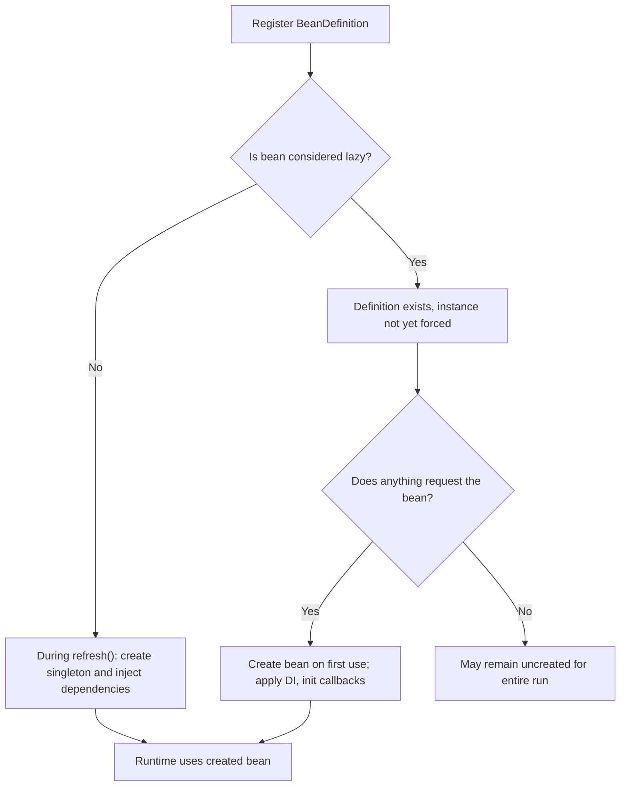
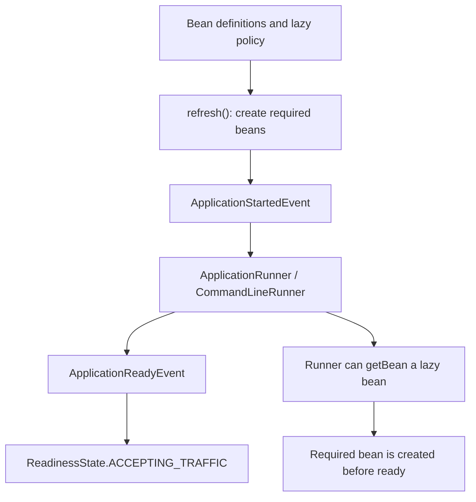

# Enabling `spring.main.lazy-initialization` or `SpringApplication#setLazyInitialization`

## 1. The Problem: Initialize All Beans Immediately or Only When Needed?

By default, in a Spring Boot application, most **singleton beans not declared lazy** are initialized by Spring Framework during `ApplicationContext.refresh()`. The container creates objects, injects dependencies, applies `BeanPostProcessor`s, runs initialization callbacks, and detects many configuration errors before the application finishes startup.

However, there are expensive beans that a given application run might not use right away: a report export engine, an adapter for a rarely used feature, or certain HTTP support components. **Lazy initialization** allows Spring to defer creating these beans until they are actually needed.

Spring Boot provides two ways to enable this mechanism application-wide:

1. **Configuration property:** `spring.main.lazy-initialization=true` in a configuration file or external configuration source.
2. **Java API call:** `SpringApplication#setLazyInitialization(true)` on the `SpringApplication` instance **before** `run(args)`.

In Spring Boot 3.3, the default value is **`false`**. Enabling lazy initialization does not mean zero beans are created at startup: there are still beans and infrastructure that must be initialized for the context to complete, beans required by eager components, runners invoked by Boot, and beans explicitly marked for early initialization.

Goal of this lesson: enable/disable accurately, observe bean creation timing, understand the limits, and choose an implementation approach that avoids increasing first-request failures.

## 2. Lazy Initialization Mechanism at the Spring Framework Layer

`ApplicationContext` manages bean definitions and creates instances as needed. For non-lazy singletons, the bean factory's `preInstantiateSingletons()` mechanism typically creates the corresponding beans during context refresh. For lazy singletons, the bean definition still exists, yet the instance may remain uncreated until a component calls `getBean(...)` or requests the bean through dependency injection.

Overview diagram:



For a lazy singleton, once first creation succeeds, Spring still keeps a single instance in the singleton cache; subsequent lookups **do not create a new instance each time**. Laziness only changes **creation timing**, and does not automatically change scope from singleton to prototype.

The main phases of a bean, when it is eventually created, remain:

- Resolve constructor, factory method, and dependencies.
- Create object; apply field/setter injection if applicable.
- Apply `BeanPostProcessor`s and appropriate proxy mechanisms.
- Execute `@PostConstruct` or corresponding init callbacks.
- Place the instance into context-managed lifecycle; destruction callbacks run on context close if the bean was created and has an appropriate destruction mechanism.

**`@PostConstruct` on an uncreated lazy bean will not have run yet.** If a `@PostConstruct` step is a prerequisite before accepting traffic, enabling global lazy may unintentionally defer that step.

### 2.1. Difference Between "Bean Registered" and "Bean Created"

This difference is easy to verify:

```java
boolean registered = context.containsBean("expensiveService");

boolean instantiated = context.getBeanFactory()
        .containsSingleton("expensiveService");
```

The snippet above assumes `context` is of type `ConfigurableApplicationContext` and a bean named `expensiveService` exists. While the lazy bean has not yet been used, `registered` can be `true` while `instantiated` is `false`.

Conversely, `context.getBean("expensiveService")` **can trigger bean creation**, causing subsequent checks to no longer reflect the pre-use state. Check with `containsSingleton` before calling `getBean` if you want to observe this experimentally.

## 3. Method 1: Enabling via `spring.main.lazy-initialization`

### 3.1. Using `application.properties`

Create or add to `src/main/resources/application.properties`:

```properties
spring.main.lazy-initialization=true
```

To disable explicitly:

```properties
spring.main.lazy-initialization=false
```

This is a **`SpringApplication`** configuration setting, not a custom business property. When Boot processes the configuration during startup, it controls applying lazy mode across eligible bean definitions.

### 3.2. Using `application.yml`

Equivalent configuration:

```yaml
spring:
  main:
    lazy-initialization: true
```

There is no need to declare it in both `.properties` and `.yml` simultaneously. If multiple sources declare this property, the source with higher precedence under **externalized configuration** rules determines the effective value.

### 3.3. Selecting at Runtime Without Rebuilding the Artifact

For an executable JAR:

```bash
java -jar app.jar --spring.main.lazy-initialization=true
```

To compare against the baseline:

```bash
java -jar app.jar --spring.main.lazy-initialization=false
```

The `--spring.main.lazy-initialization` argument lets you change the policy across environments via deployment configuration. Typically, command-line arguments take higher precedence than the same property in `application.properties`.

With a JVM system property, place `-D` **before** `-jar`:

```bash
java -Dspring.main.lazy-initialization=true -jar app.jar
```

When deploying with environment variables, follow Spring Boot's relaxed binding rules for environment variables and verify the effective property rather than guessing underscores; for file or CLI configuration, the canonical `spring.main.lazy-initialization` form is clearer.

### 3.4. When to Choose the Property?

Property configuration is usually best when:

- The same artifact needs lazy enabled in some environments and disabled in others.
- Operations teams want to A/B test startup time, heap, and first-request latency.
- The project prefers externalizing configuration outside source code rather than hard-coding startup policy.
- The application still boots via the standard `SpringApplication.run(MyApplication.class, args)` call.

Example:

```java
@SpringBootApplication
public class MyApplication {
    public static void main(String[] args) {
        SpringApplication.run(MyApplication.class, args);
    }
}
```

This is a sample snippet requiring corresponding Boot imports; complete code is in Section 6. When using the property, you do not have to instantiate `new SpringApplication(...)` just to enable lazy initialization.

## 4. Method 2: Calling `setLazyInitialization(true)` Before `run()`

When bootstrap code itself needs to decide the initialization policy, create a `SpringApplication` instance:

```java
SpringApplication app = new SpringApplication(MyApplication.class);
app.setLazyInitialization(true);
app.run(args);
```

This is an illustrative snippet requiring configuration class `MyApplication` and import `org.springframework.boot.SpringApplication`.

`setLazyInitialization(boolean)` has existed since Spring Boot 2.2 and defaults to `false` in the Spring Boot 3.3 API. It controls the same application-wide lazy initialization policy as the property above.

An equivalent option when using the builder:

```java
new SpringApplicationBuilder(MyApplication.class)
        .lazyInitialization(true)
        .run(args);
```

The `SpringApplicationBuilder` API is appropriate if project startup already uses the fluent builder or parent/child contexts; there is no need to rewrite the whole application to use the builder merely to enable lazy initialization.

### 4.1. Important: Call the Setter Before `run(args)`

Correct order:

```text
new SpringApplication(...)
    -> setLazyInitialization(true)
    -> run(args)
    -> prepare Environment/context/bean definitions
    -> mark eligible bean definitions as lazy
    -> refresh context
```

Calling the setter **after** `run()` has returned does not revert already-initialized singletons back to an "uncreated" state. Nor is it a mechanism to reload or rebuild the bean graph.

### 4.2. Choosing Between Property and Setter

| Criterion | `spring.main.lazy-initialization=true` | `app.setLazyInitialization(true)` |
| --- | --- | --- |
| Where configured | `application.properties`, YAML, CLI, or external config | Java code before startup |
| Requires editing `main()`? | No | Yes, if currently using static `SpringApplication.run` |
| Per-environment selection | Very convenient, no rebuild | Requires bootstrap logic/policy in code |
| Scope | Application-wide lazy initialization policy | Same purpose, set directly on `SpringApplication` |
| Best suited for | Environment-specific deployment and experimentation | Explicit programmatic bootstrap customization |
| Creates beans immediately when set? | No | No; processing happens during startup |

The two options do not represent "strong lazy" and "light lazy". **Do not configure two conflicting values** (such as setter `true` with external config `false`) and assume a fixed outcome without checking your Boot version's binder rules. Choose one authoritative place and verify in the actual deployment environment.

## 5. Which Beans Can Still Be Created Early?

Global lazy initialization is a default policy for eligible bean definitions, **not a promise that every class will wait until the first request**.

### 5.1. Dependency from an Eager Bean

Suppose `ReportService` is marked lazy, but `StartupVerifier` is eager and injects `ReportService` via its constructor:

```java
@Component
class StartupVerifier {

    private final ReportService reportService;

    StartupVerifier(ReportService reportService) {
        this.reportService = reportService;
    }
}
```

This illustrative snippet requires the `ReportService` class and `@Component` import. If `StartupVerifier` is initialized during startup, its direct dependencies typically **must be resolved**, which can cause `ReportService` to also initialize immediately even if `ReportService` was declared lazy.

With global lazy, `StartupVerifier` itself is usually lazy too; if nothing requests it, neither may be created. But when an essential bean, infrastructure component, or runner needs `StartupVerifier`, the entire related dependency chain can be created.

### 5.2. Beans Requested by the Framework or Runners

Spring Boot needs many infrastructure beans to complete bootstrap. During the phase after context refresh, Boot also locates and invokes `ApplicationRunner`/`CommandLineRunner` beans. Therefore, runner beans can still be created **during startup** even with global lazy enabled. Dependencies a runner explicitly fetches via `getBean(...)` are also created at that time.

**If a runner requests a service to perform warm-up, that service is still initialized before `ApplicationReadyEvent`.** This behavior is helpful when the service is a mandatory prerequisite before accepting traffic.

### 5.3. Explicitly Keeping a Bean Eager with `@Lazy(false)`

Spring Boot supports excluding a specific bean from the global lazy policy using `@Lazy(false)`:

```java
@Bean
@Lazy(false)
StartupValidator startupValidator() {
    return new StartupValidator();
}
```

The snippet above illustrates configuration; `StartupValidator` requires an implementation class. When this bean must be ready at startup to catch critical errors, `@Lazy(false)` is more surgical than disabling lazy across the entire application.

Note that `@Lazy(false)` is placed on the appropriate bean definition or class. If there is a dependency chain, you still need to verify its real effect, especially with factory methods, proxies, and components requested from elsewhere.

### 5.4. When Libraries Need `LazyInitializationExcludeFilter`

Spring Boot provides the `LazyInitializationExcludeFilter` extension for special framework integration cases that do not support lazy loading well, such as DSLs that dynamically generate bean definitions. In Boot 3.3, you can register a filter via a **static `@Bean`**:

```java
@Bean
static LazyInitializationExcludeFilter criticalBeanFilter() {
    return LazyInitializationExcludeFilter.forBeanTypes(StartupValidator.class);
}
```

This snippet requires importing `org.springframework.boot.LazyInitializationExcludeFilter`, `@Bean`, and a concrete `StartupValidator` class. It is a pattern applied inside a `@Configuration`/`@SpringBootApplication` class, **not a standalone program**.

The filter excludes beans of the specified types from being automatically marked `lazy-init` by Boot; it **does not directly invoke** constructors. Spring Boot notes that filter beans may be created very early, so declare them `static` and avoid dependencies if possible.

In most applications, using `@Lazy(false)` on critical beans is sufficient. Only use exclude filters when you are actually building libraries or integrations with special bean definition requirements.

## 6. Complete Runnable Example with Java 17+ and Spring Boot 3.3

This example uses `WebApplicationType.NONE` to observe bean creation mechanics without opening an HTTP server. It verifies that a bean has a definition yet lacks a singleton instance before being requested for the first time.

### 6.1. Project Structure

```text
lazy-boot-demo/
├── pom.xml
└── src/main/
    ├── java/com/example/lazy/LazyInitializationDemoApplication.java
    └── resources/application.properties
```

Create `pom.xml`:

```xml
<project xmlns="http://maven.apache.org/POM/4.0.0"
         xmlns:xsi="http://www.w3.org/2001/XMLSchema-instance"
         xsi:schemaLocation="http://maven.apache.org/POM/4.0.0 https://maven.apache.org/xsd/maven-4.0.0.xsd">
    <modelVersion>4.0.0</modelVersion>
    <parent>
        <groupId>org.springframework.boot</groupId>
        <artifactId>spring-boot-starter-parent</artifactId>
        <version>3.3.13</version>
        <relativePath/>
    </parent>

    <groupId>com.example</groupId>
    <artifactId>lazy-boot-demo</artifactId>
    <version>0.0.1-SNAPSHOT</version>

    <properties>
        <java.version>17</java.version>
    </properties>

    <dependencies>
        <dependency>
            <groupId>org.springframework.boot</groupId>
            <artifactId>spring-boot-starter</artifactId>
        </dependency>
    </dependencies>

    <build>
        <plugins>
            <plugin>
                <groupId>org.springframework.boot</groupId>
                <artifactId>spring-boot-maven-plugin</artifactId>
            </plugin>
        </plugins>
    </build>
</project>
```

### 6.2. Application Code

Create `src/main/java/com/example/lazy/LazyInitializationDemoApplication.java`:

```java
package com.example.lazy;

import org.springframework.boot.ApplicationRunner;
import org.springframework.boot.Banner;
import org.springframework.boot.SpringApplication;
import org.springframework.boot.WebApplicationType;
import org.springframework.boot.autoconfigure.SpringBootApplication;
import org.springframework.context.ApplicationContext;
import org.springframework.context.ConfigurableApplicationContext;
import org.springframework.context.annotation.Bean;

@SpringBootApplication
public class LazyInitializationDemoApplication {

    public static void main(String[] args) {
        SpringApplication app =
                new SpringApplication(LazyInitializationDemoApplication.class);
        app.setWebApplicationType(WebApplicationType.NONE);
        app.setBannerMode(Banner.Mode.OFF);
        app.setLogStartupInfo(false);

        // Uncomment the following line to enable via Java.
        // Keep it commented out when testing with a property or CLI.
        // app.setLazyInitialization(true);

        try (ConfigurableApplicationContext context = app.run(args)) {
            // Runners are invoked by Boot before run(args) returns.
        }
    }

    @Bean
    ExpensiveService expensiveService() {
        System.out.println("created=expensiveService");
        return new ExpensiveService();
    }

    @Bean
    ApplicationRunner observe(ApplicationContext applicationContext) {
        return args -> {
            ConfigurableApplicationContext context =
                    (ConfigurableApplicationContext) applicationContext;

            System.out.println("registered="
                    + context.containsBean("expensiveService"));
            System.out.println("instantiated-before="
                    + context.getBeanFactory()
                             .containsSingleton("expensiveService"));

            ExpensiveService service = context.getBean(ExpensiveService.class);
            System.out.println("value=" + service.message());

            System.out.println("instantiated-after="
                    + context.getBeanFactory()
                             .containsSingleton("expensiveService"));
        };
    }

    public static final class ExpensiveService {
        public String message() {
            return "hello";
        }
    }
}
```

Explanation of key details:

- `@SpringBootApplication` provides Boot configuration and component scanning for the sample project.
- `@Bean ExpensiveService` defines a singleton named `expensiveService`; the print statement in the factory method only runs **when the instance is actually created**.
- The runner accepts `ApplicationContext` and casts it to `ConfigurableApplicationContext`, valid in a Spring Boot context, to access `getBeanFactory().containsSingleton(...)`.
- `containsBean` checks definition/presence by name, **without forcing service creation**.
- `containsSingleton` checks whether a singleton instance currently exists.
- `context.getBean(ExpensiveService.class)` is the **first request point** if the bean has not been created yet.
- `try-with-resources` closes the context after the runner finishes; the example does not start a web server or perform background work.

### 6.3. Initial Configuration

Create `src/main/resources/application.properties`:

```properties
spring.main.lazy-initialization=false
logging.level.root=WARN
```

Setting `false` makes the control experiment clearer; Boot's default is also `false` if the first line is omitted.

### 6.4. Build

In the directory containing `pom.xml`:

```bash
mvn package
```

Run the packaged JAR:

```bash
java -jar target/lazy-boot-demo-0.0.1-SNAPSHOT.jar
```

Lines printed by the application code in order:

```text
created=expensiveService
registered=true
instantiated-before=true
value=hello
instantiated-after=true
```

`ExpensiveService` is created during refresh because it is not lazy, **before** the runner prints `registered`. Spring Boot and Maven logs or messages may interleave; the block above shows only the lines printed by the lesson code.

### 6.5. Enabling Lazy via Command-Line Property

Run the **same JAR**, without modifying files:

```bash
java -jar target/lazy-boot-demo-0.0.1-SNAPSHOT.jar --spring.main.lazy-initialization=true
```

Lines printed by the demo in order:

```text
registered=true
instantiated-before=false
created=expensiveService
value=hello
instantiated-after=true
```

Analysis:

1. The service's definition still exists, so `registered=true`.
2. Before the runner requests the service, the singleton has not been created, so `instantiated-before=false`.
3. `getBean(ExpensiveService.class)` triggers the factory method, printing `created=expensiveService`.
4. The method returns `hello`; the singleton now exists and `instantiated-after=true`.

This is a reproducible observation distinguishing a **lazy definition** from **actual instance initialization**. No benchmarking or log timing comparison is required to verify the mechanism.

### 6.6. Enabling Lazy via `setLazyInitialization(true)`

Uncomment the line in `main()`:

```java
app.setLazyInitialization(true);
```

At the same time, remove or avoid declaring any conflicting property so a single source governs configuration. For example, remove `spring.main.lazy-initialization=false` from `application.properties`, rebuild, and run **without** passing `--spring.main.lazy-initialization`.

Then the expected output order of the experiment matches Section 6.5: `registered=true`, `instantiated-before=false`, the service is created on the first `getBean` call, and then `instantiated-after=true`.

**Do not modify both the property and the setter at the same time** in this experiment. The goal is to demonstrate that both ways of enabling yield the same behavior, not to debug unnecessary configuration conflicts.

### 6.7. Trying `@Lazy(false)` on the Service

Keep lazy mode enabled (either via property **or** setter), and add the import:

```java
import org.springframework.context.annotation.Lazy;
```

Update the factory method:

```java
@Bean
@Lazy(false)
ExpensiveService expensiveService() {
    System.out.println("created=expensiveService");
    return new ExpensiveService();
}
```

After rebuilding and rerunning, provided no other configuration interferes, `created=expensiveService` appears during startup, **before** the runner; `instantiated-before=true` even while global lazy is enabled.

This demonstrates how to designate an essential bean to continue initializing eagerly while most of the application uses lazy initialization.

## 7. Differences from Spring Framework's `@Lazy`

| Usage | Purpose |
| --- | --- |
| `@Lazy` on a `@Bean` method | Makes that bean lazy within the active configuration scope |
| `@Lazy` on a `@Component` class | Requests that the component be initialized lazily |
| `@Lazy(false)` | Explicitly marks the bean non-lazy; can opt out of Boot's global lazy |
| `@Lazy` at an injection point | Can create a proxy deferring dependency resolution; **different** from merely marking a bean definition lazy |
| `spring.main.lazy-initialization=true` | Sets a broad lazy policy across Spring Boot |
| `SpringApplication#setLazyInitialization(true)` | Enables the same policy via Java bootstrap before `run()` |

### 7.1. `@Lazy` on a Bean Does Not Guarantee Late Initialization

If an eager bean directly depends on a `@Lazy` bean, Spring still has to satisfy the dependency before the eager bean can finish. This can pull the lazy bean into startup.

For example:

```java
@Service
class CheckoutService {

    private final InvoiceClient invoiceClient;

    CheckoutService(InvoiceClient invoiceClient) {
        this.invoiceClient = invoiceClient;
    }
}
```

If `CheckoutService` is an eager singleton and `InvoiceClient` is marked lazy, constructor injection can cause `InvoiceClient` to be created early. This illustrative snippet requires an `InvoiceClient` definition and the `@Service` import.

An `@Lazy` injection point can inject a **lazy resolution proxy**, but proxies add complexity: initialization errors may be deferred until method invocation, and classes/final methods as well as `equals`/`toString` behavior must be considered. Do not introduce proxies merely to make startup metrics look better.

### 7.2. Global Lazy Does Not Mean Every Request Initializes the Entire Application

An HTTP request only creates the beans actually required along that execution path's dependency graph. Rarely used endpoints may not create their beans until their first corresponding request arrives. Conversely, an endpoint depending on many beans can trigger a cascade of instances on the very first request.

Therefore, the performance effect is typically **shifting work from startup to first use**, not eliminating initialization cost altogether.

## 8. Impact on Startup Time, First-Request Latency, and Memory

### 8.1. Startup Can Be Faster, But It Is Not Free

By reducing the number of beans created before Boot signals ready, you may observe:

- Shorter `ApplicationContext.refresh()` duration.
- `ApplicationReadyEvent` firing sooner.
- Unused non-essential beans never initializing during short-lived instance lifecycles.

However, if a runner necessarily invokes those beans, the cost still sits before readiness. If all beans are required as soon as the application starts taking requests, the cost simply moves elsewhere.

There is no formula guaranteeing global lazy speeds up every application by a fixed percentage. Measure each workload, bean count, dependency graph, and request mix.

### 8.2. The First Request Can Be Noticeably Slower

A reporting bean composed of an HTTP client, parser, or schema validator may be created for the first time during a request. At that moment, constructor/init callbacks and related dependencies add directly to the first request's latency.

For APIs with strict SLOs, this can cause a P99 spike after deployment or autoscaling. Mitigations include:

- Keeping critical-path beans eager using `@Lazy(false)`.
- **Controlled** warm-up inside a runner for services mandatory before traffic.
- Sending warming requests in staging to measure the cold path, without sending unintended requests to production.
- Measuring first-request latency separately from steady-state latency.

### 8.3. Reserve Heap Headroom for Uncreated Beans

Right after startup completes, heap usage may look small because many singletons have not been created yet. As traffic touches other features, additional instances and caches are created, increasing heap consumption.

Do not size JVM heap solely based on memory snapshots taken the moment `ApplicationReadyEvent` fires. Load test both warm paths and cold paths, and monitor heap used/committed, GC pauses, and behavior under memory pressure.

### 8.4. Configuration Errors May Be Discovered Late

With an eager bean, the constructor can throw an exception and fail startup. With a lazy bean, **that same error may only surface during the first request that uses it**, once the instance is already receiving traffic.

Example:

```java
@Bean
ExpensiveClient expensiveClient() {
    return new ExpensiveClient(requiredEndpoint);
}
```

The snippet above is illustrative, requiring appropriate `ExpensiveClient` and `requiredEndpoint` types. If the constructor checks for an invalid endpoint, global lazy can defer the error until the bean is first requested. Do not treat successful startup as proof that all optional integrations have been verified.

## 9. Relationship to Readiness and Mandatory Work

In Spring Boot, the typical order is:



If a service is truly needed for all requests, skipping its creation at startup just to report ready earlier can make readiness **business-meaningless**. You can:

1. Mark mandatory beans with `@Lazy(false)` to detect initialization errors during refresh.
2. Or leave them lazy, yet proactively request them inside an `ApplicationRunner` before Boot reports ready, with clear timeouts and error policies.
3. For work that must run in the background, design a dedicated readiness health indicator reflecting progress, rather than spawning a thread and letting the runner return immediately.

Conversely, a rarely used feature with a safe fallback can remain lazy to avoid paying its cost on every startup.

**Readiness does not automatically guarantee all lazy beans have been created.** Spring Boot only signals completion of the startup steps assigned to it; business correctness remains the responsibility of the application and appropriate health checks.

## 10. Easily Misunderstood Scenarios

### 10.1. Global Lazy Is Enabled, Yet `ApplicationRunner` Is Still Created

Normal. Boot must locate and invoke runners during startup. Because a runner is a required entry point in this flow, the runner instance is requested and its related dependencies may be created early.

### 10.2. Property Is Set, Yet Some Constructors Still Run

Not evidence that lazy failed. Distinguish infrastructure, explicitly eager beans, dependencies of an eager bean, runners, or an explicit `getBean`. Log the bean name and what requested it to pinpoint the cause.

### 10.3. `@Lazy` Placed on a Repository, Yet Controller Injects Directly

If the controller is eager and injects the repository directly, the repository may be resolved early. If the controller is also lazy, opening the endpoint for the first time may be when the repository is first needed. In web applications, many MVC/WebFlux components have their own discovery mechanisms; verify empirically rather than assuming all handlers are lazy.

### 10.4. Calling the Setter After `SpringApplication.run` Completes

Too late to change how existing beans were created. `setLazyInitialization` is a bootstrap option, not a tool to put a context "to sleep" or evict the singleton cache at runtime.

### 10.5. Enabling Lazy to Mask Datasource Errors

Dangerous. If the datasource is an essential requirement, deferring configuration errors to the first request lets the system accept traffic when it cannot actually serve properly. Keep it eager or verify connectivity before readiness.

### 10.6. Confusing Lazy Initialization with ORM Lazy Loading

`spring.main.lazy-initialization` affects **Spring beans**, not JPA entity association lazy loading. `FetchType.LAZY`, ORM proxies, and Hibernate's `LazyInitializationException` are separate concepts. A lazy service bean does not change Hibernate's entity loading strategy.

### 10.7. Confusing with `@Primary`, `@ConditionalOn...`, or Bean Scope

Global lazy does not decide which bean is chosen during autowiring, does not replace auto-configuration conditions, and does not turn singletons into prototypes. It only affects when instances of the applicable bean definitions are created.

### 10.8. Confusion with `spring.main.lazy-initialization=false` in Another Environment

When CLI flags, profile-specific files, or system properties exist, a higher-precedence source can override the value. Check configuration in the target environment; avoid having conflicting setters and properties simultaneously.

## 11. Pre-Production Testing Checklist

Before rolling out, define the exact metrics to monitor:

| Group | Metric | Why Is It Needed? |
| --- | --- | --- |
| Startup | Time from process start to `ApplicationReadyEvent` | Verify real improvement |
| Context | Refresh duration, number of created beans | Separate container cost from runners |
| Request | First-request latency for critical endpoints | Catch costs shifted onto traffic |
| Steady-state | P95/P99 after warm-up | Ensure no regression |
| Memory | Peak heap/GC after exercising multiple features | Avoid sizing solely from startup heap |
| Correctness | Bean creation, validation, and config errors | Catch deferred errors |
| Availability | Readiness/health during cold starts and scale-out | Ensure traffic is not routed too early |

A sound testing process:

1. Measure baseline with `spring.main.lazy-initialization=false`.
2. Enable `true` on the same artifact version with equivalent test traffic.
3. Measure startup, first-request latency, and warm-state requests.
4. List mandatory beans needing `@Lazy(false)` or runner verification.
5. Exercise a sufficiently broad set of endpoints/business tests to instantiate rarely used beans.
6. Test startup failures, readiness, and scale-out scenarios with multiple concurrent replicas.
7. Roll out only when startup gains are worthwhile and the system still meets its SLOs.

If only one or two expensive beans slow down startup, consider selective `@Lazy` instead of global lazy. That approach typically has a more predictable blast radius.

## 12. Practice Scenarios and Answers

### Exercise 1 — Comparing Two Ways to Enable

A project currently uses:

```java
SpringApplication.run(App.class, args);
```

Operations wants to enable lazy in staging without modifying source code. Which approach fits?

**Answer:** Set `spring.main.lazy-initialization=true` in staging configuration or startup arguments. There is no need to change `main()` to the instance API.

### Exercise 2 — Programmatic Bootstrap

An application already creates `SpringApplication app = new SpringApplication(App.class)`. To enable lazy from Java, where does the statement go?

**Answer:** Call `app.setLazyInitialization(true)` **before** `app.run(args)`, not after the context has already been refreshed.

### Exercise 3 — `containsBean=true`, `containsSingleton=false`

A runner observes both results for the `reportService` bean. Does this mean the bean is not registered?

**Answer:** No. The bean definition exists, yet the singleton instance has not been created—matching an unrequested lazy bean.

### Exercise 4 — Using `getBean()` to Measure Whether a Bean Is Lazy

A test calls `context.getBean(ReportService.class)` and then checks `containsSingleton(...)`, getting `true`. Does that prove the bean was eagerly created at startup?

**Answer:** No. `getBean()` itself may have triggered creation of the lazy instance. You must measure **before** the first request.

### Exercise 5 — Critical Beans vs. Optional Beans

`CheckoutValidator` must validate dependencies before any request; `MonthlyReportExporter` is only used at month-end. Must they share the same lazy policy?

**Answer:** No. The validator can use `@Lazy(false)` or a deadline-bounded warm-up runner; the exporter can be lazy if first-use delay and first-use error handling are acceptable.

### Exercise 6 — Conflicting Setter and Property

`main()` calls `setLazyInitialization(true)`, yet an environment declares `spring.main.lazy-initialization=false`. Should you guess the outcome by intuition?

**Answer:** No. Avoid conflicts, designate a single clear configuration source, and verify behavior on the target Boot version and actual deployment.

### Exercise 7 — Error Seen on First Request Instead of Startup

After enabling global lazy, a misconfigured client no longer causes boot to fail, yet the first endpoint accessing the client returns an error. Is this an improvement in stability?

**Answer:** No. The error was merely **deferred**. Move essential dependencies into pre-readiness validation or exclude the client from lazy initialization.

### Exercise 8 — Global Lazy Enabled: Faster Startup, 2-Second First Request

Do you necessarily have to disable lazy globally?

**Answer:** Not necessarily. Measure which endpoint is slow, identify which beans are being created, consider warm-up or targeted eagerness for the critical path, and leave rarely used beans in lazy mode.

## 13. References

Official API and documentation resources useful for Spring Boot 3.3 / Spring Framework:

- [Spring Boot 3.3 — SpringApplication / Lazy Initialization](https://docs.spring.io/spring-boot/3.3/reference/features/spring-application.html): explains lazy mode, property configuration, setter, builder, and `@Lazy(false)`.
- [Spring Boot 3.3 API — `SpringApplication#setLazyInitialization`](https://docs.spring.io/spring-boot/3.3/api/java/org/springframework/boot/SpringApplication.html): method signature and `false` default.
- [Spring Boot 3.3 API — `LazyInitializationExcludeFilter`](https://docs.spring.io/spring-boot/3.3/api/java/org/springframework/boot/LazyInitializationExcludeFilter.html): infrastructure filter usage and `forBeanTypes(...)`.
- [Spring Framework — Lazy-initialized Beans](https://docs.spring.io/spring-framework/reference/core/beans/dependencies/factory-lazy-init.html): relationship between lazy singletons, dependencies, and `@Lazy`.

## 14. Conclusion

**`spring.main.lazy-initialization=true` and `SpringApplication#setLazyInitialization(true)` are two ways to enable the same on-demand bean initialization policy in Spring Boot.** The property is convenient for deployments; the setter fits when Java code controls bootstrap. Both must take effect **before context refresh**.

Lazy initialization does not mean bean definitions disappear, every singleton waits until the first request, or the application automatically uses less memory at all times. Beans needed for startup and dependencies of eager beans can still be created early; other lazy beans will be created when first requested.

Use lazy initialization as a **tool to balance startup time against first-use latency and error-detection timing**. Protect critical business paths with `@Lazy(false)`, startup validation, and appropriate readiness checks; measure the full lifecycle instead of just looking at a faster "Started" log line.