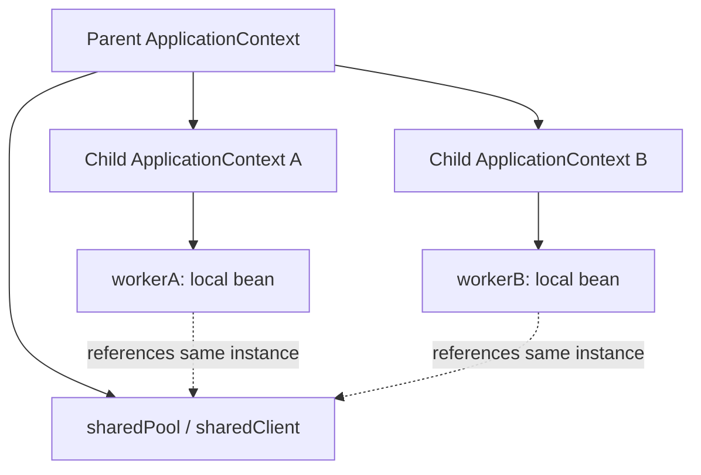

# Distinguishing Shared Resources from Single-`ApplicationContext` Resources

## 1. The Problem: When an Application Has Multiple Contexts, Who Owns the Resource?

When writing Spring Boot applications, we often hear "Spring manages singletons" or "closing the context automatically closes resources." Both statements are true **when the scope is clearly understood**, but they are very easy to misapply in applications with multiple `ApplicationContext`s, a parent context and child contexts, test environments spinning up multiple containers, or multiple instances deployed for the same service.

For example:

- A `DataSource`/connection pool shared across two modules.
- Each module having its own `ExecutorService`.
- An HTTP client shared across all consumers in **one** application.
- Two independent `ApplicationContext`s both defining `@Bean ConnectionPool`.
- A parent context providing infrastructure resources to child contexts.
- A management web context separated from the application web context.
- A `ThreadLocal` or static cache outliving the Spring context.

Without clearly defining **which resources are shared** and **who is responsible for closing them**, two opposite types of bugs can appear:

1. **Closing too early:** a child context closes and invokes `close()` on a client/pool still used by another child, causing requests, jobs, or message consumers to fail.
2. **Never closing:** a static object or executor created outside Spring has no clear owner, leaving threads, sockets, file descriptors, or memory alive after the application context ends.

The foundational rule of this lesson is: **object sharing scope**, **bean registration scope**, and **lifecycle management responsibility** are three related concepts that do not automatically coincide.

This lesson uses **Java 17+, Spring Framework 6.x, and Spring Boot 3.3.x**. The hands-on example uses `spring-boot-starter` to create `ApplicationContext`s in a parent–child relationship; no servlet container is required.

## 2. Definitions: Shared Does Not Necessarily Mean Belonging to the Same Context

### 2.1. Resource belonging to a context

This is an object whose lifecycle is owned by **a specific `ApplicationContext`**. Usually the object is created by a bean definition in that context:

```java
@Bean(destroyMethod = "close")
LocalClient localClient() {
    return new LocalClient();
}
```

The snippet above is illustrative; `LocalClient` must be defined and have a `close()` method. When the owning context is closed normally, Spring invokes the destroy callback on the singleton it created and manages.

For example: `workerExecutor` serves only the billing module and is defined in `BillingContext`. When the billing context shuts down, the billing executor must also stop.

The word "belong" here should be understood as **ownership**: the context or a component inside it is responsible for creating, operating, and destroying it. Being able to retrieve an object from `getBean(...)` does not by itself answer whether that context is the original owner or is only seeing a parent's bean.

### 2.2. Shared resource

A "shared" resource means **multiple consumers use the same instance or the same external service**, for example:

```text
Child Context A ─┐
                 ├──> Shared HTTP Client (1 object)
Child Context B ─┘
```

However, sharing can happen in several ways:

- **Parent-owned shared bean:** a bean is defined in the parent context, and children look up/inject that exact object.
- **Externally owned instance:** a component outside the contexts creates the object and passes references to multiple consumers; the external owner is responsible for closing it.
- **Shared external service:** two contexts have two different client instances that connect to the same database or broker; **they share the remote service**, not the same JVM client/pool.
- **Static/global state:** multiple places use the same object via a static field. This is classloader/process-level sharing, **not** automatic Spring lifecycle sharing.

Therefore you must ask clearly "sharing **what**": a Java object, a pool, a TCP connection, a cache, a broker, or a remote database system.

### 2.3. Three axes to name explicitly

| Axis | Question | Example |
| --- | --- | --- |
| Identity | Do multiple consumers receive the same object or different objects? | `clientA == clientB` |
| Visibility | Which contexts can find the bean definition? | Child looks up bean from parent |
| Ownership | Who creates, manages, and closes the object? | Parent closes shared client after all children |

If an object is shared yet has **two owners both calling `close()`**, sharing can lead to double-close. If nobody remains responsible for closing the object, leaks occur. A good design typically has **one clear owner and many borrowers**, and the owner outlives every borrower using the resource.

## 3. A Singleton Bean Is Per Container, Not Per JVM

In Spring Framework, the default scope is `singleton`. Specifically, this means: **one bean definition maps to one instance within one Spring IoC container**.

Example:

```java
@Configuration
class ResourceConfiguration {

    @Bean
    SharedClient sharedClient() {
        return new SharedClient();
    }
}
```

The code snippet above illustrates configuration, assuming a real `SharedClient` class. If **two independent contexts** both load `ResourceConfiguration`, each context has its own bean factory/singleton cache and typically creates **two** distinct `SharedClient` instances.

```text
Context A                  Context B
  sharedClient bean          sharedClient bean
         │                         │
         ▼                         ▼
    SharedClient #1           SharedClient #2
```

Two beans can share the same class, name, and endpoint configuration, yet **that does not give them the same identity**. Do not assume `==` simply because both are annotated `@Bean` or `@Singleton`.

### 3.1. Comparing Spring singletons with global singletons

| Scope | When Is It the Same Instance? | Who Typically Manages Lifecycle? |
| --- | --- | --- |
| Spring singleton in one context | Each bean definition has one cached singleton in that container | Container owning the bean |
| Same bean retrieved by child from parent | Child accesses **the bean owned by the parent** | Parent |
| Two independent contexts declaring the same bean | Usually **two separate instances** | Each context owns its own copy |
| Static field in the same classloader | Callers accessing the field may see one shared object | Code/app owner, not automatically closed by Spring |
| `@Scope("prototype")` | Each request may create a new instance | Caller is responsible for cleanup after creation |
| HTTP request/session-scoped bean | Per corresponding request or session | Web scope/infrastructure |
| External cluster resource | Multiple processes share one service | Operator/service; client connections still have separate owners |

A Spring Boot application running **three replicas** on Kubernetes has three separate JVMs. A singleton bean in the first replica is not the same instance as the singleton in the second replica. Do not use a Java singleton to implement distributed locking or leader coordination across replicas.

### 3.2. One context can also have multiple singletons of the same type

"Singleton" does not mean only one object per class exists in a context. If there are two bean definitions:

```java
@Bean("primaryClient")
Client primaryClient() {
    return new Client("primary");
}

@Bean("backupClient")
Client backupClient() {
    return new Client("backup");
}
```

then **two `Client` singletons** can exist in the same context, each bean name/definition having its own instance. `@Primary` or qualifiers only affect injection selection, not turning the instances into one object.

Both methods are merely examples assuming `Client` has a matching constructor. When a single shared client is desired, create exactly one bean in one owner and inject its reference into consumers instead of letting modules call `new Client(...)` themselves.

## 4. Parent/Child Contexts: A Way to Share Beans with a Clear Owner

Spring Framework supports parent–child relationships between `ApplicationContext`s. In the standard model:

- **Parent** registers shared infrastructure beans.
- **Child A** registers business beans for module A.
- **Child B** registers business beans for module B.
- A child can look up beans from its parent if it lacks a matching local definition.
- The parent **cannot automatically look up** beans registered only in a child.
- Sibling children sharing the same parent can access **the exact same parent singleton instance**.

Diagram:



Distinguish **context relationship** arrows from **object reference** arrows: a child using a parent bean does not make the child the owner of the parent bean.

### 4.1. Expressing this in Spring

In Spring Framework:

```java
AnnotationConfigApplicationContext parent =
        new AnnotationConfigApplicationContext(ParentConfig.class);

AnnotationConfigApplicationContext child =
        new AnnotationConfigApplicationContext();

child.setParent(parent);
child.register(ChildConfig.class);
child.refresh();
```

This is a snippet requiring real `ParentConfig` and `ChildConfig` classes. Once the parent has been refreshed, the child can inject a parent bean into its own beans. There is no need to copy or recreate the instance inside the child.

In Spring Boot, `SpringApplicationBuilder` offers `parent(...)` and `child(...)` APIs to build a hierarchy when needed. This is a specialized architectural choice; **most Boot applications only need a single application context**.

Illustrative builder syntax example:

```java
new SpringApplicationBuilder(ParentConfiguration.class)
        .web(WebApplicationType.NONE)
        .child(ChildConfiguration.class)
        .web(WebApplicationType.NONE)
        .run(args);
```

The config classes and imports must exist. When running a Boot application with a hierarchy, pay attention to configuration sources, event propagation, web component scopes, and shutdown; do not assume all parent and child beans are created at the same time.

### 4.2. A child can shadow a parent bean

If both parent and child define a bean named `sharedClient`, when the child looks up by name it may see its local bean instead of the same-named bean in the parent. This is **shadowing**, not sharing the same instance.

This happens easily if a child's component scan package accidentally scans the parent's infrastructure configuration. The result is unintended creation of two pools, two schedulers, or two metrics registries.

In real designs, separate configuration packages cleanly and use one owner for shared beans. When debugging, do not just print bean names; verify **which context defined the bean** and **reference identity**.

### 4.3. Bean lookup and context visibility are not lifecycle management rights

For example, `child.getBean(SharedPool.class)` can return a bean from the parent. Yet calling `child.close()` does not make the child the owner of `SharedPool`.

An important point in the `ConfigurableApplicationContext.close()` Javadoc is that **closing a context does not automatically close its parent**. The parent has an independent lifecycle.

If there are two sibling children, closing child A must not shut down a shared parent resource while child B is still using it. The parent owner must stay alive until **all borrowers have stopped**.

## 5. Closing Rule: Borrowers First, Owner Last

Suppose both children are using a pool owned by the parent:

```text
STARTUP:
  parent.create(sharedPool)
         ↓
  childA.start(consumerA)
         ↓
  childB.start(consumerB)

SHUTDOWN:
  childB.stop/close
         ↓
  childA.stop/close
         ↓
  parent.close(sharedPool)
```

The order between child A and child B can vary if they are independent. What must never be reversed is **closing the shared pool before children still using the pool have finished**.

A safe operational rule:

1. Stop accepting new requests/jobs/messages into borrowers.
2. Wait for in-flight work to finish, or send controlled cancellations.
3. Close each child context and its **local** resources.
4. Only then close the parent context and shared resources.
5. Observe that sockets/threads/connection pools are actually released.

When shutdown fails or times out, there must be a retry/idempotency strategy; completion of every transaction cannot be guaranteed by `close()` ordering alone.

### 5.1. `close()` is not `stop()`

`ConfigurableApplicationContext.stop()` coordinates `Lifecycle` beans to stop via the lifecycle processor, but **is not equivalent to destroying all singletons**.

`close()` runs shutdown and singleton destruction, appropriate when a context reaches the end of its lifecycle. After `close()`, do not continue using old beans as though the container were still active.

A bean may perform:

- `SmartLifecycle.stop(Runnable callback)` to drain work.
- `@PreDestroy` / `DisposableBean` / `@Bean(destroyMethod="close")` to release resources.
- `ExecutorService.shutdown()` or a custom mechanism to await threads.
- Closing HTTP clients, `DataSource`s, connection pools, or Kafka consumers per their specific APIs.

Not every `Closeable` referenced through a child bean is permitted to be closed by the child. **Ownership determines who closes, not who happened to invoke a method.**

### 5.2. Phase-based stopping and dependencies only help within what Spring knows

Within **one** context, `SmartLifecycle.getPhase()` allows lower phases to start first and higher phases to stop first; `depends-on` can force dependents to start after and stop before their dependencies.

However, with **multiple independent contexts or parent/child contexts**, do not imagine that a `@DependsOn` annotation in a child will automatically coordinate every parent context close triggered by an external actor. Context boundaries require an orchestrator that closes **borrowers before the owner**.

A durable pattern is orchestrating shutdown where the contexts are created, such as nested `try-with-resources`, rather than letting each module call `sharedPool.close()` itself.

### 5.3. Double-close and missing-close

| Design | Possible Failure |
| --- | --- |
| Parent creates pool, child only injects | Correct as long as child does not close pool itself |
| Parent creates pool, child also registers an alias with a destroy callback | Can **double-close** or close prematurely if child closes the alias |
| Each child creates its own pool | Does not share instance; increases connection/thread counts |
| Static pool exists outside contexts without an owner | Leaks on context reload/restart/test |
| An `AutoCloseable` shared across multiple independent contexts | No default owner; needs a single close contract |
| One context closes while another child is still running | Prone to errors accessing an already closed parent resource |

Some libraries' `close()` implementations may be idempotent, yet **you should not rely on that to mask incorrect ownership**. Double-close can still cause ordering bugs, drop active connections, or hide a mismanaged lifecycle.

## 6. Runnable Example: Parent Owns One Shared Resource, Two Children Own Separate Consumers

This example uses Java 17 and Spring Boot 3.3.13; the only dependency is `spring-boot-starter`. Rather than spinning up multiple full `SpringApplication` instances, we create `AnnotationConfigApplicationContext` directly to **verify the Spring Framework context mechanism that Boot uses**, without bringing in a web server or application runners.

Design:

- Parent registers one `SharedChannel`, owned and closed by the parent.
- Child A registers `LocalConsumer("A", channel)`; Child B registers `LocalConsumer("B", channel)`.
- Both consumers receive the same `SharedChannel` instance from the parent.
- Each child closes **its own consumer**, not the shared channel.
- Only after both children have closed does the parent close the channel.

### 6.1. Maven structure

```text
context-resource-owner-demo/
├── pom.xml
└── src/main/java/com/example/context/
    └── ContextResourceOwnerDemo.java
```

`pom.xml` file:

```xml
<project xmlns="http://maven.apache.org/POM/4.0.0"
         xmlns:xsi="http://www.w3.org/2001/XMLSchema-instance"
         xsi:schemaLocation="http://maven.apache.org/POM/4.0.0 https://maven.apache.org/xsd/maven-4.0.0.xsd">
    <modelVersion>4.0.0</modelVersion>
    <parent>
        <groupId>org.springframework.boot</groupId>
        <artifactId>spring-boot-starter-parent</artifactId>
        <version>3.3.13</version>
        <relativePath/>
    </parent>
    <groupId>com.example</groupId>
    <artifactId>context-resource-owner-demo</artifactId>
    <version>0.0.1-SNAPSHOT</version>
    <properties>
        <java.version>17</java.version>
    </properties>
    <dependencies>
        <dependency>
            <groupId>org.springframework.boot</groupId>
            <artifactId>spring-boot-starter</artifactId>
        </dependency>
    </dependencies>
    <build>
        <plugins>
            <plugin>
                <groupId>org.springframework.boot</groupId>
                <artifactId>spring-boot-maven-plugin</artifactId>
            </plugin>
        </plugins>
    </build>
</project>
```

### 6.2. Complete Java file

Create `src/main/java/com/example/context/ContextResourceOwnerDemo.java`:

```java
package com.example.context;

import org.springframework.context.annotation.AnnotationConfigApplicationContext;
import org.springframework.context.annotation.Bean;
import org.springframework.context.annotation.Configuration;

public final class ContextResourceOwnerDemo {

    public static void main(String[] args) {
        SharedChannel shared;

        try (AnnotationConfigApplicationContext parent =
                     new AnnotationConfigApplicationContext(ParentConfig.class)) {

            shared = parent.getBean(SharedChannel.class);

            try (AnnotationConfigApplicationContext childA =
                         openChild(parent, ChildAConfig.class)) {

                LocalConsumer a = childA.getBean(LocalConsumer.class);

                try (AnnotationConfigApplicationContext childB =
                             openChild(parent, ChildBConfig.class)) {

                    LocalConsumer b = childB.getBean(LocalConsumer.class);

                    System.out.println("shared-same="
                            + (a.channel() == b.channel()));
                    System.out.println("consumers-same=" + (a == b));
                }

                // Child B has closed; the parent-owned shared channel is still alive.
                System.out.println("shared-open-after-B=" + !shared.isClosed());
            }

            // Child A has closed; the parent has not closed yet.
            System.out.println("shared-open-after-A=" + !shared.isClosed());
        }

        // Now that the parent also closes, SharedChannel is destroyed.
        System.out.println("shared-closed-after-parent=" + shared.isClosed());
    }

    private static AnnotationConfigApplicationContext openChild(
            AnnotationConfigApplicationContext parent,
            Class<?> configClass) {

        AnnotationConfigApplicationContext child =
                new AnnotationConfigApplicationContext();
        child.setParent(parent);
        child.register(configClass);
        child.refresh();
        return child;
    }

    @Configuration(proxyBeanMethods = false)
    static class ParentConfig {

        @Bean(destroyMethod = "close")
        SharedChannel sharedChannel() {
            return new SharedChannel();
        }
    }

    @Configuration(proxyBeanMethods = false)
    static class ChildAConfig {

        @Bean(destroyMethod = "close")
        LocalConsumer localConsumer(SharedChannel sharedChannel) {
            return new LocalConsumer("A", sharedChannel);
        }
    }

    @Configuration(proxyBeanMethods = false)
    static class ChildBConfig {

        @Bean(destroyMethod = "close")
        LocalConsumer localConsumer(SharedChannel sharedChannel) {
            return new LocalConsumer("B", sharedChannel);
        }
    }

    static final class SharedChannel implements AutoCloseable {

        private boolean closed;

        SharedChannel() {
            System.out.println("create:shared");
        }

        boolean isClosed() {
            return closed;
        }

        @Override
        public void close() {
            if (!closed) {
                closed = true;
                System.out.println("close:shared");
            }
        }
    }

    static final class LocalConsumer implements AutoCloseable {

        private final String name;
        private final SharedChannel channel;

        LocalConsumer(String name, SharedChannel channel) {
            this.name = name;
            this.channel = channel;
            System.out.println("create:consumer-" + name);
        }

        SharedChannel channel() {
            return channel;
        }

        @Override
        public void close() {
            System.out.println("close:consumer-" + name);
        }
    }
}
```

The program holds references on a single thread; a plain `boolean closed` suffices for this **single-threaded** example. In multithreaded applications, liveness state and permission to use shared resources must be synchronized; never assume a non-volatile boolean is thread-safe.

### 6.3. Build and run

In the directory containing `pom.xml`:

```bash
mvn package
```

To run the Java class directly via Maven, supply a dependency-aware classpath or use a configured `exec:java` plugin. With the POM configuration above, `spring-boot-maven-plugin` can package an executable JAR **if a main class is identified**, though `ContextResourceOwnerDemo` does not carry `@SpringBootApplication`. To avoid depending on the Boot plugin's main-class detection, a reliable approach is:

```bash
mvn dependency:build-classpath -Dmdep.outputFile=classpath.txt
```

Once built, the Java class can be executed using `target/classes` and the dependency classpath retrieved from Maven. On Linux/macOS:

```bash
java -cp "target/classes:$(cat classpath.txt)" com.example.context.ContextResourceOwnerDemo
```

On Windows PowerShell:

```powershell
$classpath = Get-Content classpath.txt -Raw
java -cp ("target/classes;" + $classpath.Trim()) com.example.context.ContextResourceOwnerDemo
```

The approach above does not depend on whether an executable JAR has a Spring Boot main class. If you want `java -jar` in such a small project, you can declare the main class in the Boot plugin or turn the example into an appropriate `@SpringBootApplication`. All approaches require Java 17+ and the Maven dependencies.

### 6.4. Expected output

With no external configuration interfering, the lines **explicitly printed** by the program in order are:

```text
create:shared
create:consumer-A
create:consumer-B
shared-same=true
consumers-same=false
close:consumer-B
shared-open-after-B=true
close:consumer-A
shared-open-after-A=true
close:shared
shared-closed-after-parent=true
```

Spring may print additional logging depending on configuration; the block above describes only the lines produced by the demo.

**Why does this output look like this?**

1. Parent refreshes first, creating one `SharedChannel` singleton.
2. Child A is created after parent; injection into `LocalConsumer("A",...)` resolves `SharedChannel` from parent.
3. Child B also resolves the same parent bean, without creating a new `SharedChannel`.
4. Thus `a.channel() == b.channel()` is `true`, while the two `LocalConsumer`s are declared by **two different contexts**, so `a == b` is `false`.
5. `childB.close()` runs consumer B's destroy callback; parent is still alive so `shared-open-after-B=true`.
6. `childA.close()` closes only consumer A; `shared-open-after-A=true`.
7. Finally, `parent.close()` closes `SharedChannel` itself; the result is `shared-closed-after-parent=true`.

`@Bean(destroyMethod = "close")` makes ownership explicit in the code. Each consumer only holds a reference to the channel and **does not call `channel.close()`**. The parent is the sole owner.

### 6.5. Control experiment: two independent contexts

Try creating two separate contexts, **without setting a parent**:

```java
try (AnnotationConfigApplicationContext first =
             new AnnotationConfigApplicationContext(ParentConfig.class);
     AnnotationConfigApplicationContext second =
             new AnnotationConfigApplicationContext(ParentConfig.class)) {

    SharedChannel a = first.getBean(SharedChannel.class);
    SharedChannel b = second.getBean(SharedChannel.class);

    System.out.println("independent-shared-same=" + (a == b));
}
```

This code snippet is placed inside the same demo class so `ParentConfig` and `SharedChannel` are present; it is not a standalone file. Key line:

```text
independent-shared-same=false
```

Because each `AnnotationConfigApplicationContext` has its own singleton cache. When closing, each context closes **its own instance**; no resource object is shared between two contexts merely because they share a type, bean name, or configuration source.

### 6.6. Caution regarding `destroyMethod` when re-registering the same object

Suppose a library creates an external `AutoCloseable` and you try re-registering that exact instance as a bean with a destroy callback in two children. When both children close, both may call `close()` on the same resource: this is **wrong ownership**.

If for technical reasons you need a **non-owning** alias bean, you can use `@Bean(destroyMethod = "")` to disable automatic inference of public `close`/`shutdown` methods. However, this only handles **destroy method inference**; if the instance itself implements `DisposableBean` or has other lifecycle callbacks, you must still evaluate all destruction mechanisms. A **better** approach is placing the bean in the parent and letting children inject/look it up from the parent rather than registering duplicate aliases.

Do not patch over this by calling `close()` manually from multiple places; designate a single owner and reflect ownership in the context structure.

## 7. In Real Spring Boot Apps, Which Resources Belong to the Parent and Which Belong to Children?

There is no rule forcing every application to build a hierarchy. For many Boot applications, **a single context** can manage all beans normally. When you genuinely need module separation or multiple web contexts, consider:

| Resource | When Can It Be Shared? | Who Should Own It? |
| --- | --- | --- |
| HTTP client with thread-safe pool | Multiple modules talk to the same service with compatible settings | Root/parent or dedicated owner |
| `DataSource` | Multiple modules share the same DB/pool and compatible transaction setup | One clear owner, typically shared context |
| Redis client | Multiple modules share the same cluster and credentials/policies | Shared context or dedicated manager |
| Bounded executor | Multiple tasks share SLA and resources without excessive contention | Shared owner with explicit shutdown policy |
| Module scheduler | Serves only that module's functionality | Child/module context |
| Web server | Bound to a specific web application context and port | Web context owning the server |
| Tenant-specific state | Needs config/credentials/data isolation across tenants | Appropriate tenant scope/context or specialized manager |
| Metrics registry | Can be shared if meter registrations do not collide | Application owner, avoiding duplicate registration |
| Cache | Shared if data and lifecycle align | Shared owner or cache service |
| Batch job state | Typically specific to one instance/job | Job manager/context owning the job |

Sharing reduces the number of connections, threads, caches, or clients created, yet also introduces **resource and failure coupling**. A shared executor can let jobs from child A starve workers for child B. A shared `DataSource` can impact both modules if the pool runs out of connections.

Therefore share only when criteria align: thread safety, configuration, timeouts, quotas, security, isolation, and lifecycle. Never share solely because an object is expensive.

## 8. When Using a Separate Management Port or Multiple Web Contexts

Spring Boot Actuator can run the management HTTP server on a separate port:

```properties
server.port=8080
management.server.port=9090
```

In matching configurations, Boot can use a separate management context/web server. Do not assume all web contexts own **the same web server** or share the same lifecycle simply because they reside in one JVM.

This affects:

- **Resources:** whichever context contains a server manages that server; shared application resources must have clear ownership.
- **Events:** events published from a child context can propagate up to the parent; listeners on the parent may receive multiple events of the same type.
- **HTTP port:** `WebServerInitializedEvent#getWebServer().getPort()` reports the port of **the server that emitted the event**, not necessarily the main API port.
- **Shutdown:** shutting down a management port or closing a child context must not eagerly close clients/pools still serving the main application.

To distinguish events across contexts, inspect `event.getApplicationContext()` when the event type provides it. For context-level events such as `ContextClosedEvent`, check `event.getApplicationContext()`/source per the API. **Do not use a parent listener to stop shared resources just because it received a child's `ContextClosedEvent`.**

Exact mechanics vary across Boot versions and Servlet/Reactive stacks, so observe the actual contexts rather than assuming every management-port configuration creates the exact same topology.

## 9. Distinguishing Bean Scopes from Spring's `Resource` Abstraction

A linguistic confusion is that the word "resource" in Spring has at least **two meanings**:

1. **Runtime-managed resource:** `DataSource`, thread pool, HTTP client, message consumer, cache service... needing ownership and cleanup.
2. **`org.springframework.core.io.Resource`:** an abstraction describing a data source location such as `classpath:`, a file, or a URL.

Example:

```java
Resource resource = applicationContext.getResource("classpath:data/config.json");
try (InputStream stream = resource.getInputStream()) {
    // Read stream.
}
```

This snippet requires `ApplicationContext`, `Resource`/`InputStream` imports, an existing classpath file, and checked-exception handling. Here `Resource` is **a readable location/content**, not a pool/socket owned by the Spring context.

You must **close the `InputStream` you opened yourself** using `try-with-resources`. Do not assume calling `applicationContext.close()` automatically closes every stream previously opened by your code.

### 9.1. `@ApplicationScope` does not mean "shared across every ApplicationContext"

In Servlet web environments, Spring also has an application scope tied to `ServletContext`. That scope does not mean an object is shared across every Spring IoC container or every JVM replica.

When saying "application scope," check specifically whether it means:
- Spring singleton scope of one bean factory?
- Servlet application scope of one web app?
- A singleton/static in the JVM?
- A service shared at cluster level?

Use precise scope terminology to avoid flawed concurrency and cleanup designs.

## 10. Multiple Contexts in One Process vs. Multiple Instances Are Different Things

### 10.1. Multiple contexts in one JVM

This happens when:

- Using `SpringApplicationBuilder` to build a hierarchy.
- Creating a separate management context.
- Running plugins/modules with separate contexts.
- Integration tests creating multiple contexts concurrently.
- Manually spinning up a temporary `ApplicationContext` to run a task.

A parent bean can be used by multiple children, yet **a bean declared separately inside each child still has its own instance**.

### 10.2. Multiple JVMs/replicas in a cluster

Suppose there are two Boot Pods:

```text
Pod A / JVM A         Pod B / JVM B
  ApplicationContext    ApplicationContext
  DataSource pool A     DataSource pool B
         \                /
          \              /
           Shared Database
```

The **database server** resource is shared remotely, while the two `DataSource` objects are two separate pools, each Pod owning its own connection pool.

A Java static cache or singleton bean does not become a distributed cache just because a service has multiple replicas. For cluster-wide state, use appropriate shared infrastructure and design synchronization/invalidation.

### 10.3. Context reuse in Spring Test

Spring Test can **cache contexts** across compatible tests. Two tests sharing the same context object is a test-framework optimization, not a guarantee that singleton beans live for the entire suite forever.

When using `@DirtiesContext`, the framework can close a cached context and create a new one. If code stores bean references into static fields/test fixtures and keeps using them after the old context closes, those references may point to destroyed resources.

Do not use shared static clients in tests just to avoid startup cost without a teardown policy. Testing repeated context creation and closing helps catch leaks more clearly.

## 11. Designing Owner/Borrower Relationships for Shared Resources

### 11.1. One owner, many borrowers

Recommended pattern:

```text
Owner Context
    creates resource
    exposes resource
    closes resource exactly once
          ▲
          │ borrowed reference
          │
    Consumer A, Consumer B
       use but do not close
```

To make the contract explicit, it is often better to separate the usage API from the closing API:

```java
public interface MessagePublisher {
    void publish(String message);
}
```

Consumers inject only `MessagePublisher`. The owner component holds the implementation with `close()`/`shutdown()`. When consumers cannot see a close API, the chance of accidentally calling `close` on a shared resource drops.

This is a standalone Java interface illustrating permission design, not an entire message publisher library. In real systems, control transactions, thread safety, backpressure, and connection sources.

### 11.2. When reference counting is needed

Some resources genuinely must be shared across contexts **with no parent–child relationship**, or contexts may be created/destroyed dynamically. In that case you can use a **resource manager** with:

- `acquire()` to borrow a lease/handle.
- `release()` per borrower.
- Reference counting or tracking active leases.
- Closing the underlying resource only when no borrowers remain and the owner decides to shut down.
- Deadlines, idempotency, and race protection.

Do not hand-roll reference counting with a plain `int` in a multithreaded environment without synchronization. A lease can be released twice or a new borrow can race with close, requiring proper state/locking.

For most Boot applications, a parent/root context is simpler than a custom global reference-counted manager. Only use a manager when independent lifecycles genuinely demand it.

### 11.3. Beans created outside Spring and registered in a context

If a resource is created outside the container and exposed as a `@Bean`, you must explicitly decide: **will Spring own and close it, or only borrow it?**

```java
@Bean(destroyMethod = "")
ExternalClient externalClient(ExternalClientProvider provider) {
    return provider.get();
}
```

This is an illustration needing `ExternalClient`/`ExternalClientProvider` and owner configuration. `destroyMethod = ""` avoids auto-inferring `close`/`shutdown` for this bean, yet does not disable every other destroy callback on the bean type. Therefore, if a borrowed resource implements lifecycle interfaces, wrap it in a non-owning adapter instead of registering the same instance directly as a singleton across multiple contexts.

**There is no perfect auto-detection of ownership** from a resource's Java type alone. The management contract must be expressed in architecture, code, and tests.

## 12. Lifecycle and Shutdown Across Multiple Contexts

### 12.1. Contexts close independently, not by guesswork

`ConfigurableApplicationContext.close()` closes **the context it is called on**, releasing singletons and resources managed by that context. It **does not call close on the parent context**. The parent has an independent lifecycle.

Simple Java orchestration:

```java
try (AnnotationConfigApplicationContext parent =
             new AnnotationConfigApplicationContext(ParentConfig.class)) {
    try (AnnotationConfigApplicationContext child =
                 openChild(parent, ChildConfig.class)) {
        // Use child.
    } // child.close()
}     // parent.close()
```

This is a snippet assuming the `openChild` helper, both config classes, and imports are defined. Nesting `try-with-resources` guarantees **the child closes before the parent** even if usage throws an exception.

Do not infer that closing the parent automatically closes all children created arbitrarily along different code paths; maintain an owner/orchestrator that tracks the list of contexts and stop order.

### 12.2. `@PreDestroy` and `destroyMethod` on beans

Example:

```java
@Bean(destroyMethod = "shutdown")
ExecutorService workerExecutor() {
    return Executors.newFixedThreadPool(4);
}
```

This is an illustrative method requiring `ExecutorService`, `Executors`, and `@Bean` imports. The context owning the bean calls `shutdown()` during bean destruction. However, `shutdown()` only stops accepting new tasks and does not necessarily wait for all tasks to finish.

If workers still use a parent-owned HTTP client, you must coordinate stopping/awaiting workers before the owner closes the client. Use `SmartLifecycle` with a stop callback or a lifecycle coordinator rather than relying solely on a method named `shutdown`.

### 12.3. Ordering within one context and across contexts

Within one context:
- Bean dependency graphs, destroy callbacks, and `SmartLifecycle` phases help coordinate order.
- `@DependsOn` helps dependents start after and stop before their dependencies.
- Spring Boot provides a shutdown-phase timeout (`spring.lifecycle.timeout-per-shutdown-phase`).

Across contexts:
- Ensure **borrowers finish before closing the resource owner**.
- Lifecycle phases in context A do not implicitly control tasks or context B.
- A listener in the parent may receive child events due to event propagation; **never stop resources based solely on event type without checking the source context**.

### 12.4. Application restart or refresh

When an application restarts, the old context is closed and a new context is created; singleton resources in the new context **are not the old objects**. If code retains an old reference after restart, it may use an already closed client.

For several Spring Framework context implementations, calling `refresh()` a second time is unsupported. Do not call `context.refresh()` on an active Boot context to "reload a shared pool." When infrastructure/connection config changes, normally build a new instance and perform a controlled rollout.

## 13. Distinguishing Local vs. Shared Resources When Troubleshooting Production Issues

| Symptom | Possible Cause | Investigation Path |
| --- | --- | --- |
| Closing module A causes `Connection closed` in module B | A closed the shared client belonging to the common owner | Inspect destroy callbacks, explicit closes, and bean location |
| Every context opens extra connections | Each context declares its own pool | Count bean definitions and number of contexts/pools |
| Test suite leaks threads across many tests | Executor/static resource never closed | Check owner and context cache/teardown |
| Child's `@PreDestroy` closes parent's pool | Child registered an alias or called close itself | Separate owning bean from borrowing adapter |
| Running multiple replicas increases connection count | Each replica has its own pool, not a single cluster pool | Multiply pool sizes by replica count |
| Listener logs startup events twice | Child events propagate to parent | Filter events by source context |
| Parent closes before child, failing during drain | Wrong shutdown orchestration | Stop child jobs first, close parent afterward |
| `getBean(...)` returns a different object than expected | Bean name/type shadowing in child | Inspect local definitions, parent lookup, and qualifiers |
| Heap does not shrink after context close | Static cache, thread, classloader, or external reference retains objects | Heap dump/GC roots, executor termination, thread dump |
| Context closes yet sockets remain open | Resource outside managed singleton lifecycle, or async close incomplete | Identify owner and wait for real completion |

Do not conclude a resource is leaked solely from an instantaneous heap measurement; the JVM manages heap independently from releasing native connections. Use metrics for connections, threads, active/idle pools, and file descriptors alongside lifecycle logs.

## 14. Testing Ownership and Preventing Premature Closing

### 14.1. Testing identity

With a parent and two children:

```java
SharedChannel parentBean = parent.getBean(SharedChannel.class);
SharedChannel childABean = childA.getBean(SharedChannel.class);
SharedChannel childBBean = childB.getBean(SharedChannel.class);

assert parentBean == childABean;
assert parentBean == childBBean;
```

This is an illustration inside a test where contexts are already created and refreshed. It verifies **the exact same Java object**, not merely `equals`, bean name, or endpoint.

### 14.2. Testing that the owner closes once

Use a fake `AutoCloseable` recording `closeCount`. Procedure:

1. Create parent, child A, child B.
2. Close child A, verify `closeCount == 0`.
3. Have child B use the resource, verify it still works.
4. Close child B, verify `closeCount == 0`.
5. Close parent, verify `closeCount == 1`.

If `closeCount > 1` or becomes `1` while a child is still alive, at least one ownership declaration is wrong. Test both child startup failures and mid-flight shutdowns.

### 14.3. Testing concurrent/threaded borrowing

A shared resource must genuinely be thread-safe if multiple children call it concurrently. For instance, an HTTP client supporting a shared thread pool does not mean every object returned by that client is thread-safe.

For meaningful tests, run multiple consumers under realistic I/O bounds, measuring cancellation latency, resource exhaustion, connection pool behavior, and cleanup. If a resource requires a per-consumer transaction/session, **do not** share the session object itself just because the client/pool can be shared.

### 14.4. Testing shutdown with deadlines

If a child holds jobs running on an executor, verify on context close:

- No new jobs are accepted.
- In-flight jobs have a chance to finish or be cancelled within the deadline.
- Shared resources stay alive until the last job stops using them.
- Owner close happens once after all borrowers.
- Under force-kill, retry/idempotency strategies still exist.

Do not mark a test as passing merely because `ApplicationContext.close()` returns quickly if background tasks still hold sockets and have not stopped.

## 15. Common Design Mistakes

### Mistake A — "The bean is a singleton, so the whole process has one instance"

False. Spring singletons are **per-container/per-bean**; multiple contexts or multiple bean definitions of the same type can exist.

### Mistake B — "The child injects the parent's bean, so the child is responsible for closing it"

False. Injection only supplies a reference; it does not transfer ownership. If the parent created the singleton, the parent closes it; the child closes its own local beans.

### Mistake C — "Use `static` so both contexts share quickly"

This can create global state that is hard to test, hard to reconfigure, and prone to leaking across classloaders/context caches. Especially with thread pools, schedulers, connection pools, or non-daemon threads, ownership must be crystal clear. Prefer an owner bean in the root/parent or an independent manager with a close policy.

### Mistake D — "Two contexts connecting to Redis means they share the client object"

Not necessarily. Two Redis client instances can talk to the same Redis server while maintaining separate sockets and connection pools. Distinguish **a shared external service** from **a shared Java object**.

### Mistake E — "`@ApplicationScope` means the whole JVM or cluster uses one bean"

No. That scope binds to the appropriate web app/`ServletContext`; it does not turn state into a cluster singleton.

### Mistake F — "A bean is created in the parent, and `@DependsOn` in the child suffices to close all contexts in order"

No. `@DependsOn` supports dependency/lifecycle ordering within a `BeanFactory`, but does not replace orchestrating the shutdown of multiple independent contexts. Close children before the parent.

### Mistake G — "Closing the context means every `Resource`/`InputStream` is closed"

No. Streams opened by code via `Resource#getInputStream()` must be closed in that code. Likewise, objects created outside Spring are not automatically discovered and closed by the container.

### Mistake H — "Registering the same instance in two contexts means Spring only calls destroy once"

There is no such guarantee. If both contexts are configured to own/destroy the same object, destroy callbacks may run from both. Never register the same external resource as an owning bean in multiple contexts.

### Mistake I — "Closing the parent first automatically closes all children"

Do not assume this. Retain and explicitly close child references first, then close the parent. Guard the exception path as well when a child fails during startup.

### Mistake J — "Once executor `close()` returns, all tasks have finished"

Not necessarily. `shutdown()` only stops accepting new work; use `awaitTermination` or a deadline-bounded stop callback if waiting is a business requirement.

### Mistake K — "The same bean name in parent and child is the same bean"

**Shadowing** can occur. A child can resolve a local definition with the same name; check `getBean(...)` and where the bean is defined. When a shared resource is intended, avoid re-registering the same name/type in the child.

### Mistake L — "Splitting contexts provides absolute isolation"

No. Multiple contexts in **the same JVM** still share heap, CPU, system properties, process signals, and may share parent resources. Stronger isolation sometimes requires separate processes/Pods or explicit quota systems.

## 16. Self-Check Questions

**Question 1.** Two independent `AnnotationConfigApplicationContext`s both define `@Bean SharedPool`. Are there one or two pool instances?

**Answer:** Usually two, each context having its own singleton. Having the same class/bean name does not make them the same reference.

**Question 2.** The parent has a singleton `sharedPool`; two children inject it from the parent. Should `childA.close()` close the pool?

**Answer:** No. Child A is a borrower. The parent must keep the pool active for child B and close it only after all borrowers have stopped.

**Question 3.** If a child also declares `@Bean("sharedPool")`, what is worth checking?

**Answer:** The local bean may shadow the parent bean of the same name. It could create a new pool or register a wrong-ownership alias. Check local definitions and identity.

**Question 4.** A Spring Boot app runs 4 Pods, each Pod having one singleton `DataSource`. How many Java pool objects exist in the cluster?

**Answer:** Normally 4 pool objects, one per JVM/Pod, barring special architectures. All of them may connect to the same DB server.

**Question 5.** A stream is opened from `applicationContext.getResource(...)`. Who closes the stream?

**Answer:** The code that called `getInputStream()`, for example via `try-with-resources`. Context close does not automatically close arbitrary streams opened by client code.

**Question 6.** Why should a child's `@PreDestroy` not call `sharedChannel.close()` when the channel is owned by the parent?

**Answer:** Because other children may still use the channel. Only the parent owner has the right to close the resource once all borrowers have stopped.

**Question 7.** What differs between `ApplicationContext.stop()` and `close()`?

**Answer:** `stop()` coordinates lifecycle stopping for eligible beans; `close()` terminates the container and destroys the singleton resources it manages.

**Question 8.** A parent listener receives a `ContextClosedEvent` when a child closes. Should it conclude the parent has closed?

**Answer:** No. Events from a child can propagate up to the parent; check the source context. The parent may still be active.

**Question 9.** Why can't a Java singleton be used as a distributed lock across replicas?

**Answer:** Each replica/JVM has its own memory, so a singleton is not shared over the network. You need a coordinated locking mechanism on an external backend.

**Question 10.** If a resource must be shared across multiple independent contexts, are there options besides a parent context?

**Answer:** Yes: an externally owned resource manager with explicit acquire/release and shutdown, or extracting it into a separate service. Still, ensure synchronization, reference counting, timeouts, and cleanup policies.

## 17. Pre-Design Resource Checklist

- [ ] Document clearly whether the resource scope is **bean/context/process/tenant/cluster**.
- [ ] Designate **one owner** responsible for creation and destruction.
- [ ] Specify whether consumers only borrow a reference or hold close authority.
- [ ] When sharing is required, prefer a parent/root-owned bean or an explicit owner manager.
- [ ] Avoid accidentally creating the same pool in every child; audit component scans and auto-configuration.
- [ ] Evaluate thread safety, connection quotas, backpressure, and isolation.
- [ ] Stop children/consumers before closing shared parent resources.
- [ ] Design graceful stop and deadlines for tasks using the resource.
- [ ] Do not treat static fields as a default lifecycle solution.
- [ ] Close streams/files opened by your code; do not rely on context close outside contract.
- [ ] Check `@Bean(destroyMethod=...)`, `@PreDestroy`, `DisposableBean`, and `SmartLifecycle`.
- [ ] Test with multiple real contexts: identity, close order, and close count.
- [ ] Check for resource leaks on context restarts/test caching and when Pods are killed.
- [ ] With multiple replicas, calculate total connections/threads and use distributed coordination where needed.

## 18. Official Documentation

- [Spring Framework — Bean Scopes](https://docs.spring.io/spring-framework/reference/core/beans/factory-scopes.html): singleton scope per-container/per-bean; prototype and web scopes.
- [Spring Framework — `ConfigurableApplicationContext.close()` Javadoc](https://docs.spring.io/spring-framework/docs/6.1.14/javadoc-api/org/springframework/context/ConfigurableApplicationContext.html): closing a context does not close its parent.
- [Spring Framework — Customizing the Nature of a Bean](https://docs.spring.io/spring-framework/reference/core/beans/factory-nature.html): `@PreDestroy`, destroy methods, `Lifecycle`/`SmartLifecycle`, and shutdown.
- [Spring Framework — Additional Capabilities of the ApplicationContext](https://docs.spring.io/spring-framework/reference/core/beans/context-introduction.html): context hierarchies and `ResourceLoader`/`Resource` abstraction.
- [Spring Boot 3.3 — SpringApplication / Fluent Builder API](https://docs.spring.io/spring-boot/3.3/reference/features/spring-application.html): `SpringApplicationBuilder` hierarchies, event propagation, and web context types.
- [Spring Boot 3.3 — Common Application Properties](https://docs.spring.io/spring-boot/3.3/appendix/application-properties/): `management.server.port` and related settings.
- [Spring Boot — Build an ApplicationContext Hierarchy](https://docs.spring.io/spring-boot/how-to/application.html): parent/child models and non-web contexts.

## 19. Takeaways

**A shared resource does not mean a resource co-owned by every context.** Spring singletons are scoped **per bean factory/context**; two independent contexts usually create two different singletons. When children need the same instance, a parent/root context can act as **the sole owner**, while children only borrow references.

When shutting down, let **borrowers finish first and the owner release last**. Distinguish a shared Java object from a shared network backend; distinguish bean lifecycles from Spring's `Resource` abstraction and streams opened directly by code.

Clarity over **identity – visibility – ownership – close order** matters far more than naming a bean `shared` or adding `@Singleton`. It prevents resource leaks, double-closes, and destroying resources while other components are still using them.