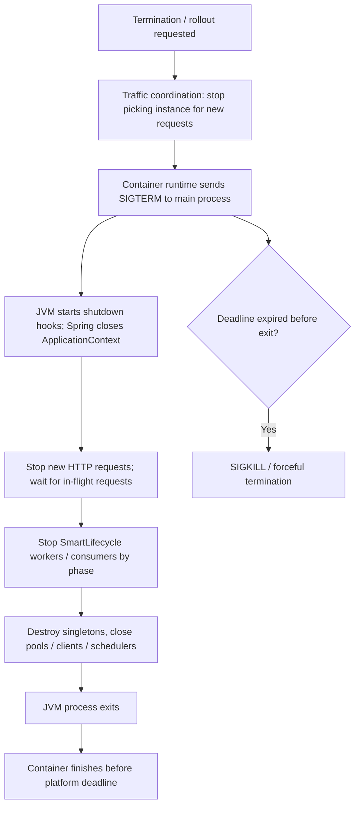

# Coordinating Spring Boot Shutdown Budgets with Docker and Deployment Platforms

## 1. The Problem: The App Wants to Stop Gently, Yet the Container Can Be Killed

Suppose a Spring Boot application is handling an HTTP request that takes 8 seconds while also processing a message or background job. When a new version rolls out, the platform must stop the old instance without dropping requests, corrupting transactions, or holding resources indefinitely.

If you only configure:

```properties
server.shutdown=graceful
spring.lifecycle.timeout-per-shutdown-phase=30s
```

yet Docker waits only 10 seconds before sending `SIGKILL`, the application is **not guaranteed a full 30 seconds**. Spring Boot's configuration takes effect only while the JVM process stays alive and is allowed to finish the context-closing chain. If the container runtime forcibly stops it earlier, the JVM cannot finish running callbacks.

Conversely, raising Docker's timeout to 5 minutes while letting workers wait on a database indefinitely does not make the application graceful either. You must design a **unified shutdown budget** across three layers:

1. **Application:** stop taking new work, wait for running requests/jobs, execute lifecycle/destroy callbacks, and exit.
2. **Container runtime:** send the proper stop signal, wait for a grace period, then force-stop if time expires.
3. **Deployment platform / load balancer:** remove the instance from new traffic routing, let existing requests/connections finish, and enforce a final cap on instance replacement.

This lesson aims to explain the mechanics, configure timings at each layer, and verify with a **Spring Boot 3.3.x / Java 17+** app running in Docker and Kubernetes.

> **Key point:** `SIGTERM` gives a chance for controlled shutdown; `SIGKILL` cannot be caught or delayed. Actual graceful shutdown time **cannot exceed the budget allowed by the platform**.

## 2. Ideal Shutdown Sequence for an Instance

A typical shutdown flow:



This is a **conceptual diagram**, not an absolute ordering for every container/web server. In Spring Boot, embedded web server graceful shutdown is part of stopping `SmartLifecycle` beans during context closure; other phases and destroy callbacks still take time. Meanwhile, Kubernetes may update EndpointSlices/readiness and execute `preStop` before or in parallel with other coordination steps.

A safe shutdown must satisfy two independent conditions:

- **Ingress side:** stop routing new requests into the instance about to stop.
- **Egress side:** in-flight requests/jobs complete, are checkpointed, or are cancelled per contract **before** the resources they rely on are closed.

Opening the HTTP port cleanly at startup and having green readiness say nothing about whether resources are released properly during shutdown.

## 3. Three Time Concepts Never to Confuse

| Concept | Mechanism / example | What happens when expired? |
| --- | --- | --- |
| **Spring graceful shutdown budget** | `spring.lifecycle.timeout-per-shutdown-phase=15s` | Lifecycle processor stops waiting on one phase's callbacks; may continue closing |
| **Docker stop timeout** | `docker stop --timeout 30 my-app` | After timeout, Docker uses `SIGKILL` if process has not exited |
| **Docker Compose stop grace** | `stop_grace_period: 30s` | Compose waits before force-killing the container |
| **Kubernetes Pod termination grace** | `terminationGracePeriodSeconds: 45` | Once grace expires, unstopped containers may be force-killed |
| **`preStop` duration** | Kubernetes hook, e.g. waiting for propagation | **Consumes** the Pod grace budget itself; not added on top automatically |
| **Traffic drain time** | EndpointSlice, Ingress, external load balancer | Platform-dependent; may need headroom while routing updates |
| **Business timeouts** | HTTP client timeout, database query timeout, job deadline | Tasks must finish, retry, or fail on their own |
| **Full JVM shutdown** | Sum of lifecycle phases, destroy methods, thread termination | No single property guarantees the entire JVM finishes in an exact second count |

The **`per-shutdown-phase`** part of `spring.lifecycle.timeout-per-shutdown-phase` is critical: it is not "maximum time for the entire process". With multiple phases waiting or slow destroy callbacks, total duration can exceed one configured timeout value.

Likewise, Docker's stop timeout does not force individual database queries to abort at 30 seconds; it enforces a deadline only on the **container**.

## 4. Spring Boot 3.3: Enabling Graceful Shutdown Properly

### 4.1. Base Configuration

In `src/main/resources/application.properties`:

```properties
server.shutdown=graceful
spring.lifecycle.timeout-per-shutdown-phase=15s
```

Or equivalent YAML:

```yaml
server:
  shutdown: graceful

spring:
  lifecycle:
    timeout-per-shutdown-phase: 15s
```

In Spring Boot **3.3.x**, `server.shutdown=graceful` is how you enable graceful shutdown for the embedded web server. Do not apply assumptions from newer Boot versions to Boot 3.3 without checking. If `server.shutdown=immediate` is set or no equivalent config exists in 3.3, do not assume the web server will wait for in-flight requests under Boot's graceful mechanism.

Spring Boot 3.3 supports graceful shutdown with embedded **Tomcat, Jetty, Undertow, and Reactor Netty** in corresponding web app types. It runs when the context closes, during an early phase of stopping `SmartLifecycle` beans.

### 4.2. What Happens to New Requests?

During graceful shutdown, the server tries to **stop accepting new requests** while giving current requests a chance to finish within the grace period. Rejection behavior varies by server:

- Embedded Tomcat, Jetty, and Reactor Netty have mechanisms to stop accepting new connections at the network layer.
- Undertow may accept connections yet respond with HTTP **503 Service Unavailable**.
- Keep-alive connections, request multiplexing, or reverse proxies can make existing connections behave differently from simple examples.

Therefore, never promise every new client after `SIGTERM` receives the exact same status code. Test against the **actual web server and networking stack**.

### 4.3. Time for Other `SmartLifecycle` Beans

Beyond the web server, integrations like queue listeners, schedulers, and executors may have their own lifecycles. Spring starts in ascending phase order and stops in descending phase order; with `depends-on`, dependents stop before dependencies even when phases suggest otherwise.

Key points:

- A consumer should **stop pulling new messages** before its connection/client closes.
- A worker needs a drain timeout, and `stop(Runnable callback)` must invoke the callback **only after stopping truly completes**.
- `spring.lifecycle.timeout-per-shutdown-phase` only sets the lifecycle processor's wait time; it **does not automatically interrupt** hung threads.
- If a background task lives outside Spring's management, an explicit owner must be responsible for stopping it.

### 4.4. JVM Shutdown Hook

In a normal Boot application, `SpringApplication` registers a JVM shutdown hook to close `ApplicationContext` when the JVM exits in a supported way. When a container sends `SIGTERM` to the Java process, the JVM normally begins its shutdown sequence, runs the hook, and gives Boot a chance to close the context.

However, this depends on signal and process plumbing:

- `SIGTERM` delivered to the JVM: opportunity for graceful shutdown.
- `SIGKILL`/kernel OOM kill/process crash: no guarantee of hooks or `@PreDestroy` running.
- IDE Stop button, shell wrappers, service managers, or Windows process termination may trigger different stop mechanisms; verify in practice.
- Calling `Runtime.halt(...)` or forced kills also bypasses the Spring lifecycle.

Do not register an ad-hoc shutdown hook that closes the same resource concurrently with the Spring context without coordination; it invites double-close bugs or breaks ordering.

## 5. Docker: What Signal Does `docker stop` Send and How Long Does It Wait?

Per Docker documentation, `docker container stop`/`docker stop` sends a stop signal to the **main process inside the container**, defaulting to `SIGTERM` if no stop signal is configured. Docker waits for an interval, then sends `SIGKILL` if the process has not exited.

Example:

```bash
docker stop --timeout 30 graceful-app
```

Here Docker grants roughly **30 seconds** to the container after the initial signal; if the Java process exits earlier, Docker does not necessarily wait the full 30 seconds.

Docker Engine defaults when no custom timeout is specified are typically:

- **10 seconds** for Linux containers.
- **30 seconds** for Windows containers.

Values can be changed by daemon or container config. Check actual configuration rather than assuming one environment's stop timeout matches another.

### 5.1. Setting Timeout When Creating a Container

Example:

```bash
docker run -d \
  --name graceful-app \
  --stop-timeout 30 \
  -p 8080:8080 \
  graceful-stop-demo:0.0.1
```

This uses Bash-style shell syntax. In PowerShell, write on a single line:

```powershell
docker run -d --name graceful-app --stop-timeout 30 -p 8080:8080 graceful-stop-demo:0.0.1
```

`--stop-timeout 30` sets the default stop timeout for **this container**. You can override it at stop time with:

```bash
docker stop --timeout 40 graceful-app
```

Do not use an infinite `--timeout -1` just to hide an uncooperative task; enforce bounds and recovery when the app cannot exit cleanly.

### 5.2. `docker stop` Is Not `docker kill`

```bash
docker stop graceful-app
```

Sends the stop signal and waits for grace. Meanwhile:

```bash
docker kill graceful-app
```

normally sends `SIGKILL` immediately unless another signal is specified; the JVM gets no guaranteed chance to run shutdown hooks.

You can use:

```bash
docker kill --signal=TERM graceful-app
```

to send TERM directly, but this operation **does not provide the same wait-then-force-kill workflow** as `docker stop`. Thus, when controlled shutdown is the goal, prefer `docker stop` over `docker kill`.

### 5.3. Ensuring the JVM Receives Signals

A proper Dockerfile:

```dockerfile
FROM eclipse-temurin:17-jre

WORKDIR /app
COPY target/graceful-stop-demo-0.0.1-SNAPSHOT.jar app.jar

EXPOSE 8080
STOPSIGNAL SIGTERM

ENTRYPOINT ["java", "-jar", "/app/app.jar"]
```

The **exec form** of `ENTRYPOINT` makes `java` the main process (PID 1 in a simple container), receiving signals directly from the container runtime.

Avoid shell form such as:

```dockerfile
ENTRYPOINT java -jar /app/app.jar
```

because an intermediate shell may become PID 1 without forwarding `SIGTERM` properly to the Java child. If you need a shell script to prepare environment variables, end it with:

```sh
exec java -jar /app/app.jar
```

When using an init process like `tini` or Docker `--init`, ensure it forwards signals and reaps child processes properly. Do not treat Java having PID 1 as the only requirement; the core requirement is that **signals reach the JVM** and child processes are managed.

### 5.4. Dockerfile `STOPSIGNAL` Does Not Change the Timeout

`STOPSIGNAL SIGTERM` only picks the **initial signal**; it does not control how long Docker waits. Stop timeouts live in `docker stop --timeout`, `docker run --stop-timeout`, daemon defaults, or orchestrator config.

Never use `STOPSIGNAL SIGKILL` for apps needing graceful shutdown: `SIGKILL` skips cleanup opportunities.

## 6. Docker Compose: Using `stop_grace_period`

With Docker Compose, a service can configure:

```yaml
services:
  app:
    image: graceful-stop-demo:0.0.1
    ports:
      - "8080:8080"
    stop_signal: SIGTERM
    stop_grace_period: 30s
```

`stop_grace_period` tells Compose how long to wait after the stop signal before force-killing. The Compose Specification accepts durations like `30s` or `1m30s`. If omitted, Compose typically defaults to **10 seconds**.

You can stop with:

```bash
docker compose stop app
```

Or override once:

```bash
docker compose stop --timeout 40 app
```

When both `stop_grace_period` and CLI timeout exist, verify the exact command and override precedence of your Compose version. Never assume Docker Compose infers `stop_grace_period` from `spring.lifecycle.timeout-per-shutdown-phase`.

`docker compose down` also removes service containers and networks per config; do not use it in tests meant only to stop one container without tearing down the stack. In this lesson, `docker compose stop app` is the cleaner stop test.

## 7. Kubernetes: Pod Termination Grace Period

In Kubernetes, Pods typically have `terminationGracePeriodSeconds`, defaulting to **30 seconds** if unconfigured. When a Pod is asked to stop:

1. The API marks the Pod terminating and computes the grace deadline.
2. Kubelet starts the node-level termination sequence.
3. If a container defines a `preStop` hook and grace is non-zero, kubelet runs the hook **within that same stop budget**.
4. Kubelet instructs the container runtime to send `TERM` to the main process (with environment-specific details).
5. If the container has not exited when grace expires, the runtime may send `SIGKILL`.

EndpointSlice and Service objects simultaneously mark the endpoint as terminating. Terminating endpoints have `ready` set to `false` to avoid normal traffic routing. However, propagation to kube-proxy, ingress, and external load balancers can take time, and existing connections can persist.

### 7.1. Example Deployment Configuration

This is a structurally valid **example Deployment manifest**. Replace `registry.example.com/...` with an image your cluster can actually pull.

```yaml
apiVersion: apps/v1
kind: Deployment
metadata:
  name: graceful-stop-demo
spec:
  replicas: 2
  strategy:
    type: RollingUpdate
    rollingUpdate:
      maxSurge: 1
      maxUnavailable: 0
  selector:
    matchLabels:
      app: graceful-stop-demo
  template:
    metadata:
      labels:
        app: graceful-stop-demo
    spec:
      terminationGracePeriodSeconds: 45
      containers:
        - name: app
          image: registry.example.com/graceful-stop-demo:0.0.1
          ports:
            - name: http
              containerPort: 8080
          startupProbe:
            httpGet:
              path: /livez
              port: http
            periodSeconds: 5
            timeoutSeconds: 2
            failureThreshold: 24
          readinessProbe:
            httpGet:
              path: /readyz
              port: http
            periodSeconds: 3
            timeoutSeconds: 2
            failureThreshold: 3
          livenessProbe:
            httpGet:
              path: /livez
              port: http
            periodSeconds: 10
            timeoutSeconds: 2
            failureThreshold: 3
```

In the sample Spring Boot app, Actuator and health probes are enabled; `/livez` and `/readyz` are exposed on the main application port.

`terminationGracePeriodSeconds: 45` is **the Pod's maximum budget**, not a guarantee Java gets a full 45 seconds regardless of prior steps. Pick the concrete value from real measurements rather than copying it without accounting for drain and shutdown of other components.

`maxSurge: 1` and `maxUnavailable: 0` help rolling updates preserve capacity provided new replicas become ready. They **do not replace** readiness probes, termination grace, readiness propagation, or drain design.

### 7.2. Readiness While a Pod Is Stopping

Spring Boot Actuator can expose readiness health groups. On normal startup, Boot publishes readiness once runners finish. When the app prepares to stop, state can flip to refusing traffic per lifecycle; however, the HTTP endpoint may already be shutting down, so `/readyz` is not always reachable during the grace period.

In Kubernetes, **Pod Terminating** is an orchestration-level signal: EndpointSlice carries terminating flags and terminating endpoints normally have `ready=false`. Therefore, traffic removal strategies must not rely solely on whether the app can still serve `/readyz` JSON after receiving TERM.

Distinguish clearly:

- Readiness indicates whether an instance should receive new traffic.
- Liveness indicates whether the process can continue operating.
- Startup probes protect slow **startups**; they do not directly grant extra **shutdown** time.
- `terminationGracePeriodSeconds` is the Pod stop budget, while Spring's graceful shutdown is one phase inside that budget.

### 7.3. When Is `preStop` Useful?

Kubernetes allows running `preStop` before sending TERM. Some older setups use a hook to wait for external load balancers to update routing:

```yaml
lifecycle:
  preStop:
    exec:
      command: ["/bin/sh", "-c", "sleep 5"]
```

**This is a fragment** to add under `containers[].lifecycle`, not a complete manifest. It only works if the image contains `/bin/sh` and `sleep`; **distroless images** may lack a shell.

Crucially: `preStop` duration **counts inside** `terminationGracePeriodSeconds`. If a Pod has 45 seconds and `preStop` takes 5 seconds, the time left for TERM, Spring shutdown, and exit is **less than ~40 seconds**. Hooks do not create "5 free seconds".

A `preStop` doing only `sleep` does not actually close resources; it only creates a buffer for routing propagation. Measure real propagation and evaluate whether a hook is needed instead of arbitrarily adding 5–20 seconds that slow down rollouts. In modern setups, EndpointSlice terminating states and load-balancer drain policies can be more useful than a fixed sleep.

### 7.4. Why Can Setting `terminationGracePeriodSeconds=60` Still Fail?

Example scenarios:

- PID 1 shell fails to forward TERM to Java, so the process never starts graceful shutdown on time.
- `preStop` sleeps for almost the full 60 seconds.
- A listener/job blocks without a timeout and never stops.
- Web server graceful phase takes 30 seconds, followed by another phase taking 30 seconds plus heavy `@PreDestroy`.
- External ingress keeps sending new requests after the server stopped accepting.
- Container gets OOMKilled or the node is lost, leaving no chance for graceful shutdown.

Fixes require diagnosing the **bottlenecked layer**, not just bumping a number high and hoping it is safe.

## 8. Production Shutdown Budget Formula

A practical calculation is:

```text
T_platform_grace
    >
T_preStop
  + T_web_inflight
  + T_other_lifecycle_phases
  + T_destroy_cleanup
  + T_signal_and_exit_overhead
  + T_safety_margin
```

Where:

- `T_preStop`: hook duration (if any).
- `T_web_inflight`: time the web server needs for running requests, capped by the phase deadline.
- `T_other_lifecycle_phases`: actual time other `SmartLifecycle` beans need to drain/stop.
- `T_destroy_cleanup`: time to release pools, flush, and close (may sit outside the phase timeout).
- `T_signal_and_exit_overhead`: signal delivery lag, JVM hooks, and exit.
- `T_safety_margin`: buffer for jitter, scheduling, networking, and high load.

Do not simply sum configured timeouts verbatim: some operations run concurrently or finish early, while others are uncapped by timeout properties. Use traces and **real worst-case** measurements to choose the budget. This formula is a **conservative design guideline**, not a Framework guarantee.

### 8.1. Example of an Intentionally Chosen Budget

Assume **illustrative** numbers, not measurements of a specific system:

| Component | Expected maximum |
| --- | ---: |
| `preStop` for propagation | 5 s |
| HTTP graceful shutdown | 15 s |
| Stopping consumers/jobs in other phases | 10 s |
| Closing clients/pools and JVM exit | 5 s |
| Headroom | 10 s |
| **Platform budget** | **45 s** |

Then choosing:

```properties
server.shutdown=graceful
spring.lifecycle.timeout-per-shutdown-phase=15s
```

and:

```yaml
terminationGracePeriodSeconds: 45
```

can be a testing starting point, **not a guarantee**: if multiple lifecycle phases each burn nearly 15 seconds, or a destroy callback lacks a timeout, 45 seconds can still run short. Verify with real logs/metrics in staging.

For standalone Docker with no `preStop` and simple shutdown logic, an example 30-second budget:

```bash
docker stop --timeout 30 graceful-app
```

may suffice for a 15-second HTTP phase plus cleanup and margin. However, increasing Docker's timeout **does not** let requests exceeding the phase limit finish automatically.

### 8.2. Cases Where Requests May Run Longer Than the Shutdown Phase

A request needs 60 seconds while the HTTP graceful phase waits only 15 seconds. When TERM arrives mid-request, the server is under no obligation to wait 60 seconds. Depending on implementation, the request may be cut or the connection closed.

Design approaches:

- Avoid holding synchronous HTTP requests for multiple minutes when possible.
- Move to asynchronous jobs, returning a job ID and providing a status polling API.
- If long requests are unavoidable, increase both phase grace **and** platform budget aligned with SLOs, capacity, and rollout policies.
- Design idempotency so client retries do not duplicate writes after disconnects.
- Align upstream proxy/ingress/HTTP client timeouts with the request SLO.

Never claim "graceful = zero dropped requests": load-balancer races, keep-alive connections, node failures, and deadlines still exist.

## 9. Runnable Spring Boot 3.3 + Java 17 Example

This example exposes a `/work` endpoint that sleeps for a bounded interval to simulate an in-flight request. The goal is stopping the container while a request is running and observing whether the request finishes **before** the Docker stop deadline.

### 9.1. Project Structure

```text
graceful-stop-demo/
├── pom.xml
├── Dockerfile
└── src/main/
    ├── java/com/example/graceful/
    │   ├── GracefulStopApplication.java
    │   └── WorkController.java
    └── resources/application.properties
```

### 9.2. `pom.xml`

```xml
<project xmlns="http://maven.apache.org/POM/4.0.0"
         xmlns:xsi="http://www.w3.org/2001/XMLSchema-instance"
         xsi:schemaLocation="http://maven.apache.org/POM/4.0.0 https://maven.apache.org/xsd/maven-4.0.0.xsd">
    <modelVersion>4.0.0</modelVersion>
    <parent>
        <groupId>org.springframework.boot</groupId>
        <artifactId>spring-boot-starter-parent</artifactId>
        <version>3.3.13</version>
        <relativePath/>
    </parent>
    <groupId>com.example</groupId>
    <artifactId>graceful-stop-demo</artifactId>
    <version>0.0.1-SNAPSHOT</version>
    <properties>
        <java.version>17</java.version>
    </properties>
    <dependencies>
        <dependency>
            <groupId>org.springframework.boot</groupId>
            <artifactId>spring-boot-starter-web</artifactId>
        </dependency>
        <dependency>
            <groupId>org.springframework.boot</groupId>
            <artifactId>spring-boot-starter-actuator</artifactId>
        </dependency>
    </dependencies>
    <build>
        <plugins>
            <plugin>
                <groupId>org.springframework.boot</groupId>
                <artifactId>spring-boot-maven-plugin</artifactId>
            </plugin>
        </plugins>
    </build>
</project>
```

### 9.3. Main Class `GracefulStopApplication.java`

```java
package com.example.graceful;

import org.springframework.boot.SpringApplication;
import org.springframework.boot.autoconfigure.SpringBootApplication;
import org.springframework.context.event.ContextClosedEvent;
import org.springframework.context.event.EventListener;

@SpringBootApplication
public class GracefulStopApplication {

    public static void main(String[] args) {
        SpringApplication.run(GracefulStopApplication.class, args);
    }

    @EventListener
    public void onContextClosed(ContextClosedEvent event) {
        System.out.println("context:closing");
    }
}
```

`onContextClosed` only logs an illustrative message; it **does not** call `System.exit()` or destroy all beans itself. Spring Framework executes the shutdown lifecycle after the context starts closing.

In a web app with parent/child contexts, the listener should also check the source context if events propagate. This example has only one application context, so filtering is unnecessary.

### 9.4. HTTP Controller `WorkController.java`

```java
package com.example.graceful;

import java.util.concurrent.atomic.AtomicInteger;

import org.springframework.http.ResponseEntity;
import org.springframework.web.bind.annotation.GetMapping;
import org.springframework.web.bind.annotation.RequestParam;
import org.springframework.web.bind.annotation.RestController;

@RestController
public class WorkController {

    private final AtomicInteger active = new AtomicInteger();

    @GetMapping("/work")
    public ResponseEntity<String> work(
            @RequestParam(defaultValue = "8000") long millis)
            throws InterruptedException {

        if (millis < 0L || millis > 20_000L) {
            return ResponseEntity.badRequest()
                    .body("millis must be between 0 and 20000");
        }

        int now = active.incrementAndGet();
        System.out.println("work:start active=" + now);

        try {
            Thread.sleep(millis);
            return ResponseEntity.ok("completed=" + millis);
        } catch (InterruptedException e) {
            Thread.currentThread().interrupt();
            System.out.println("work:interrupted");
            throw e;
        } finally {
            int remaining = active.decrementAndGet();
            System.out.println("work:end active=" + remaining);
        }
    }
}
```

This is a demo, not how to build a production business API. `Thread.sleep` only simulates a task that finishes within a bounded time; real requests may wait on databases, HTTP clients, or jobs. When optimizing concurrency/latency, avoid `sleep` on servlet request threads.

`AtomicInteger` counts active demo requests in **one JVM**. It does not count requests on other Pods, replace metrics exporters, or make requests cancellable beyond `Thread.sleep`'s interrupt behavior.

### 9.5. `application.properties`

```properties
server.port=8080
server.shutdown=graceful
spring.lifecycle.timeout-per-shutdown-phase=15s

management.endpoint.health.probes.enabled=true
management.endpoint.health.probes.add-additional-paths=true
logging.level.root=INFO
```

`server.shutdown=graceful` and the phase timeout are the core pieces. Actuator and probes let you test `/readyz`/`/livez`; `logging.level.root=INFO` provides startup/shutdown logs for diagnostics.

### 9.6. Dockerfile

```dockerfile
FROM eclipse-temurin:17-jre
WORKDIR /app
COPY target/graceful-stop-demo-0.0.1-SNAPSHOT.jar app.jar
EXPOSE 8080
STOPSIGNAL SIGTERM
ENTRYPOINT ["java", "-jar", "/app/app.jar"]
```

The image copies neither source code nor Maven cache; the JAR must be built first. Exec form lets the JVM receive stop signals directly. `EXPOSE 8080` is metadata only; mapping a host port locally still requires `-p 8080:8080`.

### 9.7. Running on Docker

In the project directory:

```bash
mvn package
docker build -t graceful-stop-demo:0.0.1 .
docker run -d --name graceful-app -p 8080:8080 graceful-stop-demo:0.0.1
```

Check once the app is ready:

```bash
curl -i http://localhost:8080/readyz
```

If startup succeeded and the health group has no other errors, you typically see HTTP 200 with a JSON body like:

```json
{"status":"UP"}
```

On a machine without `mvn`, `docker`, or ability to pull the base image, these commands will not run; the environment needs Java 17+, Maven, Docker Engine, and connectivity to download dependencies as needed.

### 9.8. Testing Graceful Shutdown with Two Terminals

**Terminal A** starts an 8-second request:

```bash
curl -i "http://localhost:8080/work?millis=8000"
```

Keep Terminal A running and confirm `work:start` appeared in Docker logs (if needed, run `docker logs -f graceful-app` in another terminal). **Terminal B** then runs:

```bash
docker stop --timeout 30 graceful-app
```

If TERM arrives while the request is still running, the Java process receives the signal and Boot executes graceful shutdown. Since the request needs only 8 seconds—less than the 15-second phase budget under normal conditions—Terminal A can receive:

```text
HTTP/1.1 200
...
completed=8000
```

This example **illustrates only status/body content**; exact headers, HTTP version, and print timing depend on the client, server, and connection.

Application logs worth observing include:

```text
work:start active=1
context:closing
work:end active=0
```

Actual ordering may differ if the request finishes near TERM, or if framework events/logs interleave. What matters is confirming `work:end active=0` and HTTP success **before the process exits**, not matching every stdout line verbatim against the block above.

If the 8-second request already finished before Terminal B sent stop, the test no longer verifies an in-flight request during shutdown. Repeat while watching `work:start` and send TERM sooner.

### 9.9. Reverse Test: Platform Grace Shorter Than Request

Restart the container:

```bash
docker start graceful-app
```

Send a longer request, e.g.:

```bash
curl -i "http://localhost:8080/work?millis=12000"
```

Once you see the request-start log, run:

```bash
docker stop --timeout 3 graceful-app
```

Docker can force-kill the JVM after 3 seconds, **before** the 12-second request finishes, even though Spring Boot is configured with a 15-second phase timeout. The client may see connection reset, empty reply, or errors depending on the networking stack.

Do not claim the request will fail 100% of the time, because if the stop command arrived late the request might already have finished; the point of the test is comparing deadlines, not predicting CPU/network scheduling.

After the test, inspect:

```bash
docker inspect graceful-app
```

Check state, exit code, and `OOMKilled` to distinguish a stop-timeout force-kill from other causes. Exit code **137** is commonly associated with SIGKILL on Linux and 143 with SIGTERM by `128+signal` convention, yet **an exit code alone is not enough to prove the cause** without container events, logs, and status.

### 9.10. Running with Docker Compose

Create `compose.yaml`:

```yaml
services:
  app:
    build: .
    image: graceful-stop-demo:0.0.1
    ports:
      - "8080:8080"
    stop_signal: SIGTERM
    stop_grace_period: 30s
```

Run:

```bash
docker compose up -d --build
docker compose stop app
```

With Compose, test the same way: one terminal issues a long request while another stops the service mid-request. Measure the time from stop signal to JVM exit and request completion rate, not just whether the Compose command exited 0.

## 10. Non-HTTP Workloads: Queues, Schedulers, and `@Async`

Graceful web shutdown **does not automatically drain** all background tasks. If a `@Scheduled` job is writing files or a consumer is processing messages, it may still need `DataSource`, HTTP clients, or broker connections after the web server stopped accepting new requests.

### 10.1. Designing `SmartLifecycle` for Long-Running Workers

For an application-owned worker, you can structure:

```text
SmartLifecycle.start()
    → open consumer, accept new messages

SmartLifecycle.stop(callback)
    → stop accepting new messages
    → wait for in-flight tasks / cancel at deadline
    → close consumer or confirm worker stopped
    → callback.run()

Bean destruction / owner shutdown
    → release remaining pools/clients
```

This is **workflow pseudocode**, not something the framework performs automatically in full. Implementation code must handle synchronization, exceptions, thread interruption, I/O timeouts, and calling the callback exactly once.

A common mistake is:

```java
@Override
public void stop(Runnable callback) {
    future.cancel(true);
    callback.run();
}
```

This illustrative snippet assumes `future` exists. `Future.cancel(true)` merely requests cancellation; it does not prove the job stopped or released resources. Invoking the callback immediately can allow the lifecycle processor to destroy the datasource while the task is still using it.

### 10.2. Business Deadlines Must Be Shorter Than the Total Deadline

If a Pod has 45 seconds to terminate, a worker must not keep retrying a database call for 60 seconds after receiving TERM. Propagate cancellation/deadlines to I/O clients, cap retries, and write checkpoints when needed.

MQ consumer example:

1. Stop polling for more messages.
2. Finish or checkpoint already fetched messages.
3. Ack only after data is durably persisted.
4. Close consumer/connection.
5. Let the broker redeliver unacked messages if the process dies before finishing.

That is why safe shutdown requires **idempotency and recovery**, not merely promising "never kill the process".

### 10.3. `ExecutorService.shutdown()` Does Not Necessarily Wait for Completion

A bean:

```java
@Bean(destroyMethod = "shutdown")
ExecutorService taskExecutor() {
    return Executors.newFixedThreadPool(4);
}
```

This snippet requires imports and belongs inside `@Configuration`/`@SpringBootApplication`. `shutdown()` stops accepting new tasks, yet does not guarantee all tasks finish before the method returns. If you must drain before closing dependencies, use bounded termination waiting/callbacks and monitor failures.

An executor may be shared across modules; in that case assign **one owner** responsible for shutdown instead of letting individual consumers call `shutdownNow()` and break another module's jobs.

### 10.4. Non-Daemon or Unmanaged Threads

If code spawns `new Thread(...).start()` and forgets to stop/join it, the JVM may fail to exit within the desired window. Shutdown coordination must retain thread handles and send stop signals. Do not expect JVM shutdown hooks to stop arbitrary infinite threads automatically.

Prefer Spring-managed executors, bounded queues, and cancellation APIs for complex background workloads. Ensure tasks can genuinely exit blocking calls within a deadline.

## 11. Traffic Draining and Readiness Before Shutdown

### 11.1. Why Must You Avoid Races with Load Balancers?

Suppose:

```text
T0: Kubernetes decides to terminate Pod A
T1: Pod A begins closing its web server
T2: External load balancer still sends a new request to A
T3: Service routing finally stops selecting A
```

The window between T1 and T3 can fail new requests because the server stopped accepting. Thus **traffic draining** and **process stopping** must be synchronized within what the platform supports.

Kubernetes marks terminating endpoints `ready=false`, removing them from normal routing. However, external cluster gateways, ingress controllers, proxy connection pools, or client keep-alive can still route using stale state briefly.

Solutions usually combine:

- Reliable readiness probes throughout the lifecycle.
- Endpoint draining at the orchestrator/ingress/load balancer.
- An **empirically measured** propagation buffer when needed.
- Web server graceful shutdown and sensible proxy/client timeouts.
- Idempotent client retries to handle unavoidable network errors.

### 11.2. Do Not Treat `preStop` Sleep as the Only Mechanism

A `preStop` sleep can wait for propagation, yet it also burns the grace period. Sleeping 20 seconds inside a 30-second Pod grace leaves only ~10 seconds or less for the entire shutdown—easily triggering SIGKILL.

Size `terminationGracePeriodSeconds` for the **total budget**, not just `spring.lifecycle.timeout-per-shutdown-phase`; avoid pointlessly duplicating the same wait time in both `preStop` and the application.

### 11.3. Long-Lived Connections and Streaming

WebSockets, SSE, long polling, HTTP/2 streams, and long requests may not finish in a few seconds. Establish explicit policies:

- Stop opening new streams while the instance is draining.
- Send protocol-level close/reconnect notifications where supported.
- Have clients reconnect and replay/checkpoint.
- Enforce stream/connection time limits during termination.
- Never promise to keep a WebSocket alive forever just because Docker's stop timeout is large.

Each web server and application protocol has its own shutdown behavior; test with real clients, not just `curl` to `/health`.

## 12. How Do Startup Probes and Rollouts Relate to Shutdown?

Even though our focus is stopping the app, safe rollouts also require **new** instances to be ready before old instances scale down.

For example, a Deployment with `maxUnavailable: 0`, `maxSurge: 1`, and readiness probes lets Kubernetes spin up a new Pod and wait for readiness before terminating an old Pod, given sufficient cluster resources. Still:

- The readiness endpoint must reflect essential business conditions.
- Overly slow `ApplicationRunner` tasks delay time-to-ready.
- `startupProbe` protects slow startups from liveness restarts; it **does not** extend shutdown time.
- Rolling updates can still be constrained by quotas, scheduling, PodDisruptionBudgets, node drains, or dependency errors.
- Longer grace periods can lengthen rollout completion and consume extra temporary capacity.

Measure both **time-to-ready** of new Pods and **time-to-exit** of old Pods. Watching only one misses failures.

## 13. Measuring and Diagnosing Slow Shutdowns

### 13.1. Log Start and Finish Milestones

Use clear milestones:

```text
shutdown:context-close-start
shutdown:http-drain-start
shutdown:http-drain-complete
shutdown:consumer-stop-start
shutdown:consumer-stop-complete
shutdown:resource-destroy
shutdown:jvm-exit
```

These are **recommended log labels**, not default Boot logs printed automatically. In section 9's example, `context:closing` and `work:start/work:end` were the labels actually printed by code.

To measure duration, use `System.nanoTime()`/metrics per phase; compute observed p95/p99/maximum across multiple rollouts. Do not infer shutdown duration from a single log line if logging buffers have not flushed or the process was killed.

### 13.2. Docker

Diagnostic commands:

```bash
docker logs graceful-app
docker inspect graceful-app
docker events --filter container=graceful-app
```

Inspect `State.ExitCode`, `State.OOMKilled`, start/finish timestamps, and events. The Docker event stream gives additional stop/kill evidence. Exit code 137 is a common sign of SIGKILL, though it can also relate to OOM; corroborate with other evidence.

### 13.3. Kubernetes

```bash
kubectl get pods
kubectl describe pod <pod-name>
kubectl logs <pod-name> --previous
```

`<pod-name>` is a parameter placeholder to replace with your real Pod name; do not run with angle brackets literally. `kubectl logs --previous` helps if the container restarted and previous logs still exist; data may be unavailable once Pods are deleted or retention expires.

Check:

- Is the Pod stuck in `Terminating`?
- What is the container `Last State`/exit code?
- Were there liveness/startup probe failures, OOMKilled, or force-kills?
- Do logs show complete worker start/finish markers?
- Is `terminationGracePeriodSeconds` configured at the right `spec` level?
- Did `preStop` hang or consume the entire budget?
- Are ingress/services continuing to route requests to a stopping Pod?

### 13.4. If Shutdown Hangs with Zero CPU Usage

The process may be waiting on:

- A JDBC query or external HTTP call missing a timeout.
- An executor waiting on `awaitTermination` indefinitely.
- A `SmartLifecycle.stop(Runnable)` that forgot to invoke its callback.
- `@PreDestroy` blocked on a lock held by another thread.
- A logging appender flushing over the network.
- An unmanaged non-daemon thread.

Capture thread dumps/stack traces while the process is still alive. Simply increasing `terminationGracePeriodSeconds` never fixes a deadlock.

## 14. Common Errors and Misconceptions

### Mistake A — "Spring Boot is configured to wait 30s, so Docker definitely waits 30s too"

False. Docker has its own stop timeout; on Linux it normally defaults to 10 seconds unless configured otherwise. Set platform grace large enough.

### Mistake B — "Kubernetes defaults to 30s, preStop sleeps 15s, and Spring uses 30s—everything is fine"

Wrong. `preStop` sits **inside** those 30 seconds; what remains is not enough for a full 30-second Spring wait, let alone cleanup and headroom. Increase the budget appropriately or trim shutdown work after measuring.

### Mistake C — "`server.shutdown=graceful` guarantees requests are never dropped"

No. Requests can exceed the graceful phase timeout, upstream proxies can route late, clients can disconnect, or nodes can die. Use retries/idempotency and real network tests.

### Mistake D — "Use `ENTRYPOINT java -jar ...` and Docker automatically forwards SIGTERM"

Shell form can make a shell PID 1 and fail to forward signals as intended. Prefer JSON exec form or `exec java ...` at the end of an entrypoint script.

### Mistake E — "Adding `preStop: sleep 30` gives Spring 30 extra seconds"

Wrong. Hooks consume the Pod's termination grace rather than adding bonus time. On shell-less images, the hook can even fail.

### Mistake F — "Short requests finished, meaning all consumers stopped too"

No. HTTP servers and background tasks have distinct lifecycles. Implement stop callbacks, deadlines, and coordination for each integration.

### Mistake G — "`spring.lifecycle.timeout-per-shutdown-phase=20s` is the max total process shutdown time"

No. It is a **per-phase** timeout; multiple phases and separate destroy callbacks may exist. Platform grace must reflect **total shutdown duration**.

### Mistake H — "Use `docker kill` to test graceful shutdown"

`docker kill` defaults to SIGKILL, giving shutdown hooks no normal chance to run. Use `docker stop` with a timeout to test TERM + grace + force-kill.

### Mistake I — "With a readiness probe, all old requests will finish"

Readiness primarily affects **routing of new requests**. Already established connections/requests still require server graceful draining and dedicated completion time.

### Mistake J — "Spring JVM received `SIGTERM` without `ContextClosedEvent`"

The JVM may not have received the signal, shutdown hooks were disabled, the process was killed ungracefully, logs were lost, or an exception caused abnormal exit. Check PID 1, command/entrypoint, events, and exit codes before changing app code.

### Mistake K — "Docker Compose `stop_grace_period` also applies to Kubernetes"

No. Compose and Kubernetes are separate orchestrators with their own configs; `stop_grace_period` does not translate into `terminationGracePeriodSeconds`. Declare the right setting in each platform's manifest.

### Mistake L — "A 503 during shutdown proves graceful failed"

Not necessarily. With Undertow, returning 503 to new requests is one way of **rejecting requests during graceful shutdown**; exact behavior depends on the server. What you must check is whether requests **accepted before shutdown** were processed within budget.

### Mistake M — "Exit code 137 proves Docker stop timeout was too short"

137 usually indicates SIGKILL, yet the cause could be OOM, an admin kill, or an orchestrator timeout. Also inspect `OOMKilled`, logs, Pod events, and signal handling time.

### Mistake N — "No `@PreDestroy` log means the method never ran"

Logs may have been buffered and not flushed before SIGKILL. Corroborate with metrics/events and measurable cleanup effects rather than a single stdout line.

## 15. Safe Deployment and Verification Workflow

### 15.1. Before Rollout

1. List every workload that must stop: HTTP requests, scheduled jobs, MQ consumers, background executors, streaming connections.
2. Identify the **owner** of each resource and dependency stop order.
3. Set deadlines per workgroup, including I/O timeouts and retry budgets.
4. Enable Spring Boot graceful shutdown and set an appropriate phase timeout.
5. Set Docker/Compose/Kubernetes grace **longer than the total required duration**, plus headroom.
6. Confirm Java receives TERM via `ENTRYPOINT` or a signal-forwarding init.
7. Measure ingress/load-balancer propagation; decide whether `preStop` is needed.
8. Prepare metrics/logs for `inFlight`, shutdown duration, and forced terminations.

### 15.2. In Staging

1. Start the app and check readiness.
2. Send multiple requests of varying durations, including some finishing near the deadline.
3. Send TERM via the exact deployment tool used in production.
4. Verify no new requests are accepted once the instance enters draining, within real topology bounds.
5. Verify older requests complete or cancel per contract.
6. Verify consumers/executors stop before connection pools close.
7. Verify Pods/containers exit **before the platform deadline** with headroom.
8. Repeat under high load, slow upstreams, network errors, and forced kills.
9. If message redelivery occurs, verify idempotency and durable state.
10. Record worst-case numbers and tune parameters from measurements.

### 15.3. In Production

- Track `shutdown_duration_seconds` broken down by service/phase.
- Track HTTP requests reset/503 during rollouts, retry rates, and latency.
- Record `SIGKILL`, OOMKills, exit codes, and Pod termination durations.
- Monitor consumer lag, unacked messages, and draining tasks.
- Ensure new replicas are ready before draining old capacity.
- Check gateway/client timeouts so one layer does not abort while another still waits.
- Have a rollout rollback plan if latency/errors spike during instance replacement.

## 16. Scenario Questions

**Scenario 1.** Spring Boot has a 20s HTTP shutdown phase, Docker stop timeout is 10s, and an active request needs 15s. Is the request guaranteed to complete?

**Answer:** No. Docker can send SIGKILL at the 10-second mark before Spring finishes. Raise Docker grace high enough for the HTTP phase, cleanup, and margin; the request must also fit other timeouts.

**Scenario 2.** A Pod has `terminationGracePeriodSeconds: 30`, and `preStop` sleeps 12s. Spring needs another 25s to drain. Is it enough?

**Answer:** No. `preStop` shares the Pod budget; fewer than ~18s remain for Spring and JVM exit. Shorten the hook/drain time or raise Pod grace based on real measurements.

**Scenario 3.** A Dockerfile uses `ENTRYPOINT ["java","-jar","/app/app.jar"]`. What is the main benefit?

**Answer:** Java is the main process in a simple container and can receive stop signals directly, without an intermediate shell failing to forward TERM.

**Scenario 4.** Readiness probe fails while the Pod is terminating; does that guarantee all older requests completed?

**Answer:** No. Readiness governs routing of new requests; graceful web draining and timeouts for in-flight requests are still needed.

**Scenario 5.** `docker stop --timeout 60` is used, while Spring has `spring.lifecycle.timeout-per-shutdown-phase=5s`. A request needs 30s; will it automatically be waited on for 30s?

**Answer:** No. Increasing platform timeout does not increase the HTTP phase budget. Spring and platform budgets must be aligned together.

**Scenario 6.** An MQ consumer stops after the HTTP server, yet the datasource closes first. Can a longer Docker stop timeout fix this?

**Answer:** Not completely. This is a **lifecycle/ownership ordering** bug. Stop the consumer before the datasource and invoke the stop callback only after draining completes, in addition to having enough deadline.

**Scenario 7.** New Pods are ready, yet the old Pod still receives new requests for a few seconds after termination starts. What is the likely cause?

**Answer:** Routing propagation lag in ingress/load balancers/connection pools or clients reusing open connections; inspect EndpointSlices, ingress, and draining policies, and allow appropriate headroom.

**Scenario 8.** `docker stop` returns and you see exit 137. Can you conclude the code ignored SIGTERM?

**Answer:** Not yet. Exit 137 usually indicates SIGKILL, which could come from OOM or timeout expiration. Check Docker events, `OOMKilled`, timeouts, and context-close logs.

**Scenario 9.** How does moving a 2-minute request to a background job help shutdown?

**Answer:** It avoids holding an HTTP connection open for minutes, though the background job still needs cancellation/checkpoints and a managing owner. Work does not vanish; you are shifting coordination and recovery strategy.

**Scenario 10.** Should you always set `terminationGracePeriodSeconds: 300` "just to be safe"?

**Answer:** No. Excessively long grace slows rollouts/draining and holds resources, while deadlocks still will not resolve themselves. Measure required durations, set real task deadlines, and keep reasonable buffers.

## 17. Official Documentation

Core sources matching Spring Boot **3.3.x** and Docker/Kubernetes behavior:

- [Spring Boot 3.3 — Graceful Shutdown](https://docs.spring.io/spring-boot/3.3/reference/web/graceful-shutdown.html): enabling `server.shutdown=graceful`, per-phase timeouts, and web server differences.
- [Docker — `docker container stop`](https://docs.docker.com/reference/cli/docker/container/stop/): stop signal, `--timeout`, Linux/Windows defaults, and forced SIGKILL.
- [Docker — `docker container run`](https://docs.docker.com/reference/cli/docker/container/run/): `--stop-timeout`, `--stop-signal`.
- [Compose Specification — `stop_grace_period`](https://compose-spec.github.io/compose-spec/container_spec.html): how long Compose waits before SIGKILL.
- [Docker — `docker compose stop`](https://docs.docker.com/reference/cli/docker/compose/stop/): stopping one or more services and CLI timeout.
- [Kubernetes — Pod Lifecycle / Termination](https://kubernetes.io/docs/concepts/workloads/pods/pod-lifecycle/): `terminationGracePeriodSeconds`, `preStop`, TERM, terminating EndpointSlices, and SIGKILL.
- [Kubernetes — Liveness, Readiness and Startup Probes](https://kubernetes.io/docs/concepts/configuration/liveness-readiness-startup-probes/): role of each probe.
- [Spring Boot 3.3 — Actuator Endpoints](https://docs.spring.io/spring-boot/3.3/reference/actuator/endpoints.html): readiness/liveness health groups and additional paths.

## 18. Key Takeaways

**Graceful shutdown is a timing contract across the application, container runtime, and deployment platform.** Spring Boot must receive the stop signal, stop new work, wait for supported in-flight requests/jobs within budget, and close resources following proper lifecycle. Docker/Compose/Kubernetes must give the JVM **enough time to complete that entire chain**, including `preStop`, stop phases, cleanup, and routing lag.

Do not confuse **per-phase** timeouts with **container-wide** deadlines, or readiness with all older requests having finished. `SIGKILL` skips shutdown hooks. Always pair I/O deadlines, retry/idempotency, ingress draining, and real shutdown tests in the deployment environment.

Good design is not "cranking every timeout way up"—it is **measuring shutdown times, defining owners/stop order, allocating realistic budgets, and verifying forced kills still leave data uncorrupted**.