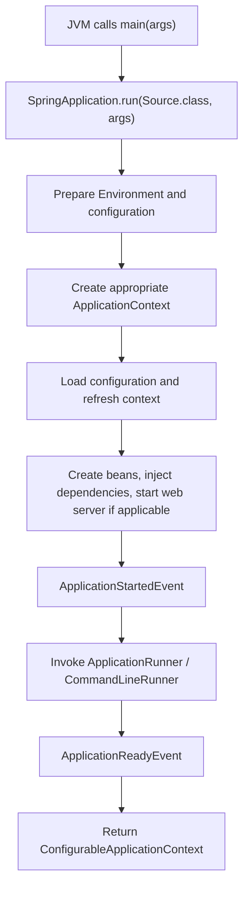

# From the `main` Method to `SpringApplication.run`

When starting a Spring Boot application, the JVM still begins from Java's `main(String[] args)` method. The difference is that `main` usually only delegates orchestration of the startup process to `SpringApplication.run(...)`. This call prepares configuration, creates and refreshes the Spring `ApplicationContext`, initializes required beans, starts the embedded server if the application is a web application, and notifies when the application is ready.

This lesson focuses on the **execution order and responsibility of each startup point**: what `main` does, why the root configuration class and `args` are passed into `run`, what happens while `run` executes, and what happens after `run` returns.

## 1. The Entry Point Is Still Java's `main`

A typical Spring Boot application has a class like the following:

```java
package com.example.startup;

import org.springframework.boot.SpringApplication;
import org.springframework.boot.autoconfigure.SpringBootApplication;

@SpringBootApplication
public class StartupDemoApplication {

    public static void main(String[] args) {
        SpringApplication.run(StartupDemoApplication.class, args);
    }
}
```

When running this class, the Java launcher looks for and invokes `public static void main(String[] args)`. The `@SpringBootApplication` annotation **does not replace `main` and does not launch the application by itself**. The call inside `main` is what initiates the Spring Boot startup sequence.

Two important arguments of the call:

- `StartupDemoApplication.class` is the **primary source**: the starting point from which Spring Boot reads application configuration. Because this class has `@SpringBootApplication`, it provides root configuration, component scanning capability, and enables auto-configuration.
- `args` passes command-line arguments from Java to Spring Boot, such as `--spring.profiles.active=dev` or `--server.port=8081`. Actual configuration is also subject to the precedence order of other property sources.

The static call above is conceptually equivalent to:

```java
SpringApplication application =
        new SpringApplication(StartupDemoApplication.class);
application.run(args);
```

The `SpringApplication` instance form is useful when customization is needed before running. For typical applications, `SpringApplication.run(...)` is shorter and easier to read.

## 2. Example to Verify Execution Order

Create a **Spring Boot 3.x, Java 17 or higher** project with the `spring-boot-starter` dependency (or `spring-boot-starter-web` if you want to run a web app). Place all of the code below in the file `src/main/java/com/example/startup/StartupDemoApplication.java`:

```java
package com.example.startup;

import org.springframework.boot.CommandLineRunner;
import org.springframework.boot.SpringApplication;
import org.springframework.boot.autoconfigure.SpringBootApplication;
import org.springframework.boot.context.event.ApplicationReadyEvent;
import org.springframework.context.ConfigurableApplicationContext;
import org.springframework.context.annotation.Bean;
import org.springframework.context.event.EventListener;

@SpringBootApplication
public class StartupDemoApplication {

    public static void main(String[] args) {
        System.out.println("1. main: before run");

        ConfigurableApplicationContext context =
                SpringApplication.run(StartupDemoApplication.class, args);

        System.out.println(
                "4. main: after run, active=" + context.isActive());
    }

    @Bean
    CommandLineRunner printAfterRefresh() {
        return args ->
                System.out.println("2. runner: context refreshed");
    }

    @EventListener(ApplicationReadyEvent.class)
    void whenReady() {
        System.out.println("3. ready: application startup complete");
    }
}
```

For a Gradle project configured with the Spring Boot plugin, run `./gradlew bootRun` (on Windows you can use `.\gradlew.bat bootRun`). For Maven you can use `./mvnw spring-boot:run`. These commands need to be run in the corresponding project directory.

Ignoring the banner and other framework log lines, the **relative order of the four self-printed lines** is:

```text
1. main: before run
2. runner: context refreshed
3. ready: application startup complete
4. main: after run, active=true
```

Explanation:

1. Line **1** is executed by the JVM before calling `SpringApplication.run`.
2. Spring Boot builds and refreshes `ApplicationContext`; then it calls `CommandLineRunner`, producing line **2**.
3. After the runners finish, Spring Boot publishes `ApplicationReadyEvent`, producing line **3**.
4. `run(...)` returns an active `ConfigurableApplicationContext`; `main` continues at line **4**.

This proves two commonly misunderstood points: `run` does not return immediately after creating the `SpringApplication` instance, and `CommandLineRunner` does not run before Spring finishes building the context. In practice, Spring log messages may appear interleaved between these four lines.

## 3. What Happens Inside `SpringApplication.run`?

Below is the **conceptual flow** of a successful startup. This is the order of primary responsibilities, not a line-by-line copy of every internal Spring Boot call.



### Step 1 — Determine How to Run and Prepare Input Data

`SpringApplication` takes the primary sources and determines the application type from the classes on the classpath along with specified configuration. The common types are `SERVLET`, `REACTIVE`, and `NONE`.

Spring Boot prepares the runtime environment (`Environment`), processes command-line arguments, profile configuration, property sources, logging information, and related startup settings. For example, `--spring.profiles.active=dev` helps select the `dev` profile; configuration files applicable to that profile are processed during the environment preparation phase.

**Do not confuse `Environment` with the operating system.** In Spring, `Environment` is an abstraction that provides profiles and properties for the application to query according to the current configuration.

### Step 2 — Create the Right Type of `ApplicationContext`

Spring Boot chooses the `ApplicationContext` implementation matching the application type:

- For Servlet/MVC applications: uses a context for servlet web applications, supporting creating an embedded HTTP server when configured accordingly.
- For Reactive/WebFlux applications: uses a reactive web context.
- For non-web applications: uses a standard context and does not need to open an HTTP port.

During this phase, registered `ApplicationContextInitializer` instances can customize the context before bean definitions are fully loaded. Creating the context is only a preparation step; it does not mean all beans are already active.

### Step 3 — Process the Root Configuration Class, Component Scan, and Auto-Configuration

`@SpringBootApplication` comprises three main roles:

| Component | Role in Startup |
|---|---|
| `@SpringBootConfiguration` | Marks the class as a source of Spring configuration. |
| `@ComponentScan` | Discovers components in the root class's package and its subpackages. |
| `@EnableAutoConfiguration` | Brings suitable auto-configurations into the context when conditions are satisfied. |

For example, if `StartupDemoApplication` resides in `com.example.startup`, default component scanning searches inside `com.example.startup` and its subpackages. A `@Service` class located in a package outside the scan scope may not be registered as a bean.

Auto-configuration is **conditional**, based on the classpath, already declared beans, and properties. Having `spring-boot-starter-web` typically brings servlet web configuration into the application; having only `spring-boot-starter` does not automatically turn the application into an HTTP server. This annotation also does not mean every bean in all libraries is created.

### Step 4 — Refresh the Context and Initialize Required Beans

During `refresh()`, Spring processes configurations/bean definitions, registers container support components, instantiates non-lazy singletons that need initialization, and performs dependency injection. Bean lifecycle callbacks such as `@PostConstruct` may run during individual bean initialization.

For web applications, the refresh process also sets up and starts the embedded web server, and registers required web components. Once refresh succeeds, beans initialized at startup are ready according to Spring's contract; however, startup runners **may not have run yet**.

Distinguish between:

- **`ApplicationContext` created**: there is a container to configure; does not yet confirm the context has been refreshed.
- **Context refreshed**: primary initialization of the container and web server (if any) is complete.
- **Application ready**: startup runners have completed and the ready event is published; this milestone comes later than refresh.

Beans declared as lazy may only be created when first used, so you cannot conclude that every bean in the system has been instantiated before `run` returns.

### Step 5 — Invoke Startup Runners and Publish the Ready Event

After the context refreshes, Spring Boot publishes `ApplicationStartedEvent`, then sequentially invokes beans implementing `ApplicationRunner` and `CommandLineRunner`. Both interfaces are used for one-time logic running after container initialization; the difference is that `ApplicationRunner` receives `ApplicationArguments`, whereas `CommandLineRunner` receives `String... args`.

If there are multiple runners and a clear order is needed, you can use `@Order` or `Ordered`. Do not rely on default bean discovery order. Runners must finish successfully before Spring Boot proceeds to `ApplicationReadyEvent`.

`ApplicationReadyEvent` indicates that Spring Boot has completed the normal startup process. It does not guarantee that every external system (such as a dependent API) is always healthy; specific readiness/health checks are still necessary for production deployments.

## 4. Key Events for Observing the Startup Lifecycle

Spring Boot publishes events at various milestones. The following table omits some secondary events to focus on the main startup sequence:

| Event | Meaning |
|---|---|
| `ApplicationStartingEvent` | Startup has just begun; context and environment have not yet been fully prepared. |
| `ApplicationEnvironmentPreparedEvent` | `Environment` has been prepared, before the full context is created. |
| `ApplicationContextInitializedEvent` | Context has been created and initializers have been applied, before bean definitions are fully loaded. |
| `ApplicationPreparedEvent` | Context has been prepared and primary sources have been loaded, before refresh. |
| `ApplicationStartedEvent` | Context has refreshed successfully, before runner execution. |
| `ApplicationReadyEvent` | Runners have finished; startup succeeded and the application is ready. |
| `ApplicationFailedEvent` | Published when startup fails. There is no ready event for that failed startup. |

**Note on listeners:** a bean using `@EventListener` can only be used once the corresponding bean/listener management mechanism is ready. If you need to catch very early events like `ApplicationStartingEvent`, register the listener with `SpringApplication` before calling `run` (or use Spring Boot's early registration mechanism), rather than expecting a regular `@EventListener` bean to exist from the start.

For work that needs to happen after application startup finishes, `ApplicationReadyEvent` is more appropriate than `ApplicationStartedEvent`; for proactive, synchronous initialization tasks, a runner can be used. Avoid performing very long blocking tasks inside a runner if you want the application to transition to the ready state promptly.

## 5. Why Does `run` Return While the Web Application Keeps Running?

The return type of the call is `ConfigurableApplicationContext`:

```java
ConfigurableApplicationContext context =
        SpringApplication.run(StartupDemoApplication.class, args);
```

This means the program can still execute code following the call, such as line **4** in the example. `SpringApplication.run` **is not** an infinite loop keeping the `main` method trapped inside it forever.

For web applications, the embedded web server and its worker threads can keep the JVM process alive to accept requests, even after `main` has reached the end. For non-web applications, if no non-daemon threads remain to keep the JVM alive, the process typically exits after `main` and related tasks finish.

Therefore, separate three concepts:

- **`run` returns:** startup succeeded and returned the context to the caller.
- **`main` finishes:** code in the `main` method ends; this does not mean the web application stops.
- **JVM process terminates:** when nothing keeps the process running or when the application is shut down.

On shutdown, Spring closes the context, executes cleanup callbacks, and handles stopping the server according to configuration. In standalone code, you can explicitly call `context.close()` when you genuinely want to close the application. Do not call `close()` immediately after `run` if the goal is to keep a web service serving requests.

## 6. Change Startup Parameters Yourself to Observe the Result

Try running a web project with command-line configuration:

```bash
./gradlew bootRun --args='--server.port=8081 --spring.profiles.active=dev'
```

In Windows PowerShell, you can use `.\gradlew.bat bootRun --args="--server.port=8081 --spring.profiles.active=dev"`. The commands above apply when the project has the Gradle wrapper and the Spring Boot Gradle plugin.

- `--server.port=8081` requests the embedded web server to use port 8081 instead of the default unless overridden by other configuration conditions.
- `--spring.profiles.active=dev` activates the `dev` profile, changing configuration and potentially changing which profile-conditional beans apply.
- For projects without a web server, `server.port` does not by itself cause port 8081 to open.

You can set breakpoints at the `SpringApplication.run` call, inside `printAfterRefresh()`, in `whenReady()`, and right after `run` to observe each milestone. When stepping over the call in the debugger, you will notice startup takes time because the container must prepare the environment, load configuration, and initialize beans, rather than merely executing a simple Java statement.

## 7. When Startup Fails, Which Phase Should You Inspect?

If `SpringApplication.run` throws an exception during startup, normal execution flow will not reach the line after `run`. Spring Boot handles startup failure, may publish `ApplicationFailedEvent`, and cleans up the context. In the example in section 2, if a bean or runner fails to start, you should not expect lines **3** and **4** to always appear.

A few common scenarios:

| Symptom | Where to Look |
|---|---|
| Bean not found for injection | Component scan package of the `@SpringBootApplication` class, bean creation conditions, qualifiers, and profiles. |
| Bean creation failed | Root cause at the bottom of the stack trace, constructor, factory method, property binding, or initialization callbacks. |
| Web server fails to bind port | Port is already in use by another process, `server.port` configuration, or server configuration errors. |
| Application initializes context then still reports startup failure | Exception inside `ApplicationRunner`/`CommandLineRunner` or post-refresh startup steps. |
| Auto-configuration does not behave as expected | Dependencies/classpath, configuration conditions, properties; enable `--debug` when you need to inspect the condition evaluation report. |

Always find the **root cause in the stack trace** before fixing. A log saying "context refresh" or "server started" does not mean the entire startup succeeded, because runners can still throw errors after those messages.

## 8. Pitfalls to Avoid

1. **"Having `@SpringBootApplication` makes the JVM automatically run Spring."** False: an entry point or launch mechanism is needed to invoke Spring Boot; in the example, that is `main`.
2. **"`SpringApplication.run` only starts the web server."** False: it manages the entire Spring context bootstrap process; console applications without an HTTP server still use it.
3. **"`ApplicationStartedEvent` means ready."** False: the started event occurs before runners; ready occurs after runners.
4. **"When `run` returns, the application has shut down."** False: the web server can continue running via its threads.
5. **"All beans are already created once the context exists."** False: refresh is needed to initialize most beans; lazy beans can also be created later.
6. **"Just adding `@Service` anywhere works."** False: the class must be within the scan scope or registered by another configuration.

**Remember the main flow:** JVM calls `main` → `SpringApplication.run` prepares the environment → creates and refreshes `ApplicationContext` → initializes required beans/server → publishes started → runs startup runners → publishes ready → returns the context. Identifying each of these milestones helps you read startup logs, place breakpoints accurately, and diagnose why an application fails to launch.
