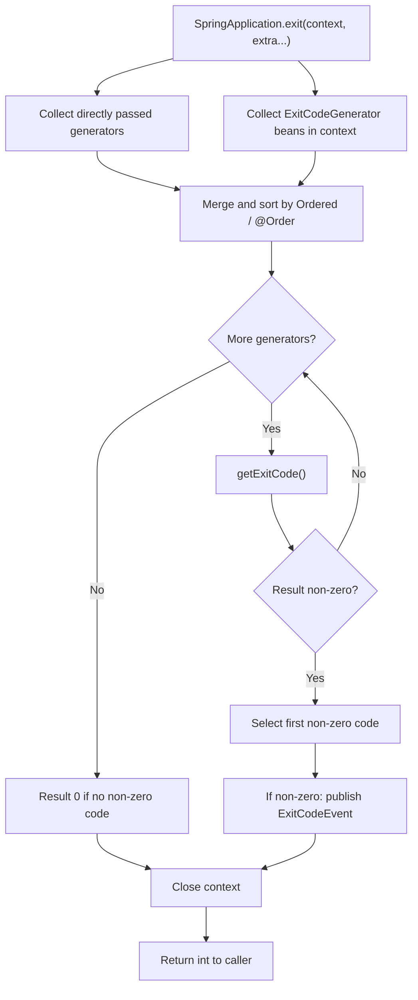
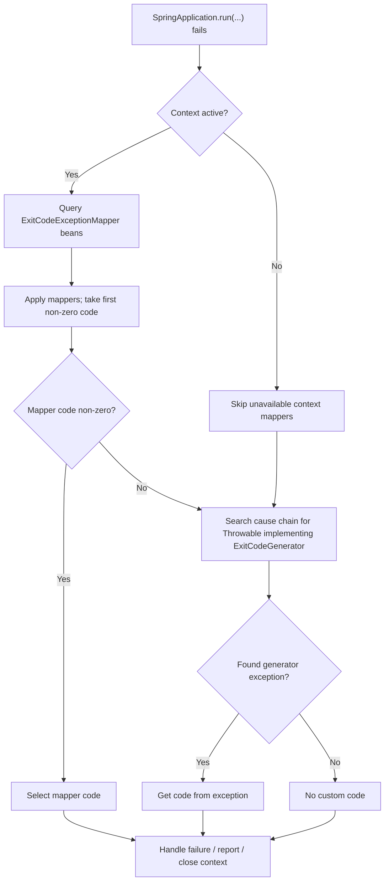

# Multiple Exit Code Sources and Selection Order in Spring Boot

## 1. The problem: when multiple sources propose an exit code, who wins?

An exit code (*process exit code*, *exit status*) is an integer returned by a process to the operating system, shell, or parent program when it terminates. By common convention, `0` indicates successful completion; a **non-zero** value indicates a situation classified as an error, unsuccessful condition, or special outcome depending on the CLI/batch contract.

In a Spring Boot application, multiple components may want to determine the exit code simultaneously:

- A data validation module wants to return `12` when data is missing.
- A synchronization module wants to return `23` when unhandled errors are detected.
- A batch runner wants to return a code reflecting the job outcome.
- Code calling `SpringApplication.exit(...)` passes additional custom `ExitCodeGenerator` arguments.
- An exception during startup implements `ExitCodeGenerator` itself.
- One or more `ExitCodeExceptionMapper` beans convert exceptions to exit codes.

Without understanding **source ordering** and the **selection algorithm**, developers can make wrong assumptions like "largest code wins," "last declared bean wins," or "directly passed generators always beat beans."

For **Spring Boot 3.3.x**, the core rule of `SpringApplication.exit(...)` is:

> **Sort all `ExitCodeGenerator` instances by `Ordered`/`@Order`, evaluate them in order, skip `0`, and select the first non-zero code.**

This rule is documented in the Spring Boot 3.3 API/reference. In the **startup failure** flow, there is also a separate step handling exception mappers and exceptions implementing `ExitCodeGenerator`. These two paths are related, yet **they are not a single free-for-all contest across every bean type**.

This lesson uses Java 17+, Spring Framework 6.x, and **Spring Boot 3.3.13** to illustrate exact decisions. It focuses primarily on batch/CLI apps, discouraging calling `System.exit` from an HTTP controller of a live serving server.

## 2. Distinguishing business outcome, exit code, and JVM termination

Three actions that are easily conflated:

1. **Producing a code:** `ExitCodeGenerator#getExitCode()` returns an `int`. By itself, it does not tell the JVM to exit.
2. **Computing the code and closing the Spring context:** `SpringApplication.exit(context, generators...)` collects/evaluates generators, may publish `ExitCodeEvent`, closes the context, and returns an `int`. It **does not call `System.exit(int)` itself**.
3. **Delivering the code to the OS:** `System.exit(code)` instructs the JVM to terminate with that status.

Correct code pattern for a CLI after work finishes:

```java
ConfigurableApplicationContext context =
        SpringApplication.run(MyCliApplication.class, args);

int exitCode = SpringApplication.exit(context);
System.exit(exitCode);
```

This is an **illustrative snippet**, requiring `MyCliApplication` and appropriate imports; the full example is in section 9.

If you only call `SpringApplication.exit(context)` and ignore the returned number, do not infer the shell received that exact number. If you only call `System.exit(42)` without closing the context first, you skip generator selection and risk an uncontrolled shutdown.

### 2.1. Code `0` has a special role in the algorithm

When a generator returns `0`, it **does not claim the selection** if a later generator returns non-zero. Here, `0` acts like "no error code proposed here; inspect the next source."

Example:

```text
Generator A -> 0
Generator B -> 0
Generator C -> 17
Generator D -> 99
```

The result is **17**, because it is the first non-zero code in **sorted order**. `99` is not picked merely for being larger.

If all generators return `0` or none exist, the normal result is `0` on the success exit path, provided code calculation and context closure do not trigger errors that alter the outcome.

### 2.2. Exit codes are not HTTP status codes

HTTP `503` represents an HTTP response. Exit code `42` represents the outcome of **a process**. They do not share a namespace, and there is no default mapping from every HTTP exception to a JVM exit code.

A request failing with 500 inside a running Spring MVC server **does not mean the entire JVM must return exit code 500**. Long-running web applications should let the framework handle requests via HTTP semantics and reserve process exit codes for process termination.

## 3. Exit code sources and when they are used

| Source | How declared | When does Boot consider it? | Notes |
| --- | --- | --- | --- |
| `ExitCodeGenerator` bean | `@Bean`/`@Component` implementing the interface | When calling `SpringApplication.exit(context, ...)` | Belongs to context; must remain resolvable at exit |
| Directly passed generator | Varargs parameter of `SpringApplication.exit` | When calling that exact method | Merged with bean generators and sorted |
| Exception implementing `ExitCodeGenerator` | `class X extends RuntimeException implements ExitCodeGenerator` | When Boot handles **startup failure**, inspecting exception/causes | Not a regular generator bean |
| `ExitCodeExceptionMapper` bean | `@Bean` mapping `Throwable -> int` | In Boot's startup-failure handling path, if context is active | May return `0` to defer to other sources |
| `ExitCodeEvent` | Listener observing determined code | After a non-zero code is computed, when context can publish | **Not a decision source** |
| `System.exit(int)` | JVM call | When code actively terminates the process | Does not re-invoke generators |
| Default JVM/shell exit | Process finishes normally or throws | Outside Spring | May depend on launcher/platform |

`ExitCodeGenerator` is a functional interface:

```java
@FunctionalInterface
public interface ExitCodeGenerator {
    int getExitCode();
}
```

This is a minimal signature adapted from the API, not a file to create yourself: the real interface is `org.springframework.boot.ExitCodeGenerator`.

`ExitCodeExceptionMapper` is also a functional interface:

```java
@FunctionalInterface
public interface ExitCodeExceptionMapper {
    int getExitCode(Throwable exception);
}
```

It returns `0` when the mapper has no matching code. Both interfaces contain "ExitCode" yet take different inputs: a generator queries current state; a mapper receives the error cause to translate into a code.

## 4. The `SpringApplication.exit` algorithm: merge sources then sort

Consider the call:

```java
int code = SpringApplication.exit(context, extraA, extraB);
```

In Spring Boot 3.3, Boot considers:

- Directly passed generators (`extraA`, `extraB`).
- Spring beans in the context implementing `ExitCodeGenerator`.

After collecting them, Boot sorts via an ordering mechanism aware of `Ordered` and `@Order`, then picks the **first non-zero code**.

Diagram:



This diagram depicts the **normal success path**, not every exception branch when a generator or shutdown callback fails. Do not use it as a substitute for real error handling.

### 4.1. Not "largest code wins"

Suppose:

| Sorted generator | Order | Returned code |
| --- | ---: | ---: |
| `validate` | -100 | 0 |
| `policy` | 0 | 8 |
| `cleanup` | 20 | 90 |
| `fallback` | 100 | 1 |

The result is **8**, not 90. `cleanup` and `fallback` might **not even be invoked** because Boot already found a non-zero code at `policy`.

This has an important design consequence: **do not put side effects or mandatory cleanup inside `getExitCode()`** of a generator you expect to always run. Generators after the first non-zero code may be skipped.

### 4.2. Not "last declared bean wins"

`@Bean` declaration order, class names, component scanning order, or collection iteration order **must not become your exit-code selection contract**. When multiple generators exist, set explicit ordering.

### 4.3. Not "direct arguments always beat beans"

`SpringApplication.exit(context, explicit)` accepts directly passed generators, but that **does not automatically grant them highest priority**. After merging, `Ordered`/`@Order` determines the order.

Example:

```text
bean-a    order=-100 -> code 7
explicit  order=0    -> code 4
bean-b    order=100  -> code 9
```

The result is **7** because `bean-a` is evaluated first. Conversely, if `explicit` has order `-200` and returns `4`, it can be chosen ahead of `bean-a`. Do not treat **varargs position** as a priority policy.

### 4.4. A generator returning 0 does not block later sources

```text
explicit-high-priority  order=-100 -> 0
bean-middle             order=0    -> 17
explicit-low-priority   order=100  -> 5
```

The result is **17**. A high-priority generator returning `0` simply means that source contributed no non-zero outcome during this evaluation.

## 5. `Ordered`, `@Order`, and numeric ordering semantics

Spring Framework uses `org.springframework.core.Ordered` and the `org.springframework.core.annotation.Order` annotation to express priority.

**Smaller `order` numbers mean higher priority.** Negative numbers are completely valid.

Example:

```java
final class BillingCode implements ExitCodeGenerator, Ordered {

    @Override
    public int getOrder() {
        return -100;
    }

    @Override
    public int getExitCode() {
        return 11;
    }
}
```

This is an illustrative class; it requires imports for `ExitCodeGenerator` and `Ordered`. `-100` is the **selection order**, not the exit status.

Alternatively, place `@Order` on the **implementation class**:

```java
@Order(10)
final class ReportingCode implements ExitCodeGenerator {

    @Override
    public int getExitCode() {
        return 13;
    }
}
```

This illustrative class requires imports for `@Order` and `ExitCodeGenerator`. Choosing between `Ordered` and `@Order` mainly depends on dynamic vs static ordering needs:

- `Ordered#getOrder()` can compute priority from state managed by the object.
- `@Order` expresses fixed priority on the type.
- For lambdas implementing `ExitCodeGenerator`, there is no explicit application class on which to put `@Order`; when order matters, return **a concrete `Ordered` implementation**.
- Do not confuse `order` values with exit code values. `order=-100` can accompany `exitCode=0` or `exitCode=42`.

### 5.1. Priority constants

`Ordered.HIGHEST_PRECEDENCE` represents the highest priority (a very low integer value); `Ordered.LOWEST_PRECEDENCE` is the lowest priority (a very high value).

Do not assign `HIGHEST_PRECEDENCE` to **every** generator, because when all share the same order, you again lack intentional relative ordering. Agree on a small priority table, for example:

| Suggested order | Role |
| ---: | --- |
| -200 | Data corruption / mandatory precondition checks |
| -100 | Validation |
| 0 | Primary business errors |
| 100 | Secondary task errors |
| 1000 | Fallback |

These numbers are **design conventions**, not special values mandated by Spring Boot.

### 5.2. What if two generators share the same order?

When two sources have the same `getOrder()` and both return non-zero, **do not rely on which source gets discovered first** if the domain requires deterministic results. Bean names, insertion order, or collection details can cause environment-dependent surprises.

Solution: assign distinct orders, or consolidate the decision into **one generator** with a clear policy. If the real business rule is "highest-severity error code," implement one aggregating generator with a severity mapping yourself; do not assume Boot's default algorithm picks the largest integer.

### 5.3. Comparing with `@Order` on other components

`@Order` is also used on `ApplicationRunner`, `CommandLineRunner`, filters, aspects, etc., but those are **separate sorting mechanisms**.

A runner's order controls when **the runner executes during startup**, not the shutdown priority of an `ExitCodeGenerator` bean. Declare ordering on the object acting as the generator itself.

## 6. Multiple proposing sources: scenario table

Assume the sources have distinct `order` values and do not throw inside `getExitCode()`.

| Sources in ascending order | Returned codes | Final result |
| --- | --- | --- |
| A: `0`, B: `0`, C: `0` | All 0 | `0` |
| A: `0`, B: `7`, C: `30` | First non-zero is B | `7` |
| A: `40`, B: `9`, C: `0` | First non-zero is A | `40` |
| Explicit order `-20`: `0`, bean order `0`: `5` | Explicit defers | `5` |
| Bean order `-20`: `8`, explicit order `0`: `3` | Bean takes precedence | `8` |
| A order `-100`: `-5`, B order `0`: `9` | First non-zero is `-5` | `-5` at Java layer; OS display may differ |
| An early generator is selected | Later generators need not run | Do not rely on their side effects |

The negative-code example highlights that the criterion is **non-zero**, not "largest positive." However, negative process codes or codes above 255 are **not portable** across OSes and shells; see section 12.

## 7. Two distinct code-determination paths: intentional exit vs startup failure

This matters greatly when one project has generator beans, mappers, and self-reporting exceptions.

### 7.1. Path A — Application succeeds and exits intentionally

```text
SpringApplication.run(...) succeeds
              |
              v
SpringApplication.exit(context, explicit...)
              |
              v
Merge explicit generators + ExitCodeGenerator beans
              |
              v
Sort by order → pick first non-zero code
              |
              v
ExitCodeEvent if non-zero
              |
              v
context.close() → return code
              |
              v
Caller System.exit(code) if returning code to OS
```

On this path, `ExitCodeExceptionMapper` **is not an `ExitCodeGenerator` bean** and does not participate in code calculation merely because it exists in the context. It is a strategy for **exception causes** when Boot handles run failures.

### 7.2. Path B — Error occurs during SpringApplication startup

In Spring Boot 3.3, when `SpringApplication.run(...)` fails, Boot processes the exception. With an active context, Boot can look up `ExitCodeExceptionMapper` beans and query them for a code. If the mapped result is `0`, Boot continues searching the exception/cause chain for a throwable implementing `ExitCodeGenerator`.

Model:



These are **two distinct priority levels**:

1. **Priority among `ExitCodeExceptionMapper` instances**: each mapper can return 0 or a code; if multiple mappers are evaluated, do not rely on discovery order without an explicit convention.
2. **Fallback from mappers to exception generators**: when mapping yields no non-zero code, Boot checks whether the exception/cause chain implements `ExitCodeGenerator`.

Do not write claims like "exceptions always beat mappers" or "running `ExitCodeGenerator` beans always beat exceptions"—that misrepresents Boot 3.3's two separate handling paths.

### 7.3. Exceptions can carry exit codes too

```java
public final class DataMissingException extends RuntimeException
        implements ExitCodeGenerator {

    public DataMissingException(String message) {
        super(message);
    }

    @Override
    public int getExitCode() {
        return 27;
    }
}
```

This compiles when importing `org.springframework.boot.ExitCodeGenerator`, placed in `DataMissingException.java` in the proper package. When this exception or an exception holding it in its cause chain causes a **Boot-handled startup failure**, code 27 can be used if no mapper already produced a non-zero code.

Do not infer that **every** `throw new DataMissingException(...)` from a live HTTP request will exit the process with 27. Normal request errors are handled by the web layer; the startup-failure handler does not run on every request.

### 7.4. `ExitCodeExceptionMapper` for external library exceptions

Many library exceptions do not implement `ExitCodeGenerator`. Mappers translate them into domain codes:

```java
@Bean
ExitCodeExceptionMapper domainExitCodeMapper() {
    return error -> {
        for (Throwable cause = error;
             cause != null;
             cause = cause.getCause()) {
            if (cause instanceof IllegalArgumentException) {
                return 64;
            }
        }
        return 0;
    };
}
```

This is an illustrative method inside a Spring configuration class requiring `@Bean` and `ExitCodeExceptionMapper` imports. In production, **do not** map every `IllegalArgumentException` to an overly broad code without a clear business contract; this example merely demonstrates walking the cause chain.

Runner exceptions can be **wrapped** by Spring Boot in another exception when propagated outward, so a mapper inspecting only the outermost `error.getClass()` may miss the real cause. Walk the cause chain carefully, avoid infinite loops on anomalous throwables, and match sufficiently specific domain exception types.

### 7.5. Mappers have existence preconditions

If an error happens too early (before creation or while the context is inactive), mapper beans in the context may be **unreachable**. In that situation, a code from an exception implementing `ExitCodeGenerator` or default handling may be the only remaining source.

Therefore, do not rely on a mapper bean as the sole mechanism for bootstrap failures before context activation. For errors needing deterministic codes very early, use self-coded exceptions or handle them at the launcher/entrypoint per supported contracts.

## 8. `ExitCodeEvent`: receiving notifications of the selected code

Spring Boot provides `org.springframework.boot.ExitCodeEvent`, containing the determined code.

A typical listener:

```java
@EventListener
public void onExitCode(ExitCodeEvent event) {
    System.out.println("exit-code=" + event.getExitCode());
}
```

This resides in a Spring-managed bean with imports `org.springframework.context.event.EventListener` and `org.springframework.boot.ExitCodeEvent`.

Conditions to remember:

- When `SpringApplication.exit(...)` computes a **non-zero code**, Boot publishes `ExitCodeEvent` before closing the context along the normal path.
- The event is for **observation** (recording metrics, appropriate auditing), not for "re-voting" on the exit code.
- If the result is `0`, do not expect `ExitCodeEvent` to always be published.
- When startup fails too early or the context cannot publish events, listener beans may not receive it.
- `@EventListener` runs synchronously by default unless async is configured; avoid heavy I/O or unbounded blocking inside listeners right as the context is closing.

If you need to log a CLI's exit code, the most direct and least coupled way is to log the `int` returned by `SpringApplication.exit(...)`, then call `System.exit` at the outer boundary.

## 9. Complete runnable example: multiple generators and selection order

This lab proves four things:

1. `ExitCodeGenerator` instances passed to the method and generator beans are merged into one selection set.
2. Order is governed by `Ordered.getOrder()`, **not bean vs explicit origin**.
3. `0` is skipped; the **first non-zero code** is selected.
4. `ExitCodeEvent` is published and the context closes when `SpringApplication.exit(...)` is called.

The project uses Maven, Java 17, Spring Boot 3.3.13, and `spring-boot-starter`. It runs with `WebApplicationType.NONE`, opening no HTTP server—the cleanest CLI format for verifying OS exit status.

### 9.1. Project structure

```text
exit-code-order-demo/
├── pom.xml
└── src/main/
    ├── java/com/example/exit/
    │   └── ExitCodeOrderApplication.java
    └── resources/
        └── application.properties
```

### 9.2. `pom.xml`

```xml
<project xmlns="http://maven.apache.org/POM/4.0.0"
         xmlns:xsi="http://www.w3.org/2001/XMLSchema-instance"
         xsi:schemaLocation="http://maven.apache.org/POM/4.0.0 https://maven.apache.org/xsd/maven-4.0.0.xsd">
    <modelVersion>4.0.0</modelVersion>
    <parent>
        <groupId>org.springframework.boot</groupId>
        <artifactId>spring-boot-starter-parent</artifactId>
        <version>3.3.13</version>
        <relativePath/>
    </parent>
    <groupId>com.example</groupId>
    <artifactId>exit-code-order-demo</artifactId>
    <version>0.0.1-SNAPSHOT</version>
    <properties>
        <java.version>17</java.version>
    </properties>
    <dependencies>
        <dependency>
            <groupId>org.springframework.boot</groupId>
            <artifactId>spring-boot-starter</artifactId>
        </dependency>
    </dependencies>
    <build>
        <plugins>
            <plugin>
                <groupId>org.springframework.boot</groupId>
                <artifactId>spring-boot-maven-plugin</artifactId>
            </plugin>
        </plugins>
    </build>
</project>
```

### 9.3. `application.properties`

Create `src/main/resources/application.properties`:

```properties
spring.main.web-application-type=none
spring.main.banner-mode=off
logging.level.root=ERROR

# Business bean code; can be overridden via CLI.
demo.business-code=42

# Enable mapper for startup failure; see section 10.
demo.map-failure=true
```

`spring.main.web-application-type=none` lets the project run as a CLI. When using a direct executable JAR, you do not need to pull Spring MVC/web servers into the project.

### 9.4. Complete Java source

Create `src/main/java/com/example/exit/ExitCodeOrderApplication.java`:

```java
package com.example.exit;

import org.springframework.boot.ApplicationRunner;
import org.springframework.boot.ExitCodeEvent;
import org.springframework.boot.ExitCodeExceptionMapper;
import org.springframework.boot.ExitCodeGenerator;
import org.springframework.boot.SpringApplication;
import org.springframework.boot.autoconfigure.SpringBootApplication;
import org.springframework.context.ConfigurableApplicationContext;
import org.springframework.context.annotation.Bean;
import org.springframework.context.event.EventListener;
import org.springframework.core.Ordered;
import org.springframework.core.env.Environment;

@SpringBootApplication
public class ExitCodeOrderApplication {

    public static void main(String[] args) {
        ConfigurableApplicationContext context =
                SpringApplication.run(ExitCodeOrderApplication.class, args);

        // Explicit generators are merged and ordered alongside bean generators.
        int code = SpringApplication.exit(
                context,
                new NamedGenerator("explicit-zero", -50, 0),
                new NamedGenerator("explicit-fallback", 50, 7));

        System.out.println("selected=" + code);
        System.exit(code);
    }

    @Bean
    ExitCodeGenerator zeroGenerator() {
        return new NamedGenerator("bean-zero", -100, 0);
    }

    @Bean
    ExitCodeGenerator businessGenerator(Environment environment) {
        int businessCode = environment.getProperty(
                "demo.business-code", Integer.class, 42);
        return new NamedGenerator("bean-business", 0, businessCode);
    }

    @Bean
    ExitCodeGenerator lateGenerator() {
        return new NamedGenerator("bean-late", 100, 99);
    }

    @Bean
    ApplicationRunner optionalFailure() {
        return args -> {
            if (args.containsOption("demo.fail")) {
                throw new DemoFailureException("Simulated startup failure");
            }
        };
    }

    @Bean
    ExitCodeExceptionMapper demoFailureMapper(Environment environment) {
        return error -> {
            boolean enabled = environment.getProperty(
                    "demo.map-failure", Boolean.class, true);
            if (!enabled) {
                return 0;
            }
            for (Throwable cause = error;
                 cause != null;
                 cause = cause.getCause()) {
                if (cause instanceof DemoFailureException) {
                    return 64;
                }
            }
            return 0;
        };
    }

    @EventListener
    public void onExitCode(ExitCodeEvent event) {
        System.out.println("event=" + event.getExitCode());
    }

    static final class NamedGenerator
            implements ExitCodeGenerator, Ordered {

        private final String name;
        private final int order;
        private final int code;

        NamedGenerator(String name, int order, int code) {
            this.name = name;
            this.order = order;
            this.code = code;
        }

        @Override
        public int getOrder() {
            return order;
        }

        @Override
        public int getExitCode() {
            System.out.println("generator:" + name + "=" + code);
            return code;
        }
    }

    static final class DemoFailureException extends RuntimeException
            implements ExitCodeGenerator {

        DemoFailureException(String message) {
            super(message);
        }

        @Override
        public int getExitCode() {
            return 27;
        }
    }
}
```

Role-by-role explanation:

- `NamedGenerator` implements both `ExitCodeGenerator` and `Ordered`, so order is an attribute of **the generator object itself**.
- Three beans `bean-zero`, `bean-business`, and `bean-late` belong to the Spring context with orders `-100`, `0`, and `100`.
- Two explicit generators are passed in `main()` with orders `-50` and `50`.
- After merging and sorting, the order becomes `-100 → -50 → 0 → 50 → 100`.
- `bean-zero` and `explicit-zero` return `0`, so neither decides the code.
- `bean-business` returns `42` from the default property, which is the first non-zero. `explicit-fallback` and `bean-late` **do not need to be called**.
- `onExitCode` only logs the event published by Boot; it does not choose the code.
- `demoFailureMapper` and `DemoFailureException` serve the **startup failure** branch, not as normal generators during a successful exit.

### 9.5. Build and run commands

From the directory containing `pom.xml`:

```bash
mvn package
java -jar target/exit-code-order-demo-0.0.1-SNAPSHOT.jar
```

If the project has a Maven Wrapper:

```bash
./mvnw package
```

On Windows PowerShell:

```powershell
.\mvnw.cmd package
```

Requires JDK 17+, Maven, and downloaded dependencies. This is not a standalone Java file compiled with `javac` without Spring on the classpath.

### 9.6. Expected output on the intentional exit path

Lines printed by the **demo code** in order:

```text
generator:bean-zero=0
generator:explicit-zero=0
generator:bean-business=42
event=42
selected=42
```

There is no `generator:explicit-fallback=7` or `generator:bean-late=99` line, because evaluation stops at the first non-zero.

The shell receives **exit status 42** when running the executable JAR directly:

```bash
echo $?
```

On Bash/zsh, run `echo $?` **immediately after the `java -jar` command** to read the program's exact exit code. If you run another command in between, `$?` reflects that latest command's status.

PowerShell:

```powershell
$LASTEXITCODE
```

With `cmd.exe`:

```bat
echo %ERRORLEVEL%
```

These commands read the status of the **direct Java process**, not Java source logging. When running via `mvn spring-boot:run`, shell status may reflect the Maven/plugin wrapper, so run `java -jar` to verify the OS exit code.

### 9.7. Variant: business bean returns 0

Keeping the same source, run:

```bash
java -jar target/exit-code-order-demo-0.0.1-SNAPSHOT.jar --demo.business-code=0
```

Lines printed by the demo:

```text
generator:bean-zero=0
generator:explicit-zero=0
generator:bean-business=0
generator:explicit-fallback=7
event=7
selected=7
```

Explanation: `bean-business` no longer proposes a non-zero code, so evaluation continues to `explicit-fallback` with order 50 and code 7. `bean-late` at order 100 does not need to be evaluated.

This directly refutes two false assumptions:

- Explicit generators do not automatically win over beans just because they were passed via varargs.
- A larger code (`bean-late=99`) does not win if an earlier generator already returned non-zero.

### 9.8. Why shouldn't each bean call `System.exit`?

Only **`main`/the launcher** should decide when to terminate the JVM. A generator simply describes an outcome via `int getExitCode()`; if a generator calls `System.exit(...)` inside that method, it can prevent other sources from being checked, break selection logic, and skip `SpringApplication` cleanup.

In a long-running web service, never let controllers or normal beans call `System.exit` in response to a request error. For a CLI finishing a job, calling exit at the `main` boundary is far cleaner.

## 10. Startup failure branch: mapper or self-reporting exception?

The Java example in section 9 also simulates startup failure via `ApplicationRunner optionalFailure()` when `--demo.fail` is passed.

`ApplicationRunner` is called by Boot **after context refresh yet before `SpringApplication.run()` completes**. In the demo, the context can already resolve `ExitCodeExceptionMapper` beans when the runner throws.

### 10.1. Mapper enabled: picks 64 instead of 27

Run:

```bash
java -jar target/exit-code-order-demo-0.0.1-SNAPSHOT.jar --demo.fail
```

In the startup error-handling path, Boot passes the exception (potentially wrapped by runner handling) to available mappers. The example's mapper finds `DemoFailureException` in the cause chain and returns `64`.

Because the mapper returned non-zero, it **selects code 64 before** Boot falls back to `DemoFailureException#getExitCode()`, which returns 27.

The key expected result when running the executable JAR directly on Boot 3.3.13 is **exit code 64**, along with Boot's startup failure logs. The failure path **never reaches** `SpringApplication.exit(context, explicit...)` in `main()` because `SpringApplication.run(...)` failed.

Do not describe stdout on the failure branch as a fixed short list: exception logs, stack traces, logger settings, and launchers make output long and varied. What matters is checking the shell code and `DemoFailureException` details in the failure log.

### 10.2. Mapper defers: exception returns 27

Run:

```bash
java -jar target/exit-code-order-demo-0.0.1-SNAPSHOT.jar --demo.fail --demo.map-failure=false
```

Now the mapper returns `0`, so Boot continues inspecting the cause chain. Since `DemoFailureException` implements `ExitCodeGenerator`, Boot can choose **27**.

Comparison summary:

| Execution path | Mapper | Exception | Selected code |
| --- | --- | --- | ---: |
| Startup succeeds; intentional exit | Not used for normal selection | No startup exception | 42 |
| Startup succeeds; `--demo.business-code=0` | Not used | None | 7 |
| Startup fails; mapper enabled | 64 | 27 | 64 |
| Startup fails; mapper returns 0 | 0 | 27 | 27 |

**Condition note:** this table reflects expectations for the demo app where the context was created and active, run via direct JAR on Java 17 with Boot 3.3.13. If an error occurs before the context is active, mapper beans may be unavailable, changing the decision path.

### 10.3. Why doesn't the demo pass regular generator beans into the error path?

When `SpringApplication.run(...)` throws an exception, code **never received a successfully running context** to pass to `SpringApplication.exit(context, explicit...)`. Spring Boot handles failure using separate logic for `ExitCodeExceptionMapper` and the exception chain.

Do not draw a single "global priority" table mixing regular beans, explicit generators, exception mappers, and exception generators as if all were invoked in one pass regardless of whether startup succeeded or failed.

### 10.4. Which throwables do mappers receive?

In practice, `ApplicationRunner` failures may be wrapped in a Boot exception, so a mapper checking only:

```java
if (error instanceof DemoFailureException) { ... }
```

may miss even when the deeper cause is `DemoFailureException`. Therefore, the demo walks `getCause()` bounded by chain termination and checks the domain type. This design is routinely needed when mappers handle exceptions from frameworks/libraries.

## 11. When multiple `ExitCodeExceptionMapper` beans exist

A large application may receive mappers from multiple modules:

```text
Mapper A: validation -> 0 or 64
Mapper B: network    -> 0 or 69
Mapper C: batch      -> 0 or 70
```

Different mappers should **return 0 when an exception is outside their responsibility**. If one mapper returns non-zero for every error, it can shadow specialized codes from other mappers or exception generators.

Recommendations:

- Scope mappers to **clear exception types/domains**, without blindly catching every `RuntimeException`.
- Ensure codes do not conflict in meaning; document the CLI code range.
- If two mappers can match the same exception, define **precedence** or merge into one coordinating mapper.
- Never assume the last-registered mapper always wins.
- Test both the mapper-returns-0 branch and the exception fallback path.
- For bootstrap errors before context activation, test separately rather than assuming mapper beans are always present.

In particular, a mapper is only allowed to **interpret failures handled by Boot**; it does not turn a business error that was caught and handled cleanly into a process failure automatically.

## 12. Exit codes and cross-OS portability

### 12.1. Avoid negative or very large codes for multi-platform CLIs

In Java, `System.exit(int)` accepts a 32-bit integer. However, shells/runtimes may display or normalize exit statuses differently; on many POSIX environments, the process code passes through status fields with limited bit width. Negative codes or codes over 255 may therefore not appear unchanged when checked from a shell.

For example, do not design a CLI needing to distinguish `System.exit(300)` from `System.exit(44)` across every OS. Nor should you use `-1` as a portable contract even though an `ExitCodeGenerator` can return a negative number.

In cross-platform systems, a **small, non-negative, non-zero range for meaningful errors** is far easier to operate. Normally avoid colliding with codes reserved by shells or container runtimes for command/signal errors; coordinate with operations to pick a dedicated range.

### 12.2. `System.exit(0)` is not a success marker for every workflow

A batch application that hits record errors yet still returns 0 can mislead a job scheduler into treating the whole run as successful. Define business statuses properly and map errors to non-zero when policy requires it.

Conversely, the demo in section 9 returns 42 without throwing an exception purely to demonstrate the selection algorithm. Do not copy code 42 as a production success status.

### 12.3. Docker and Kubernetes read the process exit code

Docker typically records the exit code of the container's main process. Kubernetes exposes exit codes in container status; restart policies and job controllers use that status to decide retries or completion.

Things to watch:

- Ensure shell entrypoints do not lose Java's code via a trailing `echo` after `java`.
- If using a shell script wrapper, use `exec java ...` when appropriate to preserve signal/status semantics, or explicitly propagate status.
- Kubernetes Jobs normally treat exit code 0 as success and non-zero as failure per policy (more granular rules can exist in Job configuration).
- Exit codes from `SIGKILL`, `OOMKilled`, or stop timeouts **do not necessarily originate from `ExitCodeGenerator`**; cross-check Pod/container events.
- In a long-lived HTTP server, there is no new process exit code per HTTP request.

### 12.4. Graceful shutdown and exit codes are two separate goals

You can close every resource cleanly yet still return a non-zero exit code due to business failure. Conversely, you can return 0 while cleanup/flushes failed if exceptions and state are unchecked.

`SpringApplication.exit(context)` supports both computing the code and closing the context. However, if `getExitCode()` or a close callback throws, the code path can change or enter error-handling fallback. Do not assume every shutdown exception turns into a clean domain code.

## 13. Common mistakes to avoid

### Mistake 1 — Assuming Spring Boot picks the largest code

False in Boot 3.3. The result is the **first non-zero code after sorting**, not `max(code)`.

### Mistake 2 — Assuming `@Bean` order in the file decides

False when code needs a stable contract. Assign `Ordered` or `@Order` on generators and avoid uncontrolled ties.

### Mistake 3 — Confusing `getOrder()` with `getExitCode()`

`getOrder()` decides **evaluation order**; `getExitCode()` returns the **code for the OS**. `order=-100` does not mean the process returns -100.

### Mistake 4 — Adding a high-priority generator returning 0 expecting it to block later sources

No. `0` is skipped so evaluation continues looking for non-zero codes. To confirm the whole workflow succeeded, design status sources properly rather than using a 0 generator to override errors reported by others.

### Mistake 5 — Putting mandatory logging/cleanup inside every `getExitCode()`

Not every generator is invoked. Evaluation can stop after the first non-zero code. Cleanup belongs in lifecycle/destroy callbacks, not side effects of a generator that might not even be queried.

### Mistake 6 — Using a lambda generator expecting an order annotation on an arbitrary method to apply

When ordering truly matters, use an explicit `Ordered` implementation or `@Order` class. Do not guess how a lambda/proxy is recognized by Spring's order comparator in every configuration.

### Mistake 7 — Calling `SpringApplication.exit(context)` yet the shell still gets 0

Likely because the caller **did not call `System.exit(returnedCode)`**, or an entrypoint wrapper masked the status. Check `main`, the execution command, and the direct process return code.

### Mistake 8 — Calling `System.exit(42)` right in the middle of the Spring context

This skips multi-source selection and can make resource cleanup hard to control. For CLIs, compute the code, close the context, and then return status in `main`.

### Mistake 9 — Using an exception mapper to handle HTTP 500

`ExitCodeExceptionMapper` is for **application exit due to failure**, not a replacement for `@ControllerAdvice` or `ErrorController` to map HTTP statuses.

### Mistake 10 — Mapper inspects only the outermost exception

Boot can wrap runner/bean-creation errors. Walk the cause chain carefully to recognize the business exception needing mapping.

### Mistake 11 — Expecting a mapper bean to run before the context finishes building

On very early failures, the context may be null/inactive, so mappers are not queried. If a failure must carry a specific code, consider a self-coded `ExitCodeGenerator` exception and test the bootstrap path.

### Mistake 12 — Catching a startup exception and assuming Boot still generates an exit code

If code catches and swallows without propagating, Boot may continue startup as a success; the failure exit-code path never runs. Failing startup must be a deliberate application decision.

### Mistake 13 — Putting `@Order(1)` on an `ApplicationRunner` to prioritize an exit generator

Runner order and generator order are two distinct mechanisms. A runner executing earlier does not cause the generator declared by that module to run earlier at exit.

### Mistake 14 — Having three beans with the same order and expecting stable order forever

Equal order does not express business priority. Assign distinct orders or write one aggregating generator so you do not depend on bean discovery order.

### Mistake 15 — Trying to use negative or huge codes in shell scripts

Operating systems may normalize exit statuses; choose a portable code range and test in real deployment environments.

### Mistake 16 — Assuming a Spring Batch job has only one code source

With Spring Batch, `JobExecutionExitCodeGenerator` may coexist with other generators. Inspect actual registered beans, orders, and the first-non-zero policy rather than guessing from starter names. Batch `ExitStatus` is a distinct concept; translation to process codes depends on integration.

## 14. Testing selection order

### 14.1. Unit testing the decision algorithm at the application level

If your project has a custom business policy, extract status sources into plain classes and test:

- When all return 0, no error code is chosen.
- When a higher-priority generator returns 0, the next generator is checked.
- Once a first non-zero appears, later generators do not decide the result.
- When two modules both propose codes, precedence rules are asserted in tests.
- When business priority changes, order and outcomes update per contract.

Minimal test matrix:

| Sorted inputs | Expected |
| --- | ---: |
| `0, 0, 0` | 0 |
| `0, 8, 31` | 8 |
| `2, 8, 0` | 2 |
| `0, -5, 19` | -5 at Java layer |
| Lower-order explicit returns 0, bean returns 17 | 17 |

These tests catch "largest-wins" bugs even when integration code is complex.

### 14.2. Integration testing `SpringApplication.exit`

Use `SpringApplication` to create a test context with real generators, call `SpringApplication.exit(context, ...)`, and assert the **returned `int`**. Do not call `System.exit` inside the test runner JVM, as it terminates the entire test process.

When verifying `ExitCodeEvent`, register a listener in the test context and assert the event receives the expected non-zero code. For `0`, assert the listener recorded no event from the normal explicit-exit path.

Ensure each test uses a fresh context because `SpringApplication.exit` closes the context. Never reuse an already-closed context.

### 14.3. Process-level integration testing

To verify real OS status, launch the executable JAR via `ProcessBuilder` or a CI script, wait for completion with a timeout, and read `Process.exitValue()`.

**Illustrative Java SE snippet** for a test harness, assuming the JAR is at the expected path:

```java
Process process = new ProcessBuilder(
        "java", "-jar",
        "target/exit-code-order-demo-0.0.1-SNAPSHOT.jar")
        .inheritIO()
        .start();

if (!process.waitFor(20, TimeUnit.SECONDS)) {
    process.destroyForcibly();
    throw new IllegalStateException("CLI did not exit");
}

int exitStatus = process.exitValue();
if (exitStatus != 42) {
    throw new AssertionError("Expected 42, got " + exitStatus);
}
```

This snippet requires imports for `Process`, `ProcessBuilder`, `TimeUnit`, and a method declaring/handling `IOException` and `InterruptedException`. Java's `Process`/`ProcessBuilder` live in `java.lang` (no explicit import needed); `TimeUnit` is in `java.util.concurrent`. `20` seconds is a sample timeout for test environments.

Testing in a **separate process** avoids calling `System.exit(...)` inside the JUnit JVM. On slower CI runners, measure actual startup time to pick timeouts rather than using arbitrary fixed numbers.

### 14.4. Test startup failure separately from success exit

Run two scenarios independently:

```bash
java -jar target/exit-code-order-demo-0.0.1-SNAPSHOT.jar --demo.fail
```

and:

```bash
java -jar target/exit-code-order-demo-0.0.1-SNAPSHOT.jar --demo.fail --demo.map-failure=false
```

Verify:

- `ApplicationRunner` actually threw `DemoFailureException`.
- With mapper enabled and context active, expected code is 64.
- When mapper returns 0, the exception code is 27.
- The startup-failure path does not print `selected=42`, because `main` never received a successful context to continue.
- Runner exceptions may be wrapped; the matcher inside the mapper still finds the root cause.

Also test a very early failure before the context is active to see whether mapper beans are actually usable.

## 15. Observing behavior in shells, Docker, and Kubernetes

### 15.1. Linux/macOS shell

Execute directly:

```bash
java -jar target/exit-code-order-demo-0.0.1-SNAPSHOT.jar
echo "status=$?"
```

With default demo output, expected status is `42`. Never run `echo $?` after several unrelated commands and assume it is Java's exit code.

### 15.2. PowerShell

```powershell
java -jar target/exit-code-order-demo-0.0.1-SNAPSHOT.jar
Write-Output "status=$LASTEXITCODE"
```

### 15.3. Docker

With an exec-form `ENTRYPOINT`:

```dockerfile
ENTRYPOINT ["java", "-jar", "/app/app.jar"]
```

the code returned by the JVM is observed by the container runtime at the main-process level. If a shell entrypoint runs extra commands after Java and exits with their status, Java's status can be masked.

You can inspect a container:

```bash
docker inspect --format '{{.State.ExitCode}}' my-cli-container
```

This assumes a container named `my-cli-container` already exists and exited; it is not a command that creates a container itself. To test, build the image from the project and run a container using your configured tooling/CI.

### 15.4. Kubernetes Job

A Job using a Boot CLI can treat status 0 as completion and non-zero as failure per restart/backoff policies. Do not use code 42 in production just because of the example; substitute domain codes agreed upon by your pipeline.

A Pod container killed by `OOMKilled` or force-stopped by `SIGKILL` can return a status outside `ExitCodeGenerator` logic, so when investigating failures read **termination reason**, logs, exit code, and Pod events together.

## 16. Designing an exit-code policy for real systems

A small, clear mapping example:

| Code | Team-agreed meaning | Should retry? |
| ---: | --- | --- |
| 0 | Processed successfully | No |
| 2 | CLI argument error | Usually fix input first |
| 10 | Invalid mandatory data | Depends on data source |
| 20 | Dependency temporarily unavailable | Can retry with backoff |
| 30 | Batch completed below contract threshold | Depends on business rules |
| 70 | Internal processing error | Requires diagnosis |

The numbers are **illustrative application conventions**, not default codes emitted by Boot. Avoid reusing one code for conflicting meanings and avoid "return 1 for every error" when schedulers need distinct retry behaviors.

A testable architecture:

```text
BusinessJobResult
   │
   ├── SUCCESS
   ├── INVALID_INPUT
   ├── RETRYABLE_DEPENDENCY
   └── PERMANENT_FAILURE
           │
           ▼
One coordinating policy / ExitCodeGenerator
           │
           ▼
SpringApplication.exit()
           │
           ▼
System.exit(code) in main
```

When business rules are complex, **one aggregating generator** may fit better than ten competing generators. When a system is modularized and each module has clear ownership, multiple generators with distinct `Ordered` priorities are also valid.

If the CLI outcome is only finalized after job completion, ensure the generator reads a **final snapshot**, not state actively mutated by background threads. Close/cancel jobs before computing status, or synchronize properly to avoid races when determining the code.

## 17. Exercises and answers

**Exercise 1.** A (order `-100`) returns 0, B (order `0`) returns 7, C (order `100`) returns 99. Final code?

**Answer:** `7`. Boot skips A's 0 and selects the first non-zero at B.

**Exercise 2.** An explicit generator (order `20`) returns 3; a bean generator (order `-10`) returns 4. Which source wins?

**Answer:** The bean returning `4`, because order `-10` is evaluated first. Explicit sources do not inherently have higher priority.

**Exercise 3.** Two generators both return non-zero: one has order 0 / code 100, the other order 10 / code 1. Does Boot pick the largest code?

**Answer:** No. It selects `100` because order 0 comes first. If the codes were swapped to 2 and 99, it would still select 2 at order 0.

**Exercise 4.** Two generators both have order 0; one returns 12, the other returns 24. Should you predict the result from `@Bean` order in source?

**Answer:** No. Assign different priorities or use one conditional policy generator.

**Exercise 5.** `SpringApplication.exit(context)` returns 13, yet code never calls `System.exit(13)`. Is the shell guaranteed to receive 13?

**Answer:** No. The method returns the number and closes the context; the caller must forward the status to the process boundary if the OS should receive that code.

**Exercise 6.** A startup exception implementing `ExitCodeGenerator` returns 27, while a mapper in an active context returns 64 for that exception. Under Spring Boot 3.3 error handling, which code takes precedence?

**Answer:** Mapper code `64`, because Boot checks mapped exceptions first and only falls back to exception generators if mapping returns 0.

**Exercise 7.** A mapper returns 0 for an exception, while an exception in the cause chain implements `ExitCodeGenerator` returning 27. Which custom code can be used?

**Answer:** `27`, via the fallback mechanism from mappers to exceptions/causes.

**Exercise 8.** Is an `ExitCodeExceptionMapper` bean automatically invoked when `main` calls `SpringApplication.exit(context)` after a successful startup?

**Answer:** Not merely because it exists; normal exit uses passed `ExitCodeGenerator` arguments and matching beans. Mappers serve startup-failure handling.

**Exercise 9.** Why shouldn't `auditService.flush()` be placed inside `getExitCode()` of an order-1000 generator?

**Answer:** Once an earlier generator returns non-zero, the order-1000 generator may never be called. Flushing belongs in separately managed lifecycle/cleanup.

**Exercise 10.** A Spring MVC endpoint throws an HTTP 500 error. Does that automatically turn the JVM exit code into 500?

**Answer:** No. The process stays running and HTTP errors are handled at the request layer; exception-to-exit mapping does not replace HTTP error handling.

**Exercise 11.** Why might a Linux shell not display the exact value of Java's `System.exit(-1)`?

**Answer:** Process exit statuses follow platform/shell representation rules; negative or overly large codes are non-portable. Use a small, non-negative range per operational contract.

**Exercise 12.** With `--demo.business-code=0`, why does the example's code switch from 42 to 7 even though a bean returns 99?

**Answer:** The first two generators and business generator return 0, so explicit fallback (order 50) returns 7 ahead of `bean-late` (order 100); the algorithm stops immediately at that non-zero code.

## 18. Pre-deployment checklist

- [ ] Clearly separate the `SpringApplication.exit()` path **after successful startup** from **startup exception** handling.
- [ ] List all `ExitCodeGenerator` beans and explicit generators for each CLI command.
- [ ] Assign ordering with `Ordered`/`@Order`; lower order values mean higher priority.
- [ ] Never rely on bean names, class declaration order, varargs position, or equal orders.
- [ ] Understand that `0` defers to later sources and first non-zero wins, not max.
- [ ] Keep `getExitCode()` simple, side-effect-free, and unnecessary for cleanup.
- [ ] Build exit-code mappings for key business outcome categories.
- [ ] For startup failures, return 0 from mappers for unrelated exceptions and walk the cause chain.
- [ ] Accept that mappers may be unavailable if failure happens before context activation.
- [ ] Observe `ExitCodeEvent` if auditing is needed, without relying on it to alter codes.
- [ ] In a CLI's `main`, call `SpringApplication.exit(...)` then `System.exit(code)` when reporting to the OS.
- [ ] Never call `System.exit` inside request handlers or inside a generator just to log HTTP errors.
- [ ] Use a portable exit-code range agreed upon with batch schedulers/CI.
- [ ] Test `java -jar` in a separate process and inspect real shell exit status.
- [ ] Ensure Docker/CI entrypoints do not swallow the Java process's exit code.
- [ ] Write tests covering multiple sources, zero-skipping, first-non-zero, ties, exception mappers, and fallbacks.

## 19. Official documentation

References for **Spring Boot 3.3.13** and Java 17:

- [Spring Boot 3.3 — SpringApplication / Application Exit](https://docs.spring.io/spring-boot/3.3/reference/features/spring-application.html): `ExitCodeGenerator`, exit codes from exceptions, first-non-zero, and ordering.
- [Spring Boot 3.3.13 API — `SpringApplication`](https://docs.spring.io/spring-boot/3.3/api/java/org/springframework/boot/SpringApplication.html): `exit(ApplicationContext, ExitCodeGenerator...)`, bean + explicit sources, and sorting policy.
- [Spring Boot 3.3 API — `ExitCodeGenerator`](https://docs.spring.io/spring-boot/3.3/api/java/org/springframework/boot/ExitCodeGenerator.html): `int getExitCode()` contract.
- [Spring Boot 3.3 API — `ExitCodeExceptionMapper`](https://docs.spring.io/spring-boot/3.3/api/java/org/springframework/boot/ExitCodeExceptionMapper.html): mapping `Throwable` to status and returning 0 convention.
- [Spring Boot 3.3 API — `ExitCodeEvent`](https://docs.spring.io/spring-boot/3.3/api/java/org/springframework/boot/ExitCodeEvent.html): notification when an exit code is determined.
- [Spring Framework 6.1 — `Ordered`](https://docs.spring.io/spring-framework/docs/6.1.x/javadoc-api/org/springframework/core/Ordered.html): integer-based priority ordering.
- [Spring Framework — `@Order`](https://docs.spring.io/spring-framework/reference/core/beans/annotation-config.html): annotation controlling order in supporting mechanisms.
- [Java 17 — `System.exit`](https://docs.oracle.com/en/java/javase/17/docs/api/java.base/java/lang/System.html#exit(int)): requesting JVM termination with status.
- [Java 17 — `Process`](https://docs.oracle.com/en/java/javase/17/docs/api/java.base/java/lang/Process.html): observing child process exit status.

## 20. Conclusion

When multiple exit code sources exist, Spring Boot 3.3 does not pick the largest code, nor does it favor one group merely for being declared earlier. With `SpringApplication.exit(context, ...)`, Boot **merges directly passed generators and generator beans, sorts by `Ordered`/`@Order`, skips 0, and takes the first non-zero code**.

When `SpringApplication.run(...)` fails, codes come from **exception mappers** (if the context is active and a mapper yields a non-zero code), falling back to **exceptions/causes implementing `ExitCodeGenerator`** when mapping does not decide. This is a distinct path from intentional exit after startup.

Finally, `SpringApplication.exit()` **computes the code and closes the context**; `System.exit(code)` delivers the code to the process boundary. A sound design has a clear code table, explicit priorities, direct tests with an executable JAR, and never treats generators as mandatory cleanup hooks.