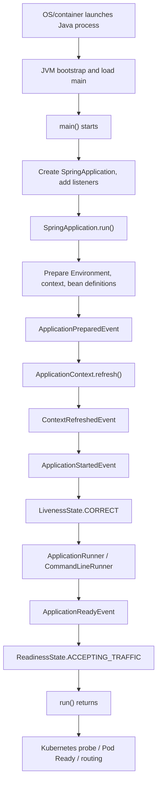

# Distinguishing Construction Time, JVM Time, `refresh()`, and Time to Ready in Spring Boot

## 1. Four Questions That Must Be Separated

When a Spring Boot application logs:

```text
Started DemoApplication in 3.2 seconds (process running for 4.1)
```

but Kubernetes only marks the Pod `Ready` after 10 seconds, you cannot yet conclude which number is wrong. They measure different intervals. The question "how long does the application take to start?" must be accompanied by **a start point, an end point, and a scope**.

In the **Startup Measurement** topic of Spring Boot Application Runtime, we need to distinguish:

1. **Construction time:** the time to create the `SpringApplication` object or to create and prepare the `ApplicationContext` before refresh, depending on the specified definition.
2. **JVM/process time:** the lifetime of the JVM, including the time before code in `main()` runs.
3. **Refresh time:** the time Spring Framework spends processing `ApplicationContext.refresh()` along with the bean factory, eager singletons, and infrastructure.
4. **Time to ready:** the interval from the chosen start milestone until Spring Boot finishes the runners, publishes `ApplicationReadyEvent`, and announces readiness; at the Kubernetes layer there are also probes and propagation.

One interval must not be arbitrarily substituted for another. For example: **`ApplicationStartedEvent` is after refresh but before runners; `ApplicationReadyEvent` is after runners**. Therefore, the "Started" log line alone is not enough to conclude that the application is ready to receive traffic.

This lesson is based on **Spring Boot 3.3.x, Spring Framework 6.x, and Java 17+**, accompanied by a runnable Maven project to record the milestones.

## 2. What Is "Construction"? Do Not Confuse It with Building a JAR

The term "construction" (or "building") is often used for three different activities:

| Activity name | Measurement scope | Part of runtime startup? |
| --- | --- | --- |
| Build/package | Maven compiles, runs tests, and packages a JAR or container image | No; occurs before the Java process runs |
| `SpringApplication` construction | From `new SpringApplication(...)` start until the constructor returns | Yes, inside `main()` |
| Context construction and preparation | Spring Boot creates the context, attaches Environment, runs initializers, loads bean definitions before refresh | Yes, inside `run()` |

Example:

```java
long begin = System.nanoTime();
SpringApplication application = new SpringApplication(DemoApplication.class);
long end = System.nanoTime();

System.out.println("construction-ns=" + (end - begin));
```

This is a snippet; it requires the `DemoApplication` class and the `SpringApplication` import. It only measures the constructor segment, **not context creation and not calling `refresh()`**.

A report that wants to refer to "context construction time" should specify the milestones, for example **`ApplicationContextInitializedEvent → ApplicationPreparedEvent`** (the approximate preparation window). You must not call the `SpringApplication` constructor time the entire application construction time.

`new AnnotationConfigApplicationContext()` is also not inherently equivalent to all of Boot's logic: Boot also processes Environment, configuration sources, startup listeners, and bean definitions along its own path.

## 3. Standard Timeline from JVM to Ready



The sequence above describes a **successful startup**. Spring Boot also has milestones before refresh, including `ApplicationStartingEvent`, `ApplicationEnvironmentPreparedEvent`, and `ApplicationContextInitializedEvent`. If startup fails, `ApplicationFailedEvent` appears on the failure path; not every startup reaches the ready milestone.

| Milestone | Meaning | What is not yet guaranteed |
| --- | --- | --- |
| JVM start | The JVM process has started living | Java `main()` has run |
| Main entry | The application starts recording timestamps itself | The JVM was not running beforehand |
| `SpringApplication` constructed | The bootstrap object has been created | Context has been refreshed |
| `ApplicationContextInitializedEvent` | Context has been created and preliminarily initialized | All bean definitions are loaded |
| `ApplicationPreparedEvent` | Prepared and about to refresh | Context refresh is complete |
| `ContextRefreshedEvent` | Context finishes refreshing | Runners have completed |
| `ApplicationStartedEvent` | Boot has passed refresh | Boot is ready |
| `ApplicationReadyEvent` | Application/command-line runners have been invoked | Kubelet has observed readiness |
| `ACCEPTING_TRAFFIC` | Boot publishes the ready state | All external backends are always healthy |
| Pod Ready | Platform evaluates the ready condition | All external load balancers have updated |

A simple sentence to remember: **JVM running ≠ context refreshed ≠ Boot started ≠ Boot ready ≠ Pod receiving routed traffic**.

## 4. JVM Time: Exists Before `main()` and Before Boot

The Java Management API provides the JVM start time and uptime:

```java
import java.lang.management.ManagementFactory;
import java.lang.management.RuntimeMXBean;

RuntimeMXBean runtime = ManagementFactory.getRuntimeMXBean();
long jvmStartEpochMs = runtime.getStartTime();
long jvmUptimeMs = runtime.getUptime();
```

This snippet needs to be inside a valid Java class/method. `getStartTime()` is a timestamp in Unix epoch milliseconds; `getUptime()` is how long the JVM has been running.

Right at the start of `main()`, `getUptime()` is usually already a positive number because the JVM has initialized the runtime, loaded classes, and prepared to invoke main. Therefore:

```java
long mainEnteredAt = System.nanoTime();
```

does **not** mark "JVM start" but only marks "start measuring at this line of code". To know the JVM's age up to the ready milestone, you can read `getUptime()` at `ApplicationReadyEvent`, but that **does not include** pre-JVM stages such as pulling the container image.

### 4.1. Analyzing a Real Log Line

Hypothetical example:

```text
Started DemoApplication in 3.200 seconds (process running for 4.100)
```

- `in 3.200 seconds`: the time according to `SpringApplication`'s mechanism up to the **started milestone**; includes context preparation and refresh.
- `process running for 4.100`: how long the JVM/process has been running at the time the log is generated.
- The `0.900`-second difference is **not necessarily** only JVM bootstrap time, because there is also code executed before `run()`, class initialization, and log-writing moments.

In particular, this log line appears before `ApplicationRunner`/`CommandLineRunner` instances run on the normal path. If a runner takes 5 seconds, the **ready milestone can be 5 seconds later than the Started log**.

### 4.2. Time Since Pod Creation Differs from Time Since JVM Start

In Kubernetes:

```text
Pod created
→ scheduling
→ image pull, volume mount, init containers
→ container launches process
→ JVM start
→ main()
→ Spring Boot run
→ readiness accepted
→ kubelet probe succeeds
→ Pod Ready
```

Many steps are not Spring Framework's responsibility. Measuring `Pod.creationTimestamp → Ready` and then writing "Spring Boot needs 12 seconds" can assign blame wrongly if image pull alone took 7 seconds.

## 5. What Does `refresh()` Do and Why Can It Be Slow?

`ApplicationContext.refresh()` is a sequence of Spring Framework tasks, not just calling one bean's constructor. It can include:

- Preparing the bean factory and context state.
- Running `BeanFactoryPostProcessor`, completing registration/adjustment of bean definitions.
- Registering `BeanPostProcessor`.
- Setting up the message source, event multicaster, and context infrastructure.
- Initializing web infrastructure depending on the context type.
- Creating **eager** singletons and resolving dependency injection.
- Running `@PostConstruct`, init callbacks, and necessary bean lifecycle steps.
- Auto-starting eligible `SmartLifecycle` beans, publishing `ContextRefreshedEvent`.

This time can increase due to ORM/JPA setup, too many bean definitions, reflection/proxies, network I/O in init callbacks, validation, connection pools, or the embedded web server. You should not conclude that every millisecond of refresh is "annotation scanning time".

### 5.1. Milestones Before and After Refresh

Spring Boot 3.3 publishes:

```text
ApplicationPreparedEvent
    ↓
refresh(...)
    ↓
ContextRefreshedEvent
    ↓
ApplicationStartedEvent
```

`ApplicationPreparedEvent` occurs when bean definitions are loaded but refresh has not yet started; `ContextRefreshedEvent` occurs when the context has refreshed. `ApplicationStartedEvent` occurs afterward, before runners.

If you take:

```text
approx_refresh_window =
    timestamp(ApplicationStartedEvent)
  - timestamp(ApplicationPreparedEvent)
```

then this is **an approximate refresh window**, not the exact duration of **the `refresh()` method itself**. It can contain listener dispatch, logging, lifecycle bookkeeping, and code lying between the measurement points.

To look in detail **inside refresh**, use `ApplicationStartup`/`StartupStep`, Java Flight Recorder, or a method-level instrumenting profiler. Do not use the timestamp of a single event and assert "refresh took exactly 800 ms".

### 5.2. Lazy Initialization Reduces Refresh but Increases First-Use Latency

```properties
spring.main.lazy-initialization=true
```

can defer creating rarely used beans, making refresh shorter. However, when the first request needs that bean, the cost shifts to **the first request time**. Therefore, an improvement in `application.started.time` does not automatically guarantee improved first-request latency or P99 during autoscaling.

If a bean is a mandatory prerequisite for serving traffic, consider `@Lazy(false)` or proactively verifying it in a runner/readiness check before routing requests.

## 6. `ApplicationStartedEvent` and `ApplicationReadyEvent`

### 6.1. Started Is After Refresh, Before Runners

`ApplicationStartedEvent` appears when the context has refreshed, but `ApplicationRunner` and `CommandLineRunner` have **not yet** been invoked.

Web infrastructure components may already have bound the port during refresh. An open port does **not** mean readiness is accepting traffic. This is why you should not use a TCP port check instead of a meaningful business readiness probe.

### 6.2. Ready Is After Runners

A runner:

```java
@Bean
ApplicationRunner preloadReferenceData() {
    return args -> Thread.sleep(5_000L);
}
```

This is an illustrative method placed in a Spring configuration class, requiring appropriate imports. Boot waits for the synchronous runner to return; `ApplicationReadyEvent` appears **after** it. `ApplicationStartedEvent` is not pushed past the runner because of this.

After `ApplicationReadyEvent`, Boot publishes `ReadinessState.ACCEPTING_TRAFFIC`. However, at the Kubernetes layer, probes and routing still have their own evaluation schedules. If a custom health indicator is not yet UP, the Pod can still be NotReady even though Boot has published the Ready event.

### 6.3. Using `getTimeTaken()` on the Right Event

Spring Boot 3.3 has:

```java
Duration startedDuration = startedEvent.getTimeTaken();
Duration readyDuration = readyEvent.getTimeTaken();
```

This is a snippet requiring variables that are instances of `ApplicationStartedEvent` and `ApplicationReadyEvent` respectively; the API can return `null` if the duration is unknown.

- `startedDuration` represents Boot's time to **started**.
- `readyDuration` represents Boot's time to **ready**.
- `readyDuration - startedDuration` is usually related to runners and event overhead.
- Do not add `refresh()` to `startedDuration`: **started already includes refresh**.
- Do not call this difference the total CPU time of runners; event callbacks and other processing steps may also lie in the interval.

### 6.4. Actuator Has Two Separate Metrics

Spring Boot 3.3 Actuator auto-configures:

| Metric | Definition |
| --- | --- |
| `application.started.time` | Time to reach the started milestone |
| `application.ready.time` | Time to reach the ready milestone |

The metric names are documented in the official reference. These metrics do not measure image pull time, Pod scheduling, probe routing, or a user sending the first request.

**Illustrative** measurement example:

```text
application.started.time = 2.2 s
application.ready.time   = 6.0 s
```

The difference of about 3.8 seconds **does not belong solely to refresh**, but occurs between started and ready. The first things to inspect are runners and synchronous listeners.

## 7. Defining Milestones with Formulas

Pick one process and denote:

- `t0`: JVM starts running.
- `t1`: Java `main()` begins.
- `t2`: `SpringApplication.run()` begins.
- `t3`: `ApplicationPreparedEvent`.
- `t4`: `ContextRefreshedEvent`.
- `t5`: `ApplicationStartedEvent`.
- `t6`: `ApplicationReadyEvent`.
- `t7`: `ReadinessState.ACCEPTING_TRAFFIC`.
- `t8`: Kubernetes/observer first confirms Ready.

With the same clock and a clearly defined measurement method:

```text
T_JVM_before_main      = t1 - t0
T_main_setup           = t2 - t1
T_prepared_to_started  = t5 - t3     (approximates the refresh window)
T_boot_started         ≈ t5 - t2
T_started_to_ready     = t6 - t5
T_boot_ready           ≈ t6 - t2
T_JVM_to_ready         = t6 - t0
T_platform_after_ready = t8 - t7     (infrastructure-dependent)
```

The `≈` sign matters: listener timestamps and the duration Boot measures internally may be captured at slightly different points. This is a model for reasoning and computing durations; do not infer that Spring Boot literally uses the variables `t0...t8`.

### 7.1. Summary Example

**Hypothetical** figures:

| Part | Time |
| --- | ---: |
| JVM before main | 0.4 s |
| Main setup | 0.2 s |
| Boot context preparation before refresh | 0.6 s |
| Refresh and immediate post-refresh overhead | 1.8 s |
| Runners and overhead between started/ready | 2.0 s |
| Probe and routing after Boot ready | 1.0 s |
| Scheduling/image pull before JVM | 3.0 s |

Derived:

```text
Boot started      ≈ 0.6 + 1.8 = 2.4 s
Boot ready        ≈ 2.4 + 2.0 = 4.4 s
JVM-to-Boot-ready ≈ 0.4 + 0.2 + 4.4 = 5.0 s
Pod-created-ready ≈ 3.0 + 5.0 + 1.0 = 9.0 s
```

All four values 2.4 / 4.4 / 5.0 / 9.0 can be correct because they measure **four different boundaries**. To compare two releases, you must use the same type of value.

## 8. Runnable Example: Java 17 + Spring Boot 3.3.13

The project below records the corresponding milestones, with a runner simulating a 1.5-second warm-up to illustrate the started→ready interval. It uses `spring-boot-starter-web` and Actuator to provide `/readyz`, `/actuator/metrics/...`, and `/actuator/startup`.

### 8.1. Structure

```text
startup-clock-demo/
├── pom.xml
└── src/main/
    ├── java/com/example/startup/StartupClockApplication.java
    └── resources/application.properties
```

### 8.2. `pom.xml`

```xml
<project xmlns="http://maven.apache.org/POM/4.0.0"
         xmlns:xsi="http://www.w3.org/2001/XMLSchema-instance"
         xsi:schemaLocation="http://maven.apache.org/POM/4.0.0 https://maven.apache.org/xsd/maven-4.0.0.xsd">
    <modelVersion>4.0.0</modelVersion>
    <parent>
        <groupId>org.springframework.boot</groupId>
        <artifactId>spring-boot-starter-parent</artifactId>
        <version>3.3.13</version>
        <relativePath/>
    </parent>
    <groupId>com.example</groupId>
    <artifactId>startup-clock-demo</artifactId>
    <version>0.0.1-SNAPSHOT</version>
    <properties>
        <java.version>17</java.version>
    </properties>
    <dependencies>
        <dependency>
            <groupId>org.springframework.boot</groupId>
            <artifactId>spring-boot-starter-web</artifactId>
        </dependency>
        <dependency>
            <groupId>org.springframework.boot</groupId>
            <artifactId>spring-boot-starter-actuator</artifactId>
        </dependency>
    </dependencies>
    <build>
        <plugins>
            <plugin>
                <groupId>org.springframework.boot</groupId>
                <artifactId>spring-boot-maven-plugin</artifactId>
            </plugin>
        </plugins>
    </build>
</project>
```

### 8.3. `StartupClockApplication.java`

Create the file `src/main/java/com/example/startup/StartupClockApplication.java`:

```java
package com.example.startup;

import java.lang.management.ManagementFactory;
import java.time.Duration;
import java.util.concurrent.TimeUnit;
import java.util.concurrent.atomic.AtomicLong;

import org.springframework.boot.ApplicationRunner;
import org.springframework.boot.SpringApplication;
import org.springframework.boot.autoconfigure.SpringBootApplication;
import org.springframework.boot.availability.AvailabilityChangeEvent;
import org.springframework.boot.availability.ReadinessState;
import org.springframework.boot.context.event.ApplicationContextInitializedEvent;
import org.springframework.boot.context.event.ApplicationEnvironmentPreparedEvent;
import org.springframework.boot.context.event.ApplicationPreparedEvent;
import org.springframework.boot.context.event.ApplicationReadyEvent;
import org.springframework.boot.context.event.ApplicationStartedEvent;
import org.springframework.boot.context.event.ApplicationStartingEvent;
import org.springframework.boot.context.metrics.buffering.BufferingApplicationStartup;
import org.springframework.context.ApplicationListener;
import org.springframework.context.annotation.Bean;
import org.springframework.context.event.ContextRefreshedEvent;
import org.springframework.context.event.EventListener;
import org.springframework.core.env.Environment;

@SpringBootApplication
public class StartupClockApplication {

    private static final AtomicLong PREPARED = new AtomicLong(-1L);
    private static final AtomicLong STARTED = new AtomicLong(-1L);

    public static void main(String[] args) {
        System.out.println("milestone=main");
        System.out.println("jvm-uptime-at-main-ms="
                + ManagementFactory.getRuntimeMXBean().getUptime());

        long startConstruct = System.nanoTime();
        SpringApplication app = new SpringApplication(StartupClockApplication.class);
        long endConstruct = System.nanoTime();

        System.out.println("springapplication-construction-ms="
                + elapsedMs(startConstruct, endConstruct));

        app.addListeners(
                (ApplicationListener<ApplicationStartingEvent>)
                        event -> System.out.println("milestone=starting"),
                (ApplicationListener<ApplicationEnvironmentPreparedEvent>)
                        event -> System.out.println("milestone=environment-prepared"),
                (ApplicationListener<ApplicationContextInitializedEvent>)
                        event -> System.out.println("milestone=context-initialized"),
                (ApplicationListener<ApplicationPreparedEvent>)
                        event -> {
                            PREPARED.set(System.nanoTime());
                            System.out.println("milestone=prepared");
                        },
                (ApplicationListener<ApplicationStartedEvent>)
                        event -> {
                            long now = System.nanoTime();
                            STARTED.set(now);
                            System.out.println("milestone=started");
                            System.out.println("boot-started-ms="
                                    + durationMs(event.getTimeTaken()));
                            System.out.println("approx-prepared-to-started-ms="
                                    + elapsedMs(PREPARED.get(), now));
                        },
                (ApplicationListener<ApplicationReadyEvent>)
                        event -> {
                            long now = System.nanoTime();
                            System.out.println("milestone=ready");
                            System.out.println("boot-ready-ms="
                                    + durationMs(event.getTimeTaken()));
                            System.out.println("approx-started-to-ready-ms="
                                    + elapsedMs(STARTED.get(), now));
                            System.out.println("jvm-uptime-at-ready-ms="
                                    + ManagementFactory.getRuntimeMXBean()
                                                       .getUptime());
                        }
        );

        app.setApplicationStartup(new BufferingApplicationStartup(2048));
        app.run(args);
        System.out.println("milestone=run-returned");
    }

    @EventListener
    public void contextRefreshed(ContextRefreshedEvent event) {
        System.out.println("milestone=context-refreshed");
    }

    @EventListener
    public void readiness(AvailabilityChangeEvent<ReadinessState> event) {
        if (event.getState() == ReadinessState.ACCEPTING_TRAFFIC) {
            System.out.println("milestone=readiness-accepting");
        }
    }

    @Bean
    ApplicationRunner demonstration(Environment environment) {
        return args -> {
            long delay = environment.getProperty(
                    "demo.warmup-ms", Long.class, 1_500L);
            if (delay < 0L || delay > 30_000L) {
                throw new IllegalArgumentException(
                        "warmup must be between 0 and 30000 milliseconds");
            }
            System.out.println("milestone=runner-begin");
            Thread.sleep(delay);
            System.out.println("milestone=runner-end");
        };
    }

    private static long elapsedMs(long from, long to) {
        return TimeUnit.NANOSECONDS.toMillis(to - from);
    }

    private static String durationMs(Duration duration) {
        return duration == null
                ? "unknown" : Long.toString(duration.toMillis());
    }
}
```

#### Why Use These APIs?

- `ManagementFactory.getRuntimeMXBean().getUptime()` measures JVM age at main and ready.
- `System.nanoTime()` calculates **local duration** using a monotonic clock; it is not a Unix timestamp.
- `new SpringApplication` is measured separately, not conflated with `refresh()`.
- Early listeners are registered **before** `run(args)` so they receive events occurring before the context has bean listeners.
- `ApplicationPreparedEvent` samples right before the refresh region; `ApplicationStartedEvent` sits after refresh.
- `ApplicationStartedEvent.getTimeTaken()` and `ApplicationReadyEvent.getTimeTaken()` obtain Boot's internal durations.
- `ApplicationRunner` waits 1.5 seconds **after started** and before ready.
- `ReadinessState.ACCEPTING_TRAFFIC` is published after the ready event.
- `BufferingApplicationStartup` records startup steps for the `/actuator/startup` endpoint.

The duration values in ms printed by the code will vary depending on the environment; there is no fixed set of milliseconds across all machines.

### 8.4. `application.properties`

Create `src/main/resources/application.properties`:

```properties
spring.main.banner-mode=off
server.port=8080
demo.warmup-ms=1500

management.endpoints.web.exposure.include=health,info,metrics,startup
management.endpoint.health.probes.enabled=true
management.endpoint.health.probes.add-additional-paths=true
```

In production, do not expose `/actuator/startup` publicly because it can reveal bean/class names and configuration details. The example above is intended for local testing or environments where actuator endpoints are protected.

### 8.5. Running

In the directory containing `pom.xml`:

```bash
mvn package
java -jar target/startup-clock-demo-0.0.1-SNAPSHOT.jar
```

If you have Maven Wrapper:

```bash
./mvnw package
```

Windows PowerShell if using the wrapper:

```powershell
.\mvnw.cmd package
```

The project requires JDK 17+, Maven, and Spring Boot dependencies on the classpath. It is not a plain Java file that can be compiled with `javac` without Spring libraries.

### 8.6. Expected Output

**Filtering only lines starting with `milestone=`**, the order in a typical successful startup is:

```text
milestone=main
milestone=starting
milestone=environment-prepared
milestone=context-initialized
milestone=prepared
milestone=context-refreshed
milestone=started
milestone=runner-begin
milestone=runner-end
milestone=ready
milestone=readiness-accepting
milestone=run-returned
```

Duration lines and framework logging will be interleaved; they contain **actual values**, so do not hard-code expected times. For example, `boot-ready-ms` can increase if warm-up increases, while `boot-started-ms` is little affected by that runner alone.

### 8.7. Controlled Experiment to Clearly See Both Intervals

Try running:

```bash
java -jar target/startup-clock-demo-0.0.1-SNAPSHOT.jar --demo.warmup-ms=5000
```

The warm-up value changes from 1500 ms to 5000 ms. Expectations:

- The `runner-begin → runner-end` duration increases by about 3.5 seconds.
- `approx-started-to-ready-ms` and `boot-ready-ms` typically increase by roughly the same amount.
- `boot-started-ms` does not directly include the runner, so it should not increase **due to `Thread.sleep` in the runner itself**.
- `approx-prepared-to-started-ms` is not directly lengthened by the runner.
- JVM uptime at ready also increases.

This is a trend that should be verified across multiple runs; GC, CPU, caches, class loading, and I/O environment introduce noise. Do not use a single measurement to draw millisecond-exact conclusions.

## 9. Querying Actuator Metrics and Readiness

Once startup completes:

```bash
curl -s http://localhost:8080/actuator/metrics/application.started.time
curl -s http://localhost:8080/actuator/metrics/application.ready.time
```

Actuator responds with JSON containing the metric name, measurements, tags, and possibly a base unit. Read the actual unit in the response; do not assume it is always milliseconds.

Cross-check with the probe endpoints:

```bash
curl -i http://localhost:8080/readyz
curl -i http://localhost:8080/livez
```

Because the example enabled `management.endpoint.health.probes.add-additional-paths=true`, the `/readyz` and `/livez` paths are on the main HTTP port. Once the runner finishes and no health contributor fails, readiness typically returns HTTP 200. While the runner has not finished, if the web server can already serve HTTP responses, readiness may return 503.

### 9.1. Actuator Metrics Are Not Yet Pod Ready Time

`application.ready.time` measures the Boot milestone, excluding Kubernetes scheduling, image pull, or readiness probe intervals. If the metric is 4 seconds while Pod Ready is 12 seconds, look for the difference in the Pod lifecycle and health contributors before saying "refresh is slow".

### 9.2. Distinguishing Ready from First Request

An API with global lazy initialization or an un-warmed cache can reach ready very early yet have a slow first request. Therefore, when reporting runtime performance, you should include both **cold first-request latency** and **steady-state latency**, not just a single startup figure.

## 10. StartupStep: Going Deeper Than a Pair of Events

Spring's `ApplicationStartup` and `StartupStep` allow decomposing startup steps. Spring Boot 3.3 supports `BufferingApplicationStartup` to store events in a buffer and inspect them via Actuator:

```java
app.setApplicationStartup(new BufferingApplicationStartup(2048));
```

This line **must come before** `app.run(args)`; it is already included in the example. When the service is running:

```bash
curl -s http://localhost:8080/actuator/startup
```

The endpoint returns a timeline containing fields such as `startTime`, `endTime`, `duration`, `startupStep.name`, `startupStep.id`, `startupStep.parentId`, and tags. Some steps may relate to `spring.beans.instantiate`, context refresh, or Boot application starting, depending on version and components.

### 10.1. Do Not Blindly Sum `duration`

Startup steps can be **nested**. If step A encloses step B, summing durations A+B double-counts B. You must inspect `parentId` and actual start/end intervals, or use a corresponding flame graph/timeline.

### 10.2. GET and POST Differ

- `GET /actuator/startup`: retrieves a snapshot of the steps currently retained.
- `POST /actuator/startup`: retrieves and **drains** the buffer according to the endpoint contract.

A POST call can cause subsequent retrievals to no longer contain the same set of steps. Choose the right collection method for benchmarks and avoid exposing the endpoint publicly.

### 10.3. Finite Buffer

`BufferingApplicationStartup(2048)` has a limit on the number of stored steps. An application with very many beans can produce more steps than the capacity. If deep investigation is needed, increase the capacity in a controlled way or use JFR. Do not infer that steps absent from the buffer definitely never ran.

## 11. JFR: When You Need to Separate Spring Overhead from JVM Overhead

If the question is "is startup slow due to bean lifecycle or GC/class loading?", two Boot events alone are not enough. Spring Framework has `FlightRecorderApplicationStartup`:

```java
import org.springframework.core.metrics.jfr.FlightRecorderApplicationStartup;

app.setApplicationStartup(new FlightRecorderApplicationStartup());
```

This is a snippet replacing the use of `BufferingApplicationStartup`; do not enable both by calling `setApplicationStartup` twice and expecting the data to be combined.

Run JFR:

```bash
java -XX:StartFlightRecording=filename=startup.jfr,duration=30s -jar target/startup-clock-demo-0.0.1-SNAPSHOT.jar
```

Analyze the `startup.jfr` file with JDK Mission Control or an appropriate JFR tool. JFR can correlate Spring startup steps with GC, class loading, JIT, CPU, and allocation events.

`duration=30s` is the **recording duration**, not a timeout for Boot startup or readiness. Profiling has overhead; when comparing performance, document the measurement conditions clearly.

## 12. Spring Ready Milestones Differ from Platform Ready Milestones

| Metric | Who decides? | What is measured |
| --- | --- | --- |
| Boot started | Spring Boot | After refresh, before runners |
| Boot ready | Spring Boot | After runners |
| Readiness accepting | Spring Availability | Boot accepts traffic according to state |
| HTTP readiness probe success | App + network + health group | Endpoint returns success at probe time |
| Pod `Ready=True` | Kubelet/Kubernetes | Pod condition is updated |
| Deployment available | Deployment controller | Replica availability policy |
| First useful response | API client & business checks | First business request actually succeeds |
| End-to-end traffic ready | Load balancer/ingress/client | Traffic can be routed under real conditions |

You can end up in a state of **JVM live, Boot ready, yet Pod NotReady** if a custom readiness health group is `OUT_OF_SERVICE`. Conversely, a TCP port can open before runners finish, while Boot is still refusing traffic.

An `ApplicationRunner` that only submits a background task and returns will **not make Boot wait for that task**. If background warm-up is mandatory, keep the runner synchronous with a deadline or express the condition via a custom readiness health indicator.

## 13. Measuring Externally Observed Time

### 13.1. Polling `/readyz` Is Not an Exact Refresh Measurement

A script can measure from **when the process-spawn command is invoked** to **the first time a readiness 200 response is received**. The result includes OS scheduling, JVM startup, Boot startup, HTTP/network, and **polling-interval lag**.

If you poll every 500 ms, the true ready moment can fall anywhere between two polls. Thus, observation accuracy is limited by both polling cadence and HTTP delay. Do not subtract `ApplicationStartedEvent` directly from that result and claim the runner took that exact number of milliseconds.

### 13.2. `time java -jar` with a Web Server

`time java -jar app.jar` for a long-running web server usually measures **the entire lifetime of the process**, not startup. If the server runs for 30 minutes before Ctrl+C, the `time` command output does not tell you that the server became ready at second 4.

Measure externally using an observer/probe with clear boundaries, and internally using Boot events/metrics for correlation.

### 13.3. Monotonic Clock and Wall Clock

`System.nanoTime()` is used for **elapsed duration** within one JVM, not as a Unix timestamp to compare across multiple JVMs. `Instant.now()` is useful for log timestamps/correlation, but the wall clock can be subject to NTP adjustments.

If subtracting timestamps between node A and node B, you must account for clock skew and transmission overhead. In distributed systems, use tracing/observers designed with appropriate clock handling and error bounds.

## 14. Common Misconceptions

### 14.1. "`Started` means ready"

False: started occurs before runners. During the runner phase, the web port may already be open and liveness may already be CORRECT while readiness is still refusing.

### 14.2. "`process running for` is the refresh time"

False: that is the JVM age at the time of the log line, including many parts outside refresh.

### 14.3. "Measuring `new SpringApplication()` measures the entire startup"

False: that is only the bootstrap object constructor, not all stages of `run()`.

### 14.4. "Taking the time between Prepared and Started is exact refresh"

Inaccurate. That interval can include event dispatch/logging and overhead before/after refresh. Use StartupStep/JFR if detailed breakdown is needed.

### 14.5. "Once Ready is reached, all backends are working"

Not guaranteed. Boot availability does not automatically check every external service; custom health indicators and business policies are still necessary.

### 14.6. "Reaching Ready earlier means the first request is faster"

Not necessarily. Lazy initialization can shift work to the first request, increasing cold latency.

### 14.7. "Summing StartupStep durations gives total Boot startup"

No. Steps are nested, so summing directly can double-count.

### 14.8. "Every ContextRefreshedEvent belongs to the main context"

No. There can be management/child contexts and event propagation. You need to check the source context.

### 14.9. "Disabling startup logging makes Spring events disappear"

`spring.main.log-startup-info=false` affects startup INFO logging; it does not mean `ApplicationStartedEvent`, `ApplicationReadyEvent`, or metrics automatically disappear.

### 14.10. "Late Pod Ready must be because Spring is slow"

Not necessarily: image pull, init containers, startup/readiness probes, CPU throttling, or load balancer propagation can all create the gap. Read the right layer.

### 14.11. "A background runner still holds readiness"

No, if the runner only submits a task and returns. Boot does not automatically wait for arbitrary background futures. Custom readiness is needed if business logic requires it.

### 14.12. "A single measurement of 2.1 seconds proves the new build is faster than 2.3 seconds"

Insufficient. Noise from the JDK, GC, warm filesystem cache, JVM JIT, network, CPU quota, and tracing overhead must be controlled across multiple runs.

## 15. Benchmark Checklist and How to Choose a Measurement Method

| Purpose | Recommended measure | Notes |
| --- | --- | --- |
| Check slow JVM before `main()` | `RuntimeMXBean.getUptime()` at main | Does not measure image pull |
| Measure `SpringApplication` constructor | `System.nanoTime()` bracketing constructor | Does not measure context startup |
| Locate preparation before refresh | Early Spring events | Intervals between events are indirect measurements |
| Estimate refresh window | Prepared → Started | **Approx**, includes overhead |
| Measure Boot started | `ApplicationStartedEvent.getTimeTaken()` | After refresh, before runners |
| Measure Boot ready | `ApplicationReadyEvent.getTimeTaken()` | After runners |
| Observe official metrics | `application.started.time` / `application.ready.time` | Requires Actuator/meter registry |
| Drill into bean startup | `ApplicationStartup`/`StartupStep`, JFR | Watch for nested steps |
| Measure Pod Ready | Kubernetes Pod condition / probes | Includes platform scheduling |
| Measure first-request cold latency | Synthetic business request | Includes lazy init and external I/O |

A reasonable workflow:

1. Record the exact environment: Boot/JDK version, profiles, classpath, JVM flags, CPU/memory limits, infrastructure, startup logging.
2. Specify the **target**: reducing Boot started, Boot ready, Pod Ready, or first useful response.
3. Run a baseline with a sample set large enough to show variance.
4. Collect Boot started/ready metrics and JVM uptime; if started/ready has a large gap, measure runners.
5. If the refresh window is large, enable StartupStep or JFR to find time-consuming parts.
6. If only Pod Ready is large, check scheduling, image pull, init containers, probes, and routing.
7. If using lazy init, check cold requests and warm requests, not just startup.
8. Re-run under equivalent conditions, reporting median and tail/variance rather than cherry-picking the best number.
9. Do not let heavy instrumentation/logging significantly distort the measurement.
10. Conclude optimization succeeded only when SLOs and business readiness/correctness are met.

## 16. Practice Scenarios

**Question 1.** Boot logs `Started ... in 2.5s`, and a runner takes 4s. Does Boot ready occur at 2.5s?

**Answer:** No. Started is before runners, ready is after runners; Boot ready may be around 6.5s from Boot's start milestone, depending on overhead.

**Question 2.** JVM uptime at `main()` is 300 ms. Is the measurement call wrong?

**Answer:** No. The JVM already performed bootstrap and class loading before `main()`.

**Question 3.** The `SpringApplication` constructor takes 5ms. Can you report startup as 5ms?

**Answer:** No. That is the bootstrap object construction time; context preparation, refresh, and runners have not been counted.

**Question 4.** Prepared→Started takes 1.8s. Can you call exact `refresh()` 1.8s?

**Answer:** No. That is an approximate refresh window, including overhead; a profiler/StartupStep is needed for detailed measurement.

**Question 5.** Pod Ready takes 12s, and `application.ready.time` is 4s. Does the 8s part definitely belong to Spring?

**Answer:** No. It could be before the JVM or belong to probes/platform.

**Question 6.** Moving a synchronous runner to `CompletableFuture.runAsync` reduces ready time. Work required for every request is still unfinished; is that a real improvement?

**Answer:** Not necessarily. If the work is mandatory, there is a risk of traffic entering the app before prerequisites are met. A readiness gate or keeping the task synchronous is needed.

**Question 7.** `ContextRefreshedEvent` has appeared, yet `/readyz` still returns 503. Is this abnormal?

**Answer:** No. Runners have not finished yet or a readiness contributor is still OUT_OF_SERVICE.

**Question 8.** `application.started.time=2s`, `application.ready.time=6s`; should you optimize the bean factory first?

**Answer:** Not yet. Inspect the 4s started→ready interval, which typically contains runners or post-refresh listeners.

**Question 9.** Some StartupSteps lie inside a parent step; summing all durations gives 15s, while Boot ready is 6s. Where is the mistake?

**Answer:** Likely double-counting due to nested steps; do not directly sum overlapping durations.

**Question 10.** Enabling lazy makes Boot started 30% faster, but the first request is 1s slower. Is there a contradiction?

**Answer:** No. Initialization cost was shifted to when the bean is first used.

**Question 11.** `time java -jar` prints 40 minutes because the server was stopped after 40 minutes. Does this number measure startup?

**Answer:** No, that is the process lifetime until exit.

**Question 12.** Why not use `System.nanoTime()` across Pods to measure Pod Ready?

**Answer:** `nanoTime` has its own relative origin, not a synchronized epoch clock across multiple processes.

## 17. Official Sources

- [Spring Boot 3.3 — SpringApplication, Application Events and Startup Tracking](https://docs.spring.io/spring-boot/3.3/reference/features/spring-application.html): lifecycle milestones, runners, readiness, `BufferingApplicationStartup`, and JFR.
- [Spring Boot 3.3 — Actuator Metrics](https://docs.spring.io/spring-boot/3.3/reference/actuator/metrics.html): `application.started.time` and `application.ready.time`.
- [Spring Boot 3.3 — Startup Actuator API](https://docs.spring.io/spring-boot/3.3/api/rest/actuator/startup.html): GET snapshot, POST drain, and startup steps schema.
- [Spring Boot 3.3 — Endpoints](https://docs.spring.io/spring-boot/3.3/reference/actuator/endpoints.html): endpoint exposure and security.
- [Spring Boot 3.3 — `ApplicationStartedEvent`](https://docs.spring.io/spring-boot/3.3/api/java/org/springframework/boot/context/event/ApplicationStartedEvent.html): post-refresh milestone and `getTimeTaken()`.
- [Spring Boot 3.3 — `ApplicationReadyEvent`](https://docs.spring.io/spring-boot/3.3/api/java/org/springframework/boot/context/event/ApplicationReadyEvent.html): post-runners milestone and `getTimeTaken()`.
- [Spring Boot 3.3 — `SpringApplicationRunListener`](https://docs.spring.io/spring-boot/3.3/api/java/org/springframework/boot/SpringApplicationRunListener.html): `started` and `ready` callbacks.
- [Java 17 — `RuntimeMXBean`](https://docs.oracle.com/en/java/javase/17/docs/api/java.management/java/lang/management/RuntimeMXBean.html): JVM start time and uptime.
- [Java 17 — `System.nanoTime()`](https://docs.oracle.com/en/java/javase/17/docs/api/java.base/java/lang/System.html#nanoTime()): duration measurement clock.

## 18. Conclusion

There is no single "Spring Boot startup time" number. **Construction** is bootstrap object creation or context preparation; **JVM time** includes time before `main`; **refresh** is Spring Framework's work on the container; **started** occurs after refresh but before runners; **ready** occurs after runners and before availability accepting. Outside the JVM, Pod Ready is also affected by infrastructure and probes.

When meaningful numbers are needed, always record **the milestone name and start point**: `jvm_uptime_at_main`, `springapplication_construction`, `prepared_to_started_approx`, `application.started.time`, `application.ready.time`, `pod_ready`, `first_request_latency`. Use `ApplicationStartup`/JFR to explain refresh, measure repeatedly under the same conditions, and optimize the stage that actually takes time rather than comparing inconsistent numbers.