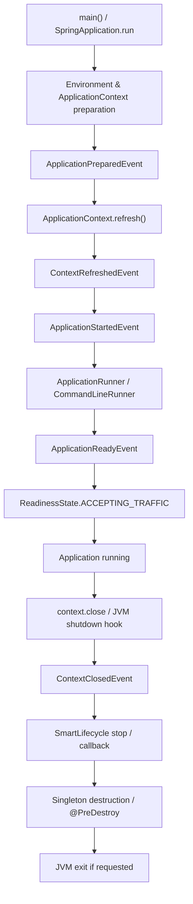

# Choosing Component, `ApplicationContext`, or Real-Process Testing When Testing Spring Boot Lifecycle

## 1. The core question: at which boundary do you want to prove behavior?

Spring Boot "lifecycle testing" is not a single type of test. Depending on requirements, we may need to prove:

- Whether a component responds properly to `start()`, `stop()`, and callbacks when invoked directly in isolation.
- Whether Spring creates beans, injects dependencies, invokes init/destroy callbacks, and **coordinates start/stop ordering** accurately.
- Whether `SpringApplication.run(...)` emits the right lifecycle events, invokes runners, and reaches readiness.
- Whether, when **a real JVM** launches via `java -jar`, it returns the right exit code to the OS, executes shutdown hooks, and exits within the allowed time.
- Whether, when a real container receives `SIGTERM`, ingress/Kubernetes stops sending new requests, lets in-flight requests drain, and avoids `SIGKILL`.

The answer cannot always be "just write `@SpringBootTest`". A unit test running inside the same JUnit JVM cannot prove the exit code returned to the OS by `System.exit(...)`. Conversely, spinning up Docker every time you need to verify an `AtomicBoolean` makes tests slow, hard to localize failures, and prone to flakiness.

Choose the **smallest test level that proves the contract under test**, then add higher-level tests for properties that smaller levels cannot observe. This is the "component → context → process" principle, not a rule requiring every feature to have all three levels.

This guide applies to **Java 17+, Spring Framework 6.x, Spring Boot 3.3.x**. Full examples use JUnit Jupiter, AssertJ, Maven Surefire, and Maven Failsafe.

## 2. The three testing boundaries

### 2.1. Component testing (*component/unit test*)

Testing a Java class instantiated directly with `new`, using mocks, fakes, stubs, or simple real collaborators. It does not require creating a Spring `ApplicationContext`.

Suitable assertions:

- `start()` transitions `isRunning()` from `false` to `true`.
- Calling `start()` twice does not create two workers or two connections if the contract is idempotent.
- `stop(Runnable callback)` invokes the callback only after cleanup, and exactly once.
- Cancellation tokens are observed; `InterruptedException` is propagated or the interrupt flag is restored.
- Stop commands do not run cleanup twice.
- When a fake dependency throws an exception, the component releases resources in `finally`.

**Limitation:** directly testing `component.start()` does not prove that **Spring automatically calls start during refresh**, does not prove phases/dependencies of `DefaultLifecycleProcessor`, and does not prove JVM shutdown hooks or process exit codes.

### 2.2. Context testing (*Spring integration/context test*)

Instantiating **a real Spring container** — such as `AnnotationConfigApplicationContext`, `ApplicationContextRunner`, or `@SpringBootTest` — to verify how the Framework manages bean lifecycles.

Suitable assertions:

- Bean definitions are registered, and dependency injection succeeds.
- Singletons are created/lazy as expected; init callbacks occur at the right moment.
- `SmartLifecycle` auto-starts during refresh according to phase and `depends-on` relationships.
- `ConfigurableApplicationContext.close()` triggers `ContextClosedEvent`, stop callbacks, and singleton destruction.
- `@PreDestroy`, `DisposableBean`, and `@Bean(destroyMethod=...)` are invoked properly in the managed context.
- Auto-configuration or profiles select the right beans.
- Startup failure occurs when required beans/properties are missing.
- Boot readiness/events are observed when launched via an appropriate `SpringApplication` path.

**Limitation:** `context.close()` is not an OS `SIGTERM`. A context test running inside the same JUnit JVM **does not** prove the process exit status, PID 1 signal forwarding, or actual reverse proxy/Kubernetes behavior.

### 2.3. Real-process testing (*process/end-to-end lifecycle test*)

Launching a new JVM, typically via `ProcessBuilder` or `java -jar`, and observing:

- Real startup via `main()`, the executable JAR, and configuration/environment.
- `ApplicationReadyEvent` / readiness of the real application.
- OS exit code when `main` calls `System.exit(...)`.
- Whether resources/threads prevent the JVM from exiting.
- Logs printed by the child process, exit duration, and failure paths.
- Graceful shutdown behavior when receiving an appropriate signal in a supported environment.

If requirements also involve Docker/Kubernetes, you must test in a **real container/orchestrator**, because a new JVM spawned by `ProcessBuilder` still **does not** simulate ingress routing, `terminationGracePeriodSeconds`, or `docker stop`.

**Trade-off:** process tests are usually slower, depend on JDK/JAR/ports/env, and require careful timeout design, child process cleanup, and log collection.

## 3. Quick selection table by requirement

| What do you want to prove? | Minimum suitable level | Is escalation needed? |
| --- | --- | --- |
| `stop()` calls cleanup exactly once | Component | Context if cleanup is invoked by Spring |
| `isRunning()` changes accurately | Component | Context if it depends on auto-start |
| `stop(Runnable)` callback after draining | Component with fake/latch | Context to verify the processor actually waits |
| `getPhase()` returns the right number | Component | Context to verify actual ordering |
| Lower phase starts first, higher phase stops first | Context | Process if dependent on shutdown hook |
| `@DependsOn` overrides phase order | Context | No process needed if only checking BeanFactory |
| Bean is destroyed only when owner context closes | Context | Multiple contexts if parent/child ownership |
| `ApplicationRunner` runs before ready | Boot context / `@SpringBootTest` | Process if checking entrypoint/OS |
| `ApplicationReadyEvent` log | Boot context | Process if stdout from JAR is needed |
| `System.exit(23)` returns status 23 | Separate process | Docker/K8s if launcher has a wrapper |
| JVM receives `SIGTERM` on `docker stop` | Real container | K8s if Pod termination must be measured |
| Pod stops receiving new traffic during rollout | Kubernetes + ingress/probes | End-to-end client observation |
| An in-flight HTTP request is gracefully drained | Web context with real server | Container/platform to verify timeout |
| `@PostConstruct` throwing causes context failure | Context | Process if failure exit code is needed |
| `ApplicationContextRunner` selects right auto-config | Small context | Full Boot if starter interactions exist |
| No duplicate data writes after force-kill | Process + real storage/broker | Chaos/kill test and idempotency |

Do not use the vague label "integration test". Specify **context integration** or **real-process integration** when it affects the evidence a test can provide.

## 4. Key lifecycle milestones for placing assertions

In a typical successful `SpringApplication.run(...)` path:



This is a **generalized model** for choosing tests. `SpringApplication.run()` in Boot emits even earlier events; when startup fails, `ApplicationFailedEvent` occurs, and when running in a container, OS signals and stop deadlines apply.

Common points of confusion:

- `ContextRefreshedEvent` **does not equal** Boot ready: runners may still be executing.
- `ApplicationStartedEvent` fires before runners; `ApplicationReadyEvent` fires after runners.
- `ConfigurableApplicationContext.stop()` does not replace `close()`: stop coordinates lifecycle, while close ends the context and destroys managed singletons.
- `@PreDestroy`/destroy callbacks differ from `SmartLifecycle.stop(Runnable)`; a test that only proves stop without closing the context will not test full cleanup.
- `ApplicationContext.close()` in a test does not guarantee the JVM or OS process will also terminate.
- Calling `System.exit()` inside the same JUnit JVM can kill the test runner itself: to verify exit codes, you must use a **separate process**.

## 5. Choosing component tests when logic needs no container

### 5.1. Suitable conditions

Start with component tests when inputs/outputs can be expressed in plain Java:

- A `NEW → RUNNING → STOPPED` state machine.
- Idempotency of `start` and `stop`.
- Cleanup when `start` fails midway.
- Stop callback completing after the task.
- Cancellation via `Future`, `Thread.interrupt()`, or token.
- Counting how many times a resource is closed.

The strength is fast and consistent tests. You can control time with a fake clock and concurrency with `CountDownLatch` instead of `Thread.sleep(1000)`.

### 5.2. Asynchronous tests must have completion signals

If a worker stops asynchronously:

```java
@Override
public void stop(Runnable callback) {
    requestStop();
    callback.run();
}
```

this is an **incorrect pattern** when `requestStop()` only emits a signal while the task is still running. It tricks the Spring lifecycle processor into thinking stop has finished.

A proper unit test must verify that the callback has **not** been invoked while the task is still in its critical section, and then **is invoked exactly once** when the task actually stops, within a finite deadline.

Using a fake task/latch lets you actively block and release execution, avoiding guessing which step a thread has reached via `Thread.sleep`.

### 5.3. Component tests do not prove annotations are read

Directly calling:

```java
new MyWorker().start();
```

does not prove that `@DependsOn`, `@Order`, `@Lazy`, `@PreDestroy`, `@EventListener`, or `@Bean(destroyMethod=...)` are processed by Spring. Annotations only take effect when the corresponding framework/processor mechanism is present.

If a test case depends on annotations, escalate to a context test with the proper configuration/bean graph.

## 6. Choosing context tests when Spring coordination is the target under test

### 6.1. `AnnotationConfigApplicationContext`: small container, clear boundary

This is the right tool when only Spring Framework is needed:

```java
try (AnnotationConfigApplicationContext context =
             new AnnotationConfigApplicationContext(TestConfig.class)) {
    MyWorker worker = context.getBean(MyWorker.class);
    assert worker.isRunning();
}
```

This snippet requires `TestConfig`, `MyWorker`, and proper imports. `try-with-resources` calls `close()` upon exiting the block, enabling testing of `@PreDestroy`, `SmartLifecycle.stop()`, and destroy callbacks.

**Benefit:** no need to initialize full Boot auto-configuration and a web server. **Limitation:** a directly created Framework context does not carry all `SpringApplication` features (environment defaults, Boot events, runners, availability state).

Therefore, use `AnnotationConfigApplicationContext` to check **bean lifecycle**, not as evidence for Boot's `ApplicationReadyEvent`.

### 6.2. `ApplicationContextRunner`: lightweight Boot config and fail-fast

`org.springframework.boot.test.context.runner.ApplicationContextRunner` builds a test context with optional configurations/properties:

```java
new ApplicationContextRunner()
        .withUserConfiguration(MyConfiguration.class)
        .withPropertyValues("demo.feature.enabled=true")
        .run(context -> {
            assertThat(context).hasSingleBean(MyService.class);
        });
```

This illustrative snippet requires `MyConfiguration`, `MyService`, and AssertJ. `ApplicationContextRunner` is suited for testing auto-configuration conditions, missing beans, and property binding. It automatically manages closing the context after the callback.

It **is not** a separate JVM process, and you should not assume all events/runners of a full Boot application run identically to invoking an executable JAR. If the goal is **Spring Boot startup events, Actuator readiness, or an HTTP server**, you may need `@SpringBootTest` or a process test.

One advantage for failure paths: `ApplicationContextRunner` supports verifying context startup failures instead of requiring an external JVM to crash. Escalate to a process only when the failure requires an actual exit status or OS signal.

### 6.3. `@SpringBootTest`: fuller application configuration

`@SpringBootTest` uses Spring Boot test infrastructure to initialize an `ApplicationContext` via `SpringApplication`. It is appropriate when you want to test:

- Real auto-configuration interactions.
- `ApplicationRunner` and custom startup beans.
- Profiles and externalized configuration.
- Lifecycle beans registered across the whole app.
- Actuator/HTTP behavior when using an appropriate web environment.

Common options:

| `webEnvironment` | Use when |
| --- | --- |
| `MOCK` (default) | Testing web layer with a mock servlet environment; no real bound port needed |
| `RANDOM_PORT` | Need a real embedded server on a random port to send HTTP requests |
| `DEFINED_PORT` | Need a fixed port; risks port conflicts during parallel runs |
| `NONE` | Need a Boot context without a web server |

`@SpringBootTest` **does not** turn the JUnit JVM into a separate process. If `main` code calls `System.exit`, do not run `main` inside JUnit to read the exit status. Use `ProcessBuilder` or an isolated process test plugin.

### 6.4. Spring TestContext cache: a trap when testing shutdown

Spring TestContext **caches ApplicationContexts** across tests with compatible configurations. A single context can be reused across multiple methods and multiple test classes.

Consequences:

- `@BeforeEach` in a test does not mean Spring creates a new context before each test.
- `@AfterEach` does not mean the context closes automatically after each test.
- Asserting that `@PreDestroy` always runs when a test method finishes can be wrong because the cache keeps the context alive.
- Manually calling `context.close()` on a context managed by the TestContext cache can break other tests.

If you need to observe **a context closing at an exact point**, prefer creating a context yourself in `try-with-resources`, or use `@DirtiesContext` intentionally. Do not overuse `@DirtiesContext` on every test, as it slows down the suite and can cause resource contention.

### 6.5. Parent/child contexts

When testing a context hierarchy, clearly verify ownership:

- Parent creates shared resources; child only injects and uses them.
- Closing the child must not close shared parent resources.
- Parent closes after children have stopped.
- ContextRefreshed/Closed events can propagate; listeners must filter the source context when tests need to distinguish them.

A bean unit test cannot prove the full closing order of multiple contexts; at least a context integration test is required.

## 7. Choosing process tests when contracts cross the JVM/OS boundary

### 7.1. Things context tests do not prove

- The shell receives exit code `23` from the Java process.
- The executable JAR has the right main class and complete classpath packaging.
- A non-daemon thread prevents the JVM from exiting after `System.exit` or natural application shutdown.
- CLI arguments are actually parsed when running `java -jar`.
- Standard output/error of a standalone process.
- Shutdown hooks execute when the JVM receives a normal termination signal.
- Docker entrypoint forwards TERM to Java.
- Kubernetes `preStop` and termination grace period are long enough for in-flight requests.

At minimum, process tests use `ProcessBuilder` to launch **the exact artifact deployed to users**. When checking Docker/Kubernetes, use the actual image/manifest in a staging environment rather than simulating it with a method call.

### 7.2. `System.exit()` must be isolated from the test JVM

Wrong when done inside JUnit:

```java
@Test
void exitsWithCode() {
    MyApplication.main(new String[]{"--demo.exit-code=23"});
}
```

If `main()` calls `System.exit(23)`, the entire JUnit/Surefire JVM can be terminated. That is not isolated testing; it can cause CI to report a crash or skip test results.

Better approach:

```text
JUnit JVM
   |
   | ProcessBuilder("java", "-jar", "app.jar", "--demo.exit-code=23")
   v
Java child JVM
   |
   | System.exit(23)
   v
JUnit JVM receives Process.exitValue() == 23
```

Tests must have a timeout, capture stdout/stderr, clean up the process on timeout, and use the right Java executable.

### 7.3. Process tests do not automatically equal Docker/Kubernetes tests

`Process.destroy()` across different operating systems is not necessarily identical to `SIGTERM` sent to PID 1 of a container. `Process.destroyForcibly()` also does not prove the platform granted an appropriate graceful timeout.

If the contract is **Docker stop**, test with `docker stop --timeout ...`; if the contract is **Pod termination**, test through the Kubernetes API and inspect container status, EndpointSlice, and readiness/ingress. Never label a Java test that merely calls `context.close()` as "Kubernetes graceful shutdown verified".

## 8. Runnable example: testing the same application at all three levels

We build a small Spring Boot CLI without a web server to focus on lifecycle and exit codes.

Contracts to verify:

1. `ProbeLifecycle` logs start/stop only once, and the stop callback is invoked exactly once.
2. In the Spring context, bean `consumer` depends on bean `transport`. Deliberately assign **counter-intuitive** phases: transport has phase `100`, consumer has phase `-100`; `@DependsOn("transport")` must take precedence so transport starts first and consumer stops first.
3. When the JAR runs in a separate JVM, the application emits `ApplicationReadyEvent`, closes the context, invokes lifecycle stop in the right order, and returns exit code `23`.

### 8.1. Project structure

```text
lifecycle-testing-demo/
├── pom.xml
└── src/
    ├── main/java/com/example/lifecycle/
    │   ├── LifecycleTestingApplication.java
    │   ├── EventJournal.java
    │   ├── ProbeLifecycle.java
    │   └── LifecycleConfig.java
    └── test/java/com/example/lifecycle/
        ├── ProbeLifecycleTest.java
        ├── SpringContextLifecycleTest.java
        └── ProcessExitIT.java
```

### 8.2. Maven `pom.xml`

```xml
<project xmlns="http://maven.apache.org/POM/4.0.0"
         xmlns:xsi="http://www.w3.org/2001/XMLSchema-instance"
         xsi:schemaLocation="http://maven.apache.org/POM/4.0.0 https://maven.apache.org/xsd/maven-4.0.0.xsd">
    <modelVersion>4.0.0</modelVersion>

    <parent>
        <groupId>org.springframework.boot</groupId>
        <artifactId>spring-boot-starter-parent</artifactId>
        <version>3.3.13</version>
        <relativePath/>
    </parent>

    <groupId>com.example</groupId>
    <artifactId>lifecycle-testing-demo</artifactId>
    <version>0.0.1-SNAPSHOT</version>

    <properties>
        <java.version>17</java.version>
    </properties>

    <dependencies>
        <dependency>
            <groupId>org.springframework.boot</groupId>
            <artifactId>spring-boot-starter</artifactId>
        </dependency>
        <dependency>
            <groupId>org.springframework.boot</groupId>
            <artifactId>spring-boot-starter-test</artifactId>
            <scope>test</scope>
        </dependency>
    </dependencies>

    <build>
        <plugins>
            <plugin>
                <groupId>org.springframework.boot</groupId>
                <artifactId>spring-boot-maven-plugin</artifactId>
            </plugin>
            <plugin>
                <groupId>org.apache.maven.plugins</groupId>
                <artifactId>maven-failsafe-plugin</artifactId>
                <executions>
                    <execution>
                        <goals>
                            <goal>integration-test</goal>
                            <goal>verify</goal>
                        </goals>
                    </execution>
                </executions>
            </plugin>
        </plugins>
    </build>
</project>
```

With Boot's Maven parent, Surefire normally runs `*Test` classes in the test phase. Failsafe is configured here to run `*IT` integration tests after the JAR has been packaged, and then verify results in the `verify` phase.

**The standard command for this entire test suite is `mvn verify`**, not just `mvn test`; if only running the test phase, `ProcessExitIT` is not executed by Failsafe yet and the executable JAR is not exercised in a process test.

### 8.3. `EventJournal.java`

```java
package com.example.lifecycle;

import java.util.List;
import java.util.concurrent.CopyOnWriteArrayList;

public final class EventJournal {

    private final List<String> events = new CopyOnWriteArrayList<>();

    public void record(String value) {
        events.add(value);
        System.out.println(value);
    }

    public List<String> snapshot() {
        return List.copyOf(events);
    }
}
```

`CopyOnWriteArrayList` allows tests/workers to read recorded events without mutating the collection directly. This is a small recorder for the demo, **not** a production logging/metrics system.

### 8.4. `ProbeLifecycle.java`

```java
package com.example.lifecycle;

import org.springframework.context.SmartLifecycle;

public final class ProbeLifecycle implements SmartLifecycle {

    private final EventJournal journal;
    private final String name;
    private final int phase;
    private volatile boolean running;

    public ProbeLifecycle(EventJournal journal, String name, int phase) {
        this.journal = journal;
        this.name = name;
        this.phase = phase;
    }

    @Override
    public int getPhase() {
        return phase;
    }

    @Override
    public boolean isAutoStartup() {
        return true;
    }

    @Override
    public boolean isRunning() {
        return running;
    }

    @Override
    public void start() {
        if (!running) {
            running = true;
            journal.record("start:" + name);
        }
    }

    @Override
    public void stop() {
        if (running) {
            running = false;
            journal.record("stop:" + name);
        }
    }

    @Override
    public void stop(Runnable callback) {
        try {
            stop();
        } finally {
            callback.run();
        }
    }
}
```

This is a simple `SmartLifecycle` implementation for testing **synchronous** behavior. `volatile boolean` is used to observe state across threads in the demo; the check-then-act `if (!running)` **is not fully atomic** if multiple threads call `start()`/`stop()` concurrently. In production, if concurrent start/stop is required, you must add synchronization or a safe state machine.

The callback here is invoked immediately **after synchronous `stop()` completes**. Do not copy this exact callback pattern if a real worker only sends a cancellation signal while background tasks remain running; in that case, you must wait for completion before invoking the callback.

### 8.5. `LifecycleConfig.java`

```java
package com.example.lifecycle;

import org.springframework.context.annotation.Bean;
import org.springframework.context.annotation.Configuration;
import org.springframework.context.annotation.DependsOn;

@Configuration(proxyBeanMethods = false)
public class LifecycleConfig {

    @Bean
    EventJournal eventJournal() {
        return new EventJournal();
    }

    @Bean("transport")
    ProbeLifecycle transport(EventJournal journal) {
        return new ProbeLifecycle(journal, "transport", 100);
    }

    @Bean("consumer")
    @DependsOn("transport")
    ProbeLifecycle consumer(EventJournal journal) {
        return new ProbeLifecycle(journal, "consumer", -100);
    }
}
```

We deliberately choose `consumer=-100`, `transport=100`: looking only at phases, consumer would tend to start first. However, `consumer` declares a dependency on transport, so Spring must **start transport before consumer and stop consumer before transport**, regardless of the conflicting phase order.

Place `@DependsOn` on **consumer**, not the reverse on transport. The relationship must be known to the BeanFactory to protect the dependency during the lifecycle.

### 8.6. `LifecycleTestingApplication.java`

```java
package com.example.lifecycle;

import org.springframework.boot.ApplicationRunner;
import org.springframework.boot.Banner;
import org.springframework.boot.ExitCodeGenerator;
import org.springframework.boot.SpringApplication;
import org.springframework.boot.WebApplicationType;
import org.springframework.boot.autoconfigure.SpringBootApplication;
import org.springframework.boot.context.event.ApplicationReadyEvent;
import org.springframework.context.ConfigurableApplicationContext;
import org.springframework.context.event.ContextClosedEvent;
import org.springframework.context.event.EventListener;
import org.springframework.context.annotation.Bean;
import org.springframework.core.env.Environment;

@SpringBootApplication
public class LifecycleTestingApplication {

    public static void main(String[] args) {
        SpringApplication application =
                new SpringApplication(LifecycleTestingApplication.class);
        application.setWebApplicationType(WebApplicationType.NONE);
        application.setBannerMode(Banner.Mode.OFF);
        application.setLogStartupInfo(false);

        ConfigurableApplicationContext context = application.run(args);
        int exitCode = SpringApplication.exit(context);
        System.out.println("process:exit-code=" + exitCode);
        System.exit(exitCode);
    }

    @Bean
    ApplicationRunner runner() {
        return args -> System.out.println("app:runner");
    }

    @Bean
    ExitCodeGenerator exitCodeGenerator(Environment environment) {
        return () -> environment.getProperty(
                "demo.exit-code", Integer.class, 0);
    }

    @EventListener
    public void ready(ApplicationReadyEvent event) {
        System.out.println("app:ready");
    }

    @EventListener
    public void closing(ContextClosedEvent event) {
        System.out.println("app:closing");
    }
}
```

`@SpringBootApplication` on a class in the same package helps discover `LifecycleConfig`. `SpringApplication.run()` creates the context, refreshes it, and invokes the runner. After `ApplicationReadyEvent`, `run()` returns; `SpringApplication.exit(context)` computes the code from the `ExitCodeGenerator` bean and **closes the context**, and then `main` calls `System.exit(code)` to return the code to the OS.

This is an **intentionally terminating CLI**. For long-running HTTP applications, **do not** call `System.exit` right after startup; only use this pattern in CLIs/batch jobs with a clear contract for exit timing.

### 8.7. `ProbeLifecycleTest.java` — component test, without creating a context

```java
package com.example.lifecycle;

import static org.assertj.core.api.Assertions.assertThat;

import java.util.concurrent.atomic.AtomicInteger;

import org.junit.jupiter.api.Test;

class ProbeLifecycleTest {

    @Test
    void startAndStopAreIdempotentForSequentialCalls() {
        EventJournal journal = new EventJournal();
        ProbeLifecycle worker =
                new ProbeLifecycle(journal, "unit", 7);

        assertThat(worker.isRunning()).isFalse();
        assertThat(worker.getPhase()).isEqualTo(7);

        worker.start();
        worker.start();

        assertThat(worker.isRunning()).isTrue();

        AtomicInteger callbacks = new AtomicInteger();
        worker.stop(callbacks::incrementAndGet);
        worker.stop();

        assertThat(worker.isRunning()).isFalse();
        assertThat(callbacks.get()).isEqualTo(1);
        assertThat(journal.snapshot())
                .containsExactly("start:unit", "stop:unit");
    }
}
```

This test **only** proves that the class manages its own state, records events, and invokes the callback properly in sequential calls. It does not prove that Spring performed any lifecycle operation. Testing `getPhase()==7` also does not prove the processor will sort properly; that is the job of a context test.

If the real implementation has threads, you must add tests for concurrency, task cancellation, and wait deadlines; the demo intentionally does not include a real worker in the program.

### 8.8. `SpringContextLifecycleTest.java` — context integration test

```java
package com.example.lifecycle;

import static org.assertj.core.api.Assertions.assertThat;

import org.junit.jupiter.api.Test;
import org.springframework.context.annotation.AnnotationConfigApplicationContext;

class SpringContextLifecycleTest {

    @Test
    void dependencyControlsStartAndStopAcrossPhases() {
        AnnotationConfigApplicationContext context =
                new AnnotationConfigApplicationContext(LifecycleConfig.class);

        EventJournal journal = context.getBean(EventJournal.class);

        try (context) {
            assertThat(journal.snapshot()).containsExactly(
                    "start:transport",
                    "start:consumer");

            assertThat(context.getBean("transport", ProbeLifecycle.class)
                              .isRunning()).isTrue();
            assertThat(context.getBean("consumer", ProbeLifecycle.class)
                              .isRunning()).isTrue();
        }

        assertThat(journal.snapshot()).containsExactly(
                "start:transport",
                "start:consumer",
                "stop:consumer",
                "stop:transport");
    }
}
```

Explanation:

1. Creates a **real Spring container** with `LifecycleConfig`.
2. `refresh()` happens inside the convenience constructor `AnnotationConfigApplicationContext(LifecycleConfig.class)`.
3. `DefaultLifecycleProcessor` calls `start()` for auto-start beans.
4. `@DependsOn` guarantees ordering despite seemingly conflicting phases `-100` and `100`.
5. `try (context)` triggers `context.close()` at the end of the block.
6. After close, verifies the stop order coordinated by **Spring**.

No web server or Boot auto-configuration is needed to verify this contract. This is a small context test case that is **sufficiently strong and low-cost**.

### 8.9. `ProcessExitIT.java` — integration test running a separate JVM

```java
package com.example.lifecycle;

import static org.assertj.core.api.Assertions.assertThat;

import java.io.IOException;
import java.nio.charset.StandardCharsets;
import java.nio.file.Files;
import java.nio.file.Path;
import java.util.List;
import java.util.concurrent.TimeUnit;

import org.junit.jupiter.api.Test;

class ProcessExitIT {

    @Test
    void executableJarRunsLifecycleAndReturnsExitStatus()
            throws IOException, InterruptedException {

        Path jar = Path.of(
                "target",
                "lifecycle-testing-demo-0.0.1-SNAPSHOT.jar")
                .toAbsolutePath();

        assertThat(Files.isRegularFile(jar)).isTrue();

        Path output = Files.createTempFile(
                "lifecycle-process-", ".log");

        try {
            String javaBinary = Path.of(
                    System.getProperty("java.home"),
                    "bin",
                    isWindows() ? "java.exe" : "java")
                    .toString();

            Process child = new ProcessBuilder(
                    javaBinary,
                    "-jar",
                    jar.toString(),
                    "--demo.exit-code=23")
                    .redirectErrorStream(true)
                    .redirectOutput(output.toFile())
                    .start();

            boolean exited = child.waitFor(25, TimeUnit.SECONDS);

            if (!exited) {
                child.destroyForcibly();
                child.waitFor(5, TimeUnit.SECONDS);
            }

            String log = Files.readString(
                    output, StandardCharsets.UTF_8);

            assertThat(exited)
                    .as("Child Java process did not finish: %s", log)
                    .isTrue();
            assertThat(child.exitValue()).isEqualTo(23);

            List<String> expectedOrder = List.of(
                    "start:transport",
                    "start:consumer",
                    "app:runner",
                    "app:ready",
                    "app:closing",
                    "stop:consumer",
                    "stop:transport",
                    "process:exit-code=23");

            int previousPosition = -1;
            for (String marker : expectedOrder) {
                int position = log.indexOf(marker);

                assertThat(position)
                        .as("Missing marker %s in process output: %s",
                                marker, log)
                        .isGreaterThan(previousPosition);

                previousPosition = position;
            }
        } finally {
            Files.deleteIfExists(output);
        }
    }

    private static boolean isWindows() {
        return System.getProperty("os.name")
                .toLowerCase(java.util.Locale.ROOT)
                .contains("win");
    }
}
```

This test runs via Failsafe **after Maven has built the executable JAR**. It captures stdout/stderr into a temporary file to avoid deadlocks caused by a full child process pipe buffer, enforces a 25-second deadline, force-kills if necessary, asserts `exitValue()==23`, and checks the ordering of markers printed by the app itself.

`ProcessBuilder` here does not need to spawn a shell; this makes paths and arguments less dependent on Bash/PowerShell escaping rules. Choosing `java` from `java.home` prioritizes the JDK running the test suite. If a CI environment uses a custom runtime image without `bin/java`, the corresponding test toolchain/JDK must be configured.

The `Files.deleteIfExists(output)` call only deletes the **temporary log file created by the test itself**, without touching project artifacts. In a real test suite, you can retain logs on failure and attach them as CI artifacts for debugging; if doing so, ensure a cleanup policy is in place.

### 8.10. Building, running, and checking results

In the directory containing `pom.xml`:

```bash
mvn verify
```

With this configuration, Maven executes:

```text
test phase:
    ProbeLifecycleTest
    SpringContextLifecycleTest

package phase:
    spring-boot-maven-plugin repackage executable JAR

integration-test / verify phases:
    ProcessExitIT runs java -jar in a new JVM
    Failsafe verifies integration test result
```

Each test is discovered by the framework according to naming conventions (`*Test` and `*IT`). If the suite has changed Surefire/Failsafe includes or disabled tests via Maven flags, behavior will differ; this guide assumes the exact `pom.xml` provided.

Running the application directly after packaging:

```bash
java -jar target/lifecycle-testing-demo-0.0.1-SNAPSHOT.jar --demo.exit-code=23
```

The **lines printed by the demo application itself** in order are:

```text
start:transport
start:consumer
app:runner
app:ready
app:closing
stop:consumer
stop:transport
process:exit-code=23
```

Spring Boot logs may appear in between; the test relies on the app's markers rather than matching all logs verbatim.

If using Bash/zsh, check the OS exit code immediately after `java -jar`:

```bash
echo $?
```

The expected value is `23`, unless altered by a launcher/OS environment. In PowerShell:

```powershell
$LASTEXITCODE
```

In `cmd.exe`:

```bat
echo %ERRORLEVEL%
```

Because the program calls `System.exit(23)`, the `java -jar` command returns nonzero **intentionally**; that does not make the example fail, rather it is the exact case verified by `ProcessExitIT`. The `mvn verify` command should still succeed because Failsafe treats exit code 23 as the **expected result of the child**, not the exit code of the Maven build.

### 8.11. What has this lab proved and what has it not proved?

| Test | Proved | Not proved |
| --- | --- | --- |
| `ProbeLifecycleTest` | State/stop callback logic of a single object | Annotations/context |
| `SpringContextLifecycleTest` | Spring starts/stops beans per `@DependsOn` despite conflicting phases | Boot events / OS exit |
| `ProcessExitIT` | Boot main, runner, ready event, context close, process exit code, and marker ordering | Docker TERM, graceful web drain, Kubernetes routing |
| Docker/Kubernetes staging test (not included in example) | Signal forwarding, timeouts, and real networking | Does not automatically prove all failure paths/data are safe |

**Do not claim** to have tested graceful shutdown via SIGTERM with `ProcessExitIT`: it terminates proactively via `System.exit(code)` after `SpringApplication.exit(context)`.

## 9. When to use `@SpringBootTest` instead of a Framework context?

The example above uses a minimal context because the contract under test is `SmartLifecycle` and dependencies. However, if behavior depends on **Spring Boot**:

- `ApplicationRunner`, readiness availability states.
- Auto-configured data source, JPA, or HTTP client.
- Configuration properties binding.
- `ApplicationStartedEvent` and `ApplicationReadyEvent`.
- Actuator health or web server lifecycle.

then `@SpringBootTest` is valuable. Example snippet:

```java
@SpringBootTest(
        classes = LifecycleTestingApplication.class,
        webEnvironment = SpringBootTest.WebEnvironment.NONE)
class BootContextSmokeTest {

    @Autowired
    ApplicationContext context;

    @Test
    void loadsWithExpectedBeans() {
        assertThat(context.getBean("consumer"))
                .isInstanceOf(ProbeLifecycle.class);
    }
}
```

The snippet above requires imports for `@SpringBootTest`, `@Autowired`, `ApplicationContext`, `@Test`, AssertJ, and the project classes. It is **not a required eighth file** of the runnable set in section 8; it is an extension path when you need a Boot application context.

A `@SpringBootTest` context can be cached across test methods. Do not try to observe context closing at the end of every method without controlling caching and `@DirtiesContext`.

### 9.1. `MOCK` vs `RANDOM_PORT`

`@SpringBootTest(webEnvironment=MOCK)` does not require opening a real HTTP port; it is suitable when testing MVC via MockMvc with matching configuration.

`@SpringBootTest(webEnvironment=RANDOM_PORT)` uses an embedded server on a random port. It lets you send real HTTP requests, verify port binding, and test the network stack at the JUnit test JVM process level; however, it is **still not an isolated JVM** and has no OS signal orchestration.

When testing graceful web server shutdown, you should have a test with a real port and a test in a container/staging matching your deployment infrastructure if SLO requirements involve termination.

## 10. Testing important failure paths

### 10.1. Errors during bean creation

For example, during startup when `@PostConstruct` throws an exception or a required dependency is missing:

- Component test: proves how the init method reacts to a simulated error.
- Context test: creates the context and asserts startup failure, appropriate bean cleanup, `BeanCreationException`, or a specific cause.
- Process test: if needed, confirms the Java process does not announce `ApplicationReadyEvent` and exits with a nonzero status.

Do not write tests that merely assert an overly broad `assertThrows(Exception.class)` while ignoring the cause: it can pass due to a configuration typo, port error, or test runner issue rather than the intended failure path.

### 10.2. `SmartLifecycle.start()` failure

A `SmartLifecycle` bean failing inside `start()` can cause refresh/startup to fail. You must verify that previously created resources are cleaned up per contract and that the application does not report ready. If a domain-specific exit code is required, use `ExitCodeExceptionMapper`/`ExitCodeGenerator` along Spring Boot's proper error path and verify it in a separate process.

### 10.3. `stop(Runnable)` fails to invoke callback

The lifecycle processor may wait for the callback up to the phase timeout. A component test can detect that the callback did not arrive, but **only a context test** proves that the Spring processor handled the timeout and proceeded/closed per contract.

Do not write a test that hangs indefinitely: use a latch and short deadline, and consider lowering `spring.lifecycle.timeout-per-shutdown-phase` or configuring an appropriate lifecycle processor in a controlled test. The test must clean up any threads/locks it creates.

### 10.4. Force-kill / crash

`SIGKILL`, OOMKill, or a native crash does not guarantee JVM shutdown hooks will run. Testing a transaction or message consumer in this scenario requires a **separate process with real storage/broker or durable test doubles**.

What to assert is not "surely `@PreDestroy` still runs on SIGKILL", but that incomplete work can be retried/is idempotent and data is not double-committed or corrupted.

### 10.5. Closed contexts and new contexts

Do not reuse an already closed `ApplicationContext` to test "Boot restart" by arbitrarily calling `refresh()` again. With `GenericApplicationContext` or Boot contexts, calling refresh a second time may be rejected. To test restart, create a **new context instance** or a new process, and check resource ownership and stale references.

## 11. Timing tests: duration must be measured at the right level

| Timing target | Appropriate measurement |
| --- | --- |
| Component `start()` or `stop()` latency | Timer/fake clock around the method |
| Callback timeout in context | Clock around `context.close()` and lifecycle processor |
| Boot started/ready | `ApplicationStartedEvent.getTimeTaken()`, `ApplicationReadyEvent.getTimeTaken()` |
| JVM startup to exit | `ProcessBuilder` measuring from spawn to `waitFor` |
| HTTP request drain | Real web server + in-flight request |
| Container termination | Docker stop timeout / container runtime metrics |
| Pod Ready or Pod termination | Kubernetes Pod conditions/events and EndpointSlice |

Some traps:

- `System.nanoTime()` measures duration within a single process, not a shared timestamp across multiple JVMs.
- `Process.waitFor(timeout)` can return `false` while the child is still alive; do not infer that it has stopped.
- Checking `Future.isCancelled()` is insufficient to prove the task body has stopped.
- Spring's shutdown phase duration does not automatically equal Docker stop grace or Pod termination grace.
- `@SpringBootTest` loads the context once and caches it; a "startup benchmark" written in `@BeforeEach` may no longer measure startup.

To measure real startup, use `ApplicationStartedEvent`/`ApplicationReadyEvent` or process tests with multiple fresh JVMs, rather than computing medians across methods that reuse a cached context.

## 12. Principles for preventing flaky tests

### 12.1. Use signals, avoid guessing thread scheduling

A test written as:

```java
Thread.sleep(100);
assertThat(worker.isRunning()).isTrue();
```

is prone to flakiness under high load: the worker may not have been scheduled yet. For async lifecycles, use `CountDownLatch`/`CompletableFuture` with a deadline. Waiting on a **meaningful event** is better than a fixed 100 ms wait.

### 12.2. Every wait must have a deadline

- Latch `await(timeout, unit)`.
- `Process.waitFor(timeout, unit)`.
- HTTP client timeout.
- Executor termination timeout.
- Pod/container stop duration in integration environments.

If the deadline expires, the test must log diagnostic info and clean up child resources; never let CI hang forever.

### 12.3. Capture both stdout and stderr

A child process can block if its output pipe fills up and the test does not read it. Use `redirectErrorStream(true)` and `redirectOutput(file)` or a concurrent consumer reader. After the process exits, read the log and assert specific markers rather than matching entire logs containing timestamps, PIDs, or version-dependent text.

### 12.4. Avoid relying on fixed ports when unnecessary

`RANDOM_PORT` or `server.port=0` reduces collisions in CI. If a test must use a fixed port, ensure isolation, cleanup, and parallel run safety.

### 12.5. Context caching is both a cost saver and shared state

A cached context saves startup time but can cause tests to inadvertently share singleton state. If a test modifies global bean state, reset it via test fixtures or isolate contexts appropriately. Do not abuse `@DirtiesContext` just to patch leaked test data.

### 12.6. Do not infer solely from missing log lines

A killed shutdown may lose logs due to buffering. Check exit codes, OS/container events, resource counters, and data state. The presence of `ContextClosedEvent` alone does not prove all `SmartLifecycle.stop(Runnable)` callbacks have completed.

## 13. Test plan for a real-world requirement

Suppose an application has a `messageConsumer` depending on `transport`, operated in Kubernetes. The contract is "during a rolling update, do not close transport before the consumer finishes draining, and do not process a message twice in a way that causes duplicate side effects".

A balanced test suite:

| Layer | Representative test | Evidence |
| --- | --- | --- |
| Component | `consumer.stop()` stops polling and drains with fake transport | Drain logic and callback contract |
| Context | Consumer `@DependsOn("transport")`, stops before transport | Spring executes lifecycle graph correctly |
| Process | Java process receives exit request, flushes resources, returns status | JVM exit and resource cleanup |
| Container | `docker stop` sends TERM; Java PID 1 receives signal | Real entrypoint/signal-forwarding |
| Orchestrator | Pod terminating, endpoints draining, in-flight requests/messages | Kubernetes + ingress + broker interaction |
| Recovery | Force-kill before ack then start new replica | Idempotency/retry does not corrupt data |

Not every unit test needs full Docker, but every contract **involving OS signals and Pod routing** must have evidence at the corresponding level.

## 14. Common test design mistakes

### Mistake 1 — Using `new Bean()` and asserting `@PreDestroy` ran

No. Without a managing Spring container, annotations are not invoked automatically. Calling methods directly only tests code, not Spring lifecycle.

### Mistake 2 — Using a context test and claiming shutdown hooks were tested

No. `context.close()` is a Java call; JVM shutdown hooks triggered by an OS signal follow a different path. Process/container tests are needed.

### Mistake 3 — Calling `System.exit` inside JUnit to read exit status

Wrong. You can kill the test runner's own JVM. Run the JAR in a child process and inspect `exitValue()`.

### Mistake 4 — Sharing one cached `@SpringBootTest` context while expecting `@PreDestroy` after every method

No. TestContext caches the context across tests; control closing via a manually created context or purposeful `@DirtiesContext`.

### Mistake 5 — Unit test calls `start`/`stop` in order and concludes `getPhase` works

You only proved **test code called them in order**, not that `DefaultLifecycleProcessor` honors phases. A context test is required.

### Mistake 6 — Testing a process with `mvn spring-boot:run` and trusting it as Java's exit status

Maven/the plugin is a wrapper layer; the exit code observed by the shell may carry Maven semantics rather than directly reflecting the JAR status in all cases. To test process exit codes, run `java -jar` in a child process.

### Mistake 7 — Asserting only that `waitFor` returns `true` without checking exit code and logs

The process could have exited due to a classpath error, startup failure, or crash. Check the code, markers, and data/endpoint state per contract.

### Mistake 8 — Calling `destroyForcibly()` and assuming `@PreDestroy` ran

Force-kill does not guarantee shutdown hooks. Force-kill tests verify **recovery**, not graceful cleanup.

### Mistake 9 — Asserting entire stdout verbatim

Boot logs contain timestamps, PIDs, thread names, and environment-dependent versions. Print stable app markers and assert **relative ordering**.

### Mistake 10 — Port collision causing lifecycle tests to fail with confusing messages

When testing web contexts, use random ports and timeouts; distinguish bind failures from the lifecycle invariant under test.

### Mistake 11 — Context tests hiding launcher errors

A context may run fine while the executable JAR lacks a main class/manifest or has wrong arguments. Only a process test on the packaged artifact catches this class of errors.

### Mistake 12 — Assuming local `ProcessBuilder.destroy()` simulates all Linux signals

No. JVM/process implementations and OSes differ; test real TERM/KILL on the target platform.

### Mistake 13 — Test timeouts too short for CI

A cold-starting process must load classes/JIT and create a context; choose deadlines based on SLO/CI environment, not 1 second just because a developer laptop is fast. However, do not set infinite timeouts to hide failures.

### Mistake 14 — Using `@DirtiesContext` to "reset everything" without understanding side effects

It invalidates the context cache and can multiply execution time. State outside Spring (static caches, external DBs, brokers) may still remain unreset.

### Mistake 15 — Tests covering only the happy path

An application needs tests for startup failures, stop callback timeouts, cancellation, resource leaks, and force-kill recovery based on real risks. Happy-path ready/close does not prove crash durability.

## 15. Self-check questions

**Question 1.** To know whether `stop(Runnable)` calls the callback exactly once after cleanup, is `@SpringBootTest` required?

**Answer:** Not necessarily. A component test with a fake/latch is usually enough. Escalate to a context test if you need to know the lifecycle processor waited for the callback.

**Question 2.** To know whether `@DependsOn` makes consumer stop before transport despite different phases, which test should you choose?

**Answer:** A context test with `AnnotationConfigApplicationContext`, `ApplicationContextRunner`, or an appropriate Boot context.

**Question 3.** To be sure the shell receives exit code 23 from the executable JAR, which test?

**Answer:** A process test running a separate JVM, checking `Process.exitValue()`; do not call `System.exit` in the JUnit JVM.

**Question 4.** If `context.close()` was called in a test, is it guaranteed that the Docker entrypoint forwards TERM properly?

**Answer:** No. You must test using a real Docker container receiving a stop signal.

**Question 5.** Does `@SpringBootTest` automatically close the context after every test method?

**Answer:** Not by default. TestContext caches the context; it may be reused across tests with compatible configurations.

**Question 6.** An async worker is running; the test sleeps 200 ms and asserts the callback was called. Is this reliable?

**Answer:** No. Use a latch/completion signal with a timeout to avoid depending on the scheduler.

**Question 7.** A child process test exits with code 1, but the test only asserts "exited". Does it pass properly?

**Answer:** Not enough. You must assert the contracted exit code, milestone logs, and critical state.

**Question 8.** `ApplicationReadyEvent` has been emitted; does that mean Kubernetes is already routing traffic to the Pod?

**Answer:** Not necessarily. Pod conditions/probes/ingress have their own timing.

**Question 9.** Why shouldn't you sum all `StartupStep.duration` values to derive total startup time in a context test?

**Answer:** Steps can be nested, so summing them double-counts; you need the timeline/parentId.

**Question 10.** If a feature uses `@Lazy`, a context test sees the bean was not created before ready; should it fail?

**Answer:** It depends on the contract. If laziness is intentional, verify initialization on first request; if it must be ready before traffic, add a readiness condition or make the bean eager.

**Question 11.** Should force-kill tests assert that `@PreDestroy` definitely ran?

**Answer:** No. Force-kill can skip cleanup; you must test recovery/idempotency.

**Question 12.** Why shouldn't a small pure-Java state mapping behavior require a process test?

**Answer:** The test would be expensive, hard to diagnose, and add no commensurate evidence. A component test is a sufficient boundary when no framework/OS semantics are involved.

## 16. Checklist before deciding on a test level

- [ ] Write a one-sentence **invariant** to guarantee: what condition holds after start/stop/close/exit?
- [ ] Choose the smallest level capable of observing that invariant.
- [ ] If the assertion depends on annotations, bean factory, phase, or auto-config, use a real context.
- [ ] If the assertion depends on JVM exit/entrypoint or shell status, use a real process.
- [ ] If the assertion depends on signals/container/orchestrator, test on that exact infrastructure.
- [ ] Distinguish `stop()` from `close()`/destroy; test both if the contract requires it.
- [ ] Test startup failure and shutdown failure, not just the happy path.
- [ ] Never call `System.exit` inside the JUnit JVM; use a child process.
- [ ] Have timeouts/cancellation and clean up processes/threads after every test.
- [ ] Never use fixed sleeps to infer a task has reached a state.
- [ ] Control TestContext caching, `@DirtiesContext`, static state, and external fixtures.
- [ ] If web, use random ports when appropriate; distinguish MOCK from a real server.
- [ ] Capture stdout/stderr without deadlocking; use markers and assert ordering.
- [ ] Verify the actual `java -jar` artifact after `mvn verify`, not just running a main class in the IDE.
- [ ] For deployments, test TERM, grace period, routing drain, and force-kill recovery.
- [ ] Report **what was proved and what was not proved** to avoid overclaiming.

## 17. Official references

- [Spring Boot 3.3 — Testing Spring Boot Applications](https://docs.spring.io/spring-boot/3.3/reference/testing/spring-boot-applications.html): `@SpringBootTest`, webEnvironment, and test context caching.
- [Spring Boot 3.3 — Testing Auto-configuration](https://docs.spring.io/spring-boot/3.3/reference/features/developing-auto-configuration.html#features.developing-auto-configuration.testing): `ApplicationContextRunner` and creating lightweight config contexts.
- [Spring Framework — TestContext Caching](https://docs.spring.io/spring-framework/reference/testing/testcontext-framework/ctx-management/caching.html): how ApplicationContext is reused across tests.
- [Spring Framework — `SmartLifecycle`](https://docs.spring.io/spring-framework/docs/6.1.8/javadoc-api/org/springframework/context/SmartLifecycle.html): `isAutoStartup`, `getPhase`, `stop(Runnable)`, dependency ordering.
- [Spring Framework — `@DependsOn`](https://docs.spring.io/spring-framework/docs/6.1.8/javadoc-api/org/springframework/context/annotation/DependsOn.html): initialization/destruction dependencies.
- [Spring Boot 3.3 — SpringApplication](https://docs.spring.io/spring-boot/3.3/reference/features/spring-application.html): events, runners, exit, and lifecycle.
- [Maven Failsafe Plugin](https://maven.apache.org/surefire/maven-failsafe-plugin/index.html): integration-test/verify after package, lifecycle, and reports.
- [Maven Surefire Plugin](https://maven.apache.org/surefire/maven-surefire-plugin/): running unit tests and test class naming conventions.
- [Java 17 — `Process` and `ProcessBuilder`](https://docs.oracle.com/en/java/javase/17/docs/api/java.base/java/lang/ProcessBuilder.html): spawning another JVM, `waitFor`, `exitValue`, redirecting streams.
- [Java 17 — `System.exit`](https://docs.oracle.com/en/java/javase/17/docs/api/java.base/java/lang/System.html#exit(int)): returning process status when the JVM terminates.
- [Spring Boot 3.3 — Graceful Shutdown](https://docs.spring.io/spring-boot/3.3/reference/web/graceful-shutdown.html): embedded server lifecycle shutdown timeout.
- [Kubernetes — Pod Termination](https://kubernetes.io/docs/concepts/workloads/pods/pod-lifecycle/): TERM, grace period, readiness, and forceful stop.

## 18. Conclusion

Choose the test level according to the **boundary of the contract**:

- **Component** to prove an object executes start/stop/cancel/cleanup properly.
- **Context** to prove Spring executes dependency injection, refresh, phases, `@DependsOn`, callbacks, and singleton destruction properly.
- **Process** to prove the executable JAR starts and terminates at the JVM/OS boundary, returning a real exit code.
- **Container/orchestrator** when the contract also depends on `SIGTERM`, readiness, traffic draining, or termination grace.

Do not use process tests for every small piece of logic, yet do not use context tests to claim OS signals have been verified. A good test suite is **properly scoped, covers failure paths, uses bounded timeouts, and states clearly what it has proved**.